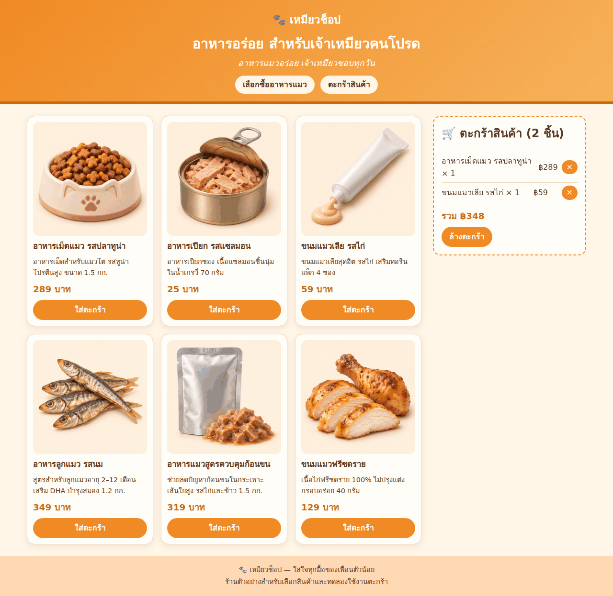

# TEST — เหมียวช็อป (B08: รวมระบบ + ทดสอบจริง)

- วันที่: 2026-11-08 · ผู้ทดสอบ: B08 (yolo1)
- วิธี: Playwright (chromium headless shell) เปิด `file:///workspace/plans/meow-shop/app/index.html` viewport 1280×900
- สคริปต์: `test-e2e.js` (รันซ้ำ: `node test-e2e.js` → exit 0 = ผ่านทุกข้อ) · ล้าง localStorage `meow-cart` ก่อนเริ่ม

## ผลการทดสอบ

| # | รายการ | ผล | รายละเอียด |
|---|--------|----|-----------|
| 1 | สโลแกนจาก `slogan.txt` อยู่ใน header (`header #slogan`) | **PASS** | "อาหารแมวอร่อย เจ้าเหมียวชอบทุกวัน" ตรงกับ slogan.txt |
| 2 | เห็นสินค้า 6 ใบ | **PASS** | `.product-card` = 6 |
| 3 | ทุกใบมีรูป | **PASS** | products.png โหลดได้ (1536×1024) · sprite 6 ช่องขนาด 238×238 · position 0/50/100% × 0/100% |
| 4 | กดใส่ตะกร้า 2 รายการ (id 1, id 3) | **PASS** | ตะกร้าแสดง 2 แถว · localStorage = `[{"id":1,"qty":1},{"id":3,"qty":1}]` |
| 5 | รีเฟรชแล้วตะกร้ายังอยู่ | **PASS** | หลัง reload ยังมี 2 แถวเหมือนเดิม · รวม ฿348 |
| 6 | ไม่มี console error | **PASS** | ไม่มี console error / pageerror / requestfailed |

**สรุป: PASS 6/6**

ภาพหน้าจอ (หลังรีเฟรช ตะกร้ายังมี 2 รายการ): 

## สิ่งที่แก้ระหว่างรวมระบบ
1. `index.html`: เพิ่ม `<script src="products.js" defer>` ก่อน shop.js/cart.js (ตามที่ B07 แจ้ง) และเพิ่ม `cart-ui.js`
2. `slogan.txt` (ใหม่): สโลแกนที่ชนะจาก B04 · ฝังข้อความเดียวกันลง `#slogan` ใน index.html แบบ static เพราะเปิดผ่าน file:// จะ fetch ไฟล์ .txt ไม่ได้ (CORS → console error) ข้อ 1 ในสคริปต์ทดสอบเทียบกับ slogan.txt ให้แล้ว
3. `cart-ui.js` (ใหม่): ยังไม่มีบล็อกไหนแสดงตะกร้าใน `aside#cart` (cart.js ไม่ยุ่งกับ DOM) จึงเขียนตัวแสดงผลที่ฟัง `meow-cart-change` แล้วแสดงรายการ จำนวน ยอดรวม ปุ่มลบ และปุ่มล้างตะกร้า
4. `style.css`: เพิ่มสไตล์ `.cart-total`, `.cart-empty`, `.cart-remove`

## ข้อสังเกต (ไม่อยู่ในเกณฑ์)
- รูปบางช่องใน products.png ไม่ตรงกับชื่อสินค้า เช่น id 2 "อาหารเปียก รสแซลมอน" เป็นรูปกระป๋องทูน่า, id 4 "อาหารลูกแมว" เป็นรูปปลาแห้ง, id 6 "ฟรีซดราย" เป็นรูปไก่ย่าง ถ้าต้องการให้ตรงกัน ให้แก้รูปหรือแก้ชื่อสินค้า
