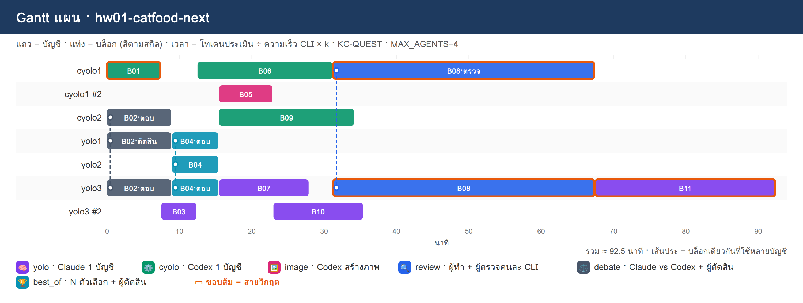

# การบ้านบท 05 · วางแผน 10 โจทย์ด้วยสกิล `dag-planner` (DAG + Gantt · ยังไม่รันจริง)


## 1. เป้าหมาย

ฝึกเปลี่ยนโจทย์ 1 ข้อเป็นแผนที่ทีมเอเจนต์รันได้ โดยใช้สกิล `dag-planner` ทำ 2 อย่างต่อโจทย์

| ผลลัพธ์ | คำสั่งของสกิล | ไฟล์ |
|---|---|---|
| **DAG** บล็อกงาน · rank · สายวิกฤต · สกิลของแต่ละบล็อก | `dag` | `blocks.json` · `dag.png` |
| **Gantt แผน** บล็อกไหนให้บัญชีไหน เมื่อไร | `plan` | `gantt-plan.png` · `PLAN.md` |

**ยังไม่ต้องดำเนินงาน:** ห้ามสั่ง `export` · `run` · `report` การบ้านนี้จบที่แผน จึงไม่ใช้โทเคนของทีม

**ต้องมีก่อน:** ทำ[ขั้นที่ 1–3 ของ lab](../README.md) ผ่านแล้ว (ติดตั้ง base skills และ `dag-planner` ใน container `multi-account` · `doctor` ขึ้น "พร้อมใช้")

## 2. โจทย์ 10 ข้อ

ทำครบทั้ง 10 ข้อ ข้อละ 1 แผน ใช้ชื่อแผนตามตาราง

| ข้อ | ชื่อแผน | โจทย์ | จุดที่ต้องคิดตอนแตกบล็อก |
|---|---|---|---|
| 1 | `hw01-catfood-next` | อยากทำเว็บขายอาหารแมว ใช้ Next.js กับ Docker มีแชทบอทช่วยแนะนำอาหาร | ภาพสินค้าต้องรอข้อมูลสินค้าหรือไม่ · หน้าแชทกับ API แชททำพร้อมกันได้อย่างไร |
| 2 | `hw02-gov-rag-k8s` | ระบบ RAG ถามตอบเอกสารภาครัฐ (ประกาศและระเบียบแบบ PDF) ตอบพร้อมอ้างอิงหน้าเอกสาร และ deployment ด้วย Kubernetes | ลำดับ ingest → chunk → embedding → retrieval · ชุดคำถามทดสอบควรเริ่มเมื่อไร · manifest ต้องรออะไร |
| 3 | `hw03-clinic-line-queue` | ระบบจองคิวคลินิกผ่าน LINE chatbot มีแจ้งเตือนก่อนถึงคิว และหน้า dashboard ของเจ้าหน้าที่ | โครงฐานข้อมูลเป็นคอขวดของกี่บล็อก · ข้อความตอบของบอทใช้สกิลไหน |
| 4 | `hw04-iot-farm-dashboard` | ระบบ IoT ฟาร์มผัก เซนเซอร์ส่งค่าผ่าน MQTT เก็บลงฐานข้อมูล time series แสดงผลบน Grafana และแจ้งเตือนเมื่อค่าเกินเกณฑ์ ทั้งหมดรันด้วย Docker Compose | ยังไม่มีอุปกรณ์จริง ต้องมีบล็อกจำลองเซนเซอร์ · รูปแบบข้อความ MQTT ต้องตกลงก่อนใคร |
| 5 | `hw05-receipt-ocr-api` | API อ่านใบเสร็จภาษาไทย (OCR) ด้วย FastAPI มีคิวงาน รันใน Docker และมีรายงานความแม่นยำจากชุดทดสอบ | เลือก OCR engine เป็นการตัดสินใจที่มีถูกผิดหรือไม่ · ชุดทดสอบทำขนานกับโค้ดได้ไหม |
| 6 | `hw06-churn-ml-pipeline` | pipeline ทำนายลูกค้าเลิกใช้บริการ ตั้งแต่เตรียมข้อมูล เทรนโมเดล เก็บผลการทดลอง เปิดเป็น API และหน้า dashboard ติดตามผล | บล็อกไหนเป็นงานคิดยาว บล็อกไหนตรงไปตรงมา · อะไรควรให้อีกฝั่งตรวจ |
| 7 | `hw07-expense-mobile` | แอปมือถือบันทึกรายจ่าย สแกนสลิปโอนเงินแล้วกรอกให้อัตโนมัติ มี backend เก็บข้อมูล และสรุปรายจ่ายรายเดือนเป็นกราฟ | สัญญา API ระหว่างแอปกับ backend · ไอคอนและภาพหน้าจอ onboarding |
| 8 | `hw08-cicd-microservices` | แยกระบบร้านค้าเดิม (monolith) เป็น 3 microservices มี API gateway CI/CD ด้วย GitHub Actions และ deploy ขึ้น Kubernetes ด้วย Helm | แยกบริการแล้วทำขนานได้กี่ทาง · pipeline กับ Helm chart ต้องรอบริการครบหรือไม่ |
| 9 | `hw09-course-media` | สื่อการสอนออนไลน์ 1 บทเรื่อง "Docker เบื้องต้น" มีสไลด์ ภาพประกอบ สคริปต์บรรยาย แบบทดสอบ 10 ข้อ และหน้าเว็บรวมทุกอย่าง | งานสร้างสรรค์เยอะ ใช้ `image` และ `best_of` ตรงไหนจึงคุ้ม · เฉลยแบบทดสอบควรมีคนตรวจ |
| 10 | `hw10-ai-autograder` | ระบบส่งการบ้านเขียนโปรแกรม รันโค้ดนักศึกษาใน sandbox (Docker) ตรวจด้วย test case ให้ AI เขียนคำแนะนำ และสรุปคะแนนให้อาจารย์ | ความปลอดภัยของ sandbox เป็นงานสำคัญที่ต้องตรวจ · เกณฑ์ให้คะแนนตัดสินอย่างไร |

## 3. ขั้นตอนต่อ 1 โจทย์

วางพรอมต์นี้ใน Claude Code app (โฟลเดอร์ `05_DAG_Planner`) แล้วเปลี่ยน 2 บรรทัดแรกตามตาราง

```text
โจทย์: <คัดลอกโจทย์จากตาราง>
ชื่อแผน: <ชื่อแผนจากตาราง>
จำนวน agent สูงสุด: 4

ใช้ทีมเอเจนต์ใน container multi-account วางแผนงานนี้ ทำงานใน container ผ่าน docker exec เท่านั้น ห้ามแก้ไฟล์ตั้งค่า ห้ามล็อกอินแทนฉัน
ก่อนเริ่ม ดูว่าใน container มีสกิลที่ช่วยงานนี้ได้หรือไม่ (/root/ai-accounts/.Claude/shared/skills) ถ้ามีให้อ่านและใช้
1. แตกโจทย์เป็นบล็อกงาน 8–12 บล็อก แต่ละบล็อกบอกสกิลที่ใช้ทำ ความยาก ไฟล์ผล และเกณฑ์เสร็จ
2. วาด DAG แล้ววางแผนว่าบล็อกไหนให้บัญชีไหน เมื่อไร (Gantt) จากโควตาจริง
วางแผนเท่านั้น ห้ามสั่ง export run หรือ report
เสร็จแล้วคัดลอก blocks.json dag.png gantt-plan.png และ PLAN.md ของแผนนี้มาไว้ที่ ./homework/<ชื่อแผน>/ บนเครื่อง
ตอบภาษาไทยสั้น ๆ: ตาราง บล็อก | ชื่อ | สกิล | ความยาก | ต้องรอ | rank · สายวิกฤตพร้อมเหตุผล 1 บรรทัด · ตาราง บล็อก | บัญชี | เริ่ม–จบ (นาที)
```

ถ้าบัญชีใน container ไม่พร้อมหรือโควตาหมด ให้วางแผนด้วยโควตาสมมติ (สกิลจะไม่เรียกบัญชีใดเลย) โดยเพิ่มบรรทัดนี้ในพรอมต์

```text
ใช้โควตาสมมติ: --accounts yolo1:80,yolo2:60,cyolo1:90,cyolo2:70
```

ตรวจแผนด้วยตัวเองก่อนส่ง

| ตรวจ | ดูที่ |
|---|---|
| ลูกศรทุกเส้นคืองานที่ต้องอ่านไฟล์ผลของกันจริง และไม่มีลูกศรที่ขาด | `dag.png` |
| บล็อกสุดท้ายเป็นงานรวมและทดสอบ มีรูป 🔒 | `dag.png` |
| `review` · `debate` · `best_of` ใช้เฉพาะบล็อกที่คุ้ม ไม่ใช่ทุกบล็อก | `dag.png` |
| ทุกบล็อกมีบัญชีรับ ไม่มีบล็อกที่ "ไม่มีบัญชีรับ" | `PLAN.md` |
| คิด rank ของบล็อกบนสายวิกฤตด้วยมือแล้วตรงกับภาพ | `dag.png` |

## 4. สิ่งที่ต้องส่ง

```text
homework/
├── hw01-catfood-next/
│   ├── blocks.json       ← บล็อกงานที่ AI แตก (แก้เองได้ถ้าเห็นว่าไม่สมเหตุผล)
│   ├── dag.png           ← DAG
│   ├── gantt-plan.png    ← Gantt แผน
│   ├── PLAN.md           ← ตารางแผนและเหตุผลที่เลือกบัญชี
│   └── ANSWER.md         ← คำตอบ 4 ข้อด้านล่าง เขียนเอง
├── hw02-gov-rag-k8s/
└── ... (ครบ 10 โฟลเดอร์)
```

`ANSWER.md` ของแต่ละโจทย์ ตอบสั้น ๆ ข้อละ 1–3 บรรทัด

1. สายวิกฤตคือบล็อกใดบ้าง ยาวเท่าไร และแสดงการคิด rank ของบล็อกแรกบนสายวิกฤตด้วยมือ
2. บล็อกใดใช้ `review` · `debate` · `best_of` · `image` เพราะอะไร (ถ้าไม่ใช้สกิลใด ให้บอกเหตุผล)
3. ยกลูกศร 1 เส้นที่ถ้าตัดออกแล้วงานจะไม่ตรงกัน และ 1 คู่บล็อกที่ตั้งใจไม่ใส่ลูกศรเพื่อให้ทำพร้อมกันได้
4. ถ้าลดจำนวน agent สูงสุดจาก 4 เหลือ 2 เวลารวมเปลี่ยนอย่างไร มีบล็อกใดไม่มีบัญชีรับหรือไม่ (สั่ง `plan` ซ้ำด้วย `--max-agents 2` แล้วอ่านผล)

## 5. เกณฑ์ให้คะแนน (ข้อละ 10 คะแนน รวม 100)

| เกณฑ์ | คะแนน |
|---|---|
| ไฟล์ครบ 5 ไฟล์ และ `dag` ไม่มี ERROR | 2 |
| บล็อกสมเหตุผล: 8–12 บล็อก ไม่มีบล็อกใหญ่เกิน L ทุกบล็อกมีไฟล์ผลและเกณฑ์เสร็จที่ตรวจได้ | 2 |
| ลูกศรถูก: ไม่ขาดและไม่เกิน บล็อกสุดท้ายเป็นรวมและทดสอบแบบ `exclusive` | 2 |
| เลือกสกิลเหมาะกับงาน และใช้สกิลหลายบัญชีเฉพาะที่คุ้ม | 2 |
| `ANSWER.md` ตอบครบ 4 ข้อ และคิด rank ด้วยมือถูก | 2 |

## 6. ตัวอย่าง: โจทย์ข้อ 1 (ทำให้ดู 1 ข้อ)

ไฟล์อยู่ที่ [`example-hw01/`](example-hw01/) ผลจริงจากการสั่ง `dag` และ `plan --max-agents 4` ใน container เมื่อ 10 พ.ย. 2026 (ยังไม่ได้รันทีม) ใช้เป็นแนวทางได้ แต่แผนที่ส่งต้องแตกบล็อกเอง


| สิ่งที่ควรสังเกต | เหตุผล |
|---|---|
| B05 ภาพสินค้า **รอ** B03 ข้อมูลสินค้า | ภาพแต่ละช่องต้องตรงกับชื่อสินค้า (บทเรียนจากเหมียวช็อปใน lab) |
| B09 หน้าต่างแชท **ไม่รอ** B08 API แชท | ทั้งสองบล็อกอ่านรูปแบบ request/response จากไฟล์ตัดสินใจของ B02 จึงทำพร้อมกันได้ |
| B02 ใช้ `debate` | เลือกวิธีทำแชทบอทเป็นการตัดสินใจที่กระทบ 2 บล็อกถัดไป |
| B08 ใช้ `review` ความยาก 4 | บอทต้องแนะนำเฉพาะสินค้าที่มีจริง เป็นงานสำคัญที่สุดของระบบ และอยู่บนสายวิกฤต |
| สายวิกฤต B01 → B08 → B11 = 0.6 + 3 + 3 = 6.6 | rank(B11) = 3 · rank(B08) = 3 + 3 = 6 · rank(B01) = 0.6 + max(6, 4.5, 4.5, 4.5, 4.5) = 6.6 |



เวลารวมประมาณ 92.5 นาทีเป็นค่าประเมินก่อนมีการรันจริง (ยังไม่มี `calib.json` ตัวปรับเวลา k = 1) ลำดับงานและบัญชีที่ได้คือสิ่งที่ใช้ตรวจ ไม่ใช่ตัวเลขนาที เหตุผลที่เลือกบัญชีของทุกบล็อกอยู่ใน [`example-hw01/PLAN.md`](example-hw01/PLAN.md)

## 7. เฉลย (สำหรับผู้สอน)

เฉลยครบ 10 ข้ออยู่ที่ [`../_solution/homework/README.md`](../_solution/homework/README.md) แต่ละข้อมีพรอมต์ที่คัดลอกไปวาง (โจทย์ + ให้ใช้สกิล) ตามด้วย DAG Gantt แผน และ `ANSWER.md` เฉลยใช้โควตาสมมติ `--accounts yolo1:80,yolo2:60,cyolo1:90,cyolo2:70` เพื่อให้สั่งซ้ำแล้วได้แผนเดียวกัน
