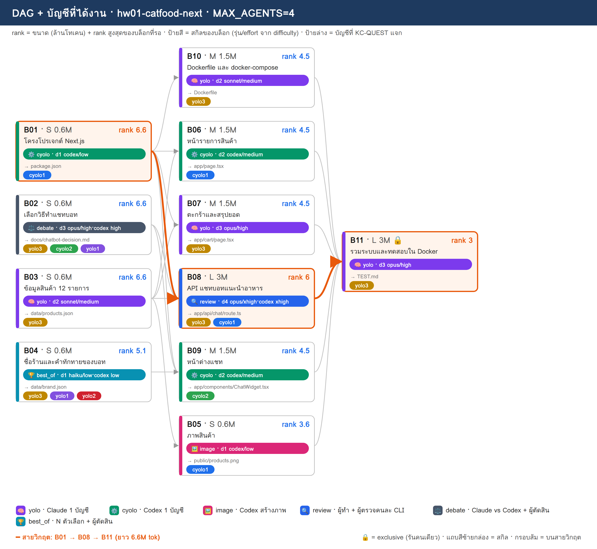
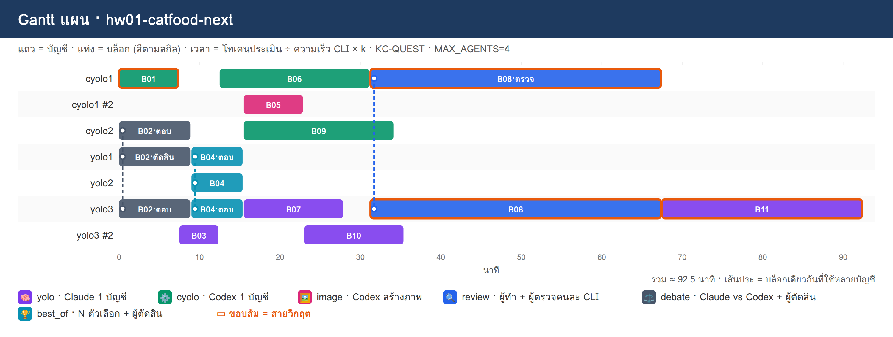

# PLAN · hw01-catfood-next

**โจทย์:** เว็บขายอาหารแมว ใช้ Next.js กับ Docker มีแชทบอทช่วยแนะนำอาหาร

วางแผนเมื่อ 10/11/2026 10:32 · MAX_AGENTS 4 · บัญชี cyolo1, cyolo2, yolo1, yolo2, yolo3 · ตัวปรับเวลา k (ยังไม่มี calib.json → k=1)

> แผนนี้ยังไม่ได้รันจริง — KC-QUEST เลือกบัญชีจากโควตา แล้วจำลองเวลาตาม dependency

## 1) โควตาของแต่ละบัญชี

| บัญชี | แพลน | ใช้ไป 5 ชม. | ใช้ไปสัปดาห์ | headroom | รีเซ็ต/หมดอายุ (ชม.) | U | slot | ที่มา |
|---|---|---|---|---|---|---|---|---|
| cyolo1 | prolite | 0% | 6% | **94%** | 97.8 | 0.197 | 3 | team.py quota |
| cyolo2 | prolite | 0% | 4% | **96%** | 97.8 | 0.197 | 3 | team.py quota |
| yolo1 | default | 0% | 30% | **70%** | 43.5 | 0.356 | 3 | team.py quota |
| yolo2 | default | 3% | 7% | **93%** | 146.4 | 0.141 | 3 | team.py quota |
| yolo3 | default | 43% | 22% | **57%** | 2.5 | 0.907 | 3 | team.py quota |

## 2) DAG + สกิล + บัญชี

**สายวิกฤต:** B01 → B08 → B11 · ยาว 6.6M tok

## 3) ตารางแจกงาน (เหตุผล KC-QUEST ทุกบล็อก)

| บล็อก | สกิล | ชื่อ | ขนาด · c | รอ | rank | บัญชี (บทบาท) | เริ่ม–จบ (นาที) | เหตุผล KC-QUEST |
|---|---|---|---|---|---|---|---|---|
| **B01** | ⚙️ cyolo | โครงโปรเจกต์ Next.js | S · 0.6 | – | 6.6 | cyolo1 (ทำ) | 0.0–7.5 | ทำ: cyolo1 33.2 (U=0.197 F=0.002 S=0.984 S=0.7 L=0.0) · 0.60M ≈ 5ชม. 1.56% / สัปดาห์ 0.2% · อันดับ 2 cyolo2 33.2 |
| B02 | ⚖️ debate | เลือกวิธีทำแชทบอท | S · 0.6 | – | 6.6 | yolo3 (ตอบ), cyolo2 (ตอบ), yolo1 (ตัดสิน) | 0.0–9.0 | ตอบ: yolo3 59.6 (U=0.906 F=0.003 S=0.554 S=1.0 L=0.0) · 0.60M ≈ 5ชม. 1.56% / สัปดาห์ 0.2% · อันดับ 2 yolo1 44.1   ตอบ: cyolo2 33.2 (U=0.197 F=0.002 S=0.984 S=0.7 L=0.0) · 0.60M ≈ 5ชม. 1.56% / สัปดาห์ 0.2% · อันดับ 2 cyolo1 29.6   ตัดสิน: yolo1 44.2 (U=0.356 F=0.001 S=0.995 S=1.0 L=0.0) · 0.18M ≈ 5ชม. 0.47% / สัปดาห์ 0.06% · อันดับ 2 yolo2 35.1 |
| B03 | 🧠 yolo | ข้อมูลสินค้า 12 รายการ | S · 0.6 | – | 6.6 | yolo3 (ทำ) | 7.5–12.5 | ทำ: yolo3 56.1 (U=0.906 F=0.003 S=0.539 S=1.0 L=0.333) · 0.60M ≈ 5ชม. 1.56% / สัปดาห์ 0.2% · อันดับ 2 yolo1 40.7 |
| B04 | 🏆 best_of | ชื่อร้านและคำทักทายของบอท | S · 0.6 | – | 5.1 | yolo3 (ตอบ), yolo1 (ตอบ), yolo2 (ตัดสิน) | 9.0–15.5 | ตอบ: yolo3 52.4 (U=0.906 F=0.003 S=0.523 S=0.773 L=0.333) · 0.60M ≈ 5ชม. 1.56% / สัปดาห์ 0.2% · อันดับ 2 yolo1 40.6   ตอบ: yolo1 40.6 (U=0.356 F=0.003 S=0.98 S=0.773 L=0.0) · 0.60M ≈ 5ชม. 1.56% / สัปดาห์ 0.2% · อันดับ 2 yolo2 31.6   ตัดสิน: yolo2 31.7 (U=0.141 F=0.001 S=0.965 S=0.773 L=0.0) · 0.18M ≈ 5ชม. 0.47% / สัปดาห์ 0.06% · อันดับ 2 cyolo1 30.7 |
| B06 | ⚙️ cyolo | หน้ารายการสินค้า | M · 1.5 | B01, B03 | 4.5 | cyolo1 (ทำ) | 12.5–31.2 | ทำ: cyolo1 29.3 (U=0.197 F=0.005 S=0.945 S=0.477 L=0.0) · 1.50M ≈ 5ชม. 3.9% / สัปดาห์ 0.49% · อันดับ 2 cyolo2 29.3 |
| B07 | 🧠 yolo | ตะกร้าและสรุปยอด | M · 1.5 | B01, B03 | 4.5 | yolo3 (ทำ) | 15.5–28.0 | ทำ: yolo3 53.9 (U=0.906 F=0.006 S=0.484 S=0.682 L=0.0) · 1.50M ≈ 5ชม. 3.9% / สัปดาห์ 0.49% · อันดับ 2 yolo1 38.7 |
| B09 | ⚙️ cyolo | หน้าต่างแชท | M · 1.5 | B01, B02, B04 | 4.5 | cyolo2 (ทำ) | 15.5–34.2 | ทำ: cyolo2 29.3 (U=0.197 F=0.005 S=0.945 S=0.477 L=0.0) · 1.50M ≈ 5ชม. 3.9% / สัปดาห์ 0.49% · อันดับ 2 cyolo1 25.4 |
| B05 | 🖼️ image | ภาพสินค้า | S · 0.6 | B03 | 3.6 | cyolo1 (ทำ) | 15.5–23.0 | ทำ: cyolo1 24.3 (U=0.197 F=0.002 S=0.93 S=0.382 L=0.333) · 0.60M ≈ 5ชม. 1.56% / สัปดาห์ 0.2% · อันดับ 2 cyolo2 24.3 |
| B10 | 🧠 yolo | Dockerfile และ docker-compose | M · 1.5 | B01 | 4.5 | yolo3 (ทำ) | 23.0–35.5 | ทำ: yolo3 49.9 (U=0.906 F=0.006 S=0.445 S=0.682 L=0.333) · 1.50M ≈ 5ชม. 3.9% / สัปดาห์ 0.49% · อันดับ 2 yolo1 38.7 |
| **B08** | 🔍 review | API แชทบอทแนะนำอาหาร | L · 3 | B01, B02, B03 | 6 | yolo3 (ทำ), cyolo1 (ตรวจ) | 31.2–67.5 | ทำ: yolo3 52.3 (U=0.906 F=0.013 S=0.367 S=0.909 L=0.333) · 3.00M ≈ 5ชม. 7.8% / สัปดาห์ 0.98% · อันดับ 2 yolo1 41.7   ตรวจ: cyolo1 31.1 (U=0.197 F=0.003 S=0.906 S=0.636 L=0.0) · 0.90M ≈ 5ชม. 2.34% / สัปดาห์ 0.29% · อันดับ 2 cyolo2 28.0 |
| **B11** | 🧠 yolo | รวมระบบและทดสอบใน Docker | L · 3 | B05, B06, B07, B08, B09, B10 | 3 | yolo3 (ทำ) | 67.5–92.5 | ทำ: yolo3 47.7 (U=0.906 F=0.013 S=0.289 S=0.455 L=0.0) · 3.00M ≈ 5ชม. 7.8% / สัปดาห์ 0.98% · อันดับ 2 yolo1 34.9 |

## 4) Gantt แผน

## 5) รอบแจกงาน

| นาทีที่ | บล็อกที่เริ่ม |
|---|---|
| 0 | B01→cyolo1, B02→yolo3+cyolo2+yolo1 |
| 7.5 | B03→yolo3 |
| 9 | B04→yolo3+yolo1+yolo2 |
| 12.5 | B06→cyolo1 |
| 15.5 | B09→cyolo2, B05→cyolo1, B07→yolo3 |
| 23 | B10→yolo3 |
| 31.2 | B08→yolo3+cyolo1 |
| 67.5 | B11→yolo3 |

## 6) สรุป

- บล็อก 11 · แจกได้ 11 · agent พร้อมกันสูงสุด 4/4
- เวลาประมาณ 92.5 นาที (แท่ง Gantt) · ไฟล์ผลของทีม: `/workspace/plans/hw01-catfood-next/app/`

ต่อไป: `dagplan.py export hw01-catfood-next` → `dagplan.py run hw01-catfood-next` → `dagplan.py report hw01-catfood-next`
