# KC-QUEST: อัลกอริทึมที่เลือกว่าบล็อกไหนให้บัญชีไหน (เจาะลึกคำสั่ง `plan` ของ dag-planner)

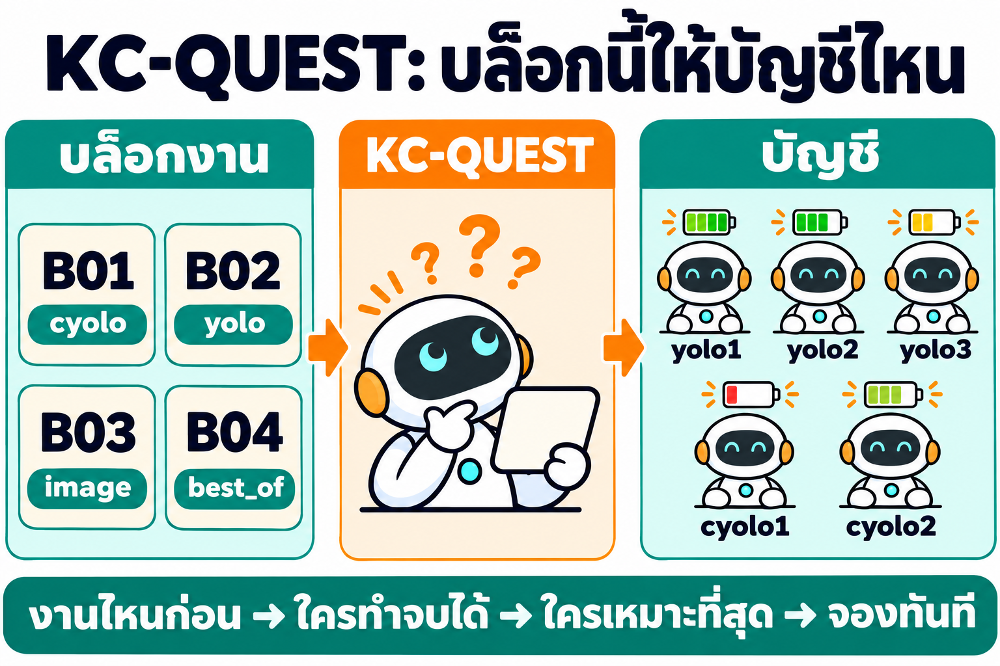

[บท 05](../05_DAG_Planner/README.md) ใช้สกิล `dag-planner` เปลี่ยนโจทย์เป็น DAG และ Gantt บทนี้เปิดดูข้างในคำสั่ง `plan` ว่า **ตัดสินอย่างไรว่าบล็อกไหนให้บัญชีไหน** ผู้ตัดสินคืออัลกอริทึมชื่อ **KC-QUEST**

| ลำดับ | หัวข้อ | ได้อะไร |
|---|---|---|
| 1 | หัวข้อ 1–2 | รู้ว่า KC-QUEST อยู่ตรงไหน และต้องใช้ข้อมูลอะไร (บล็อก · โควตา 2 ถัง · slot) |
| 2 | หัวข้อ 3 | เห็นภาพรวม 4 ขั้น และผลแจกงานของตัวอย่าง |
| 3 | หัวข้อ 4 | คำนวณตามได้ทีละขั้นด้วยตัวเลขจริง: จัดลำดับ → กรอง → ให้คะแนน → จอง |
| 4 | หัวข้อ 5 | รู้ว่าหลังวางแผนแล้ว ใครดูแลตอนรันจริง และแผนเรียนรู้จากผลจริงอย่างไร |
| 5 | หัวข้อ 6–7 | เข้าใจว่าทำไมออกแบบแบบนี้ และวิธีนี้ดีแค่ไหน |
| 6 | หัวข้อ 8–9 | ทดลองเอง และแบบฝึกหัดพร้อมเฉลย |

บทนี้ **ไม่ใช้โทเคน และไม่ต้องมี container** ทุกคำสั่งเป็น Python ที่คำนวณจากสถานการณ์โควตาตัวอย่าง ตัวเลขที่ได้จึงตรงกับหน้านี้ทุกตัว ใช้เวลาประมาณ 60–90 นาที

## 0. เตรียมเครื่อง

เปิด terminal หรือ Claude Code app ที่โฟลเดอร์ `06_KC_QUEST` แล้วรัน

```bash
python tools/kclab.py doctor
```

ต้องเห็น ✅ ที่ python และ base skills ทั้ง 4 ตัว ถ้าบรรทัด "ตัวแปลงภาพ" ขึ้น ⚠ ยังทำบทนี้ได้ครบ ภาพที่สั่งวาดจะเป็น `.svg` แทน `.png`

```text
06_KC_QUEST/
├── base_skills/     ← สกิล 4 ตัว (ห้ามแก้): agent-team · yolo · cyolo · dag-planner
├── tools/           ← เครื่องมือของบทนี้: kclab.py (โหมดสอน) · sim.py (ตัวจำลอง) · figures.py · test_kclab.py
├── examples/        ← บล็อกงานตัวอย่าง 2 ชุด และสถานการณ์โควตาของบทเรียน
└── image/           ← ภาพประกอบ
```

**KC-QUEST ตัวจริงอยู่ใน base skill** ไม่ได้อยู่ใน `tools/`

| ไฟล์ | บทบาท |
|---|---|
| `base_skills/dag-planner/scripts/kcquest.py` | **อัลกอริทึม KC-QUEST** (ไฟล์เดียวกับที่คำสั่ง `dagplan.py plan` ของบท 05 ใช้) |
| `base_skills/dag-planner/references/kcquest.md` | สูตรย่อของสกิล |
| `base_skills/agent-team/` | ตัวรันทีมจริง และแหล่งข้อมูลโควตา (`team.py check` · `team.py quota`) |
| `tools/kclab.py` | โหมดสอน เรียก `kcquest.py` ข้างบนแล้วแสดงทุกตัวเลขที่มันคิด |

`kclab.py` ไม่มีสูตรของตัวเอง ทุกครั้งที่รันจะเทียบผลกับ `kcquest.simulate()` ของ base skill ถ้าไม่ตรงกันจะหยุดและแจ้ง

## 1. KC-QUEST อยู่ตรงไหน

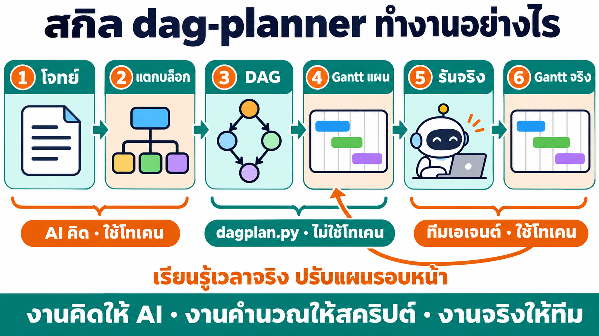

ภาพนี้มาจากบท 05 KC-QUEST คือสิ่งที่ทำงานอยู่ใน **ช่องที่ 4 (Gantt แผน)**

| ช่อง | คำสั่ง | สิ่งที่เกิดขึ้น | อยู่ในบทนี้ไหม |
|---|---|---|---|
| 3 · DAG | `dag` | คิด rank และสายวิกฤตจาก `blocks.json` | ทวนในหัวข้อ 2.1 |
| **4 · Gantt แผน** | **`plan`** | **KC-QUEST เลือกบัญชีให้ทุกบล็อก แล้วคำนวณเวลา** | **หัวข้อ 3–4** |
| 5 · รันจริง | `export` · `run` | `agent-team` รันตามแผน | หัวข้อ 5 |
| 6 · Gantt จริง | `report` | เทียบแผนกับของจริง แล้วเก็บตัวปรับเวลา k | หัวข้อ 5 |

### ที่มาของชื่อ KC-QUEST

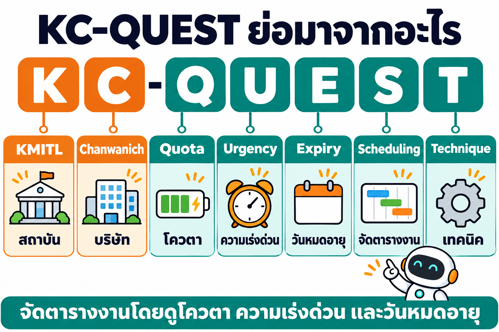

**KC-QUEST** = **K**MITL–**C**hanwanich **Q**uota-**U**rgency **E**xpiry-aware **S**cheduling **T**echnique (เทคนิคจัดตารางงานที่คำนึงถึงโควตา ความเร่งด่วน และวันหมดอายุ)

| ตัวอักษร | ย่อมาจาก | ความหมาย |
|---|---|---|
| **K** | KMITL | สถาบันเทคโนโลยีพระจอมเกล้าเจ้าคุณทหารลาดกระบัง |
| **C** | Chanwanich | บริษัท จันวณิช (CWN) |
| **Q** | Quota | โควตา |
| **U** | Urgency | ความเร่งด่วน |
| **E** | Expiry | วันหมดอายุ |
| **S** | Scheduling | จัดตารางงาน |
| **T** | Technique | เทคนิค |

K และ C มาจากสองหน่วยงานที่พัฒนาอัลกอริทึมนี้ร่วมกันเป็นสื่อการสอน ส่วน QUEST บอกสิ่งที่อัลกอริทึมดูตอนแจกงาน

## 2. ข้อมูลที่ KC-QUEST ใช้

KC-QUEST รับข้อมูล 2 ฝั่ง คือ **บล็อกงาน** กับ **บัญชี**

### 2.1 ฝั่งงาน: บล็อก · rank · สายวิกฤต (ทวนบท 05)

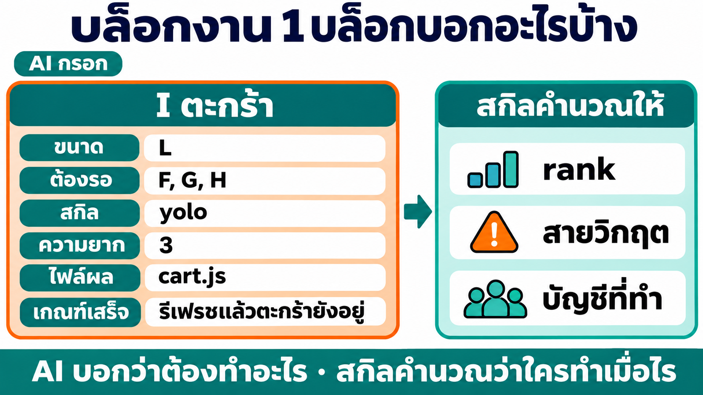

| ฟิลด์ของบล็อก | KC-QUEST ใช้ทำอะไร | สัญลักษณ์ |
|---|---|---|
| `size` S / M / L | ขนาดงาน = 0.6 / 1.5 / 3 ล้านโทเคน | $c_j$ |
| `depends_on` | คิด rank และรู้ว่าบล็อกไหนพร้อมทำแล้ว | $\mathrm{rank}(j)$ |
| `skill` | กำหนดฝั่ง (Claude หรือ Codex) และจำนวนบัญชีที่บล็อกต้องใช้ | หัวข้อ 4.5 |
| `exclusive` | บล็อกรวมและทดสอบ ต้องรันคนเดียว | – |

**rank** คือระยะทางที่ยาวที่สุดจากบล็อกนี้ไปจนจบโปรเจกต์ นับรวมตัวมันเอง คิดย้อนจากบล็อกสุดท้าย

$$\mathrm{rank}(j) = c_j + \max_{k \in \mathrm{succ}(j)} \mathrm{rank}(k)$$

$\mathrm{succ}(j)$ คือบล็อกที่รอ $j$ อยู่ ส่วน **สายวิกฤต** คือเส้นทางที่ rank ยาวที่สุด บล็อกบนสายนี้ช้าเท่าไร ทั้งโปรเจกต์ช้าเท่านั้น

ตัวอย่างระบบ 14 งานของบท 05 หัวข้อ 2 คำนวณซ้ำได้ด้วยคำสั่งนี้ (ได้ rank ของ A = 16 และสายวิกฤต A → B → F → I → L → N เหมือนในบท 05)

```bash
python tools/kclab.py rank --blocks examples/system14/blocks.json
```

### 2.2 ฝั่งบัญชี: โควตา 2 ถัง และ slot

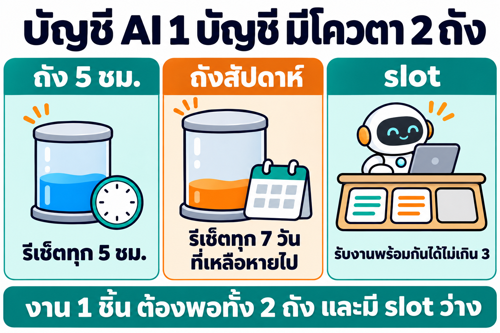

| สิ่งที่บัญชีมี | ความหมาย | สัญลักษณ์ |
|---|---|---|
| ถัง 5 ชม. | โควตาที่เหลือของรอบ 5 ชั่วโมง (%) | $H^5$ |
| ถังสัปดาห์ | โควตาที่เหลือของสัปดาห์ (%) **ส่วนที่เหลือตอนรีเซ็ตจะหายไป** | $H^w$ |
| เวลารีเซ็ต | อีกกี่ชั่วโมงถังสัปดาห์จะรีเซ็ต | $T$ |
| อัตรากินโควตา | ใช้ 1 ล้านโทเคนแล้วถังลดกี่ % ค่าตั้งต้น 2.0 (ถัง 5 ชม.) และ 0.25 (ถังสัปดาห์) | $r^5,\ r^w$ |
| slot | จำนวนงานที่บัญชีรับพร้อมกันได้ | – |
| ความเร็ว | yolo (Claude) 7.2 และ cyolo (Codex) 4.8 ล้านโทเคนต่อชั่วโมง | $v$ |

จำนวน slot ขึ้นกับโควตาที่เหลือ โดยดูถังที่เหลือน้อยกว่า

| โควตาที่เหลือ (ถังที่น้อยกว่า) | slot |
|---|---|
| ไม่เกิน 2% | 0 (ไม่รับงาน) |
| มากกว่า 2% แต่ไม่ถึง 16% | 1 |
| 16% ถึงไม่ถึง 24% | 2 |
| 24% ขึ้นไป | 3 (เพดานของ `agent-team`) |

ตอนใช้งานจริง ค่าเหล่านี้มาจาก base skill `agent-team`: `team.py check` บอกว่าบัญชีไหนพร้อม และ `team.py quota` บอกโควตาที่ใช้ไปกับเวลารีเซ็ต อัตรากินโควตาขึ้นกับแพลนของบัญชี (max 1.0 / 0.12 · team 2.0 / 0.25 · pro 1.0 / 0.15) บทนี้ใช้ค่าตั้งต้น 2.0 / 0.25 ทุกบัญชีเพื่อให้คิดตามง่าย

### 2.3 ตัวอย่างของบทนี้

**งาน:** แผน "เหมียวช็อป" 8 บล็อกจากกรณีศึกษาของบท 05 (`examples/meow-shop/blocks.json`)

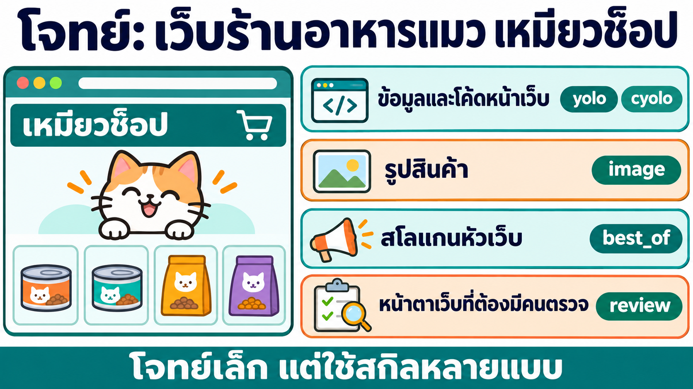

```bash
python tools/kclab.py rank
```

| บล็อก | ชื่อ | สกิล | ขนาด $c$ | ต้องรอ | rank |
|---|---|---|---|---|---|
| **B01** | โครงโปรเจกต์ | cyolo | S · 0.6 | – | **3.6** |
| B02 | ข้อมูลสินค้า | yolo | S · 0.6 | – | 3.6 |
| B03 | ภาพสินค้า | image | S · 0.6 | – | 3.6 |
| B04 | สโลแกน | best_of (n = 2) | S · 0.6 | – | 2.1 |
| **B05** | สไตล์ CSS | review | M · 1.5 | B01 | **3** |
| B06 | ตะกร้า | yolo | M · 1.5 | B02 | 3 |
| B07 | แสดงการ์ดสินค้า | cyolo | M · 1.5 | B01, B02, B03 | 3 |
| **B08** | รวม + ทดสอบ | yolo · exclusive | M · 1.5 | B04, B05, B06, B07 | **1.5** |

สายวิกฤตคือ B01 → B05 → B08 ยาว 0.6 + 1.5 + 1.5 = 3.6 ล้านโทเคน

**บัญชี:** สถานการณ์สมมติ 5 บัญชี (`examples/quota_lesson.json`) ตั้งใจให้แต่ละบัญชีมีจุดเด่นและจุดด้อยต่างกัน

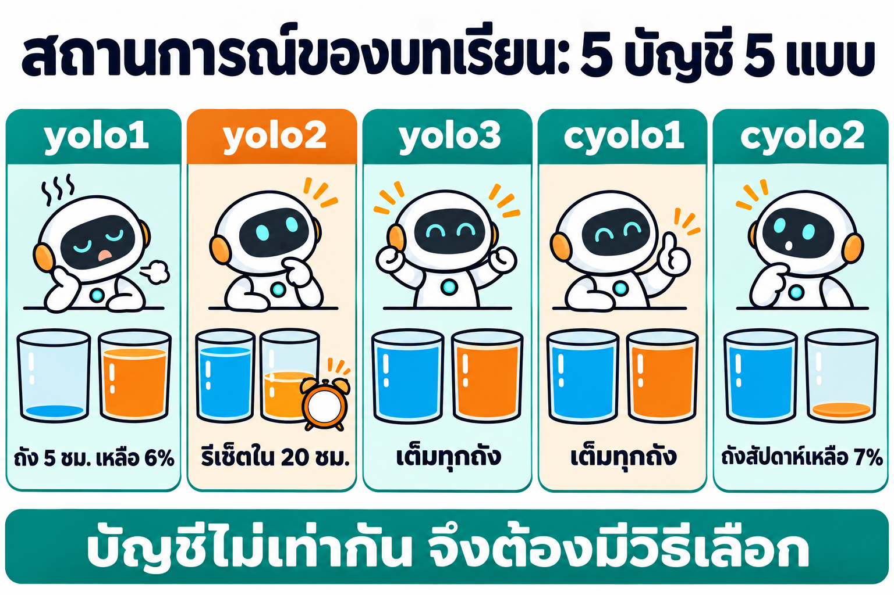

| บัญชี | ถัง 5 ชม. เหลือ $H^5$ | ถังสัปดาห์เหลือ $H^w$ | รีเซ็ตใน $T$ | slot | ลักษณะ |
|---|---|---|---|---|---|
| yolo1 | **6%** | 80% | 130 ชม. | 1 | ถัง 5 ชม. ใกล้หมด |
| yolo2 | 90% | 45% | **20 ชม.** | 3 | ถ้าไม่ใช้ โควตา 45% จะหายพรุ่งนี้ |
| yolo3 | 100% | 95% | 150 ชม. | 3 | เต็มทุกถัง |
| cyolo1 | 100% | 95% | 150 ชม. | 3 | เต็มทุกถัง |
| cyolo2 | 100% | **7%** | 100 ชม. | 1 | ถังสัปดาห์เหลือน้อย |

### 2.4 ลองคิดเองก่อน

ก่อนอ่านต่อ ลองตอบว่า B02 (สกิล yolo ขนาด S) ควรให้ yolo1, yolo2 หรือ yolo3 วิธีที่คนมักนึกถึงก่อนมี 3 แบบ และแต่ละแบบมีจุดอ่อน

| วิธี | จะเลือก | จุดอ่อน |
|---|---|---|
| ให้บัญชีที่โควตาเหลือมากที่สุด | yolo3 | โควตา 45% ของ yolo2 ไม่ถูกใช้ แล้วหายไปตอนรีเซ็ต |
| วนให้ทีละบัญชี | yolo1 ก่อน | yolo1 เหลือ 6% ถ้าบล็อกถัดไปใหญ่กว่านี้จะค้างกลางทาง |
| สุ่ม | แล้วแต่ดวง | งานบนสายวิกฤตอาจไปบัญชีที่ช้าหรือใกล้หมด |

KC-QUEST เลือก **yolo2** หัวข้อ 4 จะคำนวณให้ดูว่าทำไม

## 3. ภาพรวม: 4 คำถาม ทุกครั้งที่มีบล็อกพร้อม

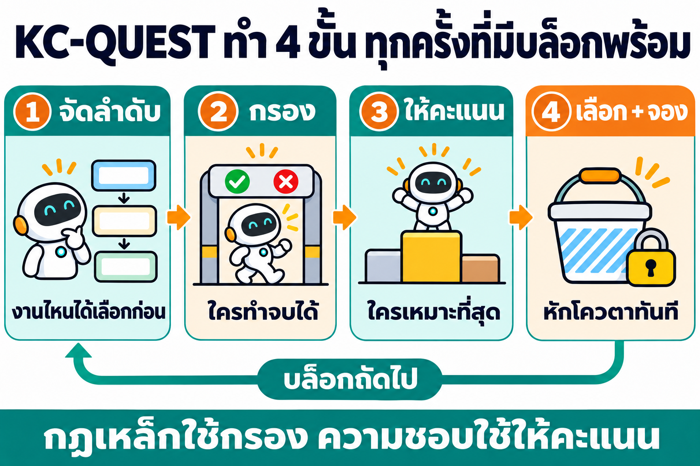

| ขั้น | คำถาม | ใช้อะไรตอบ |
|---|---|---|
| ① จัดลำดับ | บล็อกไหนได้เลือกบัญชีก่อน | จำนวนทางเลือก แล้วจึงดู rank |
| ② กรอง | บัญชีไหนทำบล็อกนี้จนจบได้ | โควตาที่เหลือของทั้ง 2 ถัง และ slot |
| ③ ให้คะแนน | ในบัญชีที่ผ่าน ใครเหมาะที่สุด | คะแนนรวมจากตัวแปร 5 ตัว |
| ④ เลือก + จอง | – | เลือกคะแนนสูงสุด แล้วหักโควตาทันที |

KC-QUEST ไม่ได้วางแผนทั้งโปรเจกต์ในครั้งเดียว มันแจกเป็น **รอบ** รอบใหม่เริ่มทุกครั้งที่มีบล็อกเสร็จ เพราะบล็อกที่รออยู่จะพร้อมทำ

```text
เวลา t = 0
วนจนทุกบล็อกได้บัญชี:
    ready ← บล็อกที่บล็อกก่อนหน้าเสร็จครบแล้ว และยังไม่ได้เริ่ม
    ① เรียง ready
    สำหรับแต่ละบล็อกตามลำดับ:
        ② หาบัญชีที่ทำจบได้   ③ ให้คะแนน   ④ เลือกคะแนนสูงสุด แล้วจองโควตาและ slot
    เลื่อน t ไปยังเวลาที่บล็อกถัดไปเสร็จ แล้วคืน slot ของบล็อกนั้น
```

ดูรอบแจกงานทั้งหมดของตัวอย่าง (เติม `--png` เพื่อวาด DAG และ Gantt ลงใน `out/lesson/`)

```bash
python tools/kclab.py rounds --png
```

| รอบ | นาทีที่ | บล็อกที่พร้อม (เรียงตาม ①) | ได้งาน |
|---|---|---|---|
| 1 | 0 | B01, B03, B02, B04 | B01→cyolo2 · B03→cyolo1 · B02→yolo2 · B04→yolo2 + yolo3 + cyolo1 |
| 2 | 5 | B06 | B06→yolo2 |
| 3 | 7.5 | B07, B05 | B07→cyolo2 · B05→yolo2 + cyolo1 |
| 4 | 26.2 | B08 | B08→yolo2 |

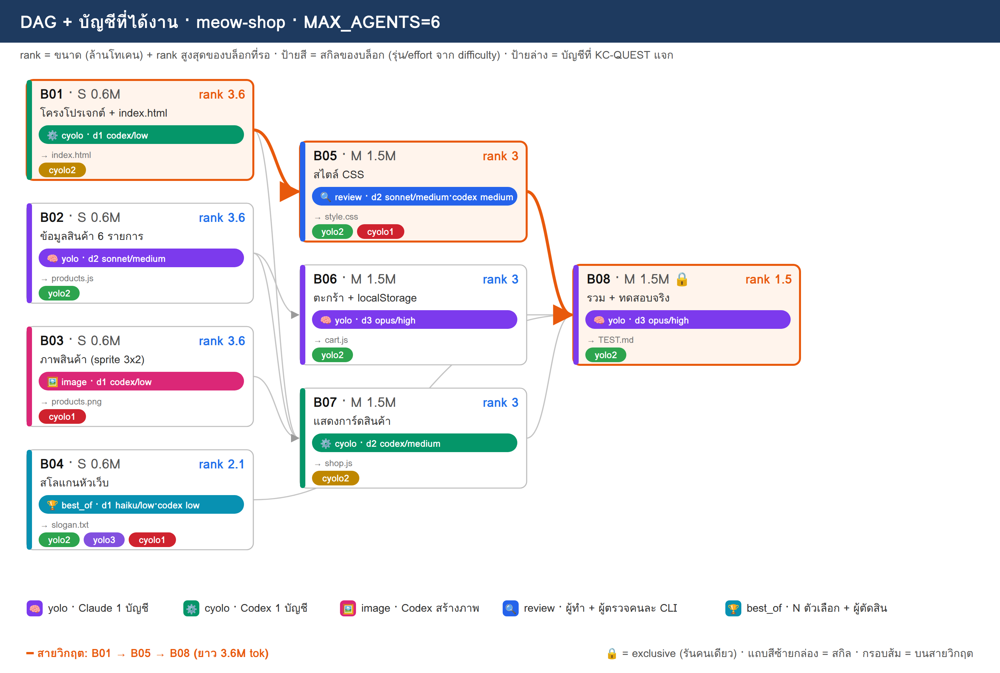

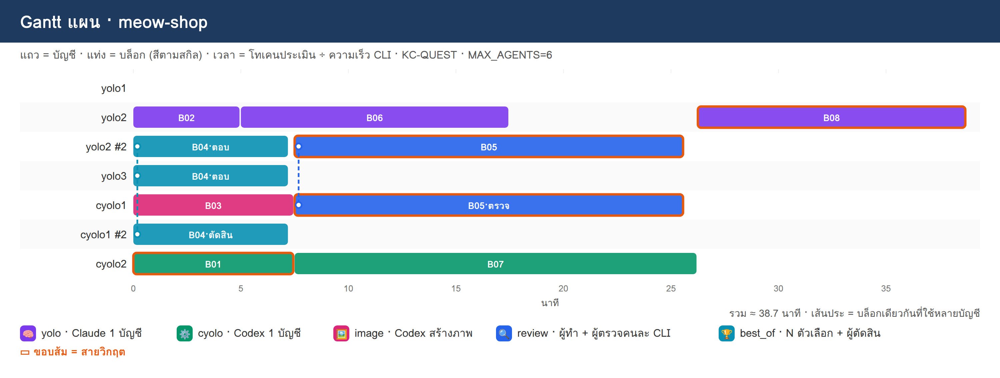

| บัญชี | บทบาทที่ได้ | โทเคนที่จอง |
|---|---|---|
| yolo1 | 0 | 0 |
| **yolo2** | **5** | **5.7M** |
| yolo3 | 1 | 0.6M |
| cyolo1 | 3 | 1.23M |
| cyolo2 | 2 | 2.1M |

เวลารวมของแผนประมาณ **38.7 นาที** ผลนี้ชวนให้ถาม 4 ข้อ ซึ่งหัวข้อ 4 จะตอบทีละข้อ

| คำถาม | คำตอบอยู่ที่ |
|---|---|
| ทำไม B01 และ B03 ได้เลือกก่อน B02 | ขั้น ① |
| ทำไม yolo1 ไม่ได้งานเลย | ขั้น ② |
| ทำไม yolo2 ได้งานมากที่สุด | ขั้น ③ |
| ทำไม B03 ไม่ไป cyolo2 เหมือน B01 | ขั้น ④ |

## 4. KC-QUEST ทีละขั้น ด้วยตัวเลขจริง

คำสั่งนี้แสดงทุกตัวเลขของรอบที่ต้องการ ตารางในหัวข้อนี้คัดมาจากผลของคำสั่งนี้

```bash
python tools/kclab.py explain --round 1
```

### 4.1 ขั้น ① จัดลำดับ: บล็อกไหนได้เลือกก่อน

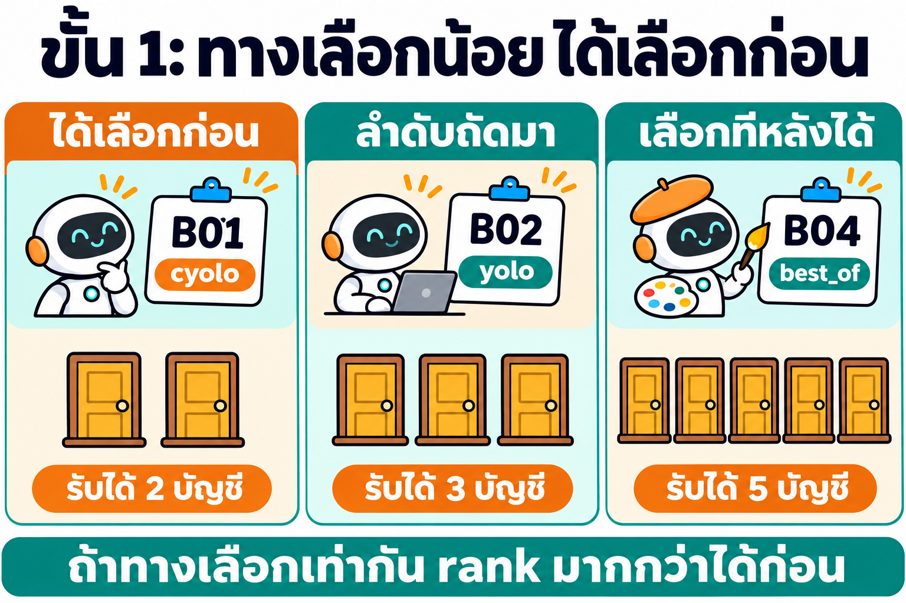

บล็อกที่เลือกทีหลังจะเหลือบัญชีให้เลือกน้อยลง ลำดับจึงมีผล KC-QUEST เรียงด้วยกติกา 3 ชั้น

| ชั้น | กติกา | เหตุผล |
|---|---|---|
| 1 | บัญชีที่รับได้ **น้อยกว่า** ได้ก่อน | บล็อกที่มีทางเลือกน้อย ถ้าปล่อยไว้อาจถูกบล็อกอื่นแย่งจนไม่เหลือบัญชี |
| 2 | ถ้าเท่ากัน rank **มากกว่า** ได้ก่อน | บล็อกที่มีงานรออยู่ข้างหลังยาว ถ้าช้าทั้งโปรเจกต์ช้า |
| 3 | ถ้ายังเท่ากัน ขนาด **ใหญ่กว่า** ได้ก่อน | งานใหญ่หาบัญชีรับยากกว่า |

$$\text{เรียงตาม}\quad \big(\ \min(|A_j|,\,3)\ \text{น้อยก่อน},\ \ \mathrm{rank}(j)\ \text{มากก่อน},\ \ c_j\ \text{มากก่อน}\ \big)$$

$|A_j|$ คือจำนวนบัญชีที่ผ่านขั้น ② สำหรับบล็อก $j$ นับสูงสุดแค่ 3 เพราะทางเลือก 3 กับ 5 ถือว่าเหลือพอเหมือนกัน กติกาชั้นที่ 1 เรียกว่า **MRV** (Minimum Remaining Values) เป็นวิธีเดียวกับการแก้ซูโดกุ ที่เติมช่องซึ่งเหลือตัวเลือกน้อยที่สุดก่อน

**รอบที่ 1** มีบล็อกพร้อม 4 บล็อก

| ลำดับ | บล็อก | สกิล | บัญชีที่รับได้ $\lvert A_j\rvert$ | rank | เหตุผล |
|---|---|---|---|---|---|
| 1 | B01 | cyolo | 2 (cyolo1, cyolo2) | 3.6 | ทางเลือกน้อยที่สุด |
| 2 | B03 | image | 2 (cyolo1, cyolo2) | 3.6 | เท่ากับ B01 ทุกอย่าง เรียงตามรหัส |
| 3 | B02 | yolo | 3 (yolo1, yolo2, yolo3) | 3.6 | ทางเลือกมากกว่า |
| 4 | B04 | best_of | 5 | 2.1 | ทางเลือกมากที่สุด และ rank ต่ำที่สุด |

B01, B02 และ B03 มี rank เท่ากัน สิ่งที่ทำให้ B01 และ B03 ได้ก่อนคือสกิล `cyolo` และ `image` ที่บังคับให้ใช้ฝั่ง Codex ซึ่งมีแค่ 2 บัญชี

### 4.2 ขั้น ② กรอง: บัญชีไหนทำจบได้

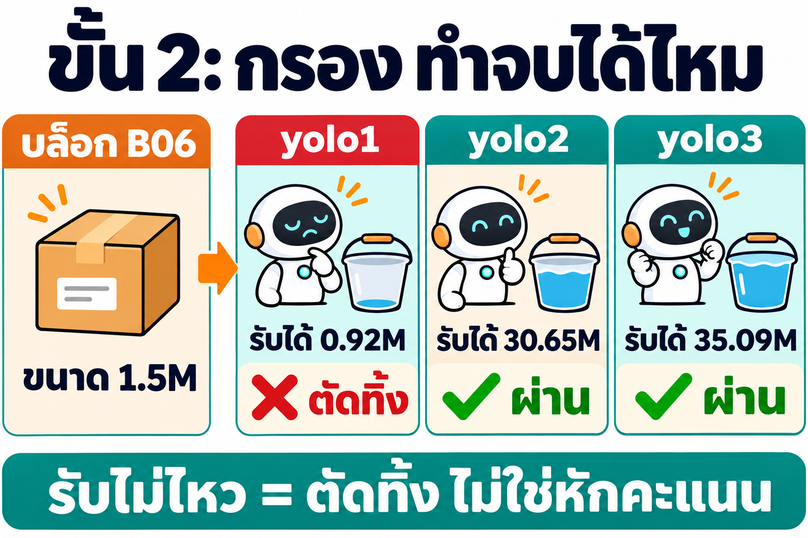

งานที่ชนเพดานโควตากลางทางต้องหยุดและย้ายบัญชี ซึ่งเสียทั้งเวลาและโทเคน เงื่อนไข "ทำจบได้" จึงเป็น **กฎเหล็ก** บัญชีที่ไม่ผ่านถูกตัดออกจากการแข่งขัน ไม่ใช่แค่ถูกหักคะแนน

บัญชีผ่านกรองเมื่อครบ 3 ข้อ

1. อยู่ฝั่งที่สกิลกำหนด (`yolo` ต้องเป็น Claude · `cyolo` และ `image` ต้องเป็น Codex)
2. มี slot ว่าง
3. ขนาดงานไม่เกิน **ความจุ** $C_a$ ของบัญชี

$$C_a = \min\left(\frac{H^5_a - m^5_a}{\sigma \cdot r^5_a},\ \frac{H^w_a - m^w_a}{\sigma \cdot r^w_a}\right) \qquad \text{ผ่านเมื่อ}\ \ c_j \le C_a$$

| ส่วนของสูตร | ความหมาย | ทำไมต้องมี |
|---|---|---|
| $H - m$ | โควตาที่ใช้ได้จริง | ไม่ใช้จนหยดสุดท้าย เหลือ **ระยะเผื่อ** $m$ ไว้ |
| $\div\ r$ | แปลง % เป็นล้านโทเคน | ให้หน่วยเดียวกับขนาดงาน $c_j$ |
| $\div\ \sigma$ ($\sigma$ = 1.3) | คิดเหมือนงานใหญ่กว่าที่ประเมิน 30% | ขนาด S / M / L เป็นค่าประเมิน ของจริงมักใหญ่กว่า |
| $\min$ | เอาถังที่รับได้น้อยกว่า | ถังไหนหมดก่อน งานก็หยุด |

ระยะเผื่อ $m$ คือโควตาที่บัญชีจะใช้ไปใน 15 นาที เมื่อทำงานพร้อมกัน $n$ งาน (นับรวมงานใหม่) และไม่ต่ำกว่า 2%

$$m = \max\big(2,\ \ r \cdot v \cdot 0.25 \cdot n\big)$$

บัญชี yolo ที่ยังว่าง ($n$ = 1) จึงมี $m^5$ = 2 × 7.2 × 0.25 = 3.6 และ $m^w$ = max(2, 0.25 × 7.2 × 0.25) = 2

**ตัวอย่าง: B06 ในรอบที่ 2** ขนาด 1.5 ล้านโทเคน สกิล yolo (`python tools/kclab.py explain --round 2`)

| บัญชี | งานที่ทำอยู่ | ถัง 5 ชม. | ถังสัปดาห์ | $C_a$ | ผล |
|---|---|---|---|---|---|
| yolo1 | 0 | (6 − 3.6) ÷ (1.3 × 2) = **0.92** | (80 − 2) ÷ (1.3 × 0.25) = 240 | 0.92 | ❌ 1.5 > 0.92 |
| yolo2 | 1 | (86.88 − 7.2) ÷ 2.6 = **30.65** | (44.6 − 2) ÷ 0.325 = 131.08 | 30.65 | ✅ |
| yolo3 | 1 | (98.44 − 7.2) ÷ 2.6 = **35.09** | (94.8 − 2) ÷ 0.325 = 285.54 | 35.09 | ✅ |

- **yolo1 รับได้แค่ 0.92 ล้านโทเคน** จึงถูกตัดจากทุกบล็อกขนาด M ส่วนบล็อกขนาด S (0.6) ยังผ่านกรองได้ แต่แพ้ในขั้นให้คะแนน yolo1 จึงไม่ได้งานเลย
- yolo2 และ yolo3 กำลังทำงานอยู่ 1 งาน ระยะเผื่อจึงเป็น 3.6 × 2 = 7.2
- ถังสัปดาห์ลดช้ากว่าถัง 5 ชม. 8 เท่า (0.25 เทียบกับ 2.0) ถังที่เป็นตัวจำกัดจึงมักเป็นถัง 5 ชม. ยกเว้นบัญชีที่ถังสัปดาห์เหลือน้อยมากอย่าง cyolo2 ซึ่งรับได้ (7 − 2) ÷ 0.325 = 15.38 ล้านโทเคน

**ถัง 5 ชม. ที่กำลังจะรีเซ็ต:** ถ้าบัญชีทำงานต่อไปได้จนถึงเวลาที่ถัง 5 ชม. รีเซ็ต KC-QUEST จะนับโควตาของรอบใหม่เพิ่มให้ บัญชีที่ถัง 5 ชม. เกือบหมดแต่อีกไม่กี่นาทีจะรีเซ็ตจึงไม่ถูกตัดทิ้ง (แบบฝึกหัดข้อ 7)

### 4.3 ขั้น ③ ให้คะแนน: ใครเหมาะที่สุด

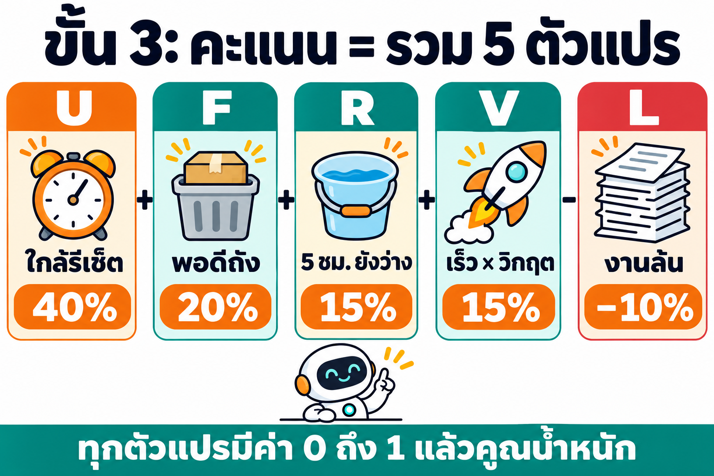

บัญชีที่ผ่านกรองมักมีหลายบัญชี และ "เหมาะ" มีหลายความหมาย เช่น ไม่ทิ้งโควตา ทำเร็ว ไม่กองงานไว้ที่เดียว KC-QUEST แปลงแต่ละความหมายเป็นตัวแปรที่มีค่า 0 ถึง 1 แล้วคูณน้ำหนักรวมเป็นคะแนนเดียว

$$S_a = 100 \times \big(0.40\,U + 0.20\,F + 0.15\,R + 0.15\,V - 0.10\,L\big)$$

| ตัวแปร | สูตร | ค่าสูงเมื่อ | เป้าหมาย |
|---|---|---|---|
| **U** ใกล้รีเซ็ต | $\dfrac{24}{24 + T}$ | ถังสัปดาห์ใกล้รีเซ็ต | ใช้โควตาที่กำลังจะหายก่อน |
| **F** พอดีถัง | $\min\left(1,\ \dfrac{\sigma\, r^w c}{H^w}\right)$ | งานกินถังสัปดาห์ที่เหลือเป็นสัดส่วนมาก | เก็บถังใหญ่ไว้ให้งานใหญ่ที่จะมาทีหลัง |
| **R** ถัง 5 ชม. ยังว่าง | $\dfrac{\max(0,\ H^5 - \sigma\, r^5 c)}{100}$ | รับงานแล้วถัง 5 ชม. ยังเหลือมาก | ไม่เข้าใกล้เพดานของรอบ 5 ชม. |
| **V** เร็ว × วิกฤต | $v_{\text{ฝั่ง}} \times \kappa_j$ | บัญชีเร็ว และบล็อกอยู่ใกล้สายวิกฤต | บล็อกที่กำหนดเวลาของโปรเจกต์ไปบัญชีเร็ว |
| **L** งานล้น | $\dfrac{\text{งานที่ทำอยู่}}{\text{slot}}$ | บัญชีทำหลายงานอยู่แล้ว | น้ำหนักติดลบ ช่วยกระจายงาน |

$v_{\text{ฝั่ง}}$ คือ 1.0 สำหรับ yolo และ 0.7 สำหรับ cyolo ส่วน $\kappa_j$ คือ rank ของบล็อกหารด้วย rank สูงสุด มีค่า 0 ถึง 1

**ทำไมต้องปรับให้อยู่ช่วง 0 ถึง 1 ก่อนรวม:** ถ้านำ "ชั่วโมง" (0–168) มาบวกกับ "สัดส่วน" (0–1) ตรง ๆ ตัวที่หน่วยใหญ่จะกลบตัวอื่น น้ำหนักจะไม่มีความหมาย

#### U ตัวแปรที่มีน้ำหนักมากที่สุด

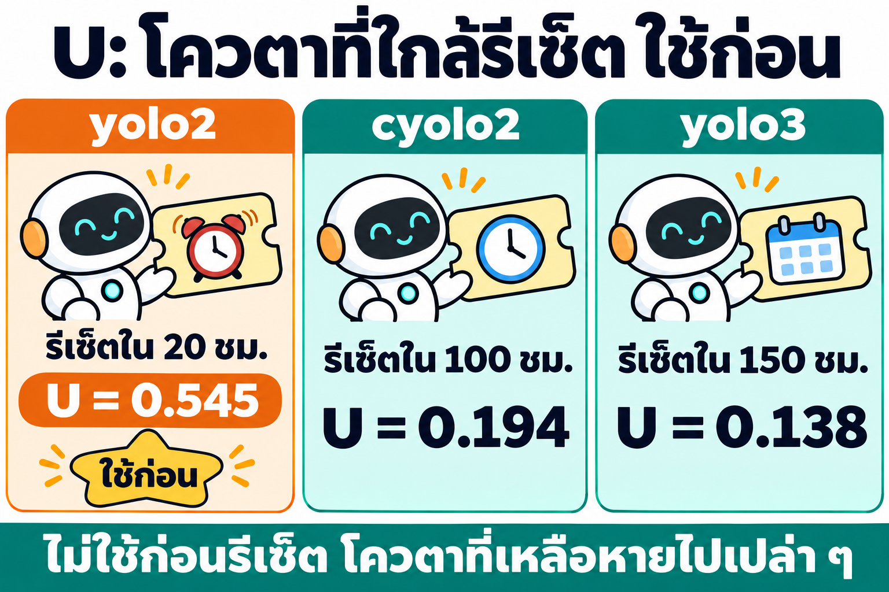

โควตาสัปดาห์ที่เหลือตอนรีเซ็ตจะหายไป เหมือนคูปองที่มีวันหมดอายุ บัญชีที่ใกล้รีเซ็ตจึงควรถูกใช้ก่อน สูตร $U = 24 \div (24 + T)$ ถูกเลือกเพราะมีสมบัติครบ 3 ข้อ

- $T$ น้อย U เข้าใกล้ 1 และ $T$ มาก U เข้าใกล้ 0 โดยไม่ติดลบ
- ไม่ต้องรู้ค่าสูงสุดของ $T$
- เหลือ 24 ชั่วโมงได้ U = 0.5 พอดี จำง่ายว่า "เหลือ 1 วัน = เร่งด่วนครึ่งหนึ่ง"

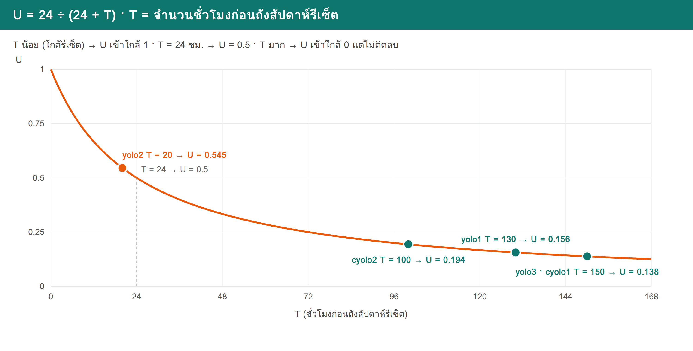

U ของ yolo2 (0.545) สูงกว่าบัญชีอื่น 3–4 เท่า และ U มีน้ำหนัก 40% นี่คือเหตุที่ yolo2 ได้งานมากที่สุด

#### แทนค่าจริง: B02 ในรอบที่ 1

B02 ขนาด 0.6 ล้านโทเคน อยู่บนเส้นที่ rank สูงสุด ($\kappa$ = 1) โควตาที่งานนี้จะใช้คือ $\sigma r^5 c$ = 1.3 × 2 × 0.6 = 1.56% ของถัง 5 ชม. และ $\sigma r^w c$ = 1.3 × 0.25 × 0.6 = 0.195% ของถังสัปดาห์

| บัญชี | U | F | R | V | L | คะแนน $S$ |
|---|---|---|---|---|---|---|
| yolo1 | 0.156 | 0.002 | (6 − 1.56) ÷ 100 = 0.044 | 1.0 | 0 | 21.9 |
| **yolo2** | **0.545** | 0.004 | (90 − 1.56) ÷ 100 = 0.884 | 1.0 | 0 | **50.1** |
| yolo3 | 0.138 | 0.002 | (100 − 1.56) ÷ 100 = 0.984 | 1.0 | 0 | 35.3 |

$$S_{\text{yolo2}} = 100 \times (0.4 \times 0.545 + 0.2 \times 0.004 + 0.15 \times 0.884 + 0.15 \times 1.0 - 0.1 \times 0) = 50.1$$

- yolo3 มี R ดีกว่า (ถัง 5 ชม. เต็มกว่า) แต่ U ของ yolo2 ห่างกันมาก yolo2 จึงชนะ 50.1 ต่อ 35.3
- yolo1 ผ่านกรอง แต่ R เหลือแค่ 0.044 เพราะถัง 5 ชม. เกือบหมด คะแนนจึงต่ำที่สุด
- F ของทุกบัญชีใกล้ 0 เพราะบล็อกขนาด S กินถังสัปดาห์น้อยมาก F จะเห็นผลชัดกับบัญชีที่ถังสัปดาห์เหลือน้อย เช่น B07 ในรอบที่ 3 ที่ cyolo2 ได้ F = 0.072 เทียบกับ cyolo1 ที่ได้ 0.005

### 4.4 ขั้น ④ เลือก + จอง: หักโควตาทันที

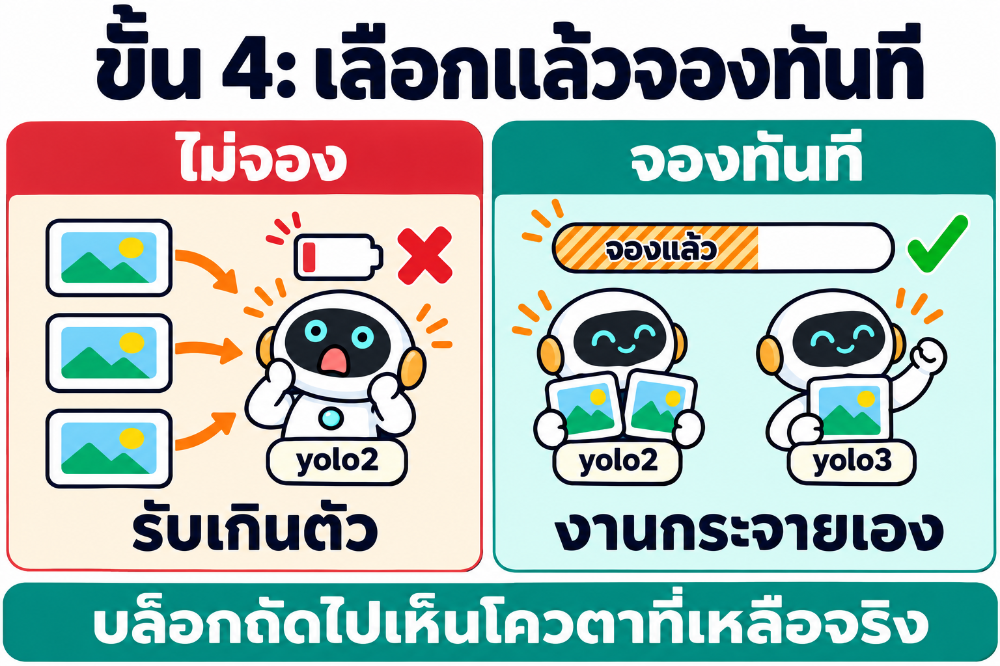

บัญชีที่คะแนนสูงสุดได้บล็อกไป แล้ว KC-QUEST **หักโควตาและ slot ของบัญชีนั้นทันที** ก่อนพิจารณาบล็อกถัดไป

$$H^5 \leftarrow H^5 - \sigma\, r^5 c \qquad H^w \leftarrow H^w - \sigma\, r^w c \qquad \text{งานที่ทำอยู่} \leftarrow \text{งานที่ทำอยู่} + 1$$

ถ้าไม่จอง ทุกบล็อกในรอบเดียวกันจะเห็นว่าบัญชีที่ดีที่สุดยังว่างเต็มที่ แล้วไปลงที่เดียวกันหมด เมื่อจองแล้ว บล็อกถัดไปเห็นค่าที่เปลี่ยน 3 อย่าง: R ลดลง L เพิ่มขึ้น และ slot อาจเต็ม งานจึงกระจายออกเองโดยไม่ต้องมีกฎห้าม

**รอบที่ 1 ทั้งรอบ** (แสดงเฉพาะบทบาทผู้ทำของแต่ละบล็อก)

| ลำดับ | บล็อก | ผู้ชนะ | คะแนน | อันดับ 2 | เกิดอะไรขึ้น |
|---|---|---|---|---|---|
| 1 | B01 | **cyolo2** | 33.6 | cyolo1 30.8 | cyolo2 ได้ U และ F สูงกว่า · จองแล้ว slot ของ cyolo2 เต็ม (1 จาก 1) |
| 2 | B03 | **cyolo1** | 30.8 | – | cyolo2 ถูกตัดเพราะ slot เต็ม เหลือ cyolo1 บัญชีเดียว |
| 3 | B02 | **yolo2** | 50.1 | yolo3 35.3 | U ของ yolo2 นำห่าง |
| 4 | B04 (ตอบคนที่ 1) | **yolo2** | 40.3 | yolo3 29.1 | yolo2 ทำอยู่ 1 จาก 3 → L = 0.333 ถูกหัก 3.3 คะแนน แต่ยังชนะ |

คะแนนของ yolo2 ลดจาก 50.1 เหลือ 40.3 มาจาก 3 ส่วน: V ลดเพราะ B04 อยู่ห่างสายวิกฤต ($\kappa$ = 0.583) R ลดเพราะถัง 5 ชม. ถูกจองไป 1.56% และ L เพิ่มเพราะมีงานอยู่แล้ว 1 งาน


ภาพนี้ได้จาก `python tools/kclab.py explain --round 1 --png` ความยาวของแต่ละสีคือน้ำหนัก × ค่าตัวแปร × 100 แท่งสีส้ม (U) ของ yolo2 ยาวกว่าบัญชีอื่นชัดเจน

### 4.5 บล็อกที่ใช้หลายบัญชี: เลือกทีละบทบาท

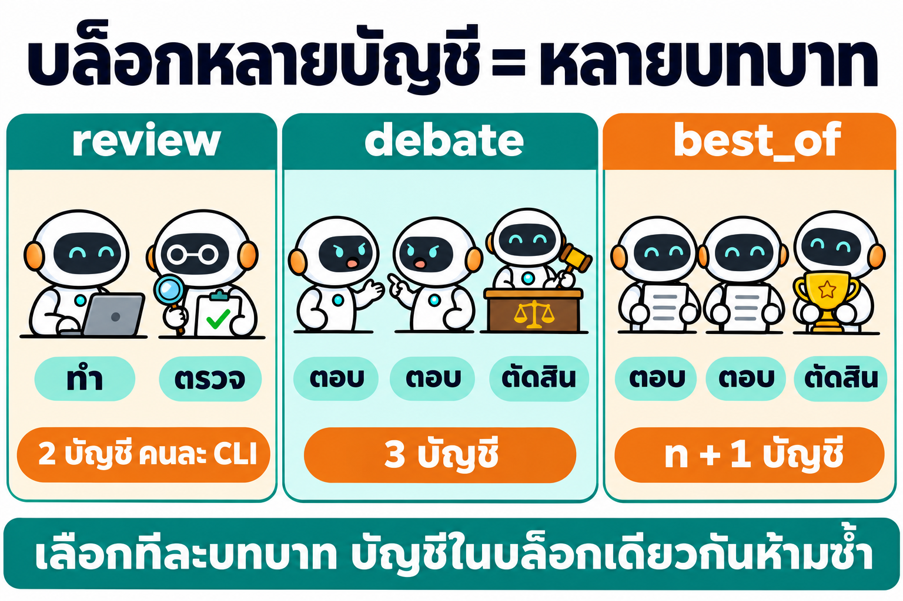

สกิล `review` · `debate` · `best_of` ใช้หลายบัญชีต่อบล็อก KC-QUEST แตกบล็อกเป็น **บทบาท** แล้วทำขั้น ②③④ ให้ทีละบทบาท

| สกิล | บทบาท (โทเคนที่ใช้ เทียบกับขนาดบล็อก $c$) | ข้อบังคับ |
|---|---|---|
| `yolo` | ทำ $c$ | ต้องเป็น Claude |
| `cyolo` · `image` | ทำ $c$ | ต้องเป็น Codex |
| `review` | ทำ $c$ → ตรวจ $0.3c$ | ผู้ตรวจต้องอยู่ **คนละ CLI** กับผู้ทำ |
| `debate` | ตอบ $c$ (Claude) + ตอบ $c$ (Codex) → ตัดสิน $0.3c$ | – |
| `best_of` | ตอบ $c$ × n → ตัดสิน $0.3c$ | – |

กติกาที่ใช้กับทุกสกิล

- บัญชีในบล็อกเดียวกัน **ห้ามซ้ำ** ผู้ตรวจและผู้ตัดสินจึงเป็นคนละบัญชีกับผู้ทำเสมอ
- ถ้ามีบทบาทใดไม่มีบัญชีรับ การจองของ **ทั้งบล็อก** ถูกคืน แล้วบล็อกรอรอบถัดไป
- บล็อกจะเริ่มได้เมื่อจำนวนบทบาทไม่เกินที่ว่างของทีม (`--max-agents`)

**ตัวอย่าง: B04 (best_of, n = 2) ในรอบที่ 1** มี 3 บทบาท

| บทบาท | โทเคน | ผู้ชนะ | คะแนน | บัญชีที่ถูกตัด |
|---|---|---|---|---|
| ตอบคนที่ 1 | 0.6M | yolo2 | 40.3 | cyolo2 (slot เต็ม) |
| ตอบคนที่ 2 | 0.6M | yolo3 | 29.1 | yolo2 (อยู่ในบล็อกนี้แล้ว) · cyolo2 |
| ตัดสิน | 0.18M | cyolo1 | 23.0 | yolo2 และ yolo3 (อยู่ในบล็อกนี้แล้ว) · cyolo2 |

**ตัวอย่าง: B05 (review) ในรอบที่ 3** ผู้ทำคือ yolo2 (คะแนน 43.0) ผู้ตรวจจึงต้องเป็นฝั่ง Codex cyolo2 ถูกตัดเพราะ slot เต็มจาก B07 ผู้ตรวจจึงเป็น cyolo1

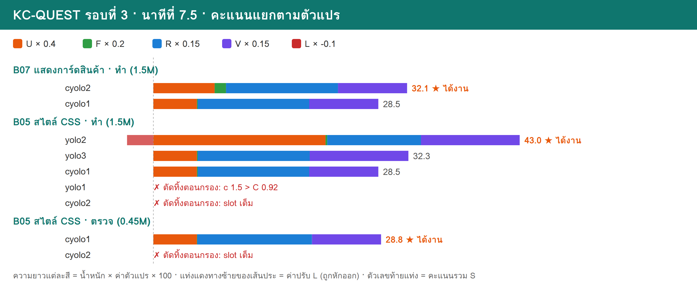

### 4.6 จากบัญชีเป็นเวลาใน Gantt

เมื่อรู้ว่าบทบาทไหนอยู่บัญชีไหน KC-QUEST คำนวณเวลาของบล็อกจากความเร็วของบัญชี

$$\text{เวลาของบล็อก} = \Big(\max_{\text{ผู้ทำ / ผู้ตอบ}} \frac{c}{v} \ +\ \sum_{\text{ผู้ตรวจ / ผู้ตัดสิน}} \frac{0.3c}{v}\Big) \times k_{\text{สกิล}}$$

ผู้ทำและผู้ตอบทำงานพร้อมกัน จึงใช้คนที่ช้าที่สุด ส่วนผู้ตรวจและผู้ตัดสินต้องรอ จึงบวกต่อท้าย $k$ คือตัวปรับเวลาจาก `calib.json` (หัวข้อ 5) ถ้ายังไม่เคยรันจริง $k$ = 1

| บล็อก | คำนวณ | เวลา |
|---|---|---|
| B02 (yolo2) | 0.6 ÷ 7.2 ชม. | 5 นาที |
| B01 (cyolo2) | 0.6 ÷ 4.8 ชม. | 7.5 นาที |
| B04 (yolo2 + yolo3 ตอบ · cyolo1 ตัดสิน) | 0.6 ÷ 7.2 + 0.18 ÷ 4.8 ชม. | 5 + 2.25 = 7.25 นาที |
| B05 (yolo2 ทำ · cyolo1 ตรวจ) | 1.5 ÷ 7.2 + 0.45 ÷ 4.8 ชม. | 12.5 + 5.6 = 18.1 นาที |

ทุกบทบาทถือ slot ตลอดช่วงเวลาของบล็อก Gantt แผนจึงไม่มีช่วงที่บัญชีใดรับงานเกิน slot

## 5. หลังวางแผน: รันจริง และเรียนรู้

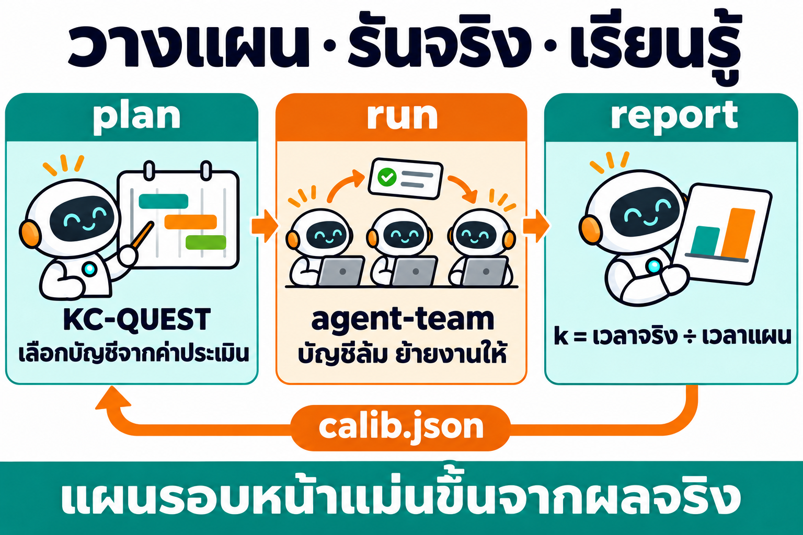

KC-QUEST ตัดสินใจจาก **ค่าประเมิน** ทั้งขนาดงานและอัตรากินโควตา ของจริงจึงต่างจากแผนได้ สกิลแบ่งหน้าที่กันดังนี้

| ช่วง | ใครรับผิดชอบ | ทำอะไร |
|---|---|---|
| วางแผน (`plan`) | KC-QUEST ใน `dag-planner` | ขั้น ①–④ ของหัวข้อ 4 และเผื่อความคลาดเคลื่อนไว้ด้วย $\sigma$ กับ $m$ |
| ส่งแผน (`export`) | `dag-planner` | ส่งงานให้ `agent-team` เป็น **ฝั่ง** (`yolo` / `cyolo`) ไม่ผูกบัญชีเจาะจง |
| รันจริง (`run`) | base skill `agent-team` | เลือกบัญชีในฝั่งตามโหลดจริง · บัญชีที่โควตาใช้ถึง 80% หยุดรับงานใหม่ · บัญชีล้มเพราะโควตาหรือล็อกอิน ย้ายงานไปบัญชีอื่น |
| สรุปผล (`report`) | `dag-planner` | เทียบแผนกับของจริง แล้วคำนวณตัวปรับเวลา $k$ |

`export` ไม่ผูกบัญชีเจาะจง เพราะใน `agent-team` งานที่ระบุบัญชีเจาะจงจะไม่ถูกย้ายเมื่อบัญชีนั้นล้ม บัญชีที่รันจริงจึงอาจไม่ตรงกับแผน และ `report` แสดงส่วนต่างนี้ให้เห็น ถ้าต้องการห้ามใช้บัญชีใด ให้ตัดบัญชีนั้นออกจาก `--accounts`

**ตัวปรับเวลา k** คำนวณแยกตามสกิล จากบล็อกที่รันสำเร็จ

$$k_{\text{สกิล}} = \frac{\sum \text{เวลาจริง}}{\sum \text{เวลาแผนก่อนคูณ } k}$$

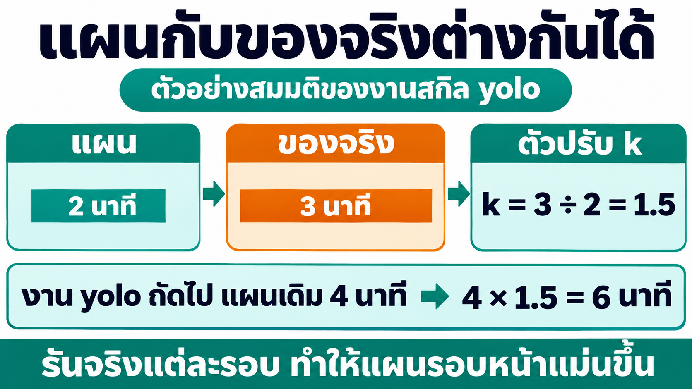

ค่า $k$ ถูกเก็บใน `calib.json` และ `plan` ครั้งถัดไปคูณเวลาของแต่ละบล็อกด้วย $k$ ของสกิลนั้น ในกรณีศึกษาเหมียวช็อปของบท 05 แผนแรกบอก 1.7 นาที รันจริงได้ 2.8 นาที และแผนที่ใช้ $k$ ใหม่บอก 2.8 นาที

$k$ ปรับเฉพาะ **เวลา** ไม่ได้เปลี่ยนว่าบัญชีไหนได้บล็อกไหน เพราะคะแนนของขั้น ③ ไม่ได้ใช้ $k$

## 6. เบื้องหลัง: ทำไมต้องตัดสินใจทีละบล็อก


การแจกงานเป็น **ปัญหา optimization** ซึ่งมี 3 ส่วนเสมอ: สิ่งที่เลือกได้ เป้าหมาย และกฎที่ห้ามผิด เขียนเป็นสมการได้ดังนี้

```math
\begin{aligned}
\min_{x,\,s}\ \ & C_{\max} = \max_j\,(s_j + p_j) \\
\text{โดยที่}\ \ & \textstyle\sum_a x_{ja} = 1 && \text{(1) ทุกบทบาทมี 1 บัญชี}\\
& s_k \ge s_j + p_j \quad \text{เมื่อ } k \text{ รอ } j && \text{(2) รอบล็อกก่อนหน้า}\\
& \textstyle\sum_j x_{ja}\,\sigma\, r^5_a\, c_j \le H^5_a - m^5_a && \text{(3) ถัง 5 ชม. ต้องพอ}\\
& \textstyle\sum_j x_{ja}\,\sigma\, r^w_a\, c_j \le H^w_a - m^w_a && \text{(4) ถังสัปดาห์ต้องพอ}\\
& \text{งานที่รันพร้อมกันบน } a \le \text{slot}_a && \text{(5) slot มีจำกัด}
\end{aligned}
```

| สัญลักษณ์ | ความหมาย |
|---|---|
| $x_{ja}$ | 1 ถ้าบทบาท $j$ ให้บัญชี $a$ ทำ (สิ่งที่ต้องเลือก) |
| $s_j$ | เวลาเริ่ม (สิ่งที่ต้องเลือก) |
| $p_j = c_j / v_a$ | เวลาทำงาน |
| $C_{\max}$ | เวลาที่บล็อกสุดท้ายเสร็จ ยิ่งน้อยยิ่งดี |

นอกจาก $C_{\max}$ ยังมีเป้าหมายรอง คือใช้โควตาที่ใกล้รีเซ็ตก่อน

**หาคำตอบที่ดีที่สุดตรง ๆ ไม่ได้ ด้วยเหตุผล 3 ข้อ**

1. **ทางเลือกมากเกินไป** แค่เลือกว่าใครทำบล็อกไหน 8 บล็อก 5 บัญชีก็มี $5^8$ = 390,625 แบบ ยังไม่นับลำดับเวลา ถ้าเป็น 14 บล็อก 10 บัญชีจะเป็น $10^{14}$ แบบ
2. **เป็นปัญหาที่ยากในทางทฤษฎี** ปัญหานี้รวมปัญหาคลาสสิก 2 ข้อที่พิสูจน์แล้วว่าเป็น NP-hard คือการจัดงานที่มีลำดับก่อนหลังให้หลายเครื่อง (ข้อ 1, 2, 5) และ bin packing หรือการใส่ของลงถังให้พอดี (ข้อ 3, 4)
3. **ข้อมูลไม่แน่นอน** ขนาดงานและอัตรากินโควตาเป็นค่าประเมิน คำตอบที่ดีที่สุดบนกระดาษจึงอาจไม่ดีที่สุดเมื่อรันจริง

KC-QUEST จึงเป็น **heuristic** คือกฎที่คิดเร็ว (ไม่ถึง 1 วินาที ไม่ใช้โทเคน) และได้คำตอบที่ดีพอ แต่ละส่วนของสมการถูกแปลงเป็นกฎง่าย ๆ ดังนี้

| หลักคิด | แปลว่า | ตอบส่วนไหนของสมการ | ขั้น |
|---|---|---|---|
| ตัดสินใจทีละบล็อก (greedy) | มีบล็อกพร้อมเมื่อไรก็แจกทันที ไม่ลองทุกแบบ | ตัวแปร $x$ และ $s$ | วงรอบ |
| เรียงลำดับให้ดี | บล็อกที่มีทางเลือกน้อยและ rank สูงได้ก่อน | เป้าหมาย $C_{\max}$ | ① |
| กฎเหล็กใช้กรอง | ข้อที่ผิดไม่ได้ ไม่นำไปปนกับคะแนน | ข้อ (3) (4) (5) | ② |
| รวมหลายเป้าหมายเป็นเลขเดียว | ปรับให้อยู่ช่วง 0–1 แล้วถ่วงน้ำหนัก | $C_{\max}$ และเป้าหมายรอง | ③ |
| จองทันที | บล็อกถัดไปเห็นโควตาที่เหลือจริง | ข้อ (3) (4) (5) | ④ |
| เผื่อไว้ แล้วเรียนรู้จากของจริง | $\sigma$ และ $m$ ตอนวางแผน แล้วปรับ $k$ หลังรัน | ข้อมูลไม่แน่นอน | ② และหัวข้อ 5 |

การเรียงตาม rank เป็นแนวคิดเดียวกับอัลกอริทึม HEFT ที่ใช้จัดงานบนคลัสเตอร์ ส่วนตัวแปร F มาจากวิธี best-fit ของ bin packing

## 7. ดีแค่ไหน

### 7.1 ขอบล่างของเวลา

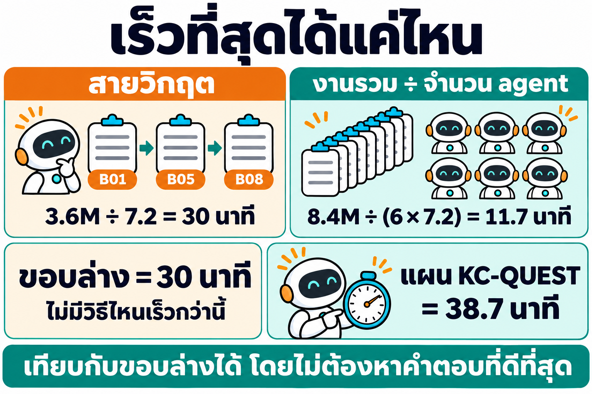

เราไม่รู้คำตอบที่ดีที่สุด แต่รู้ว่าไม่มีแผนไหนเร็วกว่า **ขอบล่าง** นี้ได้

$$C_{\max} \ \ge\ \max\left(\frac{\mathrm{rank}_{\max}}{v},\ \frac{\sum_j c_j}{N \cdot v}\right)$$

- พจน์แรก: บล็อกบนสายวิกฤตต้องทำต่อกัน เร็วกว่านี้ไม่ได้แม้มีบัญชีไม่จำกัด
- พจน์ที่สอง: งานทั้งหมดหารด้วยกำลังของทีม ($N$ = จำนวน agent ที่รันพร้อมกันได้)

เหมียวช็อป: max(3.6 ÷ 7.2 ชม., 8.4 ÷ (6 × 7.2) ชม.) = max(30, 11.7) = **30 นาที** ส่วนแผนของ KC-QUEST ใช้ **38.7 นาที** ส่วนต่าง 8.7 นาทีมาจาก 2 เรื่องที่ขอบล่างไม่ได้นับ

| สาเหตุ | เวลาที่เพิ่ม |
|---|---|
| B01 ต้องใช้ Codex ซึ่งช้ากว่า (4.8 แทน 7.2) | 7.5 − 5 = 2.5 นาที |
| B05 เป็น review มีผู้ตรวจต่อท้าย | 5.6 นาที |
| B08 ต้องรอ B07 ที่จบช้ากว่า B05 เล็กน้อย | 0.6 นาที |

ทั้ง 3 เรื่องมาจากสกิลที่บล็อกเลือก ไม่ได้มาจากการเลือกบัญชี ขอบล่างจึงเป็นเพดานที่ใช้เทียบ ไม่ใช่ค่าที่ต้องทำให้ถึง

สำหรับปัญหาพื้นฐานที่ไม่มีโควตา Graham (1966) พิสูจน์ว่าการแจกแบบ "มีเครื่องว่างเมื่อไรแจกทันที" ช้ากว่าคำตอบที่ดีที่สุดไม่เกิน $(2 - 1/N)$ เท่า วิธี greedy จึงมีหลักประกันในกรณีพื้นฐาน

### 7.2 เทียบกับวิธีอื่นด้วยตัวจำลอง

`tools/sim.py` จำลองโปรเจกต์ 16 งาน 4 บัญชี โดยให้ของจริงต่างจากค่าประเมิน: โทเคนจริงของแต่ละงานสุ่มรอบค่าประเมิน และอัตรากินโควตาจริงต่างจากที่ผู้แจกงานเชื่อ ±30% งานที่ชนเพดานกลางทางต้องรอ 5 นาทีและทำซ้ำ 15% เทียบ KC-QUEST กับ 3 วิธีในหัวข้อ 2.4

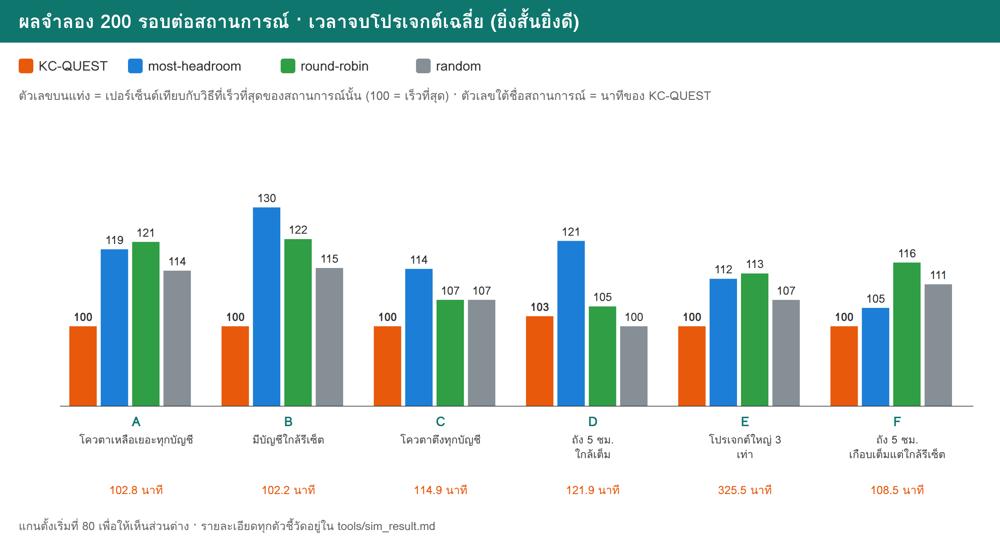

| สถานการณ์ | KC-QUEST | most-headroom | round-robin | random |
|---|---|---|---|---|
| A โควตาเหลือเยอะทุกบัญชี | **102.8** | 122.6 | 124.5 | 117.1 |
| B มีบัญชีใกล้รีเซ็ต | **102.2** | 132.6 | 124.5 | 117.1 |
| C โควตาตึงทุกบัญชี | **114.9** | 131.4 | 122.5 | 122.5 |
| D ถัง 5 ชม. ใกล้เต็ม | 121.9 | 144.3 | 124.8 | **118.9** |
| E โปรเจกต์ใหญ่ 3 เท่า | **325.5** | 364.2 | 368.5 | 347.0 |
| F ถัง 5 ชม. เกือบเต็มแต่ใกล้รีเซ็ต | **108.5** | 113.5 | 125.8 | 119.9 |

<sub>หน่วย: นาทีเฉลี่ยจนจบโปรเจกต์ จาก 200 รอบต่อสถานการณ์ · ผลเต็มอยู่ใน `tools/sim_result.md`</sub>

- KC-QUEST เร็วที่สุด **5 จาก 6 สถานการณ์**
- **สถานการณ์ B:** โควตาที่ KC-QUEST ใช้มาจากบัญชีใกล้รีเซ็ต 69.1% ส่วน most-headroom ใช้ 0% เพราะบัญชีใกล้รีเซ็ตเหลือโควตาน้อยกว่าจึงไม่เคยถูกเลือก
- **สถานการณ์ C:** KC-QUEST ชนเพดานกลางงานเฉลี่ย 0.01 ครั้งต่อโปรเจกต์ เทียบกับ round-robin 0.36 ครั้ง
- **ข้อจำกัด:** สถานการณ์ D KC-QUEST ช้ากว่าการสุ่ม 2.5% เพราะระยะเผื่อ ($\sigma$ และ $m$) ทำให้บางงานต้องรอแทนที่จะเสี่ยง KC-QUEST เป็น heuristic จึงไม่รับประกันว่าดีที่สุดทุกกรณี
- ตัวจำลองนี้ทดสอบเฉพาะขั้น ①–④ กับงานที่ใช้บัญชีเดียว ไม่ได้จำลองการย้ายงานของ `agent-team` ระหว่างรัน

```bash
python tools/sim.py --seeds 200      # รันซ้ำเอง ใช้เวลาไม่ถึง 1 นาที
python tools/test_kclab.py           # ตรวจว่าตัวเลขในหน้านี้ยังตรงกับ base skill
```

## 8. ลองเอง

### 8.1 พรอมต์สำหรับ Claude Code app

เปิดโฟลเดอร์ `06_KC_QUEST` แล้ววางพรอมต์นี้ทั้งกรอบ

```text
อยู่ในโฟลเดอร์ 06_KC_QUEST ใช้ python tools/kclab.py (ดูวิธีใช้ด้วย --help) ห้ามแก้ไฟล์ใน base_skills
1. รันคำสั่ง rounds แล้ว explain รอบที่ 3 แบบ --png
2. อธิบายเป็นภาษาไทยสั้น ๆ ว่ารอบนั้น ① เรียงบล็อกอย่างไร ② บัญชีไหนถูกตัด เพราะอะไร ③ ตัวแปรไหนทำให้ผู้ชนะชนะ ④ หลังจองแล้วโควตาของผู้ชนะเปลี่ยนอย่างไร
3. บอก path ของภาพ round-3.png
```

### 8.2 เปลี่ยนน้ำหนัก

```bash
python tools/kclab.py rounds --weights urgency=0 --out out/w_u0
python tools/kclab.py rounds --weights load=-0.4 --out out/w_l4
```

| น้ำหนัก | yolo2 (ใกล้รีเซ็ต) | yolo3 (เต็มทุกถัง) | เวลารวม | สิ่งที่เปลี่ยน |
|---|---|---|---|---|
| ปกติ (U 0.4) | **5 บทบาท · 5.7M** | 1 · 0.6M | 38.7 นาที | – |
| ปิด U (`urgency=0`) | 2 · 2.1M | **4 · 4.2M** | 38.7 นาที | B02, B06, B08 ย้ายไป yolo3 |
| L แรงขึ้น (`load=-0.4`) | 5 · 5.7M | 1 · 0.6M | 38.7 นาที | ผู้ตัดสินของ B04 ย้ายจาก cyolo1 ไป yolo1 |

เมื่อปิด U เวลารวมเท่าเดิม แต่โควตาของ yolo2 ที่จะหายใน 20 ชั่วโมงถูกใช้น้อยลงจาก 5.7M เหลือ 2.1M เวลารวมจึงไม่ได้บอกทุกอย่าง ต้องดูเป้าหมายรองด้วย

### 8.3 เปลี่ยนสถานการณ์

ใช้ `--set` แก้ค่าเฉพาะจุด หรือคัดลอก `examples/quota_lesson.json` ไปแก้แล้วส่งด้วย `--scenario`

```bash
python tools/kclab.py rounds --set yolo2.week_reset_h=200
python tools/kclab.py rounds --max-agents 4
```

| ลองแก้ | ผล |
|---|---|
| `--set yolo2.week_reset_h=200` | U ของ yolo2 เหลือ 0.107 งานของฝั่ง Claude ย้ายไป yolo3 เป็นหลัก |
| `--max-agents 4` | B04 ต้องใช้ 3 agent แต่ที่ว่างเหลือ 1 จึงรอถึงนาทีที่ 25.6 เวลารวมเพิ่มเป็น 45.4 นาที |
| `--set cyolo2.week_left=2` | cyolo2 ได้ 0 slot งานฝั่ง Codex ทั้งหมดไป cyolo1 |

ฟิลด์ที่แก้ได้: `session_left` (% ที่เหลือของถัง 5 ชม.) · `week_left` · `week_reset_h` · `session_reset_h`

### 8.4 ใช้คำสั่งจริงของสกิล

`kclab.py` กับ `dagplan.py plan` ใช้ KC-QUEST ตัวเดียวกัน ต่างกันที่ที่มาของโควตา

```bash
export DAGPLAN_DIR=out/plans
D=base_skills/dag-planner/scripts/dagplan.py
python $D dag meow-shop --blocks examples/meow-shop/blocks.json
python $D plan meow-shop --accounts yolo1:6,yolo2:90,yolo3:100,cyolo1:100,cyolo2:100
```

| | `kclab.py` | `dagplan.py plan` |
|---|---|---|
| ที่มาของโควตา | ไฟล์สถานการณ์ กำหนดได้ครบทั้ง 2 ถังและเวลารีเซ็ต | โควตาจริงจาก `team.py quota` หรือ `--accounts บัญชี:%` |
| `--accounts yolo2:90` หมายถึง | – | ถัง 5 ชม. เหลือ 90% ถังสัปดาห์เต็ม รีเซ็ตใน 168 ชม. |
| ผลที่ได้ | ตารางตัวเลขทุกขั้น | `PLAN.md` · `dag.png` · `gantt-plan.png` |

คำสั่งข้างบนให้ทุกบัญชีมี $T$ = 168 ชั่วโมง U จึงเท่ากันทุกบัญชี ผลที่ได้คือ B02, B06 และ B08 ไป yolo3 แทน yolo2 ซึ่งเป็นพฤติกรรมเดียวกับการปิด U ในหัวข้อ 8.2

ในคอลัมน์ "เหตุผล KC-QUEST" ของ `PLAN.md` ตัวย่อมาจากตัวอักษรแรกของชื่อตัวแปรในโค้ด จึงเขียนว่า `U F S S L` โดย S ตัวแรกคือ R (session) และ S ตัวที่สองคือ V (speed)

## 9. แบบฝึกหัด

ใช้สถานการณ์ของบทเรียน ($\sigma$ = 1.3 · $r^5$ = 2 · $r^w$ = 0.25) คำนวณด้วยมือก่อนแล้วจึงเปิดเฉลย

**ข้อ 1** · rank ของ B02 เท่าไร (B02 ขนาด S · บล็อกที่รอ B02 คือ B06 rank 3 และ B07 rank 3)

<details><summary>เฉลย</summary>

rank(B02) = 0.6 + max(3, 3) = **3.6** ใช้แค่ค่ามากที่สุด ไม่บวกทั้งสองตัว เพราะ B06 และ B07 ทำพร้อมกันได้
</details>

**ข้อ 2** · ความจุ $C_a$ ของ cyolo2 ตอนเริ่มรอบที่ 1 เท่าไร และถังไหนเป็นตัวจำกัด ($H^5$ = 100 · $H^w$ = 7 · $m^5$ = 2.4 · $m^w$ = 2)

<details><summary>เฉลย</summary>

ถัง 5 ชม. = (100 − 2.4) ÷ (1.3 × 2) = 37.54 · ถังสัปดาห์ = (7 − 2) ÷ (1.3 × 0.25) = 15.38 → $C$ = **15.38** ถังสัปดาห์เป็นตัวจำกัด · $m^5$ ของ cyolo คือ 2 × 4.8 × 0.25 = 2.4 เพราะ Codex ช้ากว่า จึงใช้โควตาใน 15 นาทีน้อยกว่า
</details>

**ข้อ 3** · คะแนนของ yolo3 สำหรับ B02 ในรอบที่ 1 (U = 0.138 · F = 0.002 · R = 0.984 · V = 1.0 · L = 0)

<details><summary>เฉลย</summary>

S = 100 × (0.4 × 0.138 + 0.2 × 0.002 + 0.15 × 0.984 + 0.15 × 1.0 − 0) = 100 × (0.0552 + 0.0004 + 0.1476 + 0.15) = **35.3** แพ้ yolo2 (50.1) เพราะ U ห่างกันมาก แม้ R ของ yolo3 ดีกว่า
</details>

**ข้อ 4** · B01 ได้ cyolo2 แต่ทำไม B03 ซึ่งได้เลือกถัดมาไม่ไป cyolo2 ด้วย

<details><summary>เฉลย</summary>

cyolo2 มีถังสัปดาห์เหลือ 7% จึงมีแค่ 1 slot เมื่อ B01 จองไปแล้ว slot ของ cyolo2 เต็ม B03 จึงเหลือ cyolo1 บัญชีเดียว นี่คือผลของการจองทันทีในขั้น ④
</details>

**ข้อ 5** · ถ้า yolo2 จะรีเซ็ตใน 200 ชั่วโมงแทน 20 ชั่วโมง (ค่าอื่นเท่าเดิม) B02 จะไปบัญชีไหน

<details><summary>เฉลย</summary>

U ของ yolo2 = 24 ÷ 224 = 0.107 → S = 100 × (0.4 × 0.107 + 0.2 × 0.004 + 0.15 × 0.884 + 0.15 × 1.0) = **32.6** น้อยกว่า yolo3 (35.3) → **yolo3** ได้ B02 · ยืนยันด้วย `python tools/kclab.py explain --round 1 --set yolo2.week_reset_h=200`
</details>

**ข้อ 6** · ถ้าจำกัด `--max-agents 4` รอบที่ 1 จะต่างจากเดิมอย่างไร และเวลารวมเป็นเท่าไร

<details><summary>เฉลย</summary>

B01, B03 และ B02 ใช้ไป 3 agent เหลือที่ว่าง 1 แต่ B04 (best_of) ต้องใช้ 3 จึงเริ่มไม่ได้ B04 รอจนถึงนาทีที่ 25.6 เมื่อ B05 จบ และ B08 ที่รอ B04 เลื่อนตาม เวลารวมเป็น **45.4 นาที** (จาก 38.7) · บล็อกหลายบัญชีจึงต้องการ `--max-agents` ที่มากพอ
</details>

**ข้อ 7** · yolo1 มีถัง 5 ชม. เหลือ 6% แต่ถ้าถังนี้จะรีเซ็ตในอีก 6 นาที (0.1 ชั่วโมง) yolo1 จะผ่านกรองสำหรับ B06 (1.5M) หรือไม่ และจะได้งานหรือไม่

<details><summary>เฉลย</summary>

ก่อนรีเซ็ต yolo1 ทำได้ 7.2 × 0.1 = 0.72 ล้านโทเคน ซึ่งไม่เกินที่ถังรับได้ (0.92) จึงทำงานต่อเนื่องไปถึงเวลารีเซ็ตได้ และได้ถังใหม่มาเพิ่ม: 0.72 + (100 − 3.6) ÷ 2.6 = **37.8** → **ผ่านกรอง** แต่คะแนนได้เพียง 19.2 แพ้ yolo2 (43.6) เพราะ R ยังคิดจากถังปัจจุบันที่เหลือ 6% จึง **ไม่ได้งาน** · ยืนยันด้วย `python tools/kclab.py explain --round 2 --set yolo1.session_reset_h=0.1`
</details>

**ข้อ 8 (ออกแบบ)** · ถ้าแต่ละบัญชีมีค่าใช้จ่ายต่อโทเคนไม่เท่ากัน และอยากให้ KC-QUEST ประหยัดเงิน ควรเพิ่มอะไร เป็นกฎเหล็ก (ขั้น ②) หรือคะแนน (ขั้น ③)

<details><summary>แนวคำตอบ</summary>

ขึ้นกับว่าเป็นข้อที่ผิดไม่ได้หรือแค่อยากได้ ถ้า "งบห้ามเกิน" ให้เพิ่มเงื่อนไขในขั้น ② เช่น ค่าใช้จ่ายของงานต้องไม่เกินงบที่เหลือ ถ้า "อยากให้ถูกไว้ก่อน" ให้เพิ่มตัวแปรในขั้น ③ เช่น 1 − ราคา ÷ ราคาสูงสุด เพื่อให้อยู่ช่วง 0–1 และค่าสูงเมื่อราคาถูก แล้วตั้งน้ำหนัก ในโค้ดตัวแปรทั้งหมดอยู่ใน dict `FACTORS` และน้ำหนักอยู่ใน `CFG["weights"]` ของ `kcquest.py` (ทดลองในสำเนา ไม่แก้ไฟล์ใน `base_skills`)
</details>

## 10. สรุป

| ขั้น | ทำอะไร | สูตร | ตัวอย่างจากบทนี้ |
|---|---|---|---|
| ① จัดลำดับ | ทางเลือกน้อยก่อน แล้ว rank มากก่อน | $(\min(\lvert A_j\rvert, 3),\ -\mathrm{rank},\ -c)$ | B01 และ B03 ได้ก่อน B02 |
| ② กรอง | ตัดบัญชีที่ทำไม่จบ | $c \le \min\big(\frac{H^5 - m^5}{\sigma r^5}, \frac{H^w - m^w}{\sigma r^w}\big)$ | yolo1 รับได้ 0.92M ถูกตัดจากบล็อก M |
| ③ ให้คะแนน | รวม 5 ตัวแปร | $100(0.4U + 0.2F + 0.15R + 0.15V - 0.1L)$ | yolo2 ได้ 50.1 เพราะ U = 0.545 |
| ④ เลือก + จอง | คะแนนสูงสุดได้งาน หักโควตาทันที | $H \leftarrow H - \sigma r c$ | cyolo2 slot เต็ม B03 จึงไป cyolo1 |
| หลายบัญชี | ทำ ②③④ ทีละบทบาท ห้ามบัญชีซ้ำ | ผู้ตรวจและผู้ตัดสินใช้ $0.3c$ | B04 ได้ yolo2 + yolo3 + cyolo1 |
| เรียนรู้ | ปรับเวลาจากผลรันจริง | $k$ = เวลาจริง ÷ เวลาแผน | แผน 1.7 → จริง 2.8 → แผนใหม่ 2.8 นาที |

**ข้อควรรู้**

- **KC-QUEST วางแผนจากค่าประเมิน** บัญชีที่รันจริงอาจต่างจากแผน เพราะ `agent-team` เลือกบัญชีในฝั่งเองและย้ายงานเมื่อบัญชีล้ม
- **เวลารวมไม่ได้บอกทุกอย่าง** สองแผนที่ใช้เวลาเท่ากันอาจต่างกันที่โควตาซึ่งถูกทิ้งตอนรีเซ็ต
- **บล็อกหลายบัญชีต้องมีที่ว่างพอ** ทั้งจำนวนบัญชีที่ต่างกันและ `--max-agents`
- **ห้ามแก้ไฟล์ใน `base_skills`** ถ้า base skill เปลี่ยนรุ่นจนผลไม่ตรง `kclab.py` จะแจ้ง และ `test_kclab.py` จะบอกว่าตัวเลขใดในหน้านี้ต้องปรับ

### สัญลักษณ์ที่ใช้

| สัญลักษณ์ | ความหมาย | ค่าในบทนี้ |
|---|---|---|
| $c_j$ | ขนาดของบล็อก $j$ (ล้านโทเคน) | S 0.6 · M 1.5 · L 3 |
| $\mathrm{rank}(j)$, $\kappa_j$ | ระยะทางยาวที่สุดถึงปลายทาง และค่าที่หารด้วย rank สูงสุด | – |
| $H^5$, $H^w$ | โควตาที่เหลือของถัง 5 ชม. และถังสัปดาห์ (%) | ตามสถานการณ์ |
| $T$ | ชั่วโมงก่อนถังสัปดาห์รีเซ็ต | ตามสถานการณ์ |
| $r^5$, $r^w$ | % ที่ถังลดต่อ 1 ล้านโทเคน | 2.0 · 0.25 |
| $\sigma$ | ตัวเผื่อขนาดงาน | 1.3 |
| $m$ | ระยะเผื่อ = โควตาที่ใช้ใน 15 นาที (ไม่ต่ำกว่า 2%) | yolo 3.6 · cyolo 2.4 ต่องาน |
| $v$ | ความเร็ว (ล้านโทเคนต่อชั่วโมง) | yolo 7.2 · cyolo 4.8 |
| $C_a$ | ความจุ = งานใหญ่ที่สุดที่บัญชีทำจบได้ | – |
| $\lvert A_j\rvert$ | จำนวนบัญชีที่ผ่านกรองสำหรับบล็อก $j$ | – |
| U F R V L | ตัวแปรของคะแนน | น้ำหนัก 0.40 · 0.20 · 0.15 · 0.15 · −0.10 |
| $k$ | ตัวปรับเวลาแยกตามสกิล จาก `calib.json` | 1 ถ้ายังไม่เคยรัน |

### ไฟล์ในโฟลเดอร์นี้

| ไฟล์ | คืออะไร |
|---|---|
| `KC_QUEST_Slides.html` · `KC_QUEST_Slides.pdf` | สไลด์ของบทนี้ 70 หน้า (เปิดไฟล์ `.html` ในเบราว์เซอร์ กด → เพื่อเปลี่ยนหน้า) |
| `base_skills/` | สกิล 4 ตัวชุดเดียวกับบท 05: `agent-team` · `yolo` · `cyolo` · `dag-planner` (KC-QUEST อยู่ที่ `dag-planner/scripts/kcquest.py`) |
| `tools/kclab.py` | โหมดสอน: `doctor` · `rank` · `rounds` · `explain --round N` · ตัวเลือก `--weights` `--set` `--scenario` `--max-agents` `--png` |
| `tools/sim.py` · `tools/sim_result.md` | ตัวจำลองเทียบ 4 วิธี และผลที่รันไว้ |
| `tools/figures.py` | วาดภาพ `image/lesson-*.png` จากตัวเลขจริง |
| `tools/test_kclab.py` | ตรวจว่าตัวเลขในหน้านี้ตรงกับ base skill |
| `examples/meow-shop/blocks.json` | แผนเหมียวช็อป 8 บล็อก (ชุดเดียวกับบท 05) |
| `examples/system14/blocks.json` | ระบบ 14 งานของบท 05 หัวข้อ 2 |
| `examples/quota_lesson.json` | สถานการณ์โควตา 5 บัญชีของบทเรียน |
| `image/kc-*.png` · `image/lesson-*.png` | ภาพแนวคิด และภาพข้อมูล · ภาพทวนบท 05 อ้างจาก `../05_DAG_Planner/img/` |
| `out/` | ผลที่รันเอง (ไม่เก็บใน git) |

### ติดปัญหา

| อาการ | ทำอย่างไร |
|---|---|
| `ERROR ไม่พบ base_skills/...` | รันจากโฟลเดอร์ `06_KC_QUEST` และตรวจว่ามีโฟลเดอร์ `base_skills/dag-planner` |
| ได้ภาพเป็น `.svg` | เครื่องไม่มี headless Chromium เปิดไฟล์ `.svg` ในเบราว์เซอร์ได้เลย |
| ตัวเลขไม่ตรงกับหน้านี้ | ตรวจว่าไม่ได้ใส่ `--weights` · `--set` · `--max-agents` และไม่ได้แก้ `examples/quota_lesson.json` |
| `ERROR มี 4 รอบ` | เลข `--round` เกินจำนวนรอบ ดูจำนวนรอบด้วยคำสั่ง `rounds` |
| `ERROR ผลของ kclab.py ไม่ตรงกับ kcquest.simulate()` | ไฟล์ใน `base_skills` ถูกแก้หรือเปลี่ยนรุ่น ให้คัดลอกชุดเดิมกลับมา |

<sub>KC-QUEST พัฒนาเป็นสื่อการสอนร่วมกันระหว่าง สถาบันเทคโนโลยีพระจอมเกล้าเจ้าคุณทหารลาดกระบัง (KMITL) และ บริษัท จันวณิช (Chanwanich · CWN) · ตัวเลขทั้งหมดในหน้านี้ได้จากการรัน `tools/kclab.py` และ `tools/sim.py` กับ base skills ในโฟลเดอร์นี้ เมื่อ 10 พ.ย. 2026</sub>
