# ทฤษฎี · Skill Optimization ด้วยสกิล `skill-optimizer`

> อ่านตามลำดับ 1 → 5 · ภาพ 1 ภาพต่อ 1 แนวคิด · ตัวเลขทุกตัวมาจากการทดลองจริงเมื่อ 11 พ.ย. 2026 ([ผลดิบ](../02_lab/results/))

| ส่วน | อ่านจบแล้วตอบได้ว่า |
|---|---|
| [1 · แนวคิด](#1--แนวคิด) | Skill Optimization คืออะไร และตัดสินด้วยอะไร |
| [2 · กระบวนการ](#2--กระบวนการ) | มีส่วนประกอบอะไร ใครทำอะไร ทำอะไรก่อนหลัง |
| [3 · ตัวอย่างจริง 1 รอบเต็ม](#3--ตัวอย่างจริง-1-รอบเต็ม) | แต่ละขั้นได้ตัวเลขอะไร และตัดสินอย่างไร |
| [4 · ใช้กับการตรวจและแก้เว็บ](#4--ใช้กับการตรวจและแก้เว็บ) | Playwright พบ error แล้ว `skill-optimizer` ช่วยตรงไหน |
| [5 · เครื่องมือและข้อจำกัด](#5--เครื่องมือและข้อจำกัด) | ใช้คำสั่งอะไร และเชื่อผลได้แค่ไหน |

---

# 1 · แนวคิด

## 1.1 แนวคิดหลักในภาพเดียว

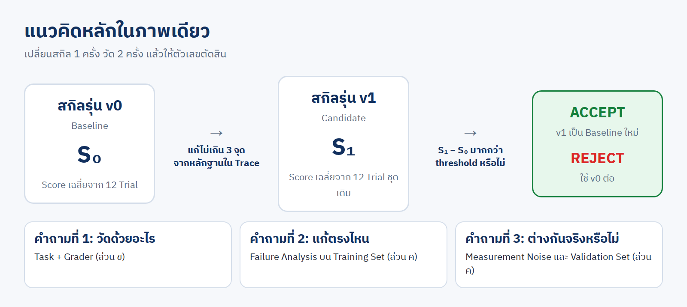

**Skill Optimization** = ปรับปรุง Agent Skill ทีละรุ่น โดยให้ **ผลการวัด** เป็นผู้ตัดสิน ไม่ใช่ความรู้สึกของผู้แก้

## 1.2 สิ่งที่ถูกปรับ: Agent Skill 4 ส่วน

## 1.3 เทียบกับ Model Training

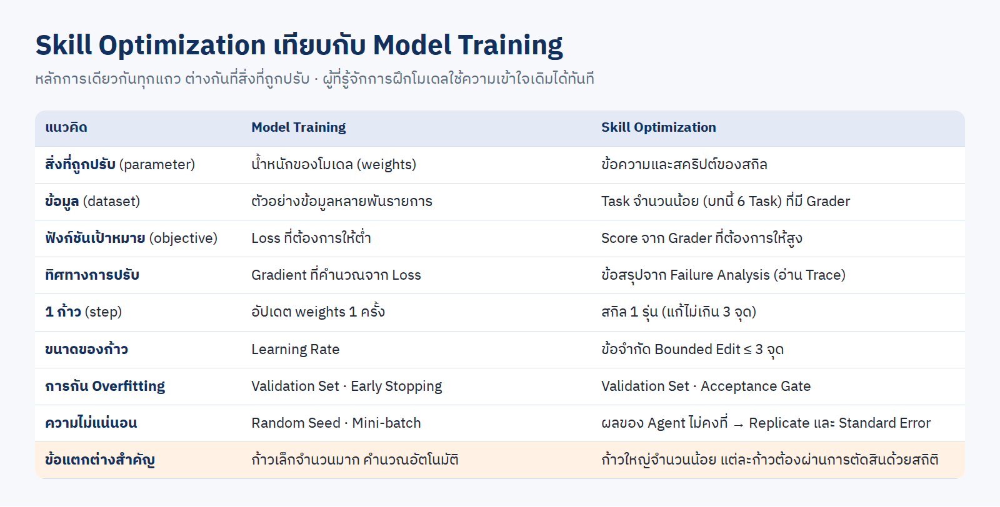

## 1.4 วิธีค้นหา: Hill Climbing ที่มี Acceptance Gate

## 1.5 ทฤษฎีที่อยู่เบื้องหลัง

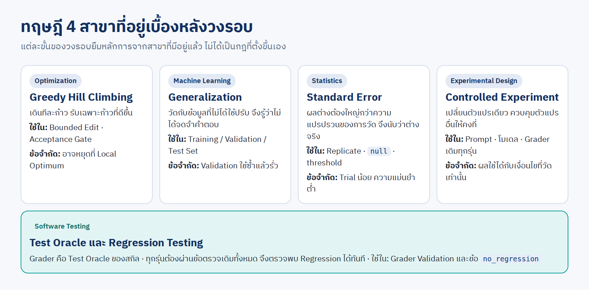

---

# 2 · กระบวนการ

## 2.1 สถาปัตยกรรม

## 2.2 ใครทำอะไร

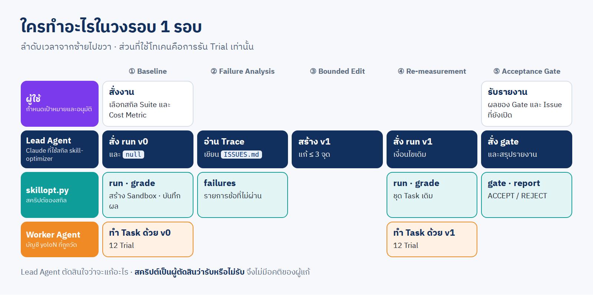

## 2.3 วงรอบ 5 ขั้น และคำสั่งของแต่ละขั้น

## 2.4 Pipeline ของการวัด 1 รอบ

---

# 3 · ตัวอย่างจริง 1 รอบเต็ม

โจทย์: สกิล `web-fixer` ให้ Agent ตรวจเว็บร้านอาหารแมวตามแผนทดสอบด้วย Playwright → แก้ Defect → พิสูจน์ · เดินตามทีละขั้น

## ขั้น 0 · เตรียมเครื่องมือวัด

**Task และ Data Split**

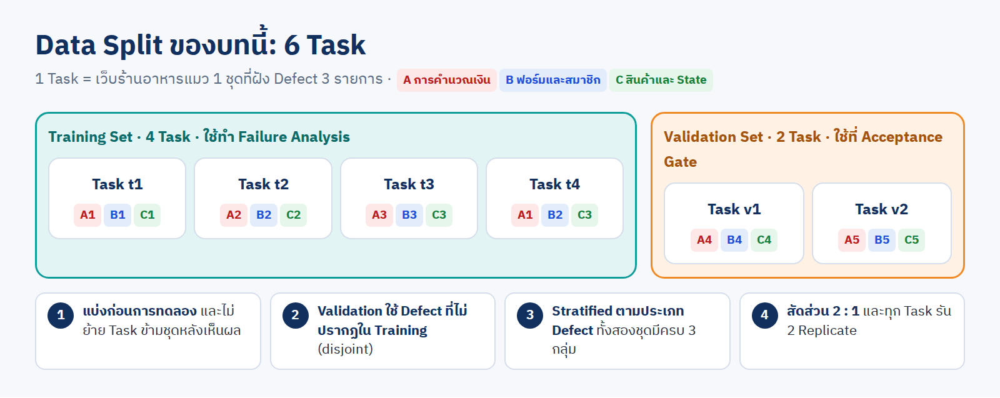

**Grader Validation** · ตรวจ Grader ก่อนใช้โทเคน

| รัน Grader กับ | ผลที่ต้องได้ | ผลจริง |
|---|---|---|
| เว็บอ้างอิงที่ถูก | `fixed` ผ่านครบ | ผ่าน 3/3 · `no_regression` ผ่าน |
| เว็บที่ยังมี Defect 3 รายการ | `fixed` ไม่ผ่านทั้ง 3 | ไม่ผ่าน 3/3 เช่น `expected "-฿79" received "-฿80"` |

## ขั้น 1 · Baseline Measurement

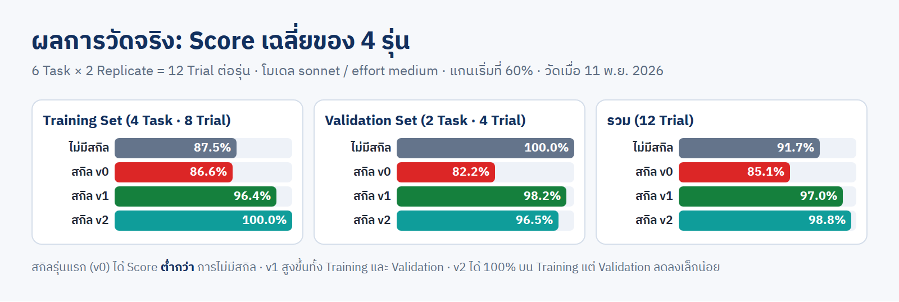

- สกิลรุ่นแรก (`v0`) ได้ **85.1%** ต่ำกว่าการไม่มีสกิล (**91.7%**) → Gate: REJECT
- ถ้าไม่รัน Baseline จะไม่รู้เลยว่าสกิลที่เขียนมาทำให้แย่ลง

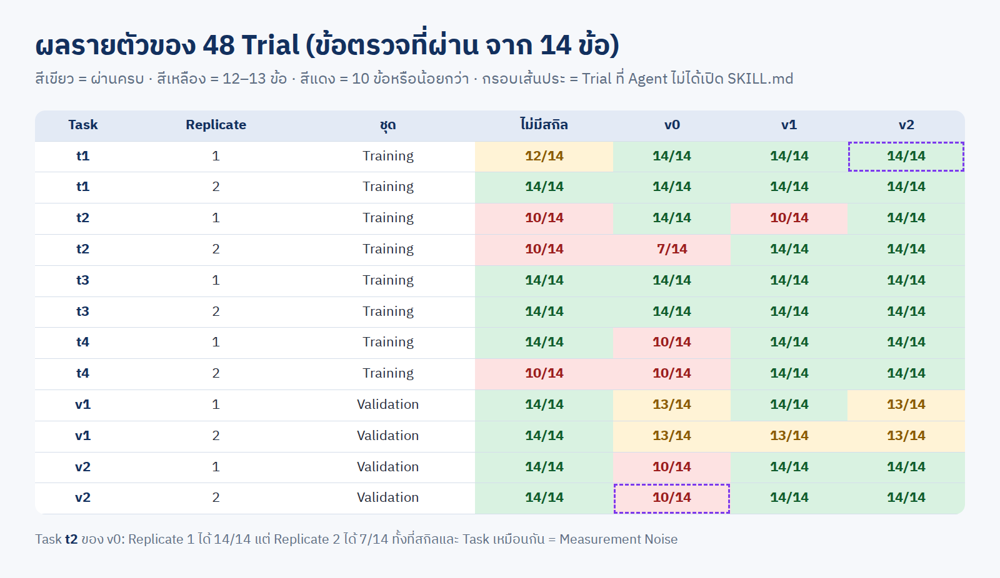

**Measurement Noise** · Task `t2` ของ `v0`: รอบ 1 ได้ 14/14 รอบ 2 ได้ 7/14 ทั้งที่ทุกอย่างเหมือนเดิม

## ขั้น 2 · Failure Analysis

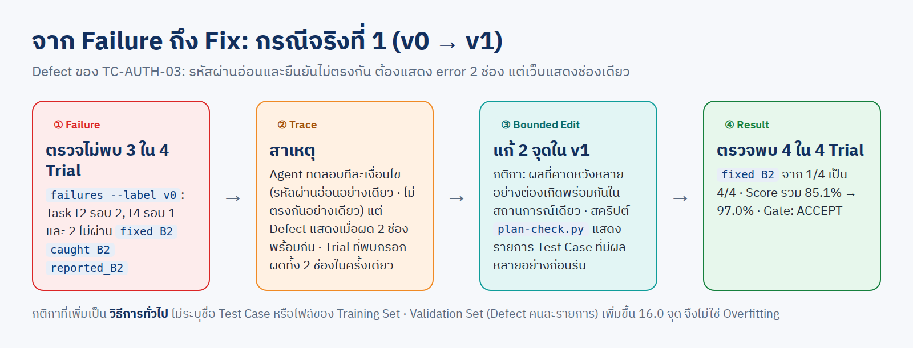

- เปิดเฉพาะ **Training Set** · บันทึกลง [`ISSUES.md`](../02_lab/skill-web-fixer/ISSUES.md) · ปัญหาที่พบ Trial เดียวยังไม่แก้

## ขั้น 3 · Bounded Edit

`v1` แก้ 2 จุด ([diff](../02_lab/skill-web-fixer/)) · ทั้งสองจุดเป็นวิธีการทั่วไป ไม่มีชื่อ Test Case ของ Training Set

## ขั้น 4 · Re-measurement

Task เดิม · 2 Replicate เดิม · โมเดลและ effort เดิม → `v1` ได้ **97.0%**

## ขั้น 5 · Acceptance Gate

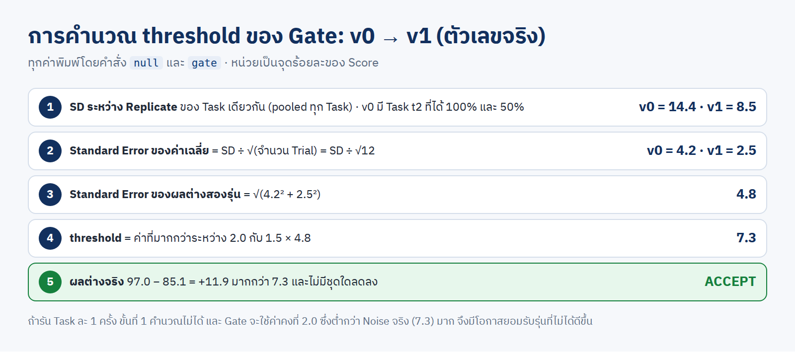

## ทำซ้ำอีกรอบ: v1 → v2

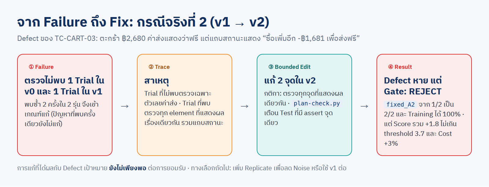

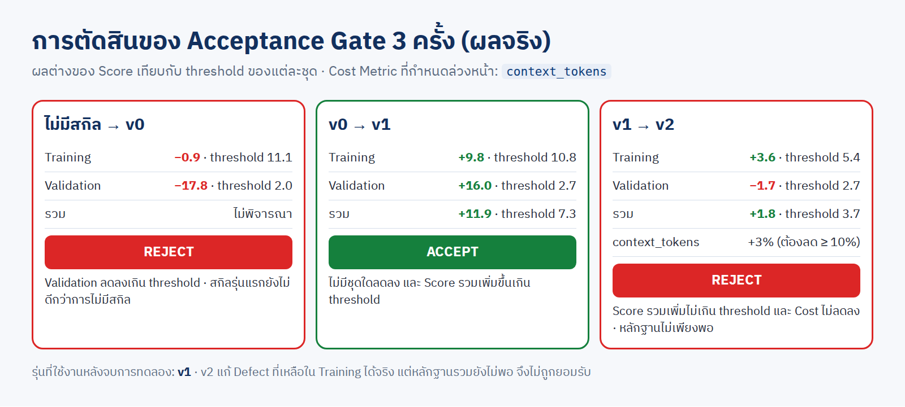

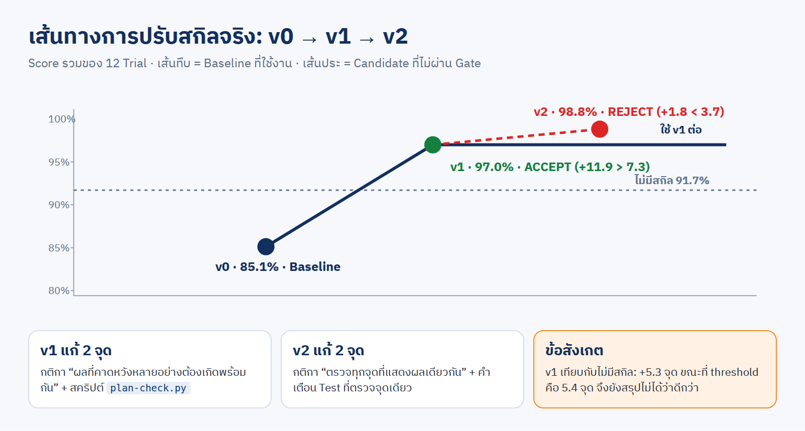

**สิ่งที่ตัวอย่างนี้สอน**

| ผล | บทเรียน |
|---|---|
| `v0` แย่กว่าไม่มีสกิล | สกิลที่ "ดูดี" ต้องวัดก่อนเชื่อ |
| `v0` → `v1` ACCEPT | Failure Analysis 1 สาเหตุ ให้ผล +11.9 จุด และ Validation ขึ้นด้วย |
| `v1` → `v2` REJECT | Training ได้ 100% ยังไม่พอ ถ้าผลต่างรวมไม่เกิน Noise |
| `v1` เทียบไม่มีสกิล +5.3 (threshold 5.4) | ยังสรุปไม่ได้ ต้องเพิ่ม Replicate |

---

# 4 · ใช้กับการตรวจและแก้เว็บ

## 4.1 Inner Loop และ Outer Loop

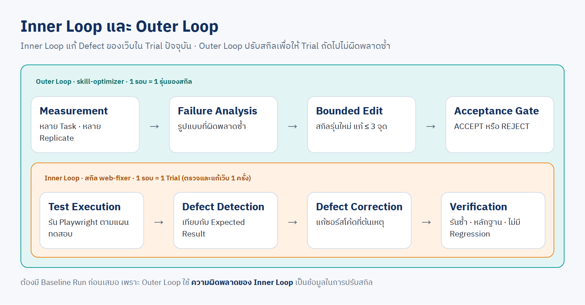

| ระดับ | สิ่งที่แก้ | มีผลกับ |
|---|---|---|
| Inner Loop | ซอร์สโค้ดของเว็บ | เว็บนี้ Trial นี้ |
| Outer Loop | สกิลที่ใช้ตรวจและแก้เว็บ | ทุกเว็บ ทุก Trial ถัดไป |

## 4.2 Failure Triage

## 4.3 การวัดสกิลตรวจเว็บ

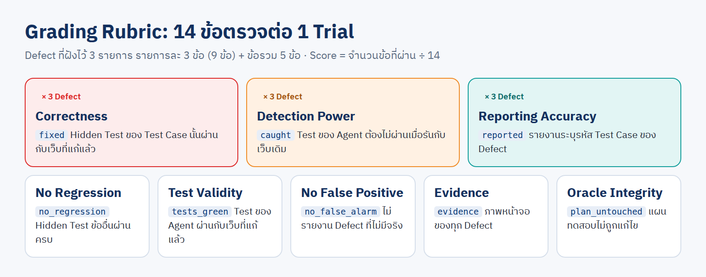

หลักฐานว่าเว็บดีขึ้นจริง (เว็บที่ Agent แก้ด้วยสกิลแต่ละรุ่น · Hidden Test ข้อเดียวกัน)

| `v0` · ไม่ผ่าน | `v1` · ผ่าน |
|---|---|
| 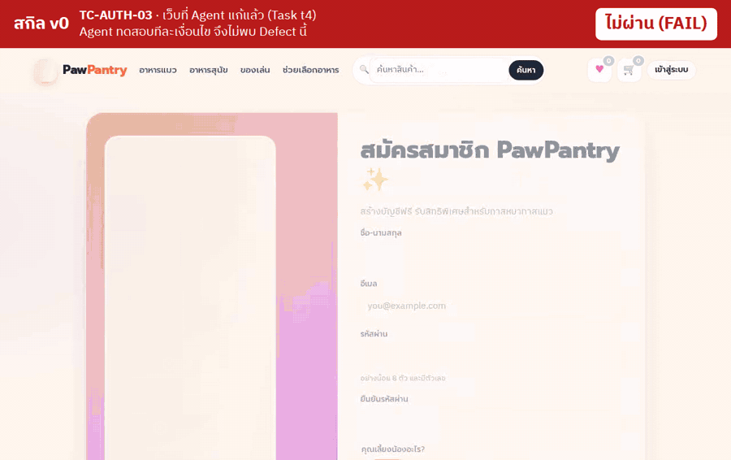 | 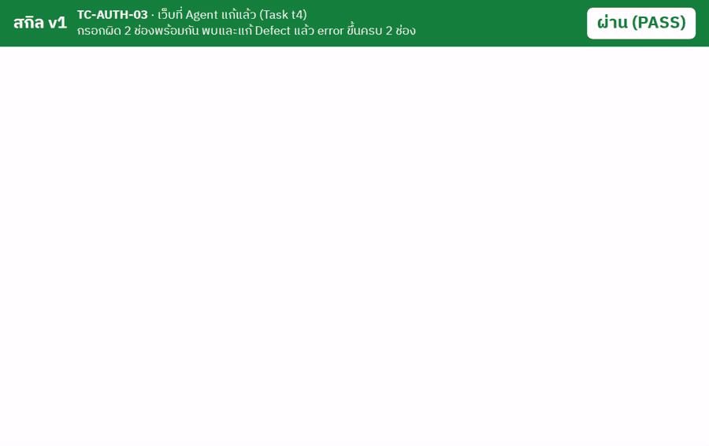 |

## 4.4 สายงาน 7 ช่วง

ทุกช่วงใช้วงรอบเดียวกัน ต่างกันที่ **Grader** · ช่วงที่ยังไม่มี Automated Check ต้องกำหนดข้อตรวจก่อน

---

# 5 · เครื่องมือและข้อจำกัด

## 5.1 สกิล `skill-optimizer`

ที่อยู่: [`../skills/skill-optimizer/`](../skills/skill-optimizer/SKILL.md) · ใน container: `/root/ai-accounts/.Claude/shared/skills/skill-optimizer`

## 5.2 Cost Metric

บทนี้กำหนดล่วงหน้าเป็น `context_tokens` ([เหตุผล](../02_lab/dag/decision-cost-metric.md))

## 5.3 สิ่งที่แก้ในสกิลรุ่นนี้ (11 พ.ย. 2026)

| # | เดิม | แก้เป็น |
|---|---|---|
| 1 | Noise คิดจาก max − min (โตตามจำนวน Replicate) และใช้ค่าของ Baseline รุ่นเดียว | Standard Error ของผลต่างสองรุ่น คิดจากทั้งสองรุ่น |
| 2 | threshold เดียวใช้กับทุกชุด | คิดแยก Training / Validation |
| 3 | `failures` แสดงผลของ Validation Set ถ้าไม่ระบุ `--split` | ค่าเริ่มต้นเป็น Training Set |
| 4 | `report` แสดงผลรายข้อรวม Validation Set | แสดงและบันทึกผลรายข้อเฉพาะ Training Set |
| 5 | `gate` ตัดสินแม้สองรุ่นรัน Task ไม่ครบชุดเดียวกัน | ไม่ตัดสิน (exit 2) |
| 6 | ไม่รายงาน Trial ที่ Agent ไม่เปิด `SKILL.md` หรือจบผิดปกติ | เพิ่มคอลัมน์ในรายงาน และคำเตือนที่ `gate` |
| 7 | ไม่มีขั้น Grader Validation | เพิ่มเป็นขั้นที่ 0 |
| 8 | ไม่กล่าวถึง Information Leakage ของ Validation Set ที่ใช้ซ้ำ | เพิ่มข้อกำหนด และรองรับ Test Set |
| 9 | Task เริ่มจากไฟล์เดี่ยวเท่านั้น | เริ่มจากโฟลเดอร์ได้ (เช่น เว็บที่ต้องแก้) |
| 10 | สคริปต์หยุดบน Windows เมื่อพิมพ์ภาษาไทย | บังคับ UTF-8 |
| 11 | ไม่มีชุดโจทย์ตัวอย่าง | เพิ่ม `examples/web-fixer/` เตรียมด้วยคำสั่งเดียว |

## 5.4 ข้อจำกัดของวิธีการ

| ข้อจำกัด | ผล | วิธีลด |
|---|---|---|
| จำนวน Task น้อย | Noise สูง ผลต่างเล็กตรวจไม่พบ (กรณี `v2`) | เพิ่ม Task หรือ Replicate |
| Validation Set ใช้ซ้ำหลายรุ่น | Information Leakage | ยืนยันด้วย Test Set |
| Grader วัดเฉพาะสิ่งที่เขียนเป็นข้อตรวจ | คุณภาพด้านอื่นไม่ถูกวัด | ทบทวนผลงานด้วยคนเป็นระยะ |
| ผลผูกกับโมเดลและ effort ที่ใช้วัด | เปลี่ยนโมเดลต้องวัดใหม่ | วัด Baseline ใหม่ทุกครั้งที่เปลี่ยน |
| Hill Climbing | อาจหยุดที่ Local Optimum | ลองแนวทางแก้ที่ต่างกันจาก Baseline เดิม |

## 5.5 คำศัพท์

| คำ | ความหมาย |
|---|---|
| **Task** · **Trial** · **Replicate** | โจทย์ 1 ข้อ · การรัน 1 ครั้ง · การรัน Task เดิมซ้ำ |
| **Grader** · **Trace** | โปรแกรมให้ Score 0–1 · บันทึกคำสั่งทุกครั้งของ Agent |
| **Baseline** · **Candidate** | รุ่นฐาน · รุ่นใหม่ที่รอตัดสิน |
| **Training / Validation / Test Set** | ชุดสำหรับ วิเคราะห์ข้อผิดพลาด / ตัดสิน / ยืนยันครั้งสุดท้าย |
| **Overfitting** | Training เพิ่ม แต่ Validation ไม่เพิ่มหรือลดลง |
| **Measurement Noise** · **Standard Error** | ความแปรปรวนของ Score เมื่อรันซ้ำ · ความไม่แน่นอนของค่าเฉลี่ย |
| **Acceptance Gate** | เกณฑ์ตัดสิน ACCEPT / REJECT |
| **Regression** | สิ่งที่เคยถูก กลายเป็นผิดหลังการแก้ |

**ถัดไป:** [LAB · ลงมือทำ](../02_lab/README.md)
