# ทฤษฎี · Skill Optimization ด้วยสกิล `skill-optimizer`

> อ่านตามลำดับ ก → จ · ภาพ 1 ภาพต่อ 1 แนวคิด · ตัวเลขตัวอย่างทุกตัวมาจากการทดลองจริงใน [LAB](../02_lab/README.md)

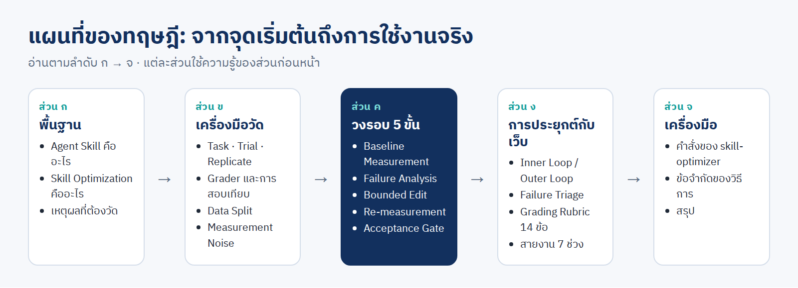

| ส่วน | เนื้อหา | อ่านจบแล้วตอบได้ว่า |
|---|---|---|
| [ก · พื้นฐาน](#ส่วน-ก--พื้นฐาน) | ก1 Agent Skill · ก2 Skill Optimization · ก3 คำศัพท์ | กำลังปรับอะไร และตัดสินด้วยอะไร |
| [ข · เครื่องมือวัด](#ส่วน-ข--เครื่องมือวัด) | ข1 สถาปัตยกรรม · ข2 Trial · ข3 Grader · ข4 Data Split · ข5 Noise | การวัด 1 ครั้งประกอบด้วยอะไร |
| [ค · วงรอบ 5 ขั้น](#ส่วน-ค--วงรอบ-5-ขั้น) | ค1–ค5 ทีละขั้น · ค6 Cost Metric | ทำอะไรก่อนหลัง และรับรุ่นใหม่เมื่อไร |
| [ง · การประยุกต์กับเว็บ](#ส่วน-ง--การประยุกต์กับการตรวจและแก้เว็บ) | ง1 สองวง · ง2 Failure Triage · ง3 Rubric · ง4 สายงาน 7 ช่วง | Playwright พบ error แล้ว `skill-optimizer` ช่วยตรงไหน |
| [จ · เครื่องมือ](#ส่วน-จ--เครื่องมือ) | จ1 คำสั่ง · จ2 สิ่งที่แก้ในสกิล · จ3 ข้อจำกัด | ใช้คำสั่งอะไร และเชื่อผลได้แค่ไหน |

---

# ส่วน ก · พื้นฐาน

## ก1 · Agent Skill มี 4 ส่วน

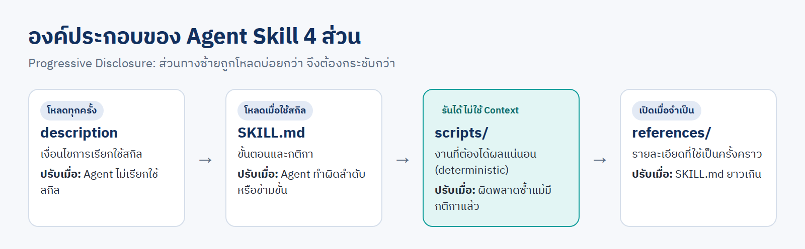

การปรับสกิล = การแก้ส่วนใดส่วนหนึ่งใน 4 ส่วนนี้

## ก2 · Skill Optimization คืออะไร

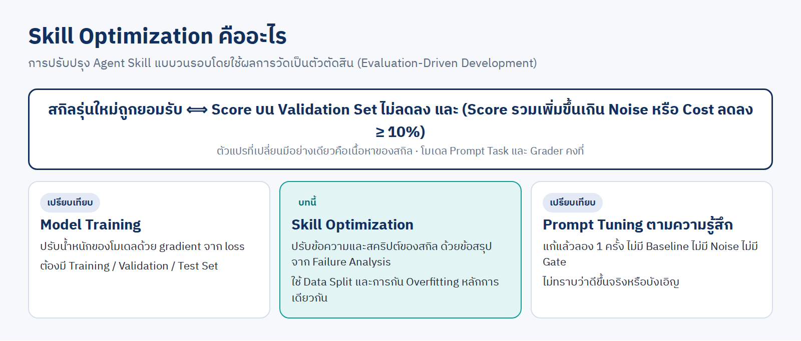

- สิ่งที่เปลี่ยนมีอย่างเดียวคือ **เนื้อหาของสกิล** · โมเดล Prompt Task และ Grader คงที่
- สกิลที่ "ใช้ได้" = ได้ผล 1 ครั้ง · สกิลที่ "ดี" = ได้ผลถูก **ซ้ำได้** กับ Task ที่ไม่เคยเห็น ด้วยต้นทุนต่ำ

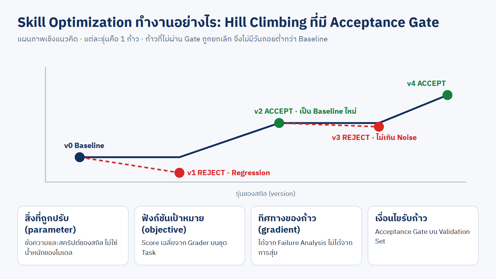

## ก3 · คำศัพท์ที่ใช้ทั้งบท

| คำ | ความหมาย |
|---|---|
| **Task** | โจทย์ 1 ข้อ |
| **Trial** | การรัน 1 ครั้ง ของ 1 Task ด้วยสกิล 1 รุ่น |
| **Replicate** | การรัน Task เดิมซ้ำ (บทนี้ 2 ครั้ง) |
| **Grader** | โปรแกรมที่ตรวจผลงานและให้ Score 0–1 |
| **Trace** | บันทึกคำสั่งทุกครั้งที่ Agent ใช้ใน 1 Trial |
| **Baseline** | สกิลรุ่นที่ใช้เป็นฐานเปรียบเทียบ |
| **Training / Validation / Test Set** | ชุด Task สำหรับ วิเคราะห์ข้อผิดพลาด / ตัดสิน / ยืนยันครั้งสุดท้าย |
| **Overfitting** | Score ของ Training เพิ่ม แต่ Validation ไม่เพิ่มหรือลดลง |
| **Measurement Noise** | ความแปรปรวนของ Score เมื่อรันสกิลรุ่นเดิมซ้ำ |
| **Acceptance Gate** | เกณฑ์ที่ตัดสิน ACCEPT หรือ REJECT |
| **Regression** | สิ่งที่เคยถูก กลายเป็นผิดหลังการแก้ |

---

# ส่วน ข · เครื่องมือวัด

## ข1 · สถาปัตยกรรมของ `skill-optimizer`

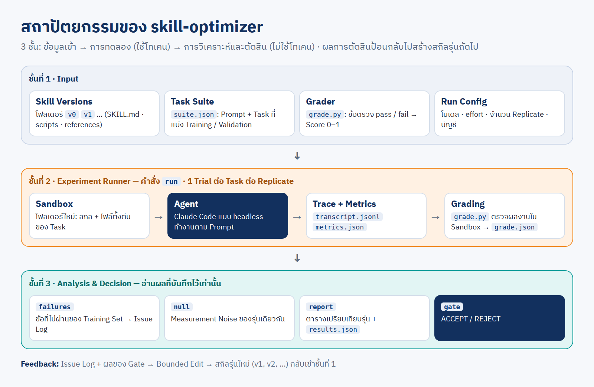

## ข2 · Pipeline ของ 1 รอบการวัด

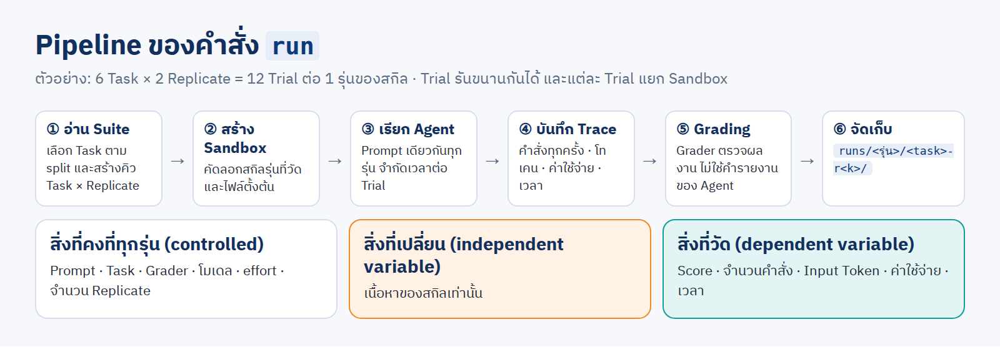

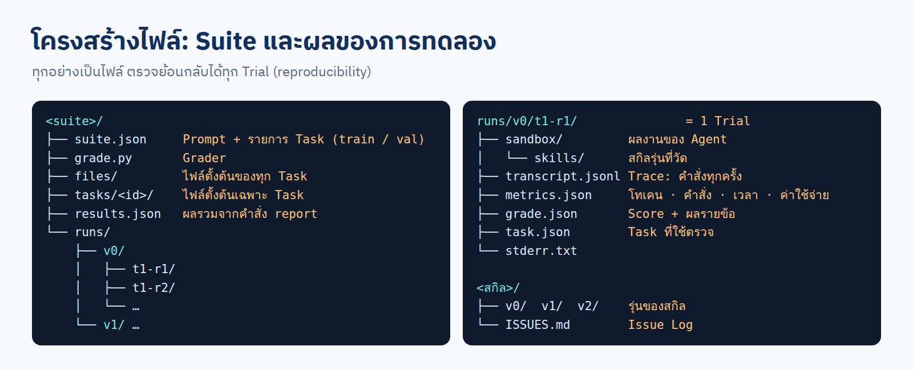

## ข3 · Grader ต้องถูกก่อน (Grader Validation)

Grader ที่ตัดสินผิดทำให้ทุกตัวเลขผิด · ตรวจ 2 กรณีก่อนใช้โทเคน

| รัน Grader กับ | ผลที่ต้องได้ |
|---|---|
| งานอ้างอิงที่ถูกทุกข้อ | 100% |
| งานที่จงใจทำผิด 1 จุด | ไม่ผ่านเฉพาะข้อนั้น |

<!--REAL:grader-->

## ข4 · Data Split

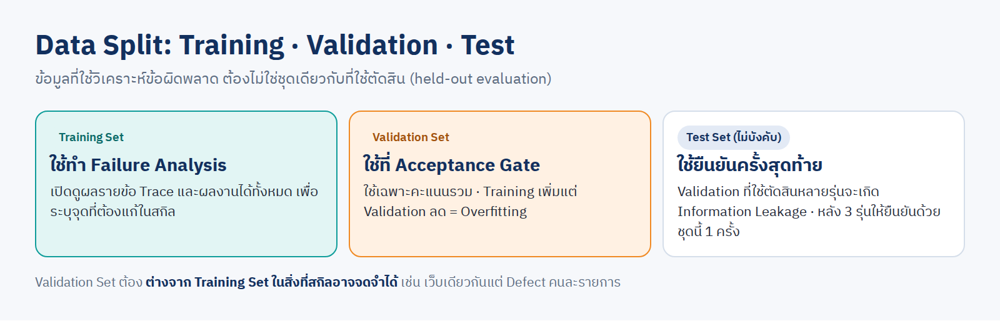

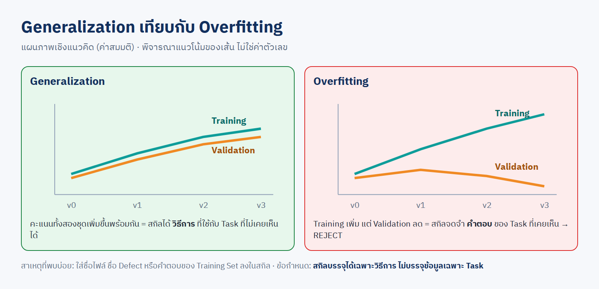

## ข5 · Measurement Noise

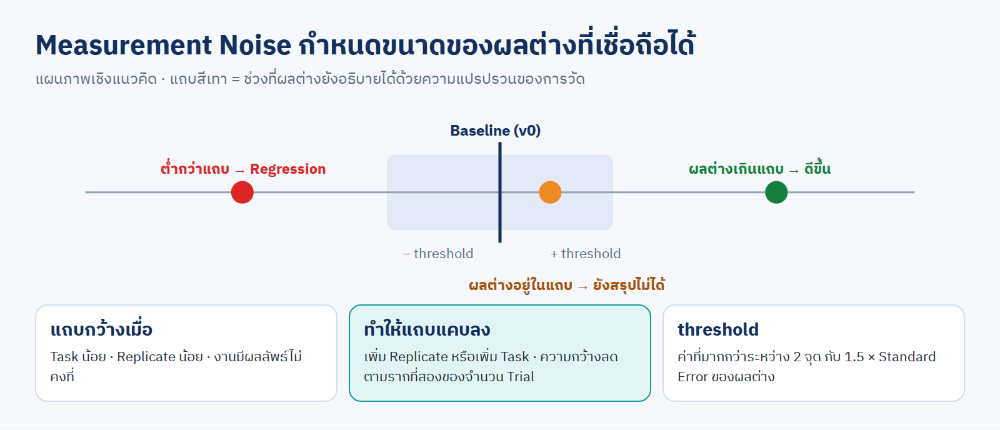

- สกิลรุ่นเดิม Task เดิม รัน 2 ครั้ง **Score ไม่เท่ากัน** เพราะผลของ Agent ไม่คงที่
- จึงรันทุก Task อย่างน้อย **2 Replicate** แล้ววัด Noise ด้วยคำสั่ง `null`

<!--REAL:noise-->

---

# ส่วน ค · วงรอบ 5 ขั้น

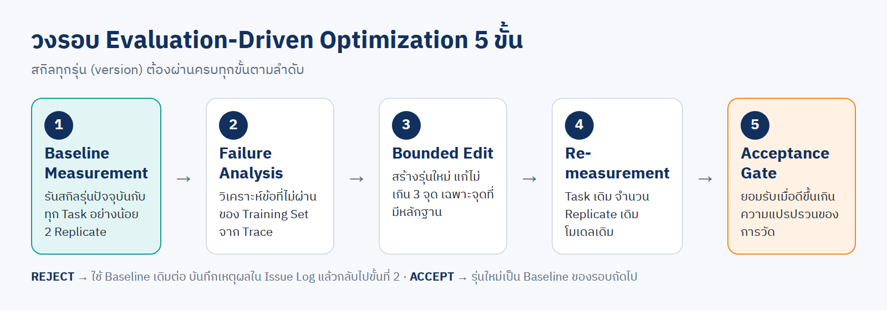

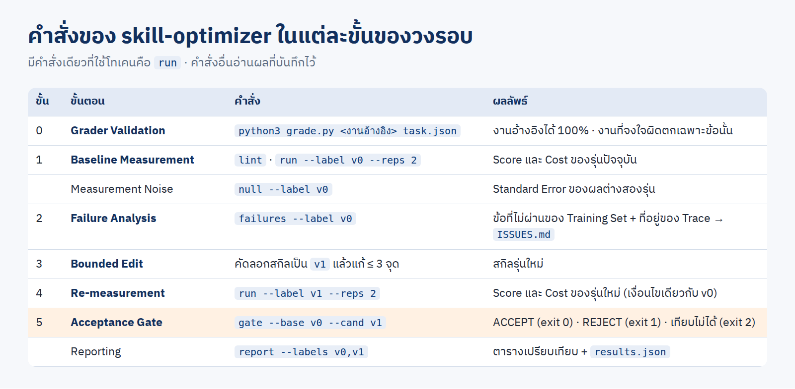

## ค1 · Baseline Measurement

ต้องรันรุ่นแรก (`v0`) ครบทุก Task ก่อน จึงมีข้อที่ไม่ผ่านให้วิเคราะห์ · ไม่มี Baseline = แก้ตามการคาดเดา

<!--REAL:baseline-->

## ค2 · Failure Analysis และ Issue Log

- เปิดเฉพาะ **Training Set**: ข้อที่ไม่ผ่าน → Trace → ผลงานใน Sandbox
- บันทึกใน `ISSUES.md` · 1 แถว = 1 สาเหตุ · ปัญหาที่พบ Trial เดียวยังไม่แก้

<!--REAL:issues-->

## ค3 · Bounded Edit

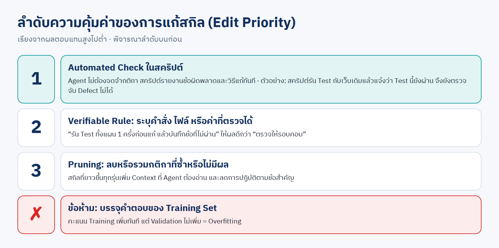

| ข้อกำหนด | เหตุผล |
|---|---|
| แก้ไม่เกิน **3 จุด** ต่อรุ่น | ระบุได้ว่าจุดใดให้ผล |
| ทุกรุ่นเป็น **โฟลเดอร์ใหม่** | ย้อนกลับและเปรียบเทียบได้ |

<!--REAL:edit-->

## ค4 · Re-measurement

Task เดิม · จำนวน Replicate เดิม · โมเดลและ effort เดิม · ต่างจาก Baseline เฉพาะเนื้อหาของสกิล

## ค5 · Acceptance Gate

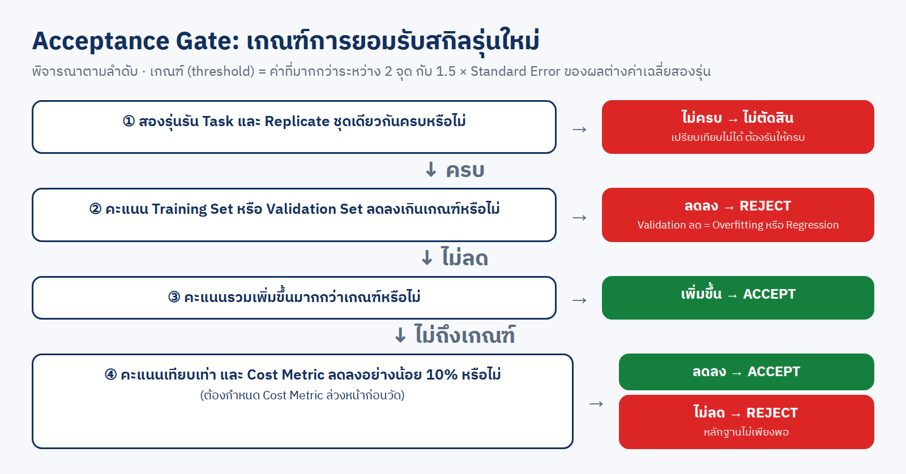

- ผ่าน Gate **ไม่ใช่ข้อพิสูจน์**: ที่ 1.5 เท่าของ Standard Error รุ่นที่ไม่ต่างจริงยังผ่านได้ราว 7% · งานสำคัญใช้ `--z 2` (ราว 2%)
- REJECT → ใช้ Baseline เดิม · **ห้าม** แก้ Grader หรือ Task เพื่อให้ผ่าน

<!--REAL:gate-->

## ค6 · Cost Metric

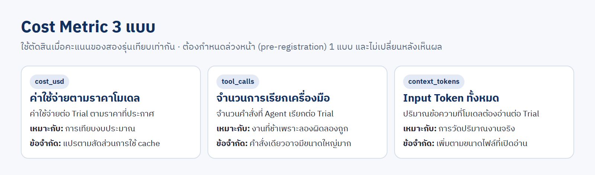

<!--REAL:cost-->

---

# ส่วน ง · การประยุกต์กับการตรวจและแก้เว็บ

## ง1 · Inner Loop และ Outer Loop

เว็บที่ AI สร้างมี Defect เสมอ · Playwright ตรวจพบแล้วแก้ได้ 2 ระดับ

| ระดับ | สิ่งที่แก้ | มีผลกับ |
|---|---|---|
| Inner Loop | ซอร์สโค้ดของเว็บ | เว็บนี้ Trial นี้ |
| Outer Loop | สกิลที่ใช้ตรวจและแก้เว็บ | ทุกเว็บ ทุก Trial ถัดไป |

## ง2 · Failure Triage

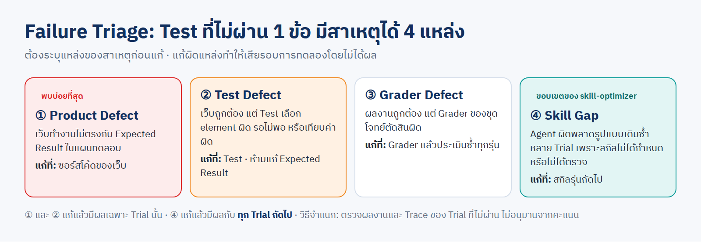

## ง3 · การวัดสกิลตรวจเว็บ

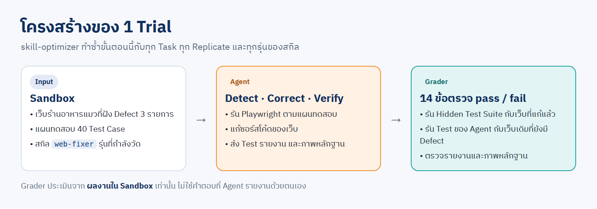

<!--REAL:web-->

## ง4 · สายงาน 7 ช่วง

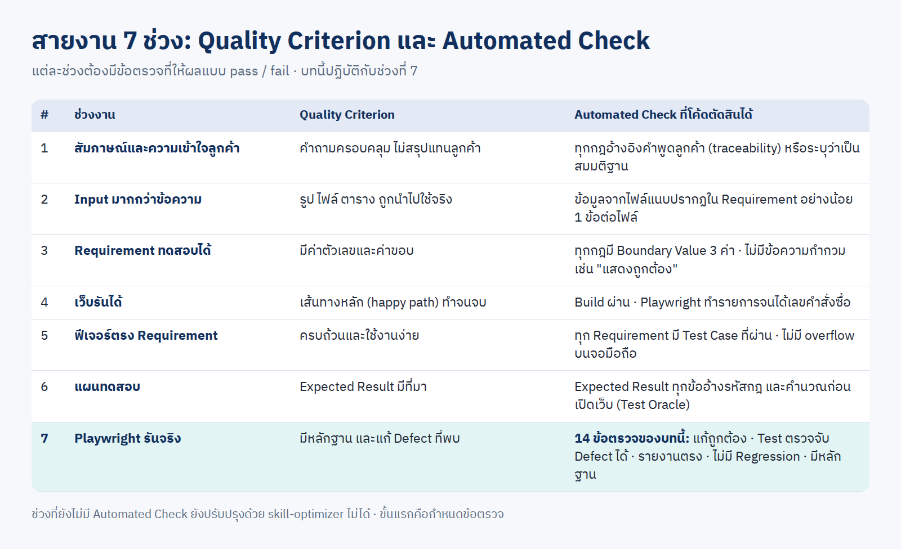

ทุกช่วงใช้วงรอบเดียวกัน ต่างกันที่ **Grader** · ช่วงที่ยังไม่มี Automated Check ต้องกำหนดข้อตรวจก่อน

---

# ส่วน จ · เครื่องมือ

## จ1 · สกิล `skill-optimizer`

ที่อยู่: [`../skills/skill-optimizer/`](../skills/skill-optimizer/SKILL.md) · ใน container: `/root/ai-accounts/.Claude/shared/skills/skill-optimizer`

| คำสั่ง | หน้าที่ | ใช้โทเคน |
|---|---|---|
| `lint` | ขนาดและต้นทุน Context ของสกิล | – |
| `run` | รันสกิลกับ Suite | ✔ |
| `failures` | ข้อที่ไม่ผ่านของ Training Set + ที่อยู่ของ Trace | – |
| `null` | Measurement Noise | – |
| `report` | ตารางเปรียบเทียบรุ่น | – |
| `gate` | ACCEPT / REJECT | – |
| `grade` | ประเมินซ้ำหลังแก้ Grader | – |

## จ2 · สิ่งที่แก้ในสกิลรุ่นนี้ (11 พ.ย. 2026)

| # | เดิม | แก้เป็น |
|---|---|---|
| 1 | Noise คิดจาก max − min (โตตามจำนวน Replicate) และใช้ค่าของ Baseline รุ่นเดียว | Standard Error ของผลต่างสองรุ่น คิดจากทั้งสองรุ่น |
| 2 | threshold เดียวใช้กับทุกชุด | คิดแยก Training / Validation (ชุดที่ Task น้อยมี Noise มากกว่า) |
| 3 | `failures` แสดงผลของ Validation Set ด้วยถ้าไม่ระบุ `--split` | ค่าเริ่มต้นเป็น Training Set เท่านั้น |
| 4 | `gate` ตัดสินแม้สองรุ่นรัน Task ไม่ครบชุดเดียวกัน | ไม่ตัดสิน (exit 2) |
| 5 | ไม่รายงาน Trial ที่ Agent ไม่เปิด `SKILL.md` หรือจบผิดปกติ | เพิ่มคอลัมน์ในรายงาน และคำเตือนที่ `gate` |
| 6 | ไม่มีขั้น Grader Validation | เพิ่มเป็นขั้นที่ 0 |
| 7 | ไม่กล่าวถึง Information Leakage ของ Validation Set ที่ใช้ซ้ำ | เพิ่มข้อกำหนด และรองรับ Test Set |
| 8 | Task เริ่มจากไฟล์เดี่ยวเท่านั้น | เริ่มจากโฟลเดอร์ได้ (เช่น เว็บที่ต้องแก้) |
| 9 | สคริปต์หยุดบน Windows เมื่อพิมพ์ภาษาไทย | บังคับ UTF-8 |

## จ3 · ข้อจำกัดของวิธีการ

| ข้อจำกัด | ผล | วิธีลด |
|---|---|---|
| จำนวน Task น้อย | Noise สูง ผลต่างเล็กตรวจไม่พบ | เพิ่ม Task หรือ Replicate |
| Validation Set ใช้ซ้ำหลายรุ่น | Information Leakage | ยืนยันด้วย Test Set |
| Grader วัดได้เฉพาะสิ่งที่เขียนเป็นข้อตรวจ | คุณภาพด้านอื่นไม่ถูกวัด | ทบทวนผลงานด้วยคนเป็นระยะ |
| ผลผูกกับโมเดลและ effort ที่ใช้วัด | เปลี่ยนโมเดลต้องวัดใหม่ | วัด Baseline ใหม่ทุกครั้งที่เปลี่ยน |

<!--REAL:summary-->
