# LAB · ปรับสกิลตรวจและแก้เว็บด้วย `skill-optimizer` (Copy & Paste)

> เว็บ: ร้านอาหารแมว **PawPantry** · สกิลที่ถูกปรับ: **`web-fixer`** (ตรวจเว็บตามแผนทดสอบด้วย Playwright → แก้ Defect → พิสูจน์)
> ผลทุกตัวในหน้านี้มาจากการรันจริงเมื่อ 11 พ.ย. 2026 · อ่าน [ทฤษฎี](../01_theory/README.md) ก่อน

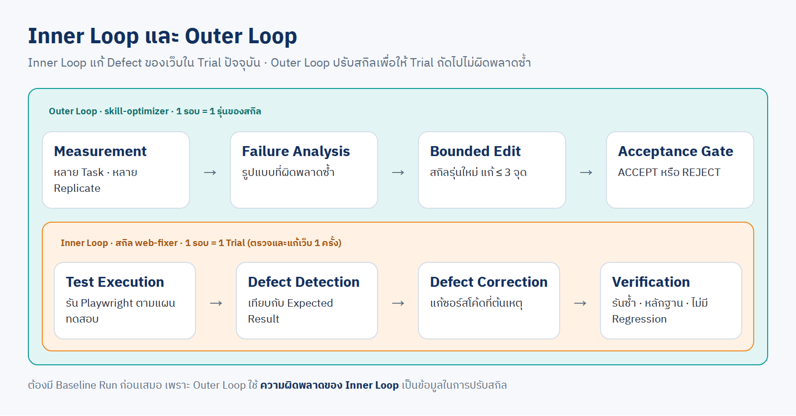

| LAB | ทำอะไร | ใช้โทเคนของบัญชี yolo | เวลาจริง (รันขนาน 4–6 Trial) |
|---|---|---|---|
| [0](#lab-0--เตรียม) | ตรวจสกิล เตรียมชุดโจทย์ ตรวจ Grader | – | 2 นาที |
| [1](#lab-1--baseline-measurement) | วัดรอบแรก: ไม่มีสกิล และ `v0` | 24 Trial | 39 นาที |
| [2](#lab-2--failure-analysis) | หาสาเหตุจาก Trace เขียน Issue Log | – | – |
| [3](#lab-3--สร้าง-v1-และตัดสิน) | สร้าง `v1` วัดซ้ำ ตัดสิน | 12 Trial | 29 นาที |
| [4](#lab-4--ทำซ้ำอีกรอบ-v2) | สร้าง `v2` วัดซ้ำ ตัดสิน | 12 Trial | 18 นาที |
| [5](#lab-5--หลักฐานว่าเว็บดีขึ้นจริง) | ดูเว็บที่แต่ละรุ่นแก้ และ GIF | – | – |

ราคาตามรายการของ 48 Trial รวม $43.10 (ไม่มีสกิล $9.64 · v0 $11.24 · v1 $10.80 · v2 $11.42) · ไม่ใช่ยอดจ่ายจริงของบัญชีแบบ subscription

พรอมต์ LAB 0 และ LAB 2 รันผ่าน Claude ตามตัวอักษรแล้ว · LAB 1 3 4 ผู้สอนรันคำสั่งของสกิลชุดเดียวกันโดยตรง ตัวเลขจึงเป็นของจริง แต่รูปแบบคำตอบของ Claude อาจต่างจากที่แสดง

**วิธีใช้:** คัดลอกพรอมต์ในกล่อง → วางใน Claude Code Desktop ที่เปิดโฟลเดอร์ `Teaching` → รอผล · ทุกพรอมต์ขึ้นต้นด้วยบรรทัดตรวจสกิลเดียวกัน ถ้า container ไม่มีสกิล Claude จะหยุด

---

## LAB 0 · เตรียม

```text
ก่อนเริ่ม ดูว่าใน container multi-account มีสกิล skill-optimizer หรือไม่ (/root/ai-accounts/.Claude/shared/skills)
ถ้าไม่มี ให้หยุดและแจ้งผม ห้ามคัดลอกหรือสร้างสกิลเอง · ถ้ามี ให้อ่านและใช้
1. เตรียมชุดโจทย์ตัวอย่าง web-fixer ของสกิล พร้อมตรวจ Grader
2. ตรวจว่าบัญชี yolo ใดพร้อมใช้
ตอบสั้น ๆ เป็นตาราง รายการ | ผล
```

ผลจริง (วางพรอมต์นี้ผ่าน Claude จริง ใช้ 1 นาที 35 วินาที)

| รายการ | ผล |
|---|---|
| สกิล `skill-optimizer` | ✅ มี · อ่าน `SKILL.md` แล้ว ไม่ได้คัดลอกหรือสร้างเอง |
| ชุดโจทย์ web-fixer | ✅ `/workspace/suite/web-fixer` (Training 4 · Validation 2 Task) · สกิลรุ่นแรกที่ `/workspace/skills/web-fixer/v0` |
| Grader กับเว็บอ้างอิง | ✅ `fixed_*` ผ่านทั้ง 3 ข้อ · `no_regression` ผ่าน |
| Grader กับเว็บที่ยังมี Defect | ✅ `fixed_*` ไม่ผ่านทั้ง 3 ข้อ → Grader ใช้ได้ |
| บัญชี | ✅ yolo1 yolo2 yolo3 พร้อม · ❌ yolo4 yolo5 ยังไม่ล็อกอิน |

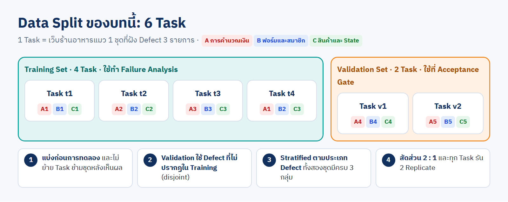

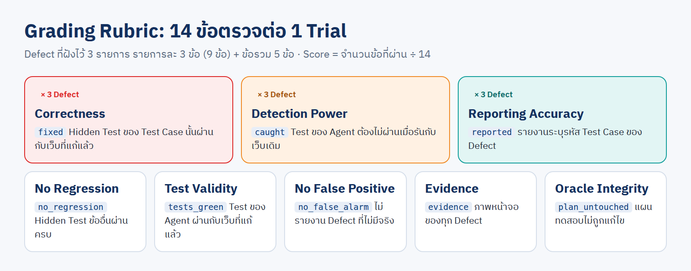

<details><summary>ชุดโจทย์นี้สร้างอย่างไร (สกิล <code>dag-planner</code> + <code>agent-team</code>)</summary>

แตกงานเป็น 12 บล็อก ใช้สกิล `yolo` `cyolo` `image` `review` `debate` `best_of` ครบ 6 แบบ · แผน 81.2 นาที · จริง **23.9 นาที** · 1,053,060 โทเคน · เสร็จ 10 จาก 12 บล็อก

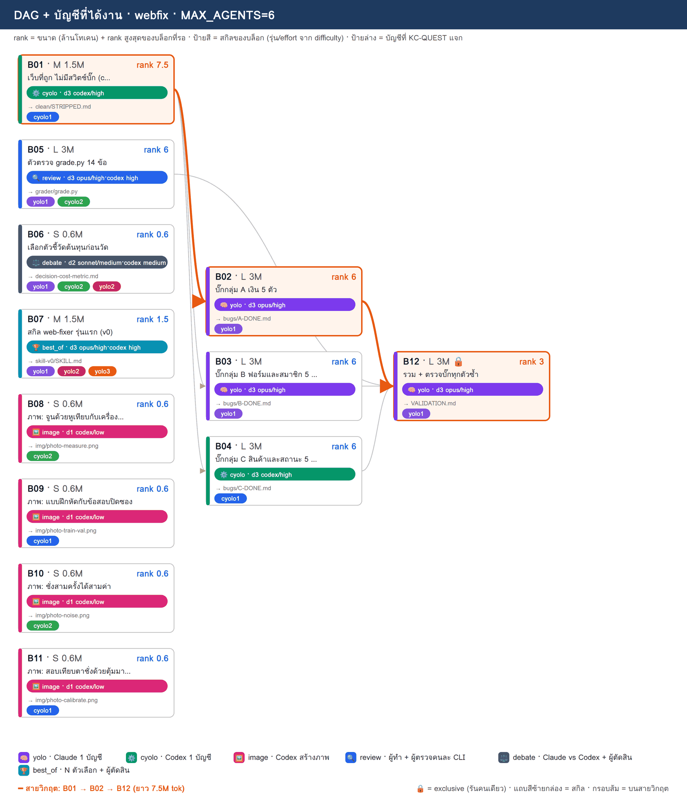

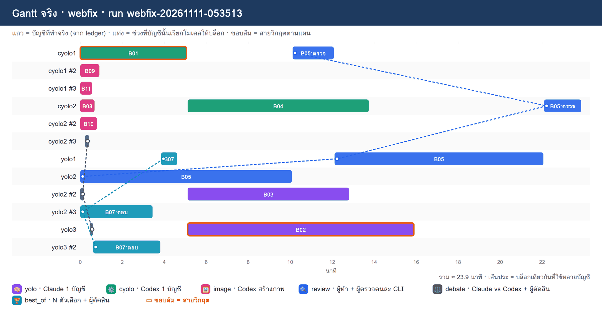

- บล็อก Grader (review) ไม่ได้ APPROVED ภายใน 2 รอบ ผู้ตรวจฝั่ง Codex ติด 1 จุด → บล็อกตรวจ Defect ซ้ำถูกบล็อกตาม → ผู้สอนแก้จุดนั้นและรันการตรวจซ้ำเอง: Defect ทั้ง 15 รายการทำให้ Hidden Test ไม่ผ่านตรง Test Case ที่ตั้งใจ ([REPORT](dag/REPORT.md))
- Cost Metric เลือกด้วย `debate` ก่อนเห็นผล: [`context_tokens`](dag/decision-cost-metric.md)
- สกิล `web-fixer` v0 มาจาก `best_of` 2 คำตอบ ผู้ตัดสินให้ 8 ต่อ 6

</details>

---

## LAB 1 · Baseline Measurement

```text
ก่อนเริ่ม ดูว่าใน container multi-account มีสกิล skill-optimizer หรือไม่ (/root/ai-accounts/.Claude/shared/skills)
ถ้าไม่มี ให้หยุดและแจ้งผม ห้ามคัดลอกหรือสร้างสกิลเอง · ถ้ามี ให้อ่านและใช้
วัดสกิล web-fixer รุ่น v0 (/workspace/skills/web-fixer/v0) กับชุดโจทย์ /workspace/suite/web-fixer และวัดแบบไม่มีสกิลด้วย
โจทย์ละ 2 รอบ · โมเดล sonnet effort medium · ใช้บัญชี yolo ที่พร้อม · รวม 24 รอบ รันเบื้องหลัง
จบแล้วตอบ: ตาราง report · ความแกว่ง (null) ของ v0 · ผล gate ไม่มีสกิล → v0 โดยใช้ cost metric context_tokens
```

ผลจริง ([report.md](results/report.md))

| รุ่น | Training | Validation | รวม | ผ่านครบ 14 ข้อ | เวลา (s) | context_tokens | อ่านสกิล |
|---|---|---|---|---|---|---|---|
| ไม่มีสกิล | 87.5% | 100.0% | **91.7%** | 8/12 | 333 | 2,139,970 | – |
| `v0` | 86.6% | 82.2% | **85.1%** | 5/12 | 517 | 2,016,372 | 11/12 |

```text
val: 100.0% → 82.2% (-17.8) · เกณฑ์ 2.0 จุด
  ✗ คะแนนชุด val ลดลงเกิน 2.0 จุด
ผล: REJECT ❌ ไม่รับ v0 แทน noskill
```

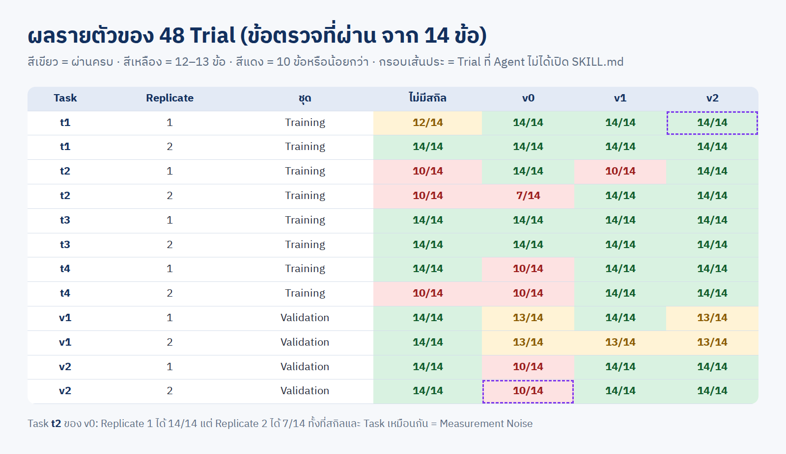

👀 สังเกต: สกิลรุ่นแรกแย่กว่าไม่มีสกิล · Task `t2` ของ `v0` ได้ 14/14 และ 7/14 ในสองรอบ · มี 1 Trial ที่ Agent ไม่เปิด `SKILL.md`

---

## LAB 2 · Failure Analysis

```text
ก่อนเริ่ม ดูว่าใน container multi-account มีสกิล skill-optimizer หรือไม่ (/root/ai-accounts/.Claude/shared/skills)
ถ้าไม่มี ให้หยุดและแจ้งผม ห้ามคัดลอกหรือสร้างสกิลเอง · ถ้ามี ให้อ่านและใช้
ดูข้อที่พลาดของ v0 เฉพาะชุด train แล้วเปิดร่องรอยและผลงานของรอบที่พลาด
หาสาเหตุที่พบมากกว่า 1 รอบ แล้วเขียน /workspace/skills/web-fixer/ISSUES.md ตามรูปแบบของสกิล
ห้ามเปิดผลรายข้อของชุด val · ยังไม่ต้องแก้สกิล · ตอบ: ตาราง ปัญหา | พบกี่รอบ | สาเหตุ | หลักฐานจากร่องรอย
```

ผลจริง ([failures-v0.txt](results/failures-v0.txt) · [ISSUES.md](skill-web-fixer/ISSUES.md)) · วางพรอมต์นี้ผ่าน Claude จริง ใช้ 2 นาที 29 วินาที และได้สาเหตุตรงกับของผู้สอน

| ปัญหา | พบ | สาเหตุที่ Claude สรุปจาก Trace |
|---|---|---|
| ตรวจไม่พบ Defect ของ TC-AUTH-03 | 3/8 (t2 รอบ 2 · t4 รอบ 1 · t4 รอบ 2) | แผนระบุ error 2 ช่องพร้อมกัน แต่ Agent แยกเป็น 2 กรณี ซึ่งผ่านทั้งคู่บนเว็บเดิม · สกิลไม่ได้บอกให้ตรวจผลหลายอย่างในสถานการณ์เดียว |
| เห็นอาการผิดแล้วแต่ไม่รายงาน (TC-CART-03) | 2/8 (t2 รอบ 2 · t4 รอบ 2) | Agent เห็น `ซื้อเพิ่มอีก -฿891 เพื่อส่งฟรี` แล้วสรุปว่า "แผนไม่ได้ระบุ ไม่นับเป็นบั๊ก" |

```text
## t4 r1 (train) score 0.71
  ✗ fixed_B2: TC-AUTH-03 ยังล้ม: getByTestId('error-confirm') element(s) not found · expected "รหัสผ่านไม่ตรงกัน"
  ✗ caught_B2: ไม่มีเทสต์ที่ชื่อมี TC-AUTH-03
  ✗ reported_B2: ไม่มีแถวที่คอลัมน์แรกเป็น TC-AUTH-03
```

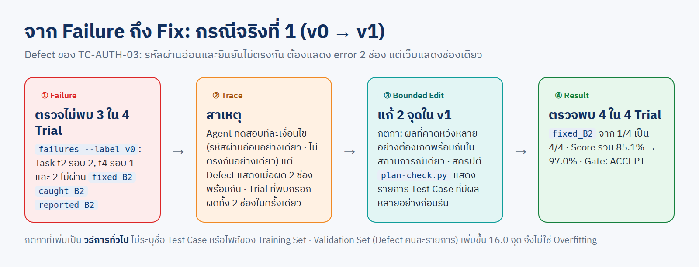

---

## LAB 3 · สร้าง v1 และตัดสิน

```text
ก่อนเริ่ม ดูว่าใน container multi-account มีสกิล skill-optimizer หรือไม่ (/root/ai-accounts/.Claude/shared/skills)
ถ้าไม่มี ให้หยุดและแจ้งผม ห้ามคัดลอกหรือสร้างสกิลเอง · ถ้ามี ให้อ่านและใช้
สร้าง /workspace/skills/web-fixer/v1 จาก v0 แก้ไม่เกิน 3 จุดตามสาเหตุใน ISSUES.md
ห้ามใส่ชื่อ test case ชื่อไฟล์ หรือคำตอบของโจทย์ลงในสกิล
วัด v1 ด้วยเงื่อนไขเดียวกับ v0 แล้วรัน gate v0 → v1 (cost metric context_tokens)
ตอบ: diff ของสกิล · ตาราง report v0,v1 · ผล gate · อัปเดต ISSUES.md
```

`v1` แก้ 2 จุด ([v0](skill-web-fixer/v0/SKILL.md) → [v1](skill-web-fixer/v1/SKILL.md))

| จุด | แก้อะไร | ระดับ |
|---|---|---|
| 1 | กติกา: ผลที่คาดหวังหลายอย่างต้องเกิดพร้อมกันในสถานการณ์เดียว แล้ว assert ครบทุกผล | Verifiable Rule |
| 2 | สคริปต์ [`plan-check.py`](skill-web-fixer/v1/scripts/plan-check.py): ตรวจว่ามี Test ครบทุกข้อของแผน และแสดงข้อที่มีผลหลายอย่าง ก่อนรัน | Automated Check |

ผลจริง ([gate-v0-v1.txt](results/gate-v0-v1.txt))

```text
train: 86.6% → 96.4% (+9.8) · เกณฑ์ 10.8 จุด
val: 82.2% → 98.2% (+16.0) · เกณฑ์ 2.7 จุด
รวม: 85.1% → 97.0% (+11.9) · เกณฑ์ 7.3 จุด = ค่าที่มากกว่าระหว่าง eps 2.0 กับ z 1.5 × ความแกว่งของส่วนต่าง 4.8 จุด
  ✓ คะแนนรวมดีขึ้น +11.9 จุด มากกว่าเกณฑ์ 7.3 จุด
ผล: ACCEPT ✅ รับ v1 แทน v0
```

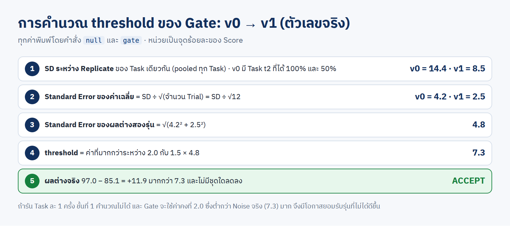

---

## LAB 4 · ทำซ้ำอีกรอบ (v2)

```text
ก่อนเริ่ม ดูว่าใน container multi-account มีสกิล skill-optimizer หรือไม่ (/root/ai-accounts/.Claude/shared/skills)
ถ้าไม่มี ให้หยุดและแจ้งผม ห้ามคัดลอกหรือสร้างสกิลเอง · ถ้ามี ให้อ่านและใช้
ดูข้อที่พลาดของ v1 เฉพาะชุด train เทียบกับ ISSUES.md แล้วสร้าง v2 จาก v1 แก้ไม่เกิน 3 จุด
วัด v2 ด้วยเงื่อนไขเดิม แล้วรัน gate v1 → v2 (cost metric context_tokens)
ถ้า REJECT ให้ใช้ v1 ต่อ ห้ามแก้ตัวตรวจหรือโจทย์ · ตอบ: ตาราง report v0,v1,v2 · ผล gate · อัปเดต ISSUES.md
```

ผลจริง ([gate-v1-v2.txt](results/gate-v1-v2.txt))

```text
train: 96.4% → 100.0% (+3.6) · เกณฑ์ 5.4 จุด
val: 98.2% → 96.5% (-1.7) · เกณฑ์ 2.7 จุด
รวม: 97.0% → 98.8% (+1.8) · เกณฑ์ 3.7 จุด
  ✗ คะแนนรวมดีขึ้น +1.8 จุด ไม่เกินเกณฑ์ 3.7 จุด และโทเคนขาเข้าไม่ลดลงอย่างน้อย 10% [+3%]
ผล: REJECT ❌ ไม่รับ v2 แทน v1
```

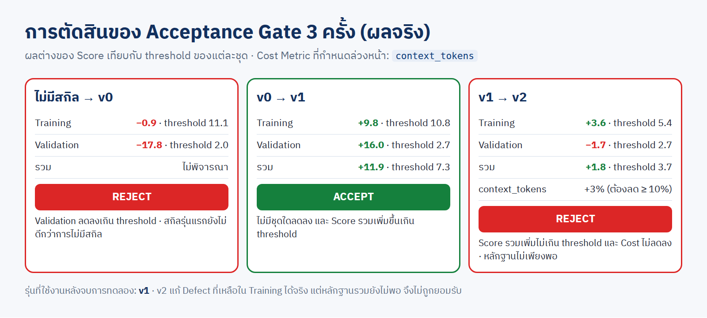

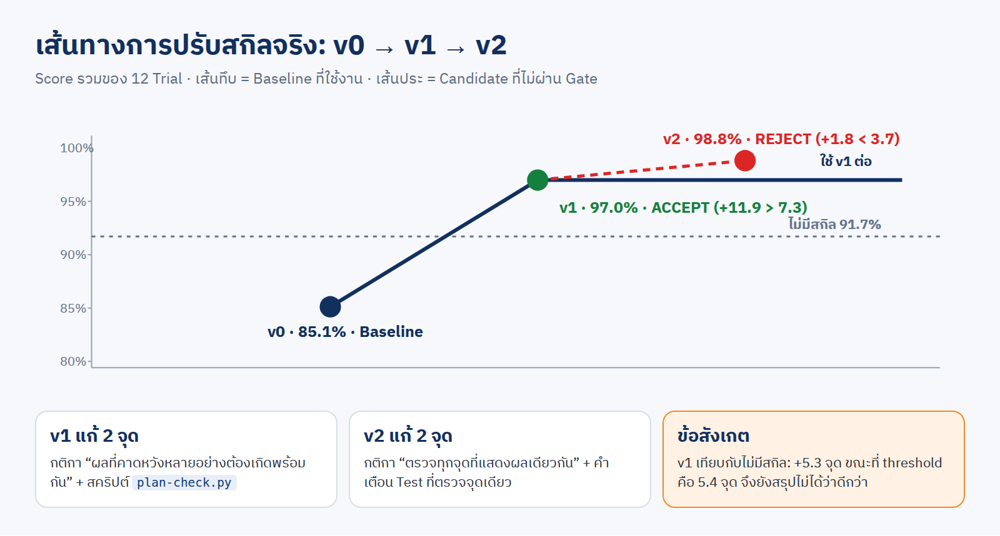

👀 `v2` ทำ Training ได้ 100% และ Defect เป้าหมายหาย แต่หลักฐานรวมยังไม่พอ → รุ่นที่ใช้คือ **`v1`**

---

## LAB 5 · หลักฐานว่าเว็บดีขึ้นจริง

Hidden Test ข้อเดียวกัน รันกับเว็บเดิม และเว็บที่ Agent แก้ด้วยสกิลแต่ละรุ่น

**TC-AUTH-03** · รหัสผ่านอ่อนและยืนยันไม่ตรงกัน ต้องแสดง error 2 ช่อง (Task `t4`)

| เว็บเดิม | ไม่มีสกิล | `v0` | `v1` |
|---|---|---|---|
|  |  | 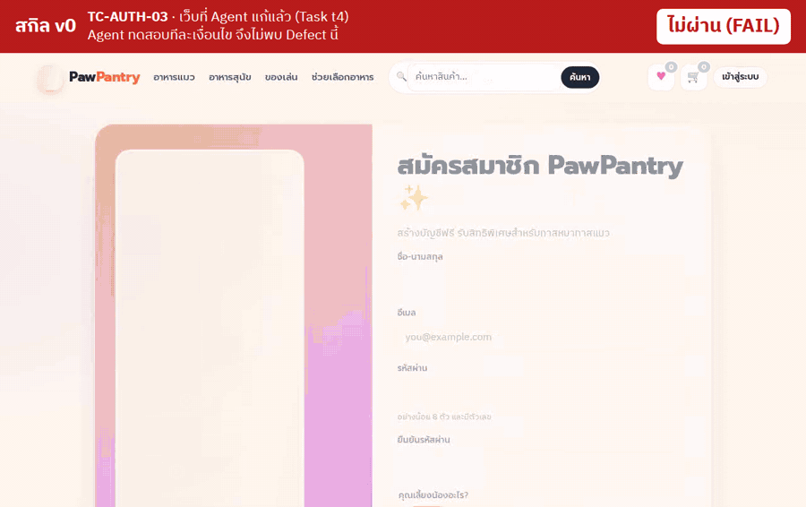 | 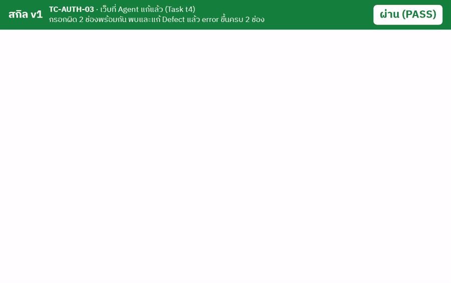 |

**TC-CART-03** · ตะกร้า ฿2,680 ต้องส่งฟรี และแถบสถานะต้องไม่ขัดกัน (Task `t2`)

| เว็บเดิม | `v0` | `v1` | `v2` |
|---|---|---|---|
| 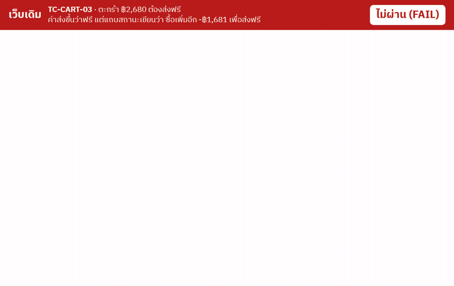 |  |  | 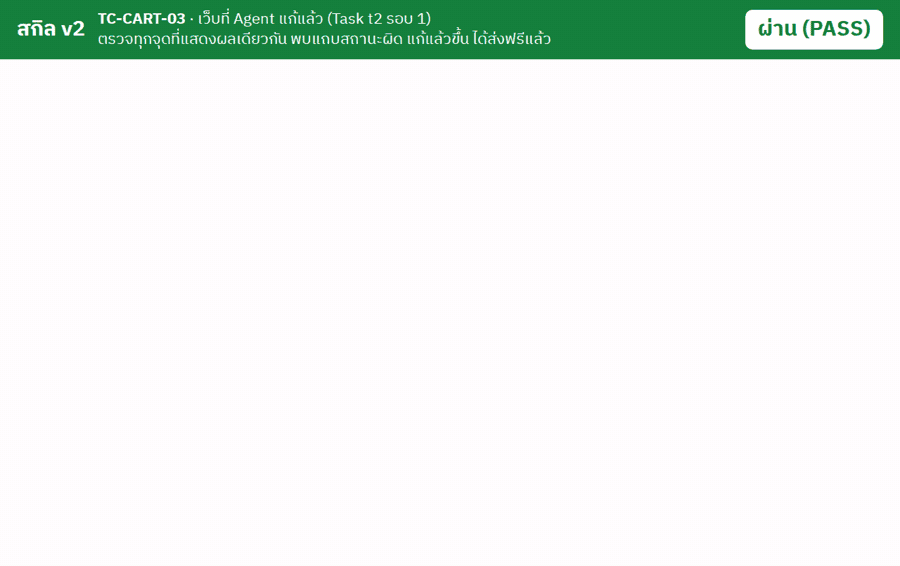 |

โค้ดเว็บที่แต่ละรุ่นแก้ (เก็บ `app` `components` `lib` + Test + รายงาน + ภาพหลักฐาน + diff เทียบเว็บเดิม)

| Task | เว็บเดิม | ไม่มีสกิล | `v0` | `v1` | `v2` |
|---|---|---|---|---|---|
| `t4` | [original](webs/t4/original/) | [10/14](webs/t4/noskill-r2/) | [10/14](webs/t4/v0-r1/) | [14/14](webs/t4/v1-r1/) · [diff](webs/t4/v1-r1/FIX.diff) | [14/14](webs/t4/v2-r1/) |
| `t2` | [original](webs/t2/original/) | [10/14](webs/t2/noskill-r1/) | [7/14](webs/t2/v0-r2/) | [10/14](webs/t2/v1-r1/) | [14/14](webs/t2/v2-r1/) · [diff](webs/t2/v2-r1/FIX.diff) |

อยากอัด GIF เอง

```text
ก่อนเริ่ม ดูว่าใน container multi-account มีสกิล skill-optimizer หรือไม่ (/root/ai-accounts/.Claude/shared/skills)
ถ้าไม่มี ให้หยุดและแจ้งผม ห้ามคัดลอกหรือสร้างสกิลเอง · ถ้ามี ให้อ่านและใช้
ใช้ ./01_week02/07_Skill_Optimization/02_lab/tools/rec.sh อัดวิดีโอเทสต์เฉลย TC-AUTH-03 กับเว็บของ Task t4:
เว็บเดิม · เว็บที่ v0 แก้ (รอบ 1) · เว็บที่ v1 แก้ (รอบ 1) แล้วแปลงเป็น GIF ด้วย tools/mkgif.py มาไว้ที่ ./gif-out บนเครื่อง
ตอบ: ตาราง เว็บ | ผ่านหรือไม่ผ่าน | ไฟล์ GIF
```

---

## ✅ เช็กลิสต์

| ☐ | ข้อ |
|---|---|
| ☐ | Grader Validation ผ่านก่อนรัน Trial แรก |
| ☐ | ทุกรุ่นรัน 6 Task × 2 Replicate ด้วยโมเดลและ effort เดียวกัน |
| ☐ | Cost Metric กำหนดก่อนวัดรุ่นใหม่ |
| ☐ | Issue Log มีจำนวน Trial จากคำสั่ง `failures` และสาเหตุจาก Trace |
| ☐ | แต่ละรุ่นแก้ไม่เกิน 3 จุด และไม่มีชื่อ Test Case ของ Training Set ในสกิล |
| ☐ | รุ่นที่ REJECT ไม่ถูกนำไปใช้ และไม่ได้แก้ Grader เพื่อให้ผ่าน |

## ถ้าเจอปัญหา

| อาการ | ทำอย่างไร |
|---|---|
| Claude ตอบว่าไม่มีสกิล | ซิงก์สกิลเข้า container ตาม [บท 03](../../03_MultiAccount_Container/) แล้วเริ่มใหม่ |
| ไม่มีบัญชี yolo พร้อม | ล็อกอินบัญชีเองใน container (ห้ามให้ AI ล็อกอินแทน) |
| `gate` exit 2 | สองรุ่นรัน Task ไม่ครบชุดเดียวกัน ให้รัน Trial ที่ขาด |
| คอลัมน์ "จบไม่ปกติ" ไม่เป็น 0 | เปิด `stderr.txt` ของ Trial นั้น ถ้าเป็นปัญหาโควตาให้รันซ้ำ |

**ไฟล์ทั้งหมดของ LAB:** [`results/`](results/) ผลดิบ 48 Trial · [`skill-web-fixer/`](skill-web-fixer/) สกิล 3 รุ่น + Issue Log · [`webs/`](webs/) เว็บที่แก้ · [`dag/`](dag/) แผนและรายงานของ dag-planner · [`tools/`](tools/) สคริปต์อัด GIF
