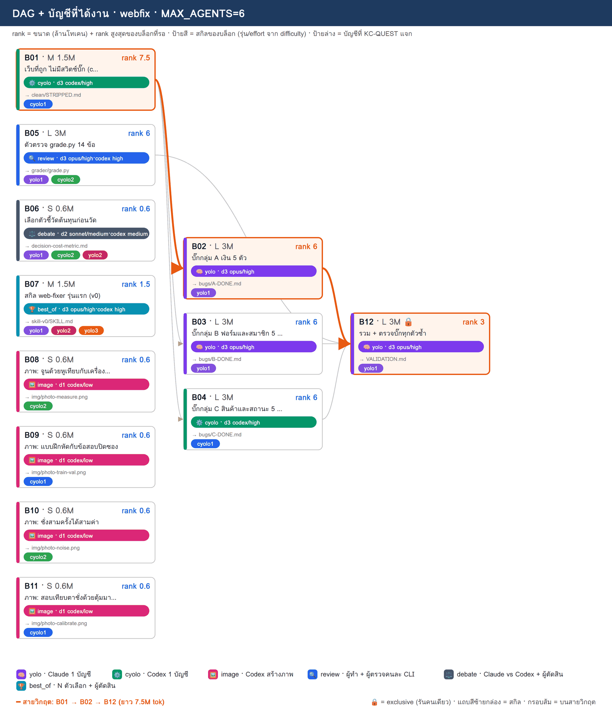
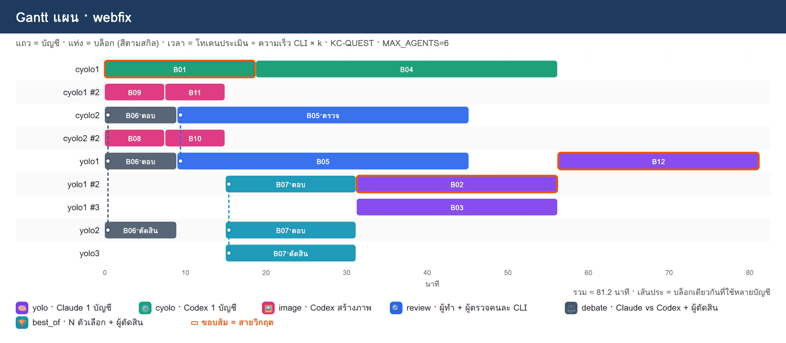

# PLAN · webfix

**โจทย์:** สร้างชุดโจทย์วัดสกิล web-fixer บนเว็บร้านอาหารแมว PawPantry: เว็บที่ถูก (clean) + บั๊กฝัง 15 ตัวที่ผูกกับ TC ในแผนทดสอบ + ตัวตรวจ grade.py + สกิลรุ่นแรก + ภาพประกอบทฤษฎี · ทุกบล็อกต้องอ่าน CONTRACT.md ใน cwd ก่อนเริ่ม และทำตามทุกข้อ

วางแผนเมื่อ 11/11/2026 05:35 · MAX_AGENTS 6 · บัญชี cyolo1, cyolo2, yolo1, yolo2, yolo3 · ตัวปรับเวลา k (ยังไม่มี calib.json → k=1)

> แผนนี้ยังไม่ได้รันจริง — KC-QUEST เลือกบัญชีจากโควตา แล้วจำลองเวลาตาม dependency

## 1) โควตาของแต่ละบัญชี

| บัญชี | แพลน | ใช้ไป 5 ชม. | ใช้ไปสัปดาห์ | headroom | รีเซ็ต/หมดอายุ (ชม.) | U | slot | ที่มา |
|---|---|---|---|---|---|---|---|---|
| cyolo1 | prolite | 0% | 8% | **92%** | 78.8 | 0.234 | 3 | team.py quota |
| cyolo2 | prolite | 0% | 8% | **92%** | 78.8 | 0.234 | 3 | team.py quota |
| yolo1 | default | 0% | 36% | **64%** | 24.4 | 0.496 | 3 | team.py quota |
| yolo2 | default | 0% | 8% | **92%** | 127.4 | 0.159 | 3 | team.py quota |
| yolo3 | default | 0% | 2% | **98%** | 151.4 | 0.137 | 3 | team.py quota |

## 2) DAG + สกิล + บัญชี

**สายวิกฤต:** B01 → B02 → B12 · ยาว 7.5M tok

## 3) ตารางแจกงาน (เหตุผล KC-QUEST ทุกบล็อก)

| บล็อก | สกิล | ชื่อ | ขนาด · c | รอ | rank | บัญชี (บทบาท) | เริ่ม–จบ (นาที) | เหตุผล KC-QUEST |
|---|---|---|---|---|---|---|---|---|
| **B01** | ⚙️ cyolo | เว็บที่ถูก ไม่มีสวิตช์บั๊ก (clean/) | M · 1.5 | – | 7.5 | cyolo1 (ทำ) | 0.0–18.8 | ทำ: cyolo1 34.3 (U=0.233 F=0.005 S=0.961 S=0.7 L=0.0) · 1.50M ≈ 5ชม. 3.9% / สัปดาห์ 0.49% · อันดับ 2 cyolo2 34.3 |
| B06 | ⚖️ debate | เลือกตัวชี้วัดต้นทุนก่อนวัด | S · 0.6 | – | 0.6 | yolo1 (ตอบ), cyolo2 (ตอบ), yolo2 (ตัดสิน) | 0.0–9.0 | ตอบ: yolo1 35.9 (U=0.496 F=0.003 S=0.984 S=0.08 L=0.0) · 0.60M ≈ 5ชม. 1.56% / สัปดาห์ 0.2% · อันดับ 2 yolo2 22.4   ตอบ: cyolo2 25.0 (U=0.233 F=0.002 S=0.984 S=0.056 L=0.0) · 0.60M ≈ 5ชม. 1.56% / สัปดาห์ 0.2% · อันดับ 2 cyolo1 21.0   ตัดสิน: yolo2 22.5 (U=0.159 F=0.001 S=0.995 S=0.08 L=0.0) · 0.18M ≈ 5ชม. 0.47% / สัปดาห์ 0.06% · อันดับ 2 yolo3 21.6 |
| B08 | 🖼️ image | ภาพ: จูนด้วยหูเทียบกับเครื่องวัด | S · 0.6 | – | 0.6 | cyolo2 (ทำ) | 0.0–7.5 | ทำ: cyolo2 21.4 (U=0.233 F=0.002 S=0.969 S=0.056 L=0.333) · 0.60M ≈ 5ชม. 1.56% / สัปดาห์ 0.2% · อันดับ 2 cyolo1 21.0 |
| B09 | 🖼️ image | ภาพ: แบบฝึกหัดกับข้อสอบปิดซอง | S · 0.6 | – | 0.6 | cyolo1 (ทำ) | 0.0–7.5 | ทำ: cyolo1 21.0 (U=0.233 F=0.002 S=0.945 S=0.056 L=0.333) · 0.60M ≈ 5ชม. 1.56% / สัปดาห์ 0.2% · อันดับ 2 cyolo2 17.8 |
| B10 | 🖼️ image | ภาพ: ชั่งสามครั้งได้สามค่า | S · 0.6 | – | 0.6 | cyolo2 (ทำ) | 7.5–15.0 | ทำ: cyolo2 21.2 (U=0.233 F=0.002 S=0.953 S=0.056 L=0.333) · 0.60M ≈ 5ชม. 1.56% / สัปดาห์ 0.2% · อันดับ 2 cyolo1 20.8 |
| B11 | 🖼️ image | ภาพ: สอบเทียบตาชั่งด้วยตุ้มมาตรฐาน | S · 0.6 | – | 0.6 | cyolo1 (ทำ) | 7.5–15.0 | ทำ: cyolo1 20.8 (U=0.233 F=0.002 S=0.93 S=0.056 L=0.333) · 0.60M ≈ 5ชม. 1.56% / สัปดาห์ 0.2% · อันดับ 2 cyolo2 17.6 |
| B05 | 🔍 review | ตัวตรวจ grade.py 14 ข้อ | L · 3 | – | 6 | yolo1 (ทำ), cyolo2 (ตรวจ) | 9.0–45.2 | ทำ: yolo1 45.7 (U=0.496 F=0.015 S=0.906 S=0.8 L=0.0) · 3.00M ≈ 5ชม. 7.8% / สัปดาห์ 0.98% · อันดับ 2 yolo2 32.3   ตรวจ: cyolo2 28.4 (U=0.233 F=0.003 S=0.93 S=0.56 L=0.333) · 0.90M ≈ 5ชม. 2.34% / สัปดาห์ 0.29% · อันดับ 2 cyolo1 24.7 |
| B07 | 🏆 best_of | สกิล web-fixer รุ่นแรก (v0) | M · 1.5 | – | 1.5 | yolo1 (ตอบ), yolo2 (ตอบ), yolo3 (ตัดสิน) | 15.0–31.2 | ตอบ: yolo1 32.7 (U=0.496 F=0.008 S=0.867 S=0.2 L=0.333) · 1.50M ≈ 5ชม. 3.9% / สัปดาห์ 0.49% · อันดับ 2 yolo2 23.8   ตอบ: yolo2 23.8 (U=0.159 F=0.005 S=0.956 S=0.2 L=0.0) · 1.50M ≈ 5ชม. 3.9% / สัปดาห์ 0.49% · อันดับ 2 yolo3 23.0   ตัดสิน: yolo3 23.3 (U=0.137 F=0.001 S=0.988 S=0.2 L=0.0) · 0.45M ≈ 5ชม. 1.17% / สัปดาห์ 0.15% · อันดับ 2 cyolo1 21.9 |
| B04 | ⚙️ cyolo | บั๊กกลุ่ม C สินค้าและสถานะ 5 ตัว | L · 3 | B01 | 6 | cyolo1 (ทำ) | 18.8–56.2 | ทำ: cyolo1 30.7 (U=0.233 F=0.011 S=0.852 S=0.56 L=0.0) · 3.00M ≈ 5ชม. 7.8% / สัปดาห์ 0.98% · อันดับ 2 cyolo2 27.4 |
| **B02** | 🧠 yolo | บั๊กกลุ่ม A เงิน 5 ตัว | L · 3 | B01 | 6 | yolo1 (ทำ) | 31.2–56.2 | ทำ: yolo1 40.7 (U=0.496 F=0.016 S=0.789 S=0.8 L=0.333) · 3.00M ≈ 5ชม. 7.8% / สัปดาห์ 0.98% · อันดับ 2 yolo2 31.8 |
| B03 | 🧠 yolo | บั๊กกลุ่ม B ฟอร์มและสมาชิก 5 ตัว | L · 3 | B01 | 6 | yolo1 (ทำ) | 31.2–56.2 | ทำ: yolo1 36.2 (U=0.496 F=0.016 S=0.711 S=0.8 L=0.667) · 3.00M ≈ 5ชม. 7.8% / สัปดาห์ 0.98% · อันดับ 2 yolo2 31.8 |
| **B12** | 🧠 yolo | รวม + ตรวจบั๊กทุกตัวซ้ำ | L · 3 | B02, B03, B04, B05 | 3 | yolo1 (ทำ) | 56.2–81.2 | ทำ: yolo1 35.7 (U=0.496 F=0.016 S=0.633 S=0.4 L=0.0) · 3.00M ≈ 5ชม. 7.8% / สัปดาห์ 0.98% · อันดับ 2 yolo2 25.8 |

## 4) Gantt แผน

## 5) รอบแจกงาน

| นาทีที่ | บล็อกที่เริ่ม |
|---|---|
| 0 | B01→cyolo1, B06→yolo1+cyolo2+yolo2, B08→cyolo2, B09→cyolo1 |
| 7.5 | B10→cyolo2, B11→cyolo1 |
| 9 | B05→yolo1+cyolo2 |
| 15 | B07→yolo1+yolo2+yolo3 |
| 18.8 | B04→cyolo1 |
| 31.2 | B02→yolo1, B03→yolo1 |
| 56.2 | B12→yolo1 |

## 6) สรุป

- บล็อก 12 · แจกได้ 12 · agent พร้อมกันสูงสุด 6/6
- เวลาประมาณ 81.2 นาที (แท่ง Gantt) · ไฟล์ผลของทีม: `/workspace/plans/webfix/app/`

ต่อไป: `dagplan.py export webfix` → `dagplan.py run webfix` → `dagplan.py report webfix`
