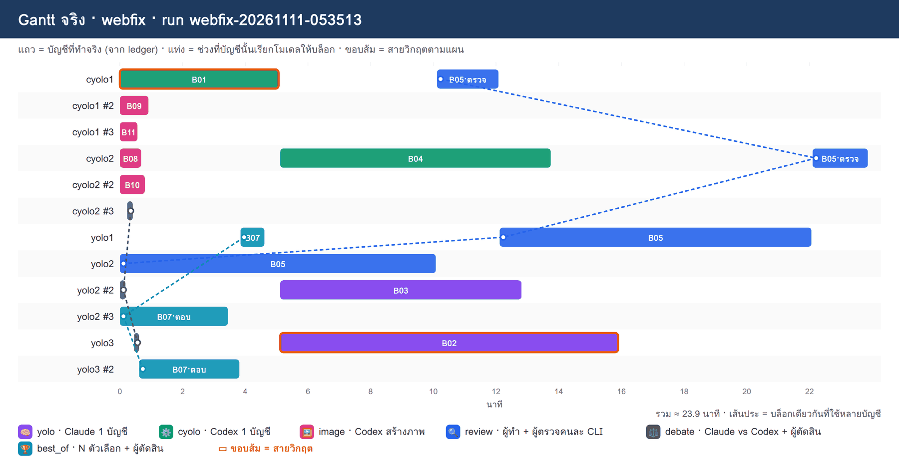
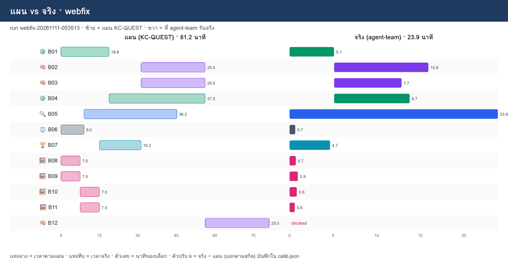

# REPORT · webfix

**run:** `webfix-20261111-053513` · `/workspace/.agent-team/webfix-20261111-053513` · โจทย์: สร้างชุดโจทย์วัดสกิล web-fixer บนเว็บร้านอาหารแมว PawPantry: เว็บที่ถูก (clean) + บั๊กฝัง 15 ตัวที่ผูกกับ TC ในแผนทดสอบ + ตัวตรวจ grade.py + สกิลรุ่นแรก + ภาพประกอบทฤษฎี · ทุกบล็อกต้องอ่าน CONTRACT.md ใน cwd ก่อนเริ่ม และทำตามทุกข้อ

## ตารางบล็อก (แผน vs จริง)

| บล็อก | สกิล | บัญชีแผน | บัญชีจริง | นาทีแผน | นาทีจริง | tokens (ไม่รวม cache read) | ครั้ง | สถานะ | ไฟล์ผล |
|---|---|---|---|---|---|---|---|---|---|
| **B01** | ⚙️ cyolo | cyolo1(ทำ) | cyolo1(ทำ) | 18.75 | 5.10 | 92,316 | 1 | ok | ✅ clean/STRIPPED.md |
| **B02** | 🧠 yolo | yolo1(ทำ) | yolo3(ทำ) | 25.00 | 10.82 | 105,369 | 1 | ok | ✅ bugs/A-DONE.md |
| B03 | 🧠 yolo | yolo1(ทำ) | yolo2(ทำ) | 25.00 | 7.73 | 79,574 | 1 | ok | ✅ bugs/B-DONE.md |
| B04 | ⚙️ cyolo | cyolo1(ทำ) | cyolo2(ทำ) | 37.50 | 8.67 | 69,973 | 1 | ok | ✅ bugs/C-DONE.md |
| B05 | 🔍 review | yolo1(ทำ), cyolo2(ตรวจ) | yolo2(ทำ), cyolo1(ตรวจ), yolo1(ทำ), cyolo2(ตรวจ) | 36.25 | 23.90 | 317,387 | 4 | bad_output — ไม่ได้ APPROVED ภายใน max_rounds=2 | ✅ grader/grade.py |
| B06 | ⚖️ debate | yolo1(ตอบ), cyolo2(ตอบ), yolo2(ตัดสิน) | yolo2(ตอบ), cyolo2(ตอบ), yolo3(ตัดสิน) | 9.00 | 0.65 | 55,556 | 3 | ok | ✅ decision-cost-metric.md |
| B07 | 🏆 best_of | yolo1(ตอบ), yolo2(ตอบ), yolo3(ตัดสิน) | yolo2(ตอบ), yolo3(ตอบ), yolo1(ตัดสิน) | 16.25 | 4.65 | 185,521 | 3 | ok | ✅ skill-v0/SKILL.md |
| B08 | 🖼️ image | cyolo2(ทำ) | cyolo2(ทำ) | 7.50 | 0.72 | 22,980 | 1 | ok | ✅ img/photo-measure.png |
| B09 | 🖼️ image | cyolo1(ทำ) | cyolo1(ทำ) | 7.50 | 0.95 | 36,633 | 1 | ok | ✅ img/photo-train-val.png |
| B10 | 🖼️ image | cyolo2(ทำ) | cyolo2(ทำ) | 7.50 | 0.83 | 44,895 | 1 | ok | ✅ img/photo-noise.png |
| B11 | 🖼️ image | cyolo1(ทำ) | cyolo1(ทำ) | 7.50 | 0.60 | 42,856 | 1 | ok | ✅ img/photo-calibrate.png |
| **B12** | 🧠 yolo | yolo1(ทำ) | yolo3 | 25.00 | - | 0 | 0 | blocked — งานที่ต้องรอ B05 ล้ม/ไม่ผ่าน จึงไม่รัน | ❌ VALIDATION.md |

- tokens รวมของบล็อก **1,053,060** = ผลรวมจาก ledger ของ run (18 การเรียก) **1,053,060** ✅ ตรงกัน
- การเรียกที่ไม่ใช่บล็อก (ตรวจความพร้อม ฯลฯ): 0 ครั้ง · 0 tokens (ไม่นับในตาราง)
- เวลารวม: แผน 81.2 นาที · จริง 23.9 นาที
- บล็อกเสร็จ 10/12

## ภาพ

## ความต่างระหว่างแผนกับของจริง

- B02: แผน yolo1(ทำ) → จริง yolo3(ทำ)
- B03: แผน yolo1(ทำ) → จริง yolo2(ทำ)
- B04: แผน cyolo1(ทำ) → จริง cyolo2(ทำ)
- B05: แผน yolo1(ทำ), cyolo2(ตรวจ) → จริง yolo2(ทำ), cyolo1(ตรวจ), yolo1(ทำ), cyolo2(ตรวจ)
- B06: แผน yolo1(ตอบ), cyolo2(ตอบ), yolo2(ตัดสิน) → จริง yolo2(ตอบ), cyolo2(ตอบ), yolo3(ตัดสิน)
- B12: แผน yolo1(ทำ) → จริง yolo3
- (export ส่งเป็นฝั่ง yolo/cyolo ไม่ผูกบัญชี เพื่อให้ failover ของ agent-team ทำงาน → agent-team เลือกบัญชีในฝั่งเองตามโหลด/โควตา ดู references/run.md)

## ตัวปรับเวลา k (calib.json)

`/workspace/plans/calib.json`: {"cyolo": 0.2447, "yolo": 0.371, "debate": 0.0722, "best_of": 0.2862, "image": 0.1033}

k = นาทีจริง ÷ นาทีแผน (ก่อนคูณ k) แยกตามสกิล · `plan` ครั้งถัดไปคูณเวลาแต่ละบล็อกด้วย k ของสกิลนั้น
