# Skill Optimization: ทำให้สกิลเก่งขึ้นด้วยการวัด (ต่อยอดจาก base skills)

บทนี้สอนวิธี**ปรับปรุงสกิลให้เก่งขึ้นแบบมีหลักฐาน** คือวัดสกิลกับชุดโจทย์จริง หาสาเหตุที่พลาด แก้ทีละน้อย วัดซ้ำ แล้วให้ "ประตูรับ" ตัดสินว่ารุ่นใหม่ดีกว่ารุ่นเดิมจริงหรือไม่ ทุกขั้นทำด้วยการ**วางพรอมต์ใน Claude Code app** ตัวเลขทุกตัวในบทนี้มาจากการรันจริงเมื่อ 10 พ.ย. 2026

สไลด์ประกอบ: [`Skill_Optimization_Slides.html`](Skill_Optimization_Slides.html) (เปิดในเบราว์เซอร์ กด → เพื่อเปลี่ยนหน้า) · [`Skill_Optimization_Slides.pdf`](Skill_Optimization_Slides.pdf) (69 หน้า)

| ลำดับ | ส่วน | หัวข้อ | ได้อะไร |
|---|---|---|---|
| 1 | แนวคิด | 1–4 | วงรอบปรับปรุงสกิล 6 ขั้น · งานวิจัย ก.ย.–ต.ค. 2026 · สกิล `skill-optimizer` |
| 2 | ส่วนที่ 1 | ขั้นที่ 1–5 | ปรับปรุงสกิลเดิม `dag-planner` (จากบท 05): v0 94.7% → v1 100% และ v2 ที่ไม่ผ่านประตู |
| 3 | ส่วนที่ 2 | ขั้นที่ 6–9 | สร้างสกิลใหม่ `web-builder` (สร้างเว็บ + ตรวจด้วย Playwright) แล้วปรับปรุงด้วยวงรอบเดียวกัน: คะแนนเท่าเดิม คำสั่งต่อรอบลดจาก 19.0 เหลือ 6.7 |
| 4 | อ้างอิง | 6–9 | สรุป ข้อควรรู้ คำสั่งที่ใช้บ่อย และรายการงานวิจัย |

## 1. ปัญหา: สกิลใช้ได้ ยังไม่ใช่สกิลเก่ง

บท 04 และ 05 สร้างสกิลจากสเปกแล้วทดสอบว่า "ใช้ได้" แต่คำถามที่ตามมาคือ ถ้าจะแก้สกิลให้ดีขึ้น จะรู้ได้อย่างไรว่าดีขึ้นจริง

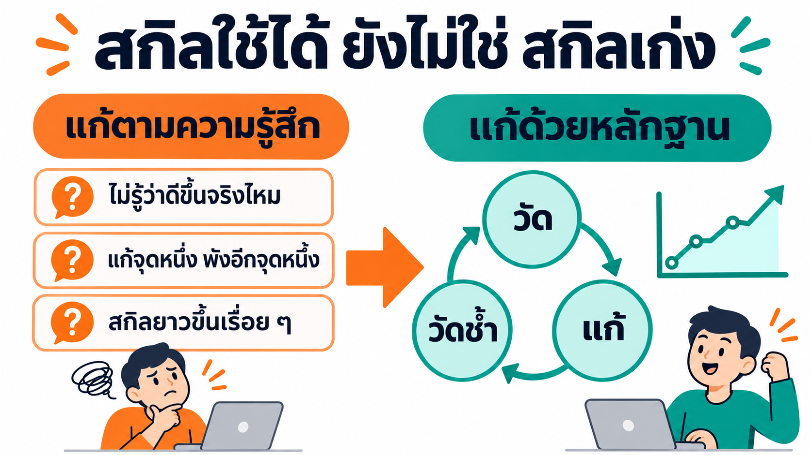

| ถ้าแก้ตามความรู้สึก | สิ่งที่เกิด |
|---|---|
| ลองโจทย์เดียว เห็นว่าดีขึ้น | รันซ้ำอีกรอบอาจได้ผลต่างเดิม เพราะ AI ตอบไม่เหมือนกันทุกครั้ง |
| เพิ่มกติกาเพื่อแก้โจทย์ที่พลาด | โจทย์นั้นผ่าน แต่โจทย์อื่นที่เคยผ่านอาจพัง |
| เพิ่มกติกาทุกครั้งที่เจอปัญหา | สกิลยาวขึ้น อ่านนานขึ้น แพงขึ้น โดยไม่รู้ว่ากติกาข้อไหนมีผลจริง |

| คำศัพท์ | ความหมาย |
|---|---|
| **ชุดโจทย์ (suite)** | โจทย์หลายข้อที่ใช้วัดสกิล พร้อมตัวตรวจ |
| **ตัวตรวจ (grader)** | โค้ดที่ตรวจผลงานแล้วให้คะแนน ไม่ใช้ AI ตัดสิน |
| **เส้นฐาน (baseline)** | คะแนนของสกิลรุ่นเดิม (v0) ก่อนแก้อะไร |
| **ชุดฝึก / ชุดสอบ (train / val)** | ชุดฝึกใช้หาข้อบกพร่อง ชุดสอบใช้ตัดสินเท่านั้น |
| **ความแกว่ง (noise)** | ส่วนต่างของคะแนนเมื่อรันสกิลเดิมกับโจทย์เดิมซ้ำ |
| **ประตูรับ (gate)** | กติกาตัดสินว่ารุ่นใหม่ได้แทนรุ่นเดิมหรือไม่ |

## 2. แนวคิด: วงรอบปรับปรุงสกิล 6 ขั้น

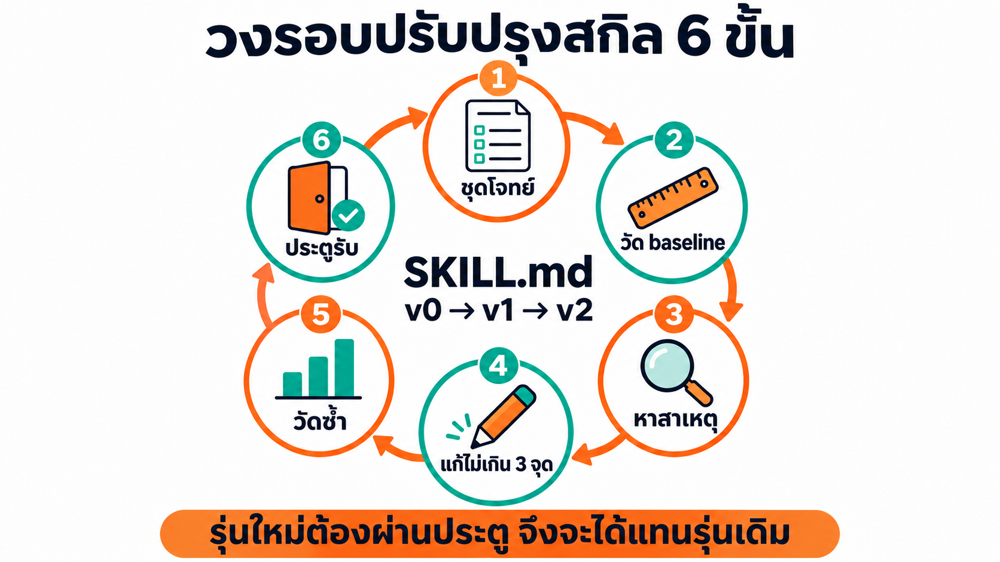

| ขั้น | ทำอะไร | ใช้โทเคนไหม |
|---|---|---|
| 1 · ชุดโจทย์ | เตรียมโจทย์ แบ่ง train / val และเขียนตัวตรวจ | ไม่ใช้ |
| 2 · วัด baseline | รันสกิลรุ่นเดิมกับทุกโจทย์ โจทย์ละหลายรอบ | ใช้ |
| 3 · หาสาเหตุ | อ่านข้อที่พลาดและร่องรอยการทำงานของชุด train | ไม่ใช้ |
| 4 · แก้ | สร้างรุ่นใหม่ แก้ไม่เกิน 3 จุด | ไม่ใช้ |
| 5 · วัดซ้ำ | รันรุ่นใหม่ด้วยเงื่อนไขเดียวกับ baseline ทุกค่า | ใช้ |
| 6 · ประตูรับ | เทียบสองรุ่น รับหรือไม่รับ แล้ววนกลับไปขั้น 3 | ไม่ใช้ |

### 2.1 สกิลมี 4 ส่วน ปรับได้ทุกส่วน

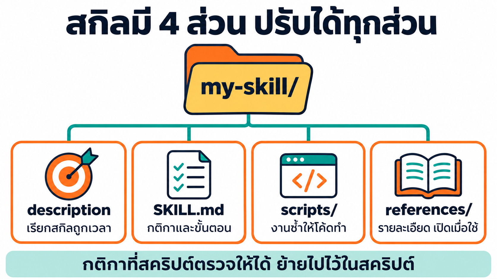

| ส่วน | ปรับเพื่ออะไร | ตัวอย่างในบทนี้ |
|---|---|---|
| `description` | ให้ AI เรียกสกิลถูกเวลา | ไม่ได้ปรับ (พรอมต์ของบทนี้บอกให้อ่านสกิลใน `./skills` เสมอ) |
| `SKILL.md` | กติกาและขั้นตอนที่ AI ต้องทำตาม | เพิ่มกติกา "ภาพของรายการต้องรอบล็อกข้อมูล" |
| `scripts/` | งานที่ตรวจได้ด้วยโค้ด | คำสั่ง `dag` เตือนเมื่อแผนเกือบเป็นเส้นตรง |
| `references/` | รายละเอียดที่เปิดเมื่อใช้ | ย้ายหัวข้อ "เรียกจาก host" ออกจาก `SKILL.md` |

หลักที่ใช้เลือก: **ถ้าสคริปต์ตรวจและเตือนให้ได้ ให้ทำในสคริปต์** เพราะ AI อ่านกติกาแล้วลืมได้ แต่ข้อความเตือนจากสคริปต์มาถึงตรงเวลาที่ต้องแก้พอดี

### 2.2 แบ่งโจทย์เป็น 2 ชุด

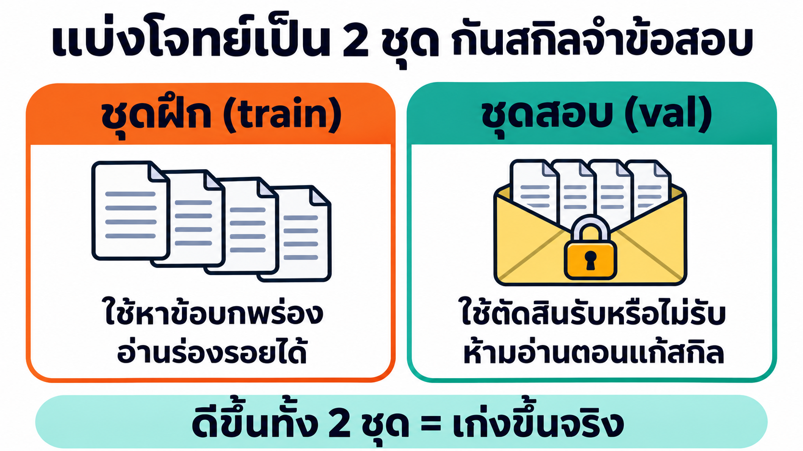

ถ้าใช้โจทย์ชุดเดียวทั้งหาข้อบกพร่องและตัดสิน สกิลอาจได้คะแนนสูงขึ้นเพราะกติกาที่เพิ่มเข้าไปตรงกับโจทย์ชุดนั้นพอดี ไม่ใช่เพราะเก่งขึ้น จึงเก็บโจทย์อีกชุดไว้ไม่ให้เห็นตอนแก้ ถ้าชุดฝึกดีขึ้นแต่ชุดสอบแย่ลง แปลว่าสกิล**จำโจทย์** (overfit)

### 2.3 รันครั้งเดียว เชื่อไม่ได้

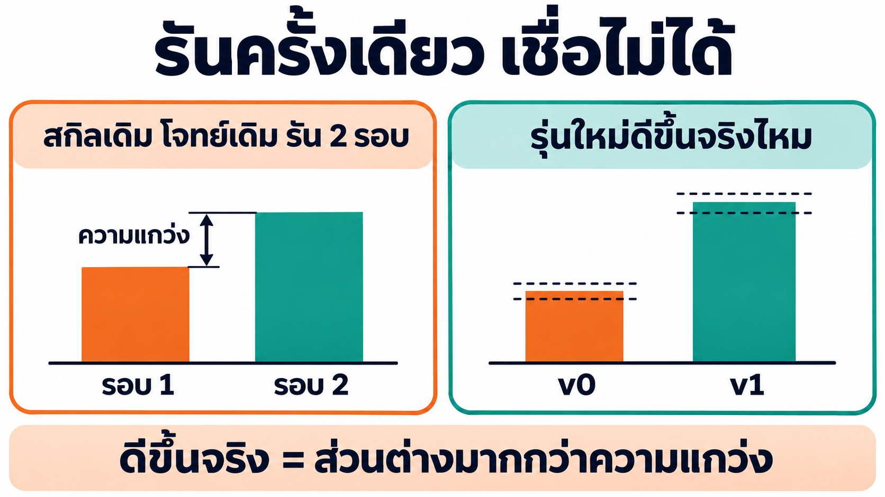

สกิลรุ่นเดียวกัน โจทย์เดียวกัน รัน 2 รอบได้คะแนนไม่เท่ากัน ส่วนต่างนี้คือ**ความแกว่ง** บทนี้วัดด้วยคำสั่ง `null`

$$\text{ความแกว่งต่อโจทย์} = \frac{1}{n}\sum_{i=1}^{n}\left(\max_r s_{i,r} - \min_r s_{i,r}\right) \qquad \text{ความแกว่งของค่าเฉลี่ย} = \frac{\text{ความแกว่งต่อโจทย์}}{\sqrt{n}}$$

$s_{i,r}$ คือคะแนนของโจทย์ที่ $i$ ในรอบที่ $r$ และ $n$ คือจำนวนโจทย์ ต้องหารด้วย $\sqrt{n}$ เพราะคะแนนที่รายงานเป็นค่าเฉลี่ยของหลายโจทย์ ซึ่งแกว่งน้อยกว่าโจทย์เดียว

### 2.4 ประตูรับ

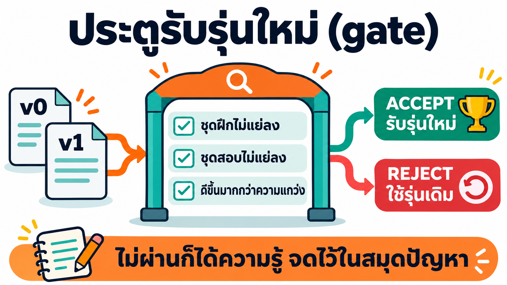

| เงื่อนไข | ถ้าไม่ผ่าน |
|---|---|
| คะแนนชุด train ไม่ลดลงเกินเกณฑ์ | การแก้ไม่ได้ผล |
| คะแนนชุด val ไม่ลดลงเกินเกณฑ์ | สกิลจำโจทย์ หรือทำของเดิมพัง |
| คะแนนรวมดีขึ้นมากกว่าเกณฑ์ **หรือ** คะแนนเท่าเดิมแต่ค่าใช้จ่ายลดลงอย่างน้อย 10% | ยังไม่มีหลักฐานพอให้เปลี่ยนรุ่น |

เกณฑ์ = ค่าที่มากกว่าระหว่าง 2 จุด กับความแกว่งของค่าเฉลี่ยของรุ่นเดิม

### 2.5 สมุดปัญหา

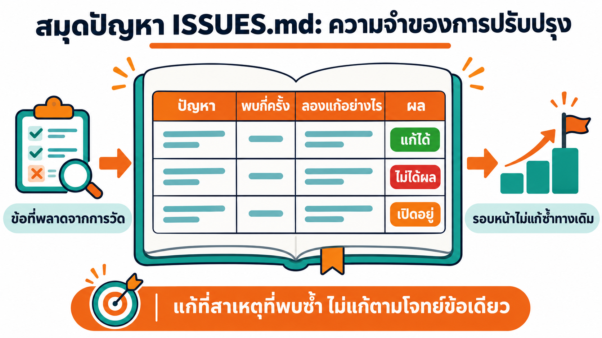

`ISSUES.md` เก็บว่าปัญหาอะไรพบกี่รอบ ลองแก้อย่างไร และได้ผลหรือไม่ รอบถัดไปอ่านไฟล์นี้ก่อน จึงไม่ลองทางแก้ที่เคยไม่ได้ผลซ้ำ และไม่แก้ปัญหาที่พบแค่รอบเดียว

## 3. งานวิจัยที่เกี่ยวข้อง (ก.ย.–ต.ค. 2026)


วงรอบในหัวข้อ 2 ประกอบจากแนวคิดของงานต่อไปนี้ ทุกรายการเปิดอ่านจากหน้าต้นฉบับแล้ว ตัวเลขในตารางเป็นตัวเลขที่ผู้เขียนงานนั้นรายงาน

| งาน | วันที่ | แนวคิดหลัก | บทนี้นำมาใช้ที่ไหน |
|---|---|---|---|
| [SkillAdam](https://arxiv.org/abs/2609.08944) | 8 ก.ย. 2026 | ปรับสกิลทีละรอบโดยมี "issue tracker" จำรูปแบบข้อผิดพลาดและทางแก้ที่ลองแล้ว และจำกัดขนาดการแก้เมื่อคะแนนแกว่งมาก | สมุดปัญหา `ISSUES.md` · แก้ไม่เกิน 3 จุดต่อรุ่น |
| [COBRA-Skills](https://arxiv.org/abs/2609.11682) | 10 ก.ย. 2026 | งบวัดผลมีจำกัด จึงใช้ bandit เลือกว่ารุ่นไหนควรได้วัดเต็มชุด | วัดเฉพาะรุ่นที่มีเหตุผลจากสมุดปัญหา (บทนี้ไม่ได้ทำ bandit) |
| [BiPA](https://arxiv.org/abs/2610.37201) | 27 ต.ค. 2026 | ทดสอบซ้ำ 3 วิธีก่อนหน้า พบว่ากำไรบนชุดเล็กหายไปเมื่อวัดกับชุดทดสอบ รุ่นที่ไม่ได้แก้อะไรก็ "ชนะ" ได้จากความแกว่ง และต้นทุนที่เพิ่มมาจากจำนวนรอบการทำงานมากกว่าความยาวสกิล | คำสั่ง `null` · ประตูรับที่เทียบกับความแกว่ง · นับจำนวนคำสั่งและค่าใช้จ่ายทุกรุ่น · ลองลบเนื้อหา (v2) |
| [HSE](https://arxiv.org/abs/2610.35616) | 26 ต.ค. 2026 | กลั่นสกิลจากร่องรอยการทำงาน แก้ไม่เกิน 3 กติกาต่อครั้ง และตรวจกับงานที่กันไว้ก่อนรับ | อ่าน `transcript.jsonl` ก่อนแก้ · ชุด val |
| [Agent Skill Evolution](https://arxiv.org/abs/2610.04832) | 4 ต.ค. 2026 | ศึกษาการแก้ `SKILL.md` จริง 2,608 คู่ พบว่ากติกาที่ได้ผลมักระบุคำสั่งหรือ path ที่รุ่นก่อนไม่เคยพูดถึง | กติกาใหม่ระบุคำสั่งและค่าที่ตรวจได้ (เช่น "เกิน 60%") |
| [SkillScriptBench](https://arxiv.org/abs/2610.04008) | 2 ต.ค. 2026 | วัดการแก้สกิลทั้ง `SKILL.md` และสคริปต์ โดยต้องไม่ทำของที่ใช้ได้อยู่พัง | แก้สคริปต์ของสกิลด้วย และดูข้อตรวจที่เคยผ่านทุกข้อ |
| [SWE-Skills-Bench](https://arxiv.org/abs/2603.15401) (ฉบับที่ 2) | 27 ต.ค. 2026 | วัดสกิล 98 ตัวแบบมี/ไม่มีสกิล พบว่า 92 ตัวไม่ทำให้ผลต่างอย่างมีนัยสำคัญ | แขน "ไม่มีสกิล" ในส่วนที่ 2 |
| [WebDev-Skills-Bench](https://arxiv.org/abs/2608.23067) | 24 ส.ค. 2026 | วัดสกิลงานเว็บ 31 ตัวด้วยชุดทดสอบ Playwright พบว่าสกิลช่วยแค่บางคู่งาน และเพิ่มค่าโทเคน | ตัวตรวจเว็บด้วย Playwright ในส่วนที่ 2 |
| [`claude plugin eval`](https://code.claude.com/docs/en/plugin-evals) | ก.ย. 2026 | เครื่องมือของ Claude Code: รันแต่ละโจทย์ 3 รอบ เทียบกับแขนที่ไม่มีปลั๊กอิน และใช้เป็นด่านใน CI | รูปแบบ "มีสกิล เทียบ ไม่มีสกิล" และการรันหลายรอบ |

พื้นฐานก่อนหน้า: [GEPA](https://arxiv.org/abs/2507.19457) (ก.ค. 2025 · อ่านร่องรอยแล้วเสนอการแก้) · [SkillOpt](https://arxiv.org/abs/2605.23904) (พ.ค. 2026 · รับการแก้เมื่อชุดที่กันไว้ดีขึ้นเท่านั้น) · [skill-creator ของ Anthropic](https://claude.com/blog/improving-skill-creator-test-measure-and-refine-agent-skills) (มี.ค. 2026 · eval · benchmark · ปรับ description)

## 4. เครื่องมือ: สกิล `skill-optimizer`

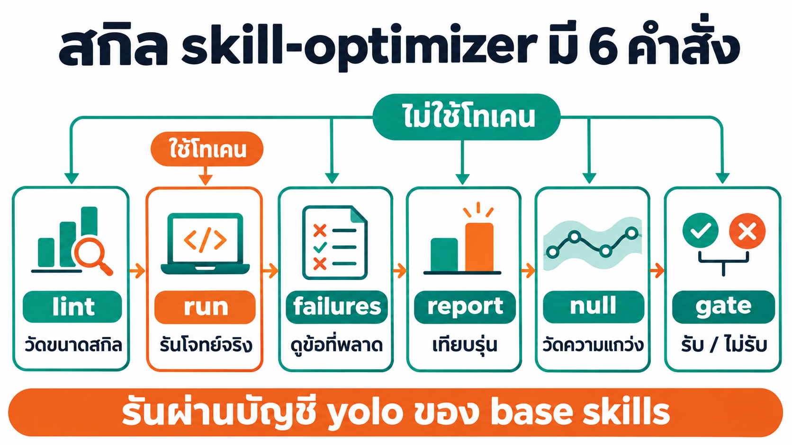

วงรอบทั้ง 6 ขั้นอยู่ในสกิล [`skills/skill-optimizer`](skills/skill-optimizer/) ซึ่งรันโจทย์ผ่านบัญชี `yoloN` ตามกติกาของ base skill `yolo` (ชุดเดียวกับ [`../05_DAG_Planner/base_skills`](../05_DAG_Planner/base_skills))

| คำสั่ง | ทำอะไร | ผลที่ได้ |
|---|---|---|
| `lint <สกิล>` | วัดขนาดของสกิล | จำนวนบรรทัดและไบต์ของ `SKILL.md` · ลิงก์ที่เสีย |
| `run <suite> --skill <สกิล> --label v0` | รันสกิลกับทุกโจทย์ รอบละ sandbox ใหม่ | `runs/v0/<โจทย์>-r<รอบ>/` มีผลงาน ร่องรอย ตัวชี้วัด และคะแนน |
| `failures <suite> --label v0` | แสดงข้อที่พลาด | รายการข้อตรวจที่ไม่ผ่าน พร้อม path ของร่องรอย |
| `report <suite> --labels v0,v1` | เทียบรุ่น | ตารางคะแนน เวลา จำนวนคำสั่ง ค่าใช้จ่าย และ `results.json` |
| `null <suite> --label v0` | วัดความแกว่ง | ความแกว่งต่อโจทย์ และของค่าเฉลี่ย |
| `gate <suite> --base v0 --cand v1` | ตัดสิน | `ACCEPT` หรือ `REJECT` พร้อมเหตุผล |

คำสั่งที่ 7 คือ `grade` ใช้ตรวจผลงานเดิมซ้ำหลังแก้ตัวตรวจ โดยไม่ต้องรันโจทย์ใหม่

**แต่ละรอบวัดอะไร**

| ตัวชี้วัด | มาจาก | ความหมาย |
|---|---|---|
| คะแนน | ตัวตรวจ | สัดส่วนข้อตรวจที่ผ่าน (0–100%) |
| เวลา | จับเวลา | วินาทีตั้งแต่ส่งพรอมต์จนเอเจนต์ตอบ |
| คำสั่ง · คำสั่งล้ม | ร่องรอย | จำนวนครั้งที่เอเจนต์เรียกเครื่องมือ และจำนวนครั้งที่เครื่องมือตอบกลับเป็นข้อผิดพลาด |
| ค่าใช้จ่าย · output token | ผลของ `yoloN` | ราคาตามรายการของรอบนั้น (ไม่ใช่ยอดจ่ายจริงของบัญชีแบบสมาชิก) |

## 5. ภาพรวมขั้นตอนการทดลอง

| ลำดับ | ทำอะไร | ผลจริง | รอบที่รัน |
|---|---|---|---|
| **ขั้นที่ 1** | เตรียมชุดโจทย์และตัวตรวจของ `dag-planner` | โจทย์ 8 ข้อ ข้อตรวจ 10 ข้อ | 0 |
| **ขั้นที่ 2** | วัดเส้นฐาน v0 และความแกว่ง | 94.7% · ความแกว่งของค่าเฉลี่ย 1.0 จุด | 16 |
| **ขั้นที่ 3** | หาสาเหตุจากร่องรอย เขียนสมุดปัญหา | 2 สาเหตุที่พบซ้ำ | 0 |
| **ขั้นที่ 4** | แก้เป็น v1 วัดซ้ำ ประตูรับ | 100% · ACCEPT | 16 |
| **ขั้นที่ 5** | ลองลดต้นทุนเป็น v2 | 100% แต่ค่าใช้จ่ายไม่ลด · REJECT | 16 |
| **ขั้นที่ 6** | ให้ Claude สร้างสกิล `web-builder` รุ่นแรก | `SKILL.md` + `verify.cjs` ใน 94 วินาที | 1 |
| **ขั้นที่ 7** | สร้างชุดโจทย์เว็บและตัวตรวจ Playwright | ชุดแรกง่ายไป · ชุดที่ 2 มี 32 ข้อตรวจต่อโจทย์ | 36 (ชุดแรก) |
| **ขั้นที่ 8** | วัด: ไม่มีสกิล เทียบ v0 (ผู้ทำ 2 รุ่น) | คะแนนเท่ากัน · คำสั่งของ haiku 19.0 → 11.0 | 48 |
| **ขั้นที่ 9** | ปรับสกิล 2 รอบ | v1 REJECT · v2 ACCEPT (คำสั่ง 11.0 → 6.7) | 24 |

ทุกขั้น **วางพรอมต์ใน Claude Code app** แล้ว Claude Code app ทำงานใน container ผ่าน `docker exec`

**ต้องมีก่อน:** container `multi-account` จาก[บท 03](../03_MultiAccount_Container/README.md) กำลังรัน · ล็อกอินบัญชี Claude อย่างน้อย 2 บัญชี (บทนี้ใช้ `yolo2` และ `yolo3` เป็นผู้ทำโจทย์) · ใน image มี Node.js และ Playwright พร้อม Chromium อยู่แล้ว (ตัวตรวจเว็บหาเองที่ `$(npm root -g)/@playwright/mcp/node_modules/playwright`)

**เปิดโฟลเดอร์งาน:** ใน Claude Code app เลือก **Code** → **New session** → เลือกโฟลเดอร์ `07_Skill_Optimization` ของรีโปนี้

```text
07_Skill_Optimization/
├── skills/skill-optimizer/        ← สกิลของบทนี้: SKILL.md · scripts/skillopt.py · references/
├── part1_dag-planner/
│   ├── evals/                     ← suite.json (8 โจทย์) · grade.py · results.json
│   ├── versions/v0 v1 v2          ← v0 = สกิลจากบท 05 · v1 = รุ่นที่ผ่านประตู · v2 = รุ่นที่ไม่ผ่าน
│   └── ISSUES.md                  ← สมุดปัญหา
└── part2_web-builder/
    ├── prompt_create_v0.txt       ← พรอมต์ที่ใช้สร้างสกิลรุ่นแรก
    ├── evals_easy/                ← ชุดโจทย์ชุดแรก (ง่ายไป เก็บไว้เป็นบทเรียน)
    ├── evals/                     ← ชุดโจทย์ที่ใช้จริง: suite.json (6 โจทย์) · harness.cjs · checks/ · ref/ (เว็บอ้างอิง)
    ├── versions/v0 v1 v2          ← v0 = รุ่นที่ Claude สร้าง · v1 = รุ่นที่ไม่ผ่าน · v2 = รุ่นที่ผ่านประตู
    └── ISSUES.md
```

ผลของทุกรอบ (`runs/`) มีขนาดใหญ่จึงไม่ได้เก็บในรีโป ตัวเลขสรุปอยู่ใน `results.json` ของแต่ละชุดโจทย์

---

# ส่วนที่ 1 · ปรับปรุงสกิลเดิม `dag-planner`

สกิลที่นำมาปรับคือ `dag-planner` จาก[บท 05](../05_DAG_Planner/README.md) ซึ่งต่อยอดจาก base skills (`agent-team` · `yolo` · `cyolo`) สำเนาที่ใช้เป็น v0 อยู่ที่ [`part1_dag-planner/versions/v0`](part1_dag-planner/versions/v0) และตรงกับ `05_DAG_Planner/_solution/skills/dag-planner` ทุกไฟล์

## ขั้นที่ 1 · เตรียมชุดโจทย์และตัวตรวจ

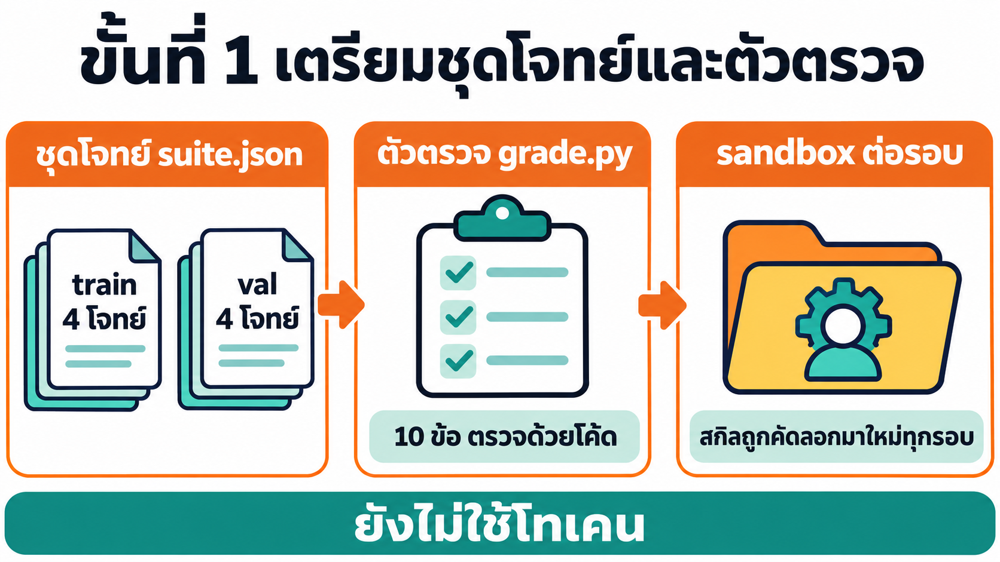

### 1.1 · โจทย์ 8 ข้อ

ทุกโจทย์ใช้พรอมต์โครงเดียวกับการบ้านของบท 05 (แตกบล็อก 8–12 บล็อก วาด DAG และ Gantt โดยไม่รันทีม) ต่างกันที่โจทย์ จำนวน agent สูงสุด และบัญชีที่มี

| ชุด | โจทย์ | agent สูงสุด | บัญชี (โควตาสมมติ) | จุดที่ตั้งใจวัด |
|---|---|---|---|---|
| train | `t1-library-booking` ระบบจองห้องประชุมของห้องสมุด | 4 | Claude 2 · Codex 2 | กรณีปกติ |
| train | `t2-school-notice` เว็บประกาศข่าวของโรงเรียน | 2 | Claude 2 | ไม่มีบัญชี Codex จึงใช้สกิล `cyolo` และ `image` ไม่ได้ |
| train | `t3-gym-membership` ระบบสมาชิกฟิตเนส | 3 | Claude 2 · Codex 1 | บล็อกหลายบัญชีต้องไม่เกิน 3 |
| train | `t4-food-truck` เว็บสั่งอาหารพร้อมรูปอาหาร | 4 | Claude 2 · Codex 1 | **ภาพของรายการ**ต้องรอข้อมูลเมนู |
| val | `v1-pet-clinic` ระบบนัดหมายคลินิกสัตว์เลี้ยง | 4 | Claude 2 · Codex 2 | กรณีปกติ |
| val | `v2-dorm-repair` ระบบแจ้งซ่อมของหอพัก | 2 | Codex 2 | ไม่มีบัญชี Claude |
| val | `v3-coop-shop` เว็บร้านสหกรณ์พร้อมรูปสินค้า | 3 | Claude 1 · Codex 2 | **ภาพของรายการ**ต้องรอข้อมูลสินค้า |
| val | `v4-quiz-platform` แพลตฟอร์มทำแบบทดสอบ | 4 | Claude 2 · Codex 2 (บัญชีหนึ่งเหลือโควตา 15%) | โควตาต่ำ |

ชุด val มีโจทย์แบบเดียวกับชุด train ทุกแบบ แต่เป็นคนละงาน ถ้ากติกาใหม่ช่วยได้เฉพาะโจทย์ที่เห็นตอนแก้ คะแนนชุด val จะไม่ขึ้นตาม

### 1.2 · ตัวตรวจ 10 ข้อ

ตัวตรวจ [`grade.py`](part1_dag-planner/evals/grade.py) ไม่เชื่อคำตอบของเอเจนต์ แต่อ่าน `blocks.json` ที่ได้ แล้วให้สคริปต์ของ v0 วางแผนซ้ำด้วยเงื่อนไขของโจทย์

| ข้อตรวจ | ผ่านเมื่อ |
|---|---|
| `files` | มี `blocks.json` · `PLAN.md` · `plan.json` · ภาพ DAG และ Gantt |
| `dag_valid` | คำสั่ง `dag` ไม่มี ERROR |
| `block_count` | มี 8–12 บล็อกตามที่โจทย์ขอ |
| `structure` | มีบล็อกเริ่มที่ไม่รอใคร · บล็อกสุดท้ายบล็อกเดียวเป็น `exclusive` · ทุกบล็อกไปถึงบล็อกสุดท้าย |
| `output_done` | ทุกบล็อกมี `output` ไม่ซ้ำกัน และมี `done` |
| `constraints` | แผนใช้จำนวน agent และบัญชีตามที่โจทย์สั่ง |
| `all_scheduled` | วางแผนซ้ำแล้วทุกบล็อกมีบัญชีรับ |
| `selective` | บล็อกหลายบัญชี (review · debate · best_of) ไม่เกิน 1 ใน 3 ของทั้งหมด |
| `parallel` | สายวิกฤตไม่เกิน 60% ของงานรวม (ทำขนานได้จริง) |
| `image_data` | บล็อกภาพของรายการรอบล็อกข้อมูล (ตรวจเฉพาะ `t4` และ `v3`) |

คะแนนของ 1 รอบ = จำนวนข้อที่ผ่าน ÷ จำนวนข้อที่ตรวจ

### 1.3 · วางพรอมต์

```text
เตรียมการทดลอง skill optimization ใน container multi-account ทำผ่าน docker เท่านั้น ห้ามลบ หยุด หรือสร้าง container / volume ห้ามแตะ credential และห้ามล็อกอินแทนผม
- คัดลอก ../05_DAG_Planner/base_skills ไปที่ /workspace/05_DAG_Planner/base_skills
- คัดลอกโฟลเดอร์ skills part1_dag-planner และ part2_web-builder ของโฟลเดอร์นี้ไปที่ /workspace/07_Skill_Optimization/ (ไม่ต้องคัดลอกโฟลเดอร์ runs)
- อ่าน /workspace/07_Skill_Optimization/skills/skill-optimizer/SKILL.md แล้วใช้สกิลนี้ตลอดการทดลอง
- สั่ง lint กับสกิล part1_dag-planner/versions/v0 และตรวจว่าบัญชี yolo2 กับ yolo3 พร้อมใช้
- เปิด part1_dag-planner/evals/suite.json แล้วสรุปว่ามีกี่โจทย์ ชุด train และ val อย่างละกี่ข้อ และตัวตรวจ grade.py ตรวจอะไรบ้าง
ยังไม่ต้องรันโจทย์ ตอบเป็นตารางสั้น ๆ แล้วหยุด
```

**ผลจริง:** `lint` ของ v0 รายงาน `SKILL.md` 85 บรรทัด 10,836 ไบต์ · สกิลทั้งโฟลเดอร์ 7 ไฟล์ 121,430 ไบต์ · ไม่มีลิงก์เสีย · ใน container `multi-account` บัญชี `yolo1–3` และ `cyolo1–2` พร้อมใช้

## ขั้นที่ 2 · วัดเส้นฐานของสกิลเดิม (v0)

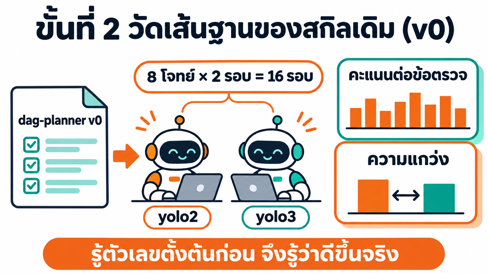

```text
วัดเส้นฐานของสกิล dag-planner รุ่น v0 ด้วยสกิล skill-optimizer ใน container multi-account
- ชุดโจทย์ /workspace/07_Skill_Optimization/part1_dag-planner/evals สกิล part1_dag-planner/versions/v0 ตั้งชื่อรุ่นว่า v0
- รันทุกโจทย์ โจทย์ละ 2 รอบ บนบัญชี yolo2 และ yolo3 (16 รอบ ใช้โทเคนจริง)
- เสร็จแล้ววัดความแกว่งของ v0
ตอบ: ตารางจาก report · ความแกว่งของค่าเฉลี่ย · ข้อตรวจที่ผ่านไม่ครบ ตัวเลขต้องมาจากคำสั่งของสกิลเท่านั้น
```

**ผลจริง** (16 รอบ · ผู้ทำ sonnet/medium)

| ชุด | รอบ | คะแนน | ได้เต็มทุกข้อ | เวลา (วินาที) | คำสั่ง | คำสั่งล้ม | ค่าใช้จ่าย | output token |
|---|---|---|---|---|---|---|---|---|
| train | 8 | **94.7%** | 4/8 | 111 | 4.4 | 0.8 | $0.16 | 3,572 |
| val | 8 | **94.7%** | 4/8 | 116 | 4.2 | 1.0 | $0.15 | 3,588 |
| รวม | 16 | **94.7%** | 8/16 | 114 | 4.3 | 0.9 | $0.15 | 3,580 |

| ข้อตรวจที่ผ่านไม่ครบ | train | val |
|---|---|---|
| `parallel` | 5/8 | 6/8 |
| `image_data` | 1/2 | 0/2 |

ข้อตรวจอีก 8 ข้อผ่านครบ 16/16 รอบ

**ความแกว่งของ v0** (`null`): ชุด train มี 2 จาก 4 โจทย์ที่สองรอบได้คะแนนไม่เท่ากัน ความแกว่งต่อโจทย์ 5.6 จุด · รวม 8 โจทย์ ความแกว่งต่อโจทย์ 2.8 จุด และ**ความแกว่งของค่าเฉลี่ย 1.0 จุด** รุ่นใหม่จึงต้องดีขึ้นมากกว่า 2 จุด (เกณฑ์ขั้นต่ำของประตู) จึงนับว่าดีขึ้นจริง

**อ่านผลอย่างไร**

- **สกิลเดิมดีอยู่แล้ว:** 8 จาก 10 ข้อตรวจผ่านทุกรอบ รวมถึงโจทย์ที่มีแต่บัญชี Claude หรือมีแต่บัญชี Codex
- **จุดอ่อนซ้ำกัน 2 ข้อ:** `parallel` และ `image_data` พลาดทั้งในชุด train และชุด val
- **คำสั่งล้มเกือบทุกรอบ:** มาจากคำสั่ง `ls plans` ของเอเจนต์ตอนสำรวจโฟลเดอร์ที่ยังไม่มี ไม่เกี่ยวกับสกิล จึงไม่นับเป็นปัญหาของสกิล

## ขั้นที่ 3 · หาสาเหตุจากร่องรอย

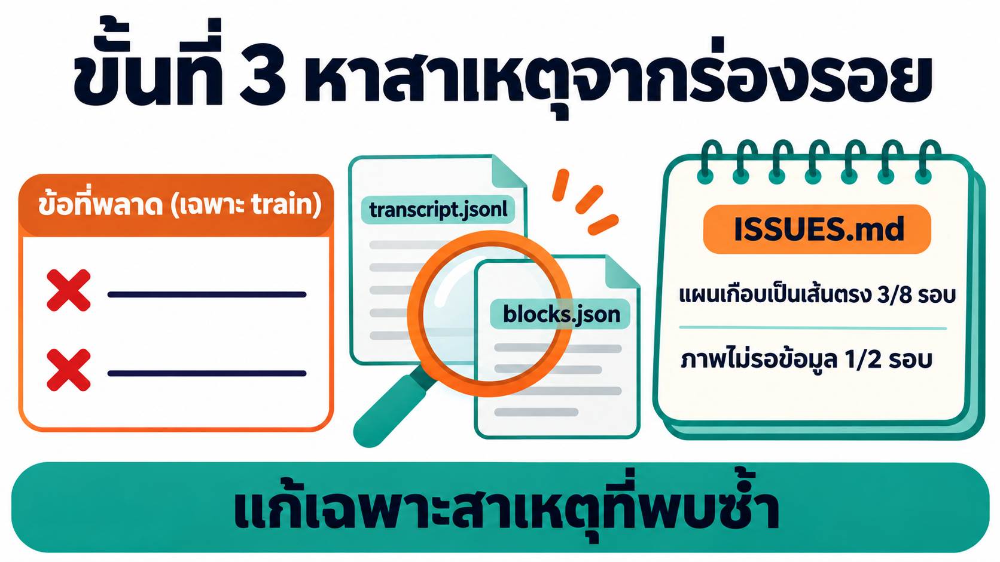

```text
หาสาเหตุของข้อที่ v0 พลาด ด้วยสกิล skill-optimizer (ยังไม่แก้สกิล)
- ดูเฉพาะชุด train: สั่ง failures แล้วเปิด transcript.jsonl และ blocks.json ของรอบที่พลาด
- เขียนสมุดปัญหาที่ /workspace/07_Skill_Optimization/part1_dag-planner/ISSUES.md ตามรูปแบบของสกิล
ตอบ: ตาราง ปัญหา | พบกี่รอบ | สาเหตุ | ทางแก้ที่เสนอ (ไม่เกิน 3 ข้อ)
```

**ผลจริง:** ชุด train พลาด 4 รอบจาก 8 รอบ รวมเป็น 2 สาเหตุ

| ปัญหา | พบ (ชุด train) | หลักฐานจากผลงาน | สาเหตุในสกิล |
|---|---|---|---|
| แผนเกือบเป็นเส้นตรง | 3/8 รอบ | `t3` รอบ 1: สายวิกฤต B01 → B04 → B05 → B07 → B08 → B10 ยาว 9.6 จากงานรวม 13.8 (70%) | กติกาบอกแค่ "รอเท่าที่จำเป็น" ไม่มีตัวเลขให้ตรวจ และคำสั่ง `dag` ไม่เตือน |
| ภาพของรายการไม่รอข้อมูล | 1/2 รอบ | `t4` รอบ 1: บล็อกรูปอาหาร B03 และ B04 ไม่มี `depends_on` | สกิลไม่มีกติกาข้อนี้ ทั้งที่เป็นบทเรียนจากเหมียวช็อปในบท 05 |

ตัวอย่างบล็อกจากแผน `t3` รอบ 1 ที่ต่อกันเป็นแถวโดยไม่จำเป็น

```text
B04 M yolo   ← B01        API สมัครสมาชิก
B05 M review ← B04        API ต่ออายุสมาชิก
B07 L yolo   ← B03, B05   เช็กอินด้วย QR
B08 M cyolo  ← B05, B07   รายงานรายเดือน
```

สมุดปัญหาฉบับเต็ม: [`part1_dag-planner/ISSUES.md`](part1_dag-planner/ISSUES.md)

## ขั้นที่ 4 · แก้ 2 จุด วัดซ้ำ ผ่านประตูรับ

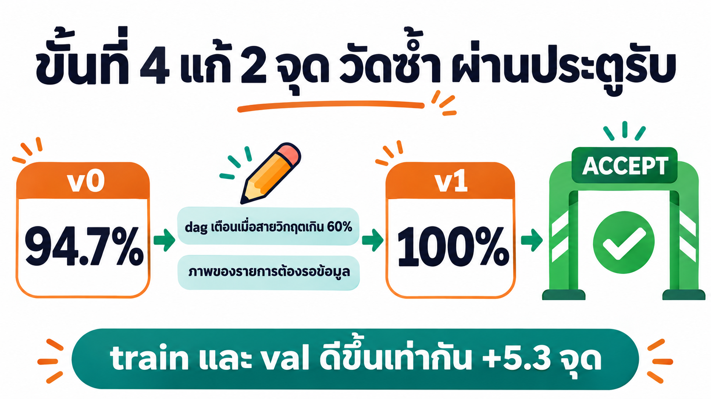

```text
ปรับปรุงสกิล dag-planner จาก v0 เป็น v1 ตามสมุดปัญหา ด้วยสกิล skill-optimizer
- คัดลอก versions/v0 เป็น versions/v1 แล้วแก้ไม่เกิน 3 จุด ให้สคริปต์เตือนเองก่อนเพิ่มกติกา ห้ามใส่ชื่อหรือคำตอบของโจทย์ลงในสกิล
- รัน v1 ด้วยเงื่อนไขเดียวกับ v0 ทุกค่า (16 รอบ) แล้วสั่ง gate เทียบ v0 กับ v1
- ถ้าข้อตรวจใดของ v1 แย่ลง ให้เปิดผลงานของรอบนั้นดูก่อนว่าเป็นความผิดของสกิลหรือของตัวตรวจ
ตอบ: จุดที่แก้ · ตารางเทียบ v0 กับ v1 · ผลประตู แล้วอัปเดต ISSUES.md
```

### 4.1 · จุดที่แก้ (2 จุด)

| จุด | ส่วนของสกิล | สิ่งที่แก้ |
|---|---|---|
| 1 | `scripts/dagplan.py` + `SKILL.md` | คำสั่ง `dag` พิมพ์ `WARN` เมื่อสายวิกฤตยาวเกิน 60% ของงานรวม พร้อมบอกสายและวิธีแก้ · กติกาเพิ่มตัวเลข 60% · ขั้นตอนที่ 3 สั่งให้อ่าน `WARN` ทุกบรรทัด |
| 2 | `scripts/dagplan.py` + `SKILL.md` | คำสั่ง `dag` พิมพ์ `WARN` เมื่อบล็อก `image` ไม่รอบล็อกข้อมูลใด · เพิ่มกติกา "บล็อกภาพของรายการต้อง `depends_on` บล็อกข้อมูล โลโก้และไอคอนไม่ต้องรอ" |

ข้อความเตือนจริงจากสคริปต์ของ v1 เมื่อป้อนแผน `t3` รอบ 1 ของ v0

```text
OK 10 บล็อก · สายวิกฤต B01 → B04 → B05 → B07 → B08 → B10 · ยาว 9.6M tok
WARN สายวิกฤต B01 → B04 → B05 → B07 → B08 → B10 ยาว 70% ของงานรวม (เกิน 60%) = แผนเกือบเป็นเส้นตรง ทำขนานได้น้อย → ตัด depends_on ที่บล็อกบนสายนี้ไม่ได้อ่านไฟล์ผลจริง หรือแบ่งบล็อก L บนสายนี้ แล้วสั่ง dag ซ้ำ
WARN B02 (image) ไม่รอบล็อกข้อมูลใดเลย: ถ้าเป็นภาพของรายการ (สินค้า · เมนู · ข่าว) ต้อง depends_on บล็อกที่กำหนดรายการนั้น ไม่เช่นนั้นภาพจะไม่ตรงกับชื่อ · โลโก้และไอคอนทั่วไปไม่ต้องแก้
```

`SKILL.md` ยาวขึ้นจาก 10,836 เป็น 11,685 ไบต์ (+8%) ไฟล์ทั้งหมดอยู่ที่ [`part1_dag-planner/versions/v1`](part1_dag-planner/versions/v1)

### 4.2 · ผลจริง: v0 เทียบ v1

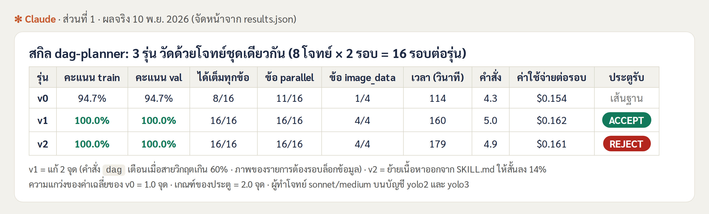

| รุ่น | ชุด | รอบ | คะแนน | ได้เต็มทุกข้อ | เวลา (วินาที) | คำสั่ง | ค่าใช้จ่าย | output token |
|---|---|---|---|---|---|---|---|---|
| v0 | train | 8 | 94.7% | 4/8 | 111 | 4.4 | $0.16 | 3,572 |
| v0 | val | 8 | 94.7% | 4/8 | 116 | 4.2 | $0.15 | 3,588 |
| **v1** | train | 8 | **100%** | 8/8 | 168 | 4.8 | $0.16 | 4,149 |
| **v1** | val | 8 | **100%** | 8/8 | 151 | 5.2 | $0.17 | 4,436 |

| ข้อตรวจ | v0 | v1 |
|---|---|---|
| `parallel` | 11/16 | **16/16** |
| `image_data` | 1/4 | **4/4** |
| อีก 8 ข้อ | 16/16 | 16/16 |

ผลของคำสั่ง `gate`

```text
ความแกว่งของ v0 เอง (A/A): ต่อโจทย์ 2.8 จุด · ของค่าเฉลี่ย 1.0 จุด → เกณฑ์ = ค่าที่มากกว่าระหว่างค่านี้กับ eps 2.0
train: 94.7% → 100.0% (+5.3) · ค่าใช้จ่าย $0.16 → $0.16 · คำสั่ง 4.4 → 4.8
val: 94.7% → 100.0% (+5.3) · ค่าใช้จ่าย $0.15 → $0.17 · คำสั่ง 4.2 → 5.2
  ✓ คะแนนรวมดีขึ้น +5.3 จุด มากกว่าความแกว่ง 2.0 จุด
ผล: ACCEPT ✅ รับ v1 แทน v0
```

**อ่านผลอย่างไร**

- **ดีขึ้นทั้งสองชุดเท่ากัน:** ชุด val ซึ่งไม่ได้ใช้ตอนแก้ ขึ้น +5.3 จุดเท่ากับชุด train การแก้จึงไม่ใช่การจำโจทย์
- **ดีขึ้นมากกว่าความแกว่ง:** +5.3 จุด เทียบกับเกณฑ์ 2.0 จุด
- **มีราคาที่ต้องจ่าย:** output token เพิ่ม 20% และจำนวนคำสั่งเพิ่มจาก 4.3 เป็น 5.0 ต่อรอบ เพราะเอเจนต์อ่าน `WARN` แล้วแก้ `blocks.json` หรืออธิบายเหตุผลที่ไม่แก้ ค่าใช้จ่ายต่อรอบเพิ่มจาก $0.154 เป็น $0.162 (+5%)
- **เวลาเทียบข้ามรุ่นไม่ได้:** เวลาต่อรอบ 114 และ 160 วินาทีวัดขณะที่เครื่องรันงานอื่นพร้อมกันไม่เท่ากัน (รันซ้ำใน container ที่ว่าง ทั้งสองรุ่นใช้ 38 วินาทีต่อรอบเท่ากัน ดูหัวข้อ 7)
- **ข้อตรวจเดิมไม่พัง:** 8 ข้อที่เคยผ่านครบยังผ่านครบ

### 4.3 · บทเรียนจากของจริง: ตัวตรวจก็ผิดได้

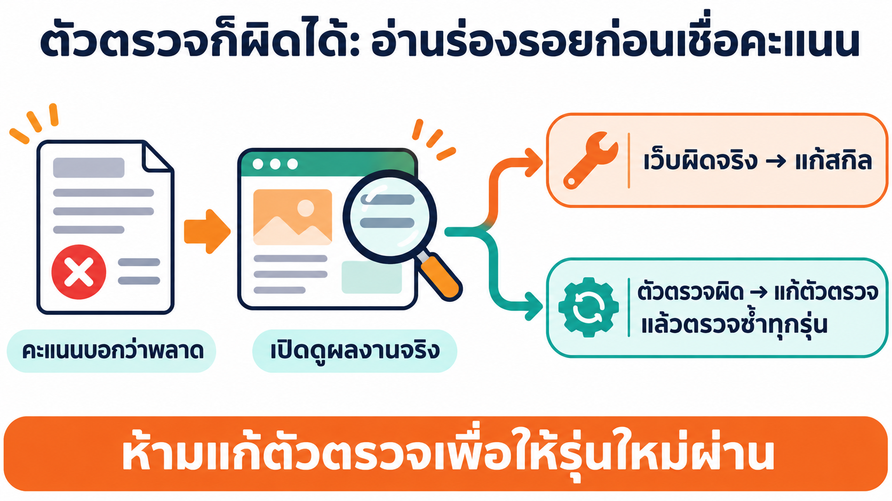

ผลรอบแรกของ v1 ไม่ได้ออกมาเป็น 100% ข้อ `image_data` ได้ **0/4** แย่กว่า v0 ที่ได้ 1/4 ทั้งที่เพิ่งเพิ่มกติกาข้อนี้ เมื่อเปิด `blocks.json` ของทั้ง 4 รอบจึงเห็นว่า

| รอบของ v1 | บล็อกภาพในแผน | ตัวตรวจรุ่นแรกตัดสิน |
|---|---|---|
| `t4` รอบ 1 | B04 โลโก้ (ไม่รอ) · B05 B06 รูปอาหาร ← B02 ข้อมูลเมนู | ไม่ผ่าน เพราะ B04 |
| `t4` รอบ 2 | B03 โลโก้ร้าน (ไม่รอ) · B05 B06 รูปอาหาร ← B02 | ไม่ผ่าน เพราะ B03 |
| `v3` รอบ 1 | B03 โลโก้สหกรณ์ (ไม่รอ) · B05 B06 รูปสินค้า ← B02 | ไม่ผ่าน เพราะ B03 |
| `v3` รอบ 2 | B06 โลโก้ร้าน (ไม่รอ) · B05 รูปสินค้า ← B02 | ไม่ผ่าน เพราะ B06 |

รูปอาหารและรูปสินค้ารอบล็อกข้อมูลครบทุกรอบ ส่วนที่ถูกนับว่าผิดคือ**โลโก้** ซึ่งไม่ต้องรอข้อมูลอยู่แล้ว ข้อบกพร่องจึงอยู่ที่ตัวตรวจ แก้ `grade.py` ให้ยกเว้นโลโก้ ไอคอน และแบนเนอร์ แล้วสั่ง `grade` ตรวจซ้ำ**ทุกรุ่น** ผลของ v0 ยังเป็น 1/4 เท่าเดิม ส่วน v1 เป็น 4/4

| ทำได้ | ห้ามทำ |
|---|---|
| แก้ตัวตรวจเมื่อเปิดผลงานแล้วพบว่าตัดสินผิด และตรวจซ้ำทุกรุ่นด้วยตัวตรวจเดียวกัน | แก้ตัวตรวจเพื่อให้รุ่นใหม่ผ่าน โดยไม่ได้ดูผลงาน |
| จดการแก้ตัวตรวจลงสมุดปัญหา | ตรวจรุ่นเก่าด้วยตัวตรวจเก่า รุ่นใหม่ด้วยตัวตรวจใหม่ |

## ขั้นที่ 5 · ลองลดต้นทุน: ไม่ผ่านประตู

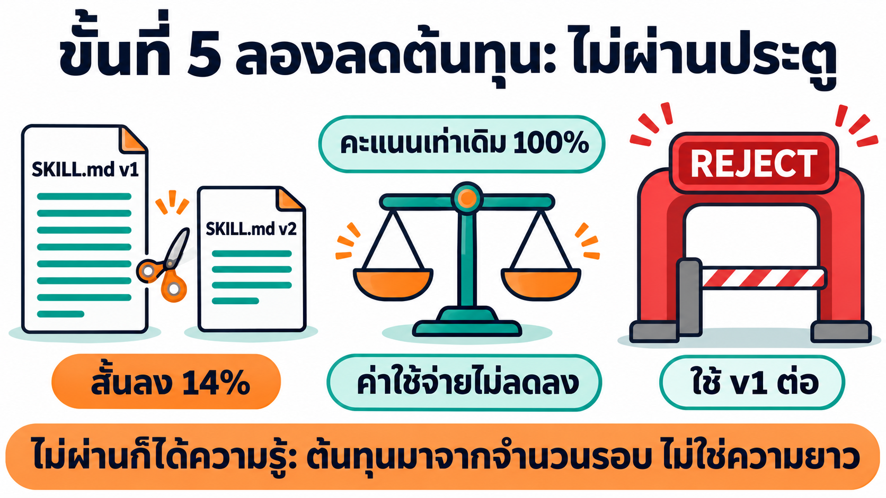

v1 ได้ 100% แล้ว จึงไม่มีคะแนนให้เพิ่ม เป้าหมายถัดไปคือ**ต้นทุน** สมมติฐาน: ถ้า `SKILL.md` สั้นลง เอเจนต์อ่านน้อยลง ค่าใช้จ่ายควรลด

```text
ลองลดต้นทุนของสกิล dag-planner: สร้าง v2 จาก v1 โดยย้ายเนื้อหาที่งานวางแผนไม่ได้ใช้ออกจาก SKILL.md ไปไว้ใน references ห้ามเปลี่ยนกติกา
รัน v2 ด้วยเงื่อนไขเดิม (16 รอบ) แล้วสั่ง gate เทียบ v1 กับ v2 ถ้าไม่ผ่านให้ใช้ v1 ต่อ และจดผลลง ISSUES.md
ตอบ: ขนาด SKILL.md ก่อนและหลังจาก lint · ตารางเทียบ · ผลประตูพร้อมเหตุผล
```

**จุดที่แก้ (3 จุด):** ย้ายหัวข้อ "เรียกจาก host" ไป `references/host.md` · ย่อหัวข้อ KC-QUEST เหลือ 1 บรรทัด (สูตรอยู่ใน `references/kcquest.md` อยู่แล้ว) · เปลี่ยน path ของสคริปต์เป็นแบบที่ใช้ได้ทุกที่ที่วางสกิล

| รุ่น | `SKILL.md` | คะแนน (16 รอบ) | เวลา (วินาที) | คำสั่ง | ค่าใช้จ่ายต่อรอบ | output token |
|---|---|---|---|---|---|---|
| v1 | 86 บรรทัด · 11,685 ไบต์ | 100% | 160 | 5.0 | $0.162 | 4,292 |
| v2 | 74 บรรทัด · 10,021 ไบต์ (-14%) | 100% | 179 | 4.9 | $0.161 | 4,221 |

```text
train: 100.0% → 100.0% (+0.0) · ค่าใช้จ่าย $0.16 → $0.16 · คำสั่ง 4.8 → 5.0
val: 100.0% → 100.0% (+0.0) · ค่าใช้จ่าย $0.17 → $0.16 · คำสั่ง 5.2 → 4.8
  ✗ คะแนนรวมดีขึ้น +0.0 จุด ไม่เกินความแกว่ง 2.0 จุด และค่าใช้จ่ายไม่ลดลงอย่างน้อย 10% → ยังไม่มีหลักฐานพอให้รับ
ผล: REJECT ❌ ไม่รับ v2 แทน v1
```

**อ่านผลอย่างไร**

- **สั้นลง 14% แต่ค่าใช้จ่ายลดไม่ถึง 1%:** ค่าใช้จ่ายของรอบหนึ่งมาจากจำนวนครั้งที่เอเจนต์ทำงาน (ประมาณ 5 คำสั่งต่อรอบ ซึ่งทุกครั้งส่งบริบททั้งหมดซ้ำ) ไม่ได้มาจากความยาวของ `SKILL.md` เป็นหลัก ตรงกับที่งาน BiPA รายงานว่าต้นทุนที่เพิ่มของสกิลมาจากจำนวนรอบมากกว่าความยาว
- **ไม่ผ่านก็ไม่เสียหาย:** v2 ไม่ได้แย่กว่า v1 แต่ก็ไม่มีหลักฐานว่าดีกว่า จึงใช้ v1 ต่อ และจดไว้ในสมุดปัญหาว่าทางนี้ไม่ได้ผล
- **รุ่นที่ใช้ต่อ:** [`part1_dag-planner/versions/v1`](part1_dag-planner/versions/v1)

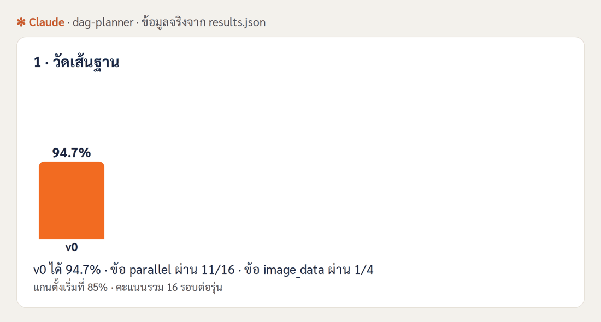

*วาดจาก `part1_dag-planner/evals/results.json` ไม่ได้แต่งตัวเลข*

---

# ส่วนที่ 2 · สร้างสกิลใหม่ `web-builder` แล้วปรับปรุง

ส่วนนี้เริ่มจากไม่มีสกิล ให้ Claude สร้างสกิลรุ่นแรก แล้วใช้วงรอบเดียวกับส่วนที่ 1 ปรับปรุง งานของสกิลคือ**สร้างเว็บ static หน้าเดียวจาก brief แล้วใช้ Playwright เปิดเว็บตรวจว่าทำงานจริงก่อนส่งงาน**

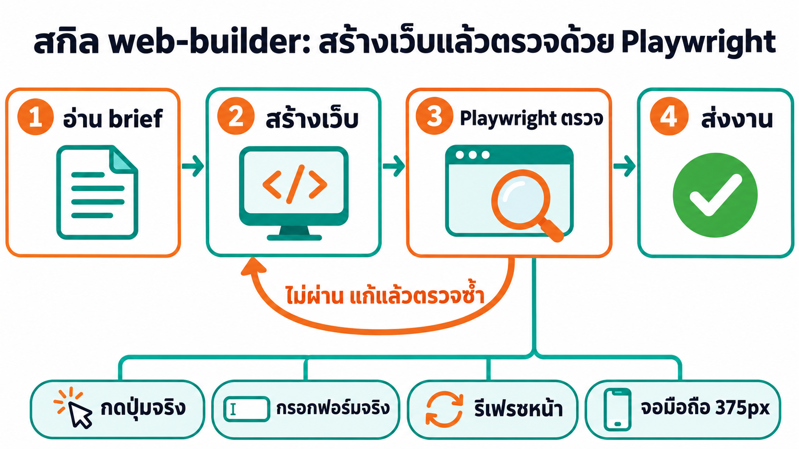

## ขั้นที่ 6 · ให้ Claude สร้างสกิลรุ่นแรก

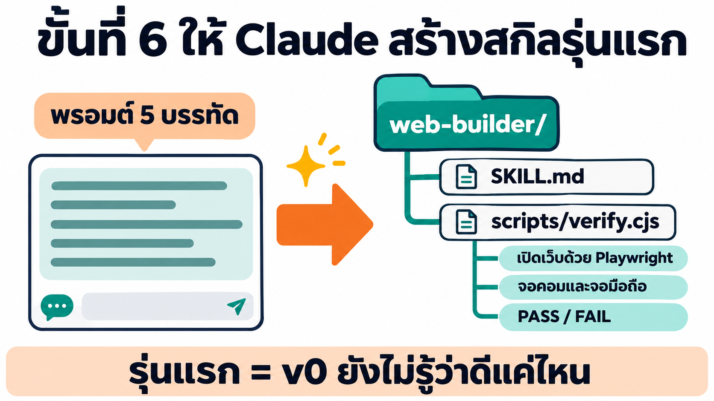

สร้างโฟลเดอร์งานใหม่ เปิด session ที่โฟลเดอร์นั้น แล้ววางพรอมต์ (ไฟล์เดียวกับ [`part2_web-builder/prompt_create_v0.txt`](part2_web-builder/prompt_create_v0.txt))

```text
ช่วยสร้างสกิลชื่อ web-builder สำหรับ AI coding agent
สกิลนี้ใช้เมื่อผู้ใช้ให้ brief ของเว็บไซต์: เอเจนต์สร้างเว็บ static หน้าเดียวไว้ที่ ./site/index.html (HTML CSS JavaScript ล้วน ไม่มี server ไม่มีขั้น build) แล้วใช้ Playwright เปิดเว็บเพื่อตรวจว่าทำงานจริงก่อนส่งงาน
สร้างไว้ที่ ./skills/web-builder (SKILL.md และ scripts ถ้าจำเป็น) สกิลต้องใช้ได้เมื่อถูกคัดลอกไปวางที่โฟลเดอร์ใดก็ได้
เครื่องนี้มี node และมี playwright อยู่ที่ $(npm root -g)/@playwright/mcp/node_modules/playwright (Chromium ติดตั้งแล้ว ต้องเปิดด้วย --no-sandbox)
ทดสอบสั้น ๆ ว่าสคริปต์ของสกิลรันได้ แล้วสรุปไฟล์ที่สร้างและหยุด
```

**ผลจริง** (opus/medium · 94 วินาที · 5 รอบการทำงาน · $0.39): ได้สกิล 2 ไฟล์ เก็บไว้ที่ [`part2_web-builder/versions/v0`](part2_web-builder/versions/v0)

```text
web-builder/
├── SKILL.md            ← 75 บรรทัด: อ่าน brief → เขียน site/index.html → รัน verify → แก้จนผ่าน → ส่งงาน
└── scripts/verify.cjs  ← 170 บรรทัด: หา playwright เอง เปิดเว็บที่จอ 1280×800 และ 375×740
                          FAIL เมื่อมี console error ไฟล์โหลดไม่ได้ หน้าว่าง จอล้น ลิงก์เสีย
                          รัน steps.json (click · fill · expectText …) ที่เอเจนต์เขียนเอง
```

บรรทัดที่บอกตำแหน่งของ playwright ในพรอมต์จำเป็น: ใน container ของวิชานี้ `require('playwright')` ตรง ๆ หาไม่เจอ เพราะ playwright ถูกติดตั้งมากับ Playwright MCP ที่ `$(npm root -g)/@playwright/mcp/node_modules/playwright`

## ขั้นที่ 7 · สร้างชุดโจทย์เว็บและตัวตรวจ

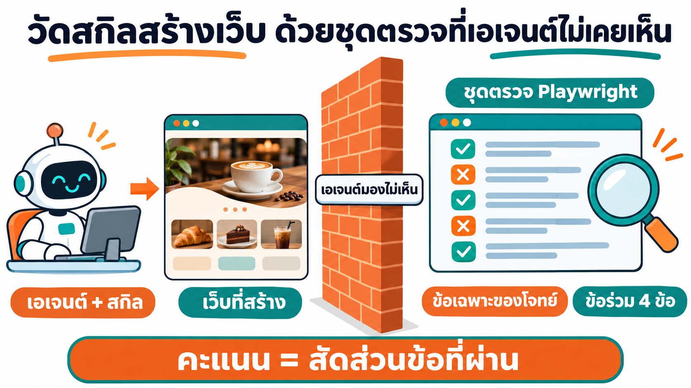

ตัวตรวจ [`harness.cjs`](part2_web-builder/evals/harness.cjs) เปิด `site/index.html` ที่เอเจนต์สร้างด้วย Playwright แล้วกดใช้งานจริงทีละข้อ เอเจนต์ไม่เคยเห็นชุดตรวจนี้ เห็นแต่ brief

### 7.1 · ชุดแรกง่ายไป วัดอะไรไม่ได้

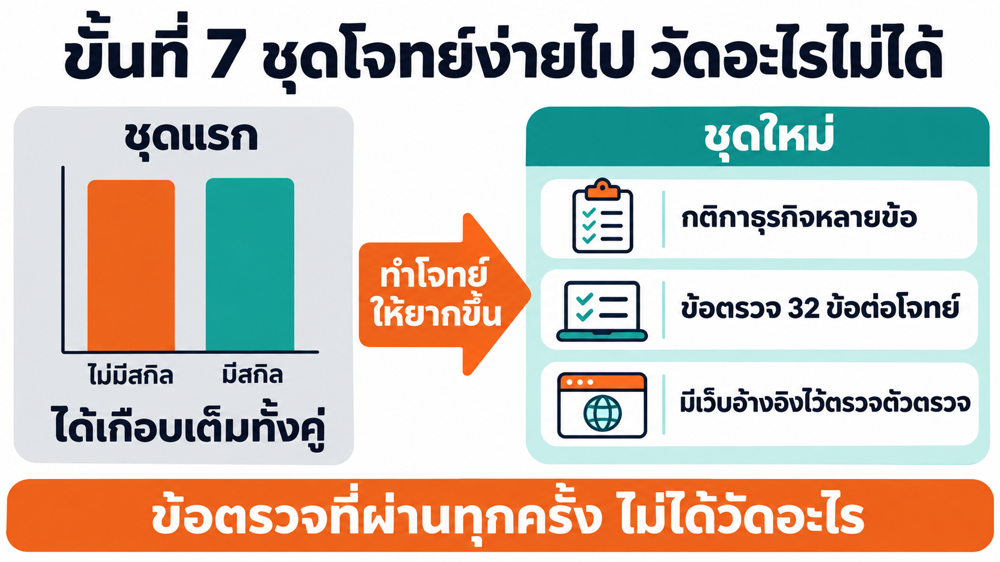

ชุดแรก ([`evals_easy`](part2_web-builder/evals_easy/)) มี 6 โจทย์ขนาดเล็ก เช่น เมนูร้านกาแฟที่มีตะกร้า ฟอร์มสมัครอบรม และรายการงาน

| แขน | รอบ | คะแนน | ได้เต็มทุกข้อ | คำสั่ง | คำสั่งล้ม |
|---|---|---|---|---|---|
| sonnet · ไม่มีสกิล | 12 | 98.5% | 10/12 | 7.7 | 2.0 |
| sonnet · สกิล v0 | 12 | 97.0% | 8/12 | 4.4 | 0.2 |
| haiku · ไม่มีสกิล | 12 | 99.6% | 11/12 | 23.7 | 5.2 |

ไม่มีสกิลก็ได้เกือบเต็ม แม้ใช้รุ่นเล็ก (haiku) ชุดโจทย์นี้จึงบอกไม่ได้ว่าสกิลดีหรือไม่ดี (ตัวตรวจของชุดนี้ไม่ได้ถูกไล่ตรวจต่อ เพราะเลิกใช้)

### 7.2 · ชุดที่ใช้จริง: กติกาธุรกิจ 32 ข้อตรวจต่อโจทย์

ชุดที่ 2 ([`evals`](part2_web-builder/evals/)) มีโจทย์ 2 แบบ แบบละ 3 ร้าน ตัวเลขของแต่ละร้านต่างกันทั้งหมด สกิลจึงจำตัวเลขไม่ได้

| ชุด | โจทย์ | แบบ | กติกาที่ต้องทำให้ถูก |
|---|---|---|---|
| train | `t1-coffee-shop` · `t3-bakery-shop` | ร้านค้า + ตะกร้า | จำนวนต่อรายการ (มีเพดาน) · โค้ดส่วนลด 2 แบบ (เปอร์เซ็นต์ · ลดคงที่เมื่อถึงขั้นต่ำ) · ค่าส่งและเกณฑ์ส่งฟรีคิดหลังหักส่วนลด · ปัดครึ่งสตางค์ขึ้น · เลขที่ออเดอร์ · จำค่าหลังรีเฟรช |
| train | `t2-meeting-room` · `t4-badminton` | ระบบจอง | ความจุต่อห้อง · เวลาปิด · เวลาซ้อน (ชนขอบได้) · ราคาวันหยุดและส่วนลดจองยาว · เรียงรายการ · ยกเลิกแล้วจองใหม่ได้ |
| val | `v1-plant-shop` | ร้านค้า + ตะกร้า | เหมือนแบบร้านค้า ตัวเลขชุดใหม่ |
| val | `v2-music-studio` | ระบบจอง | เหมือนแบบจอง ตัวเลขชุดใหม่ |

ข้อตรวจ 32 ข้อต่อโจทย์ แบ่งเป็น 3 กลุ่ม

| กลุ่ม | จำนวน | ตัวอย่าง |
|---|---|---|
| ข้อเฉพาะของโจทย์ (`f_*`) | 17–20 | `f_pct_round` ใส่โค้ดลด 15% กับยอด ฿59.50 ต้องลด ฿8.93 (8.925 ปัดขึ้น) · `f_adjacent` จองต่อจากรายการก่อนหน้าพอดีต้องได้ |
| ความทนทาน (`g_*`) | 6–8 | `g_storage` ข้อมูลใน localStorage เสียแล้วหน้าต้องยังใช้ได้ · `g_escape` พิมพ์ `<b>` ต้องแสดงเป็นตัวหนังสือ · `g_longtext` ข้อความยาวไม่ดันจอมือถือล้น |
| การเข้าถึงได้ WCAG 2.2 AA (`a_*`) | 6–7 | `a_contrast` ตัวหนังสือตัดกับพื้น ≥ 4.5:1 · `a_focus` เห็นวงโฟกัส · `a_target` เป้ากด ≥ 24px · `a_invalid` ช่องที่ผิดมี `aria-invalid` |

**เว็บอ้างอิงไว้ตรวจตัวตรวจ:** โฟลเดอร์ [`evals/ref`](part2_web-builder/evals/ref/) มีเว็บที่เราเขียนเองตามสเปก 2 ไฟล์ (ร้านค้าและระบบจอง) ก่อนใช้ตัวตรวจกับงานของเอเจนต์ ต้องรันตัวตรวจกับเว็บอ้างอิงให้ได้ 32/32 ทั้ง 6 โจทย์ก่อน ถ้าเว็บอ้างอิงไม่ผ่าน แปลว่าตัวตรวจหรือสเปกผิด

## ขั้นที่ 8 · วัด: ไม่มีสกิล เทียบ มีสกิล v0

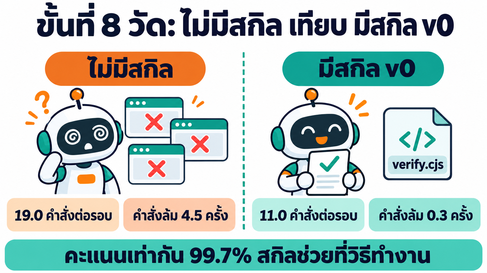

```text
วัดสกิล web-builder รุ่น v0 เทียบกับการไม่ใช้สกิล ด้วยสกิล skill-optimizer ใน container multi-account
- ชุดโจทย์ /workspace/07_Skill_Optimization/part2_web-builder/evals สกิล part2_web-builder/versions/v0
- ผู้ทำโจทย์ haiku/low รัน 2 แขน: ไม่มีสกิล (ชื่อรุ่น h-noskill) และมีสกิล (ชื่อรุ่น h-v0) แขนละ 6 โจทย์ × 2 รอบ บนบัญชี yolo2 และ yolo3 (24 รอบ ใช้โทเคนจริง)
- เสร็จแล้ววัดความแกว่งของ h-v0
ตอบ: ตารางจาก report · ข้อตรวจที่ผ่านไม่ครบ · จำนวนคำสั่งและคำสั่งล้มของแต่ละแขน
```

เราวัด 4 แขน (ผู้ทำ 2 รุ่น × ไม่มีสกิล/มีสกิล) พรอมต์ในกล่องด้านบนคือ 2 แขนของ haiku ซึ่งใช้ต่อในขั้นที่ 9

| แขน | รอบ | คะแนน | คำสั่งต่อรอบ | คำสั่งล้ม | โทเคนขาเข้า | output token | ราคาต่อรอบ |
|---|---|---|---|---|---|---|---|
| sonnet · ไม่มีสกิล | 12 | 100% | 5.0 | 0.8 | 180K | 9.4K | $0.191 |
| sonnet · สกิล v0 | 12 | 100% | 4.2 | 0.2 | 167K | 11.4K | $0.230 |
| haiku · ไม่มีสกิล | 12 | 99.7% | 19.0 | 4.5 | 773K | 32.1K | $0.033 |
| haiku · สกิล v0 | 12 | 99.7% | 11.0 | 0.3 | 548K | 31.4K | $0.031 |

**อ่านผลอย่างไร**

- **คุณภาพของเว็บไม่ต่างกัน:** ทุกแขนได้ 99.7–100% จาก 32 ข้อตรวจ งานนี้โมเดลทำได้เองอยู่แล้ว สกิลจึงเพิ่มคะแนนไม่ได้ ตรงกับที่งาน SWE-Skills-Bench และ WebDev-Skills-Bench รายงานว่าสกิลส่วนใหญ่ไม่ทำให้ผลงานดีขึ้นอย่างมีนัยสำคัญ
- **กับ sonnet สกิล v0 ทำให้แพงขึ้น:** ราคาต่อรอบ $0.191 → $0.230 (+21%) โดยคะแนนเท่าเดิม ถ้าใช้ sonnet กับงานขนาดนี้ สกิลนี้ไม่คุ้ม
- **กับ haiku สกิล v0 เปลี่ยนวิธีทำงาน:** คำสั่งต่อรอบ 19.0 → 11.0 และคำสั่งล้ม 4.5 → 0.3 ราคาใกล้เคียงเดิม
- **คำสั่งที่ล้มตอนไม่มีสกิลมาจากเครื่องมือเบราว์เซอร์:** เอเจนต์ใช้ Playwright MCP เปิด `file://` ไม่ได้ (11 ครั้งใน 12 รอบ) อ่าน `localStorage` ไม่ได้ (9 ครั้ง) และต้องเปิดปิด web server เอง ส่วน `verify.cjs` ของสกิลเปิดไฟล์ได้ตรง ๆ

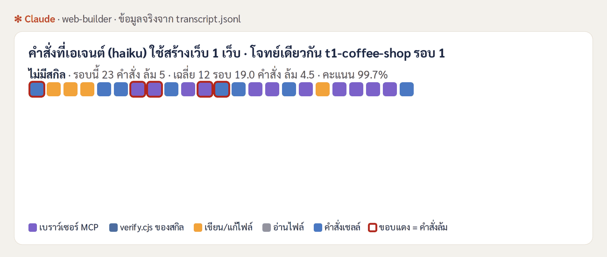

*วาดจาก `transcript.jsonl` ของโจทย์ `t1-coffee-shop` รอบ 1 ของแต่ละแขน*

### 8.1 · ก่อนเชื่อตัวเลขนี้: ตัวตรวจผิด 5 จุด

ตัวเลขในตารางด้านบนเป็นตัวเลขหลังแก้ตัวตรวจ ผลรอบแรกของชุดที่ 2 คือ sonnet ไม่มีสกิล **97.9%** และสกิล v0 **93.2%** ดูเหมือนสกิลทำให้แย่ลง 4.7 จุด เมื่อเปิดเว็บของรอบที่พลาดทีละรอบ พบว่าเป็นความผิดของตัวตรวจทั้งหมด

| # | ตัวตรวจตัดสินผิดอย่างไร | พบได้อย่างไร |
|---|---|---|
| G1 | ช่อง `type="date"` ถูกตัดสินว่าไม่มีวงโฟกัส | เว็บอ้างอิงของเราเองไม่ผ่าน |
| G2 | เว็บที่จำกัดความยาวชื่อด้วย `maxlength` ถูกตัดสินว่าเพิ่มข้อความยาวไม่ได้ | เปิดเว็บที่พลาด เห็นว่าจอไม่ล้น |
| G3 | บังคับ `aria-describedby` ทั้งที่ `role="alert"` ก็ถูก | อ่านโค้ดของเว็บที่พลาด |
| G4 | บังคับข้อความ "ตะกร้า (0)" ทั้งที่ brief ให้แสดง "ตะกร้าว่าง" | กดสั่งซื้อในเว็บที่พลาด เห็นว่าทำงานถูก |
| G5 | หาช่อง "วันที่" แล้วได้ 2 ชิ้น เพราะปุ่มยกเลิกมี `aria-label` ที่มีคำเดียวกัน เว็บที่ใช้งานได้จึงได้ 34% | ข้อความ `strict mode violation` ใน `grade.json` |

หลังแก้ทั้ง 5 จุดและสั่ง `grade` ซ้ำทุกแขน: sonnet ไม่มีสกิล 100% และสกิล v0 100% · รายละเอียดอยู่ใน [`part2_web-builder/ISSUES.md`](part2_web-builder/ISSUES.md)

## ขั้นที่ 9 · ปรับสกิล 2 รอบ: v1 ไม่ผ่าน v2 ผ่าน

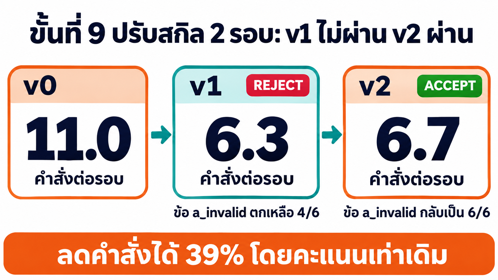

คะแนนเต็มอยู่แล้ว เป้าหมายของการปรับจึงเป็น**ทำงานให้น้อยลงโดยคะแนนไม่ลด** เส้นฐานคือ haiku + สกิล v0

```text
ปรับปรุงสกิล web-builder ด้วยสกิล skill-optimizer ใน container multi-account เป้าหมายคือคะแนนไม่ลดและจำนวนคำสั่งต่อรอบลดลง
- หาสาเหตุจากชุด train ของรุ่น h-v0: เอเจนต์ใช้คำสั่งไปกับอะไร และข้อตรวจใดพลาด แล้วเขียน part2_web-builder/ISSUES.md
- คัดลอก versions/v0 เป็นรุ่นใหม่ แก้ไม่เกิน 3 จุด ให้สคริปต์ verify.cjs ตรวจและเตือนเองก่อนเพิ่มกติกา
- รันรุ่นใหม่ด้วยเงื่อนไขเดียวกับ h-v0 (haiku/low 12 รอบ) แล้วสั่ง gate เทียบกับ h-v0 โดยใช้ --cost-metric tool_calls
- ถ้าไม่ผ่าน ให้จดสาเหตุลง ISSUES.md แล้วทำรุ่นถัดไปอีก 1 รอบ
ตอบ: จุดที่แก้ของแต่ละรุ่น · ตารางเทียบ · ผลประตูพร้อมเหตุผล
```

### 9.1 · v1: ลดคำสั่งได้ แต่ทำข้อเดิมพัง

จากร่องรอยของ h-v0: เอเจนต์เขียนสคริปต์ Playwright เองเฉลี่ย 1.3 ครั้งต่อรอบ และเปิดดู screenshot 1.6 ครั้งต่อรอบ เพราะ `steps.json` ของ v0 รีเฟรชหน้าและตรวจข้อความทั้งหน้าไม่ได้

| จุดที่แก้ใน v1 | ส่วนของสกิล |
|---|---|
| เพิ่ม action `reload` `expectBodyText` `expectNoBodyText` `fillLong` · รัน steps ทั้งจอ desktop และ mobile · ตรวจจอล้นซ้ำหลัง steps · เตือนเมื่อ steps ไม่มี `reload` หรือ `fillLong` | `scripts/verify.cjs` |
| ตาราง "ทุกข้อของ brief ต้องมี step" พร้อม 4 กรณีที่มักพลาด · คำนวณเงินเป็นสตางค์ | `SKILL.md` |
| ลบคำสั่งให้ดู screenshot ทุกครั้ง · ห้ามเขียนสคริปต์ Playwright เอง | `SKILL.md` |

**ผลจริงของ v1:** คำสั่งต่อรอบ 11.0 → 6.3 และข้อ `g_longtext` ดีขึ้นจาก 5/6 เป็น 6/6 แต่ข้อ `a_invalid` **ตกจาก 6/6 เหลือ 4/6** และราคาต่อรอบไม่ลด ($0.031 → $0.032)

```text
train: 99.6% → 99.6% (+0.0) · ค่าใช้จ่าย $0.03 → $0.03 · คำสั่ง 10.5 → 6.2
val: 100.0% → 99.2% (-0.8) · ค่าใช้จ่าย $0.04 → $0.03 · คำสั่ง 12.0 → 6.5
  ✗ คะแนนรวมดีขึ้น -0.2 จุด ไม่เกินความแกว่ง 2.0 จุด และค่าใช้จ่ายไม่ลดลงอย่างน้อย 10% [ค่าใช้จ่าย 0.031 → 0.032 (+3%)] → ยังไม่มีหลักฐานพอให้รับ
ผล: REJECT ❌ ไม่รับ h-v1 แทน h-v0
```

สาเหตุที่ `a_invalid` ตก: เมื่อสกิลบอกให้ทำตาม steps เอเจนต์ทำเฉพาะสิ่งที่ steps ตรวจ และไม่มี step ใดตรวจ `aria-invalid` การแก้จุดหนึ่งจึงทำให้อีกจุดพัง ซึ่งเห็นได้เพราะวัดครบทุกข้อตรวจทุกรุ่น

### 9.2 · เลือกตัวชี้วัดต้นทุนก่อนวัดรุ่นถัดไป

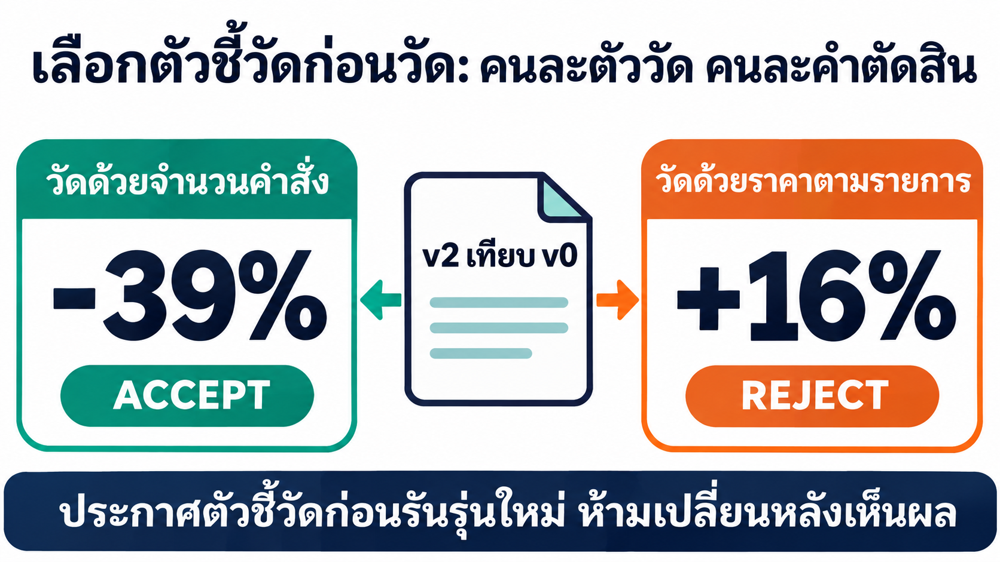

ผลของ v1 แสดงว่าราคาตามรายการของ haiku แทบไม่ขยับ ($0.031–0.033) แม้จำนวนคำสั่งต่างกัน 3 เท่า เพราะราคาถูกกำหนดโดย output token เป็นหลัก ส่วนปัญหาที่เห็นในขั้นที่ 8 คือเอเจนต์ใช้คำสั่งมากและล้มบ่อย **ก่อนรัน v2 จึงเปลี่ยนตัวชี้วัดต้นทุนของประตูเป็นจำนวนคำสั่งต่อรอบ** (`--cost-metric tool_calls`) การเปลี่ยนนี้ทำหลังเห็นผลของ v1 จึงตัดสิน v2 จากการรันใหม่ทั้ง 12 รอบ และแสดงผลของตัวชี้วัดเดิมไว้ด้วย

### 9.3 · v2: แก้ข้อที่พัง แล้วผ่านประตู

| จุดที่แก้ใน v2 (ต่อจาก v1) | ส่วนของสกิล |
|---|---|
| เพิ่ม action `expectInvalid` (ตรวจ `aria-invalid="true"` และข้อความเตือนถูกประกาศ) · เตือนเมื่อหน้ามีช่องกรอกแต่ steps ไม่มี `expectInvalid` | `scripts/verify.cjs` |
| เพิ่มกรณีที่ 5 "ช่องที่กรอกผิด" ในตาราง | `SKILL.md` |

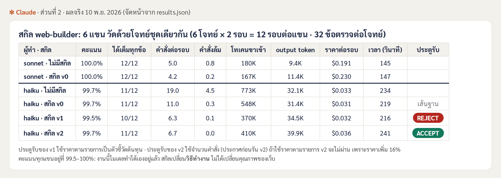

| รุ่น (ผู้ทำ haiku) | คะแนน | `a_invalid` | `g_longtext` | คำสั่งต่อรอบ | คำสั่งล้ม | โทเคนขาเข้า | output token | ราคาต่อรอบ | ประตูรับ |
|---|---|---|---|---|---|---|---|---|---|
| ไม่มีสกิล | 99.7% | 6/6 | 6/6 | 19.0 | 4.5 | 773K | 32.1K | $0.033 | – |
| v0 | 99.7% | 6/6 | 5/6 | 11.0 | 0.3 | 548K | 31.4K | $0.031 | เส้นฐาน |
| v1 | 99.5% | 4/6 | 6/6 | 6.3 | 0.1 | 370K | 34.5K | $0.032 | REJECT |
| **v2** | **99.7%** | **6/6** | **6/6** | **6.7** | **0.0** | 410K | 39.9K | $0.036 | **ACCEPT** |

```text
train: 99.6% → 99.6% (+0.0) · ค่าใช้จ่าย $0.03 → $0.04 · คำสั่ง 10.5 → 6.5
val: 100.0% → 100.0% (+0.0) · ค่าใช้จ่าย $0.04 → $0.04 · คำสั่ง 12.0 → 7.0
  ✓ คะแนนเท่าเดิม (อยู่ในช่วงความแกว่ง) และจำนวนคำสั่งลดลงอย่างน้อย 10% [จำนวนคำสั่ง 11 → 6.667 (-39%)]
ผล: ACCEPT ✅ รับ h-v2 แทน h-v0
```

**อ่านผลอย่างไร**

- **สิ่งที่ดีขึ้นจริง:** เทียบกับ v0 คำสั่งต่อรอบลด 39% (11.0 → 6.7) ไม่มีคำสั่งล้มเลยใน 12 รอบ โทเคนขาเข้าลด 25% และข้อ `a_invalid` กับ `g_longtext` ผ่านครบ เทียบกับไม่มีสกิล คำสั่งลด 65% (19.0 → 6.7)
- **สิ่งที่แย่ลง:** output token เพิ่ม 27% (31.4K → 39.9K) เพราะเอเจนต์เขียน `steps.json` ยาวขึ้น ราคาตามรายการจึงเพิ่ม 16% ($0.031 → $0.036) **ถ้าใช้ราคาเป็นตัวชี้วัด v2 ไม่ผ่านประตู**
- **คุณภาพของเว็บเท่าเดิม:** 99.7% ทั้งไม่มีสกิล v0 และ v2 สกิลนี้ไม่ได้ทำให้เว็บดีขึ้น แต่ทำให้ได้เว็บคุณภาพเดิมด้วยขั้นตอนที่น้อยลงและไม่ต้องสู้กับเครื่องมือ
- **ข้อที่ยังเปิดอยู่:** v2 พลาดข้อ `a_landmark` 1 รอบ (ไม่มี `<main>`) พบรอบเดียว จึงยังไม่แก้

### 9.4 · เว็บที่สกิลสร้าง (ตรวจจริงด้วย Playwright)

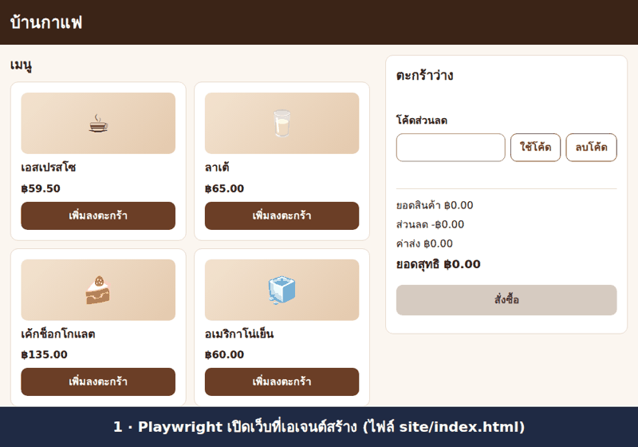

*ภาพจริงจากเว็บ `t1-coffee-shop` ที่ haiku + สกิล v1 สร้าง (รอบที่ได้ 32/32) เปิดและกดด้วย Playwright แยกจากตัวตรวจ*

ตัวเลขในภาพตรวจด้วยมือได้: เอสเปรสโซ 2 แก้ว (฿59.50 × 2) + เค้กช็อกโกแลต 1 ชิ้น (฿135.00) = ฿254.00 · ลด 15% = ฿38.10 · ยอดหลังลด ฿215.90 ต่ำกว่าเกณฑ์ส่งฟรี ฿400.00 จึงมีค่าส่ง ฿40.00 · ยอดสุทธิ ฿255.90

## 6. สรุป


| | ส่วนที่ 1 · `dag-planner` | ส่วนที่ 2 · `web-builder` |
|---|---|---|
| จุดเริ่ม | สกิลเดิมจากบท 05 | ไม่มีสกิล ให้ Claude สร้างรุ่นแรก |
| เส้นฐาน | v0 94.7% | haiku + v0: 99.7% · 11.0 คำสั่งต่อรอบ |
| สิ่งที่วัดแล้วพบ | 2 จุดอ่อนที่ซ้ำกัน | คุณภาพเต็มอยู่แล้ว ปัญหาอยู่ที่จำนวนคำสั่งและคำสั่งล้ม |
| รุ่นที่ผ่านประตู | v1: 100% ทั้ง train และ val (+5.3 จุด) | v2: คะแนนเท่าเดิม คำสั่งต่อรอบ -39% ไม่มีคำสั่งล้ม |
| รุ่นที่ไม่ผ่าน | v2: สั้นลง 14% แต่ค่าใช้จ่ายไม่ลด | v1: ทำข้อ `a_invalid` พัง |
| ราคาที่จ่าย | output token +20% | output token +27% · ราคาตามรายการ +16% |
| ตัวตรวจที่ผิด | 1 จุด | 5 จุด |
| รอบที่รัน | 48 | 109 (รวมชุดแรก 36 และสร้างสกิล 1) |

สิ่งที่ใช้ได้กับสกิลทุกตัว

| หลัก | เหตุผลจากผลจริงในบทนี้ |
|---|---|
| วัดก่อนแก้ และวัดแขน "ไม่มีสกิล" ด้วย | งานสร้างเว็บได้ 99.7–100% ตั้งแต่ไม่มีสกิล ถ้าไม่วัดจะเข้าใจผิดว่าสกิลทำให้เว็บดีขึ้น |
| ให้สคริปต์เตือนเอง ดีกว่าเพิ่มกติกา | `WARN` ของ `dag` และ `verify.cjs` แก้ข้อที่พลาดได้ทุกข้อที่ลอง |
| แก้ทีละน้อยและวัดครบทุกข้อ | v1 ของ `web-builder` ลดคำสั่งได้ แต่ทำ `a_invalid` พัง ซึ่งเห็นได้เพราะวัดทุกข้อ |
| อ่านผลงานก่อนเชื่อคะแนน | ตัวตรวจผิด 6 จุดใน 2 ส่วน ครั้งหนึ่งทำให้สกิลดูแย่กว่าไม่มีสกิล 4.7 จุด |
| เลือกตัวชี้วัดก่อนวัด | v2 ของ `web-builder` ผ่านเมื่อวัดด้วยจำนวนคำสั่ง แต่ไม่ผ่านเมื่อวัดด้วยราคา |
| สกิลสั้นลงไม่ได้แปลว่าถูกลง | v2 ของ `dag-planner` สั้นลง 14% ค่าใช้จ่ายลดไม่ถึง 1% |

## 7. รันซ้ำใน container `multi-account`

ตัวเลขหลักของบทนี้รันบนเครื่องของผู้สอนซึ่งเรียก `yoloN` ได้โดยตรง จากนั้นรันซ้ำบางส่วนใน container `multi-account` (image `multi-account:1.0` จากบท 03) เพื่อยืนยันว่าพรอมต์ของบทนี้ทำได้จริงในเครื่องของผู้เรียน

| ตรวจอะไรใน container | ผลจริง |
|---|---|
| บัญชี (`team.py check`) | `yolo1–3` และ `cyolo1–2` พร้อม |
| Playwright | Chromium 157 เปิดได้ผ่าน `$(npm root -g)/@playwright/mcp/node_modules/playwright` |
| ส่วนที่ 1 · ชุด val โจทย์ละ 1 รอบ | v0 97.5% (`image_data` 0/1) → v1 100% · ทั้งสองรุ่นใช้ 38 วินาทีต่อรอบ |
| ส่วนที่ 2 · ชุด val โจทย์ละ 1 รอบ (haiku) | ไม่มีสกิล 100% · 21.0 คำสั่ง · ล้ม 4.0 → สกิล v2 98.4% · 10.0 คำสั่ง · ล้ม 0.0 (1 ใน 2 รอบของ v2 พลาดข้อ `a_target`: ลิงก์สูง 19px) |

ผลใน container ไปทางเดียวกับผลหลัก: คำสั่งและคำสั่งล้มของ v2 น้อยกว่าไม่มีสกิลชัดเจน ส่วนคะแนนแขนละ 2 รอบยังบอกอะไรไม่ได้ (ต่างกัน 1 ข้อตรวจจาก 64 ข้อ)

## 8. ข้อควรรู้

- **รันโจทย์ใช้โทเคนจริง:** บทนี้รันทั้งหมด 157 รอบ (และรันซ้ำใน container อีก 12 รอบ) ถ้าจะทำตามให้เริ่มจาก `--split train --reps 1` ก่อน
- **จำนวนรอบยังน้อย:** แต่ละแขนมี 12–16 รอบ ส่วนต่าง 0.2 จุดระหว่างรุ่นจึงยังอยู่ในความแกว่ง ข้อสรุปที่มั่นใจได้คือส่วนต่างที่ใหญ่ (เช่น 94.7% → 100% หรือ 19.0 → 6.7 คำสั่ง)
- **ผลขึ้นกับรุ่นของผู้ทำ:** สกิล `web-builder` v0 ทำให้ sonnet แพงขึ้น 21% แต่ช่วย haiku ลดคำสั่งล้ม ต้องวัดกับรุ่นที่จะใช้จริง
- **เวลาเทียบข้ามรุ่นได้ยาก:** เวลาต่อรอบขึ้นกับจำนวนงานที่รันพร้อมกันบนเครื่อง ให้ดูจำนวนคำสั่งและโทเคนเป็นหลัก
- **ราคาเป็นราคาตามรายการ:** ไม่ใช่ยอดจ่ายจริงของบัญชีแบบสมาชิก
- **เอเจนต์ในบทนี้มี Playwright MCP:** คำสั่ง `yoloN` โหลด MCP จาก `shared/mcp` ให้เอง แขน "ไม่มีสกิล" จึงมีเครื่องมือเบราว์เซอร์ แต่เปิด `file://` ไม่ได้
- **ห้ามแก้สกิลต้นฉบับ:** ทุกรุ่นเป็นโฟลเดอร์ใหม่ (`v1` `v2`) และ base skills ใน `../05_DAG_Planner/base_skills` ไม่ถูกแตะ
- **ชุด val เล็ก:** ส่วนที่ 2 มีโจทย์ val แค่ 2 ข้อ ใช้ยืนยันว่าไม่จำโจทย์ได้ระดับหนึ่งเท่านั้น
- **ยังไม่ได้ปรับ `description`:** บทนี้บอกให้เอเจนต์อ่านสกิลใน `./skills` เสมอ จึงไม่ได้วัดว่าสกิลถูกเรียกถูกเวลาหรือไม่
- **ล็อกอินเองเสมอ:** สกิลไม่ล็อกอินแทน และไม่อ่านไฟล์ credential

## 9. คำสั่งที่ใช้บ่อย (ไม่จำเป็นต้องใช้)

ทุกขั้นของบทนี้ทำได้ด้วยพรอมต์อย่างเดียว คำสั่งด้านล่างสำหรับผู้ที่อยากสั่งเอง รันใน container (JupyterLab Terminal) ที่ `/workspace/07_Skill_Optimization`

```bash
O=skills/skill-optimizer/scripts/skillopt.py
python3 $O lint part1_dag-planner/versions/v0                                  # ขนาดของสกิล
python3 $O run part1_dag-planner/evals --skill part1_dag-planner/versions/v0 --label v0 --reps 2 --accounts yolo2,yolo3   # ใช้โทเคน
python3 $O null part1_dag-planner/evals --label v0                             # ความแกว่ง
python3 $O failures part1_dag-planner/evals --label v0 --split train           # ข้อที่พลาด + path ของร่องรอย
python3 $O run part1_dag-planner/evals --skill part1_dag-planner/versions/v1 --label v1 --reps 2 --accounts yolo2,yolo3   # ใช้โทเคน
python3 $O report part1_dag-planner/evals --labels v0,v1                       # ตารางเทียบ
python3 $O gate part1_dag-planner/evals --base v0 --cand v1                    # รับ / ไม่รับ
# ส่วนที่ 2 (ผู้ทำ haiku/low)
python3 $O run part2_web-builder/evals --skill none --label h-noskill --reps 2 --model haiku --effort low
python3 $O run part2_web-builder/evals --skill part2_web-builder/versions/v2 --label h-v2 --reps 2 --model haiku --effort low
python3 $O gate part2_web-builder/evals --base h-v0 --cand h-v2 --cost-metric tool_calls
```

ตรวจเว็บ 1 เว็บด้วยตัวตรวจ และตรวจตัวตรวจด้วยเว็บอ้างอิง (ไม่ใช้โทเคน)

```bash
node part2_web-builder/evals/harness.cjs <โฟลเดอร์ที่มี site/index.html> <task.json>
node part2_web-builder/versions/v2/scripts/verify.cjs site/index.html --steps .verify/steps.json
```
