# Week 03 · บทที่ 0 · ทฤษฎี REA + ติดตั้ง

บทนี้ **ปูพื้นก่อนลงมือ**: เข้าใจว่า reverse engineering และ REA คืออะไร ทำงานยังไง แล้วติดตั้ง REA ลงใน container ให้พร้อมใช้
ส่วน **ลงมือใช้งานจริง** (สืบ Google Flights แล้วสร้างแอป SkyThai Mini) อยู่ใน [บทที่ 1](../01_REA_Basics_Flight/README.md)

| ส่วน | ทำอะไร | ใช้เวลา |
|---|---|---|
| 🎓 ทฤษฎี T1–T15 + ทบทวน 10 ข้อ | อ่านให้เข้าใจภาพรวม | ~30 นาที |
| LAB 0 | เตรียม container ด้วย `/maccount` | ~1 นาที |
| LAB 1 | ติดตั้ง REA ครั้งเดียว ให้ทุกบัญชีใช้ได้ | ~2 นาที |

> ⚠️ ทุกบทของสัปดาห์นี้ **ดู Google Flights อย่างเดียว** ไม่คลิก ไม่ล็อกอิน ไม่ลอกโลโก้หรือโค้ด เจอ CAPTCHA ให้หยุด (รายละเอียดใน T15)

---

## 🎓 ทฤษฎี

### เรื่องของบทนี้ใน 4 ประโยค

1. เราอยากทำแอปจองตั๋วแบบ Google Flights แต่ **ไม่มีโค้ดของเขา** → ต้องเรียนวิธี "สืบ" จากสิ่งที่มองเห็น **(T1–T6)**
2. การสืบด้วยมือยากและช้า → เราให้ **AI สืบแทน** โดยเสียบเครื่องมือชื่อ **REA** เข้าไป **(T7–T10)**
3. AI รายงานผลกลับมา → เราต้อง **อ่านผลให้เป็น** แยกให้ออกว่าข้อไหนจริง ข้อไหนเดา แล้วเอาแนวคิดไปสร้างของเรา **(T11–T13)**
4. ทั้งหมดต้องทำ **อย่างปลอดภัยและถูกกติกา** **(T14–T15)**

### แผนที่ 15 หัวข้อ

| ช่วง | หัวข้อ | คำถามที่หัวข้อนี้ตอบ |
|---|---|---|
| 🔎 **1 · สืบคืออะไร** | T1 | ไม่มีโค้ดของเขา แล้วจะเรียนรู้จากแอปของเขาได้ยังไง? |
| | T2 | Reverse engineering คืออะไร ต่างจากการลอกยังไง? |
| | T3 | บนเว็บ อะไรที่เราเห็นได้ อะไรที่เห็นไม่ได้? |
| | T4 | ถ้ามีแค่ไฟล์โปรแกรม (.exe) จะสืบยังไง? |
| | T5 | "ดูโค้ด" กับ "ดูตอนทำงาน" ต่างกันยังไง · Black / Grey / White box คืออะไร? |
| | T6 | ทำไมสืบด้วยมือถึงยาก? |
| 🔌 **2 · ให้ AI สืบแทน** | T7 | MCP คืออะไร ทำไม AI ต้องใช้? |
| | T8 | REA คืออะไร ในกล่องมีอะไร คำสั่งเดินทางยังไง? |
| | T9 | AI สืบทีละขั้นยังไง ถ้าผลไม่พอทำยังไง? |
| | T10 | AI เข้าไปดูหน้าเว็บได้ยังไง? |
| 🧾 **3 · อ่านผลให้เป็น** | T11 | ข้อสรุปไหนเชื่อได้ ข้อไหนแค่เดา? |
| | T12 | REA เจออะไรใน Google Flights · ทำไม "ดีที่สุด" ≠ "ถูกที่สุด"? |
| | T13 | เอาอะไรไปใช้ในแอปเราได้ อะไรห้ามเอา? |
| ⚖️ **4 · ทำอย่างปลอดภัย** | T14 | ทำไมทำงานใน container และติดตั้งที่ส่วนกลาง? |
| | T15 | อะไรที่ REA บอกไม่ได้ และเส้นที่ห้ามข้าม? |

📌 ตัวอย่าง 🧪 ที่อ้างถึง "LAB 2–6" มาจากการรันจริงใน [บทที่ 1](../01_REA_Basics_Flight/README.md) (บทนี้มีแค่ LAB 0–1)

💡 **อ่านเร็ว:** ทุกหัวข้อขึ้นต้นด้วย **💡 ใจความ** 1–2 บรรทัด และจบด้วย **สรุป** 1 บรรทัด ถ้ารีบ อ่านแค่ 2 จุดนี้ก็จับใจความได้ ส่วนป้าย **🧪** คือตัวอย่างจากการรันจริงของบทนี้ ไม่ได้แต่งตัวเลข

<sub>เรียบเรียงจากวิดีโอ Code With Aarohi · REA MCP Explained + Live Demo ([YouTube](https://www.youtube.com/watch?v=ZGHWUXznleo)) · ภาพประกอบวาดใหม่เป็นภาษาไทยทั้งหมด</sub>

---

### T1) ปัญหา: อยากได้ฟีเจอร์จากแอปของคนอื่น

💡 **ใจความ:** เราไม่มีโค้ดของเขา แต่เรายังเห็น "เบาะแส" บนหน้าเว็บได้อีกมาก

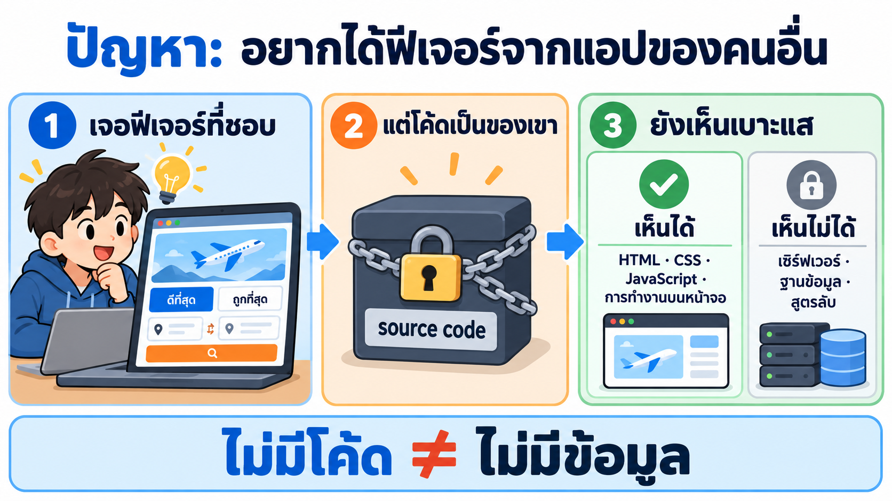
*เจอฟีเจอร์ที่ชอบ → โค้ดเป็นของเขา → แต่ยังเห็นเบาะแสบนหน้าเว็บ*

เหมือนเรากินอาหารร้านอร่อยแล้วอยากทำเองที่บ้าน ร้านไม่ให้สูตร แต่เรายังดูได้ว่าจานนี้มีอะไรบ้าง หน้าตาเป็นยังไง รสชาติแบบไหน แล้วลองทำเวอร์ชันของเราเอง

🧪 **ตัวอย่างจริง:** Google Flights มีแท็บ "ดีที่สุด" กับ "ถูกที่สุด" เราอยากรู้ 3 อย่าง
1. หน้าจอแบ่งเป็นส่วนอะไรบ้าง
2. ข้อมูลเที่ยวบิน 1 ใบมีอะไรบ้าง
3. "ดีที่สุด" กับ "ถูกที่สุด" ต่างกันยังไง

แล้วเอาความเข้าใจไปทำแอปจองตั๋วของเราเอง **โดยไม่ลอกโค้ดของ Google**

**สรุป:** ไม่มีโค้ด ≠ ไม่มีข้อมูล · สิ่งที่ได้คือ "ความเข้าใจ" ไม่ใช่ "สำเนาโค้ด"

---

### T2) Reverse engineering คืออะไร

💡 **ใจความ:** Reverse engineering (RE) คือการ **เดินย้อนกลับ**: เริ่มจากของที่มีอยู่แล้ว → หาว่ามันทำงานยังไง → แล้วสร้างของเราเองใหม่

#### ภาพ 1 · เดินย้อนกลับ เหมือนชิมเค้กแล้วอบเอง


*งานปกติ: สูตร → อบ → เค้ก · RE: ชิมเค้ก → เดาส่วนผสม → อบสูตรของเราเอง*

**เปรียบเหมือนทำเค้ก**
- **งานปกติ (เดินไปข้างหน้า):** มีสูตร → อบ → ได้เค้ก · ในงานซอฟต์แวร์ = มีโค้ด → ได้แอป
- **RE (เดินย้อนกลับ):** ได้ชิมเค้กร้านอื่นแต่ไม่มีสูตร → เดาว่ามีส่วนผสมอะไร → อบเค้กสูตรของเราเอง · ในงานซอฟต์แวร์ = มีแอปของเขา → หาว่าทำงานยังไง → เขียนแอปของเราเอง

**RE มี 3 ขั้น**

| ขั้น | ทำอะไร | เค้ก | 🧪 ในบทนี้ |
|---|---|---|---|
| 1. **สังเกต** | ดูของจริงให้ละเอียด | ชิม ดูหน้าตา ดูเนื้อเค้ก | LAB 3: ดูหน้า Google Flights เก็บเที่ยวบิน 22 ใบ |
| 2. **วิเคราะห์** | หาว่าแต่ละส่วนทำงานยังไง | เดาว่ามีแป้ง ไข่ ช็อกโกแลต | LAB 4: หาว่าข้อมูลเที่ยวบิน 1 ใบมีอะไร และเรียงยังไง |
| 3. **สร้างของเราเอง** | เอาความเข้าใจไปทำใหม่ | อบตามสูตรที่เราคิดเอง | LAB 5: สร้างแอป SkyThai Mini |

#### ภาพ 2 · ใช้กับอะไรได้ และ "ไม่ใช่" อะไร


*ใช้ได้กับทุกซอฟต์แวร์ · ยืมแนวคิดได้ แต่ห้ามลอก ห้ามเจาะ ห้ามแก้ของเขา*

**ใช้กับอะไรได้:** เว็บ · แอปมือถือ · โปรแกรมบนคอม · ไฟล์โปรแกรม (.exe) · บทนี้ใช้กับ **เว็บ**

| ✅ RE คือ | ❌ RE ไม่ใช่ |
|---|---|
| ดู → เข้าใจ → เขียนของเราใหม่เอง | **ลอก** โค้ด โลโก้ หรือชื่อแบรนด์ของเขา |
| ยืม **แนวคิด** เช่น "ข้อมูลเที่ยวบิน 1 ใบควรมีช่องอะไร" | **เจาะระบบ** หลบ CAPTCHA หรือล็อกอินแทนคนอื่น |
| ดูอย่างเดียว ไม่แตะของเขา | **แก้ไข** ระบบของเขา |

**สรุป:** RE = เดินย้อนกลับ: สังเกต → วิเคราะห์ → สร้างของเราเอง · ยืมแนวคิด ไม่ลอก ไม่เจาะ ไม่แก้

---

### T3) บนเว็บ เราดูอะไรได้ และดูอะไรไม่ได้

💡 **ใจความ:** อะไรที่เบราว์เซอร์ต้องใช้วาดหน้าจอ ต้องส่งมาถึงเครื่องเรา เราจึงเห็นได้ ส่วนที่ทำงานบนเซิร์ฟเวอร์ เราเห็นแค่ผลลัพธ์

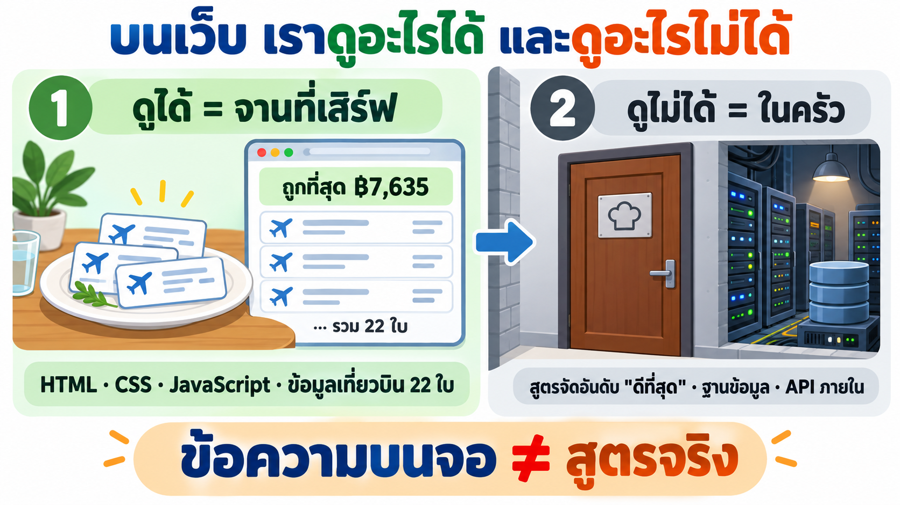
*ดูได้ = จานที่เสิร์ฟ (ของที่ส่งมาถึงเบราว์เซอร์) · ดูไม่ได้ = ในครัว (เซิร์ฟเวอร์)*

เหมือนร้านอาหาร: เราเห็น **จานที่เสิร์ฟ** (หน้าเว็บ) แต่ไม่เห็น **ในครัว** (เซิร์ฟเวอร์)

| | ✅ ดูได้ (ส่งมาถึงเบราว์เซอร์) | ❌ ดูไม่ได้ (อยู่ที่เซิร์ฟเวอร์) |
|---|---|---|
| ประเภท | HTML · CSS · JavaScript · การทำงานตอนใช้ | โค้ดหลังบ้าน · ฐานข้อมูล · API ภายใน |
| 🧪 Google Flights | ป้าย "ถูกที่สุด ฿7,635" · การ์ดเที่ยวบิน 22 ใบ · ข้อมูลเที่ยวบินที่ฝังมากับหน้า | **สูตร** ที่ใช้จัดอันดับ "ดีที่สุด" · ฐานข้อมูลเที่ยวบินทั้งหมด |

⚠️ **เห็นได้ แต่อ่านยาก:** JavaScript ของ Google ถูก **บีบ (minify)** ให้ไฟล์เล็ก ชื่อฟังก์ชันเหลือแค่ตัวอักษรสั้น ๆ เช่น `U5T3Ef` อ่านไม่ออกว่าคืออะไร

🧪 **ตัวอย่างจริง:** บนหน้าเขียนว่า "ดีที่สุด" ดูทั้ง **ราคาและความสะดวก** (ข้อความนี้เห็นได้) แต่ราคาสำคัญกี่ส่วน เวลาบินสำคัญกี่ส่วน ไม่มีในโค้ดฝั่งเบราว์เซอร์ ใน LAB 4 REA จึงตอบตรง ๆ ว่า **"ไม่ทราบ"**

**สรุป:** เห็นได้ = ของที่ส่งมาที่เบราว์เซอร์ · เห็นไม่ได้ = ตรรกะในเซิร์ฟเวอร์ · ข้อความบนจอ ≠ สูตรจริง

---

### T4) ถ้ามีแค่ไฟล์ .exe ล่ะ? (ตัวอย่างจากวิดีโอ)

💡 **ใจความ:** แม้มีแค่โปรแกรมที่ compile แล้ว ก็ยังใช้เครื่องมืออย่าง Ghidra แปลงกลับมาให้พออ่านได้

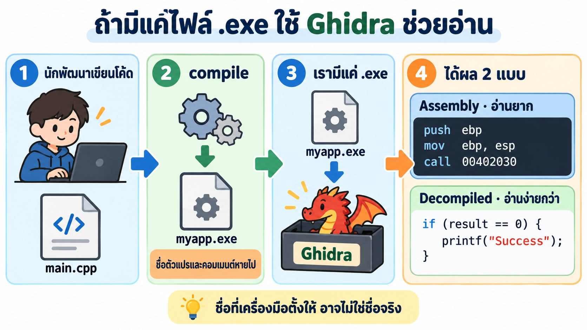
*main.cpp → compile → myapp.exe → Ghidra → assembly (อ่านยาก) และ decompiled (อ่านง่ายกว่า)*

หัวข้อนี้มาจากวิดีโอ เพื่อให้เห็นว่า RE ไม่ได้มีแค่เว็บ

1. นักพัฒนาเขียน `main.cpp` แล้ว **compile** เป็น `myapp.exe` ระหว่างทาง ชื่อตัวแปรและคอมเมนต์หายไปเกือบหมด
2. ฝั่งเรามีแค่ `myapp.exe` ไม่มีโค้ด

3. **Ghidra** แปลงไฟล์ออกมาได้ 2 แบบ

| แบบ | หน้าตา (จากสไลด์ในวิดีโอ) | อ่านง่ายไหม |
|---|---|---|
| Assembly | `push ebp` · `mov ebp, esp` · `call 00402030` | ยาก: ทีละคำสั่งของ CPU |
| Decompiled | `int result = processInput(argc); if (result == 0) { printf("Success\n"); }` | ง่ายกว่า: เห็น `if` และการเรียกฟังก์ชัน |

⚠️ ชื่อ `processInput` เป็นชื่อที่เครื่องมือ **ตั้งให้** อาจไม่ใช่ชื่อจริง

🧪 **เทียบกับของเรา:** JavaScript ของ Google ที่ถูกบีบก็คล้ายกัน ชื่อหายจนอ่านไม่ออก แต่ยังมี **ข้อความภาษาไทยบนหน้า** ช่วยให้เดาได้ว่าส่วนไหนทำอะไร (ดู T12)

**สรุป:** มีแค่ .exe ก็ยังเรียนรู้ได้ · เว็บที่ถูกบีบใช้หลักเดียวกัน

---

### T5) ดูได้กี่แบบ: Static กับ Dynamic และ 3 มุมมอง (Black / Grey / White box)

💡 **ใจความ:** มี 2 คำถามที่ต้องตอบทุกครั้งที่ "ดู" ระบบ
1. **ดูตอนไหน?** อ่านโค้ดเฉย ๆ (Static) หรือดูตอนมันกำลังทำงาน (Dynamic)
2. **ดูลึกแค่ไหน?** เห็นแค่หน้าจอ (Black box) · ส่องของที่ส่งมาถึงเครื่อง (Grey box) · มีโค้ดต้นฉบับ (White box)

เราจะใช้ **ร้านอาหาร** ตัวเดิมจาก T3 เป็นตัวเปรียบเทียบ: หน้าเว็บ = จานที่เสิร์ฟ · เซิร์ฟเวอร์ = ในครัว · โค้ด = สูตรอาหาร

#### ภาพ 1 · Static กับ Dynamic: ดูตอนไหน


*Static = อ่านสูตร (LAB 4) · Dynamic = ดูจานที่เสิร์ฟจริง (LAB 3) · ใช้คู่กันดีที่สุด*

**Static (ดูโค้ด ไม่ต้องรัน)**
- **คืออะไร:** เปิดไฟล์โค้ดขึ้นมา **อ่านเป็นตัวหนังสือ** โปรแกรมไม่ได้ทำงานเลย
- **เปรียบเหมือน:** อ่านสูตรอาหารในหนังสือ เตายังไม่ได้เปิด
- **🧪 ในบทนี้ (LAB 4):** yolo1 ดึงไฟล์ JavaScript ของ Google Flights ออกมา แล้วค้นข้อความในไฟล์ เจอคำว่า `GetBookingResults`
- **บอกได้:** "มีคำนี้อยู่ในโค้ด" ✅
- **บอกไม่ได้:** "โค้ดนี้ถูกใช้จริงไหม ตอนไหน" ❌ (สูตรอยู่ในหนังสือ ไม่ได้แปลว่าวันนี้ครัวทำเมนูนี้)

**Dynamic (ดูตอนกำลังทำงาน)**
- **คืออะไร:** ให้โปรแกรม **ทำงานอยู่จริง** แล้วดูสิ่งที่เกิดขึ้นตอนนั้น สำหรับเว็บ = เปิดหน้าเว็บค้างไว้ในเบราว์เซอร์ (JavaScript รันเสร็จแล้ว หน้าโชว์ผลแล้ว) แล้วส่องหน้านั้น
- **เปรียบเหมือน:** ดูจานที่พนักงานเสิร์ฟมาตรงหน้า
- **🧪 ในบทนี้ (LAB 3):** Chrome เปิดหน้า Google Flights ค้างไว้ (T10) แล้ว REA ส่องหน้าที่โหลดเสร็จ เห็นการ์ดเที่ยวบิน 22 ใบ ป้าย "ถูกที่สุด ฿7,635"
- **บอกได้:** "สิ่งนี้เกิดขึ้นจริงตอนนี้" ✅
- **บอกไม่ได้:** "ส่วนที่ไม่ได้กดเป็นยังไง" ❌ (เช่น หลังปุ่ม "ดูเที่ยวบินเพิ่มเติม" · หน้าจอง)

| | Static | Dynamic |
|---|---|---|
| โปรแกรมทำงานไหม | ❌ ไม่ทำงาน แค่อ่านไฟล์ | ✅ ทำงานอยู่ |
| ดูอะไร | ตัวหนังสือในไฟล์โค้ด | หน้าเว็บที่โชว์อยู่จริง |
| ในบทนี้ | LAB 4 อ่าน JavaScript | LAB 3 ส่องหน้าที่เปิดอยู่ |
| ข้อดี | เห็นโค้ดทุกส่วน รวมส่วนที่ยังไม่ถูกใช้ | เห็นของจริงที่ผู้ใช้เห็น |
| ข้อจำกัด | ไม่รู้ว่าโค้ดถูกใช้จริงไหม | เห็นเฉพาะส่วนที่เปิด/กดดู |

💡 **ใช้คู่กันดีที่สุด:** อ่านโค้ดเจอ (Static) + เห็นตอนทำงานจริง (Dynamic) = มั่นใจ
🧪 เช่น บนจอเห็น SL ราคา ฿7,635 บิน 8 ชม. 5 นาที (Dynamic) และในข้อมูลที่อ่านจากไฟล์เจอ `SL`, `485` นาที, `7635` (Static) สองทางตรงกัน → เชื่อได้

#### ภาพ 2 · Black / Grey / White box: ดูลึกแค่ไหน


*ยิ่งไปทางขวา ยิ่งเห็นข้างในมากขึ้น · REA ทำงานแบบ Grey box*

คำว่า "box" (กล่อง) หมายถึง **ระบบที่เรากำลังดู** สีของกล่องบอกว่า **เรามองทะลุเข้าไปข้างในได้แค่ไหน**

| มุมมอง | ทำไมเรียกแบบนี้ | ร้านอาหาร | เว็บ | 🧪 ในบทนี้ |
|---|---|---|---|---|
| ⬛ **Black box** กล่องดำ | กล่องทึบ มองไม่เห็นข้างในเลย | กินอย่างเดียว เห็นแค่จาน | ใช้เว็บเหมือนลูกค้า เห็นแค่หน้าจอ | เปิด Google Flights เห็นราคา ฿7,635 |
| 🔲 **Grey box** กล่องเทา | กึ่งโปร่ง เห็นข้างในบางส่วน | ส่องทุกอย่างที่มาถึงโต๊ะ (จาน ขวดซอส ใบเสร็จ) แต่ **ไม่ได้เข้าครัว** | ส่อง HTML · JavaScript · ข้อมูลที่ฝังมากับหน้า (ทุกอย่างที่ส่งมาถึงเบราว์เซอร์) | **REA ทำแบบนี้** เจอเที่ยวบิน 22 ใบใน `ds:1` |
| ⬜ **White box** กล่องขาว (กล่องใส) | ใส มองเห็นข้างในหมด | เชฟให้สูตรทั้งเล่ม | มีโค้ดต้นฉบับทั้งหมด (รวมฝั่งเซิร์ฟเวอร์) | ทำกับ Google ไม่ได้ · ทำได้กับ SkyThai Mini ของเรา (`skythai-mini/src/`) |

⚠️ **ทำไม REA เป็น Grey box ไม่ใช่ White box:** REA เห็นได้แค่ของที่ **ส่งมาถึงเบราว์เซอร์** (T3) ส่วนในครัว (เซิร์ฟเวอร์ ฐานข้อมูล สูตร "ดีที่สุด") ยังปิดอยู่

**สรุป:** Static = อ่านสูตร · Dynamic = ดูจานจริง · Black = เห็นแค่จาน · Grey = ส่องทุกอย่างบนโต๊ะ (REA) · White = มีสูตรในครัว

---

### T6) ปัญหาเดิม: เครื่องมือเยอะ คนต้องต่อจิ๊กซอว์เอง

💡 **ใจความ:** เครื่องมือ RE มีอยู่แล้ว แต่ต้องใช้หลายตัว และคนต้องเอาข้อมูลมาต่อกันเอง ซึ่งช้าและยาก


*เครื่องมือคนละชิ้น → คนต่อเอง → ช้า · REA ให้ AI ต่อแทน*

🧪 **ตัวอย่างจริง:** ถ้าสืบ Google Flights ด้วยมือ ต้อง
1. กด F12 ดูโครงหน้า
2. ไล่อ่านไฟล์ JS ที่ถูกบีบ
3. หาข้อมูลเที่ยวบินที่ซ่อนอยู่ใน array ซ้อนกันหลายชั้น
4. เทียบกับหน้าจอทีละช่อง

ใน LAB 4 yolo1 + REA ทำงานแบบนี้เสร็จใน **5 นาที 40 วินาที**

**สรุป:** ปัญหาไม่ใช่ขาดเครื่องมือ แต่คือ "คน" ต้องรู้ทุกเครื่องมือและต่อข้อมูลเอง → REA ให้ AI ทำแทน

---

### T7) MCP คืออะไร

💡 **ใจความ:** MCP คือ "ช่องเสียบมาตรฐาน" ที่ทำให้ AI agent หยิบเครื่องมือภายนอกมาใช้ได้

#### ภาพ 1 · ทำไมต้องมี MCP

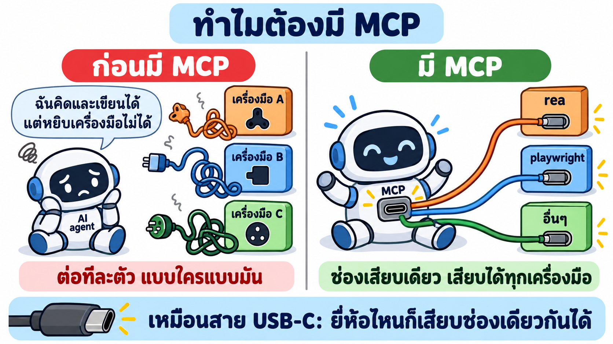
*ก่อนมี MCP: เครื่องมือแต่ละตัวต้องต่อแบบเฉพาะ · มี MCP: ช่องเดียวเสียบได้ทุกตัว*

1. **AI agent** (เช่น Claude Code) เก่งเรื่องคิดและเขียน แต่ลำพังตัวเอง **เปิดเว็บ อ่านไฟล์ JavaScript หรือถ่ายภาพหน้าจอไม่ได้**
2. **ก่อนมี MCP** ถ้าอยากให้ AI ใช้เครื่องมือ ต้องเขียนตัวเชื่อมเฉพาะให้เครื่องมือแต่ละตัว กับ AI แต่ละยี่ห้อ ยุ่งมาก
3. **มี MCP** เครื่องมือไหนทำตัวเองเป็น **MCP server** ก็เสียบเข้า AI ตัวไหนก็ได้ที่รองรับ MCP (Claude Code, Codex ฯลฯ) เหมือนสาย USB-C ที่เสียบได้ทุกเครื่อง

| คำ | ความหมายง่าย ๆ | ในบทนี้ |
|---|---|---|
| **MCP** | กติกากลางว่าจะคุยกันยังไง (ช่องเสียบ) | — |
| **MCP server** | เครื่องมือที่ทำตามกติกานั้น (ของที่เสียบ) | `rea` (207 tools) · `playwright` |
| **tool** | ความสามารถ 1 อย่างที่ server มีให้ | `inspect_web_page` = ส่องหน้าเว็บ |

#### ภาพ 2 · agent คุยกับ MCP server ยังไง


*4 ขั้นที่เกิดขึ้นทุกครั้งที่ yolo1 ทำงาน · เราไม่ต้องบอกชื่อเครื่องมือ agent เลือกเอง*

| ขั้น | เกิดอะไร | 🧪 ในบทนี้ |
|---|---|---|
| 1. อ่านรายชื่อ | agent อ่านรายชื่อว่ามี MCP server อะไรบ้าง | มี `rea` (LAB 1 ให้ AI เพิ่มให้) |
| 2. เปิด server | agent รันคำสั่งนั้นเองตอนเริ่มทำงาน | — |
| 3. ถามว่ามีอะไรบ้าง | server ตอบรายชื่อ tool พร้อมวิธีใช้ | REA ตอบ **207 tools** |
| 4. เรียกใช้ | agent เลือก tool ส่งค่าไป รับผลกลับ แล้วคิดต่อ | ดูตัวอย่างด้านล่าง |

🧪 **ตัวอย่างจริง:** LAB 3 เราพิมพ์แค่ "ตรวจหน้า Google Flights แบบอ่านอย่างเดียว" ไม่ได้บอกชื่อ tool เลย yolo1 เลือกเอง 3 ตัวตามลำดับ
`list_browser_targets` (หาแท็บ) → `inspect_web_page` (ส่องหน้า) → `capture_web_screenshot` (ถ่ายภาพ)

**สรุป:** MCP = ช่องเสียบ · MCP server = เครื่องมือที่เสียบ · tool = ความสามารถแต่ละอย่าง · agent เลือกหยิบเอง

---

### T8) REA คืออะไร มีอะไรบ้าง

💡 **ใจความ:** REA คือ "ชุดนักสืบ" ที่เสียบเข้า AI agent ผ่าน MCP ข้างในมีเครื่องมือ 207 ชิ้น + คู่มือ + ใบเสร็จหลักฐาน

**REA (Reverse Engineer Anything)** เป็นโปรเจกต์ open source (`github.com/morluto/rea`) ติดตั้งผ่าน npm ชื่อ `rea-agents` ใช้ได้กับ Claude Code, Codex และ agent อื่น

#### ภาพ 1 · ในกล่อง REA มีอะไร


*4 ช่องในกล่อง · สืบได้หลายอย่าง แต่บทนี้ใช้แค่หน้าเว็บ*

| ของในกล่อง | เปรียบเหมือน | หน้าที่ | 🧪 ในบทนี้ |
|---|---|---|---|
| **MCP server** | เครื่องมือนักสืบ | มี 207 tools ให้ agent เรียก | ส่องหน้าเว็บ · ถ่ายภาพหน้าจอ · ดึงไฟล์ JavaScript |
| **skill** | คู่มือนักสืบ | บอก agent ว่าใช้เครื่องมือไหน ลำดับไหน และต้องแยก "เห็นจริง" กับ "เดา" | ทำให้ yolo1 ติดป้าย ยืนยันแล้ว / อนุมาน เอง |
| **หลักฐาน (evidence)** | ใบเสร็จ | ผลตรวจทุกครั้งมีรหัส ตรวจย้อนได้ | รหัส `ev_…` ติดอยู่กับเที่ยวบินทุกใบ |

(ช่องที่ 4 ในภาพ "CLI" คือสวิตช์ติดตั้ง/เปิดเครื่อง AI ใช้เองเบื้องหลัง เราไม่ต้องจำ)

**ติดตั้งแล้วได้อะไร:** agent **เห็นเครื่องมือ** (MCP) + **มีคู่มือ** (skill) แค่นั้น ใน LAB 1 เราวางพรอมต์ให้ AI ติดตั้งให้

#### ภาพ 2 · เส้นทางจริงของคำสั่ง 1 ครั้ง


*คำสั่งเดินไป 6 สถานี (สถานี 2–6 อยู่ใน container) แล้วผลเดินกลับมาเป็นไฟล์หลักฐาน*

| สถานี | ใคร | ทำอะไร |
|---|---|---|
| 1 | เรา | วางพรอมต์ใน Claude Code Desktop |
| 2 | `docker exec` | Claude Code ส่งงานเข้า container |
| 3 | `yolo1` | อ่านพรอมต์ เปิดคู่มือ (skill) แล้วเลือก tool |
| 4 | REA (MCP server) | ทำงานตาม tool ที่ถูกเรียก เช่น `inspect_web_page` |
| 5 | Chrome พอร์ต 9222 | เปิดหน้า Google Flights ค้างไว้ให้ REA ส่อง (T10) |
| 6 | หน้า Google Flights | ถูกอ่านอย่างเดียว ไม่มีการคลิก |
| ↩ | ผลเดินกลับ | หลักฐาน `ev_…` → ไฟล์ `.json` → yolo1 สรุปให้เราอ่าน |

🧪 **ทดสอบจริง:** หลังติดตั้ง ถาม `yolo1` ว่าเห็น REA ไหม ได้คำตอบว่าเห็น **207 tools** และเห็นคู่มือ ✅ (ติดตั้งที่ส่วนกลางให้ทุกบัญชีใช้ได้ ดู T14) · ตัวเลข 207 มาจากรุ่น 6.7.0 ส่วนรุ่น 6.8.0 ที่ LAB 1 ติดตั้งตามคู่มือล่าสุดมี 229 tools

**สรุป:** REA = เครื่องมือ 207 ชิ้น + คู่มือ + สวิตช์ + ใบเสร็จ · คำสั่งเดินจากเรา → yolo1 → REA → Chrome แล้วผลกลับมาเป็นไฟล์หลักฐาน

---

### T9) AI สืบทีละขั้นยังไง: วงจร 4 ขั้น + ถามต่อ

💡 **ใจความ:** ถาม → ให้ AI ใช้เครื่องมือตรวจ → อ่านหลักฐาน → เอาไปใช้ ถ้ายังไม่พอก็วนกลับไปตรวจใหม่

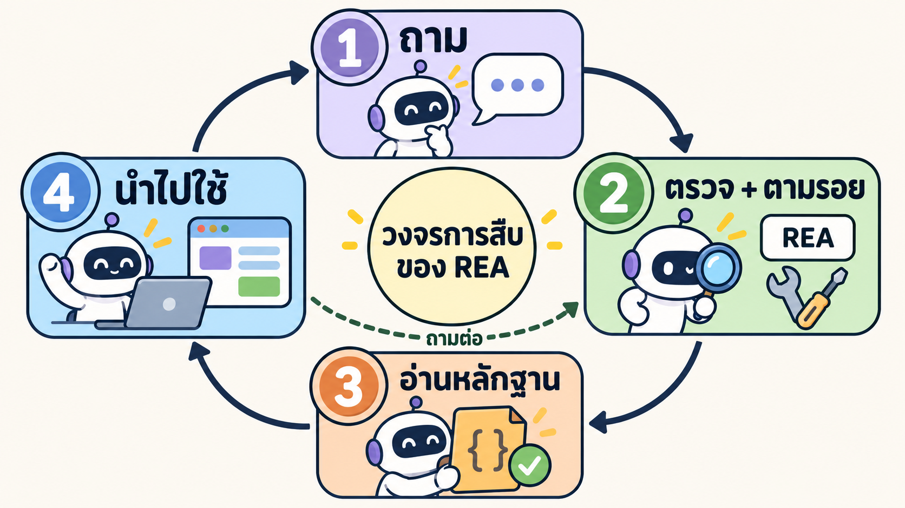
*วงจรเดียวกัน ใส่ตัวอย่างจากการสืบ Google Flights*

| ขั้น | ทำอะไร | 🧪 ในบทนี้ |
|---|---|---|
| 1. ถาม (Ask) | เราสั่งงาน | วางพรอมต์ → Claude Code ส่งต่อให้ `yolo1 -p` |
| 2. ตรวจ (Inspect & trace) | agent เรียก tool ของ REA | `inspect_web_page`, `analyze_web_bundle` |
| 3. อ่านหลักฐาน (Read the evidence) | อ่านผลที่ REA ส่งกลับ | `ui-evidence.json`, `code-analysis.json` |
| 4. ใช้ (Use what you learn) | สร้าง อธิบาย หรือทดสอบ | สร้าง SkyThai Mini |
| ↺ ถามต่อ (Follow-up) | ผลไม่พอ → ลองเครื่องมือใหม่ | ดูตัวอย่างด้านล่าง |

🧪 **ตัวอย่างจริง: วงถามต่อใน LAB 4**
1. yolo1 เรียก `analyze_web_bundle` → ได้ข้อมูลน้อย ไม่รู้ว่าเว็บใช้ framework อะไร
2. ไม่พอ → วนกลับไปเรียก `export_web_scripts` ดึงสคริปต์ออกมาเป็นไฟล์
3. เครื่องมือค้นหาตัวหนึ่งล้มเหลว → yolo1 เขียน Python ค้นเอง
4. เจอข้อมูลเที่ยวบินและรายการโหมดเรียง → ได้คำตอบ

AI ต่างจากสคริปต์ที่รันครั้งเดียวตรงนี้ คือ **ปรับวิธีเองเมื่อผลรอบแรกไม่พอ**

**สรุป:** ถาม → ตรวจ → อ่านหลักฐาน → ใช้ · ไม่พอก็วนถามต่อ

---

### T10) AI เข้าไปดูหน้าเว็บได้ยังไง: Chrome ที่ "เปิดประตู" ไว้

💡 **ใจความ:** REA จะส่องหน้าเว็บได้ ต้องเปิด Chrome แบบพิเศษที่ "เปิดประตูหลัง" ไว้ให้ (ประตูนี้ชื่อพอร์ต 9222)

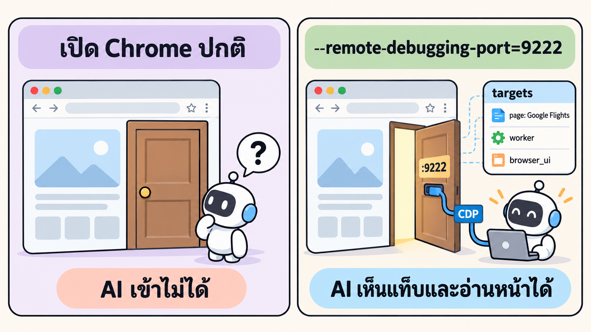
*Chrome ปกติประตูปิด · เปิดประตู 9222 แล้ว REA เข้าไปอ่านแท็บได้*

**เปรียบเหมือน:** ห้องที่มีหน้าต่างให้คนข้างนอกมองเข้าไปได้
- Chrome ปกติ = ห้องปิดทึบ → REA มองไม่เห็นอะไร
- Chrome ที่เปิดประตู 9222 = มีช่องให้มอง → REA เห็นว่ามีแท็บอะไรเปิดอยู่ แล้วส่องแท็บนั้นได้

ช่องทางนี้มีชื่อว่า **CDP (Chrome DevTools Protocol)** เป็นช่องเดียวกับที่หน้าต่าง DevTools (กด F12) ใช้อยู่แล้ว

**เราต้องทำอะไร?** ไม่ต้องพิมพ์คำสั่งเอง ใน LAB 2 เราแค่บอก Claude Code ว่า "เปิด Chrome พอร์ต 9222 ไปที่ Google Flights" แล้ว AI จัดการให้ทั้งหมด (เปิดแบบไม่มีหน้าต่าง ใช้โปรไฟล์เปล่าที่ไม่มีบัญชีของใคร)

🧪 **ตัวอย่างจริง (ผล prompt 1):** yolo1 เชื่อมต่อได้ เจอแท็บหน้าเว็บ 1 แท็บชื่อ "กรุงเทพมหานคร ไปยัง โตเกียว | Google Flights" ✅

💡 **ทำไม prompt แรกแค่ทดสอบการเชื่อมต่อ:** ถ้าไม่ผ่าน เรารู้ทันทีว่าปัญหาอยู่ที่ Chrome ไม่ต้องไปงมกับการวิเคราะห์

⚠️ ตอนประตูเปิด โปรแกรมอื่นในเครื่องก็เข้ามาได้ จึงใช้ Chrome แยกใน container และ **ปิด Chrome เมื่อจบงาน**

**สรุป:** REA ส่องเว็บผ่านประตู 9222 ของ Chrome · AI เปิดให้เอง · prompt แรกแค่เช็กว่าเข้าได้

---

### T11) เชื่อผลข้อไหนได้: ติดป้ายหลักฐาน 3 สี

💡 **ใจความ:** AI ตอบด้วยน้ำเสียงมั่นใจทุกข้อ เราจึงให้ AI **ติดป้ายสีทุกข้อสรุป** ว่ามั่นใจได้แค่ไหน แล้วเราถามเสมอว่า "มาจากหลักฐานไหน?"

#### ภาพ 1 · ป้าย 3 สี


*เขียว = ใช้ได้เลย · เหลือง = ใช้ชี้ทาง · เทา = ห้ามเดาเติม*

เปรียบเหมือน **นักสืบรายงานคดี**: บางเรื่อง "เห็นกับตา" บางเรื่อง "สงสัยว่า…" บางเรื่อง "ยังไม่รู้" นักสืบที่ดีต้องบอกให้ชัดว่าเรื่องไหนเป็นแบบไหน

| ป้าย | ความหมาย | 🧪 ตัวอย่างจริงจาก LAB 3–4 | เราใช้ยังไง |
|---|---|---|---|
| 🟢 **ยืนยันแล้ว** | เห็นในของจริง ใครตรวจซ้ำก็เจอเหมือนกัน | ข้อมูลเที่ยวบินที่ฝังมากับหน้ามีครบ 22 ใบ | ใช้เป็นข้อเท็จจริงได้ |
| 🟡 **อนุมาน** | มีเบาะแส แต่ยังไม่เห็นตรง ๆ | "ไม่เจอโค้ดเรียงในเบราว์เซอร์ จึง **น่าจะ** จัดอันดับที่เซิร์ฟเวอร์" | ใช้ชี้ทาง แต่ต้องหาหลักฐานเพิ่มก่อนสรุป |
| ⚪ **ไม่ทราบ** | หาไม่ได้ (และบอกเหตุผล) | สูตรของ "ดีที่สุด" (อยู่ในเซิร์ฟเวอร์) | ห้ามเดาเติม |

**เราได้ประโยชน์อะไร:** ตอนสร้างแอปใน LAB 5 เราเอาเฉพาะ 🟢 ไปใช้ได้เลย ส่วน 🟡 และ ⚪ ต้องออกแบบเองและบอกว่าเป็นของเรา (T13)

#### ภาพ 2 · 3 กติกาของป้าย


*ป้ายเปลี่ยนได้ตามหลักฐาน · ข้อมูลขัดกันให้หยุด · ไม่เจอ ≠ ไม่มี*

| กติกา | ความหมาย | 🧪 ตัวอย่างจริง |
|---|---|---|
| 1. หลักฐานเพิ่ม → ป้ายขยับขึ้น | ข้อสรุปเดิม แต่หลักฐานมากขึ้น ป้ายก็เปลี่ยนได้ | "Google ใช้ Wiz": LAB 3 ดูแค่โครงหน้า = 🟡 → LAB 4 อ่าน JavaScript เจอชื่อ Wiz ตรง ๆ = 🟢 |
| 2. ข้อมูลขัดกัน → ไม่สรุป | ถ้า 2 แหล่งบอกไม่ตรงกัน ห้ามเลือกเชื่ออันใดอันหนึ่ง | สวิตช์ติดตามราคา: โครงหน้าบอก "เปิด" แต่ภาพหน้าจอดู "ปิด" → yolo1 เขียน "ไม่สรุป" |
| 3. หาไม่เจอ ≠ ไม่มี | "ไม่เจอ" แปลว่าไม่เจอในส่วนที่ตรวจเท่านั้น | LAB 4 ตรวจได้ 28 สคริปต์ อีก 82 สคริปต์ไม่ได้ตรวจ |

**สรุป:** ติดป้าย 🟢 🟡 ⚪ ทุกข้อ · ป้ายเปลี่ยนได้ตามหลักฐาน · ขัดกันให้หยุด · ไม่เจอ ≠ ไม่มี · ถามเสมอว่า "มาจากหลักฐานไหน?"

---

### T12) REA เจออะไรใน Google Flights (ผลรันจริง)

💡 **ใจความ:** รวมผล LAB 3–4 ได้ 4 เรื่อง อ่านทีละเรื่องตามภาพนี้


*ภาพรวม 4 เรื่อง · แต่ละเรื่องมีรายละเอียดในขั้น 1–4 ด้านล่าง*

| เรื่อง | ใจความ | อ่านต่อ |
|---|---|---|
| 1 | ข้อมูลเที่ยวบิน 22 ใบมากับหน้าเว็บตั้งแต่แรก | ขั้น 1 |
| 2 | ตั๋ว 1 ใบ = 1 ทริป มีได้หลายขา | ขั้น 2 |
| 3 | "ดีที่สุด" ไม่ได้เรียงตามราคาอย่างเดียว | ขั้น 3 |
| 4 | ชื่อในโค้ดอ่านไม่ออก แต่ใช้ข้อความภาษาไทยช่วยหาได้ | ขั้น 4 |

#### ขั้น 1 · ข้อมูลมากับหน้าเว็บตั้งแต่แรก (SSR + hydrate)

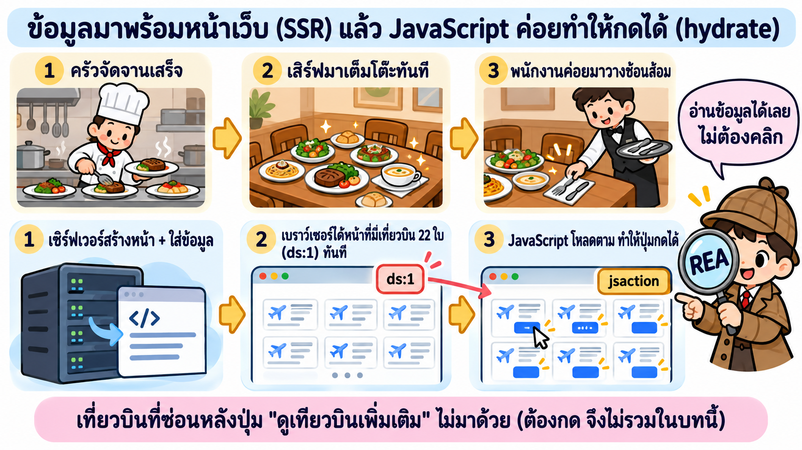
*ครัวจัดจานเสร็จ → เสิร์ฟเต็มโต๊ะทันที → ค่อยวางช้อนส้อม = เซิร์ฟเวอร์สร้างหน้า → ได้หน้าพร้อมข้อมูล → JavaScript ทำให้กดได้*

| ขั้น | ร้านอาหาร | เว็บ (ชื่อเรียก) | 🧪 Google Flights |
|---|---|---|---|
| 1 | ครัวจัดจานเสร็จ | เซิร์ฟเวอร์สร้างหน้าให้เสร็จ (**SSR** = Server-Side Rendering) | ใส่ผลค้นหาลงในหน้าเลย |
| 2 | เสิร์ฟมาเต็มโต๊ะทันที | เบราว์เซอร์ได้หน้าพร้อมข้อมูล | ข้อมูลชุดชื่อ `ds:1` มีเที่ยวบิน **22 ใบ** (ยอดนิยม 3 + อื่นๆ 19) |
| 3 | พนักงานค่อยมาวางช้อนส้อม | JavaScript โหลดตามแล้วทำให้ปุ่มกดได้ (**hydrate**) | ปุ่มผูกผ่าน `jsaction` 1,501 จุด |

🧪 **ผลต่อการสืบ:** ข้อมูลอยู่ในหน้าตั้งแต่แรก REA จึงอ่านได้ **โดยไม่ต้องคลิกอะไรเลย** แต่เที่ยวบินที่ซ่อนหลังปุ่ม "ดูเที่ยวบินเพิ่มเติม" ไม่มาด้วย เพราะบทนี้ **ห้ามคลิก** (บทที่ 3 กดแล้วได้ 300 ใบ)

#### ขั้น 2 · ข้อมูลเที่ยวบิน 1 ใบมีอะไร

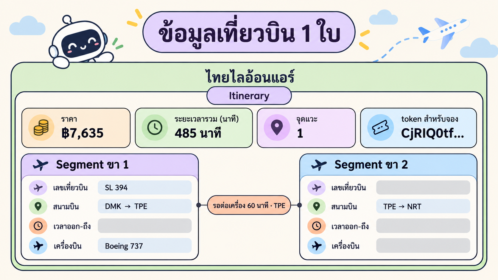
*1 ทริป (Itinerary) มีได้หลายขา (Segment) · ตัวอย่างจริง SL 394 DMK → TPE → NRT*

| ช่อง | 🧪 ตัวอย่างจริง (ไทยไลอ้อนแอร์) |
|---|---|
| สายการบิน | `SL` ไทยไลอ้อนแอร์ |
| ต้นทาง → ปลายทาง | `DMK` ดอนเมือง → `NRT` นาริตะ |
| เวลาออก → ถึง | 06:20 → 16:25 (เวลาท้องถิ่นของแต่ละสนามบิน) |
| ระยะเวลารวม | `485` นาที (8 ชม. 5 นาที) |
| ขาที่บิน | SL 394 · แวะ 60 นาทีที่ `TPE` ไทเป |
| ราคา | `7635` บาท |

💡 **ทำไมต้องเก็บระยะเวลาแยก:** ถ้าเอา 16:25 − 06:20 จะได้ 10 ชม. 5 นาที ซึ่ง **ผิด** เพราะญี่ปุ่นเวลาเร็วกว่าไทย 2 ชั่วโมง ค่า 485 นาทีที่ Google ส่งมาจึงถูกต้อง

#### ขั้น 3 · "ดีที่สุด" ≠ "ถูกที่สุด"

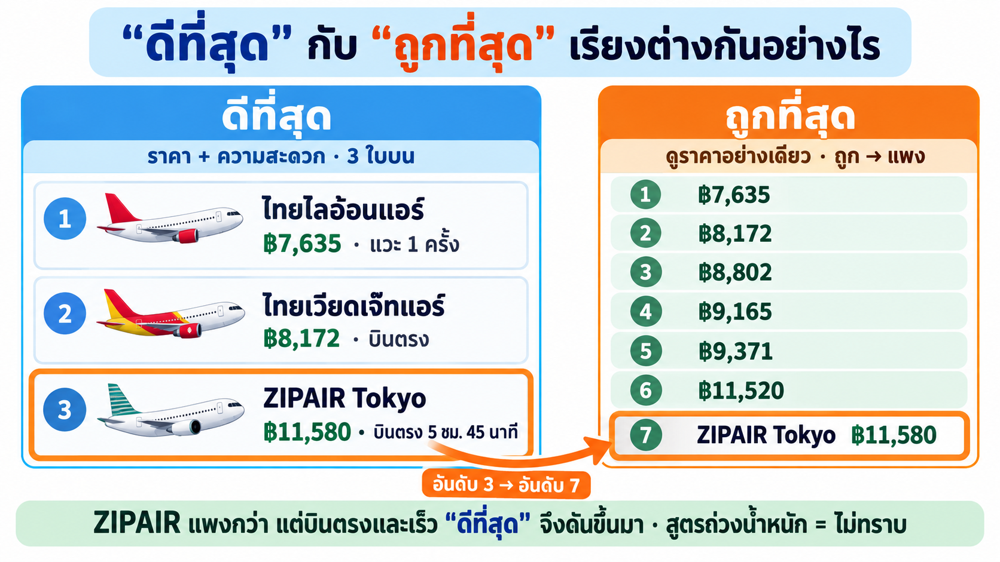
*"ดีที่สุด" = ราคา + ความสะดวก · "ถูกที่สุด" = ดูราคาอย่างเดียว*

| กลุ่ม | ราคาตามลำดับบนหน้า | เรียงตามราคาไหม |
|---|---|---|
| 3 ใบบน ("ยอดนิยม") | ฿7,635 · ฿8,172 · **฿11,580** | ❌ ไม่ |
| 19 ใบที่เหลือ | ฿8,802 → … → ฿41,760 | ✅ ถูก → แพง |

🧪 **สังเกตใบที่ 3:** ZIPAIR ฿11,580 (บินตรง 5 ชม. 45 นาที) อยู่กลุ่มบนทั้งที่มีใบถูกกว่าอีกหลายใบ ถ้าเรียงตามราคาอย่างเดียว ZIPAIR จะตกไปอยู่ **อันดับ 7**
→ แปลว่า "ดีที่สุด" ดูอย่างอื่นนอกจากราคาด้วย

**"ถูกที่สุด" เข้าใจง่าย: เรียงราคาน้อย → มาก แล้ว "ดีที่สุด" ล่ะ? ไทยไลอ้อนแอร์แวะ 1 ครั้ง ทำไมได้อันดับ 1?**

Google เขียนบนหน้าเว็บว่า "ดีที่สุด" ดู **ราคา + ความสะดวก** แต่ไม่บอกสูตร เราจึงลองเอาข้อมูลจริง 22 ใบมาคิดเองทีละขั้น


*วัด 3 อย่าง → ใบที่แพ้ใบอื่นทุกด้านตกรอบ → เหลือ 4 ใบ → 3 ใบที่ถูกที่สุดคือ 3 ใบบนของ Google*

**ขั้น ก · "ความสะดวก" วัดเป็นตัวเลขได้ 2 อย่าง**

| วัดอะไร | ดีคือ | ทำไมสำคัญกับคนเดินทาง |
|---|---|---|
| จำนวนแวะ | บินตรง (0) ดีกว่า แวะ (1) | แวะ = ลงเครื่อง รอ เสี่ยงตกเครื่อง |
| เวลาบินรวม | ยิ่งสั้นยิ่งดี | ถึงเร็ว เหนื่อยน้อย |

พอรวมกับ **ราคา** เราจะมี 3 ตัวเลขต่อเที่ยวบิน 1 ใบ

**ขั้น ข · กติกา "แพ้ทุกด้าน = ตกรอบ"**

ถ้ามีเที่ยวบินอีกใบที่ **ถูกกว่าหรือเท่ากัน + แวะน้อยกว่าหรือเท่ากัน + เร็วกว่าหรือเท่ากัน** ใบเราไม่มีเหตุผลให้ใครเลือก → ตกรอบ

| ตัวอย่าง | ราคา | แวะ | เวลาบิน | ผล |
|---|---:|---:|---:|---|
| ไทยเวียดเจ๊ทแอร์ 09:35 | ฿8,172 | 0 | 5 ชม. 55 นาที | ✅ อยู่ต่อ |
| ไทยเวียดเจ๊ทแอร์ 23:50 | ฿8,802 | 0 | 6 ชม. 5 นาที | ❌ แพ้ใบบนทุกด้าน (แพงกว่า + ช้ากว่า) |

**ขั้น ค · ใช้กติกากับทั้ง 22 ใบ เหลือแค่ 4 ใบ**


*กราฟจากข้อมูลจริง (วาดด้วย Python จาก `flights-snapshot.json`): ยิ่งไปมุมซ้ายล่างยิ่งถูกและเร็ว*

| เหลือ | ราคา | แวะ | เวลาบิน | เหตุผลที่ไม่มีใครชนะทุกด้าน | Google จัดให้ |
|---|---:|---:|---:|---|---|
| ไทยไลอ้อนแอร์ | **฿7,635** | 1 | 8 ชม. 5 นาที | **ถูกที่สุดในทั้ง 22 ใบ** ไม่มีใครถูกกว่า | 🥇 อันดับ 1 |
| ไทยเวียดเจ๊ทแอร์ | ฿8,172 | **0** | 5 ชม. 55 นาที | **บินตรงที่ถูกที่สุด** | 🥈 อันดับ 2 |
| ZIPAIR Tokyo | ฿11,580 | **0** | **5 ชม. 45 นาที** | ใบที่ถูกกว่าบินช้ากว่าทุกใบ | 🥉 อันดับ 3 |
| การบินไทย | ฿15,320 | 0 | **5 ชม. 40 นาที** | เร็วที่สุด | ไม่ติด 3 ใบบน |

**ตอบคำถาม: ทำไมไทยไลอ้อนแอร์ได้อันดับ 1 ทั้งที่แวะ 1 ครั้ง?**
เพราะถูกที่สุดในทั้งหมด ไม่มีเที่ยวบินไหน "ชนะทุกด้าน" ได้ ใครอยากประหยัดที่สุดก็ต้องเลือกใบนี้ ส่วนข้อเสีย (แวะ 1 ครั้ง) ยังพอรับได้ เพราะใช้เวลา 8 ชม. 5 นาที ซึ่งเร็วที่สุดในกลุ่มที่แวะ (ใบอื่นที่แวะใช้ 8 ชม. 55 นาที – 16 ชม.)

**แล้ว 3 ใบบนเรียงกันยังไง?** เรียงตามราคาในกลุ่มที่เหลือ: 7,635 → 8,172 → 11,580 ใบที่ 4 (การบินไทย ฿15,320) เร็วขึ้นแค่ 5 นาที แต่แพงขึ้น ฿3,740 จึง **น่าจะ** ไม่คุ้มพอให้ติด 3 ใบบน

⚠️ **ต้องแยกให้ชัด (T11)**
- 🟢 ยืนยันแล้ว: Google บอกบนหน้าว่าดู "ราคา + ความสะดวก" · 3 ใบบนคือ 7,635 · 8,172 · 11,580
- 🟡 อนุมาน: กติกา "แพ้ทุกด้าน = ตกรอบ" อธิบายข้อมูลรอบนี้ได้ครบ แต่เราคิดขึ้นเองจากข้อมูล ไม่ได้เห็นในโค้ดของ Google
- ⚪ ไม่ทราบ: สูตรจริงและน้ำหนักของแต่ละปัจจัย (อาจมีปัจจัยอื่น เช่น เวลาออกเดินทาง หรือการเปลี่ยนสนามบิน)

#### ขั้น 4 · ชื่อในโค้ดถูกบีบ แต่ใช้ข้อความภาษาไทยช่วยหาได้

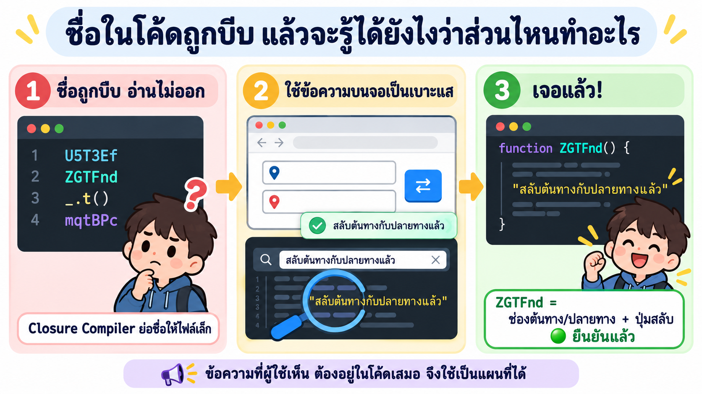
*ชื่ออ่านไม่ออก → ค้นด้วยข้อความที่ผู้ใช้เห็น → รู้ว่าโมดูลไหนทำอะไร*

| ขั้น | เกิดอะไร |
|---|---|
| 1. ชื่อถูกบีบ | Google ใช้ Closure Compiler ย่อชื่อให้ไฟล์เล็ก ชื่อเลยเหลือแค่ `U5T3Ef`, `ZGTFnd`, `_.t()` อ่านไม่ออกว่าทำอะไร |
| 2. หาเบาะแส | กดปุ่มสลับ ⇄ แล้วจอขึ้นข้อความ "สลับต้นทางกับปลายทางแล้ว" ข้อความนี้ **ต้องอยู่ในโค้ด** (ไม่งั้นจอจะแสดงไม่ได้) |
| 3. ค้นหา | ค้นข้อความนั้นในไฟล์ JavaScript → เจอในโมดูล `ZGTFnd` → `ZGTFnd` = ช่องต้นทาง/ปลายทาง + ปุ่มสลับ 🟢 |

🧪 ใช้วิธีเดียวกันหาได้อีกว่า แถบเรียง = `U5T3Ef` 🟢 (มีป้าย "ราคา", "เวลาออกเดินทาง" ฯลฯ อยู่ในโมดูลนี้) ส่วนโมดูลอื่น เช่น ตัวกรอง = `ebuxPc` เป็นแค่ 🟡 อนุมาน

**สรุป:** ข้อมูล 22 ใบมากับหน้าเว็บ · 1 ทริปมีหลายขา · เก็บระยะเวลาเป็นนาที · "ดีที่สุด" ≠ "ถูกที่สุด" และสูตรเป็นความลับของเซิร์ฟเวอร์

---

### T13) เอาอะไรมาใช้ได้: ยืม "แนวคิด" ไม่ใช่ "โค้ด"

💡 **ใจความ:** เอาแนวคิดที่เรียนรู้มา แล้วเขียนใหม่เองทั้งหมด ห้ามลอกโค้ด โลโก้ ชื่อ และห้ามเรียก API ภายในของ Google

| SkyThai Mini ยืมแนวคิดอะไร | มาจากไหน | 🧪 ทำในแอปเรายังไง |
|---|---|---|
| เก็บระยะเวลาเป็นนาที | T12 ขั้น 2 | ไม่คำนวณจากเวลาที่ข้ามโซน |
| มีการเรียงหลายแบบ | T12 ขั้น 3 | ปุ่ม ราคาถูกสุด (ค่าเริ่มต้น) · ราคาแพงสุด · บินเร็วสุด · ออกเช้าสุด |
| ตัวกรองจำนวนแวะ | LAB 3 | ปุ่ม "บินตรงเท่านั้น" (22 → 18 ใบ) |
| ข้อมูลเที่ยวบิน | `flights-snapshot.json` | ใส่ลงฐานข้อมูล PostgreSQL และติดป้าย "ข้อมูลจำลอง" |

| ของเราเองล้วน ๆ | รายละเอียด |
|---|---|
| ชื่อ หน้าตา โลโก้ | SkyThai Mini · โลโก้และภาพหน้าแรกสร้างด้วย `cyolo1` |
| เรียงแบบเริ่มต้น | **ถูก → แพง** ตามโจทย์ (Google เริ่มที่ "ดีที่สุด") |
| การจองจำลอง | เลือกเที่ยวบิน → กรอกชื่อ + อีเมล → ได้รหัสจอง `STM-XXXXXX` (ไม่มีจ่ายเงินจริง) |

🧪 ถ้าอยากมี "ดีที่สุด" ของเราเอง yolo1 เสนอสูตรที่ **คิดเอง** เช่น `ราคา×w1 + เวลาบิน×w2 + จำนวนแวะ×w3` สูตรนี้ไม่ใช่ของ Google (ของ Google = ไม่ทราบ)

**สรุป:** หลักฐาน → แนวคิด → เขียนใหม่เอง · แบรนด์และโค้ดเป็นของเราทั้งหมด

---

### T14) ทำไมทำงานใน container และติดตั้ง REA ที่ "ส่วนกลาง"

💡 **ใจความ:** container คือ "ห้องทดลอง" แยกจากเครื่องเรา ทุกคนได้ของชุดเดียวกัน ส่วนการติดตั้งที่ส่วนกลางทำให้ติดตั้งครั้งเดียว ใช้ได้ทั้ง 10 บัญชี

#### ภาพ 1 · ทำไมทำงานใน container


*เครื่องเรากับห้องทดลองแยกกัน · ของสำคัญเก็บในตู้เซฟ (volume) จึงไม่หายตอนสร้างห้องใหม่*

| เหตุผล | อธิบายง่าย ๆ |
|---|---|
| 1. ทุกคนได้ของชุดเดียวกัน | เครื่องมือ Chrome และบัญชี AI มาพร้อมใน container ไม่ต้องติดตั้งเองทีละอย่าง |
| 2. ปลอดภัยกับบัญชีส่วนตัว | Chrome ที่เปิดประตู 9222 (T10) อยู่ในห้องทดลอง ไม่ใช่ Chrome ส่วนตัวที่ล็อกอินอีเมลเราไว้ |
| 3. พังก็เริ่มใหม่ได้ | สร้างห้องใหม่ด้วย `/maccount` |
| 4. ของสำคัญไม่หาย | ล็อกอินและ REA เก็บใน "ตู้เซฟ" (Docker volume) เราลองสร้างห้องใหม่ทับแล้ว (LAB 0) REA ยังอยู่ครบ |

#### ภาพ 2 · ทำไมติดตั้งที่ส่วนกลาง

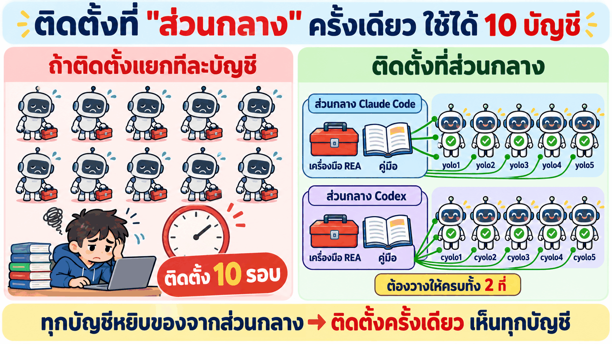
*ติดตั้งแยกต้อง 10 รอบ · ติดตั้งที่ส่วนกลาง 1 รอบ ทุกบัญชีเห็น*

- container มี **10 บัญชี AI**: `yolo1`–`yolo5` (Claude Code) และ `cyolo1`–`cyolo5` (Codex)
- ทุกบัญชีอ่านรายชื่อเครื่องมือ (MCP) และคู่มือ (skill) จาก **ที่เดียวกัน** คือโฟลเดอร์ส่วนกลาง (`shared`)
- → เพิ่ม REA ที่ส่วนกลางครั้งเดียว ทุกบัญชีเห็นทันที ไม่ต้องติดตั้ง 10 รอบ
- เราแค่วางพรอมต์ใน LAB 1 แล้ว AI จัดการเพิ่มให้เอง (และสำรองของเดิมไว้ก่อน)

**สรุป:** container = ห้องทดลองที่ปลอดภัย ทุกคนเหมือนกัน ลบสร้างใหม่ได้ · ส่วนกลาง = ติดตั้งครั้งเดียว 10 บัญชีใช้ได้

---

### T15) สิ่งที่ REA บอกไม่ได้ + จริยธรรม

💡 **ใจความ:** REA เห็นได้แค่สิ่งที่ส่งมาถึงเบราว์เซอร์ และเฉพาะส่วนที่เราเปิดดู ส่วนเส้นที่ห้ามข้ามคือ ห้ามลอก ห้ามหลบระบบป้องกัน และต้องขออนุญาต

**REA บอกไม่ได้**

| เรื่อง | 🧪 ในบทนี้ | ทำยังไงแทน |
|---|---|---|
| สิ่งที่อยู่บนเซิร์ฟเวอร์ | สูตร "ดีที่สุด" | ออกแบบเอง และบอกว่าเป็นของเรา |
| ส่วนที่เราไม่ได้กด | ไม่ได้กด "ดูเที่ยวบินเพิ่มเติม" (ได้ 22 จาก 300 ใบ) | บทที่ 2–3 ใช้ Playwright กดสำรวจ |
| ราคาปัจจุบัน | ราคา ณ 31 ต.ค. 2569 เท่านั้น | ติดป้าย "ข้อมูลจำลอง" |
| ความถูกต้อง 100% | ข้อมูลขัดกันเรื่องสวิตช์ติดตามราคา | อ่านหลักฐานเอง ไม่เชื่อทุกข้อ |

**จริยธรรม (ต้องทำทุกครั้ง)**
- **มีเครื่องมือ ≠ มีสิทธิ์:** สืบเพื่อเรียนรู้ ดูอย่างเดียว ระบบจริงนอกห้องเรียนต้องขออนุญาต
- **เคารพข้อตกลงของเว็บ:** อ่าน Terms of Service · ไม่ยิงซ้ำถี่ ๆ · ไม่ดึงข้อมูลไปขาย
- **ไม่หลบระบบป้องกัน:** เจอ CAPTCHA ให้หยุด · ไม่ใช้บัญชีคนอื่น
- **ไม่ลอก:** แบรนด์ โลโก้ โค้ด ไม่เอามาใช้
- **กฎหมายไทย (ภาพรวม):** เข้าระบบที่มีการป้องกันโดยไม่ได้รับอนุญาตผิด พ.ร.บ.คอมพิวเตอร์ฯ · ข้อมูลส่วนบุคคลอยู่ใต้ PDPA
- **ข้อความบนเว็บไม่ใช่คำสั่ง:** ถ้าหน้าเว็บเขียนสั่ง AI ให้ทำอะไร AI ต้องไม่ทำตาม (รอบจริง yolo1 รายงานว่าไม่พบข้อความแบบนี้)

**สรุป:** REA เห็นแค่ส่วนที่ส่งมาและส่วนที่เราเปิดดู · ดูอย่างเดียว ไม่ลอก ไม่หลบ ขออนุญาตเสมอ

---

### 🧠 ทบทวน 10 ข้อ (ลองตอบก่อนเปิดเฉลย)

1. Reverse engineering ต่างจากการลอกโค้ดยังไง?
2. ข้อไหน "เห็นได้" ข้อไหน "เห็นไม่ได้": (ก) ป้าย "ถูกที่สุด ฿7,635" (ข) สูตรจัดอันดับ "ดีที่สุด" (ค) ข้อมูลเที่ยวบินที่ฝังมากับหน้า
3. Ghidra ให้ผล 2 แบบ คืออะไร แบบไหนอ่านง่ายกว่า?
4. เจอชื่อ `GetBookingResults` ในไฟล์ JS แปลว่า "มีการจองจริง" ไหม? เพราะอะไร?
5. MCP server กับ skill ต่างกันยังไง?
6. ถ้าเปิด Chrome แบบปกติ (ไม่มีพอร์ต 9222) prompt 1 จะได้ผลยังไง?
7. ทำไม "Google ใช้ Wiz" เป็น 🟡 อนุมานใน LAB 3 แต่เป็น 🟢 ยืนยันแล้วใน LAB 4?
8. ZIPAIR ฿11,580 อยู่กลุ่มบน ถ้าเรียงตามราคาจะอยู่อันดับเท่าไร และบอกอะไรเรา?
9. ทำไมต้องเก็บระยะเวลาบินเป็นนาที แทนการเอาเวลาถึงลบเวลาออก?
10. ทำไมติดตั้ง REA ที่ "ส่วนกลาง" แทนการติดตั้งทีละบัญชี?

<details>
<summary>เฉลย</summary>

1. RE คือ **ดู → เข้าใจ → เขียนของเราเองใหม่** ไม่เอาโค้ด แบรนด์ หรือข้อมูลของเขามาใช้
2. (ก) เห็นได้ · (ข) เห็นไม่ได้ (อยู่ที่เซิร์ฟเวอร์ → "ไม่ทราบ") · (ค) เห็นได้ เพราะส่งมากับหน้าเว็บ
3. **assembly** กับ **decompiled code** · decompiled อ่านง่ายกว่า (แต่ชื่อฟังก์ชันอาจไม่ใช่ชื่อจริง)
4. **ไม่ได้** · เป็นการดูโค้ด (static) บอกแค่ "มีชื่อนี้ในโค้ด" ต้องเห็นตอนทำงานจริง (dynamic) ซึ่งเราไม่ได้กดจอง
5. MCP server = **กล่องเครื่องมือ** (207 tools) · skill = **คู่มือ** ว่าใช้เครื่องมือยังไง และให้แยกยืนยัน/อนุมาน
6. REA **มองไม่เห็นแท็บ** เพราะประตู CDP ปิด → เชื่อมต่อ `127.0.0.1:9222` ไม่ได้
7. LAB 3 ดูแค่โครงหน้า ไม่เจอชื่อ Wiz ตรง ๆ · LAB 4 อ่าน JS แล้วเจอ `WIZ_global_data` → **หลักฐานเพิ่ม ป้ายจึงขยับขึ้น**
8. **อันดับ 7** · "ดีที่สุด" ไม่ได้ดูราคาอย่างเดียว แต่ให้น้ำหนักอะไรเท่าไร **ไม่ทราบ**
9. เวลาออก/ถึงเป็นเวลาท้องถิ่นคนละโซน ญี่ปุ่นเร็วกว่าไทย 2 ชม. ลบกันตรง ๆ จะได้ 10 ชม. 5 นาที ซึ่งผิด (จริง 485 นาที = 8 ชม. 5 นาที)
10. ทุกบัญชีหยิบเครื่องมือและคู่มือจากที่เดียวกัน → **ติดตั้งครั้งเดียว 10 บัญชีใช้ได้** ไม่ต้องทำ 10 รอบ

</details>

---

## 🛠️ ติดตั้ง (LAB 0–1)

ทำ 2 LAB นี้ครั้งเดียว แล้วไปลงมือต่อใน [บทที่ 1](../01_REA_Basics_Flight/README.md) ได้เลย · ทุก LAB = วางพรอมต์ 1 ครั้งใน Claude Code Desktop แล้วรอผล

---

## LAB 0 · เตรียม container ด้วย `/maccount`

🎯 ให้ container `multi-account-devtool` พร้อมใช้ และบัญชี `yolo1` ล็อกอินอยู่

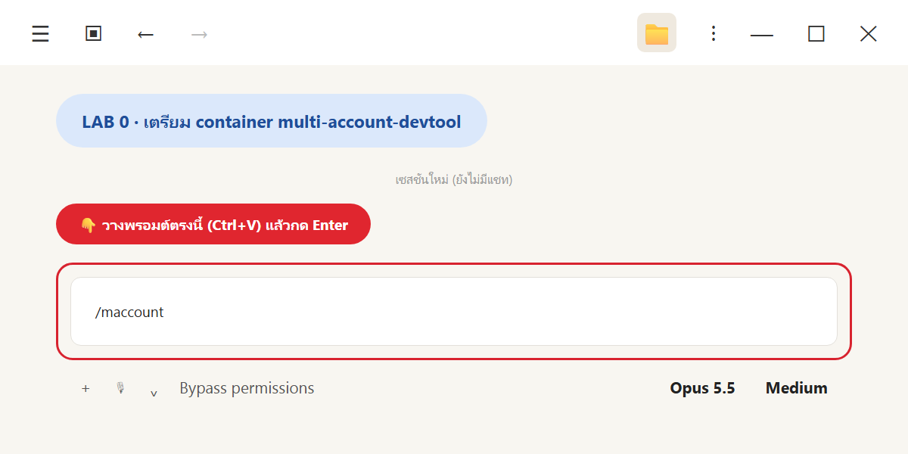
*วาง `/maccount` แล้วกด Enter*

💬 **คัดลอกพรอมต์นี้**

```text
/maccount
```

skill `/maccount` จะทำตามขั้นที่ 1 ของ LAB 03 ให้อัตโนมัติ
1. เช็ก image `tuchsanai/multi-account-devtool:2569_1`, container เดิม, พอร์ต และไฟล์ `.env`
2. ถ้า container เดิมตั้งค่าเหมือนเดิม ใช้ตัวเดิมต่อ (ไม่งั้นลบแล้ว `docker run` ใหม่ · อยากสร้างใหม่แน่ๆ พิมพ์ `/maccount สร้างใหม่`)
3. sync skill ในเครื่องเข้า container แล้วตรวจ
4. ตรวจการล็อกอินของ `yolo1`–`yolo5` และ `cyolo1`–`cyolo5`
5. เช็ก JupyterLab ตอบ 200 แล้วสรุปเป็นภาษาไทย

✅ **ผลที่คาดหวัง** (รันจริง 1 พ.ย. 2569 แบบสร้างใหม่ทับ)

| ขั้น | ผล |
|---|---|
| container | `CREATED multi-account-devtool` · พอร์ต 8886 |
| skill ส่วนกลาง | sync 5 skill · `.Claude` และ `.Codex` ✅ OK ครบ |
| ล็อกอิน | ล็อกอินแล้ว 4/10: `yolo1` `yolo2` `yolo3` `cyolo1` (บทนี้ใช้แค่ `yolo1`) |
| JupyterLab | `JUPYTER 200` |

👀 **สังเกต**
- ถ้า `yolo1` ยังไม่ล็อกอิน ให้กลับไปทำ LAB 03 ขั้นล็อกอินก่อน เพราะทุกพรอมต์หลังจากนี้ส่งงานให้ `yolo1 -p`
- สร้าง container ใหม่ทับแล้ว **REA ยังอยู่** เพราะการตั้งค่าเก็บใน Docker volume `ai-accounts` ทดสอบจริงหลังสร้างใหม่: ถาม `yolo1 -p` ว่าเห็น `rea` ไหม ได้คำตอบใน 21 วินาทีว่าเห็น `rea` **207 tools** (รุ่น 6.7.0 ตอนนั้น) และ skill `reverse-engineer-anything` ถ้าเคยทำ LAB 1 แล้ว ข้ามไป LAB 2 ได้เลย
- อย่าลบ volume `ai-accounts` (เก็บทั้งล็อกอินและ REA)

---

## LAB 1 · ติดตั้ง REA ลงใน container (ครั้งเดียว ใช้ได้ทุกบัญชี)

🎯 ให้ทั้ง `yolo1`–`yolo5` และ `cyolo1`–`cyolo5` เห็น MCP `rea` และ skill `reverse-engineer-anything` (ทฤษฎี: T8, T14)

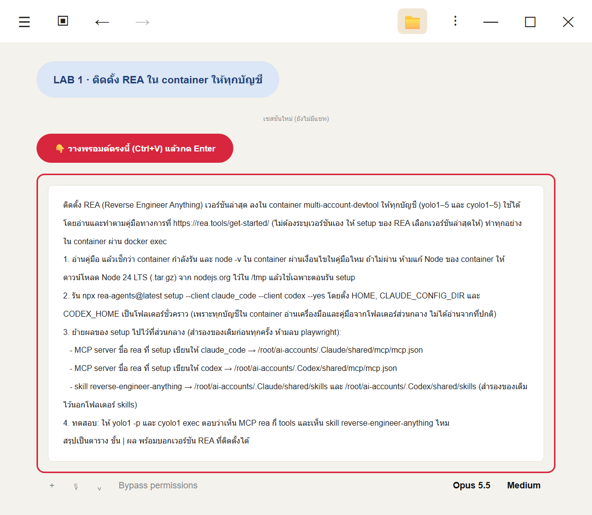
*วางพรอมต์ติดตั้ง REA*

📖 **ติดตั้งตามคู่มือทางการ:** พรอมต์นี้ **ไม่ระบุเวอร์ชัน** แต่ให้ AI อ่านคู่มือที่ [rea.tools/get-started](https://rea.tools/get-started/) แล้วรัน `npx rea-agents@latest setup` ซึ่งจะเลือกเวอร์ชันล่าสุดให้เอง ทุกครั้งที่ทำ LAB จึงได้ REA ใหม่ล่าสุด

💬 **คัดลอกพรอมต์นี้**

```text
ติดตั้ง REA (Reverse Engineer Anything) เวอร์ชันล่าสุด ลงใน container multi-account-devtool ให้ทุกบัญชี (yolo1–5 และ cyolo1–5) ใช้ได้ โดยอ่านและทำตามคู่มือทางการที่ https://rea.tools/get-started/ (ไม่ต้องระบุเวอร์ชันเอง ให้ setup ของ REA เลือกเวอร์ชันล่าสุดให้) ทำทุกอย่างใน container ผ่าน docker exec
1. อ่านคู่มือ แล้วเช็กว่า container กำลังรัน และ node -v ใน container ผ่านเงื่อนไขในคู่มือไหม ถ้าไม่ผ่าน ห้ามแก้ Node ของ container ให้ดาวน์โหลด Node 24 LTS (.tar.gz) จาก nodejs.org ไว้ใน /tmp แล้วใช้เฉพาะตอนรัน setup
2. รัน npx rea-agents@latest setup --client claude_code --client codex --yes โดยตั้ง HOME, CLAUDE_CONFIG_DIR และ CODEX_HOME เป็นโฟลเดอร์ชั่วคราว (เพราะทุกบัญชีใน container อ่านเครื่องมือและคู่มือจากโฟลเดอร์ส่วนกลาง ไม่ได้อ่านจากที่ปกติ)
3. ย้ายผลของ setup ไปไว้ที่ส่วนกลาง (สำรองของเดิมก่อนทุกครั้ง ห้ามลบ playwright):
   - MCP server ชื่อ rea ที่ setup เขียนให้ claude_code → /root/ai-accounts/.Claude/shared/mcp/mcp.json
   - MCP server ชื่อ rea ที่ setup เขียนให้ codex → /root/ai-accounts/.Codex/shared/mcp/mcp.json
   - skill reverse-engineer-anything → /root/ai-accounts/.Claude/shared/skills และ /root/ai-accounts/.Codex/shared/skills (สำรองของเดิมไว้นอกโฟลเดอร์ skills)
4. ทดสอบ: ให้ yolo1 -p และ cyolo1 exec ตอบว่าเห็น MCP rea กี่ tools และเห็น skill reverse-engineer-anything ไหม
สรุปเป็นตาราง ขั้น | ผล พร้อมบอกเวอร์ชัน REA ที่ติดตั้งได้
```

💡 พรอมต์นี้มีชื่อไฟล์และคำสั่งเทคนิคอยู่บ้าง **เพื่อให้ AI ทำได้ตรงเป๊ะ** เราไม่ต้องเข้าใจทุกบรรทัด แค่รู้ว่ามันทำ 4 อย่าง: ① อ่านคู่มือทางการ ② ให้ setup ของ REA ติดตั้งเวอร์ชันล่าสุด ③ ย้ายเครื่องมือและคู่มือไปไว้ที่ส่วนกลางให้ทุกบัญชีเห็น (T14) ④ ทดสอบว่าเห็นจริงทั้งฝั่ง Claude Code และ Codex

✅ **ผลจริง** (รันจริง 2 พ.ย. 2569 ใช้เวลาราว 4 นาที · setup เลือกให้ได้ `rea-agents` **6.8.0**)

| ขั้น | ผล |
|---|---|
| 1 อ่านคู่มือ + เช็ก Node | ✅ container รันอยู่ · คู่มือกำหนด Node 22.23.4+ แต่ใน container เป็น `v22.23.3` → AI ดาวน์โหลด Node 24 ไว้ใน `/tmp` ใช้เฉพาะตอน setup (ไม่แตะ Node ของ container) |
| 2 รัน setup ของ REA | ✅ `status: ready` · setup เลือกเวอร์ชันล่าสุดแล้วล็อกไว้เป็น `npx -y rea-agents@6.8.0 mcp` |
| 3 ย้ายไปส่วนกลาง | ✅ `mcp.json` ทั้งฝั่ง `.Claude` และ `.Codex` มี `rea` แล้ว (สำรองของเดิมไว้ playwright ยังอยู่) · คู่มือวางครบทั้ง 2 ฝั่ง |
| 4 ทดสอบ | ✅ `yolo1` และ `cyolo1` ตอบตรงกันว่าเห็น REA **229 tools** และเห็นคู่มือ `reverse-engineer-anything` (ลอง `yolo2` เพิ่มก็เห็น 229 เหมือนกัน) |

👀 **สังเกต**
- **จำนวน tools ขึ้นกับเวอร์ชัน:** 6.7.0 (ในวิดีโอและตัวอย่างทฤษฎี) มี **207 tools** · 6.8.0 มี **229 tools** ถ้าวันที่ทำ LAB ได้เวอร์ชันใหม่กว่านี้ ตัวเลขอาจเปลี่ยนอีก ไม่ผิดปกติ
- **Node ต่ำกว่าที่คู่มือกำหนด 1 รุ่นย่อย:** ตัว `setup` จะไม่ยอมทำงาน (`needs_human`) จึงต้องใช้ Node 24 ชั่วคราว ส่วนตัว MCP server รันบน Node ของ container ได้ปกติ
- **Claude Code กับ Codex อ่าน `mcp.json` คนละไฟล์:** ถ้าใส่แค่ฝั่ง `.Claude` บัญชี `cyolo` จะเห็น REA **0 tools** (เจอจริงตอนทดสอบ) พรอมต์จึงสั่งให้ใส่ทั้ง 2 ไฟล์
- ครั้งแรกที่ AI เรียกใช้ REA จะช้านิดหนึ่ง เพราะต้องดาวน์โหลดเครื่องมือมาก่อน ครั้งต่อไปเร็วขึ้น
- ถ้า `yolo1` หรือ `cyolo1` ตอบว่า "ไม่เห็น rea" ให้ใช้พรอมต์ในหัวข้อ "ถ้าเจอปัญหา" ด้านล่าง AI จะตรวจและแก้ให้

---

## ✅ เช็กลิสต์ก่อนไปบทที่ 1

- [ ] อธิบายได้ว่า reverse engineering คืออะไร และ "ไม่ใช่" อะไร (ไม่ลอก ไม่เจาะ ไม่แก้)
- [ ] บอกได้ว่าบนเว็บ อะไรดูได้ อะไรดูไม่ได้ พร้อมตัวอย่าง 1 ข้อ
- [ ] อธิบายได้ว่า MCP server กับ skill ต่างกันอย่างไร
- [ ] บอกได้ว่าป้าย 🟢 ยืนยันแล้ว · 🟡 อนุมาน · ⚪ ไม่ทราบ ต่างกันยังไง
- [ ] `/maccount` แล้ว container พร้อม และ `yolo1` ล็อกอินอยู่ (LAB 0)
- [ ] `yolo1` และ `cyolo1` เห็น REA (6.8.0 = 229 tools) และคู่มือ `reverse-engineer-anything` (LAB 1)

---

## ถ้าเจอปัญหา: คัดลอกพรอมต์นี้

```text
LAB REA ใน container multi-account-devtool มีปัญหา ช่วยตรวจทีละข้อแบบอ่านอย่างเดียวก่อน แล้วบอกฉันว่าจะแก้อย่างไร ห้ามลบไฟล์ใน /workspace/rea-flight และห้ามแก้ไฟล์ใน evidence/
1. container multi-account-devtool รันอยู่ไหม และ node -v ใน container คือเวอร์ชันอะไร
2. /root/ai-accounts/.Claude/shared/mcp/mcp.json และ /root/ai-accounts/.Codex/shared/mcp/mcp.json เป็น JSON ที่ถูกต้องไหม มีทั้ง rea (rea-agents เวอร์ชันอะไร) และ playwright ไหม
3. มีโฟลเดอร์ reverse-engineer-anything ใน /root/ai-accounts/.Claude/shared/skills และ /root/ai-accounts/.Codex/shared/skills ไหม
4. มี Chrome ที่เปิด --remote-debugging-port=9222 อยู่ไหม และ curl http://127.0.0.1:9222/json/version ใน container ตอบอะไร
5. ให้ yolo1 -p และ cyolo1 exec ตอบสั้น ๆ ว่าเห็น MCP rea กี่ tools
6. ถ้าหน้า Google Flights ขึ้น CAPTCHA หรือหน้าบล็อก ให้บอกฉัน ห้ามพยายามหลบ
สรุปเป็นตาราง ข้อ | ผล | วิธีแก้ที่แนะนำ แล้วรอให้ฉันยืนยันก่อนแก้
```

| อาการ | สาเหตุที่พบบ่อย | วิธีแก้ |
|---|---|---|
| yolo1 ไม่เห็น `rea` | `mcp.json` เสีย (ลืม `,`) หรือยังไม่ได้เพิ่ม | กู้จากไฟล์สำรอง แล้วทำ LAB 1 ใหม่ |
| yolo1 เห็น แต่ cyolo1 เห็น 0 tools | เพิ่ม `rea` แค่ใน `.Claude/shared/mcp/mcp.json` | เพิ่มใน `.Codex/shared/mcp/mcp.json` ด้วย (Codex อ่านไฟล์ของตัวเอง) |
| `setup` ตอบ `needs_human` ให้ติดตั้ง Node ใหม่ | Node ใน container (`v22.23.3`) ต่ำกว่าที่ REA รุ่นล่าสุดกำหนด | ใช้ Node 24 ชั่วคราวใน `/tmp` เฉพาะตอนรัน setup (พรอมต์ LAB 1 สั่งไว้แล้ว) ห้ามแก้ Node ของ container |
| prompt 1 เชื่อมต่อไม่ได้ | Chrome ไม่ได้เปิด / ปิดไปแล้ว | วางพรอมต์ LAB 2 ใหม่ |
| ภาพหน้าจอหมดเวลา | หน้าเว็บหนัก หรือ headless ช้า | ข้ามภาพได้ ส่วนอื่นยังใช้ได้ |
| ได้เที่ยวบินน้อยกว่า 22 ใบ หรือหน้าไม่เหมือนในบทนี้ | Google เปลี่ยนหน้า/ราคาตามวัน | ปกติ ดูโครงสร้างแทนตัวเลข |
| เปิด http://localhost:5081 ไม่ขึ้น | build ยังไม่เสร็จ หรือ `db` ยังไม่ healthy | ดู `docker compose ps` และ `docker compose logs web` ในโฟลเดอร์ `skythai-mini/` แล้วรอสักครู่ |
| yolo1 บอกว่าพอร์ต 5081 ถูกใช้อยู่ | มี process เก่าค้างพอร์ตใน container | ดูว่าใครใช้พอร์ตอยู่ด้วย `ss -ltnp` ก่อน แล้วค่อยปิดตัวที่ค้าง ไม่ต้องเปลี่ยนพอร์ตถาวร |
| `/api/health` ไม่ตอบ `{"ok":true}` | เว็บต่อฐานข้อมูลไม่ได้ | ดู `docker compose logs db` · ถ้าจะเริ่มฐานข้อมูลใหม่ใช้ `docker compose down -v` แล้ว `docker compose up -d --build` |

---

## 📖 คำศัพท์

| คำ | ความหมายแบบง่าย |
|---|---|
| **Reverse engineering (RE)** | สืบจากของที่มีอยู่ เพื่อเข้าใจว่ามันทำงานอย่างไร โดยไม่แก้มัน |
| **REA** | Reverse Engineer Anything · เครื่องมือ open source (npm `rea-agents`) ที่ให้ AI agent สืบแอปได้ |
| **MCP / MCP server** | มาตรฐานเสียบเครื่องมือเข้า AI agent / โปรแกรมที่ยื่นเครื่องมือ (tools) ให้ agent |
| **Tool** | คำสั่ง 1 อย่างที่ agent เรียกได้ เช่น `inspect_web_page` |
| **Skill** | คู่มือที่บอก agent ว่าควรทำงานแบบไหน (เช่น `reverse-engineer-anything`) |
| **CDP** | Chrome DevTools Protocol · ช่องทางให้โปรแกรมอื่นอ่าน/ควบคุม Chrome |
| **`--remote-debugging-port=9222`** | ตัวเลือกที่เปิดช่อง CDP ของ Chrome ที่พอร์ต 9222 |
| **Browser target** | สิ่งที่ CDP ให้เชื่อมต่อได้ เช่น แท็บ (`page`) หรือ worker |
| **Headless** | เปิดเบราว์เซอร์โดยไม่มีหน้าต่างให้เห็น |
| **Accessibility tree** | โครงสร้างหน้าเว็บที่เบราว์เซอร์ทำให้ screen reader ใช้ บอกชื่อปุ่ม บทบาท สถานะ |
| **Static / Runtime** | ดูโค้ดโดยไม่รัน / ดูตอนแอปรันอยู่จริง |
| **Black / Grey / White box** | ดูจากข้างนอก / ส่องของที่ส่งมาถึงเครื่อง / อ่านโค้ดต้นฉบับ |
| **Evidence / `evidence_id`** | หลักฐานที่ตรวจย้อนได้ / รหัสอ้างอิงหลักฐานแต่ละชิ้น |
| **ยืนยันแล้ว / อนุมาน / ไม่ทราบ** | เห็นจริง / มีเบาะแสแต่ยังไม่พิสูจน์ / หาไม่ได้และบอกเหตุผล |
| **Coverage** | ตรวจครอบคลุมแค่ไหน (ครบ / บางส่วน) |
| **Minify** | บีบโค้ดให้เล็ก ชื่อจะเหลือตัวอักษรสั้น ๆ อ่านยาก |
| **Wiz / Closure / Soy** | framework, ตัวบีบโค้ด และระบบ template ภายในของ Google ที่พบใน Google Flights |
| **SSR / Hydrate** | เซิร์ฟเวอร์สร้าง HTML มาให้ก่อน / JS ผูกการทำงานเข้ากับ HTML นั้นทีหลัง |
| **`AF_initDataCallback ds:1`** | ชุดข้อมูลที่ฝังมากับ HTML ของ Google Flights (มีเที่ยวบิน 22 ใบในรอบของเรา) |
| **Itinerary / Segment** | ทั้งทริปที่ซื้อ / เที่ยวบินแต่ละขา |
| **IATA** | รหัสสนามบิน 3 ตัวอักษร เช่น BKK, DMK, NRT, HND |
| **Prompt injection** | ข้อความในข้อมูลที่พยายามสั่ง AI ให้ทำสิ่งที่เราไม่ได้สั่ง |
| **Shared / symlink** | โฟลเดอร์ส่วนกลางที่ทุกบัญชีใช้ร่วมกัน / ทางลัดที่ชี้ไปโฟลเดอร์อื่น |
| **`data-testid`** | ป้ายชื่อบน element สำหรับให้เทสต์อัตโนมัติหาเจอ |

---

## 🎉 พร้อมแล้ว → บทที่ 1

ตอนนี้เข้าใจทฤษฎี และมี REA ใน container แล้ว ไปลงมือใช้งานจริงที่ [**บทที่ 1 · ใช้ REA สืบ Google Flights แล้วสร้างแอป**](../01_REA_Basics_Flight/README.md)

---

*แหล่งที่มาทฤษฎี: Code With Aarohi · REA MCP Explained + Live Demo — https://www.youtube.com/watch?v=ZGHWUXznleo · REA: github.com/morluto/rea (npm `rea-agents`) · ตัวอย่างตัวเลขทุกตัวมาจากการรันจริงใน [บทที่ 1](../01_REA_Basics_Flight/_solution/run/) เมื่อ 31 ต.ค. 2569*
