# Week 03 · บทที่ 1 · ใช้ REA สืบ Google Flights แล้วสร้างแอปจองตั๋วของเราเอง (Copy & Paste)

บทนี้เราจะรู้จัก **REA (Reverse Engineer Anything)** เครื่องมือที่ทำให้ AI "สืบ" แอปของคนอื่นได้ โดยไม่ต้องมีโค้ดของเขา


*ภาพ 1 · บทนี้ทำอะไร: ดูของเขา → ให้ AI สืบ → สร้างของเรา*

| ขั้น | ทำอะไร | ได้อะไร |
|---|---|---|
| 1. ดูของเขา | เปิด Google Flights ค้นเที่ยวบิน กรุงเทพ → โตเกียว เที่ยวเดียว วันที่ 15 ของเดือนหน้า | หน้าผลค้นหาให้ AI สืบ (ดูอย่างเดียว) |
| 2. ให้ AI สืบ | AI ใช้ REA ส่องหน้าเว็บและโค้ด | หลักฐาน: เที่ยวบิน 22 ใบ · หน้าแบ่งเป็นส่วนอะไร · เรียงยังไง |
| 3. สร้างของเรา | AI ใช้ความรู้นั้นสร้างแอปจองตั๋วจำลอง | **SkyThai Mini** เรียงเที่ยวบินจากถูกไปแพง เปิดได้บนเครื่องเรา |

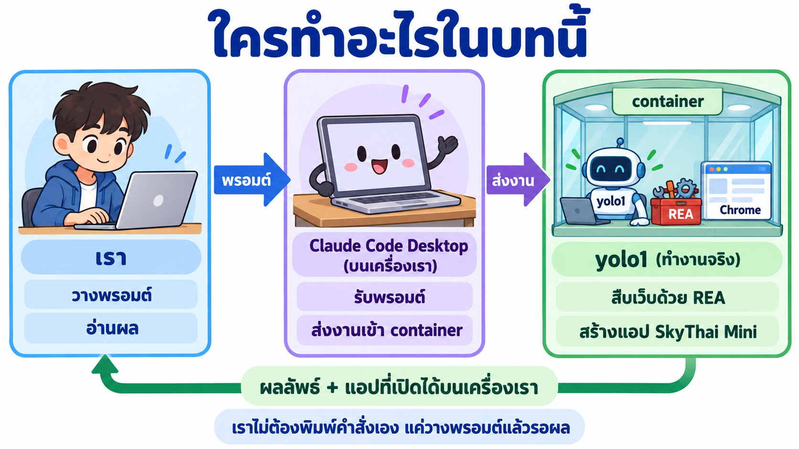
*ภาพ 2 · ใครทำอะไร: เราแค่วางพรอมต์ ที่เหลือ AI ทำ*

| ใคร | อยู่ที่ไหน | หน้าที่ |
|---|---|---|
| **เรา** | หน้าจอเรา | วางพรอมต์ แล้วอ่านผล |
| **Claude Code Desktop** | บนเครื่องเรา | รับพรอมต์ แล้วส่งงานเข้า container |
| **`yolo1`** (AI อีกตัว) | ใน container `multi-account-devtool` | ทำงานจริง: สืบเว็บด้วย REA และสร้างแอป |

> 📚 **ต้องทำ [บทที่ 0 · ทฤษฎี REA + ติดตั้ง](../00_REA_Theory_Setup/README.md) ก่อน** (container พร้อม และติดตั้ง REA แล้ว) · ตรงไหนเขียนว่า "ทฤษฎี: T…" ให้เปิดดูในบทที่ 0

> ⚠️ บทนี้ **ดู Google Flights อย่างเดียว** ไม่คลิก ไม่ล็อกอิน ไม่ลอกโลโก้หรือโค้ด เจอ CAPTCHA ให้หยุด

---

## 🗺️ เส้นทาง LAB

ก่อนลงมือ ดู 3 ภาพนี้ให้เข้าใจภาพรวม: **ไปไหนบ้าง** · **พรอมต์ทำงานยังไง** · **ผลส่งต่อกันยังไง**

### ภาพ 1 · แผนที่การเดินทาง LAB 0 → 5


*เตรียมของ (LAB 0–1 ทำไปแล้วในบทที่ 0) → สืบแบบอ่านอย่างเดียว (LAB 2–4) → สร้างของเรา (LAB 5) · บทนี้ต่อด้วย LAB 6 วัดผล*

| โซน | LAB | ทำอะไร | ได้อะไร | AI ใช้เวลา (รันจริง) |
|---|---|---|---|---|
| ⚙️ เตรียมของ | 0–1 | เตรียม container + ติดตั้ง REA → **อยู่ใน [บทที่ 0](../00_REA_Theory_Setup/README.md)** | ห้องทดลองพร้อม · ทุกบัญชีเห็น REA | — |
| 👁️ สืบ (อ่านอย่างเดียว) | 2 | เปิด Chrome แล้วเชื่อมต่อ | เห็นแท็บ Google Flights | 22 วินาที |
| | 3 | ตรวจหน้าจอ | ข้อมูลเที่ยวบิน 22 ใบ + หน้าจอมีอะไร | 2 นาที 39 วินาที |
| | 4 | วิเคราะห์ JavaScript | เบื้องหลังหน้าเว็บ + แนวทางสร้างเอง | 5 นาที 40 วินาที |
| 🔨 สร้างของเรา | 5 | สร้าง SkyThai Mini | แอปจองตั๋วที่ http://localhost:5081 | 5 นาที 56 วินาที |
| 📏 วัดผล | 6 | วัด SkyThai Mini ด้วยไม้บรรทัด 5 อัน | ตารางผลทดสอบ acceptance · differential · โครงสร้าง · visual diff · เที่ยวบิน | 10 นาที 55 วินาที |

### ภาพ 2 · พรอมต์ 1 อันมี 2 ชั้น


*เราวางทั้งก้อนครั้งเดียว Claude Code แยกส่งให้เอง*

| ชั้น | อยู่ตรงไหนในพรอมต์ | ใครทำ | ตัวอย่าง |
|---|---|---|---|
| **ชั้นนอก** | บนเส้น `---` | Claude Code Desktop (บนเครื่องเรา) | "เปิด Chrome พอร์ต 9222" · "ส่งงานด้านล่างให้ yolo1 ทำ" |
| **ชั้นใน** | ใต้เส้น `---` | `yolo1` ใน container | "ตรวจหน้า Google Flights แบบอ่านอย่างเดียว…" |

💡 เราแค่ **คัดลอกทั้งก้อนแล้ววางครั้งเดียว** ไม่ต้องแยกเอง

### ภาพ 3 · ผลของแต่ละ LAB ส่งต่อเป็นไฟล์


*เหมือนวิ่งผลัด: ไฟล์คือไม้ผลัด LAB ถัดไปอ่านไฟล์ของ LAB ก่อน จึงไม่ต้องเปิด Google ซ้ำ*

| LAB | ส่งไม้ผลัดอะไรต่อ | ใครรับไปใช้ |
|---|---|---|
| 2 | ยืนยันว่าเชื่อมต่อแท็บ Google Flights ได้ | LAB 3 |
| 3 | `flights-snapshot.json` (เที่ยวบิน 22 ใบ) · `ui-evidence.json` (หน้าจอมีอะไร) · `viewport.png` (ภาพหน้าจอ) | LAB 4 และ LAB 5 |
| 4 | `code-analysis.json` (เบื้องหลังหน้าเว็บ + แนวทางสร้างเอง) | LAB 5 |
| 5 | แอป `skythai-mini/` → คัดลอกออกมาเปิดบน Windows | เรา 🎉 |

(ข้างในแต่ละไฟล์มีอะไร ดูหัวข้อ 📦 หลัง LAB 4)

> 🔒 ผลจริงทุกพรอมต์อยู่ใน [`_solution/run/`](_solution/run/) ลองทำเองก่อน แล้วค่อยเปิดเทียบ

---

## LAB 2 · เปิด Chrome พอร์ต 9222 แล้วเชื่อมต่อ (prompt 1)

🎯 เปิด Google Flights ใน Chrome ที่ REA เข้าถึงได้ แล้วทดสอบ **แค่การเชื่อมต่อ** (ทฤษฎี บทที่ 0: T10)

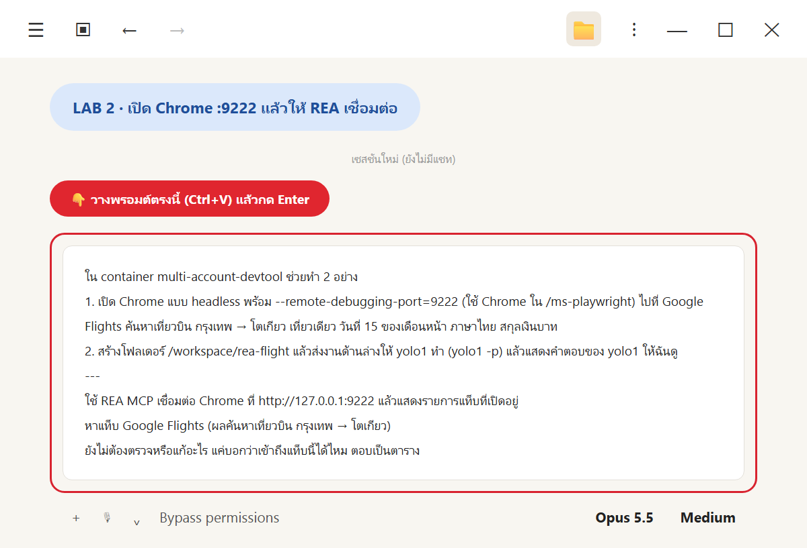
*วางพรอมต์ LAB 2*

💬 **คัดลอกพรอมต์นี้**

```text
ใน container multi-account-devtool ช่วยทำ 2 อย่าง
1. เปิด Chrome แบบ headless พร้อม --remote-debugging-port=9222 (ใช้ Chrome ใน /ms-playwright) ไปที่ Google Flights ค้นหาเที่ยวบิน กรุงเทพ → โตเกียว เที่ยวเดียว วันที่ 15 ของเดือนหน้า ภาษาไทย สกุลเงินบาท
2. สร้างโฟลเดอร์ /workspace/rea-flight แล้วส่งงานด้านล่างให้ yolo1 ทำ (yolo1 -p) แล้วแสดงคำตอบของ yolo1 ให้ฉันดู
---
ใช้ REA MCP เชื่อมต่อ Chrome ที่ http://127.0.0.1:9222 แล้วแสดงรายการแท็บที่เปิดอยู่
หาแท็บ Google Flights (ผลค้นหาเที่ยวบิน กรุงเทพ → โตเกียว)
ยังไม่ต้องตรวจหรือแก้อะไร แค่บอกว่าเข้าถึงแท็บนี้ได้ไหม ตอบเป็นตาราง
```

<details>
<summary>เบื้องหลัง: คำสั่ง Chrome ที่ถูกรันจริงใน container</summary>

```bash
docker exec -d multi-account-devtool \
  /ms-playwright/chromium-1247/chrome-linux64/chrome --headless=new --no-sandbox \
  --remote-debugging-port=9222 --user-data-dir=/tmp/rea-chrome \
  --window-size=1366,1000 --lang=th-TH \
  "https://www.google.com/travel/flights?q=Flights%20from%20Bangkok%20to%20Tokyo%20on%202026-11-15%20one%20way&hl=th&gl=TH&curr=THB"
```

`-d` = รันเบื้องหลัง Chrome จึงเปิดค้างไว้ให้ LAB 3–4 ใช้ต่อ · วันที่ในลิงก์ถูกคำนวณจาก "วันที่ 15 ของเดือนหน้า" (รันวันที่ 31 ต.ค. 2026 → 2026-11-15)

</details>

✅ **ผลจริง** (yolo1 ใช้เวลา **22 วินาที**) เชื่อมต่อ Chrome ผ่าน REA ได้ และเจอแท็บ Google Flights

**เบราว์เซอร์:** HeadlessChrome 155.0.8059.12 (CDP 1.3)

| # | Target ID | ชื่อแท็บ | Origin | เข้าถึงได้ไหม |
|---|---|---|---|---|
| 1 | `A4C056B802BF14B09D2695173957DEE9` | กรุงเทพมหานคร ไปยัง โตเกียว \| Google Flights | `https://www.google.com` | ✅ ได้ |

| รายการ | ค่า |
|---|---|
| เส้นทาง | กรุงเทพ → โตเกียว |
| วันเดินทาง | 15 พ.ย. 2026 (เที่ยวเดียว) |
| ภาษา / ประเทศ / สกุลเงิน | th / TH / THB |

ไฟล์เต็ม: [`_solution/run/out-p1.md`](_solution/run/out-p1.md)

👀 **สังเกต**
- มี `page` **1 แท็บ** + target อื่นอีก **3 ตัว** ที่ไม่ใช่ page (yolo1 ไม่แสดงในตาราง) → ตรงกับ T10
- ค่า "attached" = **ไม่ทราบ** yolo1 บอกตรง ๆ ไม่เดา นี่คือนิสัยที่ดี
- yolo1 **ไม่ได้แตะเนื้อหาหน้าเว็บ** ตามที่สั่ง
- ถ้าได้ผลว่า "เชื่อมต่อไม่ได้" ส่วนใหญ่เพราะ Chrome ยังไม่ได้เปิด หรือปิดไปแล้ว → ให้ Claude Code เช็กด้วย `curl http://127.0.0.1:9222/json/version` **ใน container**
- ถ้าหน้าแสดง CAPTCHA หรือหน้า "ยืนยันว่าไม่ใช่โปรแกรม" **ให้หยุด** ห้ามหลบ (ดูกติกาจริยธรรม)

---

## LAB 3 · ตรวจหน้าจอแบบอ่านอย่างเดียว (prompt 2)

🎯 ให้ REA เก็บโครงสร้างหน้า + เที่ยวบินที่เห็น เป็นไฟล์หลักฐาน (ทฤษฎี บทที่ 0: T5, T11)

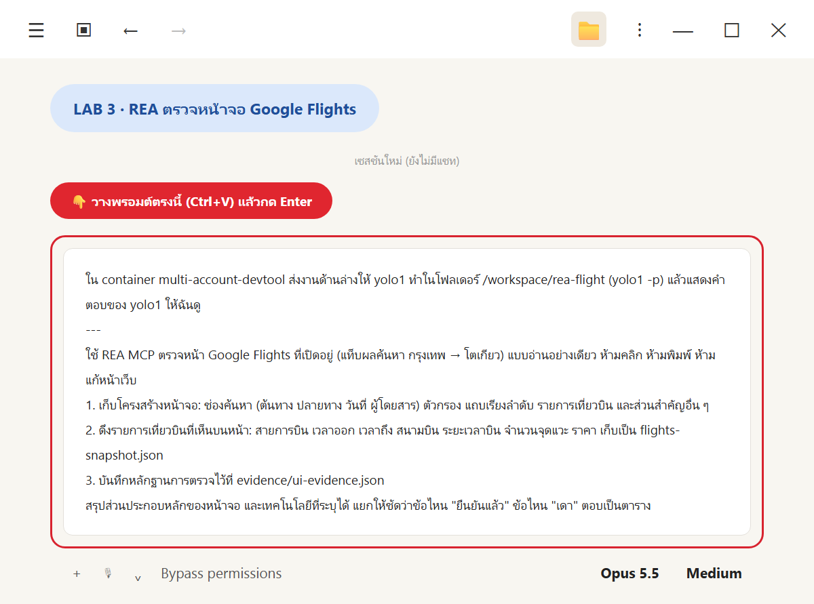
*วางพรอมต์ LAB 3*

💬 **คัดลอกพรอมต์นี้**

```text
ใน container multi-account-devtool ส่งงานด้านล่างให้ yolo1 ทำในโฟลเดอร์ /workspace/rea-flight (yolo1 -p) แล้วแสดงคำตอบของ yolo1 ให้ฉันดู
---
ใช้ REA MCP ตรวจหน้า Google Flights ที่เปิดอยู่ (แท็บผลค้นหา กรุงเทพ → โตเกียว) แบบอ่านอย่างเดียว ห้ามคลิก ห้ามพิมพ์ ห้ามแก้หน้าเว็บ
1. เก็บโครงสร้างหน้าจอ: ช่องค้นหา (ต้นทาง ปลายทาง วันที่ ผู้โดยสาร) ตัวกรอง แถบเรียงลำดับ รายการเที่ยวบิน และส่วนสำคัญอื่น ๆ
2. ดึงรายการเที่ยวบินที่เห็นบนหน้า: สายการบิน เวลาออก เวลาถึง สนามบิน ระยะเวลาบิน จำนวนจุดแวะ ราคา เก็บเป็น flights-snapshot.json
3. บันทึกหลักฐานการตรวจไว้ที่ evidence/ui-evidence.json
สรุปส่วนประกอบหลักของหน้าจอ และเทคโนโลยีที่ระบุได้ แยกให้ชัดว่าข้อไหน "ยืนยันแล้ว" ข้อไหน "เดา" ตอบเป็นตาราง
```

✅ **ผลจริง** (yolo1 ใช้เวลา **2 นาที 39 วินาที**) ใช้ REA 3 tools: `list_browser_targets` → `inspect_web_page` → `capture_web_screenshot` ไม่คลิก ไม่พิมพ์ ไม่เลื่อนหน้า ไม่รัน JavaScript บนหน้า

**ไฟล์ที่ได้**

| ไฟล์ | เนื้อหา |
|---|---|
| `flights-snapshot.json` | เที่ยวบิน **22 ใบ** (ยอดนิยม 3 + อื่น ๆ 19) |
| `evidence/ui-evidence.json` | โครงสร้างหน้า สัญญาณเทคโนโลยี `evidence_id` และ sha256 ของไฟล์ |
| `evidence/viewport.png` | ภาพหน้าจอ 1366×857 |
| `evidence/rea-evidence-bundle.json` | bundle ดิบจาก REA |

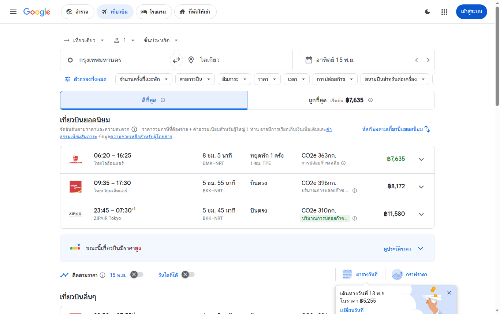
*ภาพจริงจาก `capture_web_screenshot` (เฉพาะส่วนที่เห็นบนจอ 1366×857) · ใช้เพื่อการเรียนเท่านั้น*

**ส่วนประกอบหน้าจอ (ย่อ)**

| ส่วน | ที่พบ | สถานะ |
|---|---|---|
| ตัวเลือกทริป | เที่ยวเดียว · 1 คน · ชั้นประหยัด | ยืนยันแล้ว |
| ช่องค้นหา | ต้นทาง "กรุงเทพมหานคร" → ปลายทาง "โตเกียว" (autocomplete) · ปุ่มสลับ ⇄ · วันที่ "อาทิตย์ 15 พ.ย." | ยืนยันแล้ว |
| ตัวกรอง | ตัวกรองทั้งหมด · จำนวนครั้งที่แวะพัก · สายการบิน · สัมภาระ · ราคา · เวลา · การปล่อยก๊าซ · สนามบินสำหรับต่อเครื่อง · ระยะเวลา (ยังไม่เลือก) | ยืนยันแล้ว |
| แถบเรียงลำดับ | "ดีที่สุด" ถูกเลือก · "ถูกที่สุด" ราคาเริ่มต้น **฿7,635** · ปุ่ม "จัดเรียงตามเที่ยวบินยอดนิยม" | ยืนยันแล้ว |
| รายการเที่ยวบิน | การ์ดมีโลโก้ เวลา สายการบิน ระยะเวลา รหัสสนามบิน จุดแวะ CO2e ราคา · ท้ายมี "ดูเที่ยวบินเพิ่มเติม" | ยืนยันแล้ว |
| สวิตช์ติดตามราคา | accessibility tree บอก "checked" แต่ภาพดูเหมือนปิด | **ไม่สรุป (ข้อมูลขัดกัน)** |
| ป๊อปอัป | "เดินทางวันที่ 13 พ.ย. ในราคา ฿5,255" | ยืนยันแล้ว (เห็นในภาพเท่านั้น) |

**เที่ยวบิน (ย่อ)**

| ข้อ | สายการบิน | เส้นทาง | เวลา | ระยะเวลา | แวะ | ราคา (฿) |
|---|---|---|---|---|---|---|
| 1 | ไทยไลอ้อนแอร์ | DMK→NRT | 06:20–16:25 | 8 ชม. 5 นาที | 1 (TPE) | 7,635 |
| 2 | ไทยเวียดเจ๊ทแอร์ | BKK→NRT | 09:35–17:30 | 5 ชม. 55 นาที | 0 | 8,172 |
| 3 | ZIPAIR Tokyo | BKK→NRT | 23:45–07:30+1 | 5 ชม. 45 นาที | 0 | 11,580 |
| 4–22 | ไทยเวียดเจ๊ท, ไห่หนาน, ฮ่องกงเอ็กซ์เพรส, ไชนาแอร์ไลน์, แอร์เอเชีย, การบินไทย, JAL, ANA | ปลายทาง NRT หรือ HND | — | 5 ชม. 40 นาที ถึง 16 ชม. | 0–1 | 8,802 ถึง 41,760 |

**เทคโนโลยี (ย่อ)**

| ข้อ | สถานะ |
|---|---|
| HeadlessChrome 155 ควบคุมผ่าน CDP | ยืนยันแล้ว |
| frontend ชื่อ "FlightsFrontendUi" (เห็นใน URL `/_/FlightsFrontendUi/flights_manifest.json`) | ยืนยันแล้ว |
| Wiz + Closure (`jsname` 3,169 · `jsaction` 1,501 · `jscontroller` 943) | **เดา** (หลักฐานหนักแน่น แต่ไม่มีชื่อตรง ๆ) |
| Incremental DOM (`data-idom-class`) · Material Design | **เดา** |
| ข้อมูลเริ่มต้นฝังมากับ HTML (script 26 ตัวเป็น inline) | **เดา** (ยังไม่ได้ดึง source) |
| ไม่ใช้ storage ของโดเมนเดียวกัน · ไม่มี worker | ยืนยันแล้ว (เฉพาะช่วงที่สังเกต) |

ไฟล์เต็ม: [`_solution/run/out-p2.md`](_solution/run/out-p2.md) · [`flights-snapshot.json`](_solution/run/flights-snapshot.json) · [`evidence/ui-evidence.json`](_solution/run/evidence/ui-evidence.json)

👀 **สังเกต**
- **รหัส IATA มาจากไหน:** ไม่มีใน accessibility tree (น่าจะถูกซ่อนจาก screen reader) · 3 ใบแรกอ่านจาก **ภาพหน้าจอ** ส่วนที่เหลือ **แปลงจากชื่อสนามบิน** เช่น HND มาจาก "ท่าอากาศยานนานาชาติโตเกียว" → เป็น **การอนุมาน** และในไฟล์มีช่อง `iata_basis` บอกที่มาทุกใบ (`screenshot` หรือ `mapped_from_airport_name`)
- **ไม่มีข้อมูล network** เพราะเริ่มสังเกตหลังหน้าโหลดเสร็จ และ **script จากโดเมนอื่น 22 ตัวถูกกรองออก** ตามนโยบายของ REA (REA จำกัด origin ที่อ่านได้ เพื่อความปลอดภัย)
- เที่ยวบินหลังปุ่ม "ดูเที่ยวบินเพิ่มเติม" **ไม่รวม** เพราะห้ามคลิก → coverage ไม่ครบ ไม่ได้แปลว่าไม่มี
- ข้อ "ข้อมูลขัดกัน" ของสวิตช์ติดตามราคา = ตัวอย่างที่ดีของการ **ไม่เลือกเชื่อข้างเดียว**
- **ภาพหน้าจอค้าง/หมดเวลา:** ในวิดีโอ การถ่าย screenshot หมดเวลาหลัง 20 วินาที (รอบของเราถ่ายได้) ถ้าเจอแบบนั้น งานส่วนอื่นยังใช้ได้ ไม่ต้องรันใหม่ทั้งหมด
- **หน้า Google เปลี่ยนได้ทุกวัน:** ราคา จำนวนเที่ยวบิน และข้อความป๊อปอัปของคุณจะไม่ตรงกับตารางนี้ เป็นเรื่องปกติ เทียบ "โครงสร้าง" ไม่ใช่ตัวเลข

---

## LAB 4 · วิเคราะห์ JavaScript ที่หน้าโหลดมา (prompt 3)

🎯 หาว่าหน้านี้สร้างด้วยอะไร ส่วนไหนทำอะไร ข้อมูล 1 ใบหน้าตาอย่างไร และการเรียงทำงานอย่างไร (ทฤษฎี บทที่ 0: T9, T11, T12)

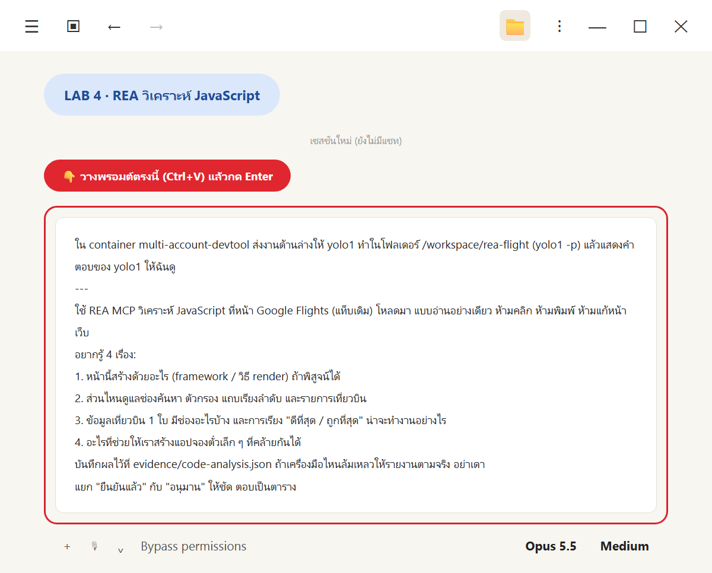
*วางพรอมต์ LAB 4*

💬 **คัดลอกพรอมต์นี้**

```text
ใน container multi-account-devtool ส่งงานด้านล่างให้ yolo1 ทำในโฟลเดอร์ /workspace/rea-flight (yolo1 -p) แล้วแสดงคำตอบของ yolo1 ให้ฉันดู
---
ใช้ REA MCP วิเคราะห์ JavaScript ที่หน้า Google Flights (แท็บเดิม) โหลดมา แบบอ่านอย่างเดียว ห้ามคลิก ห้ามพิมพ์ ห้ามแก้หน้าเว็บ
อยากรู้ 4 เรื่อง:
1. หน้านี้สร้างด้วยอะไร (framework / วิธี render) ถ้าพิสูจน์ได้
2. ส่วนไหนดูแลช่องค้นหา ตัวกรอง แถบเรียงลำดับ และรายการเที่ยวบิน
3. ข้อมูลเที่ยวบิน 1 ใบ มีช่องอะไรบ้าง และการเรียง "ดีที่สุด / ถูกที่สุด" น่าจะทำงานอย่างไร
4. อะไรที่ช่วยให้เราสร้างแอปจองตั๋วเล็ก ๆ ที่คล้ายกันได้
บันทึกผลไว้ที่ evidence/code-analysis.json ถ้าเครื่องมือไหนล้มเหลวให้รายงานตามจริง อย่าเดา
แยก "ยืนยันแล้ว" กับ "อนุมาน" ให้ชัด ตอบเป็นตาราง
```

✅ **ผลจริง** (yolo1 ใช้เวลา **5 นาที 40 วินาที**) ทั้งหมดอ่านอย่างเดียว โค้ดที่ดึงมาถูกอ่านเป็นข้อความ **ไม่ได้รัน**

**1. สร้างด้วยอะไร**

| ข้อสรุป | สถานะ |
|---|---|
| แพลตฟอร์ม Boq ของ Google (`boq-travel.FlightsFrontendUi_desktop_ms.th`) | ยืนยันแล้ว |
| framework **Wiz** ไม่ใช่ React/Angular/Vue | ยืนยันแล้ว |
| Closure Compiler + Closure Templates (Soy) | ยืนยันแล้ว |
| SSR + hydrate · `AF_initDataCallback ds:0–ds:4` · `ds:1` มีเที่ยวบินครบ 22 ใบ | ยืนยันแล้ว |
| `FlightsFrontendService` (GetShoppingResults, GetBookingResults, GetCalendarGraph) + `batchexecute` | ยืนยันแล้วว่า **มีชื่อในโค้ด** (ยังไม่ได้ดูการเรียกจริง) |
| Material components ภายใน (`VfPpkd-*`) | อนุมาน |

**2. โมดูลไหนดูแลส่วนไหน** — แถบเรียง `U5T3Ef` (ยืนยันแล้ว) · ต้นทาง/ปลายทาง `ZGTFnd` (ยืนยันแล้ว) · ที่เหลือ `mqtBPc`, `ebuxPc`, `bzUZHf`, `q0xTif`, `xEh8Cb`, `GsNaRb` (อนุมาน) — รายละเอียดใน T12 ขั้น 5

**3. ข้อมูล 1 ใบ + การเรียง**

| เรื่อง | สถานะ |
|---|---|
| ช่อง: สายการบิน `SL` · `DMK`→`NRT` · 06:20→16:25 · `485` นาที · segment SL 394 Boeing 737 · แวะ TPE 60 นาที · ราคา `7635` | ยืนยันแล้ว |
| CO2 · token สำหรับขั้นจอง · ช่วงราคาตัวกรอง 7,635–194,610 | อนุมาน |
| มี 6 โหมดเรียง | ยืนยันแล้ว |
| 3 ใบบนไม่เรียงตามราคา · 19 ใบที่เหลือเรียงถูก → แพง (8,802 → 41,760) | ยืนยันแล้ว |
| จัดอันดับที่ server · แท็บ "ถูกที่สุด" = เรียงราคาน้อยไปมาก | อนุมาน |
| สูตรถ่วงน้ำหนักของ "ดีที่สุด" | **ไม่ทราบ** |

**4. นำไปสร้างแอปได้อย่างไร** — แยก Itinerary/Segment (ยืนยันแล้ว) · เก็บระยะเวลาเป็นนาที (ยืนยันแล้ว) · API ส่ง best + others และโหมดเรียง 6 แบบ (ยืนยันแล้ว) · สูตร "ดีที่สุด" และการใช้ Next.js/Nuxt (**ออกแบบเอง**) · ใช้เป็นแนวคิดเท่านั้น ข้อมูลจริงใช้ API ที่เปิดให้บริการ (คำแนะนำ)

**เครื่องมือที่ล้มเหลว (รายงานตามจริง)**

| เรื่อง | ผล |
|---|---|
| `analyze_web_bundle` | ทำงานได้ แต่ได้แค่ 26 inline scripts ไม่ระบุ framework · endpoint `menu`, `back` เป็นผลลวง |
| CLI `--allowed-origins` แบบ JSON array | ล้มเหลว `invalid_request` · ใส่ flag ซ้ำทีละ origin จึงสำเร็จ |
| `ugrep` กับไฟล์ JS ที่บีบไว้ | ล้มเหลว "exceeds complexity limits" → เปลี่ยนไปใช้ Python |
| ความครอบคลุม | วิเคราะห์ได้ 28 สคริปต์ · อีก 82 ไม่ได้ตรวจ · ไม่มีโค้ดหน้าจอง |
| ไม่ได้รัน | `analyze_javascript_application`, source map, การวัดว่าโค้ดส่วนไหนรันจริง |

ไฟล์เต็ม: [`_solution/run/out-p3.md`](_solution/run/out-p3.md) · [`evidence/code-analysis.json`](_solution/run/evidence/code-analysis.json)

👀 **สังเกต**
- นี่คือ LAB ที่ **วงถามต่อ (T9)** เกิดขึ้นจริง: tool แรกให้ผลไม่พอ → yolo1 เปลี่ยนวิธีเอง
- **"Wiz" ขยับจาก เดา (LAB 3) → ยืนยันแล้ว (LAB 4)** เพราะมีหลักฐานจาก JS เพิ่ม (T11)
- รายงานความล้มเหลวตรง ๆ ดีกว่าแอบเดา เพราะเรารู้ว่าข้อสรุปไหน "ยังไม่ครบ"
- yolo1 แบ่ง 3 สถานะ: ยืนยันแล้ว / อนุมาน / **ออกแบบเอง** → ช่วยไม่ให้สับสนว่าอะไรเป็นของ Google อะไรเป็นไอเดียของเรา
- yolo1 เก็บไฟล์ดิบไว้ที่ `work/` (เช่น `ds1.json`) และสคริปต์วิเคราะห์ที่ `tools/` ใน `/workspace/rea-flight`
- งานนี้ใช้เวลานานที่สุด ถ้าเกิน ~10 นาทีแล้วยังไม่จบ ดูหัวข้อ "ถ้าเจอปัญหา"

---

## 📦 พักอ่าน: ไฟล์ .json จาก LAB 3–4 ข้างในมีอะไร

LAB 3 (ตรวจหน้าจอ) และ LAB 4 (วิเคราะห์ JavaScript) ได้ไฟล์ `.json` 3 ไฟล์ ไฟล์เหล่านี้คือ **"สมุดจดของนักสืบ"** ที่ LAB 5 เอาไปสร้างแอป โดยไม่ต้องกลับไปเปิด Google อีก

> 💡 **JSON อ่านยังไง (ฉบับ 30 วินาที)**
> - `{ ... }` = กล่องที่มี **ชื่อ: ค่า** หลายคู่ เช่น `"price": 7635`
> - `[ ... ]` = **รายการ** หลายชิ้น เช่น `flights: [ใบที่ 1, ใบที่ 2, …]`
> - กล่องซ้อนกล่องได้ เช่น `"departure": { "time": "06:20", "iata": "DMK" }`
> - เปิดไฟล์ใน VS Code แล้วกดลูกศร ▸ ข้างบรรทัดเพื่อพับ/กาง จะเห็นโครงชัดขึ้น

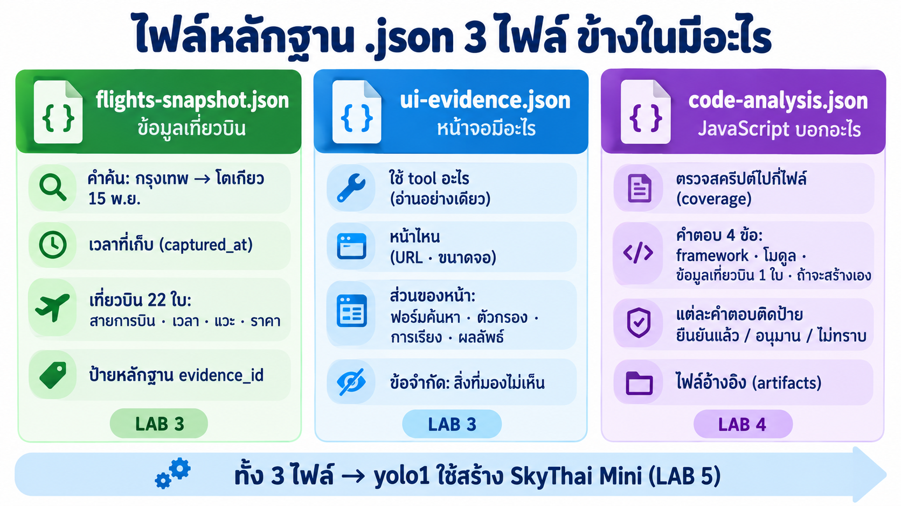
*ภาพรวม: 3 ไฟล์ตอบ 3 คำถาม · เที่ยวบินมีอะไร · หน้าจอมีอะไร · JavaScript บอกอะไร*

| ไฟล์ | ตอบคำถาม | ได้จาก | ขนาด | กลุ่มข้อมูลหลัก (ชั้นบนสุด) |
|---|---|---|---:|---|
| [`flights-snapshot.json`](_solution/run/flights-snapshot.json) | เที่ยวบินมีอะไรบ้าง | LAB 3 | 21 KB | `captured_at` · `page` · `query` · `sort` · `count` · `notes` · `flights` |
| [`evidence/ui-evidence.json`](_solution/run/evidence/ui-evidence.json) | หน้าจอแบ่งเป็นส่วนอะไร | LAB 3 | 8 KB | `method` · `target` · `evidence_records` · `files` · `ui_structure` · `technology_signals` · `limitations` |
| [`evidence/code-analysis.json`](_solution/run/evidence/code-analysis.json) | JavaScript บอกอะไร | LAB 4 | 27 KB | `target` · `method` · `coverage` · `findings` · `artifacts` · `safety` |

ทั้ง 3 ไฟล์มี `schema` บรรทัดแรก (เช่น `rea-flight/flights-snapshot@1`) = ป้ายบอกว่าไฟล์นี้เป็นแบบไหน รุ่นที่เท่าไร

---

### 📄 ไฟล์ 1 · `flights-snapshot.json` (ข้อมูลเที่ยวบิน)


*ไฟล์แบ่ง 2 ส่วน: หัวไฟล์ (เก็บอะไร เมื่อไร) + รายการเที่ยวบิน 22 ใบ*

**ส่วนที่ 1 · หัวไฟล์: บอกว่าเก็บอะไร เมื่อไร**

| ช่อง | ค่าจริง | ใช้ทำอะไร |
|---|---|---|
| `captured_at` | `2026-10-31T15:52:35Z` (= 31 ต.ค. 2569 22:52 น. เวลาไทย) | บอกว่าราคานี้เป็นของ "เวลาไหน" แอปเราจึงติดป้ายข้อมูลจำลองได้ |
| `page` | URL + ชื่อแท็บ "กรุงเทพมหานคร ไปยัง โตเกียว \| Google Flights" | ตรวจย้อนได้ว่าเก็บจากหน้าไหน |
| `query` | กรุงเทพมหานคร → โตเกียว · 2026-11-15 · เที่ยวเดียว · 1 คน · ชั้นประหยัด · THB | เงื่อนไขค้นหา (แอปเราใช้แสดงแถบสรุปการค้นหา) |
| `sort` | แท็บที่เลือก "ดีที่สุด" · แท็บถูกที่สุดเริ่ม ฿7,635 | บอกว่าตอนเก็บ หน้าเรียงแบบไหน |
| `count` | `22` | จำนวนเที่ยวบินในไฟล์ |
| `notes` | 3 ข้อ | ข้อควรรู้ (ดูด้านล่าง) |

`notes` 3 ข้อที่ yolo1 เขียนเตือนไว้เอง
1. ราคาเป็น "ราคาเริ่มต้น" ต่อผู้ใหญ่ 1 คน รวมภาษี ไม่รวมค่าสัมภาระ
2. เก็บจากหน้าที่โหลดอยู่เท่านั้น ไม่เลื่อน ไม่กด "ดูเที่ยวบินเพิ่มเติม" → เที่ยวบินที่ซ่อนอยู่หลังปุ่มไม่รวม
3. รหัส `HND` ได้จาก **การอนุมาน** ชื่อสนามบิน (ในหน้าไม่มีรหัสนี้ตรง ๆ)

**ส่วนที่ 2 · `flights`: รายการ 22 ใบ แต่ละใบหน้าตาเหมือนกัน**

ตัดมาจากไฟล์จริง (ใบที่ 1)

```json
{
  "rank": 1,
  "section": "เที่ยวบินยอดนิยม",
  "airline": "ไทยไลอ้อนแอร์",
  "operated_by": null,
  "departure": { "time": "06:20", "date_text": "วันอาทิตย์, พฤศจิกายน 15",
                 "airport_name": "ท่าอากาศยานดอนเมือง", "iata": "DMK" },
  "arrival":   { "time": "16:25", "next_day": false,
                 "airport_name": "ท่าอากาศยานนานาชาตินะริตะ", "iata": "NRT" },
  "duration": "8 ชม. 5 นาที",
  "stops": 1,
  "layovers": [ { "duration": "1 ชม.", "city": "ไทเป", "iata": "TPE" } ],
  "price": { "amount": 7635, "currency": "THB", "label": "ราคาเริ่มต้น" },
  "source": { "evidence_id": "ev_08ac3be2…" }
}
```

| ช่อง | ความหมาย | สังเกต |
|---|---|---|
| `rank` · `section` | ลำดับบนหน้า · อยู่กลุ่ม "ยอดนิยม" หรือ "อื่นๆ" | ยอดนิยม 3 ใบ · อื่นๆ 19 ใบ |
| `airline` · `operated_by` | สายการบิน · สายการบินที่บินจริง (ถ้าต่างกัน) | 3 ใบบินจริงโดย Air Japan |
| `departure` · `arrival` | เวลา วัน สนามบิน (เวลาท้องถิ่น) | `next_day: true` = ถึงวันถัดไป มี 10 ใบ |
| `duration` | เวลาบินรวม | เก็บแยก ไม่เอาเวลาถึงลบเวลาออก (T12) |
| `stops` · `layovers` | แวะกี่ครั้ง ที่ไหน นานเท่าไร | บินตรง 18 ใบ · แวะ 1 ครั้ง 4 ใบ |
| `price` | ราคา | ฿7,635 – ฿41,760 |
| `source` | **ที่มา**: ข้อมูลใบนี้มาจากการตรวจครั้งไหน | นี่คือ "ใบเสร็จ" ที่ทำให้ข้อมูลตรวจย้อนได้ |

🧪 **LAB 5 ใช้ไฟล์นี้:** คัดลอกไปไว้ใน `data/` ของแอป แล้วใส่ลงตาราง `flights` ใน PostgreSQL ตอนเริ่มระบบ

---

### 📄 ไฟล์ 2 · `ui-evidence.json` (หน้าจอมีอะไร)


*ซ้าย: `ui_structure` แบ่งหน้าเป็น 8 ส่วน · ขวา: ข้อมูลประกอบว่าตรวจยังไง ตรวจอะไร และมองไม่เห็นอะไร*

**หัวใจของไฟล์คือ `ui_structure`: หน้าแบ่งเป็น 8 ส่วน**

| ส่วน | บนหน้าจอคือ | 🧪 ค่าจริงในไฟล์ |
|---|---|---|
| `header` | แถบบนสุด | เมนู · แท็บ สำรวจ/เที่ยวบิน/โรงแรม · ปุ่มเข้าสู่ระบบ (6 รายการ) |
| `search_form` | ฟอร์มค้นหา | 6 ช่อง: ประเภทตั๋ว "เที่ยวเดียว" · ผู้โดยสาร "1 คน" · ชั้น "ชั้นประหยัด" · ต้นทาง · ปลายทาง · วันที่ "อาทิตย์ 15 พ.ย." + ปุ่มสลับ ⇄ |
| `filters` | ตัวกรอง | 9 ปุ่ม: ตัวกรองทั้งหมด · จำนวนครั้งที่แวะพัก · สายการบิน · สัมภาระ · ราคา · เวลา · การปล่อยก๊าซ · สนามบินสำหรับต่อเครื่อง · ระยะเวลา (ทุกตัวยังไม่ได้เลือก) |
| `sort` | แท็บเรียง | "ดีที่สุด" (เลือกอยู่) · "ถูกที่สุด เริ่มต้น ฿7,635" |
| `results` | รายการผล | ยอดนิยม 3 + อื่นๆ 19 · การ์ด 1 ใบมี 9 อย่าง (โลโก้ เวลา สายการบิน ระยะเวลา สนามบิน จุดแวะ CO2 ราคา ปุ่มรายละเอียด) · ปุ่ม "ดูเที่ยวบินเพิ่มเติม" |
| `price_insights` | กล่องข้อมูลราคา | "ขณะนี้เที่ยวบินมีราคาสูง" · ประวัติราคา · ติดตามราคา · ตารางวันที่ · กราฟราคา |
| `popup` | ป๊อปอัปที่เด้งขึ้น | "เดินทางวันที่ 13 พ.ย. ในราคา ฿5,255" (เห็นจากภาพหน้าจอเท่านั้น) |
| `footer` | ท้ายเว็บ | ภาษา·ไทย · สถานที่ตั้ง·ไทย · สกุลเงิน THB และลิงก์อื่นอีก 5 รายการ |

**ส่วนประกอบอื่น**

| กลุ่ม | ตอบว่า | 🧪 ค่าจริง |
|---|---|---|
| `method` | ใช้ tool อะไร แบบไหน | REA โหมด **read-only**: `list_browser_targets` → `inspect_web_page` → `capture_web_screenshot` → `export_evidence_bundle` · ไม่คลิก ไม่พิมพ์ ไม่เลื่อน |
| `target` | ดูหน้าไหน | CDP `127.0.0.1:9222` · HeadlessChrome 155 · จอ 1366×857 |
| `evidence_records` | ใบเสร็จการตรวจ | 3 ใบ (หาแท็บ · ส่องหน้า · ถ่ายภาพ) แต่ละใบมีรหัส `ev_…` |
| `files` | ไฟล์ที่ได้ + "ลายนิ้วมือ" ของไฟล์ | `viewport.png` · `flights-snapshot.json` (ถ้ามีใครแก้ไฟล์ทีหลัง ลายนิ้วมือจะไม่ตรง) |
| `technology_signals` | ร่องรอยเทคโนโลยี | `jscontroller` 943 · `jsaction` 1,501 · `jsname` 3,169 · แท็ก `C-WIZ` 5 · DOM 14,126 โหนด · ปุ่ม 157 (ใช้สรุปว่าเป็น Wiz ใน T11) |
| `limitations` | **มองไม่เห็นอะไร** | 11 ข้อ เช่น ไม่เห็น network ก่อน REA เชื่อมต่อ · ภาพหน้าจอเห็นแค่ส่วนบน 1366×857 · รหัสสนามบินไม่อยู่ในโครงหน้า เห็นจากภาพเฉพาะ 3 การ์ดแรก |

🧪 **LAB 5 ใช้ไฟล์นี้:** เป็นแบบร่างว่าหน้าเว็บควรมีส่วนอะไร (แถบสรุปการค้นหา ปุ่มเรียง ตัวกรองบินตรง รายการเที่ยวบิน)

---

### 📄 ไฟล์ 3 · `code-analysis.json` (JavaScript บอกอะไร)


*อ่านจากบนลงล่าง: ทำอะไรไป → ตรวจครบแค่ไหน → ได้คำตอบอะไร → อ้างอิงไฟล์ไหน*

**ชั้น 1 · `method`: ทำอะไรไปบ้าง (8 ขั้น)**

| # | เครื่องมือ | ผล |
|---|---|---|
| 1 | `list_browser_targets` | ✅ เจอแท็บ |
| 2 | `analyze_web_bundle` | ✅ แต่ได้น้อย (26 สคริปต์ ไม่รู้ framework) |
| 3 | REA CLI `inspect-web-page` | ✅ แต่ 22 สคริปต์ถูกตัดเพราะมาจากโดเมนอื่น |
| 4 | `export_web_scripts` | ✅ ได้ 26 สคริปต์ |
| 5 | REA CLI + อนุญาตโดเมน gstatic | ❌ ส่งค่าผิดรูป → แก้ในขั้นถัดไป |
| 6 | REA CLI `export-web-scripts` | ✅ ได้ 28 สคริปต์ |
| 7 | Python ที่ yolo1 เขียนเอง | ✅ ค้นข้อความ แกะข้อมูล `ds:1` (ไม่รันโค้ดของ Google) |
| 8 | `ugrep` | ❌ ไฟล์บรรทัดยาวเกิน → เปลี่ยนไปใช้ Python |

`not_run` บอกตรง ๆ อีก 3 อย่างที่ **ไม่ได้ทำ** เช่น ไม่ได้ดึง source map · ไม่ได้วัดว่าโค้ดส่วนไหนถูกรันจริง

**ชั้น 2 · `coverage`: ตรวจครบแค่ไหน**
- ตรวจได้ **28 สคริปต์** (จาก `www.gstatic.com`)
- **82 สคริปต์ไม่มี URL บอกที่มา** → ถูกตัดออก ไม่ได้ตรวจ
- โค้ดที่โหลดทีหลัง (เช่นหน้ารายละเอียด/หน้าจอง) ไม่อยู่ในรอบนี้
- → ถ้าไฟล์นี้บอกว่า "ไม่พบ" ให้อ่านว่า "ไม่พบใน 28 สคริปต์ที่ตรวจ" (**หาไม่เจอ ≠ ไม่มี**)

**ชั้น 3 · `findings`: คำตอบ 4 ข้อของ prompt 3** (ทุกข้อมี `status` และ `evidence`)

| ข้อ | ถามว่า | จำนวนข้อสรุป | 🧪 ตัวอย่าง |
|---|---|---|---|
| `q1_framework` | หน้านี้สร้างด้วยอะไร | 7 (🟢 6 · 🟡 1) | 🟢 ใช้ Wiz ไม่ใช่ React/Angular/Vue · 🟢 SSR แล้ว hydrate · 🟡 ปุ่มใช้ Material |
| `q2_modules` | ส่วนไหนของหน้าใครดูแล | 8 (🟢 2 · 🟡 5 · ⚪ 1) | 🟢 แถบเรียง = `U5T3Ef` · 🟢 ช่องต้นทาง/ปลายทาง = `ZGTFnd` · 🟡 ตัวกรอง = `ebuxPc` |
| `q3_flight_record` | ข้อมูลเที่ยวบิน 1 ใบอยู่ตรงไหน | ทั้งทริป 12 ช่อง · แต่ละขา 9 ช่อง · การเรียง 6 ข้อ | หาเจอว่าช่องไหนคือเวลาบิน (485 นาที) ช่องไหนคือราคา (7,635) · สูตร "ดีที่สุด" = ⚪ ไม่ทราบ |
| `q4_build_your_own` | ถ้าจะสร้างเองควรทำยังไง | 9 บทเรียน | แยก Itinerary/Segment · เก็บระยะเวลาเป็นนาที · สูตร "ดีที่สุด" ของเราต้อง **ออกแบบเอง** |

**ชั้น 4 · `artifacts` และ `safety`**
- `artifacts` = ไฟล์ดิบ 5 ไฟล์ที่ใช้อ้างอิง พร้อม "ลายนิ้วมือ" ของแต่ละไฟล์
- `safety` = ถือว่าเนื้อหาจากหน้าเว็บ "ไม่น่าเชื่อถือ" และไม่พบข้อความที่พยายามสั่ง AI (prompt injection)

🧪 **LAB 5 ใช้ไฟล์นี้:** ข้อ `q4_build_your_own` กลายเป็นแนวทางสร้างแอป (data model, การเรียง, ป้ายข้อมูลจำลอง)

---

### 🔗 3 ไฟล์โยงกันยังไง

| โยงด้วย | ตัวอย่าง |
|---|---|
| `evidence_id` | เที่ยวบินทุกใบใน `flights-snapshot.json` มี `ev_08ac3be2…` ซึ่งตรงกับใบเสร็จ "ส่องหน้า" ใน `ui-evidence.json` |
| ลายนิ้วมือไฟล์ | `ui-evidence.json` เก็บลายนิ้วมือของ `flights-snapshot.json` → รู้ได้ทันทีถ้าไฟล์ถูกแก้ทีหลัง |
| รหัสแท็บ | `ui-evidence.json` กับ `code-analysis.json` อ้างแท็บเดียวกัน → ตรวจหน้าเดียวกันแน่นอน |
| ตัวเลขตรงกัน | `code-analysis.json` บอกว่า `ds:1` มี 22 ใบ ตรงกับ `count: 22` ใน `flights-snapshot.json` |

💡 **สรุปที่ควรจำ:** ทุกข้อสรุปมี **ป้ายสถานะ** (ยืนยันแล้ว / อนุมาน / ไม่ทราบ) และ **ที่มา** (`evidence_id` หรือไฟล์อ้างอิง) และทุกไฟล์มีส่วน **ข้อจำกัด / ความครอบคลุม** บอกตรง ๆ ว่าอะไรไม่ได้ตรวจ (หลัก T11)

---

## LAB 5 · สร้าง SkyThai Mini แล้วเปิดดู (prompt 4)

🎯 ให้ yolo1 ใช้หลักฐานทั้งหมดสร้างแอปจองตั๋วจำลองของเราเองด้วย **Next.js (TypeScript) + PostgreSQL** รันด้วย `docker compose` ให้ `cyolo1` สร้างโลโก้และภาพหน้าแรก แล้วเปิดดูบนเครื่องที่ http://localhost:5081 (ทฤษฎี บทที่ 0: T13)

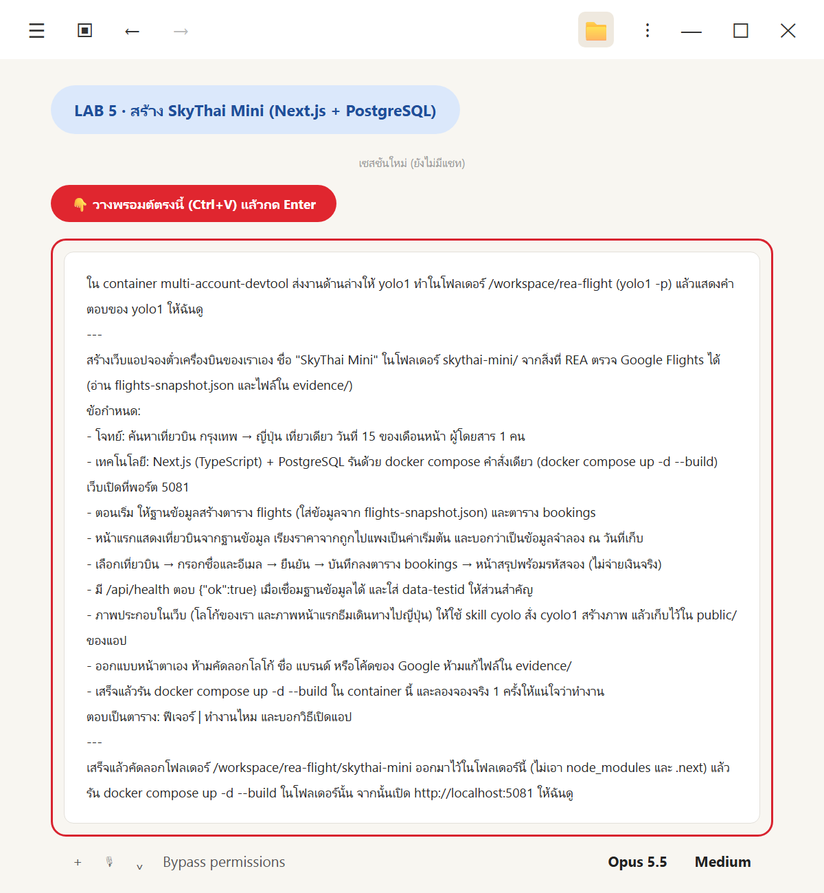
*วางพรอมต์ LAB 5*

💬 **คัดลอกพรอมต์นี้**

```text
ใน container multi-account-devtool ส่งงานด้านล่างให้ yolo1 ทำในโฟลเดอร์ /workspace/rea-flight (yolo1 -p) แล้วแสดงคำตอบของ yolo1 ให้ฉันดู
---
สร้างเว็บแอปจองตั๋วเครื่องบินของเราเอง ชื่อ "SkyThai Mini" ในโฟลเดอร์ skythai-mini/ จากสิ่งที่ REA ตรวจ Google Flights ได้ (อ่าน flights-snapshot.json และไฟล์ใน evidence/)
ข้อกำหนด:
- โจทย์: ค้นหาเที่ยวบิน กรุงเทพ → ญี่ปุ่น เที่ยวเดียว วันที่ 15 ของเดือนหน้า ผู้โดยสาร 1 คน
- เทคโนโลยี: Next.js (TypeScript) + PostgreSQL รันด้วย docker compose คำสั่งเดียว (docker compose up -d --build) เว็บเปิดที่พอร์ต 5081
- ตอนเริ่ม ให้ฐานข้อมูลสร้างตาราง flights (ใส่ข้อมูลจาก flights-snapshot.json) และตาราง bookings
- หน้าแรกแสดงเที่ยวบินจากฐานข้อมูล เรียงราคาจากถูกไปแพงเป็นค่าเริ่มต้น และบอกว่าเป็นข้อมูลจำลอง ณ วันที่เก็บ
- เลือกเที่ยวบิน → กรอกชื่อและอีเมล → ยืนยัน → บันทึกลงตาราง bookings → หน้าสรุปพร้อมรหัสจอง (ไม่จ่ายเงินจริง)
- มี /api/health ตอบ {"ok":true} เมื่อเชื่อมฐานข้อมูลได้ และใส่ data-testid ให้ส่วนสำคัญ
- ภาพประกอบในเว็บ (โลโก้ของเรา และภาพหน้าแรกธีมเดินทางไปญี่ปุ่น) ให้ใช้ skill cyolo สั่ง cyolo1 สร้างภาพ แล้วเก็บไว้ใน public/ ของแอป
- ออกแบบหน้าตาเอง ห้ามคัดลอกโลโก้ ชื่อ แบรนด์ หรือโค้ดของ Google ห้ามแก้ไฟล์ใน evidence/
- เสร็จแล้วรัน docker compose up -d --build ใน container นี้ และลองจองจริง 1 ครั้งให้แน่ใจว่าทำงาน
ตอบเป็นตาราง: ฟีเจอร์ | ทำงานไหม และบอกวิธีเปิดแอป
---
เสร็จแล้วคัดลอกโฟลเดอร์ /workspace/rea-flight/skythai-mini ออกมาไว้ในโฟลเดอร์นี้ (ไม่เอา node_modules และ .next) แล้วรัน docker compose up -d --build ในโฟลเดอร์นั้น จากนั้นเปิด http://localhost:5081 ให้ฉันดู
```

(บรรทัดสุดท้ายเป็นงานของ Claude Code Desktop ไม่ใช่ของ yolo1: คัดลอกออกจาก container ด้วย `docker cp` แล้วรัน `docker compose up -d --build` บน Windows)

✅ **ผลจริง** (yolo1 ใช้เวลา **5 นาที 56 วินาที** · 23:59:30 → 00:05:26) build ผ่าน และลองจองจริงในเบราว์เซอร์ได้ 1 ครั้ง: รหัส **`STM-D95KN3`** (Somchai Jaidee, DMK → NRT, ฿7,635) และเจอแถวนี้ในฐานข้อมูลจริง

**คำตอบของ yolo1 (ย่อจาก `out-p4.md`)**

| ฟีเจอร์ | ทำงานไหม |
|---|---|
| Next.js (TypeScript) + PostgreSQL 16 รันด้วย docker compose คำสั่งเดียว | ✅ build และรันผ่าน (ตอนนั้นใช้พอร์ต 15081 แทน 5081 ชั่วคราว ดู 👀) |
| ฐานข้อมูลสร้างตาราง `flights` (22 เที่ยวบินจาก snapshot) และ `bookings` ตอนเริ่ม | ✅ ตรวจใน psql แล้ว: 22 แถว ราคา ฿7,635–฿41,760 |
| หน้าแรกแสดงเที่ยวบินจาก DB เรียงจากถูกไปแพงเป็นค่าเริ่มต้น | ✅ 7635, 8172, 8802 … 41760 |
| ปุ่มเรียงแบบอื่น (แพงสุด / บินเร็วสุด / ออกเช้าสุด) และตัวกรองบินตรง | ✅ |
| บอกว่าเป็นข้อมูลจำลอง พร้อมวันเวลาที่เก็บ (31 ต.ค. 2569 22:52 น.) | ✅ |
| เลือกเที่ยวบิน → กรอกชื่อและอีเมล → หน้าตรวจสอบ → ยืนยัน | ✅ |
| บันทึกลงตาราง `bookings` และแสดงหน้าสรุปพร้อมรหัสจอง (ไม่จ่ายเงินจริง) | ✅ `STM-D95KN3` และพบแถวนี้ใน DB |
| ตรวจข้อมูลที่ส่งมา (อีเมลผิดรูปแบบ, รหัสจองที่ไม่มีอยู่) | ✅ อีเมลผิดได้ 400 · รหัสที่ไม่มีได้ 404 |
| `/api/health` ตอบ `{"ok":true}` | ✅ |
| `data-testid` ในส่วนสำคัญ | ✅ เช่น `flight-card`, `flight-price`, `select-flight`, `input-name`, `input-email`, `confirm-booking`, `booking-code`, `mock-data-notice` |
| โลโก้และภาพหน้าแรกธีมญี่ปุ่นจาก cyolo1 | ✅ `public/logo.png` และ `public/hero.png` เป็นงานออกแบบของเราเอง ไม่ใช้โลโก้หรือแบรนด์ของ Google |
| ไม่แก้ไฟล์ใน `evidence/` | ✅ คัดลอก snapshot ไปไว้ที่ `skythai-mini/data/` แล้วใช้ไฟล์นั้น |

**โครงสร้างโปรเจกต์ที่ได้** (`skythai-mini/`)

| ไฟล์ / โฟลเดอร์ | หน้าที่ |
|---|---|
| `Dockerfile` · `docker-compose.yml` | 2 service: `web` (Next.js พอร์ต 5081) + `db` (`postgres:16-alpine`) |
| `db/` | SQL ตอนเริ่ม: สร้างตาราง `flights` + `bookings` และใส่ข้อมูล 22 เที่ยวบิน |
| `data/` | สำเนา `flights-snapshot.json` |
| `scripts/` | สคริปต์สร้างไฟล์ seed SQL จาก snapshot |
| `src/app/` | `page.tsx` (หน้าแรก) · `book/[id]` (กรอกข้อมูล) · `booking/[code]` (สรุปการจอง) · `api/bookings` · `api/health` |
| `src/components/` · `src/lib/` | ชิ้นส่วนหน้าเว็บ (ฟอร์มจอง สรุปเที่ยวบิน) · ต่อฐานข้อมูลและจัดรูปแบบตัวเลข |
| `public/` | `logo.png` · `hero.png` (สร้างโดย `cyolo1`) |

บน Windows (Docker Desktop) `docker compose up -d --build` ในโฟลเดอร์ `skythai-mini/` ใช้เวลา **56 วินาที** แล้วเปิด http://localhost:5081 ได้

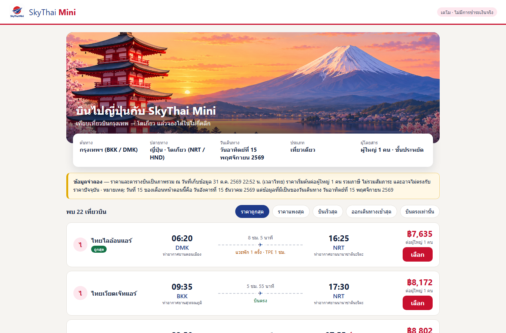
*หน้าแรกจริงที่ http://localhost:5081 · ภาพแบนเนอร์และโลโก้สร้างโดย cyolo1 · ใบแรกคือไทยไลอ้อนแอร์ ฿7,635 · ป้ายข้อมูลจำลองพูดถึง 15 ธ.ค. เพราะถ่ายภาพวันที่ 1 พ.ย. ("เดือนหน้า" = ธ.ค.) ส่วนราคาเป็นของเที่ยวบิน 15 พ.ย. ตาม snapshot (ดู 👀 เรื่องวันที่ ด้านล่าง)*

**ตัวอย่างการทำงานจริง** (บันทึกด้วย Playwright จากแอปใน `_solution/skythai-mini/`)

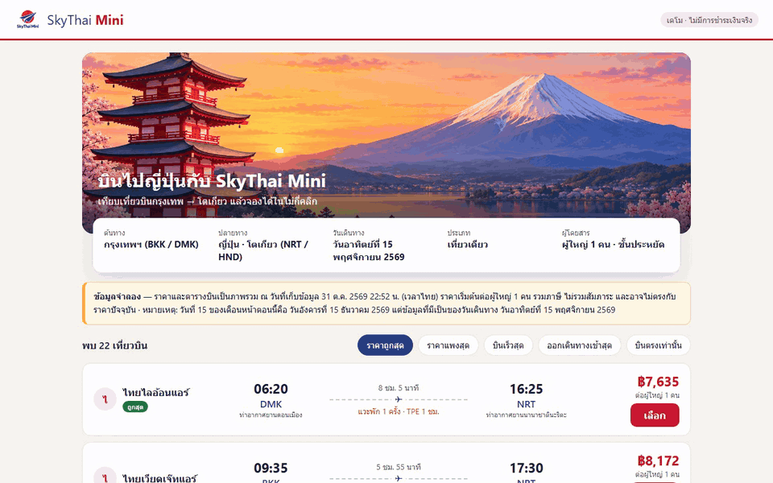
*C1 · หน้าแรกเรียงราคาถูก → แพง (ค่าเริ่มต้น)*


*C4 · จองสำเร็จ ได้รหัสจอง และรีโหลดแล้วข้อมูลยังอยู่ (มาจาก PostgreSQL)*

🎬 ดูทุก use case ต่อกันใน [`_solution/e2e/media/playlist.mp4`](_solution/e2e/media/playlist.mp4)

**ผล playlist จริง (Playwright · ผ่าน 5/5)**

| เคส | ตรวจอะไร | ผล |
|---|---|---|
| C1 | หน้าแรกเรียงถูก → แพง | ✅ 22 เที่ยวบิน ใบแรก ฿7,635 และมีป้ายข้อมูลจำลอง |
| C2 | เปลี่ยนการเรียง + ตัวกรองบินตรง | ✅ เรียงแพง → ถูก และบินเร็วสุดได้ · "บินตรงเท่านั้น" เหลือ 18 เที่ยวบิน |
| C3 | ฟอร์มตรวจข้อมูล | ✅ ฟอร์มว่างขึ้น "กรุณากรอกชื่อ-นามสกุล" · อีเมลผิดขึ้น "รูปแบบอีเมลไม่ถูกต้อง" และยังอยู่หน้าฟอร์ม |
| C4 | จองสำเร็จ + บันทึกลงฐานข้อมูล | ✅ ได้รหัส `STM-F5NP9B` ราคา ฿7,635 · รีโหลดหน้าใบจองแล้วข้อมูลยังอยู่ |
| C5 | `/api/health` + หน้า 404 | ✅ health ตอบ 200 `{"ok":true}` · รหัสจองที่ไม่มีได้หน้า 404 |

(สื่อแต่ละเคส: `_solution/e2e/media/C1.gif` … `C5.gif` และ `.mp4`)

ไฟล์เต็ม: [`_solution/run/out-p4.md`](_solution/run/out-p4.md) · โค้ดแอป [`_solution/skythai-mini/`](_solution/skythai-mini/)

👀 **สังเกต**
- **ค่าเริ่มต้นต่างจาก Google โดยตั้งใจ:** Google ใช้ "ดีที่สุด" แต่โจทย์เราให้เรียงราคา → ZIPAIR ฿11,580 ที่ Google ดันขึ้น 3 ใบบน ในแอปเราจะอยู่อันดับ 7 (T12)
- yolo1 **ยืมแนวคิด** 3 อย่าง: ระยะเวลาเป็นนาที · ตัวเลือกการเรียงจากโหมดเรียงที่พบ · ตัวกรองบินตรงจากแถบตัวกรองบนหน้า (T13)
- **ข้อมูลอยู่ในฐานข้อมูลจริง:** การจองถูกบันทึกในตาราง `bookings` ของ PostgreSQL จึงรีโหลดหน้าใบจองแล้วยังเห็น (C4)
- **ถ้าพอร์ตชน ให้ดูว่าใครใช้พอร์ตอยู่ (`ss -ltnp`) ก่อนเปลี่ยน:** รอบของเรา พอร์ต 5081 ใน container มี `python3 -m http.server` ค้างอยู่จากงานก่อนหน้าที่ถูกยกเลิก yolo1 จึงใช้พอร์ต 15081 ชั่วคราวและรายงานตรง ๆ (ไม่ปิด process ที่ตัวเองไม่ได้เปิด) · หลังปิดตัวที่ค้างแล้ว แอปรันที่ 5081 ตามโจทย์
- **เรื่องวันที่:** แอปคำนวณ "วันที่ 15 ของเดือนหน้า" · วันที่ 1 พ.ย. 2569 จะได้ 15 ธ.ค. 2569 แต่ snapshot เป็นราคาของวันที่ 15 พ.ย. 2569 แอปจึงแสดงวันที่ตาม snapshot พร้อมหมายเหตุอธิบายความต่าง **ไม่แต่งข้อมูลขึ้นเอง** (ถ้าอยากได้ราคาวันใหม่ ต้องให้ REA เก็บข้อมูลใหม่)
- `data-testid` ที่ใส่ไว้ คือสิ่งที่บทถัดไปจะใช้เขียนเทสต์อัตโนมัติ

---

## LAB 6 · วัด SkyThai Mini ด้วยไม้บรรทัด 5 อัน (prompt 5)

🎯 แอปทำงานได้แล้ว (LAB 5) แต่ **เหมือน Google Flights แค่ไหน?** LAB นี้วัด v1 ด้วย "ไม้บรรทัด" 5 อัน ชุดเดียวกับที่บทที่ 3–4 ใช้วัดทุกเวอร์ชัน ผลจึงเทียบกันได้ตรง ๆ


*ไม้บรรทัด 5 อัน กับคะแนนจริงของ v1 · แต่ละอันวัดอะไรอ่านละเอียดในหัวข้อ 📊 ด้านล่าง*

| ขั้น | ทำอะไร |
|---|---|
| 6.1 | วางพรอมต์ |
| 6.2 | อ่านผลจริง 5 ตัวเลข |
| 6.3 | 🧮 ดูว่า visual diff 27.61% คำนวณยังไง: ทฤษฎีแปลงสี RGB → YIQ แล้วคำนวณทีละขั้น (ภาพ + สมการ) |
| 6.4 | 👀 สังเกตสิ่งที่ได้เรียนรู้ |

### 6.1 · วางพรอมต์

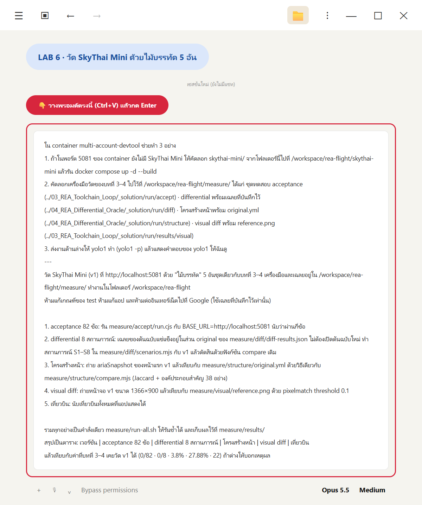
*วางพรอมต์ LAB 6*

💬 **คัดลอกพรอมต์นี้**

```text
ใน container multi-account-devtool ช่วยทำ 3 อย่าง
1. ถ้าในพอร์ต 5081 ของ container ยังไม่มี SkyThai Mini ให้คัดลอก skythai-mini/ จากโฟลเดอร์นี้ไปที่ /workspace/rea-flight/skythai-mini แล้วรัน docker compose up -d --build
2. คัดลอกเครื่องมือวัดของบทที่ 3–4 ไปไว้ที่ /workspace/rea-flight/measure/ ได้แก่ ชุดทดสอบ acceptance (../03_REA_Toolchain_Loop/_solution/run/accept) · differential พร้อมเฉลยที่บันทึกไว้ (../04_REA_Differential_Oracle/_solution/run/diff) · โครงสร้างหน้าพร้อม original.yml (../04_REA_Differential_Oracle/_solution/run/structure) · visual diff พร้อม reference.png (../03_REA_Toolchain_Loop/_solution/run/results/visual)
3. ส่งงานด้านล่างให้ yolo1 ทำ (yolo1 -p) แล้วแสดงคำตอบของ yolo1 ให้ฉันดู
---
วัด SkyThai Mini (v1) ที่ http://localhost:5081 ด้วย "ไม้บรรทัด" 5 อันชุดเดียวกับบทที่ 3–4 เครื่องมือและเฉลยอยู่ใน /workspace/rea-flight/measure/ ทำงานในโฟลเดอร์ /workspace/rea-flight
ห้ามแก้เกณฑ์ของ test ห้ามแก้แอป และห้ามต่ออินเทอร์เน็ตไปที่ Google (ใช้เฉลยที่บันทึกไว้เท่านั้น)

1. acceptance 82 ข้อ: รัน measure/accept/run.cjs กับ BASE_URL=http://localhost:5081 นับว่าผ่านกี่ข้อ
2. differential 8 สถานการณ์: เฉลยของต้นฉบับแช่แข็งอยู่ในส่วน original ของ measure/diff/diff-results.json ไม่ต้องเปิดต้นฉบับใหม่ ทำสถานการณ์ S1–S8 ใน measure/diff/scenarios.mjs กับ v1 แล้วตัดสินด้วยฟังก์ชัน compare เดิม
3. โครงสร้างหน้า: ถ่าย ariaSnapshot ของหน้าแรก v1 แล้วเทียบกับ measure/structure/original.yml ด้วยวิธีเดียวกับ measure/structure/compare.mjs (Jaccard + องค์ประกอบสำคัญ 38 อย่าง)
4. visual diff: ถ่ายหน้าจอ v1 ขนาด 1366×900 แล้วเทียบกับ measure/visual/reference.png ด้วย pixelmatch threshold 0.1
5. เที่ยวบิน: นับเที่ยวบินทั้งหมดที่แอปแสดงได้

รวมทุกอย่างเป็นคำสั่งเดียว measure/run-all.sh ให้รันซ้ำได้ และเก็บผลไว้ที่ measure/results/
สรุปเป็นตาราง: เวอร์ชัน | acceptance 82 ข้อ | differential 8 สถานการณ์ | โครงสร้างหน้า | visual diff | เที่ยวบิน
แล้วเทียบกับค่าที่บทที่ 3–4 เคยวัด v1 ได้ (0/82 · 0/8 · 3.8% · 27.88% · 22) ถ้าต่างให้บอกเหตุผล
```

💡 พรอมต์นี้ทำ 3 อย่าง: ① เปิดแอปใน container ② คัดลอกเครื่องมือวัดของบทที่ 3–4 มาใช้ ③ ให้ yolo1 วัดครบ 5 อันแล้วสรุปเป็นตาราง · **ไม่ต่ออินเทอร์เน็ตไป Google เลย** เพราะใช้ "เฉลย" ที่บทที่ 4 บันทึกไว้ และห้ามแก้เกณฑ์ของ test

### 6.2 · ผลจริง

⏱️ ชั้นนอกเตรียมแอป + เครื่องมือ ~1 นาที 30 วินาที · yolo1 วัด **10 นาที 55 วินาที**

| เวอร์ชัน | acceptance 82 ข้อ (กรรมการ cyolo1) | differential 8 สถานการณ์ (เทียบต้นฉบับแช่แข็ง) | โครงสร้างหน้า (ariaSnapshot) | visual diff (ต่ำ = ใกล้) | เที่ยวบิน |
|---|---:|---:|---:|---:|---:|
| **v1 (LAB 6 รอบนี้ · 1 พ.ย. 2569)** | **0/82** | **0/8** | **3.8%** | **27.61%** | **22** |
| v1 (วัดในบทที่ 3–4 · 31 ต.ค. 2569) | 0/82 | 0/8 | 3.8% | 27.88% | 22 |
| ตรงกันไหม | ✅ | ✅ | ✅ | ⚠️ ต่าง 0.27 จุด | ✅ |

**แต่ละตัวเลขแปลว่าอะไร**

| ไม้บรรทัด | ได้ | ทำไมได้เท่านี้ (yolo1 รายงาน) |
|---|---:|---|
| ① acceptance | 0/82 | ทุกข้อต้องเริ่มจากฟอร์มค้นหา แต่ v1 ไม่มี จึงตกตั้งแต่ขั้นแรก |
| ② differential | 0/8 | S1 · S2 · S4 ได้ผลไม่ตรงกับต้นฉบับ · S3 · S5–S8 ไม่มีฟีเจอร์ (ไม่มีปุ่มดูเพิ่ม ตัวกรอง หรือปุ่มรายละเอียด) |
| ③ โครงสร้างหน้า | 3.8% | (Jaccard 5.0% + ชิ้นสำคัญ 1/38) ÷ 2 · มีแค่รายการเที่ยวบิน |
| ④ visual diff | 27.61% | พิกเซลต่าง 339,448 จาก 1,229,400 (อธิบายละเอียดใน 6.3) |
| ⑤ เที่ยวบิน | 22 | ไล่ดูทุกมุมมองที่กดได้ เจอ 22 ใบไม่ซ้ำ (REA เห็นแค่หน้าแรก) |

### 6.3 · 🧮 visual diff 27.61% คำนวณยังไง

ค่าที่ใช้ในรอบนี้ (จาก [`visual.json`](_solution/measure/results/visual.json)): ภาพกว้าง $W = 1366$ สูง $H = 900$ · threshold $t = 0.1$ · ไม่นับขอบเบลอของตัวอักษร (`includeAA: false`)

#### ภาพรวม: เกม "จับผิดภาพ" ที่ให้คอมพิวเตอร์นับ


*ถ่าย 2 ภาพ → เทียบทีละจุด → ระบายจุดที่ต่าง → นับแล้วหาร*

ขั้น 2 คือหัวใจ: **"จุดสองจุดนี้สีต่างกันพอจะนับไหม"** ดูทีละขั้นด้านล่าง

#### 📘 ทฤษฎีก่อนคำนวณ: แปลงสี RGB เป็น YIQ

ก่อนดูว่าพิกเซล "ต่าง" ไหม ต้องเข้าใจก่อนว่า pixelmatch **ไม่ได้เทียบสีแบบที่จอเก็บ (RGB)** แต่แปลงเป็นระบบสี **YIQ** ที่ใกล้กับที่ตาคนรับรู้

##### ① RGB กับ YIQ ต่างกันยังไง

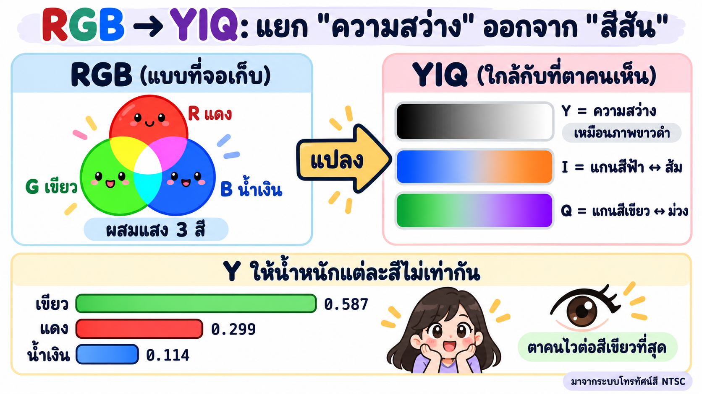
*RGB = สูตรผสมแสงของจอ · YIQ = แยก "ความสว่าง" ออกจาก "สีสัน" แบบที่ตาคนรับรู้*

| ระบบสี | ตัวเลข 3 ตัวคืออะไร | เปรียบเหมือน |
|---|---|---|
| **RGB** | ปริมาณแสง แดง · เขียว · น้ำเงิน (ค่าละ 0–255) ที่จอต้องเปิด | สูตรผสมสีของจอ |
| **YIQ** | $Y$ ความสว่าง · $I$ แกนฟ้า ↔ ส้ม · $Q$ แกนเขียว ↔ ม่วง | สิ่งที่ตาคนรู้สึก |

**ที่มา:** YIQ คิดขึ้นสำหรับ **โทรทัศน์สีระบบ NTSC** ทีวีขาวดำรุ่นเก่ารับแค่ $Y$ (ความสว่าง) ไปแสดงเป็นภาพขาวดำได้ ส่วนทีวีสีรับ $I$ กับ $Q$ เพิ่มเพื่อเติมสี

##### ② แปลงยังไง: คูณด้วยสูตร 3 บรรทัด (เมทริกซ์)


*แต่ละแถวของเมทริกซ์ตอบคำถาม 1 ข้อ: สว่างแค่ไหน · ไปทางส้มหรือฟ้า · ไปทางม่วงหรือเขียว*

$$
\begin{bmatrix} Y \\ I \\ Q \end{bmatrix}
\approx
\begin{bmatrix}
0.299 & 0.587 & 0.114 \\
0.596 & -0.274 & -0.322 \\
0.211 & -0.523 & 0.312
\end{bmatrix}
\begin{bmatrix} R \\ G \\ B \end{bmatrix}
$$

(pixelmatch ใช้ค่าละเอียดกว่านี้ เช่น $0.29889531$ แทน $0.299$ ผลต่างกันแค่ทศนิยมตำแหน่งท้าย ๆ)

**อ่านเมทริกซ์ทีละแถว**

| แถว | คำนวณ | ผลรวมสัมประสิทธิ์ | ความหมาย |
|---|---|---:|---|
| $Y$ | $0.299R + 0.587G + 0.114B$ | $1$ | ค่าเฉลี่ยถ่วงน้ำหนัก = **ความสว่าง** · เขียวหนักสุดเพราะตาไวต่อเขียวที่สุด |
| $I$ | $0.596R - 0.274G - 0.322B$ | $0$ | แดงมาก → **บวก (ฝั่งส้ม)** · น้ำเงิน/เขียวมาก → **ลบ (ฝั่งฟ้า)** |
| $Q$ | $0.211R - 0.523G + 0.312B$ | $0$ | แดง/น้ำเงินมาก → **บวก (ฝั่งม่วง)** · เขียวมาก → **ลบ (ฝั่งเขียว)** |

🧪 **คำนวณด้วยมือ 1 สี: ส้ม $(R, G, B) = (255, 128, 0)$**

$$
\begin{aligned}
Y &= 0.299(255) + 0.587(128) + 0.114(0) = 76.245 + 75.136 + 0 = 151.381 \\
I &= 0.596(255) - 0.274(128) - 0.322(0) = 151.980 - 35.072 - 0 = 116.908 \\
Q &= 0.211(255) - 0.523(128) + 0.312(0) = 53.805 - 66.944 + 0 = -13.139
\end{aligned}
$$

→ สว่างกลาง ๆ ($Y \approx 151$) · $I$ บวกมาก = **ฝั่งส้ม** ✅ · $Q$ ใกล้ 0 = ไม่ค่อยม่วงไม่ค่อยเขียว (ค่าแบบละเอียดของ pixelmatch คือ $151.31,\ 116.88,\ -12.97$)

**ทำไมสีเทาทุกเฉดได้ $I = Q = 0$:** สีเทามี $R = G = B = k$ แทนลงแถว $I$ จะได้

$$I = 0.596k - 0.274k - 0.322k = (0.596 - 0.274 - 0.322)\,k = 0 \cdot k = 0$$

แถว $Q$ ก็เหมือนกัน ($0.211 - 0.523 + 0.312 = 0$) → สีเทา ขาว ดำ **ไม่มีสีสัน** มีแต่ความสว่าง $Y = k$

##### ③ ลองแปลงสีจริง 6 สี


*$Y$ บอกว่าสว่างแค่ไหน · $I$ กับ $Q$ บอกว่าเป็นสีอะไร (ค่าละเอียดแบบ pixelmatch)*

| สี | $(R, G, B)$ | $Y$ | $I$ | $Q$ | อ่านว่า |
|---|---|---:|---:|---:|---|
| ขาว | (255, 255, 255) | 255 | 0 | 0 | สว่างสุด ไม่มีสี |
| เทา | (128, 128, 128) | 128 | 0 | 0 | สว่างครึ่งเดียว ไม่มีสี |
| ส้ม | (255, 128, 0) | 151.31 | **116.88** | −12.97 | $I$ บวก = ฝั่งส้ม |
| ฟ้า (ปุ่มของเรา) | (26, 115, 232) | 101.79 | **−90.69** | 17.58 | $I$ ลบ = ฝั่งฟ้า |
| ม่วง | (128, 0, 255) | 67.45 | −5.77 | **106.41** | $Q$ บวก = ฝั่งม่วง |
| เขียว | (0, 255, 0) | 149.59 | −69.91 | **−133.27** | $Q$ ลบ = ฝั่งเขียว |

สังเกต: เขียวล้วน ($Y = 149.59$) สว่างกว่าน้ำเงินล้วน ($Y = 29.19$) ถึง 5 เท่า ทั้งที่ RGB "เต็ม 255" เท่ากัน ตรงกับที่ตาเห็นจริง

##### ④ ดูของจริง: แยกภาพ SkyThai Mini ออกเป็น Y · I · Q

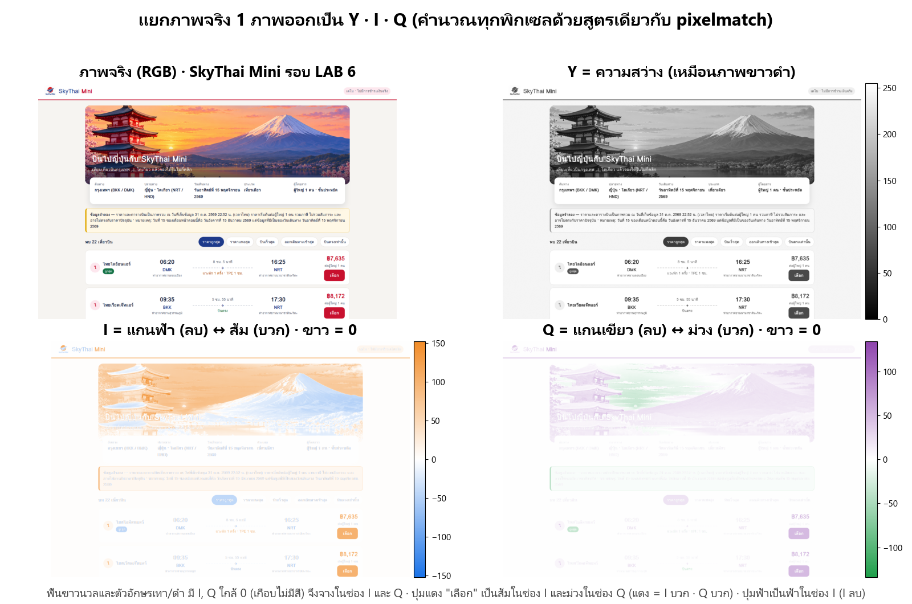
*คำนวณจริงทุกพิกเซลของภาพ v1 ด้วยสูตรเดียวกับ pixelmatch (วาดด้วย Python ไม่ใช่ภาพจำลอง)*

- ช่อง $Y$ = ภาพขาวดำของหน้าเว็บ (ทีวีขาวดำจะเห็นแบบนี้)
- ช่อง $I$: ปุ่มแดง "เลือก" และท้องฟ้ายามเย็นในแบนเนอร์เป็น **ส้ม** ($I$ บวก) · ภูเขาสีฟ้าและปุ่มสีน้ำเงิน "ราคาถูกสุด" เป็น **ฟ้า** ($I$ ลบ)
- ช่อง $Q$: ปุ่มแดงเป็น **ม่วง** ($Q$ บวก) · ท้องฟ้าสีเหลืองทองในแบนเนอร์ (เฉลี่ย RGB $(236, 192, 76)$) เป็น **เขียว** ($Q$ ลบ) เพราะสีเหลืองมีเขียวผสมมาก
- พื้นขาวนวลและตัวอักษรเทา/ดำ มี $I$, $Q$ ใกล้ 0 จึงจางหายไป ในภาพนี้ **33.6% ของพิกเซล** แทบไม่มีสีเลย ($|I|, |Q| < 0.5$)

##### ⑤ ผลต่อการเทียบเฉดสี: ต่างเท่ากันใน RGB แต่ตาเห็นไม่เท่ากัน


*เปลี่ยนทีละช่อง 40 ระดับเท่ากัน · เปลี่ยนเขียวถูกนับว่าต่าง แต่เปลี่ยนแดงหรือน้ำเงินไม่ถูกนับ (ใช้ $\delta$ และเกณฑ์ 352.15 จากขั้น 3–4 ด้านล่าง)*

| เปลี่ยนช่องไหน | $(\Delta R, \Delta G, \Delta B)$ | $Y$ | $I$ | $Q$ | $\delta$ | เกิน 352.15? |
|---|---|---:|---:|---:|---:|---|
| เขียว | (0, 40, 0) | 23.46 | −10.97 | −20.90 | **399.70** | ✅ นับว่าต่าง |
| แดง | (40, 0, 0) | 11.96 | 23.84 | 8.46 | 256.15 | ❌ ไม่นับ |
| น้ำเงิน | (0, 0, 40) | 4.58 | −12.87 | 12.45 | 90.45 | ❌ ไม่นับ |

ถ้าลบ RGB ตรง ๆ ทั้ง 3 แบบจะ "ต่าง 40 เท่ากัน" แต่ตาคนเห็นสีเขียวเปลี่ยนชัดที่สุด สูตร YIQ จึงทำให้ visual diff **นับเฉพาะความต่างที่คนมองเห็นได้จริง**

💡 **เคล็ดลับที่ pixelmatch ใช้:** สูตรแปลงเป็นแบบเส้นตรง (คูณแล้วบวก) จึงแปลง **ผลต่าง** ได้เลย ไม่ต้องแปลงทีละภาพ

$$Y(\text{สี}_1) - Y(\text{สี}_2) = Y(\text{สี}_1 - \text{สี}_2) = Y(\Delta R, \Delta G, \Delta B)$$

ขั้น 1–2 ด้านล่างจึงหา $\Delta R, \Delta G, \Delta B$ ก่อน แล้วค่อยแปลงเป็น $Y, I, Q$

#### ขั้น 1–3 · คำนวณ "ระยะห่างของสี" $\delta$ ของ 1 พิกเซล

**ขั้น 1 · หาผลต่างของสีแต่ละช่อง** ภาพ Google (ภาพ 1) กับภาพ v1 (ภาพ 2) ที่ตำแหน่ง $(x, y)$ เดียวกัน มีสี $(R_1, G_1, B_1)$ และ $(R_2, G_2, B_2)$ ค่าละ 0–255

$$\Delta R = R_1 - R_2, \qquad \Delta G = G_1 - G_2, \qquad \Delta B = B_1 - B_2$$

**ขั้น 2 · แปลงผลต่างเป็น "ความสว่าง" กับ "สีสัน"** ($Y$ = ความสว่าง · $I$, $Q$ = สีสัน · ทำไมต้องแปลงอ่านใน 📘 ทฤษฎีด้านบน)

$$
\begin{aligned}
Y &= 0.29889531\,\Delta R + 0.58662247\,\Delta G + 0.11448223\,\Delta B \\
I &= 0.59597799\,\Delta R - 0.27417610\,\Delta G - 0.32180189\,\Delta B \\
Q &= 0.21147017\,\Delta R - 0.52261711\,\Delta G + 0.31114694\,\Delta B
\end{aligned}
$$

**ขั้น 3 · รวม $Y, I, Q$ เป็นตัวเลขเดียว เรียกว่า $\delta$ (เดลต้า) = ระยะห่างของสี**


*$\delta$ = ตัวเลขเดียวที่บอกว่าสี 2 จุดห่างกันแค่ไหน · ยิ่งมาก ยิ่งต่าง*

$$\delta = 0.5053\,Y^2 + 0.299\,I^2 + 0.1957\,Q^2$$

| ส่วนของสูตร | ทำไมเป็นแบบนี้ |
|---|---|
| **ยกกำลังสอง** $Y^2, I^2, Q^2$ | ① ค่าลบกลายเป็นบวก (ต่างไปทางไหนก็นับเป็น "ต่าง") ② ต่างมากโตเร็ว: ต่าง 2 เท่า → $\delta$ โต 4 เท่า |
| **น้ำหนัก** $0.5053 > 0.299 > 0.1957$ | ตาไวต่อ **ความสว่าง** ที่สุด จึงให้ $Y$ หนักสุด · สีสัน $I$, $Q$ รองลงมา |
| **บวกกัน** | รวม 3 ส่วนเป็นตัวเลขเดียว เอาไปเทียบกับเส้นเกณฑ์ในขั้น 4 |

คำนวณ $\delta$ ได้ใน **4 ขั้นย่อย**: ① ได้ค่า $Y, I, Q$ → ② ยกกำลังสอง → ③ คูณน้ำหนัก → ④ บวกรวม

##### 🧪 กรณี A · พื้นขาวของ Google $(255, 255, 255)$ เทียบปุ่มฟ้าของเรา $(26, 115, 232)$


*ตารางคำนวณ: ค่า → ยกกำลังสอง → คูณน้ำหนัก → บวกรวม · ความสว่าง $Y$ เป็นส่วนใหญ่ของ $\delta$ (82.5%)*

① ผลต่าง แล้วแปลงเป็น $Y, I, Q$

$$
\Delta R = 255 - 26 = 229,\quad \Delta G = 255 - 115 = 140,\quad \Delta B = 255 - 232 = 23
\;\Rightarrow\;
Y = 153.21,\ I = 90.69,\ Q = -17.58
$$

②③④ ยกกำลังสอง → คูณน้ำหนัก → บวกรวม

$$
\begin{aligned}
\delta &= 0.5053\,(153.21)^2 + 0.299\,(90.69)^2 + 0.1957\,(-17.58)^2 \\
&= 0.5053 \times 23{,}472.47 + 0.299 \times 8{,}225.20 + 0.1957 \times 309.17 \\
&= 11{,}860.64 + 2{,}459.33 + 60.51 \\
&= 14{,}380.48
\end{aligned}
$$

| ส่วน | ได้ | สัดส่วนใน $\delta$ |
|---|---:|---:|
| ความสว่าง $0.5053\,Y^2$ | 11,860.64 | **82.5%** |
| ฟ้า ↔ ส้ม $0.299\,I^2$ | 2,459.33 | 17.1% |
| เขียว ↔ ม่วง $0.1957\,Q^2$ | 60.51 | 0.4% |
| **รวม $\delta$** | **14,380.48** | 100% |

→ ขาวกับฟ้า **ต่างที่ความสว่างเป็นหลัก** (ขาวสว่างกว่าฟ้ามาก) ส่วนสีสันมีผลน้อย · $14{,}380.48 > 352.15$ จึง **นับว่าต่าง**

##### 🧪 กรณี B · พื้นขาว $(255, 255, 255)$ เทียบเทาอ่อน $(245, 245, 245)$

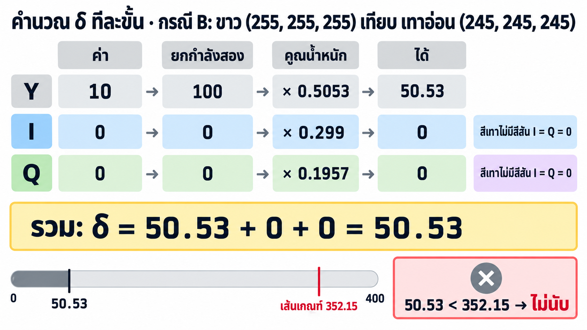
*สีเทาไม่มีสีสัน ($I = Q = 0$) $\delta$ จึงมาจากความสว่างอย่างเดียว และยังต่ำกว่าเส้นเกณฑ์มาก*

$$
\Delta R = \Delta G = \Delta B = 10
\;\Rightarrow\;
Y = 10,\ I = 0,\ Q = 0
$$

$$
\delta = 0.5053 \times 10^2 + 0.299 \times 0^2 + 0.1957 \times 0^2 = 50.53 + 0 + 0 = 50.53
$$

→ $50.53 < 352.15$ จึง **ไม่นับ** (ต่างนิดเดียว ตาแทบไม่เห็น)

| | กรณี A (ขาว vs ฟ้า) | กรณี B (ขาว vs เทาอ่อน) |
|---|---:|---:|
| $\delta$ | 14,380.48 | 50.53 |
| ห่างจากเส้นเกณฑ์ 352.15 | มากกว่าราว **41 เท่า** | ต่ำกว่าราว **7 เท่า** |
| นับว่าต่างไหม | ✅ นับ | ❌ ไม่นับ |

#### ขั้น 4 · ตัดสินด้วยเส้นเกณฑ์ 352.15


*เทาที่อ่อนกว่า 228 อยู่ซ้ายเส้นเกณฑ์ จึงไม่นับ · สีเพี้ยนเล็กน้อยจากการบีบอัดภาพจึงไม่ทำให้คะแนนเพี้ยน*

$$
\delta_{\max} = 35215\,t^2 = 35215 \times 0.1^2 = 352.15
\qquad
d(x, y) =
\begin{cases}
1 & \text{if } \delta > 352.15 \text{ and not anti-aliasing} \\
0 & \text{otherwise}
\end{cases}
$$

- $35215$ คือค่า $\delta$ ที่มากที่สุดที่สูตรนี้ให้ได้ เป็นค่าคงที่ในซอร์สโค้ดของ pixelmatch · $t = 0.1$ = ยอมให้สีเพี้ยนได้นิดหน่อย
- กรณี A: $14{,}380.48 > 352.15 \Rightarrow d = 1$ (นับ) · กรณี B: $50.53 < 352.15 \Rightarrow d = 0$ (ไม่นับ)
- สีเทาต้องเข้มขึ้นจากขาวอย่างน้อย **27 ระดับ** จึงนับ เพราะ $0.5053 \times 27^2 = 368.36 > 352.15$

#### ขั้น 5 · นับทั้งภาพแล้วคิดเป็นเปอร์เซ็นต์

ทำขั้น 1–4 กับทุกพิกเซล ($1366 \times 900$ จุด) แล้วนับจุดที่ได้ $d = 1$

$$
\text{visual diff} = \frac{\displaystyle\sum_{x=1}^{1366}\sum_{y=1}^{900} d(x, y)}{W \times H} \times 100\%
= \frac{339{,}448}{1366 \times 900} \times 100\%
= \frac{339{,}448}{1{,}229{,}400} \times 100\%
= 27.61\%
$$

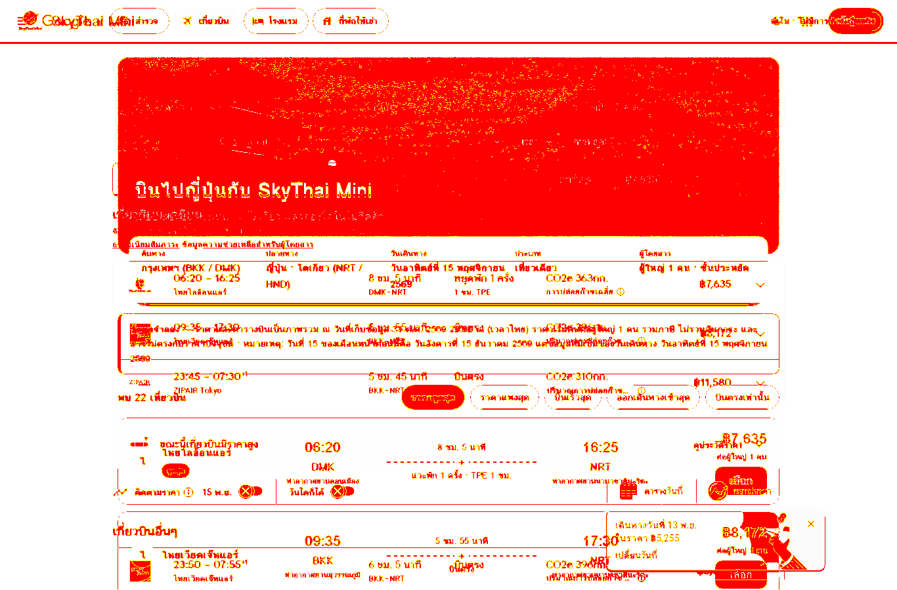
*ผลจริงรอบ LAB 6: จุดสีแดง 339,448 จุด = พิกเซลที่ได้ $d = 1$ · ที่เหลือ $100 - 27.61 = 72.39\%$ นับว่าเหมือน*

#### ทำไมรอบนี้ต่างจากบทที่ 3 อยู่ 0.27 จุด

$$
\underbrace{\frac{342{,}711}{1{,}229{,}400}}_{\text{chapter 3: } 27.88\%} - \underbrace{\frac{339{,}448}{1{,}229{,}400}}_{\text{LAB 6: } 27.61\%}
= \frac{3{,}263}{1{,}229{,}400} \times 100\% = 0.27\%
$$

ต่างกันแค่ **3,263 พิกเซล** (ราว 0.27% ของจอ) แอปไม่ได้เปลี่ยน สาเหตุที่ yolo1 หาเจอ:
- 🟢 ยืนยันแล้ว: วัดวันที่ 1 พ.ย. แอปคิด "วันที่ 15 ของเดือนหน้า" = 15 ธ.ค. ไม่ตรงกับวันในข้อมูล (15 พ.ย.) จึงเพิ่มหมายเหตุ 1 บรรทัด ทุกอย่างข้างล่างเลื่อนลง ลองลบบรรทัดนี้ในเบราว์เซอร์ทดสอบแล้วได้ 27.36% แปลว่าบรรทัดนี้ทำให้ค่า **เพิ่มขึ้น** ราว 0.25 จุด
- 🟡 ยังยืนยันไม่ได้: ส่วนที่ทำให้ค่า **ลดลง** ที่เหลือ อาจมาจากภาพหน้าแรกหรือรุ่นเบราว์เซอร์ที่ต่างกัน

### 6.4 · 👀 สังเกต

- **4 จาก 5 ค่าตรงกับบทที่ 3–4 เป๊ะ** → ชุดทดสอบ **วัดซ้ำได้** ใครรันก็ได้เลขเดิม
- **visual diff ไวต่อการเลื่อนแม้แค่บรรทัดเดียว** และ v1 ที่ไม่มีฟอร์มค้นหาเลยยัง "เหมือน" 72% (พื้นขาวตรงกับพื้นขาว) → ต้องดูคู่กับ ③ โครงสร้างหน้า (3.8%) เสมอ
- เครื่องมือบางไฟล์ของบทที่ 4 ต้องใช้ต้นฉบับแช่แข็ง (ไม่ได้เก็บไว้เพราะมี cookie) yolo1 จึงเขียนตัวแทนที่ **ไม่ต่อ Google และไม่แก้เกณฑ์** แล้วจดเหตุผลไว้ใน `NOTES.md`
- **รันซ้ำได้ด้วยคำสั่งเดียว:** `measure/run-all.sh` (ผลแต่ละรอบเก็บแยกโฟลเดอร์ตามเวลา)

ไฟล์เต็ม: [`_solution/run/out-p5.md`](_solution/run/out-p5.md) · ชุดเครื่องมือ + ผล [`_solution/measure/`](_solution/measure/) · สรุป [`SUMMARY.md`](_solution/measure/results/SUMMARY.md) · เหตุผลที่ต่าง [`NOTES.md`](_solution/measure/results/NOTES.md)

---

## 📊 ไม้บรรทัด 5 อันวัดอะไร และวัดยังไง (อ่านคู่กับ LAB 6)

playlist ผ่าน 5/5 แปลว่า **แอปทำงานตามที่เราออกแบบ** แต่ยังไม่ได้บอกว่า **เหมือน Google Flights แค่ไหน**
บทที่ 3–4 สร้าง "ไม้บรรทัด" 5 อัน แล้ววัดทุกเวอร์ชันด้วยไม้บรรทัดชุดเดียวกัน รวมถึง v1 ของบทนี้ด้วย ตัวเลขทุกตัวด้านล่างมาจากการรันจริง

### 📋 ตารางผลทดสอบ (เมทริกซ์เดียวกันทุกเวอร์ชัน)

| เวอร์ชัน | acceptance 82 ข้อ (กรรมการ cyolo1) | differential 8 สถานการณ์ (เทียบต้นฉบับแช่แข็ง) | โครงสร้างหน้า (ariaSnapshot) | visual diff (ต่ำ = ใกล้) | เที่ยวบิน |
|---|---:|---:|---:|---:|---:|
| **v1 Mini · REA (บทนี้)** | **0/82** | **0/8** | **3.8%** | **27.88%** | **22** |
| v2 Plus · + Playwright (บทที่ 2) | 51/82 | 3/8 | 55.8% | 8.19% | 22 |
| v3 Pro · + HAR · กรรมการ · วนแก้ (บทที่ 3) | 74/82 | 4/8 | 70.5% | 8.32% | 300 |
| v4 Max · + ต้นฉบับแช่แข็ง · differential · swarm (บทที่ 4) | 74/82 | 8/8 | 78.6% | 5.13% | 300 |

ทุกเวอร์ชันวัดด้วยชุดทดสอบเดียวกัน ไม่แก้ test ระหว่างทาง · ที่มาของแต่ละช่อง: ① [SCOREBOARD บทที่ 3](../03_REA_Toolchain_Loop/_solution/run/SCOREBOARD.md) · ② [DIFF-REPORT บทที่ 4](../04_REA_Differential_Oracle/_solution/run/DIFF-REPORT.md) · ③ [STRUCTURE บทที่ 4](../04_REA_Differential_Oracle/_solution/run/STRUCTURE.md) · ④ [visual diff บทที่ 3](../03_REA_Toolchain_Loop/_solution/run/results/visual/) · ⑤ นับเที่ยวบินที่แอปแสดงได้จริง

**ตารางเดียวกัน อ่านแบบเทียบ v1 กับเวอร์ชันที่ดีที่สุด**

| ไม้บรรทัด | วัดอะไร (ภาษาง่าย) | **v1 (บทนี้)** | v4 (ดีที่สุดในบทที่ 4) |
|---|---|---:|---:|
| ① acceptance 82 ข้อ | ทำได้ตาม "ข้อสอบ" 82 ข้อที่กรรมการออกจากการสำรวจ Google ไหม | **0/82** | 74/82 |
| ② differential 8 สถานการณ์ | ทำ 8 อย่างเดียวกันกับ Google ตัวจริงแล้ว ได้รายการเที่ยวบินเหมือนกันไหม | **0/8** | 8/8 |
| ③ โครงสร้างหน้า (ariaSnapshot) | หน้าเว็บมี "ชิ้นส่วน" (ปุ่ม แท็บ ช่องกรอก) แบบเดียวกันกี่ % | **3.8%** | 78.6% |
| ④ visual diff | หน้าตาต่างจาก Google กี่ % ของพิกเซล (**ต่ำ = เหมือน**) | **27.88%** | 5.13% |
| ⑤ เที่ยวบิน | แอปแสดงเที่ยวบินได้กี่ใบ (Google มี 300 ใบ) | **22** | 300 |

> 💡 อ่านตารางนี้ให้ถูก: v1 ไม่ได้ "พัง" แอปทำงานได้ครบตามโจทย์บทนี้ แต่ **REA อย่างเดียว + ห้ามคลิก** เห็นแค่หน้าแรกของ Google จึงยังขาดฟีเจอร์อีกมาก บทถัดไปค่อย ๆ เติมเครื่องมือจนตัวเลขดีขึ้น

### ① acceptance 82 ข้อ: ข้อสอบมาจากไหน ใครตรวจ

เปรียบเหมือน **ข้อสอบที่ครูคนอื่นออก** ไม่ใช่ข้อสอบที่นักเรียนออกให้ตัวเอง

| ขั้น | เกิดอะไร |
|---|---|
| 1. ได้รายการฟีเจอร์ | บทที่ 2 ใช้ Playwright กดสำรวจ Google Flights จริง แล้วเขียนลงไฟล์ `EXPLORATION.md` · ส่วน B = ฟีเจอร์ **35** ข้อ · ส่วน C = กฎ **31** ข้อ · บทที่ 3 เพิ่มส่วน F = สิ่งที่เห็นจากการดักข้อมูลเครือข่าย **16** ข้อ |
| 2. รวมเป็นข้อสอบ | 35 + 31 + 16 = **82 ข้อ** · 1 ข้อ = 1 test |
| 3. ให้กรรมการอิสระเขียน test | `cyolo1` (Codex คนละค่ายกับ `yolo1` ที่สร้างแอป) เขียน test ด้วย Playwright โดย **อ่านแค่ EXPLORATION.md** ไม่อ่านโค้ดแอป ไม่ใช้ `data-testid` ใช้แค่ข้อความ ปุ่ม และป้ายที่ผู้ใช้มองเห็น |
| 4. ทุก test เริ่มเหมือนผู้ใช้ | เปิดแอป → กรอกค้น กรุงเทพ → โตเกียว 15 พ.ย. 2026 ผ่านฟอร์มบนจอ → แล้วค่อยตรวจฟีเจอร์ของข้อนั้น |
| 5. นับ | ผ่านกี่ข้อจาก 82 · ใช้ข้อสอบชุดเดิมกับทุกเวอร์ชัน ห้ามแก้ test |

ตัวอย่างข้อสอบ: B02 เลือกจำนวนผู้โดยสาร · B17 กรองเฉพาะการบินไทย · C02 ทารกนั่งตักต้องไม่เกินจำนวนผู้ใหญ่

**ทำไม v1 ได้ 0/82:** ทุก test ต้องเริ่มจาก **ฟอร์มค้นหาและปุ่มผู้โดยสาร** แต่ v1 ไม่มีฟอร์มค้นหา (หน้าแรกแสดงผลทันที) ทั้ง 82 ข้อจึงตกตั้งแต่ขั้นเตรียม (log จริง: `locator.waitFor: Timeout 3500ms exceeded` ขณะรอปุ่มผู้โดยสาร ครบ 82 ข้อ)
⚠️ ไม่ได้แปลว่า v1 ไม่มีอะไรเลย (v1 มี 22 ใบ เรียง และตัวกรองบินตรง) แต่แปลว่า v1 **ขาดประตูหน้าบ้าน** ที่ผู้ใช้ Google ต้องผ่านก่อนใช้ทุกฟีเจอร์


*test B02 กับ v1: กรรมการหาปุ่มผู้โดยสารไม่เจอ → ไม่ผ่าน (รายละเอียดทุกข้อ: [SCOREBOARD บทที่ 3](../03_REA_Toolchain_Loop/_solution/run/SCOREBOARD.md))*

### ② differential 8 สถานการณ์: ใช้ Google ตัวจริงเป็นเฉลย

เปรียบเหมือน **ทำโจทย์ข้อเดียวกันคู่กับคนเก่ง แล้วเทียบคำตอบ** ถ้าคำตอบเหมือนกัน แปลว่าเราทำถูก

ปัญหา: Google เปลี่ยนราคาตลอด เทียบวันนี้กับพรุ่งนี้ไม่ได้ บทที่ 3–4 จึงทำ **"Google แช่แข็ง"**

| ขั้น | เกิดอะไร |
|---|---|
| 1. อัด | บทที่ 3 ใช้ Playwright อัดทุกคำขอและคำตอบระหว่างใช้ Google Flights ลงไฟล์ **HAR** |
| 2. แช่แข็ง | บทที่ 4 เปิด Google Flights จากไฟล์ HAR แบบ **ไม่ต่ออินเทอร์เน็ต** และหยุดนาฬิกาไว้ที่เวลาอัด → ได้ผลเดิมทุกรอบ (ทดสอบ 3 รอบ ตรงกันทั้ง 3) |
| 3. ทำ 8 อย่างเดียวกัน | Playwright ทำ 8 สถานการณ์กับ Google แช่แข็ง และกับแอปของเรา |
| 4. เทียบรายการเที่ยวบิน | จำนวนใบ · ราคา · สายการบิน · เวลาออก เทียบทีละตำแหน่ง ต้องตรงทั้งหมดถึงจะนับว่า ✅ |

| สถานการณ์ | Google แช่แข็งได้ | v1 |
|---|---|---|
| S1 รายการเริ่มต้น | 22 ใบ | ❌ ไม่ตรง (ราคาต่างตั้งแต่ใบที่ 2: v1 ฿8,172 · Google ฿8,432 เพราะราคา Google เปลี่ยนระหว่างวันที่เก็บ snapshot กับวันที่อัด HAR) |
| S2 แท็บ "ถูกที่สุด" | ใบแรก ฿7,635 เรียงถูก → แพง | ❌ ไม่มีแท็บ (v1 ใช้ปุ่ม "ราคาถูกสุด" แทน) |
| S3 ดูเที่ยวบินเพิ่มเติม | 300 ใบ | ⛔ ไม่มีปุ่มนี้ |
| S4 บินตรง | 18 ใบ | ❌ ได้ 18 ใบเหมือนกัน แต่ราคาและสายการบินบางใบไม่ตรง |
| S5 กรองการบินไทย | 5 ใบ | ⛔ ไม่มีตัวกรองสายการบิน |
| S6 ราคาไม่เกิน ฿10,000 | 6 ใบ | ⛔ ไม่มีตัวกรองราคา |
| S7 ออกเดินทาง 23:00–24:00 | 33 ใบ | ⛔ ไม่มีตัวกรองเวลา |
| S8 ดูรายละเอียดเที่ยวบินที่แวะ | SL 394 แวะ 1 ชม. ที่ TPE | ⛔ ไม่มีปุ่มรายละเอียด |

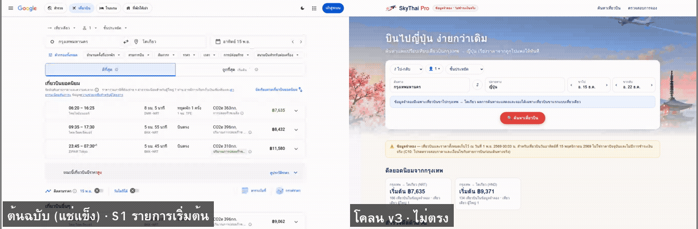
*S1 รายการเริ่มต้น: เทียบ Google แช่แข็งกับโคลนทีละใบ (รายงานเต็ม: [DIFF-REPORT บทที่ 4](../04_REA_Differential_Oracle/_solution/run/DIFF-REPORT.md))*

### ③ โครงสร้างหน้า (ariaSnapshot): หน้าเว็บมี "ชิ้นส่วน" เหมือนกันไหม

เปรียบเหมือน **เทียบ "รายการชิ้นส่วน" ของเฟอร์นิเจอร์ 2 ตัว** ไม่สนว่าสีอะไร สนแค่ว่ามีลิ้นชัก มือจับ ขา ครบไหม

**ariaSnapshot** คือคำสั่ง Playwright ที่อ่านหน้าเว็บออกมาเป็นรายการ "บทบาท + ชื่อ" แบบที่โปรแกรมอ่านหน้าจอสำหรับคนตาบอดเห็น เช่น

```yaml
- button "สลับต้นทางกับปลายทาง"
- tab "ถูกที่สุด"
- combobox "ผู้โดยสาร"
```

| ขั้น | เกิดอะไร |
|---|---|
| 1. ถ่ายรายการชิ้นส่วน | ใช้ ariaSnapshot กับหน้าผลค้นหาของ Google แช่แข็งและของแอปเรา |
| 2. ตัดส่วนแบรนด์ทิ้ง | ตัดโลโก้ เมนู Google ชื่อ SkyThai ป้าย "ข้อมูลจำลอง" ออก (ไม่ควรเหมือน) |
| 3. คะแนน ก: Jaccard | ชิ้นส่วนที่มีเหมือนกัน ÷ ชิ้นส่วนทั้งหมดรวมกันของทั้งสองหน้า |
| 4. คะแนน ข: ชิ้นสำคัญ 38 อย่าง | เช็กลิสต์ 38 ชิ้นที่ Google มี (ฟอร์มค้นหา ตัวกรอง 9 ปุ่ม แท็บ ฯลฯ) แอปเรามีกี่ชิ้น |
| 5. คะแนนรวม | ค่าเฉลี่ยของ ก กับ ข |

**ทำไม v1 ได้ 3.8%:** Jaccard 5.0% และมีชิ้นสำคัญแค่ **1 จาก 38** (มีแค่รายการเที่ยวบิน) ขาดฟอร์มค้นหาทั้งชุด ตัวกรองทั้ง 9 ปุ่ม แท็บดีที่สุด/ถูกที่สุด ปุ่มรายละเอียด ประวัติราคา และปุ่มดูเพิ่มเติม
(ไฟล์จริง: [`structure/snapshots/v1.yml`](../04_REA_Differential_Oracle/_solution/run/structure/snapshots/v1.yml) เทียบกับ [`original.yml`](../04_REA_Differential_Oracle/_solution/run/structure/snapshots/original.yml) · รายงาน [STRUCTURE บทที่ 4](../04_REA_Differential_Oracle/_solution/run/STRUCTURE.md))

### ④ visual diff: หน้าตาต่างกันกี่ % (ต่ำ = เหมือน)

เปรียบเหมือน **เกม "จับผิดภาพ"** แต่ให้คอมพิวเตอร์นับจุดที่ต่าง

| ขั้น | เกิดอะไร |
|---|---|
| 1. ถ่ายภาพขนาดเท่ากัน | Playwright ถ่ายหน้าผลค้นหาขนาด 1366×900 = 1,229,400 พิกเซล ทั้งของ Google (ภาพจากบทที่ 2) และของแอปเรา |
| 2. เทียบทีละพิกเซล | ใช้ไลบรารี **pixelmatch** ดูว่าสีของจุดเดียวกันต่างกันเกินเกณฑ์ไหม (threshold 0.1 กันสีเพี้ยนเล็กน้อย) |
| 3. ระบายสีจุดที่ต่าง | ได้ภาพไฮไลต์ จุดต่างเป็นสีแดง |
| 4. คิดเป็น % | จุดที่ต่าง ÷ จุดทั้งหมด |

**สมการที่ใช้คำนวณ** (pixelmatch · threshold $t = 0.1$ · ภาพ $W \times H = 1366 \times 900 = 1{,}229{,}400$ พิกเซล)

1. ระยะห่างของสีแต่ละพิกเซล (Y = ความสว่าง · I, Q = สีสัน มาจากผลต่าง R, G, B):

$$\delta = 0.5053\,Y^2 + 0.299\,I^2 + 0.1957\,Q^2$$

2. พิกเซลนับว่า "ต่าง" ($d = 1$) เมื่อ $\delta > 35215\,t^2 = 352.15$ และไม่ใช่ขอบเบลอของตัวอักษร
3. เปอร์เซ็นต์:

$$\text{visual diff} = \frac{\sum d(x, y)}{W \times H} \times 100\%$$

🧪 **แทนค่าจริงของ v1**

$$
\text{v1 (บทที่ 3)} = \frac{342{,}711}{1{,}229{,}400} \times 100 = 27.88\%
\qquad
\text{v1 (LAB 6)} = \frac{339{,}448}{1{,}229{,}400} \times 100 = 27.61\%
$$

(สมการเต็มทั้ง 5 ขั้น พร้อมตัวอย่างคำนวณทีละพิกเซล อยู่ใน [บทที่ 3 · T7](../03_REA_Toolchain_Loop/README.md))

**v1 ได้ 27.88%** = ต่าง 342,711 จาก 1,229,400 พิกเซล ต่างมากที่สุดในทุกเวอร์ชัน เพราะ v1 มีแบนเนอร์ภาพใหญ่ด้านบน และไม่มีฟอร์มค้นหาแบบ Google

| Google (ภาพอ้างอิง) | v1 | จุดที่ต่าง (แดง) |
|---|---|---|
| 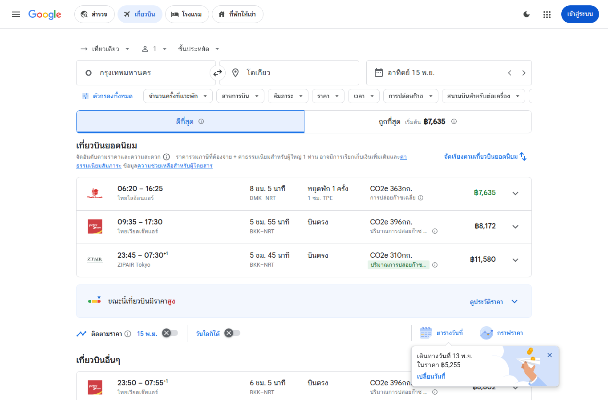 | 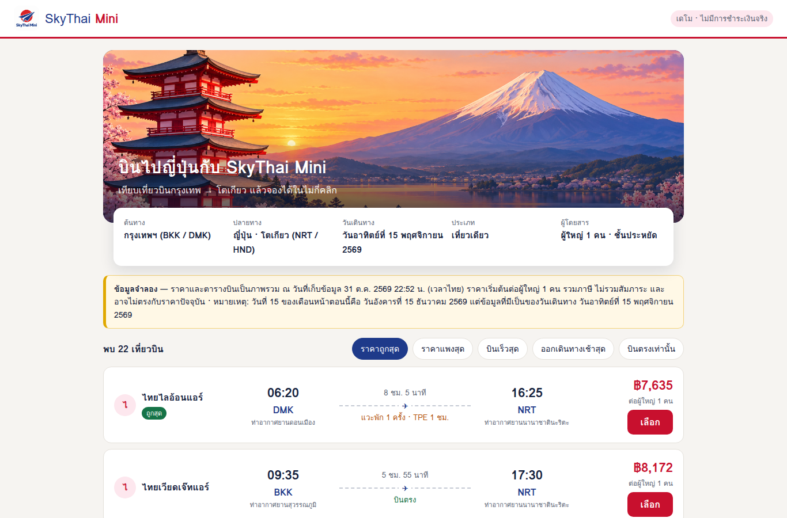 | 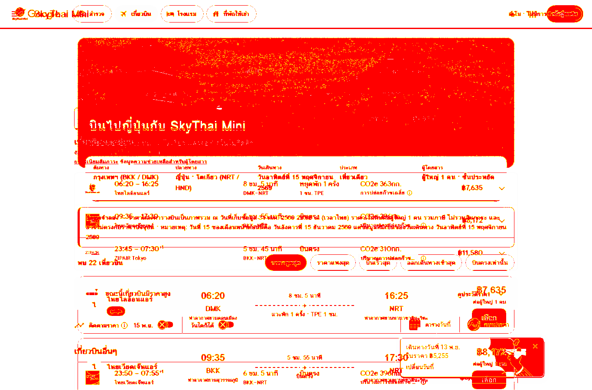 |

⚠️ **visual diff หลอกได้:** v1 ไม่มีฟอร์มค้นหาเลย แต่ยัง "เหมือน" 72% เพราะพื้นหลังสีขาวเหมือนกัน จึงต้องดูคู่กับ ③ โครงสร้างหน้า (ได้แค่ 3.8%) เสมอ

### ⑤ เที่ยวบิน: แอปแสดงได้กี่ใบ

นับเที่ยวบินทั้งหมดที่แอปแสดงได้ (รวมหลังกด "ดูเที่ยวบินเพิ่มเติม" ถ้ามี) Google มีทั้งหมด **300 ใบ**

**ทำไม v1 ได้ 22:** REA อ่านได้แค่ข้อมูลที่ฝังมากับหน้าแรก (`ds:1` = 22 ใบ · T12) อีก 278 ใบอยู่หลังปุ่ม "ดูเที่ยวบินเพิ่มเติม" ซึ่งบทนี้ **ห้ามคลิก** · บทที่ 3 ใช้ Playwright กดปุ่มนั้นแล้วอัด HAR ได้ครบ 300 ใบ

### สรุป: v1 ขาดอะไร และบทไหนเติม

| v1 ขาด | ทำให้ตัวเลขไหนต่ำ | บทที่เติม | ผลหลังเติม |
|---|---|---|---|
| ฟอร์มค้นหา ผู้โดยสาร แท็บ ตัวกรอง (เพราะ REA ไม่ได้กดสำรวจ) | ① ③ | บทที่ 2 · Playwright กดสำรวจ | v2: ① 51/82 · ③ 55.8% · ④ 8.19% |
| เที่ยวบินหลังปุ่ม "ดูเพิ่มเติม" + ข้อมูลหน้าจอง | ⑤ ① | บทที่ 3 · HAR + กรรมการ + วนแก้ | v3: ① 74/82 · ⑤ 300 ใบ |
| ผลลัพธ์ไม่ตรงกับ Google ทีละใบ | ② ③ ④ | บทที่ 4 · Google แช่แข็งเป็นเฉลย | v4: ② 8/8 · ③ 78.6% · ④ 5.13% |

---

## ✅ รูบริก: เช็กลิสต์ก่อนส่งงาน

- [ ] prompt 1 เจอแท็บ Google Flights (LAB 2)
- [ ] มี `flights-snapshot.json`, `evidence/ui-evidence.json`, `evidence/code-analysis.json` ใน `/workspace/rea-flight`
- [ ] ชี้ได้อย่างน้อย 1 ข้อที่ "ยืนยันแล้ว" 1 ข้อที่ "อนุมาน" และ 1 ข้อที่ "ไม่ทราบ" จากผลของตัวเอง
- [ ] อธิบายได้ว่า "ดีที่สุด" ต่างจาก "ถูกที่สุด" อย่างไร โดยใช้ตัวเลขจากผลของตัวเอง
- [ ] `docker compose up -d --build` ใน `skythai-mini/` แล้ว http://localhost:5081 เปิดได้ เรียงถูก → แพง เป็นค่าเริ่มต้น จองจนได้รหัส `STM-…` และ `/api/health` ตอบ `{"ok":true}`
- [ ] แอปไม่มีโลโก้ ชื่อ หรือโค้ดของ Google และมีป้ายบอกว่าเป็นข้อมูลจำลอง
- [ ] วัด v1 ด้วยไม้บรรทัด 5 อันได้ครบ และอธิบายได้ว่าทำไม v1 ได้คะแนนแบบนั้น (LAB 6)
- [ ] ปิด Chrome พอร์ต 9222 แล้วหลังจบงาน

---

## 🔁 รันซ้ำ / ปิดงาน

**ปิด Chrome ที่เปิดพอร์ต 9222** (ทำทุกครั้งที่จบงาน เพราะพอร์ตนี้ให้โปรแกรมในเครื่องควบคุมเบราว์เซอร์ได้)

```bash
docker exec multi-account-devtool pkill -f "[r]emote-debugging-port=9222"
```

(วงเล็บ `[r]` ช่วยไม่ให้ `pkill` ไปจับคำสั่งของตัวเอง)

**อยากรันซ้ำ**
1. REA ติดตั้งครั้งเดียวพอ ไม่ต้องทำ LAB 1 ซ้ำ (ยกเว้นสร้าง container ใหม่แล้วไฟล์ shared หาย)
2. ปิด Chrome ด้วยคำสั่งข้างบน แล้ววางพรอมต์ LAB 2 ใหม่ → ได้ Chrome ตัวใหม่ที่วันที่ "15 ของเดือนหน้า" ของวันนั้น
3. ถ้าอยากเริ่มสะอาด ให้ Claude Code ย้ายโฟลเดอร์เดิมไปเป็น `/workspace/rea-flight-old` ก่อน แล้วค่อยทำ LAB 2–5
4. ผลรอบใหม่ (ราคา จำนวนเที่ยวบิน) **จะต่างจากตารางในบทนี้** เพราะ Google เปลี่ยนตามวัน เป็นเรื่องปกติ

---

## ถ้าเจอปัญหา: คัดลอกพรอมต์นี้

```text
LAB REA ใน container multi-account-devtool มีปัญหา ช่วยตรวจทีละข้อแบบอ่านอย่างเดียวก่อน แล้วบอกฉันว่าจะแก้อย่างไร ห้ามลบไฟล์ใน /workspace/rea-flight และห้ามแก้ไฟล์ใน evidence/
1. container multi-account-devtool รันอยู่ไหม และ node -v ใน container คือเวอร์ชันอะไร
2. /root/ai-accounts/.Claude/shared/mcp/mcp.json เป็น JSON ที่ถูกต้องไหม มีทั้ง rea (rea-agents@6.7.0) และ playwright ไหม
3. มีโฟลเดอร์ reverse-engineer-anything ใน /root/ai-accounts/.Claude/shared/skills และ /root/ai-accounts/.Codex/shared/skills ไหม
4. มี Chrome ที่เปิด --remote-debugging-port=9222 อยู่ไหม และ curl http://127.0.0.1:9222/json/version ใน container ตอบอะไร
5. ให้ yolo1 -p ตอบสั้น ๆ ว่าเห็น MCP rea กี่ tools
6. ถ้าหน้า Google Flights ขึ้น CAPTCHA หรือหน้าบล็อก ให้บอกฉัน ห้ามพยายามหลบ
สรุปเป็นตาราง ข้อ | ผล | วิธีแก้ที่แนะนำ แล้วรอให้ฉันยืนยันก่อนแก้
```

| อาการ | สาเหตุที่พบบ่อย | วิธีแก้ |
|---|---|---|
| yolo1 ไม่เห็น `rea` | `mcp.json` เสีย (ลืม `,`) หรือยังไม่ได้เพิ่ม | กู้จากไฟล์สำรอง แล้วทำ LAB 1 ใหม่ |
| `npx` ติดตั้ง REA ไม่ผ่าน เพราะ Node | ใช้ 6.8.0 หรือ `latest` | ระบุ `rea-agents@6.7.0` เสมอ |
| prompt 1 เชื่อมต่อไม่ได้ | Chrome ไม่ได้เปิด / ปิดไปแล้ว | วางพรอมต์ LAB 2 ใหม่ |
| ภาพหน้าจอหมดเวลา | หน้าเว็บหนัก หรือ headless ช้า | ข้ามภาพได้ ส่วนอื่นยังใช้ได้ |
| ได้เที่ยวบินน้อยกว่า 22 ใบ หรือหน้าไม่เหมือนในบทนี้ | Google เปลี่ยนหน้า/ราคาตามวัน | ปกติ ดูโครงสร้างแทนตัวเลข |
| เปิด http://localhost:5081 ไม่ขึ้น | build ยังไม่เสร็จ หรือ `db` ยังไม่ healthy | ดู `docker compose ps` และ `docker compose logs web` ในโฟลเดอร์ `skythai-mini/` แล้วรอสักครู่ |
| yolo1 บอกว่าพอร์ต 5081 ถูกใช้อยู่ | มี process เก่าค้างพอร์ตใน container | ดูว่าใครใช้พอร์ตอยู่ด้วย `ss -ltnp` ก่อน แล้วค่อยปิดตัวที่ค้าง ไม่ต้องเปลี่ยนพอร์ตถาวร |
| `/api/health` ไม่ตอบ `{"ok":true}` | เว็บต่อฐานข้อมูลไม่ได้ | ดู `docker compose logs db` · ถ้าจะเริ่มฐานข้อมูลใหม่ใช้ `docker compose down -v` แล้ว `docker compose up -d --build` |

---

## 🔒 เฉลย (`_solution/`)

| ส่วน | มีอะไร | ใช้ทำอะไร |
|---|---|---|
| [`_solution/run/`](_solution/run/) | `p1.txt`–`p5.txt` (พรอมต์ชั้นในที่ส่งให้ yolo1) · `out-p1.md`–`out-p5.md` (คำตอบจริงของ yolo1) · `flights-snapshot.json` · `evidence/` | เทียบผลของเรากับรอบจริง |
| [`_solution/skythai-mini/`](_solution/skythai-mini/) | SkyThai Mini ฉบับเฉลย (Next.js + PostgreSQL · `docker-compose.yml` มี service `web` พอร์ต 5081 + `db` `postgres:16-alpine`) | เปิด SkyThai Mini ฉบับเฉลยได้ทันที |
| [`_solution/measure/`](_solution/measure/) | ชุดเครื่องมือวัด 5 ไม้บรรทัด (`run-all.sh` คำสั่งเดียว) + ผลจริงของ LAB 6 ใน `results/` | วัดแอปซ้ำได้ทุกเมื่อ |
| [`_solution/e2e/`](_solution/e2e/) | `playlist.mjs` (Playwright รัน 5 use case C1–C5 ต่อกันแล้วอัดวิดีโอ) · `results.json` · `media/` (GIF, MP4, `playlist.mp4`) | ดูแอปทำงาน และเป็นตัวอย่างสำหรับบทถัดไป |

**เปิด SkyThai Mini ฉบับเฉลย** (สั่ง Claude Code หรือรันเองใน PowerShell ที่โฟลเดอร์ `_solution/skythai-mini`)

```powershell
docker compose up -d --build
# รอบเราบน Docker Desktop ใช้ 56 วินาที แล้วเปิด http://localhost:5081
# ปิด: docker compose down   (ล้างฐานข้อมูลด้วย: docker compose down -v)
```

**รัน playlist (ไม่บังคับ)** ต้องเปิดแอปที่ 5081 ไว้ก่อน แล้วในโฟลเดอร์ `_solution/e2e` รัน `npm install` ตามด้วย `node playlist.mjs`

### ไฟล์ในบทนี้

```text
01_REA_Basics_Flight/
├── README.md                     ← ไฟล์นี้
├── img/                          ← ภาพประกอบ (lab1-00 ภาพรวม · lab1-r* เส้นทาง LAB · lab1-1x ไฟล์ json · lab2–6-paste.png · real-skythai-mini-home.png)
├── skythai-mini/                 ← (สร้างใน LAB 5) แอปของเราที่คัดลอกออกจาก container
└── _solution/
    ├── run/
    │   ├── p1.txt … p5.txt       ← พรอมต์ชั้นในที่ส่งให้ yolo1
    │   ├── out-p1.md … out-p5.md ← คำตอบจริงของ yolo1
    │   ├── flights-snapshot.json ← เที่ยวบิน 22 ใบ (31 ต.ค. 2569)
    │   └── evidence/             ← ui-evidence.json · code-analysis.json · viewport.png · bundle ดิบ
    ├── skythai-mini/             ← SkyThai Mini ฉบับเฉลย · docker compose up -d --build → http://localhost:5081
    │   ├── Dockerfile · docker-compose.yml  ← web (5081) + db (postgres:16-alpine)
    │   ├── db/ · data/ · scripts/          ← SQL ตอนเริ่ม · snapshot · สคริปต์สร้าง seed
    │   ├── src/app/ · src/components/ · src/lib/
    │   └── public/               ← logo.png · hero.png (cyolo1)
    ├── measure/                  ← (LAB 6) run-all.sh · runner/ · accept/ · diff/ · structure/ · visual/ · results/ (SUMMARY.md · NOTES.md)
    └── e2e/
        ├── playlist.mjs          ← Playwright 5 use case + อัดวิดีโอ
        ├── results.json          ← ผล C1–C5
        └── media/                ← C1.gif … C5.gif · .mp4 · playlist.mp4
```

(ใน container งานทั้งหมดอยู่ที่ `/workspace/rea-flight/` ซึ่งมี `work/` และ `tools/` ที่ yolo1 สร้างระหว่าง LAB 4 เพิ่มด้วย)

---

## 🎉 จบบทแล้ว → บทถัดไป

ตอนนี้เรามีแอป SkyThai Mini และรู้แล้วว่ามันเหมือน Google Flights แค่ไหน (วัดด้วยไม้บรรทัด 5 อัน)

บทถัดไป [**02 · REA + Playwright Exploration**](../02_REA_Playwright_Exploration/README.md) จะใช้ **Playwright คู่กับ REA** สำรวจแบบ EXPLORATION แล้ว **เทียบความครอบคลุมของฟีเจอร์** ระหว่างของต้นแบบกับแอปของเรา

---

*ตัวเลขทุกตัวในบทนี้มาจากการรันจริงใน `_solution/run/` เมื่อ 31 ต.ค.–1 พ.ย. 2569 · ทฤษฎีอยู่ใน [บทที่ 0](../00_REA_Theory_Setup/README.md)*
