# Week 03 · บทที่ 1 · REA ขั้นพื้นฐาน: ให้ AI สืบ Google Flights แล้วสร้างแอปจองตั๋วของเราเอง (Copy & Paste)

บทนี้เราจะรู้จัก **REA (Reverse Engineer Anything)** เครื่องมือ open source ที่ให้ AI agent "สืบ" แอปของคนอื่นได้ โดยไม่ต้องมีโค้ดต้นฉบับ
เป้าหมายคือ **ดู Google Flights แบบอ่านอย่างเดียว** (ค้นเที่ยวบิน กรุงเทพ → โตเกียว เที่ยวเดียว วันที่ 15 ของเดือนหน้า) แล้วให้ AI ใช้ความรู้ที่ได้ **สร้างแอปจองตั๋วจำลองของเราเอง** ชื่อ **SkyThai Mini** ที่เรียงเที่ยวบินจากถูกไปแพง

ทุกอย่างรัน **ใน container `multi-account-devtool`** ผู้เรียนแค่วางพรอมต์สั้น ๆ ใน **Claude Code Desktop** แล้ว Claude Code จะสั่งงานเข้า container ผ่าน `docker exec` และส่งงานต่อให้บัญชี `yolo1` (`yolo1 -p`) ทำ

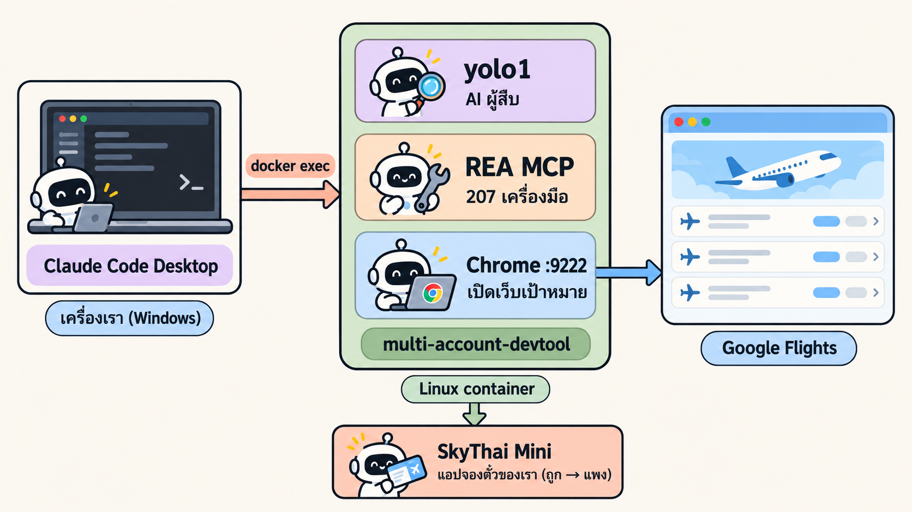
*ภาพรวมของบทนี้: เราสั่งจาก Desktop → container ทำงานทั้งหมด → REA สืบ Google Flights → yolo1 สร้าง SkyThai Mini*

| สิ่งที่ได้จากบทนี้ | อยู่ที่ไหน |
|---|---|
| เข้าใจทฤษฎี reverse engineering + REA แบบทีละขั้น พร้อมตัวอย่างจริงจาก Google Flights | หัวข้อ 🎓 ทฤษฎี (T1–T15) |
| REA 6.7.0 ติดตั้งใน container ให้ `yolo1`–`yolo5` และ `cyolo1`–`cyolo5` ใช้ได้ทุกบัญชี | LAB 1 |
| Chrome แบบ headless ที่ REA เข้าถึงได้ทางพอร์ต `9222` | LAB 2 |
| หลักฐานการสืบ: `flights-snapshot.json` (22 เที่ยวบิน), `evidence/ui-evidence.json`, `evidence/code-analysis.json`, `evidence/viewport.png` | LAB 3–4 |
| แอป **SkyThai Mini** (Next.js + TypeScript + PostgreSQL · โลโก้และภาพหน้าแรกจาก `cyolo1`) รันด้วย `docker compose` คำสั่งเดียว เปิดที่ http://localhost:5081 | LAB 5 → `skythai-mini/` |
| ผลวัดว่า v1 เหมือน Google แค่ไหน 5 ตัวเลข (acceptance 82 ข้อ · differential 8 สถานการณ์ · โครงสร้างหน้า · visual diff · จำนวนเที่ยวบิน) พร้อมวิธีวัดทีละขั้น | หัวข้อ 📊 หลัง LAB 5 |

### 🧰 ก่อนเริ่ม ต้องมี

| ✅ | สิ่งที่ต้องมี | ตรวจยังไง |
|---|---|---|
| ☐ | **Docker Desktop** เปิดอยู่ | ไอคอนวาฬมุมขวาล่างไม่หมุน |
| ☐ | **Claude Code Desktop** บน Windows | เปิดแอปได้ และเปิดโฟลเดอร์นี้อยู่ |
| ☐ | ทำ [LAB 03 · Multi-Account Container](../../01_week02/03_MultiAccount_Container/README.md) แล้ว | มี image `tuchsanai/multi-account-devtool:2569_1` และล็อกอิน `yolo1` แล้ว |
| ☐ | ทำ [LAB 04 · ติดตั้ง Skill ส่วนกลาง](../../01_week02/04_Skill_Setup/00_Setup_Skill/readme.md) แล้ว | รู้จักโฟลเดอร์ `shared` ที่ทุกบัญชีใช้ร่วมกัน |
| ☐ | มี skill `/maccount` ใน Claude Code Desktop | พิมพ์ `/` แล้วเห็น `maccount` |
| ☐ | container มี **Docker อยู่ข้างใน (docker-in-docker)** ให้ `yolo1` สั่ง `docker compose` ได้เองใน LAB 5 | `docker exec multi-account-devtool docker version` ตอบทั้ง Client และ Server |

⏱️ **เวลาโดยประมาณ:** อ่านทฤษฎี ~30 นาที · ลงมือ LAB 0–5 ~30–40 นาที (เวลารอ AI จริงรวมกันราว 15 นาที ดูตัวเลขในแต่ละ LAB)

> ⚠️ **กติกาจริยธรรม (อ่านก่อนเริ่ม)**
> - บทนี้ **ดูอย่างเดียว (read-only)**: ห้ามคลิก ห้ามพิมพ์ ห้ามแก้หน้าเว็บของ Google ทุกพรอมต์เขียนข้อห้ามนี้ไว้แล้ว
> - ทำเพื่อ **การเรียนรู้แนวคิด** เท่านั้น ห้ามคัดลอกโลโก้ ชื่อแบรนด์ หรือโค้ดของ Google มาใช้ ห้ามนำข้อมูลไปขายต่อ และห้ามเรียก API ภายในของ Google ในแอปของเรา
> - เปิดหน้าเดียว ครั้งเดียว ไม่ยิงซ้ำถี่ ๆ ถ้าเจอ CAPTCHA หรือหน้าบล็อก **ให้หยุด** ห้ามพยายามหลบหรือแก้ CAPTCHA
> - ราคาใน `flights-snapshot.json` เป็น **ภาพนิ่ง ณ เวลาที่เก็บ** (31 ต.ค. 2569) ไม่ใช่ราคาปัจจุบัน แอปของเราต้องบอกผู้ใช้แบบนี้เสมอ
> - เว็บไซต์ทุกแห่งมีข้อตกลงการใช้งาน (Terms of Service) ของตัวเอง ก่อนจะสืบระบบจริงนอกห้องเรียน ให้อ่านข้อตกลงและขออนุญาตก่อนทุกครั้ง

---

## 🎓 ทฤษฎี: เข้าใจทีละขั้นก่อนลงมือ

อ่านทีละหัวข้อ แต่ละหัวข้อมี 4 ส่วนเหมือนกัน
1. **💡 ใจความ 1 ประโยค** อ่านแค่นี้ก็พอรู้เรื่อง
2. **คำอธิบาย** สั้น ๆ พร้อมตัวเปรียบเทียบในชีวิตจริง
3. **🧪 ตัวอย่างจริง** จากการรันของเราใน `_solution/run/` (ไม่ได้แต่งตัวเลข)
4. **สรุป** 1 บรรทัด

เนื้อหาเรียบเรียงจากวิดีโอ **Code With Aarohi · REA MCP Explained + Live Demo** ([YouTube](https://www.youtube.com/watch?v=ZGHWUXznleo)) ภาพประกอบทุกภาพวาดใหม่เป็นภาษาไทยด้วย `cyolo1` (ไม่ใช้ภาพจากวิดีโอ) ตัวเลขในภาพตรงกับผลรันจริงของบทนี้

| ช่วง | หัวข้อ | อ่านแล้วตอบได้ว่า |
|---|---|---|
| 🔎 ช่วง 1 · RE คืออะไร | T1–T6 | ทำไมต้องสืบ · สืบคืออะไร · เว็บให้ดูอะไรได้บ้าง · ดูได้กี่แบบ |
| 🔌 ช่วง 2 · REA ทำงานยังไง | T7–T10 | MCP คืออะไร · REA มีอะไรบ้าง · AI สืบทีละขั้นยังไง · AI เข้าไปดูเว็บได้ยังไง |
| 🧾 ช่วง 3 · อ่านผลให้เป็น | T11–T13 | เชื่อผลข้อไหนได้ · เราได้อะไรจาก Google Flights · เอาอะไรมาใช้ได้บ้าง |
| ⚖️ ช่วง 4 · ขอบเขต | T14–T15 | ทำไมทำใน container · อะไรที่ REA บอกไม่ได้ และห้ามทำอะไร |

---

### T1) ปัญหา: อยากได้ฟีเจอร์จากแอปของคนอื่น

💡 **ใจความ:** เราไม่มีโค้ดของเขา แต่เรายังเห็น "เบาะแส" บนหน้าเว็บได้อีกมาก


*เจอฟีเจอร์ที่ชอบ → โค้ดเป็นของเขา → แต่ยังเห็นเบาะแสบนหน้าเว็บ*

เหมือนเรากินอาหารร้านอร่อยแล้วอยากทำเองที่บ้าน ร้านไม่ให้สูตร แต่เรายังดูได้ว่าจานนี้มีอะไรบ้าง หน้าตาเป็นยังไง รสชาติแบบไหน แล้วลองทำเวอร์ชันของเราเอง

🧪 **ตัวอย่างจริง:** Google Flights มีแท็บ "ดีที่สุด" กับ "ถูกที่สุด" เราอยากรู้ 3 อย่าง
1. หน้าจอแบ่งเป็นส่วนอะไรบ้าง
2. ข้อมูลเที่ยวบิน 1 ใบมีอะไรบ้าง
3. "ดีที่สุด" กับ "ถูกที่สุด" ต่างกันยังไง

แล้วเอาความเข้าใจไปทำแอปจองตั๋วของเราเอง **โดยไม่ลอกโค้ดของ Google**

**สรุป:** ไม่มีโค้ด ≠ ไม่มีข้อมูล · สิ่งที่ได้คือ "ความเข้าใจ" ไม่ใช่ "สำเนาโค้ด"

---

### T2) Reverse engineering คืออะไร

💡 **ใจความ:** ดูของที่มีอยู่แล้ว → เข้าใจว่ามันทำงานยังไง → สร้างของเราเองใหม่

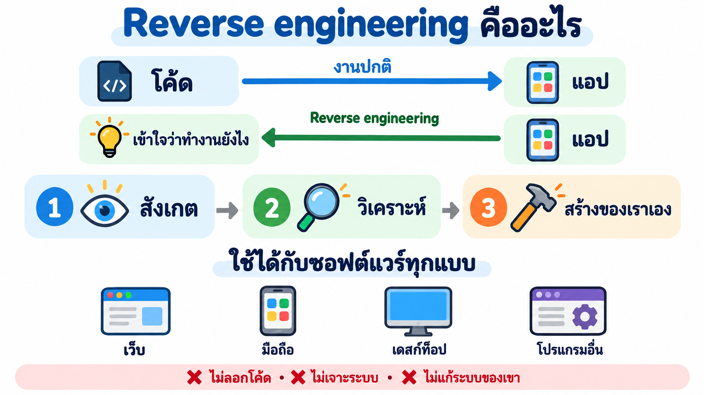
*งานปกติ: โค้ด → แอป · RE: แอป → ความเข้าใจ · 3 ขั้น และ 3 สิ่งที่ห้ามทำ*

งานปกติเดิน **ไปข้างหน้า**: เขียนโค้ด → ได้แอป
Reverse engineering (RE) เดิน **ย้อนกลับ**: มีแอป → เดาว่าข้างในน่าจะทำงานยังไง

RE มี 3 ขั้น

| ขั้น | ทำอะไร | 🧪 ในบทนี้ |
|---|---|---|
| 1. สังเกต | ดูหน้าจอ ไฟล์ที่โหลด และพฤติกรรม | LAB 3: REA เก็บโครงหน้า Google Flights + เที่ยวบิน 22 ใบ |
| 2. วิเคราะห์ | หาว่าแต่ละส่วนทำงานร่วมกันยังไง | LAB 4: REA อ่าน JavaScript หาว่าส่วนไหนดูแลการเรียง |
| 3. อธิบายแล้วใช้ | สรุปเป็นความรู้ แล้วสร้างของเราเอง | LAB 5: yolo1 สร้าง SkyThai Mini ใหม่ทั้งหมด |

RE **ไม่ใช่** 3 อย่างนี้
- ❌ **ลอก** โค้ด โลโก้ หรือชื่อแบรนด์ → เราเอาแค่แนวคิด แล้วเขียนเอง
- ❌ **เจาะระบบ** → ไม่ล็อกอินแทนคนอื่น ไม่หลบ CAPTCHA
- ❌ **แก้ระบบของเขา** → เราแค่ดู

**สรุป:** RE = สังเกต → วิเคราะห์ → อธิบาย · ดูอย่างเดียว ไม่ลอก ไม่เจาะ ไม่แก้

---

### T3) บนเว็บ เราดูอะไรได้ และดูอะไรไม่ได้

💡 **ใจความ:** อะไรที่เบราว์เซอร์ต้องใช้วาดหน้าจอ ต้องส่งมาถึงเครื่องเรา เราจึงเห็นได้ ส่วนที่ทำงานบนเซิร์ฟเวอร์ เราเห็นแค่ผลลัพธ์

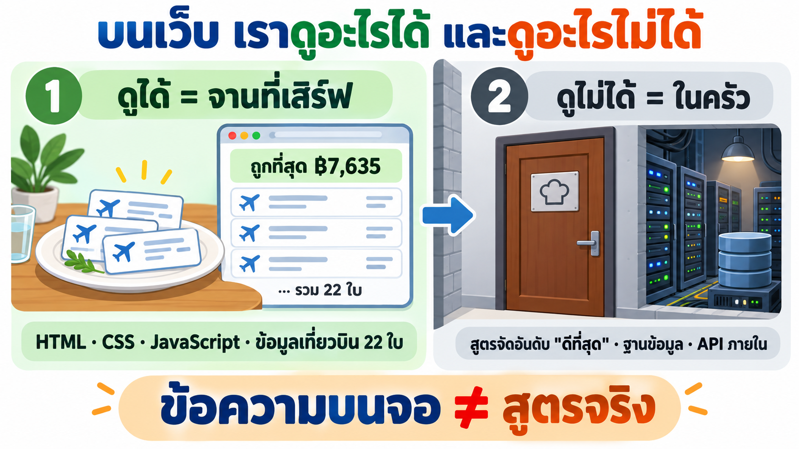
*ดูได้ = จานที่เสิร์ฟ (ของที่ส่งมาถึงเบราว์เซอร์) · ดูไม่ได้ = ในครัว (เซิร์ฟเวอร์)*

เหมือนร้านอาหาร: เราเห็น **จานที่เสิร์ฟ** (หน้าเว็บ) แต่ไม่เห็น **ในครัว** (เซิร์ฟเวอร์)

| | ✅ ดูได้ (ส่งมาถึงเบราว์เซอร์) | ❌ ดูไม่ได้ (อยู่ที่เซิร์ฟเวอร์) |
|---|---|---|
| ประเภท | HTML · CSS · JavaScript · การทำงานตอนใช้ | โค้ดหลังบ้าน · ฐานข้อมูล · API ภายใน |
| 🧪 Google Flights | ป้าย "ถูกที่สุด ฿7,635" · การ์ดเที่ยวบิน 22 ใบ · ข้อมูลเที่ยวบินที่ฝังมากับหน้า | **สูตร** ที่ใช้จัดอันดับ "ดีที่สุด" · ฐานข้อมูลเที่ยวบินทั้งหมด |

⚠️ **เห็นได้ แต่อ่านยาก:** JavaScript ของ Google ถูก **บีบ (minify)** ให้ไฟล์เล็ก ชื่อฟังก์ชันเหลือแค่ตัวอักษรสั้น ๆ เช่น `U5T3Ef` อ่านไม่ออกว่าคืออะไร

🧪 **ตัวอย่างจริง:** บนหน้าเขียนว่า "ดีที่สุด" ดูทั้ง **ราคาและความสะดวก** (ข้อความนี้เห็นได้) แต่ราคาสำคัญกี่ส่วน เวลาบินสำคัญกี่ส่วน ไม่มีในโค้ดฝั่งเบราว์เซอร์ ใน LAB 4 REA จึงตอบตรง ๆ ว่า **"ไม่ทราบ"**

**สรุป:** เห็นได้ = ของที่ส่งมาที่เบราว์เซอร์ · เห็นไม่ได้ = ตรรกะในเซิร์ฟเวอร์ · ข้อความบนจอ ≠ สูตรจริง

---

### T4) ถ้ามีแค่ไฟล์ .exe ล่ะ? (ตัวอย่างจากวิดีโอ)

💡 **ใจความ:** แม้มีแค่โปรแกรมที่ compile แล้ว ก็ยังใช้เครื่องมืออย่าง Ghidra แปลงกลับมาให้พออ่านได้

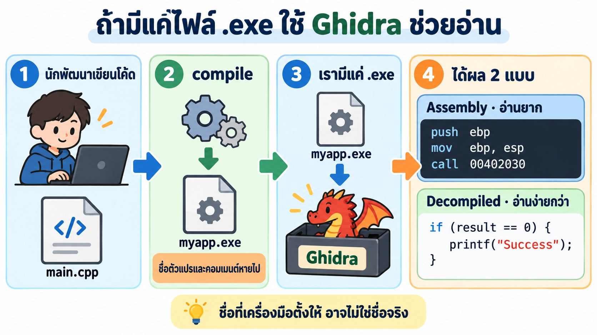
*main.cpp → compile → myapp.exe → Ghidra → assembly (อ่านยาก) และ decompiled (อ่านง่ายกว่า)*

หัวข้อนี้มาจากวิดีโอ เพื่อให้เห็นว่า RE ไม่ได้มีแค่เว็บ

1. นักพัฒนาเขียน `main.cpp` แล้ว **compile** เป็น `myapp.exe` ระหว่างทาง ชื่อตัวแปรและคอมเมนต์หายไปเกือบหมด
2. ฝั่งเรามีแค่ `myapp.exe` ไม่มีโค้ด

3. **Ghidra** แปลงไฟล์ออกมาได้ 2 แบบ

| แบบ | หน้าตา (จากสไลด์ในวิดีโอ) | อ่านง่ายไหม |
|---|---|---|
| Assembly | `push ebp` · `mov ebp, esp` · `call 00402030` | ยาก: ทีละคำสั่งของ CPU |
| Decompiled | `int result = processInput(argc); if (result == 0) { printf("Success\n"); }` | ง่ายกว่า: เห็น `if` และการเรียกฟังก์ชัน |

⚠️ ชื่อ `processInput` เป็นชื่อที่เครื่องมือ **ตั้งให้** อาจไม่ใช่ชื่อจริง

🧪 **เทียบกับของเรา:** JavaScript ของ Google ที่ถูกบีบก็คล้ายกัน ชื่อหายจนอ่านไม่ออก แต่ยังมี **ข้อความภาษาไทยบนหน้า** ช่วยให้เดาได้ว่าส่วนไหนทำอะไร (ดู T12)

**สรุป:** มีแค่ .exe ก็ยังเรียนรู้ได้ · เว็บที่ถูกบีบใช้หลักเดียวกัน

---

### T5) ดูได้กี่แบบ: Static กับ Dynamic และ 3 มุมมอง (Black / Grey / White box)

💡 **ใจความ:** มี 2 คำถามที่ต้องตอบทุกครั้งที่ "ดู" ระบบ
1. **ดูตอนไหน?** อ่านโค้ดเฉย ๆ (Static) หรือดูตอนมันกำลังทำงาน (Dynamic)
2. **ดูลึกแค่ไหน?** เห็นแค่หน้าจอ (Black box) · ส่องของที่ส่งมาถึงเครื่อง (Grey box) · มีโค้ดต้นฉบับ (White box)

เราจะใช้ **ร้านอาหาร** ตัวเดิมจาก T3 เป็นตัวเปรียบเทียบ: หน้าเว็บ = จานที่เสิร์ฟ · เซิร์ฟเวอร์ = ในครัว · โค้ด = สูตรอาหาร

#### ภาพ 1 · Static กับ Dynamic: ดูตอนไหน


*Static = อ่านสูตร (LAB 4) · Dynamic = ดูจานที่เสิร์ฟจริง (LAB 3) · ใช้คู่กันดีที่สุด*

**Static (ดูโค้ด ไม่ต้องรัน)**
- **คืออะไร:** เปิดไฟล์โค้ดขึ้นมา **อ่านเป็นตัวหนังสือ** โปรแกรมไม่ได้ทำงานเลย
- **เปรียบเหมือน:** อ่านสูตรอาหารในหนังสือ เตายังไม่ได้เปิด
- **🧪 ในบทนี้ (LAB 4):** yolo1 ดึงไฟล์ JavaScript ของ Google Flights ออกมา แล้วค้นข้อความในไฟล์ เจอคำว่า `GetBookingResults`
- **บอกได้:** "มีคำนี้อยู่ในโค้ด" ✅
- **บอกไม่ได้:** "โค้ดนี้ถูกใช้จริงไหม ตอนไหน" ❌ (สูตรอยู่ในหนังสือ ไม่ได้แปลว่าวันนี้ครัวทำเมนูนี้)

**Dynamic (ดูตอนกำลังทำงาน)**
- **คืออะไร:** ให้โปรแกรม **ทำงานอยู่จริง** แล้วดูสิ่งที่เกิดขึ้นตอนนั้น สำหรับเว็บ = เปิดหน้าเว็บค้างไว้ในเบราว์เซอร์ (JavaScript รันเสร็จแล้ว หน้าโชว์ผลแล้ว) แล้วส่องหน้านั้น
- **เปรียบเหมือน:** ดูจานที่พนักงานเสิร์ฟมาตรงหน้า
- **🧪 ในบทนี้ (LAB 3):** Chrome เปิดหน้า Google Flights ค้างไว้ (T10) แล้ว REA ส่องหน้าที่โหลดเสร็จ เห็นการ์ดเที่ยวบิน 22 ใบ ป้าย "ถูกที่สุด ฿7,635"
- **บอกได้:** "สิ่งนี้เกิดขึ้นจริงตอนนี้" ✅
- **บอกไม่ได้:** "ส่วนที่ไม่ได้กดเป็นยังไง" ❌ (เช่น หลังปุ่ม "ดูเที่ยวบินเพิ่มเติม" · หน้าจอง)

| | Static | Dynamic |
|---|---|---|
| โปรแกรมทำงานไหม | ❌ ไม่ทำงาน แค่อ่านไฟล์ | ✅ ทำงานอยู่ |
| ดูอะไร | ตัวหนังสือในไฟล์โค้ด | หน้าเว็บที่โชว์อยู่จริง |
| ในบทนี้ | LAB 4 อ่าน JavaScript | LAB 3 ส่องหน้าที่เปิดอยู่ |
| ข้อดี | เห็นโค้ดทุกส่วน รวมส่วนที่ยังไม่ถูกใช้ | เห็นของจริงที่ผู้ใช้เห็น |
| ข้อจำกัด | ไม่รู้ว่าโค้ดถูกใช้จริงไหม | เห็นเฉพาะส่วนที่เปิด/กดดู |

💡 **ใช้คู่กันดีที่สุด:** อ่านโค้ดเจอ (Static) + เห็นตอนทำงานจริง (Dynamic) = มั่นใจ
🧪 เช่น บนจอเห็น SL ราคา ฿7,635 บิน 8 ชม. 5 นาที (Dynamic) และในข้อมูลที่อ่านจากไฟล์เจอ `SL`, `485` นาที, `7635` (Static) สองทางตรงกัน → เชื่อได้

#### ภาพ 2 · Black / Grey / White box: ดูลึกแค่ไหน


*ยิ่งไปทางขวา ยิ่งเห็นข้างในมากขึ้น · REA ทำงานแบบ Grey box*

คำว่า "box" (กล่อง) หมายถึง **ระบบที่เรากำลังดู** สีของกล่องบอกว่า **เรามองทะลุเข้าไปข้างในได้แค่ไหน**

| มุมมอง | ทำไมเรียกแบบนี้ | ร้านอาหาร | เว็บ | 🧪 ในบทนี้ |
|---|---|---|---|---|
| ⬛ **Black box** กล่องดำ | กล่องทึบ มองไม่เห็นข้างในเลย | กินอย่างเดียว เห็นแค่จาน | ใช้เว็บเหมือนลูกค้า เห็นแค่หน้าจอ | เปิด Google Flights เห็นราคา ฿7,635 |
| 🔲 **Grey box** กล่องเทา | กึ่งโปร่ง เห็นข้างในบางส่วน | ส่องทุกอย่างที่มาถึงโต๊ะ (จาน ขวดซอส ใบเสร็จ) แต่ **ไม่ได้เข้าครัว** | ส่อง HTML · JavaScript · ข้อมูลที่ฝังมากับหน้า (ทุกอย่างที่ส่งมาถึงเบราว์เซอร์) | **REA ทำแบบนี้** เจอเที่ยวบิน 22 ใบใน `ds:1` |
| ⬜ **White box** กล่องขาว (กล่องใส) | ใส มองเห็นข้างในหมด | เชฟให้สูตรทั้งเล่ม | มีโค้ดต้นฉบับทั้งหมด (รวมฝั่งเซิร์ฟเวอร์) | ทำกับ Google ไม่ได้ · ทำได้กับ SkyThai Mini ของเรา (`skythai-mini/src/`) |

⚠️ **ทำไม REA เป็น Grey box ไม่ใช่ White box:** REA เห็นได้แค่ของที่ **ส่งมาถึงเบราว์เซอร์** (T3) ส่วนในครัว (เซิร์ฟเวอร์ ฐานข้อมูล สูตร "ดีที่สุด") ยังปิดอยู่

**สรุป:** Static = อ่านสูตร · Dynamic = ดูจานจริง · Black = เห็นแค่จาน · Grey = ส่องทุกอย่างบนโต๊ะ (REA) · White = มีสูตรในครัว

---

### T6) ปัญหาเดิม: เครื่องมือเยอะ คนต้องต่อจิ๊กซอว์เอง

💡 **ใจความ:** เครื่องมือ RE มีอยู่แล้ว แต่ต้องใช้หลายตัว และคนต้องเอาข้อมูลมาต่อกันเอง ซึ่งช้าและยาก


*เครื่องมือคนละชิ้น → คนต่อเอง → ช้า · REA ให้ AI ต่อแทน*

🧪 **ตัวอย่างจริง:** ถ้าสืบ Google Flights ด้วยมือ ต้อง
1. กด F12 ดูโครงหน้า
2. ไล่อ่านไฟล์ JS ที่ถูกบีบ
3. หาข้อมูลเที่ยวบินที่ซ่อนอยู่ใน array ซ้อนกันหลายชั้น
4. เทียบกับหน้าจอทีละช่อง

ใน LAB 4 yolo1 + REA ทำงานแบบนี้เสร็จใน **5 นาที 40 วินาที**

**สรุป:** ปัญหาไม่ใช่ขาดเครื่องมือ แต่คือ "คน" ต้องรู้ทุกเครื่องมือและต่อข้อมูลเอง → REA ให้ AI ทำแทน

---

### T7) MCP คืออะไร

💡 **ใจความ:** MCP คือ "ช่องเสียบมาตรฐาน" ที่ทำให้ AI agent หยิบเครื่องมือภายนอกมาใช้ได้

#### ภาพ 1 · ทำไมต้องมี MCP

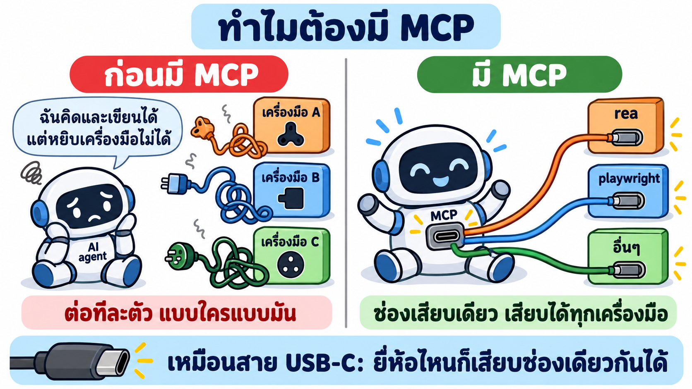
*ก่อนมี MCP: เครื่องมือแต่ละตัวต้องต่อแบบเฉพาะ · มี MCP: ช่องเดียวเสียบได้ทุกตัว*

1. **AI agent** (เช่น Claude Code) เก่งเรื่องคิดและเขียน แต่ลำพังตัวเอง **เปิดเว็บ อ่านไฟล์ JavaScript หรือถ่ายภาพหน้าจอไม่ได้**
2. **ก่อนมี MCP** ถ้าอยากให้ AI ใช้เครื่องมือ ต้องเขียนตัวเชื่อมเฉพาะให้เครื่องมือแต่ละตัว กับ AI แต่ละยี่ห้อ ยุ่งมาก
3. **มี MCP** เครื่องมือไหนทำตัวเองเป็น **MCP server** ก็เสียบเข้า AI ตัวไหนก็ได้ที่รองรับ MCP (Claude Code, Codex ฯลฯ) เหมือนสาย USB-C ที่เสียบได้ทุกเครื่อง

| คำ | ความหมายง่าย ๆ | ในบทนี้ |
|---|---|---|
| **MCP** | กติกากลางว่าจะคุยกันยังไง (ช่องเสียบ) | — |
| **MCP server** | เครื่องมือที่ทำตามกติกานั้น (ของที่เสียบ) | `rea` (207 tools) · `playwright` |
| **tool** | ความสามารถ 1 อย่างที่ server มีให้ | `inspect_web_page` = ส่องหน้าเว็บ |

#### ภาพ 2 · agent คุยกับ MCP server ยังไง


*4 ขั้นที่เกิดขึ้นทุกครั้งที่ yolo1 ทำงาน · เราไม่ต้องบอกชื่อเครื่องมือ agent เลือกเอง*

| ขั้น | เกิดอะไร | 🧪 ในบทนี้ |
|---|---|---|
| 1. อ่านรายชื่อ | agent อ่านรายชื่อว่ามี MCP server อะไรบ้าง | มี `rea` (LAB 1 ให้ AI เพิ่มให้) |
| 2. เปิด server | agent รันคำสั่งนั้นเองตอนเริ่มทำงาน | — |
| 3. ถามว่ามีอะไรบ้าง | server ตอบรายชื่อ tool พร้อมวิธีใช้ | REA ตอบ **207 tools** |
| 4. เรียกใช้ | agent เลือก tool ส่งค่าไป รับผลกลับ แล้วคิดต่อ | ดูตัวอย่างด้านล่าง |

🧪 **ตัวอย่างจริง:** LAB 3 เราพิมพ์แค่ "ตรวจหน้า Google Flights แบบอ่านอย่างเดียว" ไม่ได้บอกชื่อ tool เลย yolo1 เลือกเอง 3 ตัวตามลำดับ
`list_browser_targets` (หาแท็บ) → `inspect_web_page` (ส่องหน้า) → `capture_web_screenshot` (ถ่ายภาพ)

**สรุป:** MCP = ช่องเสียบ · MCP server = เครื่องมือที่เสียบ · tool = ความสามารถแต่ละอย่าง · agent เลือกหยิบเอง

---

### T8) REA คืออะไร มีอะไรบ้าง

💡 **ใจความ:** REA คือ "ชุดนักสืบ" ที่เสียบเข้า AI agent ผ่าน MCP ข้างในมีเครื่องมือ 207 ชิ้น + คู่มือ + ใบเสร็จหลักฐาน

**REA (Reverse Engineer Anything)** เป็นโปรเจกต์ open source (`github.com/morluto/rea`) ติดตั้งผ่าน npm ชื่อ `rea-agents` ใช้ได้กับ Claude Code, Codex และ agent อื่น

#### ภาพ 1 · ในกล่อง REA มีอะไร


*4 ช่องในกล่อง · สืบได้หลายอย่าง แต่บทนี้ใช้แค่หน้าเว็บ*

| ของในกล่อง | เปรียบเหมือน | หน้าที่ | 🧪 ในบทนี้ |
|---|---|---|---|
| **MCP server** | เครื่องมือนักสืบ | มี 207 tools ให้ agent เรียก | ส่องหน้าเว็บ · ถ่ายภาพหน้าจอ · ดึงไฟล์ JavaScript |
| **skill** | คู่มือนักสืบ | บอก agent ว่าใช้เครื่องมือไหน ลำดับไหน และต้องแยก "เห็นจริง" กับ "เดา" | ทำให้ yolo1 ติดป้าย ยืนยันแล้ว / อนุมาน เอง |
| **หลักฐาน (evidence)** | ใบเสร็จ | ผลตรวจทุกครั้งมีรหัส ตรวจย้อนได้ | รหัส `ev_…` ติดอยู่กับเที่ยวบินทุกใบ |

(ช่องที่ 4 ในภาพ "CLI" คือสวิตช์ติดตั้ง/เปิดเครื่อง AI ใช้เองเบื้องหลัง เราไม่ต้องจำ)

**ติดตั้งแล้วได้อะไร:** agent **เห็นเครื่องมือ** (MCP) + **มีคู่มือ** (skill) แค่นั้น ใน LAB 1 เราวางพรอมต์ให้ AI ติดตั้งให้

#### ภาพ 2 · เส้นทางจริงของคำสั่ง 1 ครั้ง


*คำสั่งเดินไป 6 สถานี (สถานี 2–6 อยู่ใน container) แล้วผลเดินกลับมาเป็นไฟล์หลักฐาน*

| สถานี | ใคร | ทำอะไร |
|---|---|---|
| 1 | เรา | วางพรอมต์ใน Claude Code Desktop |
| 2 | `docker exec` | Claude Code ส่งงานเข้า container |
| 3 | `yolo1` | อ่านพรอมต์ เปิดคู่มือ (skill) แล้วเลือก tool |
| 4 | REA (MCP server) | ทำงานตาม tool ที่ถูกเรียก เช่น `inspect_web_page` |
| 5 | Chrome พอร์ต 9222 | เปิดหน้า Google Flights ค้างไว้ให้ REA ส่อง (T10) |
| 6 | หน้า Google Flights | ถูกอ่านอย่างเดียว ไม่มีการคลิก |
| ↩ | ผลเดินกลับ | หลักฐาน `ev_…` → ไฟล์ `.json` → yolo1 สรุปให้เราอ่าน |

🧪 **ทดสอบจริง:** หลังติดตั้ง ถาม `yolo1` ว่าเห็น REA ไหม ได้คำตอบว่าเห็น **207 tools** และเห็นคู่มือ ✅ (ติดตั้งที่ส่วนกลางให้ทุกบัญชีใช้ได้ ดู T14)

**สรุป:** REA = เครื่องมือ 207 ชิ้น + คู่มือ + สวิตช์ + ใบเสร็จ · คำสั่งเดินจากเรา → yolo1 → REA → Chrome แล้วผลกลับมาเป็นไฟล์หลักฐาน

---

### T9) AI สืบทีละขั้นยังไง: วงจร 4 ขั้น + ถามต่อ

💡 **ใจความ:** ถาม → ให้ AI ใช้เครื่องมือตรวจ → อ่านหลักฐาน → เอาไปใช้ ถ้ายังไม่พอก็วนกลับไปตรวจใหม่


*วงจรเดียวกัน ใส่ตัวอย่างจากการสืบ Google Flights*

| ขั้น | ทำอะไร | 🧪 ในบทนี้ |
|---|---|---|
| 1. ถาม (Ask) | เราสั่งงาน | วางพรอมต์ → Claude Code ส่งต่อให้ `yolo1 -p` |
| 2. ตรวจ (Inspect & trace) | agent เรียก tool ของ REA | `inspect_web_page`, `analyze_web_bundle` |
| 3. อ่านหลักฐาน (Read the evidence) | อ่านผลที่ REA ส่งกลับ | `ui-evidence.json`, `code-analysis.json` |
| 4. ใช้ (Use what you learn) | สร้าง อธิบาย หรือทดสอบ | สร้าง SkyThai Mini |
| ↺ ถามต่อ (Follow-up) | ผลไม่พอ → ลองเครื่องมือใหม่ | ดูตัวอย่างด้านล่าง |

🧪 **ตัวอย่างจริง: วงถามต่อใน LAB 4**
1. yolo1 เรียก `analyze_web_bundle` → ได้ข้อมูลน้อย ไม่รู้ว่าเว็บใช้ framework อะไร
2. ไม่พอ → วนกลับไปเรียก `export_web_scripts` ดึงสคริปต์ออกมาเป็นไฟล์
3. เครื่องมือค้นหาตัวหนึ่งล้มเหลว → yolo1 เขียน Python ค้นเอง
4. เจอข้อมูลเที่ยวบินและรายการโหมดเรียง → ได้คำตอบ

AI ต่างจากสคริปต์ที่รันครั้งเดียวตรงนี้ คือ **ปรับวิธีเองเมื่อผลรอบแรกไม่พอ**

**สรุป:** ถาม → ตรวจ → อ่านหลักฐาน → ใช้ · ไม่พอก็วนถามต่อ

---

### T10) AI เข้าไปดูหน้าเว็บได้ยังไง: Chrome ที่ "เปิดประตู" ไว้

💡 **ใจความ:** REA จะส่องหน้าเว็บได้ ต้องเปิด Chrome แบบพิเศษที่ "เปิดประตูหลัง" ไว้ให้ (ประตูนี้ชื่อพอร์ต 9222)


*Chrome ปกติประตูปิด · เปิดประตู 9222 แล้ว REA เข้าไปอ่านแท็บได้*

**เปรียบเหมือน:** ห้องที่มีหน้าต่างให้คนข้างนอกมองเข้าไปได้
- Chrome ปกติ = ห้องปิดทึบ → REA มองไม่เห็นอะไร
- Chrome ที่เปิดประตู 9222 = มีช่องให้มอง → REA เห็นว่ามีแท็บอะไรเปิดอยู่ แล้วส่องแท็บนั้นได้

ช่องทางนี้มีชื่อว่า **CDP (Chrome DevTools Protocol)** เป็นช่องเดียวกับที่หน้าต่าง DevTools (กด F12) ใช้อยู่แล้ว

**เราต้องทำอะไร?** ไม่ต้องพิมพ์คำสั่งเอง ใน LAB 2 เราแค่บอก Claude Code ว่า "เปิด Chrome พอร์ต 9222 ไปที่ Google Flights" แล้ว AI จัดการให้ทั้งหมด (เปิดแบบไม่มีหน้าต่าง ใช้โปรไฟล์เปล่าที่ไม่มีบัญชีของใคร)

🧪 **ตัวอย่างจริง (ผล prompt 1):** yolo1 เชื่อมต่อได้ เจอแท็บหน้าเว็บ 1 แท็บชื่อ "กรุงเทพมหานคร ไปยัง โตเกียว | Google Flights" ✅

💡 **ทำไม prompt แรกแค่ทดสอบการเชื่อมต่อ:** ถ้าไม่ผ่าน เรารู้ทันทีว่าปัญหาอยู่ที่ Chrome ไม่ต้องไปงมกับการวิเคราะห์

⚠️ ตอนประตูเปิด โปรแกรมอื่นในเครื่องก็เข้ามาได้ จึงใช้ Chrome แยกใน container และ **ปิด Chrome เมื่อจบงาน**

**สรุป:** REA ส่องเว็บผ่านประตู 9222 ของ Chrome · AI เปิดให้เอง · prompt แรกแค่เช็กว่าเข้าได้

---

### T11) เชื่อผลข้อไหนได้: ติดป้ายหลักฐาน 3 สี

💡 **ใจความ:** AI ตอบด้วยน้ำเสียงมั่นใจทุกข้อ เราจึงให้ AI **ติดป้ายสีทุกข้อสรุป** ว่ามั่นใจได้แค่ไหน แล้วเราถามเสมอว่า "มาจากหลักฐานไหน?"

#### ภาพ 1 · ป้าย 3 สี


*เขียว = ใช้ได้เลย · เหลือง = ใช้ชี้ทาง · เทา = ห้ามเดาเติม*

เปรียบเหมือน **นักสืบรายงานคดี**: บางเรื่อง "เห็นกับตา" บางเรื่อง "สงสัยว่า…" บางเรื่อง "ยังไม่รู้" นักสืบที่ดีต้องบอกให้ชัดว่าเรื่องไหนเป็นแบบไหน

| ป้าย | ความหมาย | 🧪 ตัวอย่างจริงจาก LAB 3–4 | เราใช้ยังไง |
|---|---|---|---|
| 🟢 **ยืนยันแล้ว** | เห็นในของจริง ใครตรวจซ้ำก็เจอเหมือนกัน | ข้อมูลเที่ยวบินที่ฝังมากับหน้ามีครบ 22 ใบ | ใช้เป็นข้อเท็จจริงได้ |
| 🟡 **อนุมาน** | มีเบาะแส แต่ยังไม่เห็นตรง ๆ | "ไม่เจอโค้ดเรียงในเบราว์เซอร์ จึง **น่าจะ** จัดอันดับที่เซิร์ฟเวอร์" | ใช้ชี้ทาง แต่ต้องหาหลักฐานเพิ่มก่อนสรุป |
| ⚪ **ไม่ทราบ** | หาไม่ได้ (และบอกเหตุผล) | สูตรของ "ดีที่สุด" (อยู่ในเซิร์ฟเวอร์) | ห้ามเดาเติม |

**เราได้ประโยชน์อะไร:** ตอนสร้างแอปใน LAB 5 เราเอาเฉพาะ 🟢 ไปใช้ได้เลย ส่วน 🟡 และ ⚪ ต้องออกแบบเองและบอกว่าเป็นของเรา (T13)

#### ภาพ 2 · 3 กติกาของป้าย


*ป้ายเปลี่ยนได้ตามหลักฐาน · ข้อมูลขัดกันให้หยุด · ไม่เจอ ≠ ไม่มี*

| กติกา | ความหมาย | 🧪 ตัวอย่างจริง |
|---|---|---|
| 1. หลักฐานเพิ่ม → ป้ายขยับขึ้น | ข้อสรุปเดิม แต่หลักฐานมากขึ้น ป้ายก็เปลี่ยนได้ | "Google ใช้ Wiz": LAB 3 ดูแค่โครงหน้า = 🟡 → LAB 4 อ่าน JavaScript เจอชื่อ Wiz ตรง ๆ = 🟢 |
| 2. ข้อมูลขัดกัน → ไม่สรุป | ถ้า 2 แหล่งบอกไม่ตรงกัน ห้ามเลือกเชื่ออันใดอันหนึ่ง | สวิตช์ติดตามราคา: โครงหน้าบอก "เปิด" แต่ภาพหน้าจอดู "ปิด" → yolo1 เขียน "ไม่สรุป" |
| 3. หาไม่เจอ ≠ ไม่มี | "ไม่เจอ" แปลว่าไม่เจอในส่วนที่ตรวจเท่านั้น | LAB 4 ตรวจได้ 28 สคริปต์ อีก 82 สคริปต์ไม่ได้ตรวจ |

**สรุป:** ติดป้าย 🟢 🟡 ⚪ ทุกข้อ · ป้ายเปลี่ยนได้ตามหลักฐาน · ขัดกันให้หยุด · ไม่เจอ ≠ ไม่มี · ถามเสมอว่า "มาจากหลักฐานไหน?"

---

### T12) REA เจออะไรใน Google Flights (ผลรันจริง)

💡 **ใจความ:** รวมผล LAB 3–4 ได้ 4 เรื่อง อ่านทีละเรื่องตามภาพนี้


*ภาพรวม 4 เรื่อง · แต่ละเรื่องมีรายละเอียดในขั้น 1–4 ด้านล่าง*

| เรื่อง | ใจความ | อ่านต่อ |
|---|---|---|
| 1 | ข้อมูลเที่ยวบิน 22 ใบมากับหน้าเว็บตั้งแต่แรก | ขั้น 1 |
| 2 | ตั๋ว 1 ใบ = 1 ทริป มีได้หลายขา | ขั้น 2 |
| 3 | "ดีที่สุด" ไม่ได้เรียงตามราคาอย่างเดียว | ขั้น 3 |
| 4 | ชื่อในโค้ดอ่านไม่ออก แต่ใช้ข้อความภาษาไทยช่วยหาได้ | ขั้น 4 |

#### ขั้น 1 · ข้อมูลมากับหน้าเว็บตั้งแต่แรก (SSR + hydrate)

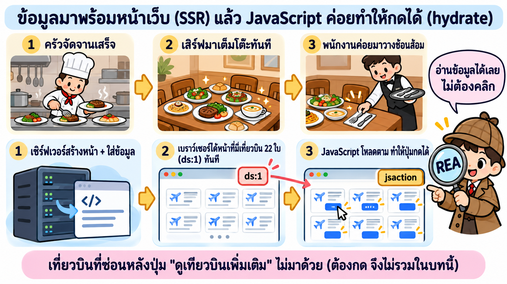
*ครัวจัดจานเสร็จ → เสิร์ฟเต็มโต๊ะทันที → ค่อยวางช้อนส้อม = เซิร์ฟเวอร์สร้างหน้า → ได้หน้าพร้อมข้อมูล → JavaScript ทำให้กดได้*

| ขั้น | ร้านอาหาร | เว็บ (ชื่อเรียก) | 🧪 Google Flights |
|---|---|---|---|
| 1 | ครัวจัดจานเสร็จ | เซิร์ฟเวอร์สร้างหน้าให้เสร็จ (**SSR** = Server-Side Rendering) | ใส่ผลค้นหาลงในหน้าเลย |
| 2 | เสิร์ฟมาเต็มโต๊ะทันที | เบราว์เซอร์ได้หน้าพร้อมข้อมูล | ข้อมูลชุดชื่อ `ds:1` มีเที่ยวบิน **22 ใบ** (ยอดนิยม 3 + อื่นๆ 19) |
| 3 | พนักงานค่อยมาวางช้อนส้อม | JavaScript โหลดตามแล้วทำให้ปุ่มกดได้ (**hydrate**) | ปุ่มผูกผ่าน `jsaction` 1,501 จุด |

🧪 **ผลต่อการสืบ:** ข้อมูลอยู่ในหน้าตั้งแต่แรก REA จึงอ่านได้ **โดยไม่ต้องคลิกอะไรเลย** แต่เที่ยวบินที่ซ่อนหลังปุ่ม "ดูเที่ยวบินเพิ่มเติม" ไม่มาด้วย เพราะบทนี้ **ห้ามคลิก** (บทที่ 3 กดแล้วได้ 300 ใบ)

#### ขั้น 2 · ข้อมูลเที่ยวบิน 1 ใบมีอะไร

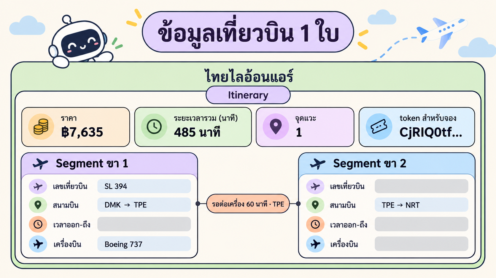
*1 ทริป (Itinerary) มีได้หลายขา (Segment) · ตัวอย่างจริง SL 394 DMK → TPE → NRT*

| ช่อง | 🧪 ตัวอย่างจริง (ไทยไลอ้อนแอร์) |
|---|---|
| สายการบิน | `SL` ไทยไลอ้อนแอร์ |
| ต้นทาง → ปลายทาง | `DMK` ดอนเมือง → `NRT` นาริตะ |
| เวลาออก → ถึง | 06:20 → 16:25 (เวลาท้องถิ่นของแต่ละสนามบิน) |
| ระยะเวลารวม | `485` นาที (8 ชม. 5 นาที) |
| ขาที่บิน | SL 394 · แวะ 60 นาทีที่ `TPE` ไทเป |
| ราคา | `7635` บาท |

💡 **ทำไมต้องเก็บระยะเวลาแยก:** ถ้าเอา 16:25 − 06:20 จะได้ 10 ชม. 5 นาที ซึ่ง **ผิด** เพราะญี่ปุ่นเวลาเร็วกว่าไทย 2 ชั่วโมง ค่า 485 นาทีที่ Google ส่งมาจึงถูกต้อง

#### ขั้น 3 · "ดีที่สุด" ≠ "ถูกที่สุด"

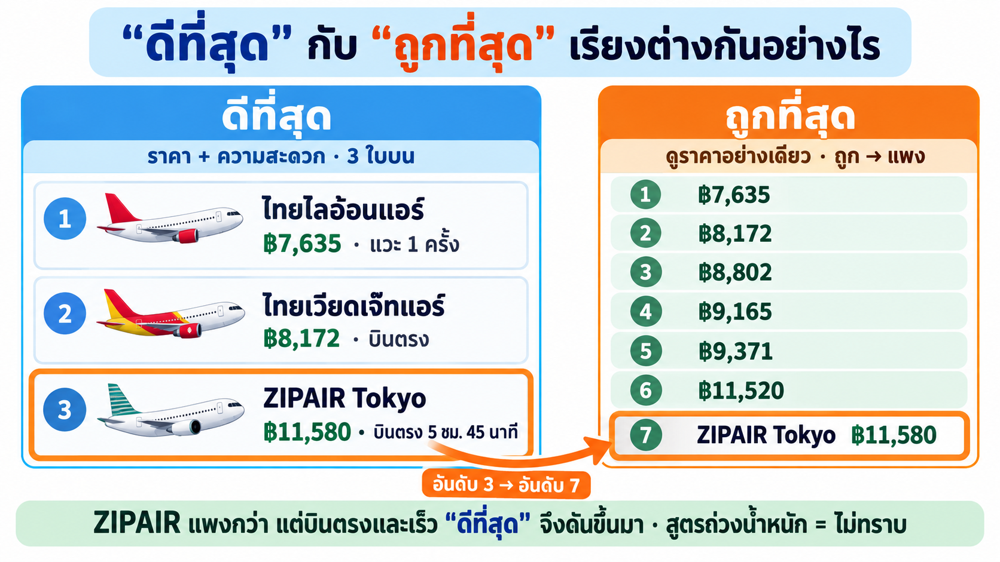
*"ดีที่สุด" = ราคา + ความสะดวก · "ถูกที่สุด" = ดูราคาอย่างเดียว*

| กลุ่ม | ราคาตามลำดับบนหน้า | เรียงตามราคาไหม |
|---|---|---|
| 3 ใบบน ("ยอดนิยม") | ฿7,635 · ฿8,172 · **฿11,580** | ❌ ไม่ |
| 19 ใบที่เหลือ | ฿8,802 → … → ฿41,760 | ✅ ถูก → แพง |

🧪 **สังเกตใบที่ 3:** ZIPAIR ฿11,580 (บินตรง 5 ชม. 45 นาที) อยู่กลุ่มบนทั้งที่มีใบถูกกว่าอีกหลายใบ ถ้าเรียงตามราคาอย่างเดียว ZIPAIR จะตกไปอยู่ **อันดับ 7**
→ แปลว่า "ดีที่สุด" ดูอย่างอื่นนอกจากราคาด้วย

**"ถูกที่สุด" เข้าใจง่าย: เรียงราคาน้อย → มาก แล้ว "ดีที่สุด" ล่ะ? ไทยไลอ้อนแอร์แวะ 1 ครั้ง ทำไมได้อันดับ 1?**

Google เขียนบนหน้าเว็บว่า "ดีที่สุด" ดู **ราคา + ความสะดวก** แต่ไม่บอกสูตร เราจึงลองเอาข้อมูลจริง 22 ใบมาคิดเองทีละขั้น


*วัด 3 อย่าง → ใบที่แพ้ใบอื่นทุกด้านตกรอบ → เหลือ 4 ใบ → 3 ใบที่ถูกที่สุดคือ 3 ใบบนของ Google*

**ขั้น ก · "ความสะดวก" วัดเป็นตัวเลขได้ 2 อย่าง**

| วัดอะไร | ดีคือ | ทำไมสำคัญกับคนเดินทาง |
|---|---|---|
| จำนวนแวะ | บินตรง (0) ดีกว่า แวะ (1) | แวะ = ลงเครื่อง รอ เสี่ยงตกเครื่อง |
| เวลาบินรวม | ยิ่งสั้นยิ่งดี | ถึงเร็ว เหนื่อยน้อย |

พอรวมกับ **ราคา** เราจะมี 3 ตัวเลขต่อเที่ยวบิน 1 ใบ

**ขั้น ข · กติกา "แพ้ทุกด้าน = ตกรอบ"**

ถ้ามีเที่ยวบินอีกใบที่ **ถูกกว่าหรือเท่ากัน + แวะน้อยกว่าหรือเท่ากัน + เร็วกว่าหรือเท่ากัน** ใบเราไม่มีเหตุผลให้ใครเลือก → ตกรอบ

| ตัวอย่าง | ราคา | แวะ | เวลาบิน | ผล |
|---|---:|---:|---:|---|
| ไทยเวียดเจ๊ทแอร์ 09:35 | ฿8,172 | 0 | 5 ชม. 55 นาที | ✅ อยู่ต่อ |
| ไทยเวียดเจ๊ทแอร์ 23:50 | ฿8,802 | 0 | 6 ชม. 5 นาที | ❌ แพ้ใบบนทุกด้าน (แพงกว่า + ช้ากว่า) |

**ขั้น ค · ใช้กติกากับทั้ง 22 ใบ เหลือแค่ 4 ใบ**


*กราฟจากข้อมูลจริง (วาดด้วย Python จาก `flights-snapshot.json`): ยิ่งไปมุมซ้ายล่างยิ่งถูกและเร็ว*

| เหลือ | ราคา | แวะ | เวลาบิน | เหตุผลที่ไม่มีใครชนะทุกด้าน | Google จัดให้ |
|---|---:|---:|---:|---|---|
| ไทยไลอ้อนแอร์ | **฿7,635** | 1 | 8 ชม. 5 นาที | **ถูกที่สุดในทั้ง 22 ใบ** ไม่มีใครถูกกว่า | 🥇 อันดับ 1 |
| ไทยเวียดเจ๊ทแอร์ | ฿8,172 | **0** | 5 ชม. 55 นาที | **บินตรงที่ถูกที่สุด** | 🥈 อันดับ 2 |
| ZIPAIR Tokyo | ฿11,580 | **0** | **5 ชม. 45 นาที** | ใบที่ถูกกว่าบินช้ากว่าทุกใบ | 🥉 อันดับ 3 |
| การบินไทย | ฿15,320 | 0 | **5 ชม. 40 นาที** | เร็วที่สุด | ไม่ติด 3 ใบบน |

**ตอบคำถาม: ทำไมไทยไลอ้อนแอร์ได้อันดับ 1 ทั้งที่แวะ 1 ครั้ง?**
เพราะถูกที่สุดในทั้งหมด ไม่มีเที่ยวบินไหน "ชนะทุกด้าน" ได้ ใครอยากประหยัดที่สุดก็ต้องเลือกใบนี้ ส่วนข้อเสีย (แวะ 1 ครั้ง) ยังพอรับได้ เพราะใช้เวลา 8 ชม. 5 นาที ซึ่งเร็วที่สุดในกลุ่มที่แวะ (ใบอื่นที่แวะใช้ 8 ชม. 55 นาที – 16 ชม.)

**แล้ว 3 ใบบนเรียงกันยังไง?** เรียงตามราคาในกลุ่มที่เหลือ: 7,635 → 8,172 → 11,580 ใบที่ 4 (การบินไทย ฿15,320) เร็วขึ้นแค่ 5 นาที แต่แพงขึ้น ฿3,740 จึง **น่าจะ** ไม่คุ้มพอให้ติด 3 ใบบน

⚠️ **ต้องแยกให้ชัด (T11)**
- 🟢 ยืนยันแล้ว: Google บอกบนหน้าว่าดู "ราคา + ความสะดวก" · 3 ใบบนคือ 7,635 · 8,172 · 11,580
- 🟡 อนุมาน: กติกา "แพ้ทุกด้าน = ตกรอบ" อธิบายข้อมูลรอบนี้ได้ครบ แต่เราคิดขึ้นเองจากข้อมูล ไม่ได้เห็นในโค้ดของ Google
- ⚪ ไม่ทราบ: สูตรจริงและน้ำหนักของแต่ละปัจจัย (อาจมีปัจจัยอื่น เช่น เวลาออกเดินทาง หรือการเปลี่ยนสนามบิน)

#### ขั้น 4 · ชื่อในโค้ดถูกบีบ แต่ใช้ข้อความภาษาไทยช่วยหาได้

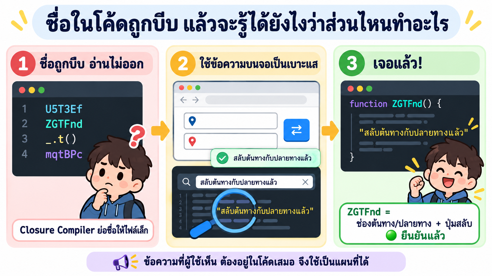
*ชื่ออ่านไม่ออก → ค้นด้วยข้อความที่ผู้ใช้เห็น → รู้ว่าโมดูลไหนทำอะไร*

| ขั้น | เกิดอะไร |
|---|---|
| 1. ชื่อถูกบีบ | Google ใช้ Closure Compiler ย่อชื่อให้ไฟล์เล็ก ชื่อเลยเหลือแค่ `U5T3Ef`, `ZGTFnd`, `_.t()` อ่านไม่ออกว่าทำอะไร |
| 2. หาเบาะแส | กดปุ่มสลับ ⇄ แล้วจอขึ้นข้อความ "สลับต้นทางกับปลายทางแล้ว" ข้อความนี้ **ต้องอยู่ในโค้ด** (ไม่งั้นจอจะแสดงไม่ได้) |
| 3. ค้นหา | ค้นข้อความนั้นในไฟล์ JavaScript → เจอในโมดูล `ZGTFnd` → `ZGTFnd` = ช่องต้นทาง/ปลายทาง + ปุ่มสลับ 🟢 |

🧪 ใช้วิธีเดียวกันหาได้อีกว่า แถบเรียง = `U5T3Ef` 🟢 (มีป้าย "ราคา", "เวลาออกเดินทาง" ฯลฯ อยู่ในโมดูลนี้) ส่วนโมดูลอื่น เช่น ตัวกรอง = `ebuxPc` เป็นแค่ 🟡 อนุมาน

**สรุป:** ข้อมูล 22 ใบมากับหน้าเว็บ · 1 ทริปมีหลายขา · เก็บระยะเวลาเป็นนาที · "ดีที่สุด" ≠ "ถูกที่สุด" และสูตรเป็นความลับของเซิร์ฟเวอร์

---

### T13) เอาอะไรมาใช้ได้: ยืม "แนวคิด" ไม่ใช่ "โค้ด"

💡 **ใจความ:** เอาแนวคิดที่เรียนรู้มา แล้วเขียนใหม่เองทั้งหมด ห้ามลอกโค้ด โลโก้ ชื่อ และห้ามเรียก API ภายในของ Google

| SkyThai Mini ยืมแนวคิดอะไร | มาจากไหน | 🧪 ทำในแอปเรายังไง |
|---|---|---|
| เก็บระยะเวลาเป็นนาที | T12 ขั้น 2 | ไม่คำนวณจากเวลาที่ข้ามโซน |
| มีการเรียงหลายแบบ | T12 ขั้น 3 | ปุ่ม ราคาถูกสุด (ค่าเริ่มต้น) · ราคาแพงสุด · บินเร็วสุด · ออกเช้าสุด |
| ตัวกรองจำนวนแวะ | LAB 3 | ปุ่ม "บินตรงเท่านั้น" (22 → 18 ใบ) |
| ข้อมูลเที่ยวบิน | `flights-snapshot.json` | ใส่ลงฐานข้อมูล PostgreSQL และติดป้าย "ข้อมูลจำลอง" |

| ของเราเองล้วน ๆ | รายละเอียด |
|---|---|
| ชื่อ หน้าตา โลโก้ | SkyThai Mini · โลโก้และภาพหน้าแรกสร้างด้วย `cyolo1` |
| เรียงแบบเริ่มต้น | **ถูก → แพง** ตามโจทย์ (Google เริ่มที่ "ดีที่สุด") |
| การจองจำลอง | เลือกเที่ยวบิน → กรอกชื่อ + อีเมล → ได้รหัสจอง `STM-XXXXXX` (ไม่มีจ่ายเงินจริง) |

🧪 ถ้าอยากมี "ดีที่สุด" ของเราเอง yolo1 เสนอสูตรที่ **คิดเอง** เช่น `ราคา×w1 + เวลาบิน×w2 + จำนวนแวะ×w3` สูตรนี้ไม่ใช่ของ Google (ของ Google = ไม่ทราบ)

**สรุป:** หลักฐาน → แนวคิด → เขียนใหม่เอง · แบรนด์และโค้ดเป็นของเราทั้งหมด

---

### T14) ทำไมทำงานใน container และติดตั้ง REA ที่ "ส่วนกลาง"

💡 **ใจความ:** container คือ "ห้องทดลอง" แยกจากเครื่องเรา ทุกคนได้ของชุดเดียวกัน ส่วนการติดตั้งที่ส่วนกลางทำให้ติดตั้งครั้งเดียว ใช้ได้ทั้ง 10 บัญชี

#### ภาพ 1 · ทำไมทำงานใน container


*เครื่องเรากับห้องทดลองแยกกัน · ของสำคัญเก็บในตู้เซฟ (volume) จึงไม่หายตอนสร้างห้องใหม่*

| เหตุผล | อธิบายง่าย ๆ |
|---|---|
| 1. ทุกคนได้ของชุดเดียวกัน | เครื่องมือ Chrome และบัญชี AI มาพร้อมใน container ไม่ต้องติดตั้งเองทีละอย่าง |
| 2. ปลอดภัยกับบัญชีส่วนตัว | Chrome ที่เปิดประตู 9222 (T10) อยู่ในห้องทดลอง ไม่ใช่ Chrome ส่วนตัวที่ล็อกอินอีเมลเราไว้ |
| 3. พังก็เริ่มใหม่ได้ | สร้างห้องใหม่ด้วย `/maccount` |
| 4. ของสำคัญไม่หาย | ล็อกอินและ REA เก็บใน "ตู้เซฟ" (Docker volume) เราลองสร้างห้องใหม่ทับแล้ว (LAB 0) REA ยังอยู่ครบ |

#### ภาพ 2 · ทำไมติดตั้งที่ส่วนกลาง


*ติดตั้งแยกต้อง 10 รอบ · ติดตั้งที่ส่วนกลาง 1 รอบ ทุกบัญชีเห็น*

- container มี **10 บัญชี AI**: `yolo1`–`yolo5` (Claude Code) และ `cyolo1`–`cyolo5` (Codex)
- ทุกบัญชีอ่านรายชื่อเครื่องมือ (MCP) และคู่มือ (skill) จาก **ที่เดียวกัน** คือโฟลเดอร์ส่วนกลาง (`shared`)
- → เพิ่ม REA ที่ส่วนกลางครั้งเดียว ทุกบัญชีเห็นทันที ไม่ต้องติดตั้ง 10 รอบ
- เราแค่วางพรอมต์ใน LAB 1 แล้ว AI จัดการเพิ่มให้เอง (และสำรองของเดิมไว้ก่อน)

**สรุป:** container = ห้องทดลองที่ปลอดภัย ทุกคนเหมือนกัน ลบสร้างใหม่ได้ · ส่วนกลาง = ติดตั้งครั้งเดียว 10 บัญชีใช้ได้

---

### T15) สิ่งที่ REA บอกไม่ได้ + จริยธรรม

💡 **ใจความ:** REA เห็นได้แค่สิ่งที่ส่งมาถึงเบราว์เซอร์ และเฉพาะส่วนที่เราเปิดดู ส่วนเส้นที่ห้ามข้ามคือ ห้ามลอก ห้ามหลบระบบป้องกัน และต้องขออนุญาต

**REA บอกไม่ได้**

| เรื่อง | 🧪 ในบทนี้ | ทำยังไงแทน |
|---|---|---|
| สิ่งที่อยู่บนเซิร์ฟเวอร์ | สูตร "ดีที่สุด" | ออกแบบเอง และบอกว่าเป็นของเรา |
| ส่วนที่เราไม่ได้กด | ไม่ได้กด "ดูเที่ยวบินเพิ่มเติม" (ได้ 22 จาก 300 ใบ) | บทที่ 2–3 ใช้ Playwright กดสำรวจ |
| ราคาปัจจุบัน | ราคา ณ 31 ต.ค. 2569 เท่านั้น | ติดป้าย "ข้อมูลจำลอง" |
| ความถูกต้อง 100% | ข้อมูลขัดกันเรื่องสวิตช์ติดตามราคา | อ่านหลักฐานเอง ไม่เชื่อทุกข้อ |

**จริยธรรม (ต้องทำทุกครั้ง)**
- **มีเครื่องมือ ≠ มีสิทธิ์:** สืบเพื่อเรียนรู้ ดูอย่างเดียว ระบบจริงนอกห้องเรียนต้องขออนุญาต
- **เคารพข้อตกลงของเว็บ:** อ่าน Terms of Service · ไม่ยิงซ้ำถี่ ๆ · ไม่ดึงข้อมูลไปขาย
- **ไม่หลบระบบป้องกัน:** เจอ CAPTCHA ให้หยุด · ไม่ใช้บัญชีคนอื่น
- **ไม่ลอก:** แบรนด์ โลโก้ โค้ด ไม่เอามาใช้
- **กฎหมายไทย (ภาพรวม):** เข้าระบบที่มีการป้องกันโดยไม่ได้รับอนุญาตผิด พ.ร.บ.คอมพิวเตอร์ฯ · ข้อมูลส่วนบุคคลอยู่ใต้ PDPA
- **ข้อความบนเว็บไม่ใช่คำสั่ง:** ถ้าหน้าเว็บเขียนสั่ง AI ให้ทำอะไร AI ต้องไม่ทำตาม (รอบจริง yolo1 รายงานว่าไม่พบข้อความแบบนี้)

**สรุป:** REA เห็นแค่ส่วนที่ส่งมาและส่วนที่เราเปิดดู · ดูอย่างเดียว ไม่ลอก ไม่หลบ ขออนุญาตเสมอ

---

### 🧠 ทบทวน 10 ข้อ (ลองตอบก่อนเปิดเฉลย)

1. Reverse engineering ต่างจากการลอกโค้ดยังไง?
2. ข้อไหน "เห็นได้" ข้อไหน "เห็นไม่ได้": (ก) ป้าย "ถูกที่สุด ฿7,635" (ข) สูตรจัดอันดับ "ดีที่สุด" (ค) ข้อมูลเที่ยวบินที่ฝังมากับหน้า
3. Ghidra ให้ผล 2 แบบ คืออะไร แบบไหนอ่านง่ายกว่า?
4. เจอชื่อ `GetBookingResults` ในไฟล์ JS แปลว่า "มีการจองจริง" ไหม? เพราะอะไร?
5. MCP server กับ skill ต่างกันยังไง?
6. ถ้าเปิด Chrome แบบปกติ (ไม่มีพอร์ต 9222) prompt 1 จะได้ผลยังไง?
7. ทำไม "Google ใช้ Wiz" เป็น 🟡 อนุมานใน LAB 3 แต่เป็น 🟢 ยืนยันแล้วใน LAB 4?
8. ZIPAIR ฿11,580 อยู่กลุ่มบน ถ้าเรียงตามราคาจะอยู่อันดับเท่าไร และบอกอะไรเรา?
9. ทำไมต้องเก็บระยะเวลาบินเป็นนาที แทนการเอาเวลาถึงลบเวลาออก?
10. ทำไมติดตั้ง REA ที่ "ส่วนกลาง" แทนการติดตั้งทีละบัญชี?

<details>
<summary>เฉลย</summary>

1. RE คือ **ดู → เข้าใจ → เขียนของเราเองใหม่** ไม่เอาโค้ด แบรนด์ หรือข้อมูลของเขามาใช้
2. (ก) เห็นได้ · (ข) เห็นไม่ได้ (อยู่ที่เซิร์ฟเวอร์ → "ไม่ทราบ") · (ค) เห็นได้ เพราะส่งมากับหน้าเว็บ
3. **assembly** กับ **decompiled code** · decompiled อ่านง่ายกว่า (แต่ชื่อฟังก์ชันอาจไม่ใช่ชื่อจริง)
4. **ไม่ได้** · เป็นการดูโค้ด (static) บอกแค่ "มีชื่อนี้ในโค้ด" ต้องเห็นตอนทำงานจริง (dynamic) ซึ่งเราไม่ได้กดจอง
5. MCP server = **กล่องเครื่องมือ** (207 tools) · skill = **คู่มือ** ว่าใช้เครื่องมือยังไง และให้แยกยืนยัน/อนุมาน
6. REA **มองไม่เห็นแท็บ** เพราะประตู CDP ปิด → เชื่อมต่อ `127.0.0.1:9222` ไม่ได้
7. LAB 3 ดูแค่โครงหน้า ไม่เจอชื่อ Wiz ตรง ๆ · LAB 4 อ่าน JS แล้วเจอ `WIZ_global_data` → **หลักฐานเพิ่ม ป้ายจึงขยับขึ้น**
8. **อันดับ 7** · "ดีที่สุด" ไม่ได้ดูราคาอย่างเดียว แต่ให้น้ำหนักอะไรเท่าไร **ไม่ทราบ**
9. เวลาออก/ถึงเป็นเวลาท้องถิ่นคนละโซน ญี่ปุ่นเร็วกว่าไทย 2 ชม. ลบกันตรง ๆ จะได้ 10 ชม. 5 นาที ซึ่งผิด (จริง 485 นาที = 8 ชม. 5 นาที)
10. ทุกบัญชีหยิบเครื่องมือและคู่มือจากที่เดียวกัน → **ติดตั้งครั้งเดียว 10 บัญชีใช้ได้** ไม่ต้องทำ 10 รอบ

</details>

---

## 🗺️ เส้นทาง LAB

ก่อนลงมือ ดู 3 ภาพนี้ให้เข้าใจภาพรวม: **ไปไหนบ้าง** · **พรอมต์ทำงานยังไง** · **ผลส่งต่อกันยังไง**

### ภาพ 1 · แผนที่การเดินทาง LAB 0 → 5


*3 โซน: เตรียมของ (LAB 0–1) → สืบแบบอ่านอย่างเดียว (LAB 2–4) → สร้างของเรา (LAB 5)*

| โซน | LAB | ทำอะไร | ได้อะไร | AI ใช้เวลา (รันจริง) |
|---|---|---|---|---|
| ⚙️ เตรียมของ | 0 | เตรียม container | ห้องทดลองพร้อม บัญชี AI ล็อกอินแล้ว | — |
| | 1 | ติดตั้ง REA | ทุกบัญชีเห็น REA 207 tools + คู่มือ | — |
| 👁️ สืบ (อ่านอย่างเดียว) | 2 | เปิด Chrome แล้วเชื่อมต่อ | เห็นแท็บ Google Flights | 22 วินาที |
| | 3 | ตรวจหน้าจอ | ข้อมูลเที่ยวบิน 22 ใบ + หน้าจอมีอะไร | 2 นาที 39 วินาที |
| | 4 | วิเคราะห์ JavaScript | เบื้องหลังหน้าเว็บ + แนวทางสร้างเอง | 5 นาที 40 วินาที |
| 🔨 สร้างของเรา | 5 | สร้าง SkyThai Mini | แอปจองตั๋วที่ http://localhost:5081 | 5 นาที 56 วินาที |

### ภาพ 2 · พรอมต์ 1 อันมี 2 ชั้น


*เราวางทั้งก้อนครั้งเดียว Claude Code แยกส่งให้เอง*

| ชั้น | อยู่ตรงไหนในพรอมต์ | ใครทำ | ตัวอย่าง |
|---|---|---|---|
| **ชั้นนอก** | บนเส้น `---` | Claude Code Desktop (บนเครื่องเรา) | "เปิด Chrome พอร์ต 9222" · "ส่งงานด้านล่างให้ yolo1 ทำ" |
| **ชั้นใน** | ใต้เส้น `---` | `yolo1` ใน container | "ตรวจหน้า Google Flights แบบอ่านอย่างเดียว…" |

💡 เราแค่ **คัดลอกทั้งก้อนแล้ววางครั้งเดียว** ไม่ต้องแยกเอง

### ภาพ 3 · ผลของแต่ละ LAB ส่งต่อเป็นไฟล์


*เหมือนวิ่งผลัด: ไฟล์คือไม้ผลัด LAB ถัดไปอ่านไฟล์ของ LAB ก่อน จึงไม่ต้องเปิด Google ซ้ำ*

| LAB | ส่งไม้ผลัดอะไรต่อ | ใครรับไปใช้ |
|---|---|---|
| 2 | ยืนยันว่าเชื่อมต่อแท็บ Google Flights ได้ | LAB 3 |
| 3 | `flights-snapshot.json` (เที่ยวบิน 22 ใบ) · `ui-evidence.json` (หน้าจอมีอะไร) · `viewport.png` (ภาพหน้าจอ) | LAB 4 และ LAB 5 |
| 4 | `code-analysis.json` (เบื้องหลังหน้าเว็บ + แนวทางสร้างเอง) | LAB 5 |
| 5 | แอป `skythai-mini/` → คัดลอกออกมาเปิดบน Windows | เรา 🎉 |

(ข้างในแต่ละไฟล์มีอะไร ดูหัวข้อ 📦 หลัง LAB 4)

> 🔒 ผลจริงทุกพรอมต์อยู่ใน [`_solution/run/`](_solution/run/) ลองทำเองก่อน แล้วค่อยเปิดเทียบ

---

## LAB 0 · เตรียม container ด้วย `/maccount`

🎯 ให้ container `multi-account-devtool` พร้อมใช้ และบัญชี `yolo1` ล็อกอินอยู่

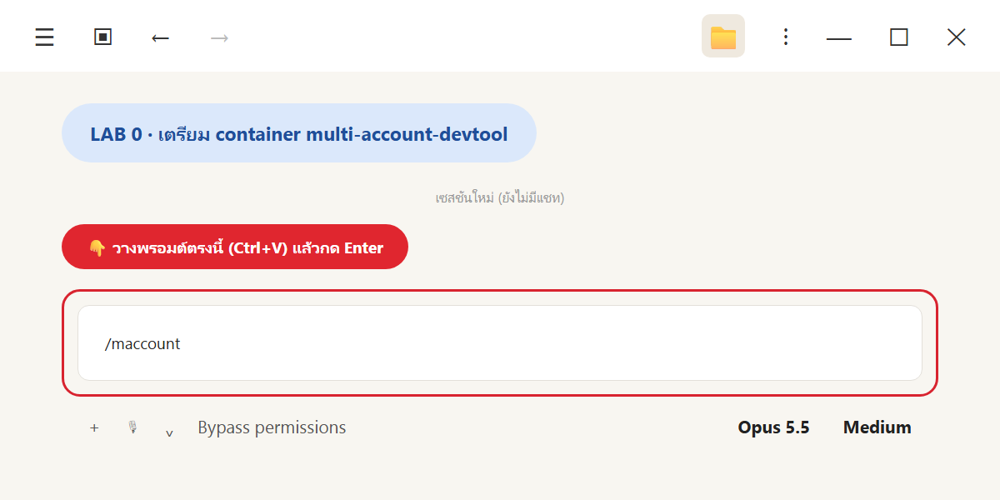
*วาง `/maccount` แล้วกด Enter*

💬 **คัดลอกพรอมต์นี้**

```text
/maccount
```

skill `/maccount` จะทำตามขั้นที่ 1 ของ LAB 03 ให้อัตโนมัติ
1. เช็ก image `tuchsanai/multi-account-devtool:2569_1`, container เดิม, พอร์ต และไฟล์ `.env`
2. ถ้า container เดิมตั้งค่าเหมือนเดิม ใช้ตัวเดิมต่อ (ไม่งั้นลบแล้ว `docker run` ใหม่ · อยากสร้างใหม่แน่ๆ พิมพ์ `/maccount สร้างใหม่`)
3. sync skill ในเครื่องเข้า container แล้วตรวจ
4. ตรวจการล็อกอินของ `yolo1`–`yolo5` และ `cyolo1`–`cyolo5`
5. เช็ก JupyterLab ตอบ 200 แล้วสรุปเป็นภาษาไทย

✅ **ผลที่คาดหวัง** (รันจริง 1 พ.ย. 2569 แบบสร้างใหม่ทับ)

| ขั้น | ผล |
|---|---|
| container | `CREATED multi-account-devtool` · พอร์ต 8886 |
| skill ส่วนกลาง | sync 5 skill · `.Claude` และ `.Codex` ✅ OK ครบ |
| ล็อกอิน | ล็อกอินแล้ว 4/10: `yolo1` `yolo2` `yolo3` `cyolo1` (บทนี้ใช้แค่ `yolo1`) |
| JupyterLab | `JUPYTER 200` |

👀 **สังเกต**
- ถ้า `yolo1` ยังไม่ล็อกอิน ให้กลับไปทำ LAB 03 ขั้นล็อกอินก่อน เพราะทุกพรอมต์หลังจากนี้ส่งงานให้ `yolo1 -p`
- สร้าง container ใหม่ทับแล้ว **REA ยังอยู่** เพราะการตั้งค่าเก็บใน Docker volume `ai-accounts` ทดสอบจริงหลังสร้างใหม่: ถาม `yolo1 -p` ว่าเห็น `rea` ไหม ได้คำตอบใน 21 วินาทีว่าเห็น `rea` **207 tools** และ skill `reverse-engineer-anything` ถ้าเคยทำ LAB 1 แล้ว ข้ามไป LAB 2 ได้เลย
- อย่าลบ volume `ai-accounts` (เก็บทั้งล็อกอินและ REA)

---

## LAB 1 · ติดตั้ง REA ลงใน container (ครั้งเดียว ใช้ได้ทุกบัญชี)

🎯 ให้ทั้ง `yolo1`–`yolo5` และ `cyolo1`–`cyolo5` เห็น MCP `rea` และ skill `reverse-engineer-anything` (ทฤษฎี: T8, T14)

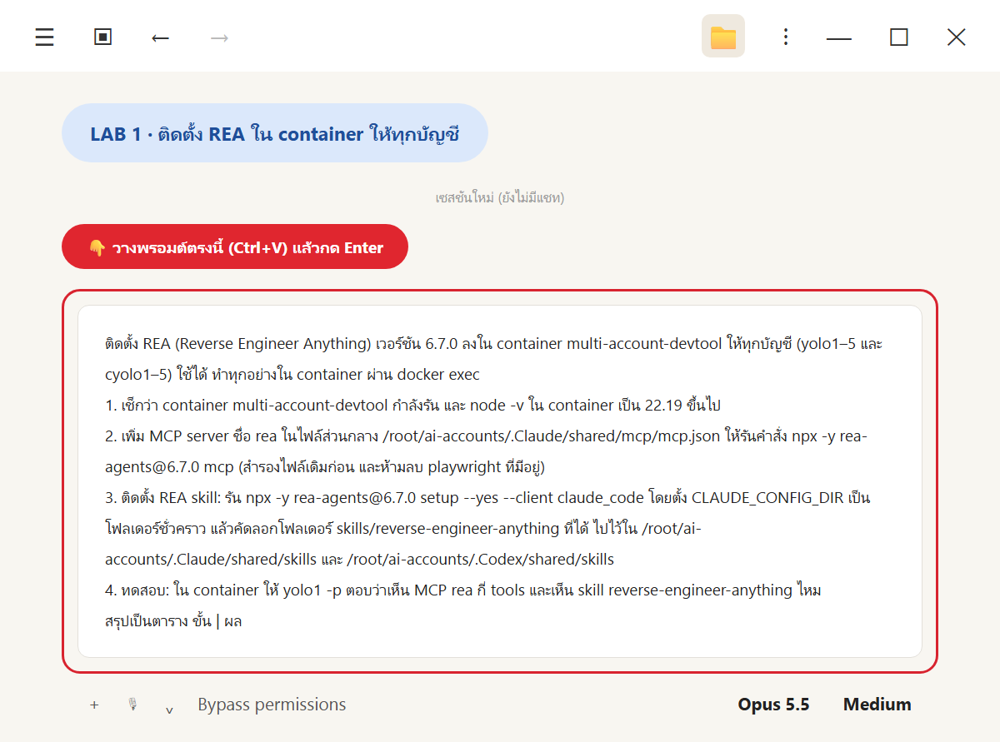
*วางพรอมต์ติดตั้ง REA*

💬 **คัดลอกพรอมต์นี้**

```text
ติดตั้ง REA (Reverse Engineer Anything) เวอร์ชัน 6.7.0 ลงใน container multi-account-devtool ให้ทุกบัญชี (yolo1–5 และ cyolo1–5) ใช้ได้ ทำทุกอย่างใน container ผ่าน docker exec
1. เช็กว่า container multi-account-devtool กำลังรัน และ node -v ใน container เป็น 22.19 ขึ้นไป
2. เพิ่ม MCP server ชื่อ rea ในไฟล์ส่วนกลาง /root/ai-accounts/.Claude/shared/mcp/mcp.json ให้รันคำสั่ง npx -y rea-agents@6.7.0 mcp (สำรองไฟล์เดิมก่อน และห้ามลบ playwright ที่มีอยู่)
3. ติดตั้ง REA skill: รัน npx -y rea-agents@6.7.0 setup --yes --client claude_code โดยตั้ง CLAUDE_CONFIG_DIR เป็นโฟลเดอร์ชั่วคราว แล้วคัดลอกโฟลเดอร์ skills/reverse-engineer-anything ที่ได้ ไปไว้ใน /root/ai-accounts/.Claude/shared/skills และ /root/ai-accounts/.Codex/shared/skills
4. ทดสอบ: ใน container ให้ yolo1 -p ตอบว่าเห็น MCP rea กี่ tools และเห็น skill reverse-engineer-anything ไหม
สรุปเป็นตาราง ขั้น | ผล
```

💡 พรอมต์นี้มีชื่อไฟล์และคำสั่งเทคนิคอยู่บ้าง **เพื่อให้ AI ทำได้ตรงเป๊ะ** เราไม่ต้องเข้าใจทุกบรรทัด แค่รู้ว่ามันทำ 3 อย่าง: ① ให้ทุกบัญชีเห็นเครื่องมือ REA ② วางคู่มือ REA ③ ทดสอบว่าเห็นจริง

✅ **ผลจริง**

| ขั้น | ผล |
|---|---|
| 1 เช็ก container | ✅ รันอยู่ และพร้อมติดตั้ง |
| 2 เพิ่มเครื่องมือ REA ที่ส่วนกลาง | ✅ เพิ่มแล้ว (สำรองของเดิมไว้ และเครื่องมือเดิมยังอยู่ครบ) |
| 3 วางคู่มือ REA ที่ส่วนกลาง | ✅ วางแล้ว ทั้งฝั่ง Claude Code และ Codex |
| 4 ทดสอบ | ✅ `yolo1` ตอบว่าเห็น REA **207 tools** และเห็นคู่มือ `reverse-engineer-anything` |

👀 **สังเกต**
- ตัวเลข **207 tools** ตรงกับที่เห็นในวิดีโอ
- ครั้งแรกที่ AI เรียกใช้ REA จะช้านิดหนึ่ง เพราะต้องดาวน์โหลดเครื่องมือมาก่อน ครั้งต่อไปเร็วขึ้น
- ถ้า `yolo1` ตอบว่า "ไม่เห็น rea" ให้ใช้พรอมต์ในหัวข้อ "ถ้าเจอปัญหา" ด้านล่าง AI จะตรวจและแก้ให้

---

## LAB 2 · เปิด Chrome พอร์ต 9222 แล้วเชื่อมต่อ (prompt 1)

🎯 เปิด Google Flights ใน Chrome ที่ REA เข้าถึงได้ แล้วทดสอบ **แค่การเชื่อมต่อ** (ทฤษฎี: T10)


*วางพรอมต์ LAB 2*

💬 **คัดลอกพรอมต์นี้**

```text
ใน container multi-account-devtool ช่วยทำ 2 อย่าง
1. เปิด Chrome แบบ headless พร้อม --remote-debugging-port=9222 (ใช้ Chrome ใน /ms-playwright) ไปที่ Google Flights ค้นหาเที่ยวบิน กรุงเทพ → โตเกียว เที่ยวเดียว วันที่ 15 ของเดือนหน้า ภาษาไทย สกุลเงินบาท
2. สร้างโฟลเดอร์ /workspace/rea-flight แล้วส่งงานด้านล่างให้ yolo1 ทำ (yolo1 -p) แล้วแสดงคำตอบของ yolo1 ให้ฉันดู
---
ใช้ REA MCP เชื่อมต่อ Chrome ที่ http://127.0.0.1:9222 แล้วแสดงรายการแท็บที่เปิดอยู่
หาแท็บ Google Flights (ผลค้นหาเที่ยวบิน กรุงเทพ → โตเกียว)
ยังไม่ต้องตรวจหรือแก้อะไร แค่บอกว่าเข้าถึงแท็บนี้ได้ไหม ตอบเป็นตาราง
```

<details>
<summary>เบื้องหลัง: คำสั่ง Chrome ที่ถูกรันจริงใน container</summary>

```bash
docker exec -d multi-account-devtool \
  /ms-playwright/chromium-1247/chrome-linux64/chrome --headless=new --no-sandbox \
  --remote-debugging-port=9222 --user-data-dir=/tmp/rea-chrome \
  --window-size=1366,1000 --lang=th-TH \
  "https://www.google.com/travel/flights?q=Flights%20from%20Bangkok%20to%20Tokyo%20on%202026-11-15%20one%20way&hl=th&gl=TH&curr=THB"
```

`-d` = รันเบื้องหลัง Chrome จึงเปิดค้างไว้ให้ LAB 3–4 ใช้ต่อ · วันที่ในลิงก์ถูกคำนวณจาก "วันที่ 15 ของเดือนหน้า" (รันวันที่ 31 ต.ค. 2026 → 2026-11-15)

</details>

✅ **ผลจริง** (yolo1 ใช้เวลา **22 วินาที**) เชื่อมต่อ Chrome ผ่าน REA ได้ และเจอแท็บ Google Flights

**เบราว์เซอร์:** HeadlessChrome 155.0.8059.12 (CDP 1.3)

| # | Target ID | ชื่อแท็บ | Origin | เข้าถึงได้ไหม |
|---|---|---|---|---|
| 1 | `A4C056B802BF14B09D2695173957DEE9` | กรุงเทพมหานคร ไปยัง โตเกียว \| Google Flights | `https://www.google.com` | ✅ ได้ |

| รายการ | ค่า |
|---|---|
| เส้นทาง | กรุงเทพ → โตเกียว |
| วันเดินทาง | 15 พ.ย. 2026 (เที่ยวเดียว) |
| ภาษา / ประเทศ / สกุลเงิน | th / TH / THB |

ไฟล์เต็ม: [`_solution/run/out-p1.md`](_solution/run/out-p1.md)

👀 **สังเกต**
- มี `page` **1 แท็บ** + target อื่นอีก **3 ตัว** ที่ไม่ใช่ page (yolo1 ไม่แสดงในตาราง) → ตรงกับ T10
- ค่า "attached" = **ไม่ทราบ** yolo1 บอกตรง ๆ ไม่เดา นี่คือนิสัยที่ดี
- yolo1 **ไม่ได้แตะเนื้อหาหน้าเว็บ** ตามที่สั่ง
- ถ้าได้ผลว่า "เชื่อมต่อไม่ได้" ส่วนใหญ่เพราะ Chrome ยังไม่ได้เปิด หรือปิดไปแล้ว → ให้ Claude Code เช็กด้วย `curl http://127.0.0.1:9222/json/version` **ใน container**
- ถ้าหน้าแสดง CAPTCHA หรือหน้า "ยืนยันว่าไม่ใช่โปรแกรม" **ให้หยุด** ห้ามหลบ (ดูกติกาจริยธรรม)

---

## LAB 3 · ตรวจหน้าจอแบบอ่านอย่างเดียว (prompt 2)

🎯 ให้ REA เก็บโครงสร้างหน้า + เที่ยวบินที่เห็น เป็นไฟล์หลักฐาน (ทฤษฎี: T5, T11)


*วางพรอมต์ LAB 3*

💬 **คัดลอกพรอมต์นี้**

```text
ใน container multi-account-devtool ส่งงานด้านล่างให้ yolo1 ทำในโฟลเดอร์ /workspace/rea-flight (yolo1 -p) แล้วแสดงคำตอบของ yolo1 ให้ฉันดู
---
ใช้ REA MCP ตรวจหน้า Google Flights ที่เปิดอยู่ (แท็บผลค้นหา กรุงเทพ → โตเกียว) แบบอ่านอย่างเดียว ห้ามคลิก ห้ามพิมพ์ ห้ามแก้หน้าเว็บ
1. เก็บโครงสร้างหน้าจอ: ช่องค้นหา (ต้นทาง ปลายทาง วันที่ ผู้โดยสาร) ตัวกรอง แถบเรียงลำดับ รายการเที่ยวบิน และส่วนสำคัญอื่น ๆ
2. ดึงรายการเที่ยวบินที่เห็นบนหน้า: สายการบิน เวลาออก เวลาถึง สนามบิน ระยะเวลาบิน จำนวนจุดแวะ ราคา เก็บเป็น flights-snapshot.json
3. บันทึกหลักฐานการตรวจไว้ที่ evidence/ui-evidence.json
สรุปส่วนประกอบหลักของหน้าจอ และเทคโนโลยีที่ระบุได้ แยกให้ชัดว่าข้อไหน "ยืนยันแล้ว" ข้อไหน "เดา" ตอบเป็นตาราง
```

✅ **ผลจริง** (yolo1 ใช้เวลา **2 นาที 39 วินาที**) ใช้ REA 3 tools: `list_browser_targets` → `inspect_web_page` → `capture_web_screenshot` ไม่คลิก ไม่พิมพ์ ไม่เลื่อนหน้า ไม่รัน JavaScript บนหน้า

**ไฟล์ที่ได้**

| ไฟล์ | เนื้อหา |
|---|---|
| `flights-snapshot.json` | เที่ยวบิน **22 ใบ** (ยอดนิยม 3 + อื่น ๆ 19) |
| `evidence/ui-evidence.json` | โครงสร้างหน้า สัญญาณเทคโนโลยี `evidence_id` และ sha256 ของไฟล์ |
| `evidence/viewport.png` | ภาพหน้าจอ 1366×857 |
| `evidence/rea-evidence-bundle.json` | bundle ดิบจาก REA |


*ภาพจริงจาก `capture_web_screenshot` (เฉพาะส่วนที่เห็นบนจอ 1366×857) · ใช้เพื่อการเรียนเท่านั้น*

**ส่วนประกอบหน้าจอ (ย่อ)**

| ส่วน | ที่พบ | สถานะ |
|---|---|---|
| ตัวเลือกทริป | เที่ยวเดียว · 1 คน · ชั้นประหยัด | ยืนยันแล้ว |
| ช่องค้นหา | ต้นทาง "กรุงเทพมหานคร" → ปลายทาง "โตเกียว" (autocomplete) · ปุ่มสลับ ⇄ · วันที่ "อาทิตย์ 15 พ.ย." | ยืนยันแล้ว |
| ตัวกรอง | ตัวกรองทั้งหมด · จำนวนครั้งที่แวะพัก · สายการบิน · สัมภาระ · ราคา · เวลา · การปล่อยก๊าซ · สนามบินสำหรับต่อเครื่อง · ระยะเวลา (ยังไม่เลือก) | ยืนยันแล้ว |
| แถบเรียงลำดับ | "ดีที่สุด" ถูกเลือก · "ถูกที่สุด" ราคาเริ่มต้น **฿7,635** · ปุ่ม "จัดเรียงตามเที่ยวบินยอดนิยม" | ยืนยันแล้ว |
| รายการเที่ยวบิน | การ์ดมีโลโก้ เวลา สายการบิน ระยะเวลา รหัสสนามบิน จุดแวะ CO2e ราคา · ท้ายมี "ดูเที่ยวบินเพิ่มเติม" | ยืนยันแล้ว |
| สวิตช์ติดตามราคา | accessibility tree บอก "checked" แต่ภาพดูเหมือนปิด | **ไม่สรุป (ข้อมูลขัดกัน)** |
| ป๊อปอัป | "เดินทางวันที่ 13 พ.ย. ในราคา ฿5,255" | ยืนยันแล้ว (เห็นในภาพเท่านั้น) |

**เที่ยวบิน (ย่อ)**

| ข้อ | สายการบิน | เส้นทาง | เวลา | ระยะเวลา | แวะ | ราคา (฿) |
|---|---|---|---|---|---|---|
| 1 | ไทยไลอ้อนแอร์ | DMK→NRT | 06:20–16:25 | 8 ชม. 5 นาที | 1 (TPE) | 7,635 |
| 2 | ไทยเวียดเจ๊ทแอร์ | BKK→NRT | 09:35–17:30 | 5 ชม. 55 นาที | 0 | 8,172 |
| 3 | ZIPAIR Tokyo | BKK→NRT | 23:45–07:30+1 | 5 ชม. 45 นาที | 0 | 11,580 |
| 4–22 | ไทยเวียดเจ๊ท, ไห่หนาน, ฮ่องกงเอ็กซ์เพรส, ไชนาแอร์ไลน์, แอร์เอเชีย, การบินไทย, JAL, ANA | ปลายทาง NRT หรือ HND | — | 5 ชม. 40 นาที ถึง 16 ชม. | 0–1 | 8,802 ถึง 41,760 |

**เทคโนโลยี (ย่อ)**

| ข้อ | สถานะ |
|---|---|
| HeadlessChrome 155 ควบคุมผ่าน CDP | ยืนยันแล้ว |
| frontend ชื่อ "FlightsFrontendUi" (เห็นใน URL `/_/FlightsFrontendUi/flights_manifest.json`) | ยืนยันแล้ว |
| Wiz + Closure (`jsname` 3,169 · `jsaction` 1,501 · `jscontroller` 943) | **เดา** (หลักฐานหนักแน่น แต่ไม่มีชื่อตรง ๆ) |
| Incremental DOM (`data-idom-class`) · Material Design | **เดา** |
| ข้อมูลเริ่มต้นฝังมากับ HTML (script 26 ตัวเป็น inline) | **เดา** (ยังไม่ได้ดึง source) |
| ไม่ใช้ storage ของโดเมนเดียวกัน · ไม่มี worker | ยืนยันแล้ว (เฉพาะช่วงที่สังเกต) |

ไฟล์เต็ม: [`_solution/run/out-p2.md`](_solution/run/out-p2.md) · [`flights-snapshot.json`](_solution/run/flights-snapshot.json) · [`evidence/ui-evidence.json`](_solution/run/evidence/ui-evidence.json)

👀 **สังเกต**
- **รหัส IATA มาจากไหน:** ไม่มีใน accessibility tree (น่าจะถูกซ่อนจาก screen reader) · 3 ใบแรกอ่านจาก **ภาพหน้าจอ** ส่วนที่เหลือ **แปลงจากชื่อสนามบิน** เช่น HND มาจาก "ท่าอากาศยานนานาชาติโตเกียว" → เป็น **การอนุมาน** และในไฟล์มีช่อง `iata_basis` บอกที่มาทุกใบ (`screenshot` หรือ `mapped_from_airport_name`)
- **ไม่มีข้อมูล network** เพราะเริ่มสังเกตหลังหน้าโหลดเสร็จ และ **script จากโดเมนอื่น 22 ตัวถูกกรองออก** ตามนโยบายของ REA (REA จำกัด origin ที่อ่านได้ เพื่อความปลอดภัย)
- เที่ยวบินหลังปุ่ม "ดูเที่ยวบินเพิ่มเติม" **ไม่รวม** เพราะห้ามคลิก → coverage ไม่ครบ ไม่ได้แปลว่าไม่มี
- ข้อ "ข้อมูลขัดกัน" ของสวิตช์ติดตามราคา = ตัวอย่างที่ดีของการ **ไม่เลือกเชื่อข้างเดียว**
- **ภาพหน้าจอค้าง/หมดเวลา:** ในวิดีโอ การถ่าย screenshot หมดเวลาหลัง 20 วินาที (รอบของเราถ่ายได้) ถ้าเจอแบบนั้น งานส่วนอื่นยังใช้ได้ ไม่ต้องรันใหม่ทั้งหมด
- **หน้า Google เปลี่ยนได้ทุกวัน:** ราคา จำนวนเที่ยวบิน และข้อความป๊อปอัปของคุณจะไม่ตรงกับตารางนี้ เป็นเรื่องปกติ เทียบ "โครงสร้าง" ไม่ใช่ตัวเลข

---

## LAB 4 · วิเคราะห์ JavaScript ที่หน้าโหลดมา (prompt 3)

🎯 หาว่าหน้านี้สร้างด้วยอะไร ส่วนไหนทำอะไร ข้อมูล 1 ใบหน้าตาอย่างไร และการเรียงทำงานอย่างไร (ทฤษฎี: T9, T11, T12)


*วางพรอมต์ LAB 4*

💬 **คัดลอกพรอมต์นี้**

```text
ใน container multi-account-devtool ส่งงานด้านล่างให้ yolo1 ทำในโฟลเดอร์ /workspace/rea-flight (yolo1 -p) แล้วแสดงคำตอบของ yolo1 ให้ฉันดู
---
ใช้ REA MCP วิเคราะห์ JavaScript ที่หน้า Google Flights (แท็บเดิม) โหลดมา แบบอ่านอย่างเดียว ห้ามคลิก ห้ามพิมพ์ ห้ามแก้หน้าเว็บ
อยากรู้ 4 เรื่อง:
1. หน้านี้สร้างด้วยอะไร (framework / วิธี render) ถ้าพิสูจน์ได้
2. ส่วนไหนดูแลช่องค้นหา ตัวกรอง แถบเรียงลำดับ และรายการเที่ยวบิน
3. ข้อมูลเที่ยวบิน 1 ใบ มีช่องอะไรบ้าง และการเรียง "ดีที่สุด / ถูกที่สุด" น่าจะทำงานอย่างไร
4. อะไรที่ช่วยให้เราสร้างแอปจองตั๋วเล็ก ๆ ที่คล้ายกันได้
บันทึกผลไว้ที่ evidence/code-analysis.json ถ้าเครื่องมือไหนล้มเหลวให้รายงานตามจริง อย่าเดา
แยก "ยืนยันแล้ว" กับ "อนุมาน" ให้ชัด ตอบเป็นตาราง
```

✅ **ผลจริง** (yolo1 ใช้เวลา **5 นาที 40 วินาที**) ทั้งหมดอ่านอย่างเดียว โค้ดที่ดึงมาถูกอ่านเป็นข้อความ **ไม่ได้รัน**

**1. สร้างด้วยอะไร**

| ข้อสรุป | สถานะ |
|---|---|
| แพลตฟอร์ม Boq ของ Google (`boq-travel.FlightsFrontendUi_desktop_ms.th`) | ยืนยันแล้ว |
| framework **Wiz** ไม่ใช่ React/Angular/Vue | ยืนยันแล้ว |
| Closure Compiler + Closure Templates (Soy) | ยืนยันแล้ว |
| SSR + hydrate · `AF_initDataCallback ds:0–ds:4` · `ds:1` มีเที่ยวบินครบ 22 ใบ | ยืนยันแล้ว |
| `FlightsFrontendService` (GetShoppingResults, GetBookingResults, GetCalendarGraph) + `batchexecute` | ยืนยันแล้วว่า **มีชื่อในโค้ด** (ยังไม่ได้ดูการเรียกจริง) |
| Material components ภายใน (`VfPpkd-*`) | อนุมาน |

**2. โมดูลไหนดูแลส่วนไหน** — แถบเรียง `U5T3Ef` (ยืนยันแล้ว) · ต้นทาง/ปลายทาง `ZGTFnd` (ยืนยันแล้ว) · ที่เหลือ `mqtBPc`, `ebuxPc`, `bzUZHf`, `q0xTif`, `xEh8Cb`, `GsNaRb` (อนุมาน) — รายละเอียดใน T12 ขั้น 5

**3. ข้อมูล 1 ใบ + การเรียง**

| เรื่อง | สถานะ |
|---|---|
| ช่อง: สายการบิน `SL` · `DMK`→`NRT` · 06:20→16:25 · `485` นาที · segment SL 394 Boeing 737 · แวะ TPE 60 นาที · ราคา `7635` | ยืนยันแล้ว |
| CO2 · token สำหรับขั้นจอง · ช่วงราคาตัวกรอง 7,635–194,610 | อนุมาน |
| มี 6 โหมดเรียง | ยืนยันแล้ว |
| 3 ใบบนไม่เรียงตามราคา · 19 ใบที่เหลือเรียงถูก → แพง (8,802 → 41,760) | ยืนยันแล้ว |
| จัดอันดับที่ server · แท็บ "ถูกที่สุด" = เรียงราคาน้อยไปมาก | อนุมาน |
| สูตรถ่วงน้ำหนักของ "ดีที่สุด" | **ไม่ทราบ** |

**4. นำไปสร้างแอปได้อย่างไร** — แยก Itinerary/Segment (ยืนยันแล้ว) · เก็บระยะเวลาเป็นนาที (ยืนยันแล้ว) · API ส่ง best + others และโหมดเรียง 6 แบบ (ยืนยันแล้ว) · สูตร "ดีที่สุด" และการใช้ Next.js/Nuxt (**ออกแบบเอง**) · ใช้เป็นแนวคิดเท่านั้น ข้อมูลจริงใช้ API ที่เปิดให้บริการ (คำแนะนำ)

**เครื่องมือที่ล้มเหลว (รายงานตามจริง)**

| เรื่อง | ผล |
|---|---|
| `analyze_web_bundle` | ทำงานได้ แต่ได้แค่ 26 inline scripts ไม่ระบุ framework · endpoint `menu`, `back` เป็นผลลวง |
| CLI `--allowed-origins` แบบ JSON array | ล้มเหลว `invalid_request` · ใส่ flag ซ้ำทีละ origin จึงสำเร็จ |
| `ugrep` กับไฟล์ JS ที่บีบไว้ | ล้มเหลว "exceeds complexity limits" → เปลี่ยนไปใช้ Python |
| ความครอบคลุม | วิเคราะห์ได้ 28 สคริปต์ · อีก 82 ไม่ได้ตรวจ · ไม่มีโค้ดหน้าจอง |
| ไม่ได้รัน | `analyze_javascript_application`, source map, การวัดว่าโค้ดส่วนไหนรันจริง |

ไฟล์เต็ม: [`_solution/run/out-p3.md`](_solution/run/out-p3.md) · [`evidence/code-analysis.json`](_solution/run/evidence/code-analysis.json)

👀 **สังเกต**
- นี่คือ LAB ที่ **วงถามต่อ (T9)** เกิดขึ้นจริง: tool แรกให้ผลไม่พอ → yolo1 เปลี่ยนวิธีเอง
- **"Wiz" ขยับจาก เดา (LAB 3) → ยืนยันแล้ว (LAB 4)** เพราะมีหลักฐานจาก JS เพิ่ม (T11)
- รายงานความล้มเหลวตรง ๆ ดีกว่าแอบเดา เพราะเรารู้ว่าข้อสรุปไหน "ยังไม่ครบ"
- yolo1 แบ่ง 3 สถานะ: ยืนยันแล้ว / อนุมาน / **ออกแบบเอง** → ช่วยไม่ให้สับสนว่าอะไรเป็นของ Google อะไรเป็นไอเดียของเรา
- yolo1 เก็บไฟล์ดิบไว้ที่ `work/` (เช่น `ds1.json`) และสคริปต์วิเคราะห์ที่ `tools/` ใน `/workspace/rea-flight`
- งานนี้ใช้เวลานานที่สุด ถ้าเกิน ~10 นาทีแล้วยังไม่จบ ดูหัวข้อ "ถ้าเจอปัญหา"

---

## 📦 พักอ่าน: ไฟล์ .json จาก LAB 3–4 ข้างในมีอะไร

LAB 3 (ตรวจหน้าจอ) และ LAB 4 (วิเคราะห์ JavaScript) ได้ไฟล์ `.json` 3 ไฟล์ ไฟล์เหล่านี้คือ **"สมุดจดของนักสืบ"** ที่ LAB 5 เอาไปสร้างแอป โดยไม่ต้องกลับไปเปิด Google อีก

> 💡 **JSON อ่านยังไง (ฉบับ 30 วินาที)**
> - `{ ... }` = กล่องที่มี **ชื่อ: ค่า** หลายคู่ เช่น `"price": 7635`
> - `[ ... ]` = **รายการ** หลายชิ้น เช่น `flights: [ใบที่ 1, ใบที่ 2, …]`
> - กล่องซ้อนกล่องได้ เช่น `"departure": { "time": "06:20", "iata": "DMK" }`
> - เปิดไฟล์ใน VS Code แล้วกดลูกศร ▸ ข้างบรรทัดเพื่อพับ/กาง จะเห็นโครงชัดขึ้น


*ภาพรวม: 3 ไฟล์ตอบ 3 คำถาม · เที่ยวบินมีอะไร · หน้าจอมีอะไร · JavaScript บอกอะไร*

| ไฟล์ | ตอบคำถาม | ได้จาก | ขนาด | กลุ่มข้อมูลหลัก (ชั้นบนสุด) |
|---|---|---|---:|---|
| [`flights-snapshot.json`](_solution/run/flights-snapshot.json) | เที่ยวบินมีอะไรบ้าง | LAB 3 | 21 KB | `captured_at` · `page` · `query` · `sort` · `count` · `notes` · `flights` |
| [`evidence/ui-evidence.json`](_solution/run/evidence/ui-evidence.json) | หน้าจอแบ่งเป็นส่วนอะไร | LAB 3 | 8 KB | `method` · `target` · `evidence_records` · `files` · `ui_structure` · `technology_signals` · `limitations` |
| [`evidence/code-analysis.json`](_solution/run/evidence/code-analysis.json) | JavaScript บอกอะไร | LAB 4 | 27 KB | `target` · `method` · `coverage` · `findings` · `artifacts` · `safety` |

ทั้ง 3 ไฟล์มี `schema` บรรทัดแรก (เช่น `rea-flight/flights-snapshot@1`) = ป้ายบอกว่าไฟล์นี้เป็นแบบไหน รุ่นที่เท่าไร

---

### 📄 ไฟล์ 1 · `flights-snapshot.json` (ข้อมูลเที่ยวบิน)


*ไฟล์แบ่ง 2 ส่วน: หัวไฟล์ (เก็บอะไร เมื่อไร) + รายการเที่ยวบิน 22 ใบ*

**ส่วนที่ 1 · หัวไฟล์: บอกว่าเก็บอะไร เมื่อไร**

| ช่อง | ค่าจริง | ใช้ทำอะไร |
|---|---|---|
| `captured_at` | `2026-10-31T15:52:35Z` (= 31 ต.ค. 2569 22:52 น. เวลาไทย) | บอกว่าราคานี้เป็นของ "เวลาไหน" แอปเราจึงติดป้ายข้อมูลจำลองได้ |
| `page` | URL + ชื่อแท็บ "กรุงเทพมหานคร ไปยัง โตเกียว \| Google Flights" | ตรวจย้อนได้ว่าเก็บจากหน้าไหน |
| `query` | กรุงเทพมหานคร → โตเกียว · 2026-11-15 · เที่ยวเดียว · 1 คน · ชั้นประหยัด · THB | เงื่อนไขค้นหา (แอปเราใช้แสดงแถบสรุปการค้นหา) |
| `sort` | แท็บที่เลือก "ดีที่สุด" · แท็บถูกที่สุดเริ่ม ฿7,635 | บอกว่าตอนเก็บ หน้าเรียงแบบไหน |
| `count` | `22` | จำนวนเที่ยวบินในไฟล์ |
| `notes` | 3 ข้อ | ข้อควรรู้ (ดูด้านล่าง) |

`notes` 3 ข้อที่ yolo1 เขียนเตือนไว้เอง
1. ราคาเป็น "ราคาเริ่มต้น" ต่อผู้ใหญ่ 1 คน รวมภาษี ไม่รวมค่าสัมภาระ
2. เก็บจากหน้าที่โหลดอยู่เท่านั้น ไม่เลื่อน ไม่กด "ดูเที่ยวบินเพิ่มเติม" → เที่ยวบินที่ซ่อนอยู่หลังปุ่มไม่รวม
3. รหัส `HND` ได้จาก **การอนุมาน** ชื่อสนามบิน (ในหน้าไม่มีรหัสนี้ตรง ๆ)

**ส่วนที่ 2 · `flights`: รายการ 22 ใบ แต่ละใบหน้าตาเหมือนกัน**

ตัดมาจากไฟล์จริง (ใบที่ 1)

```json
{
  "rank": 1,
  "section": "เที่ยวบินยอดนิยม",
  "airline": "ไทยไลอ้อนแอร์",
  "operated_by": null,
  "departure": { "time": "06:20", "date_text": "วันอาทิตย์, พฤศจิกายน 15",
                 "airport_name": "ท่าอากาศยานดอนเมือง", "iata": "DMK" },
  "arrival":   { "time": "16:25", "next_day": false,
                 "airport_name": "ท่าอากาศยานนานาชาตินะริตะ", "iata": "NRT" },
  "duration": "8 ชม. 5 นาที",
  "stops": 1,
  "layovers": [ { "duration": "1 ชม.", "city": "ไทเป", "iata": "TPE" } ],
  "price": { "amount": 7635, "currency": "THB", "label": "ราคาเริ่มต้น" },
  "source": { "evidence_id": "ev_08ac3be2…" }
}
```

| ช่อง | ความหมาย | สังเกต |
|---|---|---|
| `rank` · `section` | ลำดับบนหน้า · อยู่กลุ่ม "ยอดนิยม" หรือ "อื่นๆ" | ยอดนิยม 3 ใบ · อื่นๆ 19 ใบ |
| `airline` · `operated_by` | สายการบิน · สายการบินที่บินจริง (ถ้าต่างกัน) | 3 ใบบินจริงโดย Air Japan |
| `departure` · `arrival` | เวลา วัน สนามบิน (เวลาท้องถิ่น) | `next_day: true` = ถึงวันถัดไป มี 10 ใบ |
| `duration` | เวลาบินรวม | เก็บแยก ไม่เอาเวลาถึงลบเวลาออก (T12) |
| `stops` · `layovers` | แวะกี่ครั้ง ที่ไหน นานเท่าไร | บินตรง 18 ใบ · แวะ 1 ครั้ง 4 ใบ |
| `price` | ราคา | ฿7,635 – ฿41,760 |
| `source` | **ที่มา**: ข้อมูลใบนี้มาจากการตรวจครั้งไหน | นี่คือ "ใบเสร็จ" ที่ทำให้ข้อมูลตรวจย้อนได้ |

🧪 **LAB 5 ใช้ไฟล์นี้:** คัดลอกไปไว้ใน `data/` ของแอป แล้วใส่ลงตาราง `flights` ใน PostgreSQL ตอนเริ่มระบบ

---

### 📄 ไฟล์ 2 · `ui-evidence.json` (หน้าจอมีอะไร)


*ซ้าย: `ui_structure` แบ่งหน้าเป็น 8 ส่วน · ขวา: ข้อมูลประกอบว่าตรวจยังไง ตรวจอะไร และมองไม่เห็นอะไร*

**หัวใจของไฟล์คือ `ui_structure`: หน้าแบ่งเป็น 8 ส่วน**

| ส่วน | บนหน้าจอคือ | 🧪 ค่าจริงในไฟล์ |
|---|---|---|
| `header` | แถบบนสุด | เมนู · แท็บ สำรวจ/เที่ยวบิน/โรงแรม · ปุ่มเข้าสู่ระบบ (6 รายการ) |
| `search_form` | ฟอร์มค้นหา | 6 ช่อง: ประเภทตั๋ว "เที่ยวเดียว" · ผู้โดยสาร "1 คน" · ชั้น "ชั้นประหยัด" · ต้นทาง · ปลายทาง · วันที่ "อาทิตย์ 15 พ.ย." + ปุ่มสลับ ⇄ |
| `filters` | ตัวกรอง | 9 ปุ่ม: ตัวกรองทั้งหมด · จำนวนครั้งที่แวะพัก · สายการบิน · สัมภาระ · ราคา · เวลา · การปล่อยก๊าซ · สนามบินสำหรับต่อเครื่อง · ระยะเวลา (ทุกตัวยังไม่ได้เลือก) |
| `sort` | แท็บเรียง | "ดีที่สุด" (เลือกอยู่) · "ถูกที่สุด เริ่มต้น ฿7,635" |
| `results` | รายการผล | ยอดนิยม 3 + อื่นๆ 19 · การ์ด 1 ใบมี 9 อย่าง (โลโก้ เวลา สายการบิน ระยะเวลา สนามบิน จุดแวะ CO2 ราคา ปุ่มรายละเอียด) · ปุ่ม "ดูเที่ยวบินเพิ่มเติม" |
| `price_insights` | กล่องข้อมูลราคา | "ขณะนี้เที่ยวบินมีราคาสูง" · ประวัติราคา · ติดตามราคา · ตารางวันที่ · กราฟราคา |
| `popup` | ป๊อปอัปที่เด้งขึ้น | "เดินทางวันที่ 13 พ.ย. ในราคา ฿5,255" (เห็นจากภาพหน้าจอเท่านั้น) |
| `footer` | ท้ายเว็บ | ภาษา·ไทย · สถานที่ตั้ง·ไทย · สกุลเงิน THB และลิงก์อื่นอีก 5 รายการ |

**ส่วนประกอบอื่น**

| กลุ่ม | ตอบว่า | 🧪 ค่าจริง |
|---|---|---|
| `method` | ใช้ tool อะไร แบบไหน | REA โหมด **read-only**: `list_browser_targets` → `inspect_web_page` → `capture_web_screenshot` → `export_evidence_bundle` · ไม่คลิก ไม่พิมพ์ ไม่เลื่อน |
| `target` | ดูหน้าไหน | CDP `127.0.0.1:9222` · HeadlessChrome 155 · จอ 1366×857 |
| `evidence_records` | ใบเสร็จการตรวจ | 3 ใบ (หาแท็บ · ส่องหน้า · ถ่ายภาพ) แต่ละใบมีรหัส `ev_…` |
| `files` | ไฟล์ที่ได้ + "ลายนิ้วมือ" ของไฟล์ | `viewport.png` · `flights-snapshot.json` (ถ้ามีใครแก้ไฟล์ทีหลัง ลายนิ้วมือจะไม่ตรง) |
| `technology_signals` | ร่องรอยเทคโนโลยี | `jscontroller` 943 · `jsaction` 1,501 · `jsname` 3,169 · แท็ก `C-WIZ` 5 · DOM 14,126 โหนด · ปุ่ม 157 (ใช้สรุปว่าเป็น Wiz ใน T11) |
| `limitations` | **มองไม่เห็นอะไร** | 11 ข้อ เช่น ไม่เห็น network ก่อน REA เชื่อมต่อ · ภาพหน้าจอเห็นแค่ส่วนบน 1366×857 · รหัสสนามบินไม่อยู่ในโครงหน้า เห็นจากภาพเฉพาะ 3 การ์ดแรก |

🧪 **LAB 5 ใช้ไฟล์นี้:** เป็นแบบร่างว่าหน้าเว็บควรมีส่วนอะไร (แถบสรุปการค้นหา ปุ่มเรียง ตัวกรองบินตรง รายการเที่ยวบิน)

---

### 📄 ไฟล์ 3 · `code-analysis.json` (JavaScript บอกอะไร)


*อ่านจากบนลงล่าง: ทำอะไรไป → ตรวจครบแค่ไหน → ได้คำตอบอะไร → อ้างอิงไฟล์ไหน*

**ชั้น 1 · `method`: ทำอะไรไปบ้าง (8 ขั้น)**

| # | เครื่องมือ | ผล |
|---|---|---|
| 1 | `list_browser_targets` | ✅ เจอแท็บ |
| 2 | `analyze_web_bundle` | ✅ แต่ได้น้อย (26 สคริปต์ ไม่รู้ framework) |
| 3 | REA CLI `inspect-web-page` | ✅ แต่ 22 สคริปต์ถูกตัดเพราะมาจากโดเมนอื่น |
| 4 | `export_web_scripts` | ✅ ได้ 26 สคริปต์ |
| 5 | REA CLI + อนุญาตโดเมน gstatic | ❌ ส่งค่าผิดรูป → แก้ในขั้นถัดไป |
| 6 | REA CLI `export-web-scripts` | ✅ ได้ 28 สคริปต์ |
| 7 | Python ที่ yolo1 เขียนเอง | ✅ ค้นข้อความ แกะข้อมูล `ds:1` (ไม่รันโค้ดของ Google) |
| 8 | `ugrep` | ❌ ไฟล์บรรทัดยาวเกิน → เปลี่ยนไปใช้ Python |

`not_run` บอกตรง ๆ อีก 3 อย่างที่ **ไม่ได้ทำ** เช่น ไม่ได้ดึง source map · ไม่ได้วัดว่าโค้ดส่วนไหนถูกรันจริง

**ชั้น 2 · `coverage`: ตรวจครบแค่ไหน**
- ตรวจได้ **28 สคริปต์** (จาก `www.gstatic.com`)
- **82 สคริปต์ไม่มี URL บอกที่มา** → ถูกตัดออก ไม่ได้ตรวจ
- โค้ดที่โหลดทีหลัง (เช่นหน้ารายละเอียด/หน้าจอง) ไม่อยู่ในรอบนี้
- → ถ้าไฟล์นี้บอกว่า "ไม่พบ" ให้อ่านว่า "ไม่พบใน 28 สคริปต์ที่ตรวจ" (**หาไม่เจอ ≠ ไม่มี**)

**ชั้น 3 · `findings`: คำตอบ 4 ข้อของ prompt 3** (ทุกข้อมี `status` และ `evidence`)

| ข้อ | ถามว่า | จำนวนข้อสรุป | 🧪 ตัวอย่าง |
|---|---|---|---|
| `q1_framework` | หน้านี้สร้างด้วยอะไร | 7 (🟢 6 · 🟡 1) | 🟢 ใช้ Wiz ไม่ใช่ React/Angular/Vue · 🟢 SSR แล้ว hydrate · 🟡 ปุ่มใช้ Material |
| `q2_modules` | ส่วนไหนของหน้าใครดูแล | 8 (🟢 2 · 🟡 5 · ⚪ 1) | 🟢 แถบเรียง = `U5T3Ef` · 🟢 ช่องต้นทาง/ปลายทาง = `ZGTFnd` · 🟡 ตัวกรอง = `ebuxPc` |
| `q3_flight_record` | ข้อมูลเที่ยวบิน 1 ใบอยู่ตรงไหน | ทั้งทริป 12 ช่อง · แต่ละขา 9 ช่อง · การเรียง 6 ข้อ | หาเจอว่าช่องไหนคือเวลาบิน (485 นาที) ช่องไหนคือราคา (7,635) · สูตร "ดีที่สุด" = ⚪ ไม่ทราบ |
| `q4_build_your_own` | ถ้าจะสร้างเองควรทำยังไง | 9 บทเรียน | แยก Itinerary/Segment · เก็บระยะเวลาเป็นนาที · สูตร "ดีที่สุด" ของเราต้อง **ออกแบบเอง** |

**ชั้น 4 · `artifacts` และ `safety`**
- `artifacts` = ไฟล์ดิบ 5 ไฟล์ที่ใช้อ้างอิง พร้อม "ลายนิ้วมือ" ของแต่ละไฟล์
- `safety` = ถือว่าเนื้อหาจากหน้าเว็บ "ไม่น่าเชื่อถือ" และไม่พบข้อความที่พยายามสั่ง AI (prompt injection)

🧪 **LAB 5 ใช้ไฟล์นี้:** ข้อ `q4_build_your_own` กลายเป็นแนวทางสร้างแอป (data model, การเรียง, ป้ายข้อมูลจำลอง)

---

### 🔗 3 ไฟล์โยงกันยังไง

| โยงด้วย | ตัวอย่าง |
|---|---|
| `evidence_id` | เที่ยวบินทุกใบใน `flights-snapshot.json` มี `ev_08ac3be2…` ซึ่งตรงกับใบเสร็จ "ส่องหน้า" ใน `ui-evidence.json` |
| ลายนิ้วมือไฟล์ | `ui-evidence.json` เก็บลายนิ้วมือของ `flights-snapshot.json` → รู้ได้ทันทีถ้าไฟล์ถูกแก้ทีหลัง |
| รหัสแท็บ | `ui-evidence.json` กับ `code-analysis.json` อ้างแท็บเดียวกัน → ตรวจหน้าเดียวกันแน่นอน |
| ตัวเลขตรงกัน | `code-analysis.json` บอกว่า `ds:1` มี 22 ใบ ตรงกับ `count: 22` ใน `flights-snapshot.json` |

💡 **สรุปที่ควรจำ:** ทุกข้อสรุปมี **ป้ายสถานะ** (ยืนยันแล้ว / อนุมาน / ไม่ทราบ) และ **ที่มา** (`evidence_id` หรือไฟล์อ้างอิง) และทุกไฟล์มีส่วน **ข้อจำกัด / ความครอบคลุม** บอกตรง ๆ ว่าอะไรไม่ได้ตรวจ (หลัก T11)

---

## LAB 5 · สร้าง SkyThai Mini แล้วเปิดดู (prompt 4)

🎯 ให้ yolo1 ใช้หลักฐานทั้งหมดสร้างแอปจองตั๋วจำลองของเราเองด้วย **Next.js (TypeScript) + PostgreSQL** รันด้วย `docker compose` ให้ `cyolo1` สร้างโลโก้และภาพหน้าแรก แล้วเปิดดูบนเครื่องที่ http://localhost:5081 (ทฤษฎี: T13)


*วางพรอมต์ LAB 5*

💬 **คัดลอกพรอมต์นี้**

```text
ใน container multi-account-devtool ส่งงานด้านล่างให้ yolo1 ทำในโฟลเดอร์ /workspace/rea-flight (yolo1 -p) แล้วแสดงคำตอบของ yolo1 ให้ฉันดู
---
สร้างเว็บแอปจองตั๋วเครื่องบินของเราเอง ชื่อ "SkyThai Mini" ในโฟลเดอร์ skythai-mini/ จากสิ่งที่ REA ตรวจ Google Flights ได้ (อ่าน flights-snapshot.json และไฟล์ใน evidence/)
ข้อกำหนด:
- โจทย์: ค้นหาเที่ยวบิน กรุงเทพ → ญี่ปุ่น เที่ยวเดียว วันที่ 15 ของเดือนหน้า ผู้โดยสาร 1 คน
- เทคโนโลยี: Next.js (TypeScript) + PostgreSQL รันด้วย docker compose คำสั่งเดียว (docker compose up -d --build) เว็บเปิดที่พอร์ต 5081
- ตอนเริ่ม ให้ฐานข้อมูลสร้างตาราง flights (ใส่ข้อมูลจาก flights-snapshot.json) และตาราง bookings
- หน้าแรกแสดงเที่ยวบินจากฐานข้อมูล เรียงราคาจากถูกไปแพงเป็นค่าเริ่มต้น และบอกว่าเป็นข้อมูลจำลอง ณ วันที่เก็บ
- เลือกเที่ยวบิน → กรอกชื่อและอีเมล → ยืนยัน → บันทึกลงตาราง bookings → หน้าสรุปพร้อมรหัสจอง (ไม่จ่ายเงินจริง)
- มี /api/health ตอบ {"ok":true} เมื่อเชื่อมฐานข้อมูลได้ และใส่ data-testid ให้ส่วนสำคัญ
- ภาพประกอบในเว็บ (โลโก้ของเรา และภาพหน้าแรกธีมเดินทางไปญี่ปุ่น) ให้ใช้ skill cyolo สั่ง cyolo1 สร้างภาพ แล้วเก็บไว้ใน public/ ของแอป
- ออกแบบหน้าตาเอง ห้ามคัดลอกโลโก้ ชื่อ แบรนด์ หรือโค้ดของ Google ห้ามแก้ไฟล์ใน evidence/
- เสร็จแล้วรัน docker compose up -d --build ใน container นี้ และลองจองจริง 1 ครั้งให้แน่ใจว่าทำงาน
ตอบเป็นตาราง: ฟีเจอร์ | ทำงานไหม และบอกวิธีเปิดแอป
---
เสร็จแล้วคัดลอกโฟลเดอร์ /workspace/rea-flight/skythai-mini ออกมาไว้ในโฟลเดอร์นี้ (ไม่เอา node_modules และ .next) แล้วรัน docker compose up -d --build ในโฟลเดอร์นั้น จากนั้นเปิด http://localhost:5081 ให้ฉันดู
```

(บรรทัดสุดท้ายเป็นงานของ Claude Code Desktop ไม่ใช่ของ yolo1: คัดลอกออกจาก container ด้วย `docker cp` แล้วรัน `docker compose up -d --build` บน Windows)

✅ **ผลจริง** (yolo1 ใช้เวลา **5 นาที 56 วินาที** · 23:59:30 → 00:05:26) build ผ่าน และลองจองจริงในเบราว์เซอร์ได้ 1 ครั้ง: รหัส **`STM-D95KN3`** (Somchai Jaidee, DMK → NRT, ฿7,635) และเจอแถวนี้ในฐานข้อมูลจริง

**คำตอบของ yolo1 (ย่อจาก `out-p4.md`)**

| ฟีเจอร์ | ทำงานไหม |
|---|---|
| Next.js (TypeScript) + PostgreSQL 16 รันด้วย docker compose คำสั่งเดียว | ✅ build และรันผ่าน (ตอนนั้นใช้พอร์ต 15081 แทน 5081 ชั่วคราว ดู 👀) |
| ฐานข้อมูลสร้างตาราง `flights` (22 เที่ยวบินจาก snapshot) และ `bookings` ตอนเริ่ม | ✅ ตรวจใน psql แล้ว: 22 แถว ราคา ฿7,635–฿41,760 |
| หน้าแรกแสดงเที่ยวบินจาก DB เรียงจากถูกไปแพงเป็นค่าเริ่มต้น | ✅ 7635, 8172, 8802 … 41760 |
| ปุ่มเรียงแบบอื่น (แพงสุด / บินเร็วสุด / ออกเช้าสุด) และตัวกรองบินตรง | ✅ |
| บอกว่าเป็นข้อมูลจำลอง พร้อมวันเวลาที่เก็บ (31 ต.ค. 2569 22:52 น.) | ✅ |
| เลือกเที่ยวบิน → กรอกชื่อและอีเมล → หน้าตรวจสอบ → ยืนยัน | ✅ |
| บันทึกลงตาราง `bookings` และแสดงหน้าสรุปพร้อมรหัสจอง (ไม่จ่ายเงินจริง) | ✅ `STM-D95KN3` และพบแถวนี้ใน DB |
| ตรวจข้อมูลที่ส่งมา (อีเมลผิดรูปแบบ, รหัสจองที่ไม่มีอยู่) | ✅ อีเมลผิดได้ 400 · รหัสที่ไม่มีได้ 404 |
| `/api/health` ตอบ `{"ok":true}` | ✅ |
| `data-testid` ในส่วนสำคัญ | ✅ เช่น `flight-card`, `flight-price`, `select-flight`, `input-name`, `input-email`, `confirm-booking`, `booking-code`, `mock-data-notice` |
| โลโก้และภาพหน้าแรกธีมญี่ปุ่นจาก cyolo1 | ✅ `public/logo.png` และ `public/hero.png` เป็นงานออกแบบของเราเอง ไม่ใช้โลโก้หรือแบรนด์ของ Google |
| ไม่แก้ไฟล์ใน `evidence/` | ✅ คัดลอก snapshot ไปไว้ที่ `skythai-mini/data/` แล้วใช้ไฟล์นั้น |

**โครงสร้างโปรเจกต์ที่ได้** (`skythai-mini/`)

| ไฟล์ / โฟลเดอร์ | หน้าที่ |
|---|---|
| `Dockerfile` · `docker-compose.yml` | 2 service: `web` (Next.js พอร์ต 5081) + `db` (`postgres:16-alpine`) |
| `db/` | SQL ตอนเริ่ม: สร้างตาราง `flights` + `bookings` และใส่ข้อมูล 22 เที่ยวบิน |
| `data/` | สำเนา `flights-snapshot.json` |
| `scripts/` | สคริปต์สร้างไฟล์ seed SQL จาก snapshot |
| `src/app/` | `page.tsx` (หน้าแรก) · `book/[id]` (กรอกข้อมูล) · `booking/[code]` (สรุปการจอง) · `api/bookings` · `api/health` |
| `src/components/` · `src/lib/` | ชิ้นส่วนหน้าเว็บ (ฟอร์มจอง สรุปเที่ยวบิน) · ต่อฐานข้อมูลและจัดรูปแบบตัวเลข |
| `public/` | `logo.png` · `hero.png` (สร้างโดย `cyolo1`) |

บน Windows (Docker Desktop) `docker compose up -d --build` ในโฟลเดอร์ `skythai-mini/` ใช้เวลา **56 วินาที** แล้วเปิด http://localhost:5081 ได้


*หน้าแรกจริงที่ http://localhost:5081 · ภาพแบนเนอร์และโลโก้สร้างโดย cyolo1 · ใบแรกคือไทยไลอ้อนแอร์ ฿7,635 · ป้ายข้อมูลจำลองพูดถึง 15 ธ.ค. เพราะถ่ายภาพวันที่ 1 พ.ย. ("เดือนหน้า" = ธ.ค.) ส่วนราคาเป็นของเที่ยวบิน 15 พ.ย. ตาม snapshot (ดู 👀 เรื่องวันที่ ด้านล่าง)*

**ตัวอย่างการทำงานจริง** (บันทึกด้วย Playwright จากแอปใน `_solution/skythai-mini/`)


*C1 · หน้าแรกเรียงราคาถูก → แพง (ค่าเริ่มต้น)*

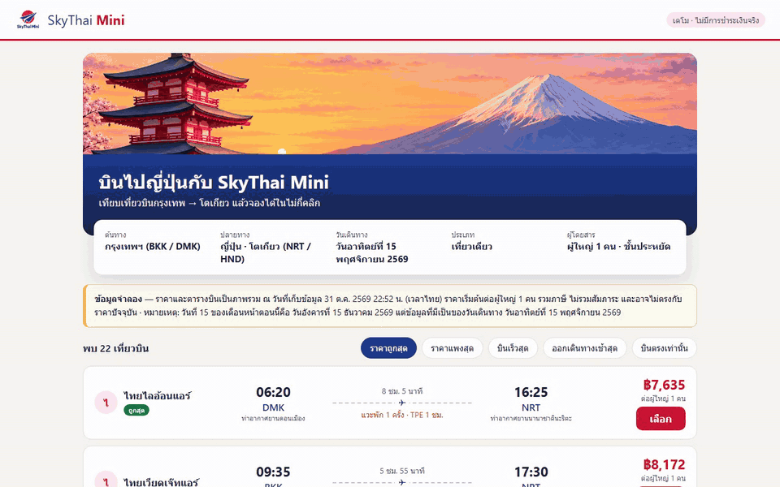
*C4 · จองสำเร็จ ได้รหัสจอง และรีโหลดแล้วข้อมูลยังอยู่ (มาจาก PostgreSQL)*

🎬 ดูทุก use case ต่อกันใน [`_solution/e2e/media/playlist.mp4`](_solution/e2e/media/playlist.mp4)

**ผล playlist จริง (Playwright · ผ่าน 5/5)**

| เคส | ตรวจอะไร | ผล |
|---|---|---|
| C1 | หน้าแรกเรียงถูก → แพง | ✅ 22 เที่ยวบิน ใบแรก ฿7,635 และมีป้ายข้อมูลจำลอง |
| C2 | เปลี่ยนการเรียง + ตัวกรองบินตรง | ✅ เรียงแพง → ถูก และบินเร็วสุดได้ · "บินตรงเท่านั้น" เหลือ 18 เที่ยวบิน |
| C3 | ฟอร์มตรวจข้อมูล | ✅ ฟอร์มว่างขึ้น "กรุณากรอกชื่อ-นามสกุล" · อีเมลผิดขึ้น "รูปแบบอีเมลไม่ถูกต้อง" และยังอยู่หน้าฟอร์ม |
| C4 | จองสำเร็จ + บันทึกลงฐานข้อมูล | ✅ ได้รหัส `STM-F5NP9B` ราคา ฿7,635 · รีโหลดหน้าใบจองแล้วข้อมูลยังอยู่ |
| C5 | `/api/health` + หน้า 404 | ✅ health ตอบ 200 `{"ok":true}` · รหัสจองที่ไม่มีได้หน้า 404 |

(สื่อแต่ละเคส: `_solution/e2e/media/C1.gif` … `C5.gif` และ `.mp4`)

ไฟล์เต็ม: [`_solution/run/out-p4.md`](_solution/run/out-p4.md) · โค้ดแอป [`_solution/skythai-mini/`](_solution/skythai-mini/)

👀 **สังเกต**
- **ค่าเริ่มต้นต่างจาก Google โดยตั้งใจ:** Google ใช้ "ดีที่สุด" แต่โจทย์เราให้เรียงราคา → ZIPAIR ฿11,580 ที่ Google ดันขึ้น 3 ใบบน ในแอปเราจะอยู่อันดับ 7 (T12)
- yolo1 **ยืมแนวคิด** 3 อย่าง: ระยะเวลาเป็นนาที · ตัวเลือกการเรียงจากโหมดเรียงที่พบ · ตัวกรองบินตรงจากแถบตัวกรองบนหน้า (T13)
- **ข้อมูลอยู่ในฐานข้อมูลจริง:** การจองถูกบันทึกในตาราง `bookings` ของ PostgreSQL จึงรีโหลดหน้าใบจองแล้วยังเห็น (C4)
- **ถ้าพอร์ตชน ให้ดูว่าใครใช้พอร์ตอยู่ (`ss -ltnp`) ก่อนเปลี่ยน:** รอบของเรา พอร์ต 5081 ใน container มี `python3 -m http.server` ค้างอยู่จากงานก่อนหน้าที่ถูกยกเลิก yolo1 จึงใช้พอร์ต 15081 ชั่วคราวและรายงานตรง ๆ (ไม่ปิด process ที่ตัวเองไม่ได้เปิด) · หลังปิดตัวที่ค้างแล้ว แอปรันที่ 5081 ตามโจทย์
- **เรื่องวันที่:** แอปคำนวณ "วันที่ 15 ของเดือนหน้า" · วันที่ 1 พ.ย. 2569 จะได้ 15 ธ.ค. 2569 แต่ snapshot เป็นราคาของวันที่ 15 พ.ย. 2569 แอปจึงแสดงวันที่ตาม snapshot พร้อมหมายเหตุอธิบายความต่าง **ไม่แต่งข้อมูลขึ้นเอง** (ถ้าอยากได้ราคาวันใหม่ ต้องให้ REA เก็บข้อมูลใหม่)
- `data-testid` ที่ใส่ไว้ คือสิ่งที่บทถัดไปจะใช้เขียนเทสต์อัตโนมัติ

---

## 📊 SkyThai Mini (v1) เหมือน Google Flights แค่ไหน: ผลวัดจริง 5 ตัวเลข

playlist ผ่าน 5/5 แปลว่า **แอปทำงานตามที่เราออกแบบ** แต่ยังไม่ได้บอกว่า **เหมือน Google Flights แค่ไหน**
บทที่ 3–4 สร้าง "ไม้บรรทัด" 5 อัน แล้ววัดทุกเวอร์ชันด้วยไม้บรรทัดชุดเดียวกัน รวมถึง v1 ของบทนี้ด้วย ตัวเลขทุกตัวด้านล่างมาจากการรันจริง

| ไม้บรรทัด | วัดอะไร (ภาษาง่าย) | **v1 (บทนี้)** | v4 (ดีที่สุดในบทที่ 4) |
|---|---|---:|---:|
| ① acceptance 82 ข้อ | ทำได้ตาม "ข้อสอบ" 82 ข้อที่กรรมการออกจากการสำรวจ Google ไหม | **0/82** | 74/82 |
| ② differential 8 สถานการณ์ | ทำ 8 อย่างเดียวกันกับ Google ตัวจริงแล้ว ได้รายการเที่ยวบินเหมือนกันไหม | **0/8** | 8/8 |
| ③ โครงสร้างหน้า (ariaSnapshot) | หน้าเว็บมี "ชิ้นส่วน" (ปุ่ม แท็บ ช่องกรอก) แบบเดียวกันกี่ % | **3.8%** | 78.6% |
| ④ visual diff | หน้าตาต่างจาก Google กี่ % ของพิกเซล (**ต่ำ = เหมือน**) | **27.88%** | 5.13% |
| ⑤ เที่ยวบิน | แอปแสดงเที่ยวบินได้กี่ใบ (Google มี 300 ใบ) | **22** | 300 |

> 💡 อ่านตารางนี้ให้ถูก: v1 ไม่ได้ "พัง" แอปทำงานได้ครบตามโจทย์บทนี้ แต่ **REA อย่างเดียว + ห้ามคลิก** เห็นแค่หน้าแรกของ Google จึงยังขาดฟีเจอร์อีกมาก บทถัดไปค่อย ๆ เติมเครื่องมือจนตัวเลขดีขึ้น

### ① acceptance 82 ข้อ: ข้อสอบมาจากไหน ใครตรวจ

เปรียบเหมือน **ข้อสอบที่ครูคนอื่นออก** ไม่ใช่ข้อสอบที่นักเรียนออกให้ตัวเอง

| ขั้น | เกิดอะไร |
|---|---|
| 1. ได้รายการฟีเจอร์ | บทที่ 2 ใช้ Playwright กดสำรวจ Google Flights จริง แล้วเขียนลงไฟล์ `EXPLORATION.md` · ส่วน B = ฟีเจอร์ **35** ข้อ · ส่วน C = กฎ **31** ข้อ · บทที่ 3 เพิ่มส่วน F = สิ่งที่เห็นจากการดักข้อมูลเครือข่าย **16** ข้อ |
| 2. รวมเป็นข้อสอบ | 35 + 31 + 16 = **82 ข้อ** · 1 ข้อ = 1 test |
| 3. ให้กรรมการอิสระเขียน test | `cyolo1` (Codex คนละค่ายกับ `yolo1` ที่สร้างแอป) เขียน test ด้วย Playwright โดย **อ่านแค่ EXPLORATION.md** ไม่อ่านโค้ดแอป ไม่ใช้ `data-testid` ใช้แค่ข้อความ ปุ่ม และป้ายที่ผู้ใช้มองเห็น |
| 4. ทุก test เริ่มเหมือนผู้ใช้ | เปิดแอป → กรอกค้น กรุงเทพ → โตเกียว 15 พ.ย. 2026 ผ่านฟอร์มบนจอ → แล้วค่อยตรวจฟีเจอร์ของข้อนั้น |
| 5. นับ | ผ่านกี่ข้อจาก 82 · ใช้ข้อสอบชุดเดิมกับทุกเวอร์ชัน ห้ามแก้ test |

ตัวอย่างข้อสอบ: B02 เลือกจำนวนผู้โดยสาร · B17 กรองเฉพาะการบินไทย · C02 ทารกนั่งตักต้องไม่เกินจำนวนผู้ใหญ่

**ทำไม v1 ได้ 0/82:** ทุก test ต้องเริ่มจาก **ฟอร์มค้นหาและปุ่มผู้โดยสาร** แต่ v1 ไม่มีฟอร์มค้นหา (หน้าแรกแสดงผลทันที) ทั้ง 82 ข้อจึงตกตั้งแต่ขั้นเตรียม (log จริง: `locator.waitFor: Timeout 3500ms exceeded` ขณะรอปุ่มผู้โดยสาร ครบ 82 ข้อ)
⚠️ ไม่ได้แปลว่า v1 ไม่มีอะไรเลย (v1 มี 22 ใบ เรียง และตัวกรองบินตรง) แต่แปลว่า v1 **ขาดประตูหน้าบ้าน** ที่ผู้ใช้ Google ต้องผ่านก่อนใช้ทุกฟีเจอร์


*test B02 กับ v1: กรรมการหาปุ่มผู้โดยสารไม่เจอ → ไม่ผ่าน (รายละเอียดทุกข้อ: [SCOREBOARD บทที่ 3](../03_REA_Toolchain_Loop/_solution/run/SCOREBOARD.md))*

### ② differential 8 สถานการณ์: ใช้ Google ตัวจริงเป็นเฉลย

เปรียบเหมือน **ทำโจทย์ข้อเดียวกันคู่กับคนเก่ง แล้วเทียบคำตอบ** ถ้าคำตอบเหมือนกัน แปลว่าเราทำถูก

ปัญหา: Google เปลี่ยนราคาตลอด เทียบวันนี้กับพรุ่งนี้ไม่ได้ บทที่ 3–4 จึงทำ **"Google แช่แข็ง"**

| ขั้น | เกิดอะไร |
|---|---|
| 1. อัด | บทที่ 3 ใช้ Playwright อัดทุกคำขอและคำตอบระหว่างใช้ Google Flights ลงไฟล์ **HAR** |
| 2. แช่แข็ง | บทที่ 4 เปิด Google Flights จากไฟล์ HAR แบบ **ไม่ต่ออินเทอร์เน็ต** และหยุดนาฬิกาไว้ที่เวลาอัด → ได้ผลเดิมทุกรอบ (ทดสอบ 3 รอบ ตรงกันทั้ง 3) |
| 3. ทำ 8 อย่างเดียวกัน | Playwright ทำ 8 สถานการณ์กับ Google แช่แข็ง และกับแอปของเรา |
| 4. เทียบรายการเที่ยวบิน | จำนวนใบ · ราคา · สายการบิน · เวลาออก เทียบทีละตำแหน่ง ต้องตรงทั้งหมดถึงจะนับว่า ✅ |

| สถานการณ์ | Google แช่แข็งได้ | v1 |
|---|---|---|
| S1 รายการเริ่มต้น | 22 ใบ | ❌ ไม่ตรง (ราคาต่างตั้งแต่ใบที่ 2: v1 ฿8,172 · Google ฿8,432 เพราะราคา Google เปลี่ยนระหว่างวันที่เก็บ snapshot กับวันที่อัด HAR) |
| S2 แท็บ "ถูกที่สุด" | ใบแรก ฿7,635 เรียงถูก → แพง | ❌ ไม่มีแท็บ (v1 ใช้ปุ่ม "ราคาถูกสุด" แทน) |
| S3 ดูเที่ยวบินเพิ่มเติม | 300 ใบ | ⛔ ไม่มีปุ่มนี้ |
| S4 บินตรง | 18 ใบ | ❌ ได้ 18 ใบเหมือนกัน แต่ราคาและสายการบินบางใบไม่ตรง |
| S5 กรองการบินไทย | 5 ใบ | ⛔ ไม่มีตัวกรองสายการบิน |
| S6 ราคาไม่เกิน ฿10,000 | 6 ใบ | ⛔ ไม่มีตัวกรองราคา |
| S7 ออกเดินทาง 23:00–24:00 | 33 ใบ | ⛔ ไม่มีตัวกรองเวลา |
| S8 ดูรายละเอียดเที่ยวบินที่แวะ | SL 394 แวะ 1 ชม. ที่ TPE | ⛔ ไม่มีปุ่มรายละเอียด |


*S1 รายการเริ่มต้น: เทียบ Google แช่แข็งกับโคลนทีละใบ (รายงานเต็ม: [DIFF-REPORT บทที่ 4](../04_REA_Differential_Oracle/_solution/run/DIFF-REPORT.md))*

### ③ โครงสร้างหน้า (ariaSnapshot): หน้าเว็บมี "ชิ้นส่วน" เหมือนกันไหม

เปรียบเหมือน **เทียบ "รายการชิ้นส่วน" ของเฟอร์นิเจอร์ 2 ตัว** ไม่สนว่าสีอะไร สนแค่ว่ามีลิ้นชัก มือจับ ขา ครบไหม

**ariaSnapshot** คือคำสั่ง Playwright ที่อ่านหน้าเว็บออกมาเป็นรายการ "บทบาท + ชื่อ" แบบที่โปรแกรมอ่านหน้าจอสำหรับคนตาบอดเห็น เช่น

```yaml
- button "สลับต้นทางกับปลายทาง"
- tab "ถูกที่สุด"
- combobox "ผู้โดยสาร"
```

| ขั้น | เกิดอะไร |
|---|---|
| 1. ถ่ายรายการชิ้นส่วน | ใช้ ariaSnapshot กับหน้าผลค้นหาของ Google แช่แข็งและของแอปเรา |
| 2. ตัดส่วนแบรนด์ทิ้ง | ตัดโลโก้ เมนู Google ชื่อ SkyThai ป้าย "ข้อมูลจำลอง" ออก (ไม่ควรเหมือน) |
| 3. คะแนน ก: Jaccard | ชิ้นส่วนที่มีเหมือนกัน ÷ ชิ้นส่วนทั้งหมดรวมกันของทั้งสองหน้า |
| 4. คะแนน ข: ชิ้นสำคัญ 38 อย่าง | เช็กลิสต์ 38 ชิ้นที่ Google มี (ฟอร์มค้นหา ตัวกรอง 9 ปุ่ม แท็บ ฯลฯ) แอปเรามีกี่ชิ้น |
| 5. คะแนนรวม | ค่าเฉลี่ยของ ก กับ ข |

**ทำไม v1 ได้ 3.8%:** Jaccard 5.0% และมีชิ้นสำคัญแค่ **1 จาก 38** (มีแค่รายการเที่ยวบิน) ขาดฟอร์มค้นหาทั้งชุด ตัวกรองทั้ง 9 ปุ่ม แท็บดีที่สุด/ถูกที่สุด ปุ่มรายละเอียด ประวัติราคา และปุ่มดูเพิ่มเติม
(ไฟล์จริง: [`structure/snapshots/v1.yml`](../04_REA_Differential_Oracle/_solution/run/structure/snapshots/v1.yml) เทียบกับ [`original.yml`](../04_REA_Differential_Oracle/_solution/run/structure/snapshots/original.yml) · รายงาน [STRUCTURE บทที่ 4](../04_REA_Differential_Oracle/_solution/run/STRUCTURE.md))

### ④ visual diff: หน้าตาต่างกันกี่ % (ต่ำ = เหมือน)

เปรียบเหมือน **เกม "จับผิดภาพ"** แต่ให้คอมพิวเตอร์นับจุดที่ต่าง

| ขั้น | เกิดอะไร |
|---|---|
| 1. ถ่ายภาพขนาดเท่ากัน | Playwright ถ่ายหน้าผลค้นหาขนาด 1366×900 = 1,229,400 พิกเซล ทั้งของ Google (ภาพจากบทที่ 2) และของแอปเรา |
| 2. เทียบทีละพิกเซล | ใช้ไลบรารี **pixelmatch** ดูว่าสีของจุดเดียวกันต่างกันเกินเกณฑ์ไหม (threshold 0.1 กันสีเพี้ยนเล็กน้อย) |
| 3. ระบายสีจุดที่ต่าง | ได้ภาพไฮไลต์ จุดต่างเป็นสีแดง |
| 4. คิดเป็น % | จุดที่ต่าง ÷ จุดทั้งหมด |

**v1 ได้ 27.88%** = ต่าง 342,711 จาก 1,229,400 พิกเซล ต่างมากที่สุดในทุกเวอร์ชัน เพราะ v1 มีแบนเนอร์ภาพใหญ่ด้านบน และไม่มีฟอร์มค้นหาแบบ Google

| Google (ภาพอ้างอิง) | v1 | จุดที่ต่าง (แดง) |
|---|---|---|
|  |  |  |

⚠️ **visual diff หลอกได้:** v1 ไม่มีฟอร์มค้นหาเลย แต่ยัง "เหมือน" 72% เพราะพื้นหลังสีขาวเหมือนกัน จึงต้องดูคู่กับ ③ โครงสร้างหน้า (ได้แค่ 3.8%) เสมอ

### ⑤ เที่ยวบิน: แอปแสดงได้กี่ใบ

นับเที่ยวบินทั้งหมดที่แอปแสดงได้ (รวมหลังกด "ดูเที่ยวบินเพิ่มเติม" ถ้ามี) Google มีทั้งหมด **300 ใบ**

**ทำไม v1 ได้ 22:** REA อ่านได้แค่ข้อมูลที่ฝังมากับหน้าแรก (`ds:1` = 22 ใบ · T12) อีก 278 ใบอยู่หลังปุ่ม "ดูเที่ยวบินเพิ่มเติม" ซึ่งบทนี้ **ห้ามคลิก** · บทที่ 3 ใช้ Playwright กดปุ่มนั้นแล้วอัด HAR ได้ครบ 300 ใบ

### สรุป: v1 ขาดอะไร และบทไหนเติม

| v1 ขาด | ทำให้ตัวเลขไหนต่ำ | บทที่เติม | ผลหลังเติม |
|---|---|---|---|
| ฟอร์มค้นหา ผู้โดยสาร แท็บ ตัวกรอง (เพราะ REA ไม่ได้กดสำรวจ) | ① ③ | บทที่ 2 · Playwright กดสำรวจ | v2: ① 51/82 · ③ 55.8% · ④ 8.19% |
| เที่ยวบินหลังปุ่ม "ดูเพิ่มเติม" + ข้อมูลหน้าจอง | ⑤ ① | บทที่ 3 · HAR + กรรมการ + วนแก้ | v3: ① 74/82 · ⑤ 300 ใบ |
| ผลลัพธ์ไม่ตรงกับ Google ทีละใบ | ② ③ ④ | บทที่ 4 · Google แช่แข็งเป็นเฉลย | v4: ② 8/8 · ③ 78.6% · ④ 5.13% |

---

## ✅ รูบริก: เช็กลิสต์ก่อนส่งงาน

- [ ] อธิบายได้ว่า reverse engineering คืออะไร และ "ไม่ใช่" อะไร (ไม่ลอก ไม่เจาะ ไม่แก้)
- [ ] บอกได้ว่าบน Google Flights อะไรดูได้ อะไรดูไม่ได้ พร้อมตัวอย่าง 1 ข้อ
- [ ] อธิบายได้ว่า MCP server กับ skill ต่างกันอย่างไร และ `setup` เปลี่ยน 2 อย่างอะไร
- [ ] `yolo1` เห็น MCP `rea` 207 tools และ skill `reverse-engineer-anything` (LAB 1)
- [ ] prompt 1 เจอแท็บ Google Flights เป็น target ประเภท `page` (LAB 2)
- [ ] มี `flights-snapshot.json`, `evidence/ui-evidence.json`, `evidence/code-analysis.json` ใน `/workspace/rea-flight`
- [ ] ชี้ได้อย่างน้อย 1 ข้อที่ "ยืนยันแล้ว" 1 ข้อที่ "อนุมาน" และ 1 ข้อที่ "ไม่ทราบ" จากผลของตัวเอง
- [ ] อธิบายได้ว่า "ดีที่สุด" ต่างจาก "ถูกที่สุด" อย่างไร โดยใช้ตัวเลขจากผลของตัวเอง
- [ ] `docker compose up -d --build` ใน `skythai-mini/` แล้ว http://localhost:5081 เปิดได้ เรียงถูก → แพง เป็นค่าเริ่มต้น จองจนได้รหัส `STM-…` และ `/api/health` ตอบ `{"ok":true}`
- [ ] แอปไม่มีโลโก้ ชื่อ หรือโค้ดของ Google และมีป้ายบอกว่าเป็นข้อมูลจำลอง
- [ ] ปิด Chrome พอร์ต 9222 แล้วหลังจบงาน

---

## 🔁 รันซ้ำ / ปิดงาน

**ปิด Chrome ที่เปิดพอร์ต 9222** (ทำทุกครั้งที่จบงาน เพราะพอร์ตนี้ให้โปรแกรมในเครื่องควบคุมเบราว์เซอร์ได้)

```bash
docker exec multi-account-devtool pkill -f "[r]emote-debugging-port=9222"
```

(วงเล็บ `[r]` ช่วยไม่ให้ `pkill` ไปจับคำสั่งของตัวเอง)

**อยากรันซ้ำ**
1. REA ติดตั้งครั้งเดียวพอ ไม่ต้องทำ LAB 1 ซ้ำ (ยกเว้นสร้าง container ใหม่แล้วไฟล์ shared หาย)
2. ปิด Chrome ด้วยคำสั่งข้างบน แล้ววางพรอมต์ LAB 2 ใหม่ → ได้ Chrome ตัวใหม่ที่วันที่ "15 ของเดือนหน้า" ของวันนั้น
3. ถ้าอยากเริ่มสะอาด ให้ Claude Code ย้ายโฟลเดอร์เดิมไปเป็น `/workspace/rea-flight-old` ก่อน แล้วค่อยทำ LAB 2–5
4. ผลรอบใหม่ (ราคา จำนวนเที่ยวบิน) **จะต่างจากตารางในบทนี้** เพราะ Google เปลี่ยนตามวัน เป็นเรื่องปกติ

---

## ถ้าเจอปัญหา: คัดลอกพรอมต์นี้

```text
LAB REA ใน container multi-account-devtool มีปัญหา ช่วยตรวจทีละข้อแบบอ่านอย่างเดียวก่อน แล้วบอกฉันว่าจะแก้อย่างไร ห้ามลบไฟล์ใน /workspace/rea-flight และห้ามแก้ไฟล์ใน evidence/
1. container multi-account-devtool รันอยู่ไหม และ node -v ใน container คือเวอร์ชันอะไร
2. /root/ai-accounts/.Claude/shared/mcp/mcp.json เป็น JSON ที่ถูกต้องไหม มีทั้ง rea (rea-agents@6.7.0) และ playwright ไหม
3. มีโฟลเดอร์ reverse-engineer-anything ใน /root/ai-accounts/.Claude/shared/skills และ /root/ai-accounts/.Codex/shared/skills ไหม
4. มี Chrome ที่เปิด --remote-debugging-port=9222 อยู่ไหม และ curl http://127.0.0.1:9222/json/version ใน container ตอบอะไร
5. ให้ yolo1 -p ตอบสั้น ๆ ว่าเห็น MCP rea กี่ tools
6. ถ้าหน้า Google Flights ขึ้น CAPTCHA หรือหน้าบล็อก ให้บอกฉัน ห้ามพยายามหลบ
สรุปเป็นตาราง ข้อ | ผล | วิธีแก้ที่แนะนำ แล้วรอให้ฉันยืนยันก่อนแก้
```

| อาการ | สาเหตุที่พบบ่อย | วิธีแก้ |
|---|---|---|
| yolo1 ไม่เห็น `rea` | `mcp.json` เสีย (ลืม `,`) หรือยังไม่ได้เพิ่ม | กู้จากไฟล์สำรอง แล้วทำ LAB 1 ใหม่ |
| `npx` ติดตั้ง REA ไม่ผ่าน เพราะ Node | ใช้ 6.8.0 หรือ `latest` | ระบุ `rea-agents@6.7.0` เสมอ |
| prompt 1 เชื่อมต่อไม่ได้ | Chrome ไม่ได้เปิด / ปิดไปแล้ว | วางพรอมต์ LAB 2 ใหม่ |
| ภาพหน้าจอหมดเวลา | หน้าเว็บหนัก หรือ headless ช้า | ข้ามภาพได้ ส่วนอื่นยังใช้ได้ |
| ได้เที่ยวบินน้อยกว่า 22 ใบ หรือหน้าไม่เหมือนในบทนี้ | Google เปลี่ยนหน้า/ราคาตามวัน | ปกติ ดูโครงสร้างแทนตัวเลข |
| เปิด http://localhost:5081 ไม่ขึ้น | build ยังไม่เสร็จ หรือ `db` ยังไม่ healthy | ดู `docker compose ps` และ `docker compose logs web` ในโฟลเดอร์ `skythai-mini/` แล้วรอสักครู่ |
| yolo1 บอกว่าพอร์ต 5081 ถูกใช้อยู่ | มี process เก่าค้างพอร์ตใน container | ดูว่าใครใช้พอร์ตอยู่ด้วย `ss -ltnp` ก่อน แล้วค่อยปิดตัวที่ค้าง ไม่ต้องเปลี่ยนพอร์ตถาวร |
| `/api/health` ไม่ตอบ `{"ok":true}` | เว็บต่อฐานข้อมูลไม่ได้ | ดู `docker compose logs db` · ถ้าจะเริ่มฐานข้อมูลใหม่ใช้ `docker compose down -v` แล้ว `docker compose up -d --build` |

---

## 📖 คำศัพท์

| คำ | ความหมายแบบง่าย |
|---|---|
| **Reverse engineering (RE)** | สืบจากของที่มีอยู่ เพื่อเข้าใจว่ามันทำงานอย่างไร โดยไม่แก้มัน |
| **REA** | Reverse Engineer Anything · เครื่องมือ open source (npm `rea-agents`) ที่ให้ AI agent สืบแอปได้ |
| **MCP / MCP server** | มาตรฐานเสียบเครื่องมือเข้า AI agent / โปรแกรมที่ยื่นเครื่องมือ (tools) ให้ agent |
| **Tool** | คำสั่ง 1 อย่างที่ agent เรียกได้ เช่น `inspect_web_page` |
| **Skill** | คู่มือที่บอก agent ว่าควรทำงานแบบไหน (เช่น `reverse-engineer-anything`) |
| **CDP** | Chrome DevTools Protocol · ช่องทางให้โปรแกรมอื่นอ่าน/ควบคุม Chrome |
| **`--remote-debugging-port=9222`** | ตัวเลือกที่เปิดช่อง CDP ของ Chrome ที่พอร์ต 9222 |
| **Browser target** | สิ่งที่ CDP ให้เชื่อมต่อได้ เช่น แท็บ (`page`) หรือ worker |
| **Headless** | เปิดเบราว์เซอร์โดยไม่มีหน้าต่างให้เห็น |
| **Accessibility tree** | โครงสร้างหน้าเว็บที่เบราว์เซอร์ทำให้ screen reader ใช้ บอกชื่อปุ่ม บทบาท สถานะ |
| **Static / Runtime** | ดูโค้ดโดยไม่รัน / ดูตอนแอปรันอยู่จริง |
| **Black / Grey / White box** | ดูจากข้างนอก / ส่องของที่ส่งมาถึงเครื่อง / อ่านโค้ดต้นฉบับ |
| **Evidence / `evidence_id`** | หลักฐานที่ตรวจย้อนได้ / รหัสอ้างอิงหลักฐานแต่ละชิ้น |
| **ยืนยันแล้ว / อนุมาน / ไม่ทราบ** | เห็นจริง / มีเบาะแสแต่ยังไม่พิสูจน์ / หาไม่ได้และบอกเหตุผล |
| **Coverage** | ตรวจครอบคลุมแค่ไหน (ครบ / บางส่วน) |
| **Minify** | บีบโค้ดให้เล็ก ชื่อจะเหลือตัวอักษรสั้น ๆ อ่านยาก |
| **Wiz / Closure / Soy** | framework, ตัวบีบโค้ด และระบบ template ภายในของ Google ที่พบใน Google Flights |
| **SSR / Hydrate** | เซิร์ฟเวอร์สร้าง HTML มาให้ก่อน / JS ผูกการทำงานเข้ากับ HTML นั้นทีหลัง |
| **`AF_initDataCallback ds:1`** | ชุดข้อมูลที่ฝังมากับ HTML ของ Google Flights (มีเที่ยวบิน 22 ใบในรอบของเรา) |
| **Itinerary / Segment** | ทั้งทริปที่ซื้อ / เที่ยวบินแต่ละขา |
| **IATA** | รหัสสนามบิน 3 ตัวอักษร เช่น BKK, DMK, NRT, HND |
| **Prompt injection** | ข้อความในข้อมูลที่พยายามสั่ง AI ให้ทำสิ่งที่เราไม่ได้สั่ง |
| **Shared / symlink** | โฟลเดอร์ส่วนกลางที่ทุกบัญชีใช้ร่วมกัน / ทางลัดที่ชี้ไปโฟลเดอร์อื่น |
| **`data-testid`** | ป้ายชื่อบน element สำหรับให้เทสต์อัตโนมัติหาเจอ |

---

## 🔒 เฉลย (`_solution/`)

| ส่วน | มีอะไร | ใช้ทำอะไร |
|---|---|---|
| [`_solution/run/`](_solution/run/) | `p1.txt`–`p4.txt` (พรอมต์ชั้นในที่ส่งให้ yolo1) · `out-p1.md`–`out-p4.md` (คำตอบจริงของ yolo1) · `flights-snapshot.json` · `evidence/` | เทียบผลของเรากับรอบจริง |
| [`_solution/skythai-mini/`](_solution/skythai-mini/) | SkyThai Mini ฉบับเฉลย (Next.js + PostgreSQL · `docker-compose.yml` มี service `web` พอร์ต 5081 + `db` `postgres:16-alpine`) | เปิด SkyThai Mini ฉบับเฉลยได้ทันที |
| [`_solution/e2e/`](_solution/e2e/) | `playlist.mjs` (Playwright รัน 5 use case C1–C5 ต่อกันแล้วอัดวิดีโอ) · `results.json` · `media/` (GIF, MP4, `playlist.mp4`) | ดูแอปทำงาน และเป็นตัวอย่างสำหรับบทถัดไป |

**เปิด SkyThai Mini ฉบับเฉลย** (สั่ง Claude Code หรือรันเองใน PowerShell ที่โฟลเดอร์ `_solution/skythai-mini`)

```powershell
docker compose up -d --build
# รอบเราบน Docker Desktop ใช้ 56 วินาที แล้วเปิด http://localhost:5081
# ปิด: docker compose down   (ล้างฐานข้อมูลด้วย: docker compose down -v)
```

**รัน playlist (ไม่บังคับ)** ต้องเปิดแอปที่ 5081 ไว้ก่อน แล้วในโฟลเดอร์ `_solution/e2e` รัน `npm install` ตามด้วย `node playlist.mjs`

### ไฟล์ในบทนี้

```text
01_REA_Basics_Flight/
├── README.md                     ← ไฟล์นี้
├── img/                          ← ภาพประกอบภาษาไทยทั้งหมด (lab1-t* ทฤษฎี · lab1-r* เส้นทาง LAB · lab1-1x ไฟล์ json และ "ดีที่สุด" · lab0–5-paste.png · real-skythai-mini-home.png)
├── skythai-mini/                 ← (สร้างใน LAB 5) แอปของเราที่คัดลอกออกจาก container
└── _solution/
    ├── run/
    │   ├── p1.txt … p4.txt       ← พรอมต์ชั้นในที่ส่งให้ yolo1
    │   ├── out-p1.md … out-p4.md ← คำตอบจริงของ yolo1
    │   ├── flights-snapshot.json ← เที่ยวบิน 22 ใบ (31 ต.ค. 2569)
    │   └── evidence/             ← ui-evidence.json · code-analysis.json · viewport.png · bundle ดิบ
    ├── skythai-mini/             ← SkyThai Mini ฉบับเฉลย · docker compose up -d --build → http://localhost:5081
    │   ├── Dockerfile · docker-compose.yml  ← web (5081) + db (postgres:16-alpine)
    │   ├── db/ · data/ · scripts/          ← SQL ตอนเริ่ม · snapshot · สคริปต์สร้าง seed
    │   ├── src/app/ · src/components/ · src/lib/
    │   └── public/               ← logo.png · hero.png (cyolo1)
    └── e2e/
        ├── playlist.mjs          ← Playwright 5 use case + อัดวิดีโอ
        ├── results.json          ← ผล C1–C5
        └── media/                ← C1.gif … C5.gif · .mp4 · playlist.mp4
```

(ใน container งานทั้งหมดอยู่ที่ `/workspace/rea-flight/` ซึ่งมี `work/` และ `tools/` ที่ yolo1 สร้างระหว่าง LAB 4 เพิ่มด้วย)

---

## 🎉 จบบทแล้ว → บทถัดไป

ตอนนี้เรามี REA ใน container, รู้วิธีอ่านหลักฐาน 3 ระดับ และมีแอป SkyThai Mini ที่ใส่ `data-testid` ไว้พร้อม

บทถัดไป [**02 · REA + Playwright Exploration**](../02_REA_Playwright_Exploration/README.md) จะใช้ **Playwright คู่กับ REA** สำรวจแบบ EXPLORATION แล้ว **เทียบความครอบคลุมของฟีเจอร์** ระหว่างของต้นแบบกับแอปของเรา

---

*แหล่งที่มาทฤษฎี: Code With Aarohi · REA MCP Explained + Live Demo — https://www.youtube.com/watch?v=ZGHWUXznleo · นิยาม RE: Chikofsky, E. J. & Cross, J. H. (1990) "Reverse Engineering and Design Recovery: A Taxonomy", IEEE Software · REA: github.com/morluto/rea (npm `rea-agents`) · ตัวเลขทุกตัวในบทนี้มาจากการรันจริงใน `_solution/run/` เมื่อ 31 ต.ค. 2569*
