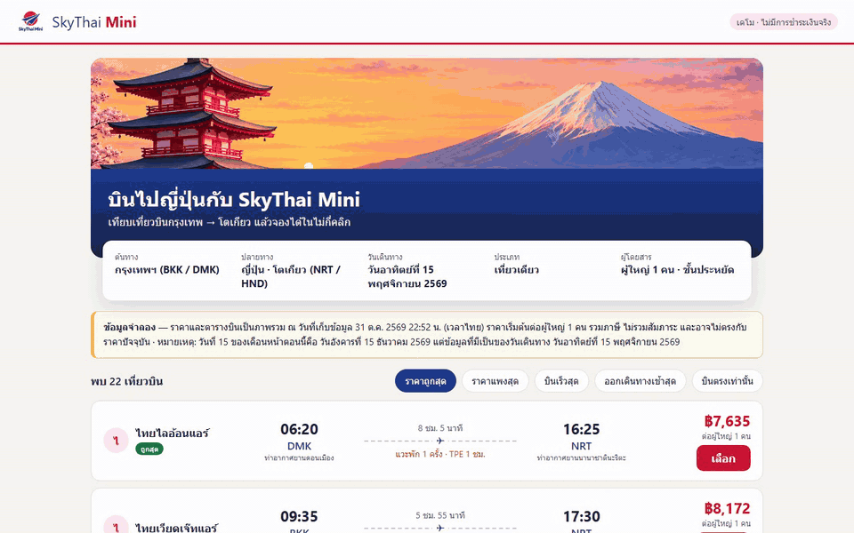

# SkyThai Mini (v1) — Playwright Playlist

สคริปต์ `playlist.mjs` เปิด Chromium แบบ headless แล้วเล่น use case 5 เคสกับแอปที่รันอยู่ที่ http://localhost:5081
ทุกเคสอัดวิดีโอ 1280×800 (locale th-TH, เวลา Asia/Bangkok) มีกรอบแดงรอบจุดที่ตรวจ และแถบคำบรรยายภาษาไทยด้านล่าง (เขียว = ผ่าน, แดง = ไม่ผ่าน)

## วิธีรัน

```bash
# ต้องเปิดแอปก่อน: docker compose up -d  (ในโฟลเดอร์ ../skythai-mini)
npm install
node playlist.mjs            # หรือ BASE_URL=http://host:port node playlist.mjs
```

ผลที่ได้: `results.json`, ตารางผลในเทอร์มินัล (exit code ≠ 0 ถ้ามีเคสไม่ผ่าน), และไฟล์ใน `media/`
(`<id>.mp4`, `<id>.gif`, `playlist.mp4` รวมทุกเคส) — ต้องมี `ffmpeg` บน PATH

## ผลการรันจริง

| เคส | เรื่อง | ผล | รายละเอียด | เวลา |
|---|---|---|---|---|
| C1 | หน้าแรกเรียงราคาถูก→แพง | ✅ ผ่าน | 22 เที่ยวบิน เรียงถูก→แพง เริ่ม ฿7,635 และมีป้ายข้อมูลจำลอง | 24.0 s |
| C2 | เปลี่ยนการเรียง / ตัวกรองบินตรง | ✅ ผ่าน | เรียงแพง→ถูก, บินเร็วสุด และกรองบินตรงได้ 18 เที่ยวบิน | 26.7 s |
| C3 | ฟอร์มตรวจข้อมูลผู้โดยสาร | ✅ ผ่าน | ฟอร์มว่างและอีเมลผิดถูกปฏิเสธ และยังอยู่หน้าฟอร์ม | 21.5 s |
| C4 | จองสำเร็จ + บันทึกลงฐานข้อมูล | ✅ ผ่าน | ได้รหัส STM-XXXXXX ราคา ฿7,635 และรีโหลดหน้าใบจองแล้วข้อมูลยังอยู่ (มาจาก PostgreSQL) | 29.6 s |
| C5 | /api/health + หน้า 404 | ✅ ผ่าน | `{"ok":true}` และรหัสจองที่ไม่มี/รูปแบบผิดได้ HTTP 404 | 21.4 s |

> หมายเหตุ: C4 สร้างการจองใหม่ในฐานข้อมูลทุกครั้งที่รัน (รหัสสุ่ม)

## วิดีโอ

- ▶ ทั้งชุด: [media/playlist.mp4](media/playlist.mp4)
- C1 — [GIF](media/C1.gif) · [MP4](media/C1.mp4)
- C2 — [GIF](media/C2.gif) · [MP4](media/C2.mp4)
- C3 — [GIF](media/C3.gif) · [MP4](media/C3.mp4)
- C4 — [GIF](media/C4.gif) · [MP4](media/C4.mp4)
- C5 — [GIF](media/C5.gif) · [MP4](media/C5.mp4)


