# Week 03 · บทที่ 2 · REA + Playwright: สำรวจ Google Flights แบบลูกค้า แล้วสร้าง SkyThai Plus (Copy & Paste)

บทที่ 1 เราให้ **REA** สืบ Google Flights **แบบอ่านอย่างเดียว** แล้วได้แอป **SkyThai Mini (v1)** ที่พอร์ต 5081
บทนี้เราเพิ่ม **Playwright MCP** เป็น "มือ" ให้ AI **กดใช้เว็บเหมือนลูกค้า** แล้วจดสิ่งที่เจอลง **`EXPLORATION.md`** ตามวิธีของบทร้านสัตว์เลี้ยง (Week 01) จากนั้นให้ REA "ส่องข้างใน" เก็บหลักฐานมาเสริม แล้วสร้างแอปเวอร์ชัน 2 ชื่อ **SkyThai Plus** (Next.js + PostgreSQL พอร์ต 5082) สุดท้ายใช้ **Playwright วัดด้วยเทสต์** ว่า v1 กับ v2 เก็บฟีเจอร์ของ Google Flights ได้ครบแค่ไหน

ทุกอย่างรัน **ใน container `multi-account-devtool`** ผู้เรียนแค่วางพรอมต์ใน **Claude Code Desktop** บน Windows แล้ว Claude Code จะส่งงานเข้า container ผ่าน `docker exec` ให้บัญชี `yolo1` (สำรวจ + สร้างแอป), `yolo2` (เทียบ v1/v2) และ `cyolo1` (สร้างภาพ) ทำ

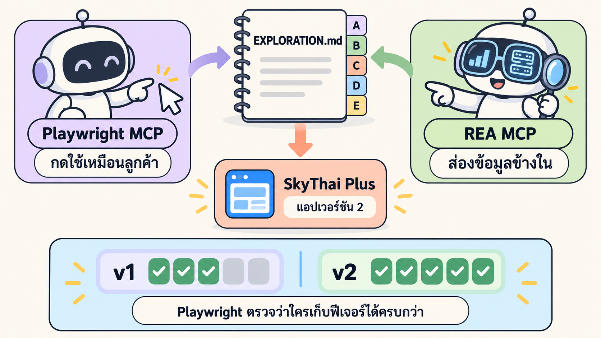
*ภาพรวมของบทนี้: Playwright กดให้เห็น + REA ส่องให้รู้ → `EXPLORATION.md` → SkyThai Plus → วัด v1 vs v2 ด้วยเทสต์*

| สิ่งที่ได้จากบทนี้ | อยู่ที่ไหน |
|---|---|
| เข้าใจทฤษฎี Playwright MCP, accessibility snapshot, exploratory testing, `EXPLORATION.md` และการวัดความครบด้วยเทสต์ พร้อมตัวอย่างจริงจากรอบของเรา | หัวข้อ 🎓 ทฤษฎี (T1–T10) |
| `EXPLORATION.md` ส่วน A–C, E จากการกดใช้ Google Flights จริง + ภาพ 40 รูปใน `exploration/` | LAB 1 |
| ส่วน D โมเดลข้อมูล + คอลัมน์ "หลักฐาน [E]" จาก REA + `flights-full.json` (เที่ยวบิน 22 ใบพร้อมรายละเอียดทุกขา) | LAB 2 |
| แอป **SkyThai Plus** (Next.js + TypeScript + PostgreSQL · ภาพจาก `cyolo1`) รันด้วย `docker compose` คำสั่งเดียว เปิดที่ http://localhost:5082 | LAB 3 → `skythai-plus/` |
| `COMPARE.md` ผลเทสต์ 35 ฟีเจอร์: **v1 4/35 (11.4%) · v2 33/35 (94.3%)** + GIF หลักฐานเคียงข้าง 8 ไฟล์ | LAB 4 |

### 🧰 ก่อนเริ่ม ต้องมี

| ✅ | สิ่งที่ต้องมี | ตรวจยังไง |
|---|---|---|
| ☐ | ทำ [บทที่ 1 · REA ขั้นพื้นฐาน](../01_REA_Basics_Flight/README.md) จบแล้ว | `yolo1` เห็น MCP `rea` 207 tools และมี `/workspace/rea-flight/skythai-mini` (v1) ใน container |
| ☐ | **Docker Desktop** เปิดอยู่ | ไอคอนวาฬมุมขวาล่างไม่หมุน |
| ☐ | **Claude Code Desktop** บน Windows | เปิดแอปได้ และเปิดโฟลเดอร์นี้อยู่ |
| ☐ | container `multi-account-devtool` รันอยู่ และล็อกอิน `yolo1`, `yolo2`, `cyolo1` แล้ว | ใช้ `/maccount` (บทที่ 1 LAB 0) |
| ☐ | MCP `playwright` อยู่ในไฟล์ส่วนกลาง `mcp.json` (มีมากับ image อยู่แล้ว) | LAB 0 ของบทนี้ตรวจให้ |
| ☐ | Chrome พอร์ต `9222` เปิดผลค้นหา กรุงเทพ → โตเกียว ไว้ (สำหรับ REA ใน LAB 2) | LAB 0 ของบทนี้ตรวจให้ ถ้าไม่เปิดให้เปิดใหม่แบบบทที่ 1 LAB 2 |

⏱️ **เวลาโดยประมาณ:** อ่านทฤษฎี ~60 นาที · ลงมือ LAB 0–4 ~75–90 นาที (เวลารอ AI จริงรวมกันราว 58 นาที ดูตัวเลขในแต่ละ LAB)

> ⚠️ **กติกาจริยธรรม (บทนี้ "กด" ได้แล้ว อ่านให้ดี)**
> - บทที่ 1 ห้ามคลิกเลย แต่บทนี้ Playwright **กดใช้เว็บเหมือนลูกค้าคนหนึ่ง** ได้ (ค้นหา เปิดตัวกรอง ขยายรายละเอียด) เพราะนี่คือสิ่งที่ลูกค้าทั่วไปทำอยู่แล้ว
> - เส้นที่ห้ามข้าม (เขียนไว้ในพรอมต์แล้ว): **ห้ามล็อกอิน · ห้ามจ่ายเงิน · ห้ามกรอกข้อมูลส่วนตัว · หยุดก่อนไปเว็บสายการบิน**
> - ทำช้า ๆ แบบคนจริง สำรวจรอบเดียว ไม่ยิงซ้ำถี่ ๆ ถ้าเจอ CAPTCHA หรือหน้าบล็อก **ให้หยุด** ห้ามพยายามหลบ
> - เรียนรู้ **แนวคิดและพฤติกรรม** ห้ามคัดลอกโลโก้ ชื่อแบรนด์ หรือโค้ดของ Google และห้ามเรียก API ภายในของ Google ในแอปของเรา
> - ราคาทุกตัวในบทนี้เป็น **ภาพนิ่ง ณ 31 ต.ค. 2569 (2026)** ของเที่ยวบินวันที่ 15 พ.ย. 2569 ไม่ใช่ราคาปัจจุบัน แอปของเราต้องบอกผู้ใช้แบบนี้เสมอ
> - ก่อนสืบระบบจริงนอกห้องเรียน ให้อ่าน Terms of Service และขออนุญาตก่อนทุกครั้ง

---

## 🎓 ทฤษฎี: เข้าใจทีละขั้นก่อนลงมือ

ทุกหัวข้อมี **ตัวอย่างจริง** จากรอบที่เรารันเมื่อ 31 ต.ค. – 1 พ.ย. 2569

- 🧪 ข้อความที่มีป้าย **(รันจริงของเรา)** = ตัวเลขจากไฟล์ใน `_solution/run/` ไม่ได้แต่งขึ้น
- ภาพชื่อ `lab2-*.png` ทำใหม่สำหรับบทนี้ · ภาพ `real-*.png` และ GIF ใน `_solution/` เป็นภาพจริงจากแอปของเรา

| กลุ่ม | หัวข้อ |
|---|---|
| 🤔 ทำไมต้องมีมือ | T1 ทำไม REA อย่างเดียวไม่พอ · T2 Playwright MCP = มือของ AI · T3 AI อ่านหน้าเว็บเป็นต้นไม้ (snapshot + ref) |
| 🧭 สำรวจแล้วจดให้เป็น | T4 สำรวจแบบลูกค้า (exploratory testing) · T5 `EXPLORATION.md` ส่วน A–E และป้าย [O] [R] [E] |
| 🔭 สองมุมมอง | T6 มองจากนอก (Playwright) vs มองจากใน (REA) · T7 สองเบราว์เซอร์ใน container เดียว |
| 🏗️ จากบันทึกสู่แอปและการวัดผล | T8 จากส่วน D สู่ตารางฐานข้อมูล · T9 วัดความครบด้วยเทสต์ (coverage) · T10 หลักฐานแบบ GIF · 🧠 ทบทวน |

---

### T1) ทำไม REA อย่างเดียวไม่พอ

**คำถาม:** บทที่ 1 REA เก็บข้อมูลได้ละเอียดมาก แล้วทำไมแอป v1 ยังเหมือน Google Flights แค่นิดเดียว?

**คำตอบสั้น:** REA ในบทที่ 1 **ไม่คลิกอะไรเลย** (เราสั่งห้ามเอง) มันจึงเห็นแค่ "สถานะแรก" ของหน้า สิ่งที่เกิด **หลังกด** ทั้งหมดจึงหายไป


*REA อย่างเดียว = ไม่กดก็ไม่เห็นหน้าถัดไป · Playwright อย่างเดียว = เห็นแค่บนจอ · ใช้คู่กัน = เห็นทั้งพฤติกรรมและข้อมูล*

**ลองไล่ทีละขั้นว่าอะไรหายไป (รันจริงของเรา)**

1. **สิ่งที่ซ่อนอยู่หลังปุ่ม:** หน้าแรกฝังเที่ยวบินมาแค่ **22 ใบ** อีก **278 ใบ** ต้องกด "ดูเที่ยวบินเพิ่มเติม" ก่อน (22 + 278 = **300**) → บทที่ 1 ได้แค่ 22
2. **กฎที่เห็นเฉพาะตอนกด:** เช่น ปุ่ม − ของผู้ใหญ่กดไม่ได้เมื่อเหลือ 1 คน · ผู้โดยสารรวมเกิน 9 คนไม่ได้ · ตัวกรองหลายตัวทำงานแบบ AND → ไม่มีอยู่ในหลักฐานของบทที่ 1 เลย
3. **หน้าจอที่ไม่เคยเปิด:** ป๊อปอัปตัวกรอง 8 ตัว ปฏิทิน ตารางวันที่ กราฟราคา หน้าตัวเลือกการจอง → REA ไม่เคยเห็น
4. **ผลลัพธ์:** v1 ที่สร้างจาก REA อย่างเดียว เป็น "รายการเที่ยวบินที่แสดงตายตัว" ประเภทตั๋ว ผู้โดยสาร และชั้นโดยสารเป็นแค่ข้อความ ไม่มีตัวกรอง แท็บ หรือปฏิทิน

> **ตัวอย่าง (รันจริงของเรา · LAB 4):** เทสต์ 35 ฟีเจอร์ชุดเดียวกัน
>
> | แอป | สร้างจาก | ผ่าน | ครอบคลุม |
> |---|---|---|---|
> | v1 SkyThai Mini | REA อย่างเดียว (ไม่คลิก) | 4/35 | **11.4%** |
> | v2 SkyThai Plus | Playwright สำรวจ + REA หลักฐาน | 33/35 | **94.3%** |
>
> ข้อที่ v1 ผ่านคือ เรียงลำดับ · ตัวกรองบินตรง · เลือกเที่ยวบิน · ปุ่มย้อนกลับ ซึ่งเป็นสิ่งที่ "เดาได้" จากหน้าแรก ส่วนข้อที่ต้อง "กดแล้วดูผล" v1 ไม่ผ่านเกือบหมด

**ข้อควรระวัง:** ไม่ได้แปลว่า REA ไม่ดี บทที่ 1 REA ให้ข้อมูลเที่ยวบิน **ครบและแม่น** (เวลา ราคา จุดแวะ) ปัญหาคือ **ขาด "มือ"** บทนี้จึงเพิ่มมือ ไม่ได้ทิ้ง REA

**สรุปสั้น:** REA เห็นแค่สถานะแรกของหน้า · พฤติกรรมหลังกด + ข้อมูลหลังปุ่มหายไป · ต้องมีมือ (Playwright) มาเสริม

---

### T2) Playwright คืออะไร · Playwright MCP คือ "มือของ AI"

**คำถาม:** AI จะ "กดปุ่ม" บนเว็บได้อย่างไร ในเมื่อมันเป็นแค่โมเดลภาษา?

**Playwright** คือไลบรารี open source ของ Microsoft สำหรับ **ควบคุมเบราว์เซอร์ด้วยโค้ด** (Chromium, Firefox, WebKit) ใช้ทำ **automated test** และงานอัตโนมัติบนเว็บ (เราใช้มาแล้วใน Week 01)

**Playwright MCP** คือ Playwright ที่ห่อเป็น **MCP server** (จำ T7 บทที่ 1: MCP = ช่องเสียบมาตรฐาน) ทำให้ AI agent เรียกใช้ "คำสั่งเบราว์เซอร์" ได้เป็น tool


*AI สั่งเป็นภาษาคน → เลือก tool → Playwright ควบคุม Chromium → ผลลัพธ์ + ภาพกลับมาให้ AI คิดต่อ*

**tool หลักที่ AI ใช้ระหว่างสำรวจ**

| tool | ทำอะไร | เทียบกับคน |
|---|---|---|
| `navigate` | เปิด URL | พิมพ์ที่อยู่เว็บ |
| `snapshot` | อ่านหน้าเป็น **accessibility tree** พร้อม `ref` ของทุกปุ่ม (ดู T3) | กวาดตามองทั้งหน้า |
| `click` | กดสิ่งที่มี `ref` ที่ระบุ | คลิกเมาส์ |
| `type` | พิมพ์ข้อความลงช่อง | พิมพ์คีย์บอร์ด |
| `screenshot` | ถ่ายภาพหน้าจอ | แคปจอเก็บหลักฐาน |

(ชื่อเต็มใน Claude Code จะเป็นแบบ `mcp__playwright__browser_click` คือ "tool `browser_click` จาก MCP server ชื่อ `playwright`")

**การทำงาน 1 รอบ (เช่น "กดแท็บถูกที่สุด")**

1. AI เรียก `snapshot` → ได้ต้นไม้ของหน้า เห็นว่ามี `tab "ถูกที่สุด …" [ref=e4010]`
2. AI เรียก `click` พร้อม `ref=e4010`
3. Playwright กดจริงใน Chromium แล้วรอหน้าเปลี่ยน
4. AI เรียก `snapshot` หรือ `screenshot` อีกครั้ง → เห็นผลหลังกด → จดลงบันทึก

> **ตัวอย่าง (รันจริงของเรา · LAB 1):** เราไม่ได้บอกชื่อ tool เลย แค่สั่งว่า "สำรวจเหมือนลูกค้าคนหนึ่งที่อยากจองตั๋ว" yolo1 ใช้เวลา **15 นาที 14 วินาที** กดฟอร์มค้นหา ปฏิทิน แท็บ การเรียง ตัวกรองทั้ง 8 ตัว แผงตัวกรองทั้งหมด ขยายรายละเอียด "ดูเที่ยวบินเพิ่มเติม" ตารางวันที่ กราฟราคา จนถึงกด "เลือกเที่ยวบิน" (ไทยเวียดเจ๊ทแอร์ บินตรง ฿8,172) แล้วหยุดที่หน้าตัวเลือกการจอง ได้ภาพหน้าจอ 40 รูป

**Playwright ใน container ของเรา:** MCP `playwright` ลงทะเบียนไว้ในไฟล์ส่วนกลาง `/root/ai-accounts/.Claude/shared/mcp/mcp.json` อยู่แล้ว (บทที่ 1 LAB 1 เราเพิ่ม `rea` ข้าง ๆ โดย **ไม่ลบ `playwright`**) ตั้งค่าเป็น **headless** (ไม่มีหน้าต่าง) และ **isolated** (โปรไฟล์ใหม่ทุกครั้ง ไม่มี cookie หรือบัญชีใด ๆ)

**สรุปสั้น:** Playwright = ควบคุมเบราว์เซอร์ด้วยโค้ด · Playwright MCP = ยื่นคำสั่งเบราว์เซอร์ให้ AI เป็น tool · AI วน snapshot → click → snapshot

---

### T3) AI "อ่าน" หน้าเว็บอย่างไร: accessibility snapshot + ref

**คำถาม:** AI ไม่มีตา แล้วรู้ได้อย่างไรว่าปุ่ม "ถูกที่สุด" อยู่ตรงไหน และจะกดให้ถูกปุ่มได้อย่างไร?

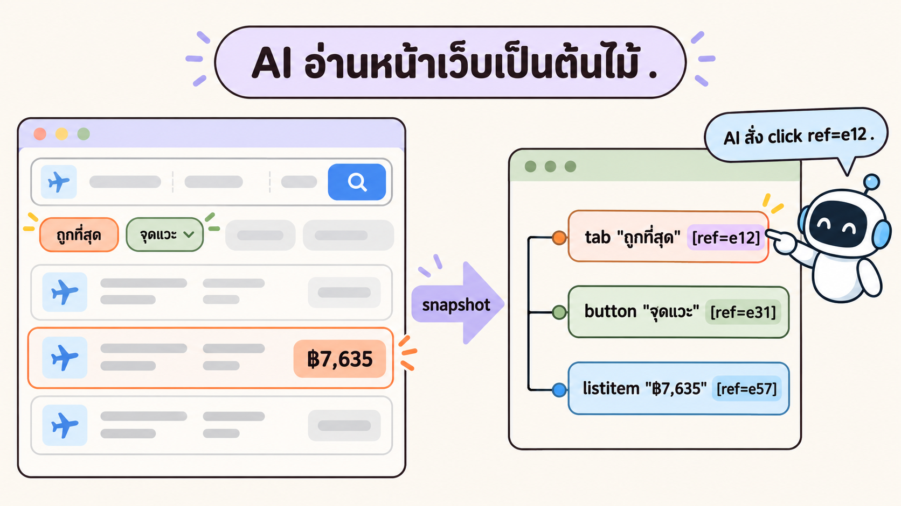
*หน้าเว็บ → snapshot → ต้นไม้ที่มี "บทบาท + ชื่อ + ref" → AI สั่งกดด้วย ref (เลข ref ในภาพเป็นตัวอย่าง)*

**Accessibility tree** คือโครงสร้างที่เบราว์เซอร์สร้างให้ **screen reader** (โปรแกรมอ่านจอสำหรับผู้พิการทางสายตา) ใช้ ทุกชิ้นบอก 3 อย่าง

| ส่วน | ความหมาย | ตัวอย่าง |
|---|---|---|
| **role** (บทบาท) | ชิ้นนี้คืออะไร | `button`, `tab`, `combobox`, `link`, `heading` |
| **name** (ชื่อที่อ่านได้) | ข้อความที่ screen reader จะอ่าน | `"สลับต้นทางกับปลายทาง"` |
| **state / value** | สถานะหรือค่า | `[selected]`, `[disabled]`, `: กรุงเทพมหานคร` |

Playwright MCP เติม **`ref`** (เลขอ้างอิง เช่น `e3852`) ให้ทุกชิ้นที่กดได้ AI จึงสั่ง `click ref=e3852` ได้ตรงตัว ไม่ต้องเดาพิกัดบนจอ

> **ตัวอย่าง (รันจริงของเรา · ตัดจาก `_solution/run/exploration/results-snapshot.yml`):** หน้าผลค้นหา Google Flights ที่ yolo1 เห็น
>
> ```yaml
> - combobox "ต้นทาง" [ref=e3845]: กรุงเทพมหานคร
> - button "สลับต้นทางกับปลายทาง" [ref=e3852] [cursor=pointer]
> - combobox "ปลายทาง" [ref=e3861]: โตเกียว
> - heading "ผลการค้นหา" [level=2] [ref=e3994]
> - generic [ref=e3995]: มีผลลัพธ์ 22 รายการ
> - tablist [ref=e3998]:
>   - tab [selected] [ref=e3999] [cursor=pointer]:
>     - text: ดีที่สุด
>   - tab "ถูกที่สุด เริ่มต้น 7635 บาทไทย ดูข้อมูลเพิ่มเติมเกี่ยวกับการจัดอันดับ" [ref=e4010] [cursor=pointer]
> ...
> - button "ดูเที่ยวบินเพิ่มเติม" [ref=e5266]
> ```
>
> อ่านทีละบรรทัด
> 1. มีช่องต้นทาง/ปลายทางเป็น `combobox` ค่าปัจจุบัน "กรุงเทพมหานคร" → "โตเกียว"
> 2. มีปุ่มสลับ ชื่อ "สลับต้นทางกับปลายทาง" (ref `e3852`)
> 3. มีผลลัพธ์ **22 รายการ**
> 4. แท็บ "ดีที่สุด" ถูกเลือกอยู่ (`[selected]`) ส่วนแท็บ "ถูกที่สุด" บอกราคาเริ่มต้น **7635 บาท** ไว้ในชื่อเลย
> 5. ท้ายรายการมีปุ่ม "ดูเที่ยวบินเพิ่มเติม" (ref `e5266`) → นี่คือปุ่มที่พาไปเห็น 300 ใบ

**ทำไม snapshot ดีกว่าดูจากภาพอย่างเดียว**

| | screenshot (ภาพ) | snapshot (ต้นไม้) |
|---|---|---|
| AI อ่านตัวหนังสือ | ต้องอ่านจากพิกเซล อาจผิด | ได้ข้อความตรง ๆ |
| รู้สถานะ | เดาจากสี | มี `[selected]`, `[disabled]` บอกชัด |
| กดให้ถูก | ต้องคำนวณพิกัด | ใช้ `ref` |
| ข้อเสีย | — | ไม่เห็นหน้าตา สี ตำแหน่ง → จึงถ่าย screenshot คู่กันเป็นหลักฐาน |

**เชื่อมกับ T9:** ชื่อที่อ่านได้ (role + name) คือสิ่งเดียวกับที่ **เทสต์แบบ user-visible** ใช้หาปุ่ม (`getByRole('button', { name: … })`) และเป็นสิ่งที่ผู้พิการทางสายตา "เห็น" จริง เว็บที่ตั้งชื่อปุ่มดีจึงทั้งทดสอบง่ายและเข้าถึงได้ดี

**สรุปสั้น:** snapshot = หน้าเว็บในรูปต้นไม้ role + name + state · `ref` = ป้ายให้ AI กดตรงตัว · ภาพหน้าจอเก็บคู่ไว้เป็นหลักฐาน

---

### T4) สำรวจแบบลูกค้า (Exploratory testing): วางแผน → ลงมือ → สังเกต → จด

**คำถาม:** "ลองกดทุกอย่าง" ฟังดูมั่ว แล้วจะสำรวจอย่างไรให้เป็นระบบ?

**Exploratory testing** คือการทดสอบที่ **เรียนรู้ ออกแบบ และลงมือไปพร้อมกัน** ไม่มีสคริปต์ล่วงหน้า แต่มี **เป้าหมาย (charter)** และ **จดบันทึก** ทุกอย่าง (แนวคิดนี้มาจาก Cem Kaner และ James Bach) เหมาะกับงานที่ **ไม่มีสเปก** อย่างเว็บของคนอื่น

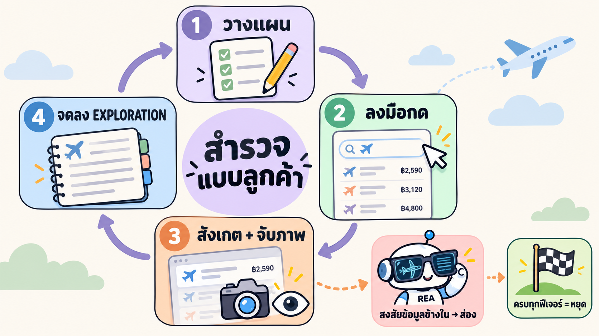
*วนรอบ วางแผน → ลงมือ → สังเกต + จับภาพ → จด · สงสัยข้อมูลข้างในค่อยส่งให้ REA · ครบทุกฟีเจอร์แล้วหยุด*

| ขั้น | ทำอะไร | ตัวอย่างจริง (LAB 1 · รันจริงของเรา) |
|---|---|---|
| **0 ตั้ง charter** | บอกว่าเป็นใคร อยากทำอะไร ขอบเขตแค่ไหน | "ลูกค้าคนหนึ่งที่อยากจองตั๋ว กรุงเทพ → โตเกียว เที่ยวเดียว 15 พ.ย. 2026 ผู้ใหญ่ 1 คน · ห้ามล็อกอิน ห้ามจ่ายเงิน" |
| **1 วางแผน** | เลือกสิ่งที่จะลองต่อไป | "ลองเพิ่มทารกบนตักให้มากกว่าผู้ใหญ่" |
| **2 ลงมือ** | กด / พิมพ์ / เลื่อน | ผู้ใหญ่ 1 + ทารกบนตัก 2 |
| **3 สังเกต + จับภาพ** | ดูว่าเกิดอะไร ถ่ายภาพไว้ | ขึ้นข้อความ "ต้องมีผู้ใหญ่อย่างน้อย 1 คนสำหรับการเดินทางพร้อมทารกที่นั่งบนตัก 1 คน" และปุ่ม "เสร็จ" หายไป → `05-passengers-lap-infant-rule.png` |
| **4 จด** | ลงตารางที่ถูกส่วน | ส่วน C ข้อ C2 "จำนวนทารกบนตักต้องไม่เกินจำนวนผู้ใหญ่" ที่มา **[O]** |
| ↺ **วนต่อ** | ผลรอบนี้ให้ไอเดียรอบหน้า | "แล้วถ้ารวมเกิน 9 คนล่ะ?" → ได้ C3 "ขออภัย เราไม่รองรับผู้โดยสารมากกว่า 9 ท่าน" |

**เทคนิค "ลองแบบลูกค้า" ที่ใช้บ่อย**

1. **ทางปกติ (happy path):** ค้นหา → เลือก → ไปหน้าจอง
2. **ค่าขอบ:** ผู้ใหญ่ 1 คนแล้วกด − · ผู้โดยสาร 9 คนแล้วกด +
3. **รวมเงื่อนไข:** ใส่ตัวกรองหลายตัวพร้อมกัน → เจอ C13 "ตัวกรองทำงานแบบ AND" (35 → 6 → 0 รายการ และขึ้น "ไม่พบผลลัพธ์")
4. **ไปแล้วกลับ:** เข้าหน้าจองแล้วกด ← → เจอ C26 รายการที่โหลดเพิ่มไว้ **300 → 22**
5. **สิ่งที่ "ดูแปลก":** จดเป็นคำถาม ไม่ใช่สรุปเอง เช่น แท็บ "ถูกที่สุด" ยังเห็น ฿11,580 อยู่ก่อน ฿8,802 → ส่วน E ข้อ 4

**เมื่อไรควรหยุด:** ครบทุกฟีเจอร์ที่ลูกค้าเห็น หรือถึงเส้นที่ห้ามข้าม (รอบของเราหยุดที่หน้าตัวเลือกการจอง ไม่กด "ดำเนินการต่อ") แล้ว **เขียนสิ่งที่ยังไม่ได้ลองไว้ตรง ๆ** (yolo1 เขียนว่ายังไม่ได้ลองปุ่ม < > ข้างวันที่ ปุ่มเลือกสนามบินหลายแห่ง ชั้นธุรกิจ และการค้นหาตอนกรอกไม่ครบ)

**สรุปสั้น:** สำรวจ ≠ กดมั่ว · มี charter + ขอบเขต · วน วางแผน → ลงมือ → สังเกต → จด · สิ่งที่ไม่แน่ใจเขียนเป็นคำถาม

---

### T5) `EXPLORATION.md` 5 ส่วน และป้ายที่มา [O] [R] [E]

**คำถาม:** สำรวจเสร็จแล้วจดอย่างไรให้คนอื่น (หรือ AI ตัวถัดไป) เอาไปสร้างแอปต่อได้?

เราใช้รูปแบบเดียวกับ [Week 01 บทร้านสัตว์เลี้ยง](../../00_week01/03_petshop-testplan-from-exploration/README.md) แต่ปรับให้เข้ากับงาน "สร้างแอปเลียนแบบแนวคิด"


*5 ส่วนของ `EXPLORATION.md` และป้ายบอกที่มา 3 แบบของบทนี้*

| ส่วน | จดอะไร | ใครเขียน | ใช้ต่อทำอะไร | ในรอบของเรา (รันจริงของเรา) |
|---|---|---|---|---|
| **A แผนผังหน้าจอ** | หน้า/สถานะ · ไปถึงได้อย่างไร · ภาพ | Playwright (LAB 1) | รู้ว่าแอปต้องมีกี่หน้า กี่ป๊อปอัป | A1–A22 (+ สถานะย่อย A4a, A9a, A9b) และ 2 แถว "ไม่ได้ไป" (เว็บสายการบิน, หน้าล็อกอิน) |
| **B ฟีเจอร์** | ฟีเจอร์ · อยู่ตรงไหน · ลูกค้าทำอะไรได้ · ผลที่เห็น · **หลักฐาน [E]** | Playwright (LAB 1) + REA เติมคอลัมน์ [E] (LAB 2) | รายการสิ่งที่ต้องสร้าง **และ** ใช้เป็นรายการเทสต์ใน LAB 4 | **35 ฟีเจอร์** (B01–B35) |
| **C กฎ** | กฎ · ตัวอย่างที่ลอง · ผลที่เห็น · ที่มา | Playwright (LAB 1) | เงื่อนไขที่แอปต้องทำตาม (validation, CHECK ในฐานข้อมูล) | **31 ข้อ** (C1–C31) · [O] 28 · [R] 3 |
| **D โมเดลข้อมูล** | ช่อง · ตัวอย่าง · ยืนยันแล้ว/อนุมาน | REA (LAB 2) | ออกแบบตารางในฐานข้อมูล (T8) | ราว 40 ช่อง แบ่ง ผลการค้นหา / เที่ยวบิน / ขา / ตัวกรอง / ราคา |
| **E คำถาม** | สิ่งที่ยังไม่รู้ **(ห้ามเดา)** | ทั้งคู่ | กันไม่ให้แอปแต่งพฤติกรรมเอง | **18 ข้อ** |

**ป้ายที่มาของบทนี้ ต่างจาก Week 01 อย่างไร**

| ป้าย | ความหมาย | ตัวอย่างจริงจาก `EXPLORATION.md` ของเรา | เชื่อได้แค่ไหน |
|---|---|---|---|
| **[O] เห็นจากเว็บ** | เห็นบนจอตอนกดจริง | C15 "การบินไทย เท่านั้น" ได้ 5 รายการที่เป็น TG ล้วน ส่วน "การบินไทย, เอเอ็นเอ" ไม่อยู่ในผล | 🟡 เห็นจริง แต่เป็นแค่ "รอบนั้น" |
| **[R] สามัญสำนึก** | กฎที่คนทั่วไปรู้ แต่ **ยังไม่ได้ลองบนเว็บ** | C28 ต้นทางกับปลายทางไม่ควรเป็นที่เดียวกัน · C30 BKK 09:35 → NRT 17:30 = 5 ชม. 55 นาที เพราะญี่ปุ่นเร็วกว่าไทย 2 ชม. | 🟡 ต้องเขียนเหตุผลกำกับ |
| **[E] หลักฐานจาก REA** | ระบบมีข้อมูลรองรับ (accessibility tree, ข้อมูลที่ฝังในหน้า, DOM, ภาพ) | B02 ผู้โดยสาร ✅ E3: spinbutton ผู้ใหญ่ `min=1 max=9` ตรงกับปุ่ม − ที่กดไม่ได้ | 🟢 ยืนยันจากข้างในอีกตาหนึ่ง |

**ทำไมบทนี้ไม่มี [D] (ข้อมูลทีม)?** ใน Week 01 มีไฟล์ `TEST-DATA.md` จาก "ทีม" เป็นแหล่งความจริงสูงสุด แต่ Google Flights **ไม่มีทีมมาบอกเรา** ไม่มีสเปก ไม่มีเอกสารภายใน เราจึงมีแค่ [O] [R] และหลักฐานจากระบบ [E] สิ่งนี้คือข้อจำกัดสำคัญ: **ทุกอย่างที่เรารู้มาจากการสังเกต** (T9 จะเห็นผลของข้อจำกัดนี้)

**สัญลักษณ์ในคอลัมน์ "หลักฐาน [E]" (LAB 2)**

| สัญลักษณ์ | ความหมาย | ตัวอย่างจริง |
|---|---|---|
| ✅ | ระบบมีหลักฐานรองรับ | B10 แท็บ ดีที่สุด/ถูกที่สุด: E1 เห็น tab "ถูกที่สุด เริ่มต้น 7635 บาทไทย" · E2 ข้อมูลแยก 2 กลุ่ม `ds:1[2]` (3 ใบ) และ `ds:1[3]` (19 ใบ) |
| ◐ | มีบางส่วน (เช่น มีปุ่ม แต่พฤติกรรมไม่ได้ยืนยัน) | B06 ปุ่มสลับ: E1 มีปุ่ม "สลับต้นทางกับปลายทาง" แต่ REA ไม่ได้กด จึงยืนยันพฤติกรรมไม่ได้ |
| ✗ | ไม่มีหลักฐาน | B25 ล้างตัวกรอง · B32 หน้าจอง · B33 ปุ่มย้อนกลับ · B34 ส่วนอื่นในหน้าแรก (อยู่คนละหน้ากับที่ REA เปิดไว้) |

**กฎทอง (มาจาก Week 01):** อย่า "อบบั๊ก" ลงในบันทึก ถ้าเห็นอะไรแปลก ให้ **เขียนเป็นคำถามในส่วน E** แทนการสรุปเอง

> **ตัวอย่าง (รันจริงของเรา):** ส่วน E ข้อ 5 "หน้าค้นหาบอกช่วงราคาปกติ ฿4,950–7,200 แต่หน้าจองบอก ฿8,100–11,500" yolo1 ไม่เลือกเชื่อข้างใดข้างหนึ่ง ใน LAB 2 REA เจอว่าช่วง ฿4,950–7,200 **มีอยู่จริงในข้อมูลของหน้าค้นหา** (พร้อมประวัติราคา 61 จุด) แต่ยังไม่รู้ว่าหน้าจองใช้ฐานไหน → คำถามยังเปิดอยู่ ถูกต้องแล้ว

**สรุปสั้น:** A หน้า · B ฟีเจอร์ · C กฎ · D ข้อมูล · E คำถาม · ป้าย [O] เห็น / [R] สามัญสำนึก / [E] หลักฐานจากระบบ · ไม่มี [D] เพราะไม่มีทีมของ Google มายืนยัน

---

### T6) สองเลนส์: มองจากภายนอก (Playwright) vs มองจากข้างใน (REA)

**คำถาม:** ถ้า Playwright กดได้ทุกอย่างแล้ว ทำไมยังต้องใช้ REA อีก?


*Playwright = ตาและมือของลูกค้า · REA = แว่นเอกซเรย์ส่องข้อมูลข้างใน · ใช้คู่กันจึงเห็นครบ*

| | 🟣 Playwright (ภายนอก · black box) | 🟢 REA (ภายใน · grey box) |
|---|---|---|
| เห็นอะไร | สิ่งที่ลูกค้าเห็น **หลังกด** | ข้อมูลที่ **ส่งมาถึงเบราว์เซอร์** แม้ไม่ได้แสดงบนจอ |
| เก่งเรื่อง | พฤติกรรม · กฎ · ลำดับหน้าจอ | โครงสร้างข้อมูล · ค่าที่ซ่อน · ตรวจซ้ำได้ด้วย `evidence_id` |
| พลาดเรื่อง | ข้อมูลที่ไม่ได้แสดง · ตัวเลขที่ถูกปัด | อะไรที่ต้องกดถึงจะโหลด · พฤติกรรมหลังกด |
| ในบทนี้ | LAB 1 · LAB 4 | LAB 2 |

**ตัวอย่างสิ่งที่ "แต่ละเลนส์เจอ ส่วนอีกเลนส์ไม่เจอ" (รันจริงของเรา)**

| Playwright เจอ (ต้องกดถึงเห็น) | REA เจอ (ไม่ต้องกด แต่ไม่โชว์บนจอ) |
|---|---|
| **กฎผู้โดยสาร** C1–C4: ผู้ใหญ่ขั้นต่ำ 1 · ทารกบนตัก ≤ ผู้ใหญ่ · รวม ≤ 9 · ผิดเงื่อนไขแล้วปุ่ม "เสร็จ" หายไป | **ข้อมูลที่ฝังในหน้า** `AF_initDataCallback` (`ds:0`–`ds:4`) มีเที่ยวบิน 22 ใบพร้อมรายละเอียดทุกขา |
| **ตัวกรองทำงานแบบ AND** (C13: 35 → 6 → 0 รายการ แล้วขึ้น "ไม่พบผลลัพธ์") | **ช่วงราคาในข้อมูล** ฿7,635–194,610 (ส่วน slider บนจอเห็น ฿10,000–310,000 หลังโหลดครบ 300 ใบ) |
| **ดูเที่ยวบินเพิ่มเติม 22 → 300** และย้อนกลับจากหน้าจองแล้วเหลือ 22 (C26) | **สนามบินต่อเครื่อง 33 แห่ง** · สายการบิน 64 รหัส · พันธมิตร 3 กลุ่ม |
| **"HKG เท่านั้น" ยังแสดงบินตรง** (C16: 76 = บินตรง 18 + แวะ HKG 58) | **รหัสระดับ CO2** 1/2/3 = ต่ำ/เฉลี่ย/สูง ตรงกับข้อความบนหน้าครบ 22 ใบ |
| **ราคาในปฏิทินถูกปัด** (C7: ปฏิทิน ฿7,640 แต่ราคาจริง ฿7,635) | **ราคาจริงที่ไม่ปัด** + ประวัติราคา 61 จุด · ช่วงปกติ ฿4,950–7,200 |
| **ติดตามราคาต้องล็อกอิน** (C24) | **SL 394 ใช้เลขเดียวกันทั้งสองขา** (DMK→TPE→NRT) · NH 878/808/806 ทำการบินจริงโดย Air Japan |

**Triangulation (จำ T5 บทที่ 1):** เมื่อสองเลนส์ตรงกัน ความมั่นใจสูงขึ้น
- Playwright เห็นปุ่ม − ผู้ใหญ่กดไม่ได้เมื่อเหลือ 1 คน ([O])
- REA เห็น spinbutton ผู้ใหญ่ `min=1 max=9` ใน DOM ([E] ✅)
- สองเลนส์ตรงกัน → กฎ C1 แข็งแรง → แอปของเราทำ CHECK `adults BETWEEN 1 AND 9` ในฐานข้อมูลได้อย่างมั่นใจ

และเมื่อเลนส์หนึ่ง **ไม่มี** หลักฐาน เราก็รู้ว่าเชื่อได้แค่ครึ่งเดียว เช่น กฎ "รวม ≤ 9 และทารกบนตัก ≤ ผู้ใหญ่" REA เขียนไว้ว่า **"ไม่เห็นใน DOM"** → รู้จากการกดของ Playwright อย่างเดียว

**สรุปสั้น:** Playwright = พฤติกรรมหลังกด · REA = ข้อมูลที่ซ่อนอยู่ · ตรงกันแล้วมั่นใจขึ้น · เลนส์ไหนไม่มีหลักฐานต้องเขียนบอก

---

### T7) สองเบราว์เซอร์ใน container เดียว (และการรายงานตามจริง)

**คำถาม:** ทำไมไม่ให้ Playwright กับ REA ใช้ Chrome ตัวเดียวกัน?


*yolo1 ถือสองสาย: Playwright MCP → Chromium ที่เปิดใหม่ · REA MCP → Chrome :9222 ที่เปิดค้างไว้*

| | Chromium ของ Playwright MCP | Chrome พอร์ต 9222 |
|---|---|---|
| ใครใช้ | Playwright MCP | REA MCP (ผ่าน CDP · บทที่ 1 T10) |
| เปิดอย่างไร | Playwright เปิดเองทุกครั้งที่เริ่มงาน (headless + isolated) | เราเปิดเอง (บทที่ 1 LAB 2) ด้วย `--remote-debugging-port=9222` แล้วเปิดค้างไว้ |
| ทำอะไร | กด พิมพ์ เปลี่ยนหน้า (สถานะเปลี่ยนตลอด) | ค้างอยู่ที่หน้าผลค้นหา ให้ REA อ่าน |
| ปิดเมื่อไร | ปิดเองเมื่องานจบ | ต้องปิดเอง (ดู 🔁) |

**เหตุผลที่แยก**

1. **ไม่ให้สองงานแย่งกัน:** ถ้า Playwright กดตัวกรองบนแท็บที่ REA กำลังอ่าน REA จะได้ข้อมูลของ "หน้าที่ถูกกรองแล้ว" แทนหน้าต้นฉบับ
2. **หลักฐานสะอาด:** REA ควรอ่านหน้าที่ **ยังไม่มีใครกด** จะได้รู้ว่า "ข้อมูลตั้งต้นที่ส่งมา" มีอะไร
3. **ปลอดภัย:** Chromium ของ Playwright เป็นโปรไฟล์ใหม่ทุกครั้ง ไม่มี cookie · Chrome :9222 ก็ใช้โปรไฟล์แยก `/tmp/rea-chrome` · ไม่มีบัญชีจริงทั้งคู่
4. **ใช้ต่อจากบทที่ 1 ได้:** Chrome :9222 คือตัวเดิมที่เราเปิดไว้แล้ว ไม่ต้องตั้งค่าใหม่

**การรายงานตามจริง (รันจริงของเรา · LAB 2):** เราสั่ง REA ให้ทำ "แบบอ่านอย่างเดียว" แต่ yolo1 รายงานขึ้นต้นเองว่า

> งานนี้ **ไม่ได้อ่านอย่างเดียว 100%** เครื่องมือ `capture_browser_scenario` แบบ connect โหลด URL ค้นหาเดิมซ้ำ 1 ครั้ง (`goto_start`) ก่อนเก็บข้อมูล หลังจากนั้นไม่มีการคลิกหรือกรอกอะไรเลย

แล้ว yolo1 ทำ 3 อย่างที่เราอยากให้ AI ทำเสมอ
1. **บอกตรง ๆ** ว่าเกิดอะไร (โหลดหน้าซ้ำ 1 ครั้ง ตอน 23:21 น.)
2. **ตรวจผลกระทบ:** เทียบเที่ยวบินทั้ง 22 ใบกับหน้าเดิม → **ตรงกันทุกใบ** ทั้งราคา เวลาออก และเวลาถึง
3. **เขียนหมายเหตุไว้ในไฟล์** (`flights-full.json` ช่อง `meta.caveat` และใน `EXPLORATION.md`) ให้คนอ่านทีหลังรู้

นี่คือเหตุผลที่บทนี้ให้ความสำคัญกับ "หลักฐาน" มากกว่า "คำตอบที่ดูดี"

**สรุปสั้น:** สองเบราว์เซอร์ = สองหน้าที่ ไม่แย่งกัน · Playwright กด · REA อ่านหน้าที่ยังไม่มีใครกด · เครื่องมือทำเกินคำสั่งต้องรายงานและตรวจผลกระทบ

---

### T8) จาก `EXPLORATION.md` สู่แอป: ส่วน D → ตารางในฐานข้อมูล

**คำถาม:** มีบันทึกแล้ว จะแปลงเป็น "แอปจริง" อย่างไร?

**หลักคิด:** แต่ละส่วนของ `EXPLORATION.md` กลายเป็นชิ้นหนึ่งของแอป

| ส่วน | กลายเป็น | ตัวอย่างใน SkyThai Plus (รันจริงของเรา) |
|---|---|---|
| A แผนผังหน้าจอ | หน้าและป๊อปอัป (routes + components) | `src/app/page.tsx` (หน้าแรก) · `search/` (ผลค้นหา) · `booking/[id]` · `booking/confirmation/[ref]` · `bookings/lookup` |
| B ฟีเจอร์ | components ที่ต้องสร้าง | `SearchForm`, `PassengerPicker`, `DatePicker`, `PlacePicker`, `FilterSections`, `FlightRow`, `Insights` |
| C กฎ | validation ฝั่งหน้าเว็บ + API + **CHECK ในฐานข้อมูล** | C2/C3 → CHECK ในตาราง `bookings` |
| **D โมเดลข้อมูล** | **ตารางในฐานข้อมูล** | ดูด้านล่าง |
| E คำถาม | สิ่งที่ **ไม่สร้าง** หรือสร้างแบบบอกตรง ๆ ว่าประมาณเอา | ไม่มีไอคอน Wi-Fi/USB เพราะความหมายของ flag "ยังไม่รู้" |

**ขั้นตอนแปลงส่วน D เป็นตาราง (ไล่จากของจริง)**

1. **หา "สิ่งของ" (entity)** ในส่วน D: ผลการค้นหา · เที่ยวบิน · ขา · การแวะพัก · ตัวกรอง · ข้อมูลราคา + การจองของเราเอง
2. **ดูความสัมพันธ์:** เที่ยวบิน 1 ใบ มีหลายขา (1:N) และหลายจุดแวะ (1:N) · การจอง 1 ครั้ง อ้างเที่ยวบิน 1 ใบ
3. **ใช้เฉพาะช่องที่ "ยืนยันแล้ว"** เป็นคอลัมน์บังคับ · ช่อง "อนุมาน" ใส่ได้แต่ยอมให้ว่าง · ช่อง "ยังไม่รู้" **ไม่ใส่**
4. **แปลงกฎในส่วน C เป็น CHECK**

| ส่วน D (ของ Google) | ตาราง.คอลัมน์ (ของเรา) | ความสัมพันธ์ |
|---|---|---|
| ราคา `item[1][0][1]` = 7635 | `flights.price_thb` (CHECK > 0) | — |
| ระยะเวลารวม `f[9]` = 485 นาที | `flights.total_duration_min` | — |
| กลุ่ม `ds:1[2]` / `ds:1[3]` | `flights.result_group` ('best' / 'other') | — |
| ขา `f[2][]`: เลขเที่ยวบิน, ผู้ทำการบินจริง, เวลาพร้อม timezone, เครื่องบิน | `flight_legs` (`flight_number`, `operated_by`, `depart_at TIMESTAMPTZ`, `aircraft`) | flights 1 → N flight_legs |
| การแวะพัก `f[13][]` = [60, "TPE", …] | `layovers` (`duration_min`, `airport_code`, `change_airport_to`) | flights 1 → N layovers |
| ตัวกรอง `ds:1[7]`: สายการบิน 64 · พันธมิตร 3 · สนามบินต่อเครื่อง 33 | `airlines`, `alliances`, `connecting_airports` | ตารางอ้างอิง |
| ข้อมูลเชิงลึกด้านราคา `ds:1[5]` (ช่วงปกติ + ประวัติ 61 จุด) | `price_insights`, `price_history` | — |
| วันที่ถูกกว่า `ds:1[6]` = 13 พ.ย. ฿5,255 | `cheaper_dates` | — |
| (ไม่มีใน Google · ของเราเอง) | `bookings` + CHECK `infants_lap <= adults` (C2) และ `adults + children + infants_seat + infants_lap <= 9` (C3) | bookings N → 1 flights |

> **ตัวอย่าง (รันจริงของเรา · เทียบ v1 กับ v2)**
>
> | | v1 SkyThai Mini | v2 SkyThai Plus |
> |---|---|---|
> | ต้นทางข้อมูล | `flights-snapshot.json` (สิ่งที่เห็นบนจอ) | `flights-full.json` (ข้อมูลที่ฝังในหน้า + รายละเอียดทุกขา) |
> | ตาราง | `flights` + `bookings` | `flights` · `flight_legs` · `layovers` · `bookings` + ตารางประกอบ (`airlines`, `airports`, `price_history` ฯลฯ) |
> | ข้อมูลตั้งต้น | 22 เที่ยวบิน | 22 เที่ยวบิน **26 ขาบิน** |
> | กฎในฐานข้อมูล | ตรวจรูปแบบอีเมล | + CHECK กฎผู้โดยสาร C2/C3 |
>
> ทำไมต้องแยก `flight_legs`: เที่ยวบินแวะพัก 1 ครั้ง (เช่น SL 394 DMK → TPE → NRT) มี 2 ขา แต่ละขามีเวลา timezone และเครื่องบินของตัวเอง ถ้าเก็บรวมในแถวเดียวจะแสดง "ขยายรายละเอียดเที่ยวบิน" (B14) ไม่ได้

**สรุปสั้น:** A → หน้า · B → components · C → validation + CHECK · D → ตาราง (ใช้เฉพาะช่องที่ยืนยันแล้ว) · E → สิ่งที่ไม่แต่งเอง

---

### T9) วัดความครบด้วยเทสต์ (feature coverage)

**คำถาม:** จะพูดว่า "v2 เหมือน Google มากกว่า" ได้อย่างไร โดยไม่ใช้ความรู้สึก?


*ใช้รายการฟีเจอร์จากส่วน B เป็นเกณฑ์ แล้วให้เทสต์ชุดเดียวกันตัดสินทั้งสองแอป*

**วิธีวัด (ทำใน LAB 4)**

1. **เกณฑ์ = ส่วน B:** 35 ฟีเจอร์ → เขียน **1 test ต่อ 1 ฟีเจอร์** (B01–B35)
2. **test ชุดเดียวกัน** รันกับทั้งสองแอป (Playwright project `v1` / `v2` ต่างกันแค่ `baseURL` 5081 / 5082)
3. **หาปุ่มจากสิ่งที่ผู้ใช้เห็น** (role · ชื่อที่อ่านได้ · ข้อความ) **ห้ามใช้ `data-testid`** class id หรือ URL ภายใน เพราะสองแอปเขียนคนละแบบ ถ้าผูกกับโค้ดของแอปใดแอปหนึ่ง อีกแอปจะตกเพราะ "ชื่อไม่ตรง" ไม่ใช่เพราะ "ไม่มีฟีเจอร์"
4. **ห้ามแก้โค้ดของทั้งสองแอป**
5. **นับผ่าน / 35** = เปอร์เซ็นต์ครอบคลุม

> **ตัวอย่าง (รันจริงของเรา · ตัดจาก `_solution/run/compare/tests/features.spec.ts`)** เทสต์ B17 ตัวกรองสายการบิน
>
> ```ts
> test('B17 ตัวกรอง: สายการบิน', async ({ page }) => {
>   await gotoResults(page);
>   await openFilter(page, /^สายการบิน/);
>   await expect(page.getByText(/เลือกสายการบินทั้งหมด/).first()).toBeVisible();
>   for (const a of ['Oneworld', 'SkyTeam', 'Star Alliance']) await expect(page.getByText(a).first()).toBeVisible();
>   const only = onlyButtonFor(page, /การบินไทย/);
>   await only.click();
>   await closePopup(page);
>   await expect.poll(async () => (await rowTexts(page)).every((x) => /การบินไทย/.test(x))).toBe(true);
> });
> ```
>
> อ่านทีละขั้น: ไปหน้าผลค้นหา → เปิดตัวกรองที่ชื่อขึ้นต้นด้วย "สายการบิน" → ต้องเห็น "เลือกสายการบินทั้งหมด" และกลุ่มพันธมิตร 3 กลุ่ม → กด "การบินไทย เท่านั้น" → **ทุกแถวที่เหลือต้องเป็นการบินไทย**
> ผล: v1 ❌ (ไม่มีแถวตัวกรองเลย) · v2 ✅ (เหลือ 5 รายการ TG ตรงกับกฎ C15 ของ Google)

**ผลจริง (รันจริงของเรา)**

| เวอร์ชัน | ผ่าน | ไม่ผ่าน | ครอบคลุม |
|---|---|---|---|
| v1 SkyThai Mini | 4 / 35 | 31 | **11.4%** |
| v2 SkyThai Plus | 33 / 35 | 2 | **94.3%** |

**อ่านตัวเลขให้เป็น: 3 ข้อควรระวัง**

1. **เกณฑ์ "ผ่าน" มีความเห็นปนอยู่:** yolo2 ให้ผ่านถ้า "ทำส่วนหลักได้" แล้วจดส่วนที่ขาดในหมายเหตุ เช่น v1 ผ่าน B12 เรียงลำดับ ทั้งที่ไม่มีเรียงตามเวลาถึง/การปล่อยก๊าซ/ยอดนิยม และผ่าน B16 ทั้งที่มีแค่ "บินตรง" yolo2 เขียนเองว่า **ถ้าตัดสินเข้มกว่านี้ v1 จะได้ 2/35**
2. **ผ่าน ≠ เหมือน Google ทุกอย่าง:** v2 ผ่าน B18 ตัวกรองสัมภาระ แต่ **ไม่ได้ตัดรายการออกจริง** เพราะข้อมูลจำลองไม่มีข้อมูลสัมภาระ
3. **⚠️ เทสต์ลำเอียงเข้าข้าง v2 (สำคัญที่สุด):** เทสต์เขียนจาก `EXPLORATION.md` ที่จดชื่อปุ่มของ Google (เช่น "นำผู้ใหญ่ออก", "เปลี่ยนชั้นโดยสาร") และ v2 ก็ **สร้างจาก `EXPLORATION.md` ฉบับเดียวกัน** จึงตั้งชื่อปุ่มแบบเดียวกัน → เทสต์หาเจอง่าย ส่วน v1 อาจมีฟีเจอร์แต่ตั้งชื่อต่าง แล้วตกเพราะ "หาไม่เจอ" เหมือน **ผู้ออกข้อสอบกับผู้สอบอ่านหนังสือเล่มเดียวกัน** คะแนนจึงสูงเกินจริงได้

ข้อ 3 คือเหตุผลที่ **บทที่ 3 ใช้ "กรรมการอิสระ" (independent judge)** ที่ไม่ได้เห็นบันทึกของผู้สร้าง มาตัดสินแทน

**สรุปสั้น:** วัดด้วยเทสต์ชุดเดียวกัน หาด้วยสิ่งที่ผู้ใช้เห็น ไม่ใช้ `data-testid` · v1 11.4% vs v2 94.3% · แต่ระวังเกณฑ์และความลำเอียงจากแหล่งเดียวกัน

---

### T10) หลักฐานแบบ GIF: ทำไมต้องมีภาพเคลื่อนไหว

**คำถาม:** มีตาราง ✅/❌ แล้ว ทำไมต้องทำ GIF อีก?

**เพราะตัวเลขผ่าน/ไม่ผ่านอาจผิดได้ 2 แบบ**

| ผิดแบบ | ตัวอย่าง | GIF ช่วยอย่างไร |
|---|---|---|
| **เทสต์ไม่ผ่าน แต่จริง ๆ แอปมีฟีเจอร์** (false negative) | เทสต์หาปุ่มชื่อ "ประเภทตั๋ว" แต่แอปตั้งชื่ออื่น | ดูภาพแล้วเห็นว่ามีปุ่มอยู่ → แก้เทสต์ |
| **เทสต์ผ่าน แต่กดผิดจุด** (false positive) | เทสต์เจอคำว่า "การบินไทย" ในหัวข้อ ไม่ใช่ในแถวผลลัพธ์ | กรอบแดงบอกว่าตรวจตรงไหน → เห็นว่าตรวจผิดที่ |

**GIF ที่ดีในบทนี้มี 5 อย่าง** (ตามที่สั่งใน LAB 4 และที่ yolo2 ทำจริง)

1. **เคียงข้าง ซ้าย v1 | ขวา v2** → test เดียวกัน เห็นความต่างในภาพเดียว
2. **กรอบสีแดง** รอบจุดที่ test กำลังตรวจ พร้อมป้ายบอกว่าตรวจอะไร
3. **ป้ายผลด้านบน** ✔ ผ่าน (เขียว) หรือ ✘ ไม่ผ่าน + ขั้นที่หาไม่เจอ (แดง)
4. **ค้างภาพผลลัพธ์ 3 วินาที** ให้คนดูทัน
5. **ไฟล์เล็กพอแชร์** กว้าง ≤ 1280 px · ≤ 3 MB (ของเรา 1280×400 px · 6 fps · 0.99–1.28 MB · ยาวราว 10 วินาที)

> **ตัวอย่าง (รันจริงของเรา):** หลักฐานแต่ละไฟล์ใช้วิธี **ตรวจย้อนได้**
> - วิดีโอต้นฉบับ `.webm` ของแต่ละฝั่งเก็บไว้ใน `compare/evidence-run/`
> - กรอบแดงวาดด้วยฟังก์ชัน `mark()` · ค้างภาพด้วย `holdResult()` (อยู่ใน `compare/tests/helpers.ts`)
> - รวมภาพด้วย `compare/make-gifs.mjs` (ย่อแต่ละฝั่งเหลือกว้าง 640 แล้ววางคู่ด้วย ffmpeg `hstack`)
> - **รายงานปัญหาตามจริง:** Playwright 1.64.1 ต้องใช้ `ffmpeg-1013` แต่ใน container มีแค่ `ffmpeg-1011` ที่เข้ารหัสไม่สำเร็จ yolo2 จึงทำตัวเรียก ffmpeg ไว้ที่ `/tmp/pw-browsers` **โดยไม่แตะ `/ms-playwright`** และเขียนวิธีไว้ใน `evidence-gif/INDEX.md`

**ใครได้ประโยชน์:** อาจารย์/ผู้รีวิวดู 10 วินาทีก็เชื่อผลได้ · เพื่อนร่วมทีมที่ไม่ได้รันเอง · ตัวเราในอนาคตที่ลืมไปแล้วว่าเทสต์ตรวจอะไร

**สรุปสั้น:** ตัวเลขบอก "ผลลัพธ์" · GIF บอก "ตรวจอะไร ตรงไหน" · เคียงข้าง + กรอบแดง + ค้างภาพ = ตรวจย้อนได้ในไม่กี่วินาที

---

### 🧠 ทบทวน 10 ข้อ (ลองตอบก่อนเปิดเฉลย)

1. ทำไม v1 ที่สร้างจาก REA อย่างเดียวจึงผ่านแค่ 4/35 ทั้งที่ข้อมูลเที่ยวบินแม่นยำ?
2. เที่ยวบิน 278 ใบที่หายไปในบทที่ 1 อยู่ที่ไหน และต้องทำอะไรถึงจะเห็น?
3. Playwright MCP กดปุ่มที่ถูกต้องได้อย่างไร ถ้าไม่ใช้พิกัดบนจอ?
4. ในบรรทัด `tab "ถูกที่สุด เริ่มต้น 7635 บาทไทย …" [ref=e4010]` อะไรคือ role, name และ ref?
5. วงจรสำรวจแบบลูกค้ามีกี่ขั้น อะไรบ้าง และเมื่อไรควรหยุด?
6. ป้าย [O] [R] [E] ต่างกันอย่างไร และทำไมบทนี้ไม่มี [D]?
7. ยกตัวอย่าง 1 สิ่งที่ Playwright เจอแต่ REA ไม่เจอ และ 1 สิ่งที่ REA เจอแต่ Playwright ไม่เจอ
8. ทำไมใช้สองเบราว์เซอร์แยกกัน และเมื่อ REA โหลดหน้าซ้ำ 1 ครั้ง yolo1 ทำอะไรบ้าง?
9. ทำไมเทสต์ใน LAB 4 ห้ามใช้ `data-testid`?
10. ทำไมคะแนน 94.3% ของ v2 อาจ "สูงเกินจริง" และบทที่ 3 แก้อย่างไร?

<details>
<summary>เฉลย</summary>

1. REA **ไม่คลิก** จึงเห็นแค่สถานะแรกของหน้า พฤติกรรมหลังกด (ตัวกรอง ป๊อปอัปผู้โดยสาร ปฏิทิน แท็บ) และกฎที่เห็นเฉพาะตอนกดจึงหายไป v1 จึงเป็นรายการตายตัว
2. อยู่หลังปุ่ม **"ดูเที่ยวบินเพิ่มเติม"** (ไม่ได้ฝังมากับหน้า) ต้อง **กดปุ่มนั้น** จึงจะเห็นครบ 300 ใบ
3. เรียก `snapshot` ได้ accessibility tree ที่ทุกชิ้นมี `ref` แล้วสั่ง `click` ด้วย `ref` นั้น
4. role = `tab` · name = "ถูกที่สุด เริ่มต้น 7635 บาทไทย ดูข้อมูลเพิ่มเติมเกี่ยวกับการจัดอันดับ" · ref = `e4010`
5. 4 ขั้น: **วางแผน → ลงมือกด → สังเกต + จับภาพ → จดลง EXPLORATION** แล้ววนต่อ · หยุดเมื่อครบทุกฟีเจอร์ที่ลูกค้าเห็น หรือถึงเส้นที่ห้ามข้าม (เช่น ก่อนไปเว็บสายการบิน) และต้องเขียนสิ่งที่ยังไม่ได้ลองไว้
6. [O] = เห็นบนจอตอนกด · [R] = สามัญสำนึกที่ยังไม่ได้ลองบนเว็บ · [E] = ระบบมีหลักฐานรองรับ (จาก REA) · ไม่มี [D] เพราะ **ไม่มีทีมหรือสเปกของ Google** มายืนยัน
7. Playwright: กฎผู้โดยสาร ≤ 9 คน / ตัวกรอง AND / 22 → 300 / "HKG เท่านั้น" ยังแสดงบินตรง · REA: ข้อมูล `ds` ที่ฝังในหน้า / ช่วงราคา ฿7,635–194,610 / สนามบินต่อเครื่อง 33 แห่ง / รหัส CO2 1/2/3
8. กันไม่ให้การกดของ Playwright เปลี่ยนหน้าที่ REA กำลังอ่าน และให้ REA อ่านหน้าที่ยังไม่มีใครกด · yolo1 **บอกตรง ๆ**, **ตรวจผลกระทบ** (22 ใบตรงกับหน้าเดิมทุกใบ) และ **เขียนหมายเหตุในไฟล์**
9. สองแอปเขียนคนละแบบ `data-testid` ไม่เหมือนกัน ถ้าผูกกับของแอปหนึ่ง อีกแอปจะตกเพราะชื่อไม่ตรง ไม่ใช่เพราะไม่มีฟีเจอร์ · หาจากสิ่งที่ผู้ใช้เห็นจึงยุติธรรมกว่า
10. เทสต์และ v2 มาจาก `EXPLORATION.md` ฉบับเดียวกัน (ชื่อปุ่มแบบเดียวกัน) + เกณฑ์ "ผ่าน" ใจดี (เช่น B18 ผ่านแต่ไม่ได้กรองจริง) · บทที่ 3 ใช้ **กรรมการอิสระ** ที่ไม่ได้เห็นบันทึกของผู้สร้างมาตัดสิน

</details>

---

## 🗺️ เส้นทาง LAB

**ทุก LAB = วางพรอมต์ 1 ครั้งใน Claude Code Desktop** (เปิดในโฟลเดอร์นี้) แล้วรอผล · ไฟล์ที่ LAB ก่อนสร้างใน `/workspace/rea-flight-v2` คือ "ความจำ" ที่ LAB ถัดไปใช้ต่อ

| LAB | ทำอะไร | ใครทำงาน | ได้อะไร | เวลา AI (รันจริง) |
|---|---|---|---|---|
| 0 | เช็กก่อนเริ่ม | Claude Code Desktop | รู้ว่า REA, Playwright, v1 และ Chrome :9222 พร้อม | — |
| 1 | Playwright สำรวจแบบลูกค้า | `yolo1 -p` + Playwright MCP | `EXPLORATION.md` (A, B, C, E) · `exploration/*.png` | 15 นาที 14 วินาที |
| 2 | REA เก็บหลักฐานเพิ่ม | `yolo1 -p` + REA MCP | ส่วน D · คอลัมน์ [E] · `flights-full.json` · `evidence/` | 5 นาที 59 วินาที |
| 3 | สร้าง SkyThai Plus | `yolo1 -p` + `cyolo1` (ภาพ) | `skythai-plus/` → `docker compose` บน Windows (http://localhost:5082) | 14 นาที 6 วินาที |
| 4 | เทียบ v1/v2 + GIF | `yolo2 -p` + Playwright | `COMPARE.md` · `compare/` · `evidence-gif/` | 22 นาที 31 วินาที |

💡 **พรอมต์มี 2–3 ชั้นเหมือนบทที่ 1**
- **ชั้นนอก** (บนเส้น `---` แรก) = คุยกับ Claude Code Desktop ให้ไปทำใน container
- **ชั้นใน** (ระหว่างเส้น `---`) = งานที่ส่งต่อให้ `yolo1 -p` / `yolo2 -p` (ชุดเดียวกับ `_solution/run/q1.txt`–`q4.txt`)
- **ชั้นท้าย** (ใต้เส้น `---` ที่สอง ถ้ามี) = งานของ Claude Code Desktop หลัง yolo ทำเสร็จ เช่น คัดลอกไฟล์ออกมา

> 🔒 ผลจริงทุกพรอมต์อยู่ใน [`_solution/run/`](_solution/run/) ลองทำเองก่อน แล้วค่อยเปิดเทียบ

---

## LAB 0 · เช็กก่อนเริ่ม

🎯 ให้แน่ใจว่าของจากบทที่ 1 ยังอยู่ครบ ก่อนเสียเวลารอ AI นาน ๆ (เป็นแค่การเช็กง่าย ๆ ไม่ต้องมีภาพประกอบ)

💬 **คัดลอกพรอมต์นี้**

```text
ใน container multi-account-devtool ช่วยเช็กความพร้อมก่อนเริ่มบทที่ 2 แบบอ่านอย่างเดียว ห้ามแก้หรือลบอะไร
1. container multi-account-devtool รันอยู่ไหม
2. /root/ai-accounts/.Claude/shared/mcp/mcp.json มีทั้ง rea (rea-agents@6.7.0) และ playwright ไหม
3. มีโฟลเดอร์ /workspace/rea-flight/skythai-mini (แอป v1 จากบทที่ 1) ไหม และ curl http://localhost:5081/api/health ใน container ตอบอะไร
4. มี Chrome ที่เปิด --remote-debugging-port=9222 อยู่ไหม (curl http://127.0.0.1:9222/json/version ใน container)
5. yolo1, yolo2 และ cyolo1 ล็อกอินอยู่ไหม
สรุปเป็นตาราง ข้อ | ผล | ถ้าไม่ผ่านควรทำอะไร
```

✅ **ผลที่คาดหวัง**

| ข้อ | ผล |
|---|---|
| 1 container | กำลังรัน |
| 2 MCP | มีทั้ง `rea` และ `playwright` |
| 3 v1 | มีโฟลเดอร์ · `/api/health` ตอบ `{"ok":true}` (ถ้าไม่ตอบ ให้ Claude Code รัน `docker compose up -d` ในโฟลเดอร์นั้น หรือปล่อยให้ LAB 4 เปิดให้เอง) |
| 4 Chrome :9222 | ตอบ JSON ที่มี `"Browser": "HeadlessChrome/…"` |
| 5 บัญชี | ล็อกอินครบ 3 บัญชี |

👀 **สังเกต**
- **ถ้า Chrome :9222 ไม่ได้เปิด** (เช่น ปิดไปตอนจบบทที่ 1) ให้เปิดใหม่แบบเดียวกับ [บทที่ 1 LAB 2](../01_REA_Basics_Flight/README.md) (ไม่ต้องส่ง prompt 1 ให้ yolo1 ซ้ำ) หรือปล่อยให้ LAB 2 ของบทนี้เปิดให้ เพราะพรอมต์ LAB 2 เขียนไว้แล้วว่า "ถ้ายังไม่เปิด ให้เปิดแบบเดียวกับบทที่ 1 ก่อน"
- ถ้า `rea` หายไป (สร้าง container ใหม่) ให้ทำบทที่ 1 LAB 1 ใหม่
- ถ้า `yolo2` หรือ `cyolo1` ยังไม่ล็อกอิน ให้กลับไปทำขั้นล็อกอินของ LAB 03 Multi-Account Container ก่อน (LAB 3 ต้องใช้ `cyolo1` · LAB 4 ต้องใช้ `yolo2`)

---

## LAB 1 · Playwright สำรวจ Google Flights แบบลูกค้า

🎯 ให้ yolo1 ใช้ Playwright MCP **กดใช้ Google Flights เหมือนลูกค้า** แล้วเขียน `EXPLORATION.md` ส่วน A, B, C, E พร้อมภาพหน้าจอ (ทฤษฎี: T2, T3, T4, T5)

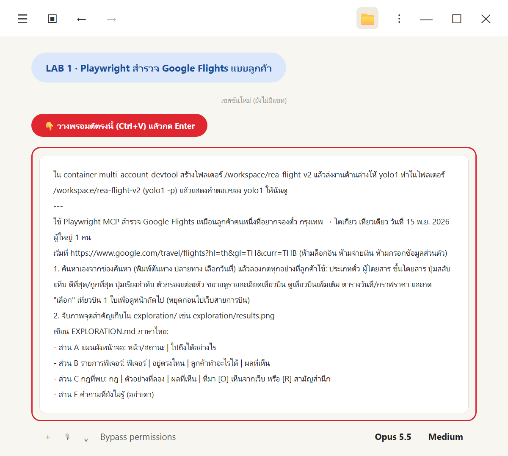
*วางพรอมต์ LAB 1*

💬 **คัดลอกพรอมต์นี้**

```text
ใน container multi-account-devtool สร้างโฟลเดอร์ /workspace/rea-flight-v2 แล้วส่งงานด้านล่างให้ yolo1 ทำในโฟลเดอร์ /workspace/rea-flight-v2 (yolo1 -p) แล้วแสดงคำตอบของ yolo1 ให้ฉันดู
---
ใช้ Playwright MCP สำรวจ Google Flights เหมือนลูกค้าคนหนึ่งที่อยากจองตั๋ว กรุงเทพ → โตเกียว เที่ยวเดียว วันที่ 15 พ.ย. 2026 ผู้ใหญ่ 1 คน
เริ่มที่ https://www.google.com/travel/flights?hl=th&gl=TH&curr=THB (ห้ามล็อกอิน ห้ามจ่ายเงิน ห้ามกรอกข้อมูลส่วนตัว)
1. ค้นหาเองจากช่องค้นหา (พิมพ์ต้นทาง ปลายทาง เลือกวันที่) แล้วลองกดทุกอย่างที่ลูกค้าใช้: ประเภทตั๋ว ผู้โดยสาร ชั้นโดยสาร ปุ่มสลับ แท็บ ดีที่สุด/ถูกที่สุด ปุ่มเรียงลำดับ ตัวกรองแต่ละตัว ขยายดูรายละเอียดเที่ยวบิน ดูเที่ยวบินเพิ่มเติม ตารางวันที่/กราฟราคา และกด "เลือก" เที่ยวบิน 1 ใบเพื่อดูหน้าถัดไป (หยุดก่อนไปเว็บสายการบิน)
2. จับภาพจุดสำคัญเก็บใน exploration/ เช่น exploration/results.png
เขียน EXPLORATION.md ภาษาไทย:
- ส่วน A แผนผังหน้าจอ: หน้า/สถานะ | ไปถึงได้อย่างไร
- ส่วน B รายการฟีเจอร์: ฟีเจอร์ | อยู่ตรงไหน | ลูกค้าทำอะไรได้ | ผลที่เห็น
- ส่วน C กฎที่พบ: กฎ | ตัวอย่างที่ลอง | ผลที่เห็น | ที่มา [O] เห็นจากเว็บ หรือ [R] สามัญสำนึก
- ส่วน E คำถามที่ยังไม่รู้ (อย่าเดา)
```

✅ **ผลจริง** (yolo1 ใช้เวลา **15 นาที 14 วินาที** · 23:05:00 → 23:20:14) สำรวจครบทุกข้อที่ขอ ไม่ล็อกอิน ไม่กรอกข้อมูลส่วนตัว และ **หยุดที่หน้าตัวเลือกการจอง** ไม่กด "ดำเนินการต่อ" ไปเว็บสายการบิน

**ไฟล์ที่ได้**

| ไฟล์ | เนื้อหา |
|---|---|
| `EXPLORATION.md` | ส่วน A (A1–A22 + สถานะย่อย) · B (35 ฟีเจอร์) · C (31 กฎ: [O] 28 · [R] 3) · E (คำถามที่ยังไม่รู้) · ภาคผนวกรายการภาพ |
| `exploration/` | ภาพหน้าจอ **40 รูป** (`01-home.png` … `39-cheapest-tab-default-sort.png` + `results.png`) และ snapshot `results-snapshot.yml`, `booking-snapshot.yml` |

(สำเนาของ `EXPLORATION.md` ตอนจบ LAB 1 ก่อน REA เติม อยู่ที่ [`_solution/run/EXPLORATION.step1.md`](_solution/run/EXPLORATION.step1.md))

**กฎที่น่าสนใจที่เห็นจากการกดจริง (ย่อจาก `out-q1.md`)**

| กลุ่ม | สิ่งที่เจอ | ข้อในส่วน C |
|---|---|---|
| ผู้โดยสาร | รวมได้ไม่เกิน 9 คน (นับทารกบนตักด้วย) · ทารกบนตัก ≤ ผู้ใหญ่ · ผิดเงื่อนไขแล้วปุ่ม "เสร็จ" หายไปจนกว่าจะแก้ | C1–C4 |
| ปฏิทิน | เลือกวันในอดีตไม่ได้ · ราคาในปฏิทินถูกปัด (฿7,640 vs ราคาจริง ฿7,635) | C6–C7 |
| การเรียงลำดับ | ค่าที่เลือกคงอยู่เมื่อสลับแท็บ · ถ้าไม่ใช่ค่าเริ่มต้น ตารางวันที่ กราฟราคา และกล่องข้อมูลราคาจะหายไป | C11–C12 |
| ตัวกรอง | ทำงานร่วมกันแบบ AND · "การบินไทย เท่านั้น" ไม่รวมเที่ยวบินร่วม · "HKG เท่านั้น" ยังแสดงบินตรง 18 เที่ยว · สัมภาระมีแค่กระเป๋าถือ สูงสุด 1 ใบ | C13–C17 |
| ดูเที่ยวบินเพิ่มเติม | 22 → **300** · แต่กดย้อนกลับจากหน้าจองแล้วเหลือ 22 | C26 |
| ติดตามราคา | ต้องล็อกอิน (yolo1 กด "ปิด" ไม่ลงชื่อเข้าใช้) | C24 |
| หน้าจอง | 2 ผู้ขาย: สายการบิน ฿8,172 (รวมค่าธรรมเนียมเพิ่มเติม ฿81) และ Gotogate ฿8,847 | C22–C23 |

**สิ่งที่ yolo1 ไม่สรุปเอง (ส่วน E)**
- แท็บ "ถูกที่สุด" กับการเรียงค่าเริ่มต้น รายการไม่ได้เรียงตามราคา (฿11,580 อยู่ก่อน ฿8,802) → **เก็บเป็นคำถาม ไม่ได้สรุปว่าเป็นบั๊ก**
- ช่วงราคาปกติไม่ตรงกัน (หน้าค้นหา ฿4,950–7,200 · หน้าจอง ฿8,100–11,500)
- ค่าธรรมเนียม ฿81 คือค่าอะไร · ปุ่ม "ดูตัวเลือก" มีในหน้าแต่ไม่เห็นบนจอ 1366px

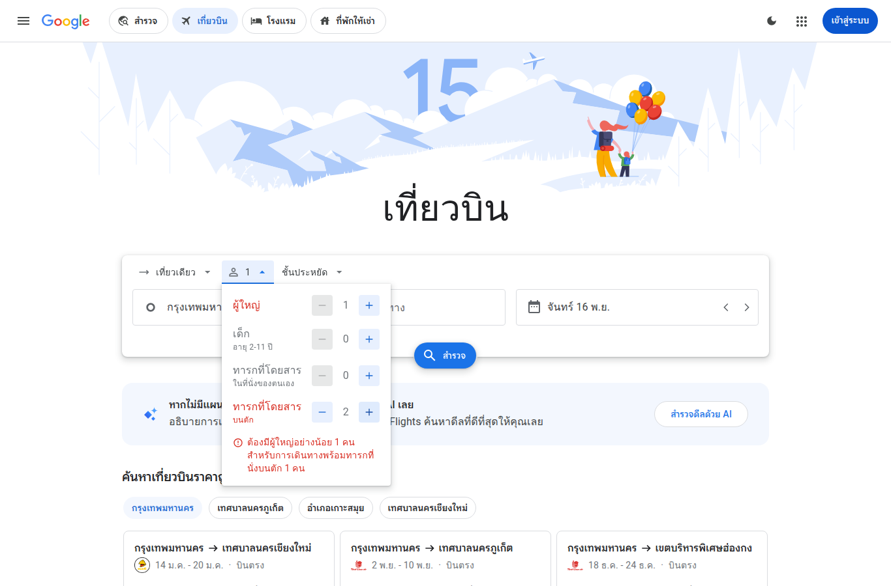
*ภาพจริง `05-passengers-lap-infant-rule.png` = หลักฐานของกฎ C2 · ใช้เพื่อการเรียนเท่านั้น*

ไฟล์เต็ม: [`_solution/run/out-q1.md`](_solution/run/out-q1.md) · [`EXPLORATION.step1.md`](_solution/run/EXPLORATION.step1.md) · ภาพทั้งหมด [`_solution/run/exploration/`](_solution/run/exploration/)

👀 **สังเกต**
- **yolo1 บอกสิ่งที่ยังไม่ได้ลองไว้ตรง ๆ:** ปุ่ม < > ข้างช่องวันที่ · "เลือกสนามบินหลายแห่ง" · ชั้นธุรกิจ/ชั้นหนึ่ง · การค้นหาตอนกรอกไม่ครบ → ทั้งหมดอยู่ในส่วน E หรือติด [R] (T4)
- **[R] มีแค่ 3 ข้อ** (C28–C30) เพราะเกือบทุกกฎได้มาจากการกดจริง ข้อ [R] คือข้อที่ "น่าจะจริงแต่ยังไม่ได้ลอง" ต้องระวังตอนสร้างแอป
- **ตัวเลขเปลี่ยนตามวัน:** ราคาและจำนวนเที่ยวบินเป็นค่าที่เห็น 31 ต.ค. 2569 ราว 23:05–23:17 น. ของคุณจะต่างไป เทียบ "โครงสร้างและกฎ" ไม่ใช่ตัวเลข
- **ถ้ารันหลังวันที่ 15 พ.ย. 2569:** วันที่ในพรอมต์จะกลายเป็นอดีต (เลือกไม่ได้ตามกฎ C6) ให้เปลี่ยน "15 พ.ย. 2026" ในพรอมต์ LAB 1–2 เป็นวันที่ 15 ของเดือนหน้า (เช่น 15 ธ.ค. 2026)
- **ใช้เวลานานที่สุดในบท** เพราะต้องกดจริงทีละขั้นและถ่ายภาพ 40 รูป อย่าปิดหน้าต่างระหว่างรอ

---

## LAB 2 · REA เก็บหลักฐานเพิ่มให้ `EXPLORATION.md`

🎯 ให้ yolo1 ใช้ REA **ส่องข้อมูลข้างใน** หน้าผลค้นหาที่เปิดค้างไว้ใน Chrome :9222 แล้วเติม `flights-full.json`, คอลัมน์ "หลักฐาน [E]" ในส่วน B และส่วน D โมเดลข้อมูล (ทฤษฎี: T5, T6, T7)

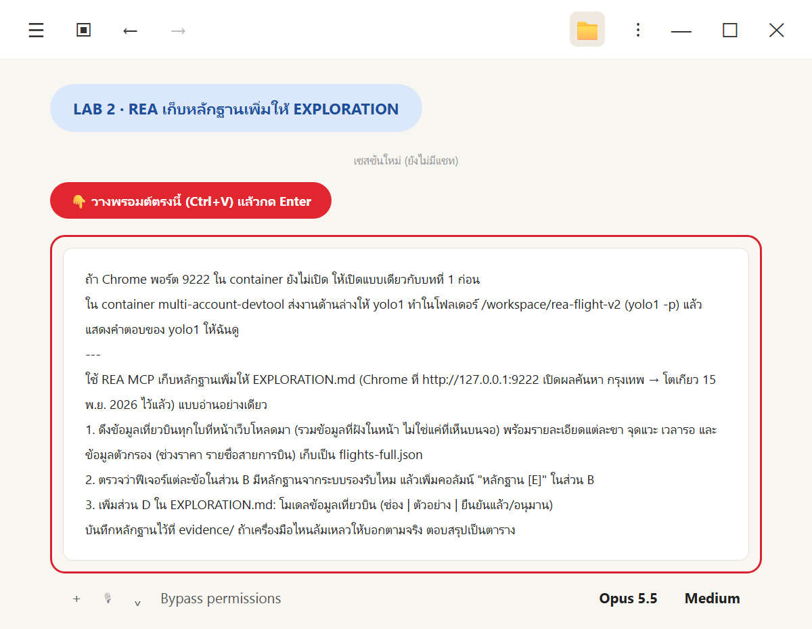
*วางพรอมต์ LAB 2*

💬 **คัดลอกพรอมต์นี้**

```text
ถ้า Chrome พอร์ต 9222 ใน container ยังไม่เปิด ให้เปิดแบบเดียวกับบทที่ 1 ก่อน
ใน container multi-account-devtool ส่งงานด้านล่างให้ yolo1 ทำในโฟลเดอร์ /workspace/rea-flight-v2 (yolo1 -p) แล้วแสดงคำตอบของ yolo1 ให้ฉันดู
---
ใช้ REA MCP เก็บหลักฐานเพิ่มให้ EXPLORATION.md (Chrome ที่ http://127.0.0.1:9222 เปิดผลค้นหา กรุงเทพ → โตเกียว 15 พ.ย. 2026 ไว้แล้ว) แบบอ่านอย่างเดียว
1. ดึงข้อมูลเที่ยวบินทุกใบที่หน้าเว็บโหลดมา (รวมข้อมูลที่ฝังในหน้า ไม่ใช่แค่ที่เห็นบนจอ) พร้อมรายละเอียดแต่ละขา จุดแวะ เวลารอ และข้อมูลตัวกรอง (ช่วงราคา รายชื่อสายการบิน) เก็บเป็น flights-full.json
2. ตรวจว่าฟีเจอร์แต่ละข้อในส่วน B มีหลักฐานจากระบบรองรับไหม แล้วเพิ่มคอลัมน์ "หลักฐาน [E]" ในส่วน B
3. เพิ่มส่วน D ใน EXPLORATION.md: โมเดลข้อมูลเที่ยวบิน (ช่อง | ตัวอย่าง | ยืนยันแล้ว/อนุมาน)
บันทึกหลักฐานไว้ที่ evidence/ ถ้าเครื่องมือไหนล้มเหลวให้บอกตามจริง ตอบสรุปเป็นตาราง
```

<details>
<summary>เบื้องหลัง: คำสั่งเปิด Chrome :9222 (ใช้เมื่อยังไม่เปิด · เหมือนบทที่ 1 LAB 2)</summary>

```bash
docker exec -d multi-account-devtool \
  /ms-playwright/chromium-1247/chrome-linux64/chrome --headless=new --no-sandbox \
  --remote-debugging-port=9222 --user-data-dir=/tmp/rea-chrome \
  --window-size=1366,1000 --lang=th-TH \
  "https://www.google.com/travel/flights?q=Flights%20from%20Bangkok%20to%20Tokyo%20on%202026-11-15%20one%20way&hl=th&gl=TH&curr=THB"
```

ถ้าเปลี่ยนวันที่ในพรอมต์ (เช่น เป็น 15 ธ.ค.) ให้วันที่ในลิงก์ตรงกันด้วย

</details>

✅ **ผลจริง** (yolo1 ใช้เวลา **5 นาที 59 วินาที**) ทำครบทั้ง 3 ข้อ และ **เปิดรายงานด้วยเรื่องที่ต้องแจ้งก่อน** ว่า REA โหลดหน้าซ้ำ 1 ครั้ง (ดู T7)

**ผลแต่ละข้อ (ย่อจาก `out-q2.md`)**

| งาน | ผล | ไฟล์ |
|---|---|---|
| 1 ดึงข้อมูลเที่ยวบิน | **22 ใบ** จากข้อมูลที่ฝังในหน้า (ยอดนิยม 3 + อื่น ๆ 19) ทุกใบมีทุกขา: เลขเที่ยวบิน · เวลาพร้อม timezone · เครื่องบิน · ที่วางขา · ผู้ทำการบินจริง · จุดแวะและเวลารอ (TPE 60, HAK 520, HKG 240, TPE 135 นาที) · CO2 · ข้อมูลตัวกรอง: ราคา ฿7,635–194,610 · สายการบิน 64 รหัส · พันธมิตร 3 กลุ่ม · สนามบินต่อเครื่อง 33 แห่ง · เวลาแวะ 55–2010 นาที · ระยะเวลารวม 340–2495 นาที | `flights-full.json` |
| 1 ข้อจำกัด | อีก **278 ใบ ไม่ได้ฝังในหน้า** ต้องกด "ดูเที่ยวบินเพิ่มเติม" → ไม่ได้ดึง เพราะงานนี้ห้ามคลิก | — |
| 2 คอลัมน์ "หลักฐาน [E]" | 35 ฟีเจอร์ ติด ✅ / ◐ / ✗ พร้อมบอกว่าหลักฐานมาจาก E1–E4 | `EXPLORATION.md` |
| 3 ส่วน D | ราว 40 ช่อง แบ่ง ผลการค้นหา / เที่ยวบิน / ขา / ตัวกรอง / ราคา · ช่องที่ไม่รู้ความหมายเขียนว่า **"ยังไม่รู้ (ไม่เดา)"** | `EXPLORATION.md` |

**เครื่องมือ REA ที่ใช้ (รวมที่ล้มเหลว)**

| เครื่องมือ | สถานะ | หมายเหตุ |
|---|---|---|
| `list_browser_targets` | ✅ | เจอแท็บผลค้นหา 1 แท็บ (URL แบบ `?q=Flights from Bangkok to Tokyo…` ไม่ใช่ `/search?tfs=` แบบที่ Playwright เห็น) |
| `inspect_web_page` | ⚠️ ได้บางส่วน | ได้ accessibility tree แต่ **ไม่ได้ข้อมูลที่ฝังในหน้า** เพราะ policy ของ REA ตัดสคริปต์ที่ไม่มี URL ออก 82 ตัว |
| `capture_browser_scenario` (connect) | ✅ แต่ **โหลดหน้าซ้ำ 1 ครั้ง** | ได้ DOM เต็ม 3.25 MB ที่มีข้อมูล `ds:0`–`ds:4` |
| `capture_web_screenshot` | ✅ | ตรวจ sha256 แล้วตรง |
| `export_evidence_bundle` | ✅ | 4 records |
| `jq` | ❌ ไม่มีในเครื่อง | ใช้ Python แทน |

**ตัวอย่างส่วน D (ย่อ · เที่ยวบินแรก SL 394)**

| ช่อง | ตัวอย่าง | สถานะ |
|---|---|---|
| ราคา `item[1][0][1]` | 7635 | ยืนยันแล้ว |
| ระยะเวลารวม `f[9]` | 485 นาที = 8 ชม. 5 นาที | ยืนยันแล้ว |
| ระยะเวลาบินของขา `leg[11]` | 230 นาที (230 + แวะ 60 + 195 = 485) | ยืนยันแล้ว (ผลรวมตรง) |
| เครื่องบิน `leg[17]` | "Boeing 737" | อนุมาน (ไม่ได้ขยายแถวให้เห็นบนจอรอบนี้) |
| ระดับ CO2 `f[22][2]` | 1 = ต่ำ · 2 = เฉลี่ย · 3 = สูง | ยืนยันแล้ว (เทียบ label ครบ 22 ใบ) |
| ธงสิ่งอำนวยความสะดวก `leg[12]` | `[null,1,…,1,null,3]` | **ยังไม่รู้ (ไม่เดา)** |

**สิ่งที่ REA เจอเพิ่ม**
- ช่วงราคาปกติ ฿4,950–7,200 ที่ค้างในส่วน E **มีอยู่จริงในข้อมูลของหน้าค้นหา** พร้อมประวัติราคา 61 จุด
- SL 394 ใช้เลขเที่ยวบินเดียวกันทั้งสองขา · NH 878/808/806 ทำการบินจริงโดย Air Japan
- คำถาม "ลำดับในแท็บถูกที่สุด" (ส่วน E) **ยังตอบไม่ได้** → yolo1 จึงไม่แก้ส่วน E

ไฟล์เต็ม: [`_solution/run/out-q2.md`](_solution/run/out-q2.md) · [`EXPLORATION.md`](_solution/run/EXPLORATION.md) · [`flights-full.json`](_solution/run/flights-full.json) · [`evidence/`](_solution/run/evidence/)

👀 **สังเกต**
- **ตรวจตัวเลขที่ AI สรุปเสมอ:** yolo1 สรุปว่าคอลัมน์ [E] ได้ ✅ 16 · ◐ 15 · ✗ 4 แต่ถ้านับจากตารางในไฟล์ `EXPLORATION.md` จริงจะได้ ✅ 14 · ◐ 17 · ✗ 4 (รวม 35 เท่ากัน) → **ไฟล์คือหลักฐาน คำสรุปคือความเห็น** ถ้าขัดกันให้เชื่อไฟล์
- **"อ่านอย่างเดียว" ไม่ได้ 100%:** เครื่องมือโหลดหน้าซ้ำ 1 ครั้ง yolo1 บอกเอง ตรวจว่า 22 ใบตรงกับหน้าเดิมทุกใบ และเขียนไว้ใน `meta.caveat` ของ `flights-full.json` (T7)
- **REA ก็ยังไม่เห็น 278 ใบ** เพราะไม่ได้ฝังมากับหน้า → นี่คือสิ่งที่ "ต้องกด" เท่านั้น (T1)
- **✗ 4 ข้อ** (ล้างตัวกรอง, หน้าจอง, ปุ่มย้อนกลับ, หน้าแรก) ไม่ใช่ "ไม่มีฟีเจอร์" แต่ REA เปิดแค่หน้าผลค้นหา จึงไม่มีหลักฐานของหน้าอื่น → **หาไม่เจอ ≠ ไม่มี** (บทที่ 1 T11)
- `evidence/` ใน `_solution` เก็บสคริปต์ถอดข้อมูล (`ds.py`, `build.py`, `addD.py`, `editB.py`), accessibility JSON, ภาพจาก REA และสำเนา `EXPLORATION.before-rea.md` (ไฟล์ DOM ดิบขนาดใหญ่ไม่ได้คัดลอกมา)

---

## LAB 3 · สร้าง SkyThai Plus แล้วเปิดดู

🎯 ให้ yolo1 ใช้ `EXPLORATION.md` (B ฟีเจอร์ · C กฎ · D โมเดลข้อมูล) + `flights-full.json` สร้างแอปเวอร์ชัน 2 ด้วย **Next.js (TypeScript) + PostgreSQL** ให้ `cyolo1` สร้างโลโก้และภาพหน้าแรก แล้วเปิดบนเครื่องที่ http://localhost:5082 (ทฤษฎี: T8)

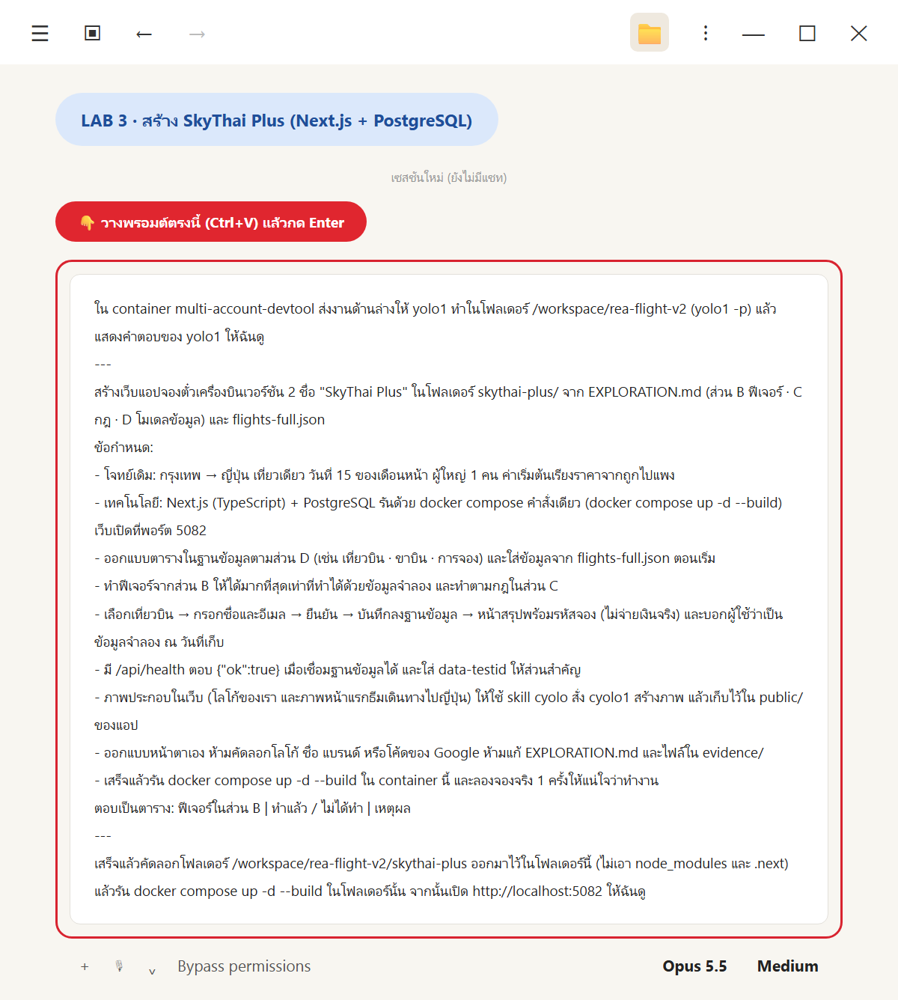
*วางพรอมต์ LAB 3*

💬 **คัดลอกพรอมต์นี้**

```text
ใน container multi-account-devtool ส่งงานด้านล่างให้ yolo1 ทำในโฟลเดอร์ /workspace/rea-flight-v2 (yolo1 -p) แล้วแสดงคำตอบของ yolo1 ให้ฉันดู
---
สร้างเว็บแอปจองตั๋วเครื่องบินเวอร์ชัน 2 ชื่อ "SkyThai Plus" ในโฟลเดอร์ skythai-plus/ จาก EXPLORATION.md (ส่วน B ฟีเจอร์ · C กฎ · D โมเดลข้อมูล) และ flights-full.json
ข้อกำหนด:
- โจทย์เดิม: กรุงเทพ → ญี่ปุ่น เที่ยวเดียว วันที่ 15 ของเดือนหน้า ผู้ใหญ่ 1 คน ค่าเริ่มต้นเรียงราคาจากถูกไปแพง
- เทคโนโลยี: Next.js (TypeScript) + PostgreSQL รันด้วย docker compose คำสั่งเดียว (docker compose up -d --build) เว็บเปิดที่พอร์ต 5082
- ออกแบบตารางในฐานข้อมูลตามส่วน D (เช่น เที่ยวบิน · ขาบิน · การจอง) และใส่ข้อมูลจาก flights-full.json ตอนเริ่ม
- ทำฟีเจอร์จากส่วน B ให้ได้มากที่สุดเท่าที่ทำได้ด้วยข้อมูลจำลอง และทำตามกฎในส่วน C
- เลือกเที่ยวบิน → กรอกชื่อและอีเมล → ยืนยัน → บันทึกลงฐานข้อมูล → หน้าสรุปพร้อมรหัสจอง (ไม่จ่ายเงินจริง) และบอกผู้ใช้ว่าเป็นข้อมูลจำลอง ณ วันที่เก็บ
- มี /api/health ตอบ {"ok":true} เมื่อเชื่อมฐานข้อมูลได้ และใส่ data-testid ให้ส่วนสำคัญ
- ภาพประกอบในเว็บ (โลโก้ของเรา และภาพหน้าแรกธีมเดินทางไปญี่ปุ่น) ให้ใช้ skill cyolo สั่ง cyolo1 สร้างภาพ แล้วเก็บไว้ใน public/ ของแอป
- ออกแบบหน้าตาเอง ห้ามคัดลอกโลโก้ ชื่อ แบรนด์ หรือโค้ดของ Google ห้ามแก้ EXPLORATION.md และไฟล์ใน evidence/
- เสร็จแล้วรัน docker compose up -d --build ใน container นี้ และลองจองจริง 1 ครั้งให้แน่ใจว่าทำงาน
ตอบเป็นตาราง: ฟีเจอร์ในส่วน B | ทำแล้ว / ไม่ได้ทำ | เหตุผล
---
เสร็จแล้วคัดลอกโฟลเดอร์ /workspace/rea-flight-v2/skythai-plus ออกมาไว้ในโฟลเดอร์นี้ (ไม่เอา node_modules และ .next) แล้วรัน docker compose up -d --build ในโฟลเดอร์นั้น จากนั้นเปิด http://localhost:5082 ให้ฉันดู
```

(บรรทัดสุดท้ายเป็นงานของ Claude Code Desktop: คัดลอกออกจาก container ด้วย `docker cp` แล้วรัน `docker compose up -d --build` บน Windows)

✅ **ผลจริง** (yolo1 ใช้เวลา **14 นาที 6 วินาที** · 23:59:30 → 00:13:36) build ผ่าน web และ db ขึ้น healthy · `/api/health` ตอบ `{"ok":true}` · ลองจองจริงในเบราว์เซอร์ 1 ครั้ง: เลือก SL 394 ฿7,635 → ได้รหัสจอง **`UNB7CJ`** และเจอแถวนี้ในตาราง `bookings` จริง · console ของเบราว์เซอร์ไม่มี error

**ตัวเลขที่ yolo1 ตรวจระหว่างทาง (ตรงกับ `EXPLORATION.md`)**
- เลือกบินตรง → เหลือ 18 รายการ และราคาเริ่มต้นเปลี่ยนเป็น ฿8,172 (ตรง C14)
- "การบินไทย เท่านั้น" → 5 รายการ (ตรง C15)

**คำตอบของ yolo1 (ย่อจาก `out-q3.md` · ครบ 35 แถวในไฟล์เต็ม)**

| กลุ่มฟีเจอร์ในส่วน B | ทำแล้ว / ไม่ได้ทำ | เหตุผล (ย่อ) |
|---|---|---|
| ประเภทตั๋ว · ชั้นโดยสาร | ทำแล้ว (บางส่วน) | มีครบทุกตัวเลือก แต่ข้อมูลมีแค่ขาไปและชั้นประหยัด → จองได้เฉพาะเที่ยวเดียว ชั้นอื่นขึ้นว่าไม่มีข้อมูล |
| ผู้โดยสาร | ทำแล้ว | ปุ่ม −/+ 4 ประเภท ทำตามกฎ C1–C4 และ API ตรวจซ้ำ |
| ต้นทาง/ปลายทาง · สนามบินหลายแห่ง · ปุ่มสลับ · ปุ่ม < > · ค้นหา | ทำแล้ว | ปุ่มสลับกดไม่ได้ถ้าปลายทางว่าง (C5) · < > ไม่ให้เลื่อนไปอดีต · ตรวจ C28/C29 ก่อนค้น |
| ปฏิทิน | ทำแล้ว (บางส่วน) | 2 เดือน เลือกอดีตไม่ได้ (C6) แต่ **ไม่มีราคาใต้วันที่** เพราะข้อมูลไม่มีราคารายวัน |
| แท็บ · ⓘ · เรียงลำดับ 6 แบบ · แถวเที่ยวบิน | ทำแล้ว | การเรียงคงอยู่เมื่อสลับแท็บ (C11) · ⚠ เมื่อแวะพักนาน (เกณฑ์ ≥ 6 ชม. **yolo1 กำหนดเอง**) |
| ขยายรายละเอียด · ดูเที่ยวบินเพิ่มเติม | ทำแล้ว (บางส่วน) | ไม่มี Wi-Fi/USB เพราะความหมายของ flag "ยังไม่รู้" · แสดง 10 → 22 ใบ (อีก ~278 ใบไม่มีข้อมูล) |
| ตัวกรองทั้ง 8 ตัว + ตัวกรองทั้งหมด + ล้างตัวกรอง | ทำแล้ว (สัมภาระบางส่วน) | AND (C13) · "HKG เท่านั้น" ยังแสดงบินตรง (C16) · slider ราคาทีละ ฿10,000 (C19) · สัมภาระยังไม่ตัดรายการ เพราะไม่มีข้อมูล |
| ข้อมูลเชิงลึกด้านราคา · การ์ดวันที่ถูกกว่า · ติดตามราคา · ตารางวันที่ | ทำแล้ว | กราฟประวัติราคา 61 วันจาก DB แสดงตามกฎ C12 · ติดตามราคาขึ้นป๊อปอัปให้เข้าสู่ระบบ (C24) |
| กราฟราคา | **ไม่ได้ทำ** | ไม่มีราคารายวัน ทำไปก็เป็นกราฟเปล่า |
| เลือกเที่ยวบิน · หน้าสรุปการเดินทาง · ปุ่มย้อนกลับ | ทำแล้ว | ผู้ขายรายเดียว (SkyThai Plus) ราคาเท่าหน้าผลค้นหา (C22) · ย้อนกลับแล้วรายการที่โหลดเพิ่มหายไป (C26) |
| ส่วนอื่นในหน้าแรก · ภาษา/สกุลเงิน | ทำแล้ว (บางส่วน) | มีดีลยอดนิยม + FAQ · ไม่มีดีลด้วย AI · ภาษา/สกุลเงินแสดงได้แต่เปลี่ยนไม่ได้ |
| (เพิ่มนอกส่วน B) | ทำแล้ว | หน้า "ตรวจสอบการจอง" และ `GET /api/flights` |

**ฐานข้อมูล:** `flights` · `flight_legs` · `layovers` · `bookings` + ตารางประกอบ (`airlines`, `airports`, `price_history` ฯลฯ) ใส่ข้อมูลอัตโนมัติตอนเริ่ม ได้ **22 เที่ยวบิน 26 ขาบิน** · `bookings` มี CHECK กันข้อมูลผิดกฎ C2/C3 (T8)

**ภาพ:** `cyolo1` สร้าง `public/logo.png` และ `public/hero-japan.png` · yolo1 เปิดดูแล้วว่าชื่อ SkyThai Plus สะกดถูกและไม่มีโลโก้แบรนด์อื่น · `icon.png` กับ `hero-japan.jpg` ย่อจากภาพต้นฉบับให้เว็บโหลดเร็ว

**โครงสร้างโปรเจกต์ที่ได้** (`skythai-plus/`)

| ไฟล์ / โฟลเดอร์ | หน้าที่ |
|---|---|
| `Dockerfile` · `docker-compose.yml` | 2 service: `web` (Next.js พอร์ต 5082) + `db` (`postgres:16-alpine` มี healthcheck) |
| `data/flights-full.json` | สำเนาข้อมูลจาก LAB 2 |
| `src/lib/schema.ts` · `seed.ts` · `instrumentation.ts` | สร้างตารางและใส่ข้อมูลตอนแอปเริ่ม |
| `src/app/` | `page.tsx` (หน้าแรก) · `search/` · `booking/[id]` · `booking/confirmation/[ref]` · `bookings/lookup` · `api/health` · `api/flights` · `api/bookings` |
| `src/components/` | `SearchForm`, `PassengerPicker`, `DatePicker`, `PlacePicker`, `FilterSections`, `FlightRow`, `Results`, `Insights`, `BookingFlow` ฯลฯ |
| `public/` | `logo.png` · `hero-japan.png` (cyolo1) · `icon.png` · `hero-japan.jpg` |

บน Windows (Docker Desktop) `docker compose up -d --build` ในโฟลเดอร์ `skythai-plus/` ใช้เวลา **29 วินาที** แล้วเปิด http://localhost:5082 ได้


*หน้าแรกจริงที่ http://localhost:5082 · วันเดินทางคำนวณเป็น 15 ธ.ค. แต่ป้ายบอกชัดว่าข้อมูลเป็นของเที่ยวบิน 15 พ.ย. ที่เก็บเมื่อ 31 ต.ค. 2569*

ไฟล์เต็ม: [`_solution/run/out-q3.md`](_solution/run/out-q3.md) · โค้ดแอป [`_solution/skythai-plus/`](_solution/skythai-plus/)

### 🎬 playlist ของ v2

**ผล playlist จริงของ v2 (Playwright · ผ่าน 8/8 · รันบน Windows ที่ http://localhost:5082)**

| เคส | ตรวจอะไร | ผล |
|---|---|---|
| P1 | ค้นผ่านฟอร์มจริง เปลี่ยนวันเป็น 15 พ.ย. | ✅ 22 เที่ยวบิน ใบแรก ฿7,635 เรียงถูก → แพงครบ |
| P2 | กฎผู้โดยสาร | ✅ ผู้ใหญ่ − กดไม่ได้ที่ 1 · ทารกบนตักเกินผู้ใหญ่ขึ้นเตือนและซ่อน "เสร็จ" · เกิน 9 คนไม่ได้ |
| P3 | แท็บ + เรียง 6 แบบ | ✅ ทุกแบบตรงกับ `/api/flights` · การเรียงคงอยู่เมื่อสลับแท็บ (C11) |
| P4 | ตัวกรอง | ✅ บินตรง 18 ใบ (เริ่มต้น ฿8,172) · การบินไทยเท่านั้น 5 ใบ · ล้างทั้งหมดกลับเป็น 22 |
| P5 | ขยายรายละเอียด | ✅ เที่ยวบินแวะพักเห็น 2 ขา + กล่องแวะพักที่ TPE |
| P6 | เครื่องมือราคา | ✅ ข้อมูลเชิงลึกเฉพาะเรียงยอดนิยม (C12) · ตารางวันที่ 8 วัน · การ์ดวันถูกกว่า 13 พ.ย. ฿5,255 |
| P7 | จองจริง + ตรวจสอบการจอง | ✅ ได้รหัส `GTQRS9` · ค้นด้วยอีเมลผิดไม่เจอ อีเมลถูกเจอ (ยืนยันว่าบันทึกใน PostgreSQL) |
| P8 | API | ✅ `/api/health` ok · `/api/flights` 22 ใบ เรียง ฿7,635 → ฿41,760 |

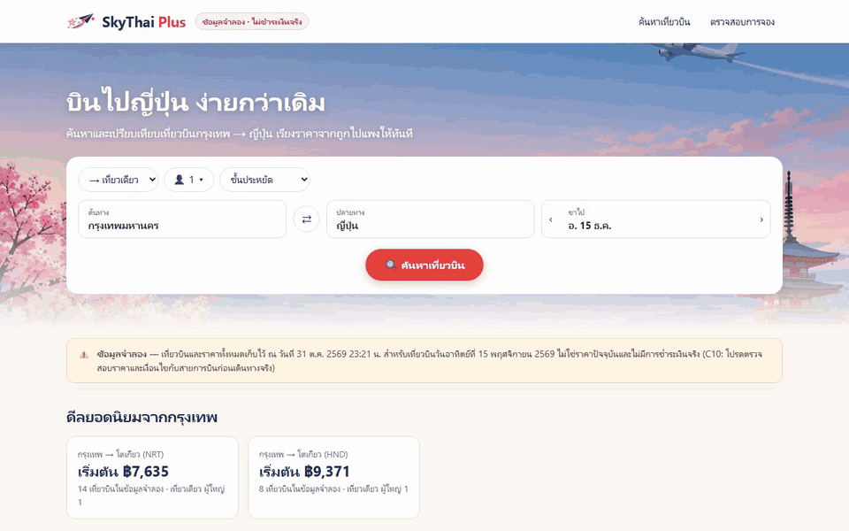
*P2 · กฎผู้โดยสารที่ได้มาจากการสำรวจด้วย Playwright (EXPLORATION ส่วน C)*

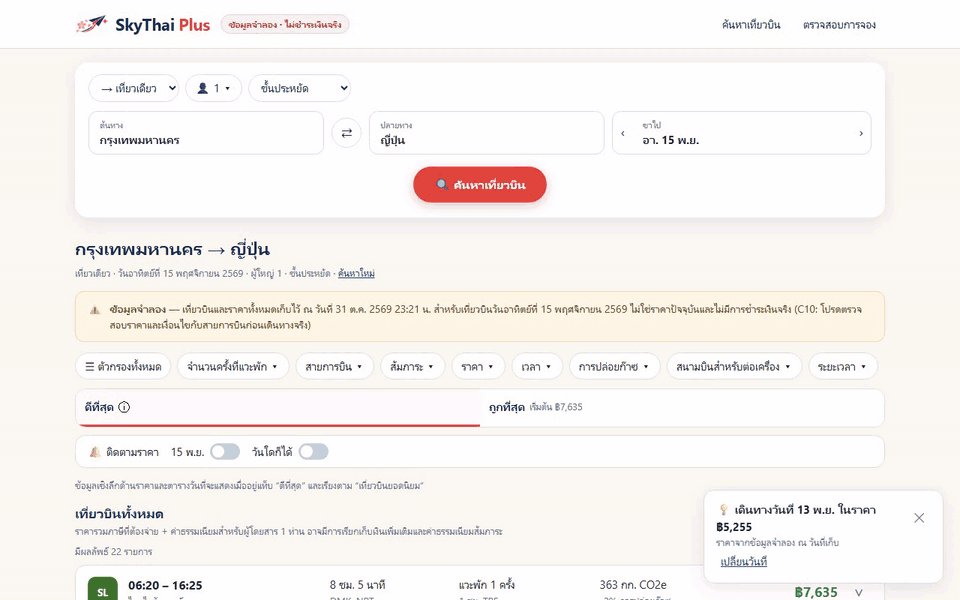
*P7 · จองแล้วค้นเจอในหน้า "ตรวจสอบการจอง" = บันทึกลงฐานข้อมูลจริง*

🎬 ทุกเคสต่อกัน: [`_solution/e2e/media/playlist.mp4`](_solution/e2e/media/playlist.mp4) · วิธีรันดู [`_solution/e2e/README.md`](_solution/e2e/README.md)

👀 **สังเกต**
- **เรื่องวันที่ (ตรงไปตรงมา):** รันวันที่ 1 พ.ย. 2569 "วันที่ 15 ของเดือนหน้า" = **15 ธ.ค. 2569** แต่ข้อมูลเป็นเที่ยวบิน 15 พ.ย. yolo1 จึง **เลื่อนวันของเที่ยวบินชุดเดิมให้ตรงกับวันที่ค้นหา (เวลาและราคาคงเดิม)** และใส่ป้ายข้อมูลจำลองทุกหน้า ไม่แต่งราคาใหม่ขึ้นเอง (ถ้าอยากได้ราคาจริงของวันใหม่ ต้องสำรวจใหม่)
- **"ทำแล้ว (บางส่วน)" ไม่ใช่ความล้มเหลว:** yolo1 บอกเหตุผลทุกข้อ ส่วนใหญ่คือ **ข้อมูลจำลองไม่มี** (ราคารายวัน สัมภาระ เที่ยวบินอีก 278 ใบ) ไม่ใช่การสำรวจตกหล่น
- **มีสิ่งที่ yolo1 กำหนดเอง** เช่น เกณฑ์ "แวะพักนาน ≥ 6 ชม." และข้อมูลว่าสายการบินไหนอยู่พันธมิตรไหน (ใช้ความรู้ทั่วไป) → yolo1 เขียนบอกไว้ ไม่ได้อ้างว่ามาจาก Google
- **ไม่แตะหลักฐาน:** ไม่แก้ `EXPLORATION.md` และ `evidence/` ตามที่สั่ง
- ภาพจาก `cyolo1` เป็นงานออกแบบของเราเอง ไม่มีโลโก้หรือแบรนด์ของ Google

---

## LAB 4 · yolo2 เทียบ v1 กับ v2 ด้วย Playwright + GIF หลักฐาน

🎯 ให้ **yolo2** (คนละบัญชีกับผู้สร้าง) เขียนเทสต์ 1 ข้อต่อ 1 ฟีเจอร์ในส่วน B รันกับทั้ง v1 และ v2 แล้วสรุปเปอร์เซ็นต์ครอบคลุม พร้อม GIF เคียงข้าง (ทฤษฎี: T9, T10)

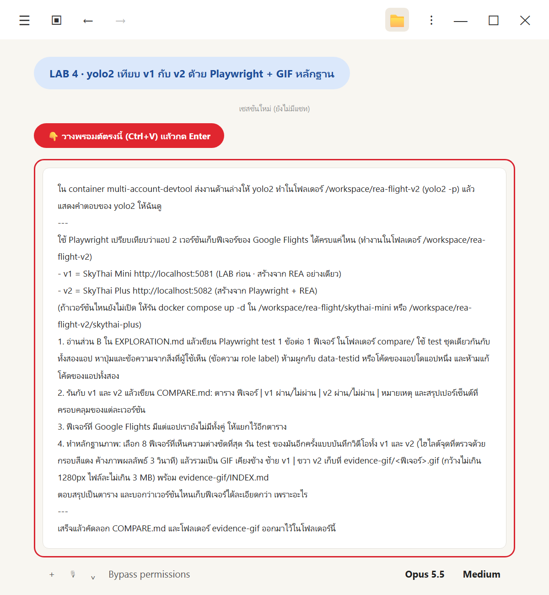
*วางพรอมต์ LAB 4*

💬 **คัดลอกพรอมต์นี้**

```text
ใน container multi-account-devtool ส่งงานด้านล่างให้ yolo2 ทำในโฟลเดอร์ /workspace/rea-flight-v2 (yolo2 -p) แล้วแสดงคำตอบของ yolo2 ให้ฉันดู
---
ใช้ Playwright เปรียบเทียบว่าแอป 2 เวอร์ชันเก็บฟีเจอร์ของ Google Flights ได้ครบแค่ไหน (ทำงานในโฟลเดอร์ /workspace/rea-flight-v2)
- v1 = SkyThai Mini http://localhost:5081 (LAB ก่อน · สร้างจาก REA อย่างเดียว)
- v2 = SkyThai Plus http://localhost:5082 (สร้างจาก Playwright + REA)
(ถ้าเวอร์ชันไหนยังไม่เปิด ให้รัน docker compose up -d ใน /workspace/rea-flight/skythai-mini หรือ /workspace/rea-flight-v2/skythai-plus)
1. อ่านส่วน B ใน EXPLORATION.md แล้วเขียน Playwright test 1 ข้อต่อ 1 ฟีเจอร์ ในโฟลเดอร์ compare/ ใช้ test ชุดเดียวกันกับทั้งสองแอป หาปุ่มและข้อความจากสิ่งที่ผู้ใช้เห็น (ข้อความ role label) ห้ามผูกกับ data-testid หรือโค้ดของแอปใดแอปหนึ่ง และห้ามแก้โค้ดของแอปทั้งสอง
2. รันกับ v1 และ v2 แล้วเขียน COMPARE.md: ตาราง ฟีเจอร์ | v1 ผ่าน/ไม่ผ่าน | v2 ผ่าน/ไม่ผ่าน | หมายเหตุ และสรุปเปอร์เซ็นต์ที่ครอบคลุมของแต่ละเวอร์ชัน
3. ฟีเจอร์ที่ Google Flights มีแต่แอปเรายังไม่มีทั้งคู่ ให้แยกไว้อีกตาราง
4. ทำหลักฐานภาพ: เลือก 8 ฟีเจอร์ที่เห็นความต่างชัดที่สุด รัน test ของมันอีกครั้งแบบบันทึกวิดีโอทั้ง v1 และ v2 (ไฮไลต์จุดที่ตรวจด้วยกรอบสีแดง ค้างภาพผลลัพธ์ 3 วินาที) แล้วรวมเป็น GIF เคียงข้าง ซ้าย v1 | ขวา v2 เก็บที่ evidence-gif/<ฟีเจอร์>.gif (กว้างไม่เกิน 1280px ไฟล์ละไม่เกิน 3 MB) พร้อม evidence-gif/INDEX.md
ตอบสรุปเป็นตาราง และบอกว่าเวอร์ชันไหนเก็บฟีเจอร์ได้ละเอียดกว่า เพราะอะไร
---
เสร็จแล้วคัดลอก COMPARE.md และโฟลเดอร์ evidence-gif ออกมาไว้ในโฟลเดอร์นี้
```

✅ **ผลจริง** (yolo2 ใช้เวลา **22 นาที 31 วินาที** · 00:14:05 → 00:36:36) เขียนเทสต์ครบ **35 ข้อ** รันกับทั้งสองแอป **รันซ้ำ 2 รอบได้ผลตรงกัน** ไม่ใช้ `data-testid` และไม่แก้โค้ดของทั้งสองแอป

| เวอร์ชัน | ผ่าน | ครอบคลุม |
|---|---|---|
| v1 SkyThai Mini | **4 / 35** | **11.4%** |
| v2 SkyThai Plus | **33 / 35** | **94.3%** |

**แยกตามกลุ่มฟีเจอร์ (จาก `out-q4.md`)**

| กลุ่มฟีเจอร์ (ส่วน B) | v1 | v2 |
|---|---|---|
| ฟอร์มค้นหา B01–B09 | 0/9 | 8/9 (ปฏิทินไม่มีราคาใต้วันที่) |
| ผลการค้นหา B10–B15 | 1/6 (เรียงลำดับ) | 6/6 |
| ตัวกรอง B16–B25 | 1/10 (มีแค่บินตรง) | 10/10 |
| เครื่องมือราคา B26–B30 | 0/5 | 4/5 (ไม่มีกราฟราคา) |
| การจอง B31–B33 | 2/3 | 3/3 |
| หน้าแรกและการตั้งค่า B34–B35 | 0/2 | 2/2 |
| **รวม** | **4/35 = 11.4%** | **33/35 = 94.3%** |

**ตัวอย่างหมายเหตุราย test (จาก `COMPARE.md`)**

| # | ฟีเจอร์ | v1 | v2 | หมายเหตุ (ย่อ) |
|---|---|---|---|---|
| B01 | ประเภทตั๋ว | ❌ | ✅ | v1 เป็นข้อความ "ประเภท: เที่ยวเดียว" เฉย ๆ · v2 เลือก "ไป-กลับ" แล้วมีช่องขากลับ และ "หลายเมือง" มีปุ่ม "เพิ่มเที่ยวบิน" |
| B07 | ปฏิทินวันที่ | ❌ | ❌ | v2 มีปฏิทิน 2 เดือน **แต่ไม่มีราคาใต้วันที่** (จุดเด่นของ Google) |
| B12 | เรียงลำดับ | ✅ | ✅ | v1 ผ่านแบบหลวม: มีแค่ 4 ลิงก์ ไม่มีเวลาถึง/การปล่อยก๊าซ/ยอดนิยม |
| B15 | ดูเที่ยวบินเพิ่มเติม | ❌ | ✅ | v1 แสดง 22 รายการทีเดียว ไม่มีปุ่ม · v2 10 → 22 (Google ได้ 300) |
| B30 | กราฟราคา | ❌ | ❌ | ทั้งสองแอปไม่มีปุ่ม "กราฟราคา" |
| B31 | เลือกเที่ยวบิน | ✅ | ✅ | ทั้งคู่ไปหน้าจองได้ ราคา ฿8,172 ตรงกับที่เลือก |

**ฟีเจอร์ที่ Google Flights มี แต่ทั้งสองแอปยังไม่มี**

| ฟีเจอร์ของ Google Flights | ข้อ | v2 ตอนนี้ | สิ่งที่ยังขาด |
|---|---|---|---|
| ราคาใต้วันที่ในปฏิทิน | B07 | มีปฏิทินแต่ไม่มีราคา | ข้อมูลราคารายวัน |
| กราฟราคา | B30 | ไม่มี | ทั้งหน้าจอนี้ |
| โหลดเที่ยวบินครบ 300 รายการ | B15 | ได้แค่ 22 | ข้อมูลอีกประมาณ 278 รายการ |
| ตัวกรองสัมภาระที่ตัดรายการออกจริง | B18 | มีปุ่มแต่ไม่มีผล | ข้อมูลสัมภาระของแต่ละเที่ยวบิน |
| ผู้ขายหลายราย + ค่าธรรมเนียมแยก (C23) | B32 | ผู้ขายรายเดียว | รายชื่อผู้ขายและราคาแต่ละราย |
| สำรวจจุดหมายปลายทาง / ดีลด้วย AI | B34 | ไม่มี | ทั้งสองส่วน |
| เปลี่ยนภาษา / สกุลเงินได้จริง | B35 | มีหน้าต่าง แต่เลือกได้แค่ค่าเดิม | ภาษาอื่น + การแปลงสกุลเงิน |
| ลงชื่อเข้าใช้เพื่อติดตามราคาได้จริง | B28 | มีแค่ป๊อปอัปแจ้ง | ระบบบัญชีผู้ใช้ |

**ทำไม v2 ละเอียดกว่า (คำตอบของ yolo2 · ย่อ)**
- **v1 สร้างจาก REA อย่างเดียว** ได้ "ข้อมูลเที่ยวบิน" ครบ แต่ไม่ได้ "สิ่งที่ผู้ใช้กดแล้วเกิดผล" แอปจึงเป็นรายการตายตัว
- **v2 สร้างจาก Playwright + REA** ได้ทั้งชื่อปุ่มแบบเดียวกับ Google (เช่น "นำผู้ใหญ่ออก", "เปลี่ยนชั้นโดยสาร") และกฎที่เห็นหลังกดเท่านั้น
- ส่วนที่ v2 ยังขาดคือ **สิ่งที่ข้อมูลจำลองไม่มี** ไม่ใช่การสำรวจตกหล่น

**หลักฐาน GIF เคียงข้าง (ซ้าย v1 · ขวา v2)** ทั้ง 8 ไฟล์เป็นแบบ v1 ✘ / v2 ✔ ขนาด 1280×400 px · 0.99–1.28 MB

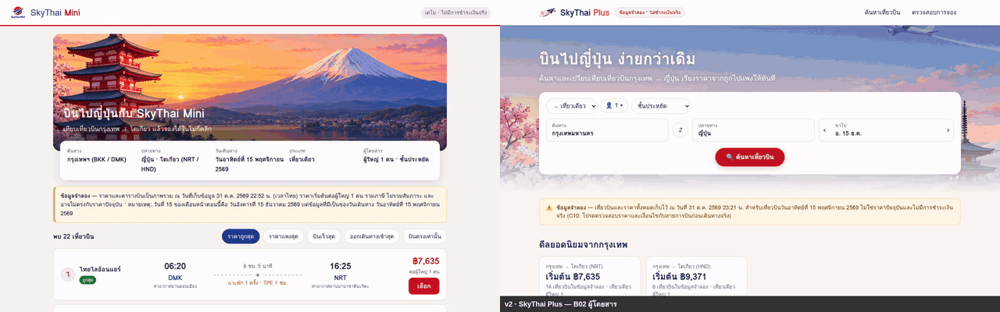
*B02 ผู้โดยสาร · v2 ปุ่ม − ผู้ใหญ่กดไม่ได้ (กฎ C1) กด + เด็กแล้วกลายเป็น 2 คน*


*B10 แท็บ ดีที่สุด / ถูกที่สุด · v2 แท็บ "ถูกที่สุด เริ่มต้น ฿7,635"*

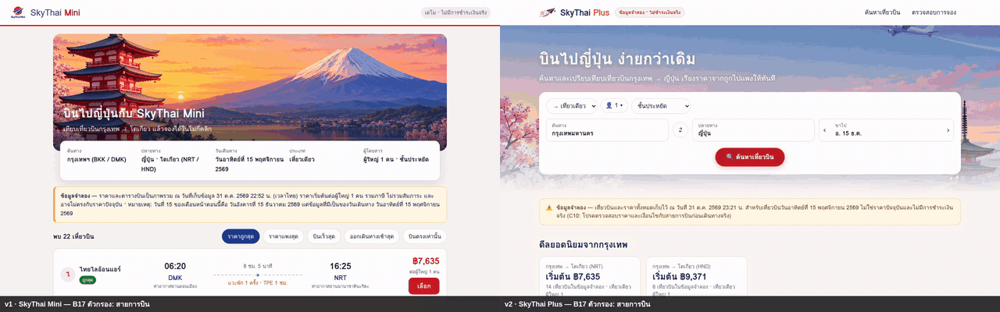
*B17 ตัวกรองสายการบิน · v2 "การบินไทย เท่านั้น" เหลือ 5 รายการ (กฎ C15)*

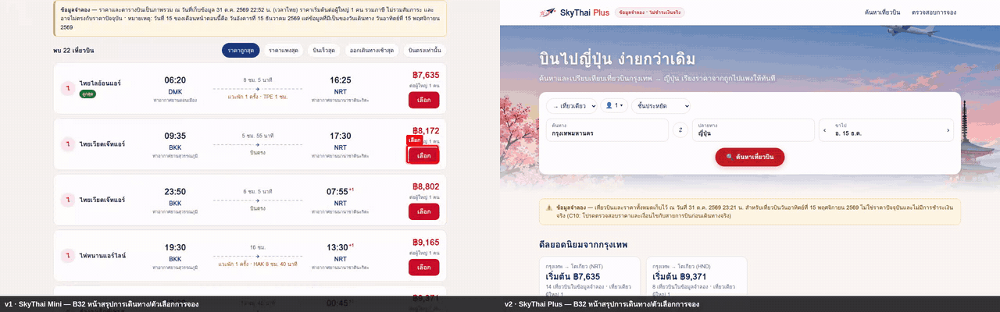
*B32 หน้าสรุปการเดินทาง · v1 มีแค่ฟอร์ม · v2 มีแชร์ ติดตามราคา นโยบายสัมภาระ และตัวเลือกการจอง*

GIF ที่เหลือ: [B01 ประเภทตั๋ว](_solution/run/evidence-gif/B01.gif) · [B04 ช่องต้นทาง/ปลายทาง](_solution/run/evidence-gif/B04.gif) · [B14 ขยายรายละเอียด](_solution/run/evidence-gif/B14.gif) · [B26 ข้อมูลเชิงลึกด้านราคา](_solution/run/evidence-gif/B26.gif) · คำอธิบายทุกไฟล์ใน [`evidence-gif/INDEX.md`](_solution/run/evidence-gif/INDEX.md)

ไฟล์เต็ม: [`_solution/run/out-q4.md`](_solution/run/out-q4.md) · [`COMPARE.md`](_solution/run/COMPARE.md) · เทสต์ [`_solution/run/compare/`](_solution/run/compare/)

👀 **สังเกต**
- **ทำไมให้ yolo2 ไม่ใช่ yolo1:** yolo1 เป็นคนสร้าง v2 ถ้าให้ตรวจงานตัวเองอาจ "เข้าข้างตัวเอง" โดยไม่ตั้งใจ (แต่ยังใช้ `EXPLORATION.md` ฉบับเดียวกันอยู่ดี ดู T9 ข้อ 3)
- **เกณฑ์เข้มขึ้น v1 ได้ 2/35:** yolo2 เขียนเองว่า B12 และ B16 ของ v1 "ผ่านแบบหลวม" → **ตัวเลขเปอร์เซ็นต์ขึ้นกับเกณฑ์เสมอ** ต้องอ่านหมายเหตุประกอบ
- **v2 ผ่านไม่ได้แปลว่าเหมือน Google:** เช่น B18 สัมภาระผ่านแต่ไม่ได้กรองจริง · B32 ผ่านแต่มีผู้ขายรายเดียว
- **GIF ทุกไฟล์เป็นแบบ v1 ✘ / v2 ✔** เพราะพรอมต์ขอ "ความต่างชัดที่สุด" → GIF ชุดนี้ **เลือกมาโชว์ความต่าง** ไม่ใช่ตัวแทนของทั้ง 35 ข้อ
- **ปัญหาเครื่องมือก็รายงาน:** อัดวิดีโอไม่ได้เพราะ ffmpeg เวอร์ชันไม่ตรง yolo2 แก้โดยไม่แตะ `/ms-playwright` และเขียนวิธีไว้ใน `INDEX.md` (`/tmp` อาจถูกล้าง ถ้าจะอัดใหม่ต้องสร้างตัวเรียกนี้ก่อน)
- `compare/` คือชุดเทสต์ที่ **ใช้ซ้ำได้** กับแอปเวอร์ชันถัดไปในบทที่ 3

---

## ✅ รูบริก: เช็กลิสต์ก่อนส่งงาน

- [ ] อธิบายได้ว่าทำไม REA อย่างเดียวไม่พอ โดยยกตัวเลขจริง (22 vs 300 ใบ · 4/35)
- [ ] อธิบายได้ว่า Playwright MCP ใช้ snapshot + `ref` กดปุ่มอย่างไร และชี้ role / name / ref จากบรรทัด snapshot ได้
- [ ] บอกวงจรสำรวจแบบลูกค้า 4 ขั้น และเส้นที่ห้ามข้าม (ล็อกอิน จ่ายเงิน ข้อมูลส่วนตัว เว็บสายการบิน)
- [ ] `EXPLORATION.md` มีครบ 5 ส่วน A–E · ส่วน B มีคอลัมน์ "หลักฐาน [E]" · กฎทุกข้อในส่วน C ติดป้าย [O] หรือ [R]
- [ ] ชี้ได้อย่างน้อย 1 สิ่งที่ Playwright เจอแต่ REA ไม่เจอ และกลับกัน จากผลของตัวเอง
- [ ] มี `exploration/*.png` และ `flights-full.json` ใน `/workspace/rea-flight-v2`
- [ ] รู้ว่าเครื่องมือของ REA ทำอะไรเกินคำสั่งหรือล้มเหลวบ้าง (เช่น โหลดหน้าซ้ำ) และรายงานไว้
- [ ] `docker compose up -d --build` ใน `skythai-plus/` แล้ว http://localhost:5082 เปิดได้ · ค้นหา → เลือก → จองได้รหัส · `/api/health` ตอบ `{"ok":true}` · มีป้ายข้อมูลจำลอง
- [ ] ฐานข้อมูลมีตารางเที่ยวบิน ขาบิน และการจองแยกกัน (ตามส่วน D)
- [ ] `COMPARE.md` มีตาราง 35 ฟีเจอร์ เปอร์เซ็นต์ของ v1 และ v2 และตาราง "ทั้งคู่ยังไม่มี"
- [ ] มี GIF เคียงข้างอย่างน้อย 8 ไฟล์ + `INDEX.md` และเปิดดูแล้วเห็นกรอบแดง + ป้ายผล
- [ ] อธิบายได้ว่าทำไมคะแนนของ v2 อาจสูงเกินจริง (เทสต์กับแอปมาจากบันทึกเดียวกัน)
- [ ] แอปไม่มีโลโก้ ชื่อ หรือโค้ดของ Google
- [ ] ปิด Chrome พอร์ต 9222 แล้วหลังจบงาน

---

## 🔁 รันซ้ำ / ปิดงาน

**ปิด Chrome ที่เปิดพอร์ต 9222** (ทำทุกครั้งที่จบงาน · Chromium ของ Playwright MCP ปิดเองเมื่องานจบ)

```bash
docker exec multi-account-devtool pkill -f "[r]emote-debugging-port=9222"
```

**ปิดแอปบน Windows** (PowerShell ในโฟลเดอร์ `skythai-plus/` หรือ `_solution/skythai-plus/`)

```powershell
docker compose down        # ล้างฐานข้อมูลด้วย: docker compose down -v
```

**อยากรันซ้ำ**
1. REA และ Playwright ติดตั้งแล้ว ไม่ต้องทำอะไรเพิ่ม
2. ถ้าอยากเริ่มสะอาด ให้ Claude Code ย้าย `/workspace/rea-flight-v2` ไปเป็น `/workspace/rea-flight-v2-old` ก่อน แล้วค่อยทำ LAB 1–4
3. **วันที่:** ถ้ารันหลัง 15 พ.ย. 2569 ให้แก้ "15 พ.ย. 2026" ในพรอมต์ LAB 1–2 และในลิงก์ Chrome :9222 เป็นวันที่ 15 ของเดือนหน้า
4. ผลรอบใหม่ (ราคา จำนวนเที่ยวบิน ชื่อปุ่ม จำนวนกฎ) **จะต่างจากตารางในบทนี้** เพราะ Google เปลี่ยนได้ทุกวัน เป็นเรื่องปกติ
5. LAB 4 ต้องเปิดทั้ง v1 (5081) และ v2 (5082) ใน container ก่อน (พรอมต์สั่งให้เปิดเองถ้ายังไม่เปิด)

---

## ถ้าเจอปัญหา: คัดลอกพรอมต์นี้

```text
LAB บทที่ 2 (REA + Playwright) ใน container multi-account-devtool มีปัญหา ช่วยตรวจทีละข้อแบบอ่านอย่างเดียวก่อน แล้วบอกฉันว่าจะแก้อย่างไร ห้ามลบไฟล์ใน /workspace/rea-flight-v2 และห้ามแก้ EXPLORATION.md หรือไฟล์ใน evidence/
1. container multi-account-devtool รันอยู่ไหม
2. /root/ai-accounts/.Claude/shared/mcp/mcp.json เป็น JSON ที่ถูกต้องไหม มีทั้ง rea และ playwright ไหม
3. ให้ yolo1 -p ตอบสั้น ๆ ว่าเห็น MCP playwright และ rea ไหม
4. มี Chrome ที่เปิด --remote-debugging-port=9222 อยู่ไหม และ curl http://127.0.0.1:9222/json/version ใน container ตอบอะไร
5. ใน /workspace/rea-flight-v2 มีไฟล์อะไรบ้าง (EXPLORATION.md, exploration/, flights-full.json, evidence/, skythai-plus/, compare/)
6. curl http://localhost:5081/api/health และ http://localhost:5082/api/health ใน container ตอบอะไร
7. ถ้าหน้า Google Flights ขึ้น CAPTCHA หรือหน้าบล็อก ให้บอกฉัน ห้ามพยายามหลบ
สรุปเป็นตาราง ข้อ | ผล | วิธีแก้ที่แนะนำ แล้วรอให้ฉันยืนยันก่อนแก้
```

| อาการ | สาเหตุที่พบบ่อย | วิธีแก้ |
|---|---|---|
| yolo1 บอกว่าไม่มี Playwright MCP | `mcp.json` เสีย หรือ `playwright` ถูกลบตอนเพิ่ม `rea` | กู้ `mcp.json` จากไฟล์สำรองของบทที่ 1 LAB 1 แล้วเปิด `yolo1` ใหม่ |
| LAB 1 เจอ CAPTCHA / หน้าบล็อก | กดถี่เกินไป หรือ IP ถูกจำกัด | **หยุด** อย่าหลบ รอสักพักแล้วลองใหม่ หรือใช้ผลใน `_solution/run/` เรียนต่อ |
| LAB 1 เลือกวันที่ไม่ได้ | วันที่ในพรอมต์เป็นอดีตแล้ว (กฎ C6) | เปลี่ยนเป็นวันที่ 15 ของเดือนหน้า |
| LAB 2 REA เชื่อมต่อไม่ได้ | Chrome :9222 ปิดไปแล้ว | วางพรอมต์ LAB 2 ใหม่ (บรรทัดแรกสั่งเปิด Chrome ให้) |
| LAB 2 ได้ข้อมูลน้อยกว่า 22 ใบ หรือไม่มี `ds:1` | Google เปลี่ยนหน้า หรือ `inspect_web_page` ตัดสคริปต์ inline | ให้ yolo1 ลอง `capture_browser_scenario` แล้วรายงานตามจริง |
| เปิด http://localhost:5082 ไม่ขึ้น | build ยังไม่เสร็จ หรือ `db` ยังไม่ healthy | `docker compose ps` และ `docker compose logs web` ในโฟลเดอร์ `skythai-plus/` แล้วรอสักครู่ |
| พอร์ต 5082 ถูกใช้อยู่ | process เก่าค้าง | ดูว่าใครใช้พอร์ตก่อน (`ss -ltnp` ใน container / `netstat -ano` บน Windows) อย่าเปลี่ยนพอร์ตถาวร |
| LAB 4 v1 ไม่ตอบ | v1 ใน container ปิดอยู่ | `docker compose up -d` ใน `/workspace/rea-flight/skythai-mini` |
| LAB 4 อัดวิดีโอไม่ได้ | ffmpeg ของ Playwright ไม่ตรงเวอร์ชัน | ทำตามหมายเหตุใน `evidence-gif/INDEX.md` (สร้างตัวเรียก ffmpeg ใน `/tmp/pw-browsers` โดยไม่แตะ `/ms-playwright`) |

---

## 📖 คำศัพท์

| คำ | ความหมายแบบง่าย |
|---|---|
| **Playwright** | ไลบรารี open source สำหรับควบคุมเบราว์เซอร์ด้วยโค้ด ใช้ทำเทสต์อัตโนมัติ |
| **Playwright MCP** | Playwright ที่ห่อเป็น MCP server ให้ AI เรียก navigate / click / type / snapshot / screenshot ได้ |
| **Headless / Isolated** | เปิดเบราว์เซอร์ไม่มีหน้าต่าง / ใช้โปรไฟล์ใหม่ทุกครั้ง ไม่มี cookie หรือบัญชี |
| **Accessibility tree / snapshot** | โครงสร้างหน้าเว็บที่บอก role + name + state ของทุกชิ้น / ภาพนิ่งของต้นไม้นั้นที่ AI อ่าน |
| **role / name / ref** | ชิ้นนี้คืออะไร / ชื่อที่อ่านได้ / เลขอ้างอิงที่ Playwright MCP ใส่ให้เพื่อกดตรงตัว |
| **Exploratory testing** | ทดสอบแบบเรียนรู้ ออกแบบ และลงมือไปพร้อมกัน มี charter และจดบันทึก |
| **Charter** | เป้าหมาย + ขอบเขตของการสำรวจ 1 รอบ |
| **`EXPLORATION.md`** | บันทึกการสำรวจ 5 ส่วน A แผนผัง · B ฟีเจอร์ · C กฎ · D โมเดลข้อมูล · E คำถาม |
| **[O] / [R] / [E]** | เห็นจากเว็บ / สามัญสำนึก / หลักฐานจากระบบ (REA) |
| **Oracle** | แหล่งที่ใช้ตัดสินว่าผลแบบไหน "ถูก" |
| **Black box / Grey box** | มองจากภายนอกแบบลูกค้า (Playwright) / ส่องของที่ส่งมาถึงเบราว์เซอร์ (REA) |
| **Triangulation** | ใช้หลายแหล่งยืนยันเรื่องเดียวกัน |
| **`AF_initDataCallback` / `ds:1`** | ชุดข้อมูลที่ Google ฝังมากับ HTML ของหน้าผลค้นหา |
| **Entity / 1:N** | "สิ่งของ" ที่จะเป็นตาราง / ความสัมพันธ์หนึ่งต่อหลาย เช่น เที่ยวบิน 1 ใบมีหลายขา |
| **CHECK constraint** | กฎในฐานข้อมูลที่ไม่ยอมให้บันทึกข้อมูลผิดเงื่อนไข |
| **Feature coverage** | สัดส่วนฟีเจอร์ที่ผ่านเทสต์ เทียบกับรายการฟีเจอร์ทั้งหมด |
| **User-visible locator** | การหาปุ่มจากสิ่งที่ผู้ใช้เห็น (role, label, ข้อความ) แทน `data-testid` |
| **False positive / False negative** | เทสต์ผ่านทั้งที่ไม่ควรผ่าน / เทสต์ตกทั้งที่แอปมีฟีเจอร์ |
| **Independent judge** | ผู้ตัดสินที่ไม่ได้เห็นบันทึกของผู้สร้าง (บทที่ 3) |
| **Side-by-side GIF** | ภาพเคลื่อนไหวของเทสต์เดียวกัน วาง v1 กับ v2 คู่กัน |

---

## 🔒 เฉลย (`_solution/`)

| ส่วน | มีอะไร | ใช้ทำอะไร |
|---|---|---|
| [`_solution/run/`](_solution/run/) | `q1.txt`–`q4.txt` (พรอมต์ชั้นใน) · `out-q1.md`–`out-q4.md` (คำตอบจริง) · `EXPLORATION.step1.md` (หลัง LAB 1) · `EXPLORATION.md` (หลัง LAB 2) · `exploration/` (ภาพ 40 รูป + snapshot) · `flights-full.json` · `evidence/` · `COMPARE.md` · `evidence-gif/` | เทียบผลของเรากับรอบจริง |
| [`_solution/run/compare/`](_solution/run/compare/) | ชุดเทสต์ 35 ข้อ (`tests/features.spec.ts`, `tests/helpers.ts`) · `playwright.config.ts` (project v1/v2) · `results.json` · `summarize.mjs` · `make-gifs.mjs` | รันเทียบซ้ำ หรือใช้กับแอปเวอร์ชันถัดไป |
| [`_solution/skythai-plus/`](_solution/skythai-plus/) | SkyThai Plus ฉบับเฉลย (Next.js 16 + PostgreSQL 16 · `docker-compose.yml` มี `web` พอร์ต 5082 + `db` `postgres:16-alpine`) | เปิด SkyThai Plus ฉบับเฉลยได้ทันที |
| [`_solution/e2e/`](_solution/e2e/) | Playwright playlist ของ v2 (ดูหัวข้อ "playlist ของ v2" ใน LAB 3) | ดูแอปทำงานเป็นวิดีโอ |

**เปิด SkyThai Plus ฉบับเฉลย** (สั่ง Claude Code หรือรันเองใน PowerShell ที่โฟลเดอร์ `_solution/skythai-plus`)

```powershell
docker compose up -d --build
# รอบเราบน Docker Desktop ใช้ 29 วินาที แล้วเปิด http://localhost:5082
# ปิด: docker compose down   (ล้างฐานข้อมูลด้วย: docker compose down -v)
```

**รันเทสต์เทียบซ้ำ (ใน container ต้องเปิด v1 และ v2 ไว้ก่อน)** ดูคำสั่งในหัวข้อ "วิธีรันซ้ำ" ของ [`COMPARE.md`](_solution/run/COMPARE.md)

### ไฟล์ในบทนี้

```text
02_REA_Playwright_Exploration/
├── README.md                         ← ไฟล์นี้
├── img/                              ← lab2-01…09 (ทฤษฎี) · lab1–4-paste.png · real-skythai-plus-home.png
├── skythai-plus/                     ← (สร้างใน LAB 3) แอปของเราที่คัดลอกออกจาก container
├── COMPARE.md · evidence-gif/        ← (สร้างใน LAB 4) คัดลอกออกจาก container
└── _solution/
    ├── run/
    │   ├── q1.txt … q4.txt           ← พรอมต์ชั้นในที่ส่งให้ yolo1 / yolo2
    │   ├── out-q1.md … out-q4.md     ← คำตอบจริง
    │   ├── EXPLORATION.step1.md      ← หลัง LAB 1 (A, B, C, E)
    │   ├── EXPLORATION.md            ← หลัง LAB 2 (+ D และคอลัมน์ [E])
    │   ├── exploration/              ← ภาพ 40 รูป + results-snapshot.yml · booking-snapshot.yml
    │   ├── flights-full.json         ← 22 เที่ยวบิน + ทุกขา + ตัวกรอง + ข้อมูลราคา (31 ต.ค. 2569)
    │   ├── evidence/                 ← สคริปต์ถอดข้อมูล · a11y JSON · ภาพจาก REA · EXPLORATION.before-rea.md
    │   ├── compare/                  ← ชุดเทสต์ 35 ข้อ (v1/v2) + สคริปต์สรุปผลและทำ GIF
    │   ├── COMPARE.md                ← v1 4/35 (11.4%) · v2 33/35 (94.3%)
    │   └── evidence-gif/             ← B01 B02 B04 B10 B14 B17 B26 B32 .gif + INDEX.md
    ├── skythai-plus/                 ← SkyThai Plus ฉบับเฉลย · docker compose up -d --build → http://localhost:5082
    │   ├── Dockerfile · docker-compose.yml  ← web (5082) + db (postgres:16-alpine)
    │   ├── data/flights-full.json
    │   ├── src/app/ · src/components/ · src/lib/  ← หน้า · components · schema/seed/ค้นหา
    │   └── public/                   ← logo.png · hero-japan.png (cyolo1) · icon.png · hero-japan.jpg
    └── e2e/                          ← Playwright playlist ของ v2
```

(ใน container งานทั้งหมดอยู่ที่ `/workspace/rea-flight-v2/` ส่วน v1 ยังอยู่ที่ `/workspace/rea-flight/skythai-mini/`)

---

## 🎉 จบบทแล้ว → บทถัดไป

← ย้อนกลับ [**01 · REA ขั้นพื้นฐาน**](../01_REA_Basics_Flight/README.md)

ตอนนี้เรามี "มือ" (Playwright) + "แว่นเอกซเรย์" (REA) · รู้วิธีจด `EXPLORATION.md` พร้อมป้ายที่มา · มีแอป SkyThai Plus และชุดเทสต์ 35 ข้อที่วัด v1 ได้ 11.4% และ v2 ได้ 94.3%

แต่เราก็รู้แล้วว่าคะแนนนี้ **อาจลำเอียง** เพราะผู้สร้างกับผู้ออกข้อสอบใช้บันทึกเล่มเดียวกัน

บทถัดไป [**03 · REA Toolchain Loop**](../03_REA_Toolchain_Loop/README.md) จะเพิ่ม **HAR** (บันทึก network ทั้งหมดตั้งแต่เริ่มโหลด) · **กรรมการอิสระ (independent judge)** ที่ตัดสินโดยไม่เห็นบันทึกของผู้สร้าง · **วงจรปิด (closed loop)** สร้าง → ตัดสิน → แก้ → ตัดสินใหม่ · และ **visual diff** เทียบหน้าตาแบบพิกเซล

---

*ตัวเลขทุกตัวในบทนี้มาจากการรันจริงใน `_solution/run/` เมื่อ 31 ต.ค. – 1 พ.ย. 2569 (ราคาเป็นภาพนิ่งของเที่ยวบิน 15 พ.ย. 2569) · แนวคิด EXPLORATION.md และป้ายที่มามาจาก [Week 01 บทที่ 3](../../00_week01/03_petshop-testplan-from-exploration/README.md) · Exploratory testing: Cem Kaner, James Bach · Playwright: playwright.dev (Microsoft) · REA: github.com/morluto/rea (npm `rea-agents`)*
