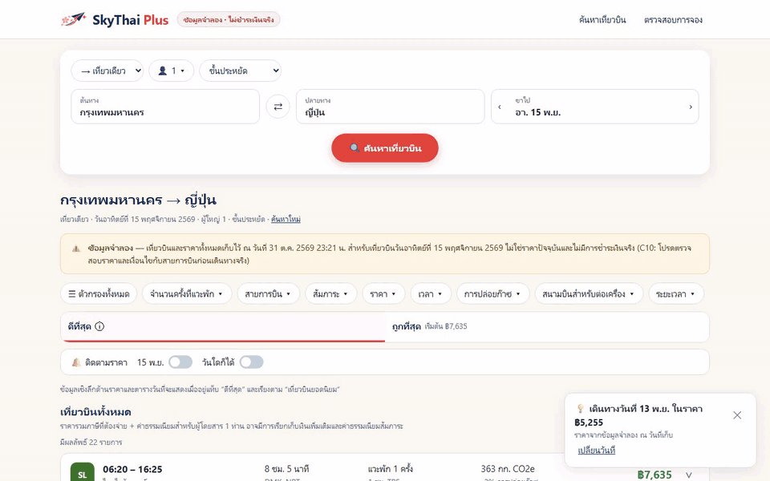

# SkyThai Plus (v2) — Playwright Playlist

สคริปต์ `playlist.mjs` เปิด Chromium แบบ headless (slowMo 250 ms) แล้วเล่น use case 8 เคสกับแอปที่รันอยู่ที่ http://localhost:5082
ทุกเคสอัดวิดีโอ 1280×800 (locale th-TH, เวลา Asia/Bangkok) มีกรอบแดงรอบจุดที่ตรวจ และแถบคำบรรยายภาษาไทยด้านล่าง (เขียว = ผ่าน, แดง = ไม่ผ่าน) ค้างผลแต่ละจุด 3.5 วินาที

## วิธีรัน

```bash
# ต้องเปิดแอปก่อน: docker compose up -d --build  (ในโฟลเดอร์ ../skythai-plus) แล้วเช็ก http://localhost:5082/api/health → {"ok":true}
npm install
node playlist.mjs                 # หรือ BASE_URL=http://host:port node playlist.mjs
ONLY=P1,P7 node playlist.mjs      # รันเฉพาะบางเคส (ไม่สร้าง playlist.mp4)
```

ผลที่ได้: `results.json`, ตารางผลในเทอร์มินัล (exit code ≠ 0 ถ้ามีเคสไม่ผ่าน) และไฟล์ใน `media/`
(`<id>.mp4`, `<id>.gif` 8 fps กว้าง 960, `playlist.mp4` รวมทุกเคส) — ต้องมี `ffmpeg` บน PATH
GIF ใช้ `mpdecimate` ตัดเฟรมที่ซ้ำกันช่วงค้างภาพ (ความยาวเท่าเดิม แต่ไฟล์เล็กลงราว 3 เท่า) — media ทั้งหมดรวม ~21 MB

## เรื่องวันที่ (สำคัญ)

วันเริ่มต้นของแอปคือ "วันที่ 15 ของเดือนหน้า" ซึ่งคำนวณจากนาฬิกาของ **เซิร์ฟเวอร์** (วันนี้ 1 พ.ย. 2026 → 15 ธ.ค. 2026)
แต่ข้อมูลจำลองเป็นเที่ยวบินวันที่ **15 พ.ย. 2026** จึงไม่ได้ freeze นาฬิกาเบราว์เซอร์ (ไม่มีผลกับฝั่งเซิร์ฟเวอร์อยู่แล้ว) แต่เลือกวันที่ผ่าน UI แทน:

- **P1** ค้นหาผ่านหน้าแรกจริง: เปิดปฏิทิน → เดือนก่อนหน้า → กด 15 พ.ย. → เสร็จ → ค้นหาเที่ยวบิน
- **P3–P7** เปิด URL ผลค้นหาที่ฟอร์มสร้างให้โดยตรง (`/search?trip=oneway&from=BKK-CITY&to=JP&date=2026-11-15&…`) เพื่อไม่ต้องเลือกวันซ้ำทุกเคส

(ถ้าค้นวันอื่น แอปจะเลื่อนชุดเที่ยวบินเดิมไปวันนั้นโดยคงเวลา/ราคา และแสดงป้ายบอกไว้)

## ผลการรันจริง (1 พ.ย. 2026)

| เคส | เรื่อง | ผล | รายละเอียด | เวลา |
|---|---|---|---|---|
| P1 | ค้นหา กรุงเทพ → ญี่ปุ่น 15 พ.ย. | ✅ ผ่าน | เลือก 15 พ.ย. ผ่านปฏิทิน ได้ 22 เที่ยวบิน เรียงถูก→แพง ใบแรก ฿7,635 | 40.3 s |
| P2 | กฎผู้โดยสาร | ✅ ผ่าน | ผู้ใหญ่ 1 → ปุ่ม − กดไม่ได้ · ทารกบนตัก 2 > ผู้ใหญ่ 1 → เตือน + ซ่อน "เสร็จ" · รวม 10 → "ไม่รองรับมากกว่า 9 ท่าน" · ผู้ใหญ่ 9 → ปุ่ม + กดไม่ได้ | 37.9 s |
| P3 | แท็บ + เมนูเรียง 6 แบบ | ✅ ผ่าน | ทั้ง 6 โหมดให้ลำดับตรงกับที่คำนวณจาก `/api/flights` และเปลี่ยนทุกครั้ง · แท็บถูกที่สุด "เริ่มต้น ฿7,635" · การเรียงคงอยู่เมื่อสลับแท็บ (C11) | 58.4 s |
| P4 | ตัวกรอง | ✅ ผ่าน | บินตรง 18 (เริ่มต้น ฿8,172) · การบินไทยเท่านั้น 5 · บินตรง+TG = "ตัวกรองทั้งหมด (2)" · ล้างทั้งหมด → 22 | 48.3 s |
| P5 | ขยายเที่ยวบินต่อเครื่อง | ✅ ผ่าน | SL ฿7,635 แวะ 1 ครั้ง → 2 ขาบิน + กล่องแวะพัก TPE · บินตรงมี 1 ขา เปิดพร้อมกันได้ | 24.1 s |
| P6 | ข้อมูลเชิงลึก / ตารางวันที่ / วันที่ถูกกว่า | ✅ ผ่าน | เรียงยอดนิยมแล้วมีข้อมูลเชิงลึก (ต่ำสุด ฿7,635) + กราฟ · ตารางวันที่ 8 วัน ถูกสุด 13 พ.ย. ฿5,255 · ยกเลิกแล้ววันไม่เปลี่ยน (C25) · การ์ด "เปลี่ยนวันที่" ไป 13 พ.ย. | 41.7 s |
| P7 | จองครบวงจร + ตรวจสอบการจอง | ✅ ผ่าน | จอง ฿7,635 ได้รหัส 6 ตัว (รอบนี้ `GTQRS9`) · หน้า "ตรวจสอบการจอง": อีเมลผิด → ไม่พบ, อีเมลถูก → พบ ชื่อ/อีเมล/ยอดตรง | 42.9 s |
| P8 | /api/health + /api/flights | ✅ ผ่าน | `{"ok":true}` · JSON `mock:true count:22` ราคาเรียง ฿7,635 → ฿41,760 | 20.3 s |

> หมายเหตุ: P7 สร้างการจองใหม่ในตาราง `bookings` ทุกครั้งที่รัน (รหัสสุ่ม) · ไม่พบบั๊กในรอบนี้

## วิดีโอ

- ▶ ทั้งชุด: [media/playlist.mp4](media/playlist.mp4)
- P1 ค้นหา 15 พ.ย. — [GIF](media/P1.gif) · [MP4](media/P1.mp4)
- P2 กฎผู้โดยสาร — [GIF](media/P2.gif) · [MP4](media/P2.mp4)
- P3 แท็บ + การเรียง — [GIF](media/P3.gif) · [MP4](media/P3.mp4)
- P4 ตัวกรอง — [GIF](media/P4.gif) · [MP4](media/P4.mp4)
- P5 รายละเอียดเที่ยวบิน — [GIF](media/P5.gif) · [MP4](media/P5.mp4)
- P6 ข้อมูลเชิงลึกด้านราคา — [GIF](media/P6.gif) · [MP4](media/P6.mp4)
- P7 จอง + ตรวจสอบการจอง — [GIF](media/P7.gif) · [MP4](media/P7.mp4)
- P8 API — [GIF](media/P8.gif) · [MP4](media/P8.mp4)


