# Week 03 · บทที่ 3 · REA Toolchain Loop: HAR + กรรมการอิสระ + วงจรปิด + Visual diff → SkyThai Pro (Copy & Paste)

บทที่ 1 เราใช้ **REA อย่างเดียว** ได้ **SkyThai Mini (v1)** ที่พอร์ต 5081
บทที่ 2 เพิ่ม **Playwright MCP** ให้ AI กดใช้เว็บเหมือนลูกค้า ได้ **SkyThai Plus (v2)** ที่พอร์ต 5082 และชุดเทสต์ของตัวเองให้ v2 ได้ 94.3%

บทนี้เราจะถามคำถามที่ยากกว่าเดิม: **"94.3% นั้นเชื่อได้จริงไหม และจะทำให้ดีขึ้นได้อย่างไร"** เราเพิ่ม **ชุดเครื่องมือ (toolchain)** 5 อย่าง เข้าไปอุดช่องว่างที่บทที่ 2 ทิ้งไว้

1. **HAR** อัดเครือข่ายตลอดเส้นทางลูกค้า แล้วให้ REA อ่าน → เห็นข้อมูลที่ "โหลดทีหลัง"
2. **Trace + วิดีโอ + GIF** ของ Playwright → หลักฐานที่ย้อนดูได้ทุกจังหวะ
3. **กรรมการอิสระ (independent judge)** จากโมเดลคนละค่าย (`cyolo1` = Codex) เขียนข้อสอบโดยไม่เห็นโค้ดแอป
4. **วงจรปิด (closed loop)** สร้าง → ทดสอบ → อ่านผลที่แดง → แก้ → ทดสอบใหม่ จนถึงเกณฑ์
5. **Visual diff (pixelmatch)** เทียบหน้าจอกับต้นฉบับแบบนับพิกเซล

ผลลัพธ์คือแอปเวอร์ชัน 3 **SkyThai Pro** (Next.js + PostgreSQL พอร์ต 5083) และ **ตารางคะแนนสุดท้าย** ที่ใช้ข้อสอบชุดเดียวกันวัดทั้ง 3 เวอร์ชัน

ทุกอย่างรัน **ใน container `multi-account-devtool`** ผู้เรียนแค่วางพรอมต์ใน **Claude Code Desktop** บน Windows แล้ว Claude Code จะส่งงานเข้า container ผ่าน `docker exec` ให้ `yolo1` (Claude · เก็บข้อมูล + สร้างแอป) และ `cyolo1` (Codex · กรรมการ)

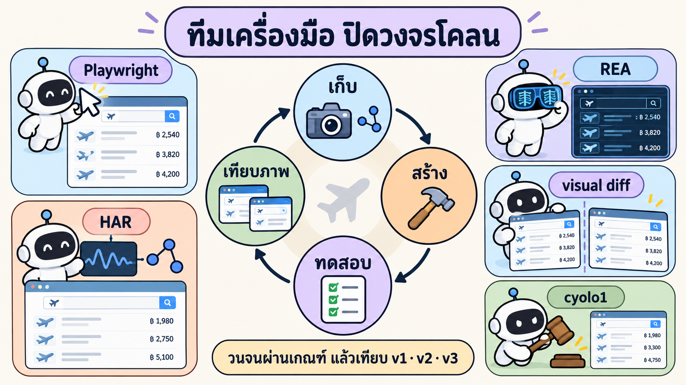
*ภาพรวมของบทนี้: เก็บ (HAR + REA) → สร้าง (yolo1) → ทดสอบ (cyolo1 เป็นกรรมการ) → เทียบภาพ (pixelmatch) แล้ววนจนถึงเกณฑ์*

| สิ่งที่ได้จากบทนี้ | อยู่ที่ไหน |
|---|---|
| เข้าใจทฤษฎีเครื่องมือทุกตัวแบบทีละขั้น พร้อมตัวอย่างจริงจากรอบของเรา | หัวข้อ 🎓 ทฤษฎี (T1–T8) |
| HAR 125 คำขอ อ่านด้วย REA → `API-INVENTORY.md` · เที่ยวบิน **300 ใบ** ใน `flights-all.json` · `EXPLORATION.md` ส่วน F (16 ข้อ) · `journey.gif` | LAB 1 |
| ชุดข้อสอบของกรรมการอิสระ **82 ข้อ** (B35 · C31 · F16) + GIF ทุกข้อ · baseline v2 **51/82** | LAB 2 → `accept/` |
| แอป **SkyThai Pro (v3)** ผ่าน **74/82 (90.2%)** ใน 2 รอบ · `LOOP.md` | LAB 3 → `skythai-pro/` (http://localhost:5083) |
| `SCOREBOARD.md` v1 · v2 · v3 + visual diff + GIF เทียบ 10 เคส × 3 เวอร์ชัน | LAB 4 |

### 🧰 ก่อนเริ่ม ต้องมี

| ✅ | สิ่งที่ต้องมี | ตรวจยังไง |
|---|---|---|
| ☐ | ทำ [บทที่ 1 · REA ขั้นพื้นฐาน](../01_REA_Basics_Flight/README.md) จบแล้ว | มี `/workspace/rea-flight/skythai-mini` (v1) และ `yolo1` เห็น MCP `rea` 207 tools |
| ☐ | ทำ [บทที่ 2 · REA + Playwright Exploration](../02_REA_Playwright_Exploration/README.md) จบแล้ว | มี `/workspace/rea-flight-v2/` ที่มี `EXPLORATION.md`, `flights-full.json`, `exploration/` และ `skythai-plus/` (v2) |
| ☐ | **Docker Desktop** และ **Claude Code Desktop** บน Windows | เปิดแอปได้ และเปิดโฟลเดอร์นี้อยู่ |
| ☐ | container `multi-account-devtool` รันอยู่ ล็อกอิน `yolo1` และ `cyolo1` แล้ว | ใช้ `/maccount` (บทที่ 1 LAB 0) |
| ☐ | v1 (`:5081`) และ v2 (`:5082`) เปิดอยู่ **ใน container** | LAB 0 ของบทนี้ตรวจให้ |

⏱️ **เวลาโดยประมาณ:** อ่านทฤษฎี ~60–75 นาที · ลงมือ LAB 0–4 ~60–75 นาที (เวลารอ AI จริงรวมกันราว 46 นาที ดูตัวเลขในแต่ละ LAB)

> ⚠️ **กติกาจริยธรรม (บทนี้ "อัดเครือข่าย" ได้แล้ว อ่านให้ดี)**
> - สคริปต์เดินเส้นทางเหมือนลูกค้าคนหนึ่ง **รอบเดียว**: ค้นหา → ดูเพิ่ม → กรองบินตรง → ขยาย 1 ใบ → เลือก 1 ใบ แล้ว **หยุดที่หน้าตัวเลือกการจอง** ไม่กด "ดำเนินการต่อ"
> - **ห้ามล็อกอิน · ห้ามจ่ายเงิน · ห้ามไปต่อที่เว็บสายการบินหรือผู้ขาย** · ถ้าเจอ CAPTCHA หรือหน้าบล็อก **ให้หยุด**
> - **ไฟล์ HAR, trace และวิดีโอมี cookie, token และร่องรอยการใช้งาน** → เก็บไว้ใน container เท่านั้น **ห้าม commit ห้ามแชร์** (ใน repo นี้จึงไม่มีไฟล์ดิบเหล่านี้)
> - ห้ามคัดลอกโลโก้ ชื่อแบรนด์ หรือโค้ดของ Google และห้ามเรียก API ภายในของ Google ในแอปของเรา แอปของเราอ่านจากฐานข้อมูลของเราเองเท่านั้น
> - ราคาทุกตัวในบทนี้เป็น **ภาพนิ่ง ณ 1 พ.ย. 2569 (2026) ราว 00:03 น.** ของเที่ยวบินวันที่ 15 พ.ย. 2569 ไม่ใช่ราคาปัจจุบัน

---

## 🎓 ทฤษฎี: เข้าใจทีละขั้นก่อนลงมือ

ทุกหัวข้อมี **ตัวอย่างจริง** จากรอบที่เรารันเมื่อ 31 ต.ค. – 1 พ.ย. 2569

- 🧪 ข้อความที่มีป้าย **(รันจริงของเรา)** = ตัวเลขจากไฟล์ใน `_solution/run/` ไม่ได้แต่งขึ้น
- ภาพชื่อ `lab3-*.png` วาดใหม่สำหรับบทนี้ (ตัวเลขในภาพวาดเป็นตัวอย่างประกอบ ไม่ใช่ผลจริง) · ภาพ `real-*.png`, PNG และ GIF ใน `_solution/` เป็นภาพจริงจากการรัน

| กลุ่ม | หัวข้อ |
|---|---|
| 🕳️ ทำไมต้องมีบทนี้ | T1 ช่องว่างที่บทที่ 2 ทิ้งไว้ |
| 📡 เห็นให้ครบ | T2 HAR: อัดเครือข่ายแล้วให้ REA อ่าน · T3 Playwright script vs Playwright MCP · T4 Trace + วิดีโอ + GIF |
| ⚖️ วัดให้ยุติธรรม | T5 กรรมการอิสระ (acceptance test) · T6 วงจรปิด (closed loop) · T7 Visual diff ด้วย pixelmatch |
| 🧩 รวมภาพ | T8 เครื่องมือแต่ละตัวเพิ่มอะไร · 🧠 ทบทวน |

---

### T1) ช่องว่างที่บทที่ 2 ทิ้งไว้

**คำถาม:** บทที่ 2 ให้ v2 ได้ 33/35 (94.3%) ฟังดูดีมาก แล้วยังขาดอะไรอีก?

เมื่อย้อนอ่านผลบทที่ 2 อย่างละเอียด เราเจอช่องว่าง 3 ข้อ

| # | ช่องว่าง | หลักฐานจากบทที่ 2 (รันจริงของเรา) | ผลเสีย | เครื่องมือที่บทนี้ใช้อุด |
|---|---|---|---|---|
| 1 | **ข้อมูลไม่ครบ** | REA อ่านได้แค่ข้อมูลที่ฝังใน HTML (`ds:1`) = **22 ใบ** · Google มีปุ่ม "ดูเที่ยวบินเพิ่มเติม" ที่บทที่ 2 **อนุมาน** ว่ามีอีก 278 ใบ แต่ไม่มีข้อมูลจริง | v2 แสดงได้แค่ 22 ใบ (เปิดมา 10 กดดูเพิ่มเป็น 22) | **HAR + REA** (T2) |
| 2 | **ผู้สร้างให้คะแนนตัวเอง** | ข้อสอบ 35 ข้อเขียนโดย `yolo2` (ค่าย Claude เดียวกับผู้สร้าง) จากบันทึก `EXPLORATION.md` เล่มเดียวกับที่ใช้สร้าง · เกณฑ์ยอมให้ "ผ่าน" ถ้าทำได้เฉพาะส่วนหลัก · แก้ test แล้วรันซ้ำ 2 รอบ | คะแนนอาจสูงเกินจริง เช่น B15 "ดูเที่ยวบินเพิ่มเติม" ผ่าน ทั้งที่ Google ได้ 300 แต่ v2 ได้ 22 | **กรรมการอิสระ** (T5) + **วงจรปิด** (T6) |
| 3 | **ไม่มีการเทียบหน้าตาแบบวัดได้** | บทที่ 2 เทียบด้วยการ "ดูด้วยตา" และ GIF | พูดได้แค่ "ดูคล้าย" ไม่มีตัวเลขที่ตรวจซ้ำได้ | **Visual diff** (T7) |

> **ตัวอย่าง (รันจริงของเรา) · ข้อสอบคนละชุด คะแนนคนละเรื่อง**
>
> | เวอร์ชัน | ชุดของบทที่ 2 (35 ข้อ · `yolo2`) | ชุดของกรรมการอิสระ (82 ข้อ · `cyolo1`) |
> |---|---|---|
> | v1 SkyThai Mini | 4/35 (11.4%) | 0/82 (0%) |
> | v2 SkyThai Plus | 33/35 (94.3%) | **51/82 (62.2%)** |
> | v3 SkyThai Pro | — | **74/82 (90.2%)** |
>
> v2 ตัวเดิม แอปเดิม แต่พอเปลี่ยนคนออกข้อสอบ คะแนนตกจาก 94.3% เหลือ 62.2% → นี่คือเหตุผลที่บทนี้ต้องมีกรรมการอิสระ (รายละเอียดว่าทำไมตัวเลขต่างกันอยู่ใน T5)

**สรุปสั้น:** บทที่ 2 ขาด 3 อย่าง: ข้อมูลครบ · คนตัดสินที่เป็นกลาง · การวัดหน้าตาด้วยตัวเลข · บทนี้เติมทีละอย่าง แล้ววัดใหม่ด้วยข้อสอบชุดเดียวกันทั้ง 3 เวอร์ชัน

---

### T2) HAR คืออะไร: อัดเครือข่ายแล้วให้ REA อ่าน

**คำถาม:** ถ้าข้อมูล 278 ใบไม่ได้อยู่ใน HTML แล้วมันมาจากไหน และเราจะ "เห็น" มันได้อย่างไร?

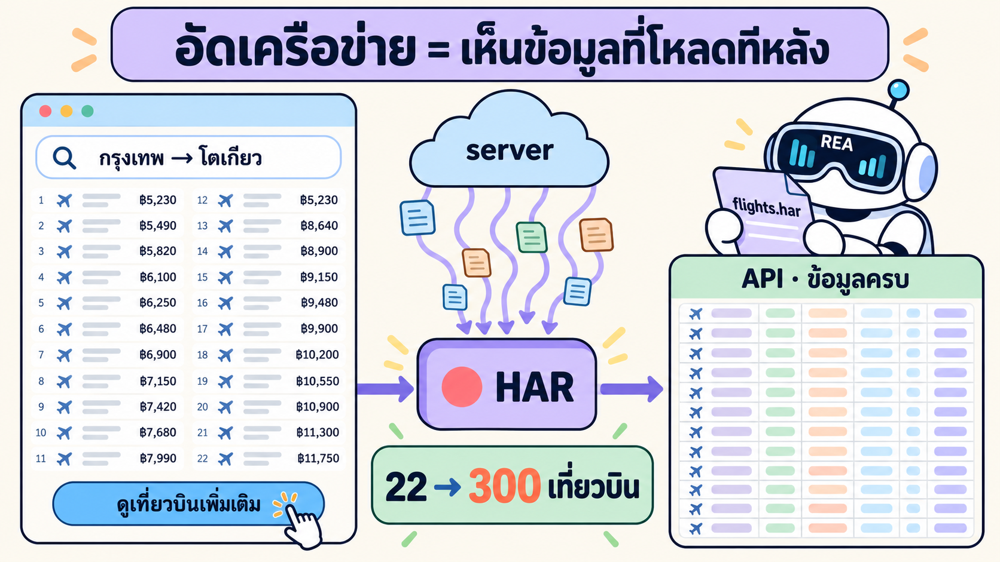
*เมื่อกด "ดูเที่ยวบินเพิ่มเติม" ข้อมูลไหลมาจาก server ผ่านเครือข่าย HAR อัดไว้ทั้งหมด แล้ว REA อ่านเป็นตาราง API*

#### ขั้น 1 · HAR คืออะไร

**HAR (HTTP Archive)** คือไฟล์ **JSON** มาตรฐานที่เก็บ "ทุกคำขอ (request) และคำตอบ (response)" ที่เบราว์เซอร์ส่งและรับระหว่างใช้งานหน้าเว็บ เหมือน **กล้องวงจรปิดของสายเครือข่าย**

โครงสร้างหลัก (ย่อ)

```text
{ "log": {
    "version": "1.2",
    "creator": { "name": "Playwright", ... },
    "pages":   [ ... ],                 ← หน้าเว็บที่เปิด
    "entries": [                        ← 1 entry = 1 คำขอ
      { "startedDateTime": "...",       ← ส่งเมื่อไร
        "request":  { "method": "POST", "url": "https://www.google.com/_/FlightsFrontendUi/data/...GetShoppingResults",
                      "headers": [...], "cookies": [...], "postData": { "text": "f.req=..." } },
        "response": { "status": 200, "headers": [...], "cookies": [...],
                      "content": { "size": 909247, "mimeType": "...", "text": ")]}'..." },  ← ตัวข้อมูล
                      "bodySize": 55862 },                                                     ← ขนาดบนสาย
        "timings":  { "dns": ..., "connect": ..., "send": ..., "wait": ..., "receive": ... }  ← ใช้เวลาแต่ละช่วงกี่ ms
      }, ... ] } }
```

| ช่อง | บอกอะไร | ตัวอย่างจริง (entry #62 · กด "ดูเที่ยวบินเพิ่มเติม") |
|---|---|---|
| `request.method` + `url` | ขออะไร ที่ไหน | `POST …/FlightsFrontendService/GetShoppingResults` |
| `request.postData` | ส่งเงื่อนไขอะไรไป | `f.req=` ที่ flag ท้ายเป็น `[0,1,0,1]` |
| `response.content.size` | ข้อมูลจริงหลังถอดการบีบอัด | 909,247 ไบต์ |
| `response.bodySize` | ขนาดที่วิ่งบนสายจริง (บีบอัดแล้ว) | 55,862 ไบต์ |
| `response.content.text` | ตัวข้อมูล (ถ้าเลือกเก็บ) | เที่ยวบิน 300 ใบ |
| `timings` | เวลาแต่ละช่วงของคำขอ | ใช้หาว่าช้าที่ DNS, รอ server หรือรับข้อมูล |

#### ขั้น 2 · อัด HAR ได้อย่างไร

| วิธี | ทำอย่างไร |
|---|---|
| ด้วยมือ | Chrome DevTools (F12) → แท็บ **Network** → ใช้งานหน้าเว็บ → คลิกขวา **Save all as HAR** |
| ด้วย Playwright (บทนี้) | สร้าง browser context พร้อมตัวเลือก `recordHar` แล้วทุกคำขอใน context นั้นถูกอัดอัตโนมัติ ไฟล์ถูกเขียนตอน `context.close()` |

บรรทัดจริงใน `_solution/run/scripts/journey.mjs` (สคริปต์ที่ yolo1 เขียน)

```js
recordHar:   { path: out('har', 'flights.har'), content: 'embed' },   // อัดเครือข่าย + ฝังตัวข้อมูลไว้ในไฟล์
recordVideo: { dir: out('video'), size: { width: 1366, height: 900 } }, // อัดวิดีโอ (ใช้ใน T4)
```

`content: 'embed'` = เก็บ **ตัวข้อมูล** ของคำตอบไว้ในไฟล์ด้วย (ถ้าไม่ใส่จะได้แค่ header และขนาด)

#### ขั้น 3 · ให้ REA อ่าน HAR

REA มีเครื่องมือ `inspect_web_network_capture` (format `har`) ที่อ่าน HAR แล้วจัดกลุ่มเป็น **API surface** (คำขอแบบไหน ไปที่ไหน ทำอะไร) พร้อม `evidence_id` ตรวจย้อนได้เหมือนบทที่ 1

> **ตัวอย่าง (รันจริงของเรา) · บทเรียน "อ่านข้อความ error"**
> 1. ส่ง HAR ดิบให้ REA → **ไม่รับ** ข้อความ error คือ
>    `HAR schema validation failed: /log/entries/2/request/url must match format "uri"`
> 2. อ่านทีละส่วน: entry ที่ **2** · ช่อง **request.url** · ผิด **รูปแบบ URI**
> 3. เปิด entry 2 ดู: เป็น URL ของ Google Fonts ที่มี `|` (เช่น `family=Product+Sans|Google+Sans+Text`) ซึ่ง RFC 3986 ไม่อนุญาตให้อยู่ใน URL แบบไม่ encode
> 4. yolo1 เขียน `scripts/clean_har.py` แปลง `|` เป็น `%7C` แล้ว **เขียนเป็นไฟล์ใหม่** `flights.clean.har` (ไฟล์ดิบไม่ถูกแก้) · แก้ 1 ช่อง
> 5. REA รับไฟล์ อ่านครบ **125/125 records** แยกได้ **89 กลุ่ม endpoint**
>
> ข้อคิด: error ส่วนใหญ่ **บอกทางแก้อยู่แล้ว** ถ้าอ่านทีละคำ · และอย่าแก้ไฟล์หลักฐานต้นฉบับ ให้เขียนไฟล์ใหม่เสมอ

> **ตัวอย่าง (รันจริงของเรา) · ปัญหาที่สอง: stream ที่ถูกยกเลิก**
> คำขอ `GetShoppingResults` / `GetBookingResults` ตอบกลับเป็น **stream** และหน้าเว็บของ Google สั่งยกเลิก (abort) เองเมื่อได้ข้อมูลครบ HAR รอบแรกจึงมีแต่ `net::ERR_ABORTED` **ไม่มีตัวข้อมูลเลย** · yolo1 แก้โดยเปิด CDP `Network.streamResourceContent` ระหว่างอัด → ได้ข้อมูลครบ และเขียน `_comment` ไว้ใน entry ที่เติมเองว่ามาจาก CDP (ซื่อตรงเรื่องที่มาของหลักฐาน)

#### ขั้น 4 · HAR เปิดเผยอะไรที่บทที่ 2 มองไม่เห็น

ทุกข้อด้านล่างมาจาก `API-INVENTORY.md` และ `EXPLORATION.md` ส่วน F **(รันจริงของเรา)**

| คำขอ (ลำดับใน HAR) | จังหวะของลูกค้า | สิ่งที่เห็นในเครือข่าย | ขนาด (ข้อมูลจริง / บนสาย) |
|---|---|---|---|
| `GetShoppingResults` #52 | เปิดผลค้นหา | 3 ใบยอดนิยม + 19 ใบอื่น ๆ + บอกว่า "ยังไม่ได้โหลดอีก 278 ใบ" · flag ท้าย `[0,0,0,1]` | 105,824 / 19,597 ไบต์ |
| `GetShoppingResults` #62 | กด "ดูเที่ยวบินเพิ่มเติม" | **คำขอเดิม เปลี่ยน flag ตัวเดียว** เป็น `[0,1,0,1]` → ได้ **300 ใบในคำขอเดียว ไม่มีแบ่งหน้า** | 909,247 / 55,862 ไบต์ |
| `GetShoppingResults` #92 | ตัวกรอง "บินตรงเท่านั้น" | **server ค้นใหม่** (ช่องจำนวนจุดแวะ 0 → 1) ได้ 18 ใบ = ตรงกับบินตรงทั้ง 18 ใบใน 300 ใบ | 94,901 / 17,990 ไบต์ |
| `GetBookingResults` #111 | กด "เลือกเที่ยวบิน" VZ 832 | **ผู้ขาย 2 ราย**: ไทยเวียดเจ๊ทแอร์ ฿8,432 (+ค่าธรรมเนียม ฿81) และ Gotogate ฿9,107 · ช่วงราคาปกติ ฿8,100–11,500 | 14,029 ไบต์ |

ข้อค้นพบเด่นจาก 300 ใบ

| ข้อ | สิ่งที่พบ | สถานะ |
|---|---|---|
| F1 | 22 + 278 = **300** ใบ (บทที่ 2 อนุมานไว้ → ตอนนี้ยืนยันแล้ว) | ยืนยันแล้ว |
| F5 | จำนวนจุดแวะ: บินตรง 18 · 1 ครั้ง 201 · 2 ครั้ง 32 · 3 ครั้ง 47 · 4 ครั้ง 1 | ยืนยันแล้ว (แต่ภายหลังพบว่า **นับผิด 1 ใบ** ดู T5) |
| F10 | **23 ใบต้องย้ายสนามบินตอนต่อเครื่อง**: KIX→ITM 13 · TPE→TSA 7 · ICN→GMP 3 | ยืนยันว่ารหัสต่างกัน / อนุมานความหมาย |
| F14 | **ราคาเปลี่ยนใน ~40 นาที**: 22 ใบแรกเหมือนบทที่ 2 ทุกใบและเรียงเดิม แต่ราคาเปลี่ยน 6 ใบ เช่น **VZ 832 ฿8,172 → ฿8,432** | ยืนยันแล้ว |
| F15 | ตัวกรองจากชุดเต็ม: สายการบิน 64 ราย · สนามบินต่อเครื่อง 33 แห่ง | ยืนยันแล้ว |
| F16 | คำขอเบื้องหลังที่ผู้ใช้ไม่เห็น: `/log` 31 ครั้ง · `browserinfo` ส่งขนาดจอ 1366×900 | ยืนยันว่ามีการส่ง / ไม่รู้เนื้อหา |

**รวมทั้งเส้นทาง:** 125 คำขอ · ข้อมูลจริง ≈ 9.2 MB · บนสาย ≈ 2.7 MB · ข้อมูลเที่ยวบินจริงอยู่แค่ใน **4 คำขอ** (≈ 1.12 MB ถ้าไม่บีบอัด หรือ ≈ 93 KB บนสาย)

#### ขั้น 5 · ความเป็นส่วนตัว: HAR = ข้อมูลอ่อนไหว

HAR เก็บ **ทุกอย่าง** รวมถึง header `Cookie` / `Set-Cookie`, token ในฟอร์ม และ URL ที่มีรหัสเฉพาะตัว ถ้าล็อกอินไว้ HAR ก็คือ "กุญแจบ้าน" ดี ๆ นี่เอง

| หลัก | ในบทนี้ |
|---|---|
| ใช้โปรไฟล์ใหม่ ไม่ล็อกอิน | สคริปต์เปิด browser context ใหม่ ไม่มีบัญชีใด ๆ |
| ไม่ commit ไฟล์ดิบ | `har/`, `trace/`, `video/`, `rea/` **อยู่ใน container เท่านั้น** ใน repo มีแค่ผลสรุป (`API-INVENTORY.md`, `flights-all.json`) |
| ให้เครื่องมือปิดค่าลับ | REA ตัด cookie/header ที่เป็น credential (`NID`, `Cookie`, `Set-Cookie`) ออกจาก **ผลของตัวเอง** ให้แล้ว แต่ **ไฟล์ HAR ดิบยังมีอยู่** · ถ้ามีค่าลับเฉพาะที่รู้ล่วงหน้า REA มีตัวเลือก `--sensitive-value` ให้ระบุค่าที่ต้องปิด |
| จำกัดขอบเขต | สคริปต์ route ยกเลิก navigation ที่ไม่ใช่โดเมน Google → ทุกคำขอใน HAR ไปแค่ google.com, gstatic.com, googleapis.com |

**สรุปสั้น:** HAR = บันทึกทุกคำขอเป็น JSON (`log.entries[]` → request / response / timings / content) · Playwright อัดได้ด้วย `recordHar` · REA อ่านแล้วได้ API surface · ได้ 22 → 300 ใบ และรู้ว่า "ตัวกรอง = ค้นใหม่ที่ server" · HAR มีความลับ ห้ามหลุดออกนอก container

---

### T3) Playwright script vs Playwright MCP: ต่างกันอย่างไร ใช้ตอนไหน

**คำถาม:** บทที่ 2 ก็ใช้ Playwright แล้ว ทำไมบทนี้สั่งว่า "เขียนสคริปต์ Playwright (ไม่ใช่ MCP)"?

Playwright มี 2 แบบที่ใช้เครื่องยนต์เดียวกัน แต่ "คนขับ" ต่างกัน

| | **Playwright MCP** (บทที่ 2) | **Playwright script / test runner** (บทนี้) |
|---|---|---|
| ใครคุม | **AI กดเอง** ทีละขั้นผ่าน tool เช่น `browser_click`, `browser_snapshot` | **โค้ด** ที่เขียนไว้ล่วงหน้า (`.mjs`, `.cjs`, `.spec.ts`) |
| เหมาะกับ | **สำรวจ** ของที่ยังไม่รู้จัก ปรับทางเองเมื่อเจอสิ่งไม่คาดคิด | **ทำซ้ำ** เส้นทางที่รู้แล้ว ให้ได้ผลเหมือนเดิมทุกครั้ง |
| รันซ้ำ | แต่ละครั้งอาจเดินคนละทาง | เหมือนเดิมทุกครั้ง (deterministic มากกว่า) |
| บันทึก HAR / trace / วิดีโอ | ทำได้จำกัด | ทำได้ครบ: `recordHar`, `tracing.start()`, `recordVideo` |
| รันใน CI | ไม่เหมาะ (ต้องมี AI) | เหมาะ (`node script.mjs` หรือ `npx playwright test`) |
| ต้นทุน | โทเคน AI ทุกครั้งที่รัน | เขียนครั้งเดียว รันกี่ครั้งก็ไม่ใช้ AI |

**ลำดับที่ดี:** ใช้ **MCP สำรวจก่อน** (บทที่ 2 → ได้ `EXPLORATION.md`) แล้ว **แปลงเส้นทางที่รู้แล้วเป็นสคริปต์** (บทนี้) เพื่ออัดหลักฐานและรันซ้ำได้

> **ตัวอย่าง (รันจริงของเรา)**
> - **LAB 1:** yolo1 เขียน `scripts/journey.mjs` เดิน 5 ขั้น (แถวเที่ยวบิน 22 → 300 → บินตรง 18 → ขยาย 1 ใบ → เลือก 1 ใบ) พร้อมอัด HAR + trace + วิดีโอในรอบเดียว
> - **LAB 2–4:** ข้อสอบของกรรมการ (`accept/suite.cjs` + `run.cjs`) เป็นสคริปต์ล้วน รันกับ v1, v2, v3 ได้แค่เปลี่ยน `BASE_URL` → **นี่คือสิ่งที่ MCP ทำไม่ได้: ข้อสอบชุดเดียวกันเป๊ะ ๆ กับทุกเวอร์ชัน**
> - **เรื่องเวอร์ชัน:** yolo1 ต้องผูก Playwright ไว้ที่ `1.64.0-alpha` เพราะ 1.64.1 หา ffmpeg ที่ต้องใช้อัดวิดีโอในเครื่องไม่เจอ (container มีแค่ ffmpeg-1011) และรายงานตรง ๆ ใน `out-r1.md`

**สรุปสั้น:** MCP = AI ขับเอง เหมาะสำรวจ · script = โค้ดขับ เหมาะทำซ้ำ อัดหลักฐาน และรันใน CI · สำรวจด้วย MCP แล้วล็อกเส้นทางเป็นสคริปต์

---

### T4) Trace + วิดีโอ + GIF: หลักฐานที่ย้อนดูได้ทุกจังหวะ

**คำถาม:** test บอกแค่ "ผ่าน/ไม่ผ่าน" ถ้าไม่ผ่าน เราจะรู้ได้อย่างไรว่าพังตรงไหน?

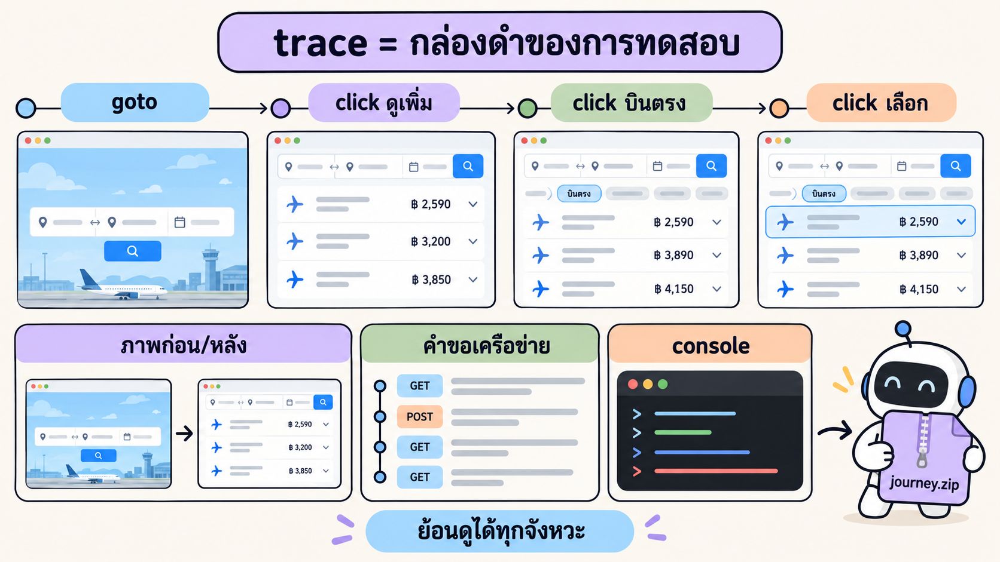
*trace = กล่องดำ (black box recorder) ของการทดสอบ ย้อนดูได้ทุกคำสั่ง*

หลักฐาน 3 แบบ เรียงจากละเอียดมากไปน้อย

| แบบ | คืออะไร | เปิดดูอย่างไร | ขนาดจริงของเรา |
|---|---|---|---|
| **Trace** (`.zip`) | บันทึกทุกคำสั่ง (goto, click, …) + ภาพก่อน/หลังแต่ละคำสั่ง + **DOM snapshot** + คำขอเครือข่าย + console + บรรทัดโค้ดที่สั่ง | `npx playwright show-trace trace/journey.zip` หรือลากไฟล์ไปที่ trace.playwright.dev (เปิดในเครื่อง ไม่ส่งขึ้น server) | `journey.zip` **42 MB** |
| **Video** (`.webm`) | วิดีโอหน้าจอตลอดการทดสอบ | เครื่องเล่นวิดีโอทั่วไป | `journey.webm` |
| **GIF** | แปลงจากวิดีโอด้วย ffmpeg ให้เล็ก วนซ้ำ ฝังใน README / รายงานได้ทันที | เปิดในเบราว์เซอร์หรือ GitHub | `journey.gif` **110 เฟรม กว้าง 800 px (≈5 MB)** |

**ขั้นตอนเปิด trace (ในโค้ดจริง)**

```js
await context.tracing.start({ screenshots: true, snapshots: true, sources: true, title: 'BKK→TYO journey' });
// ... เดินเส้นทางลูกค้า ...
await context.tracing.stop({ path: out('trace', 'journey.zip') });
```

| ตัวเลือก | เก็บอะไร |
|---|---|
| `screenshots: true` | ภาพหน้าจอเป็นระยะ (ทำแถบภาพตามเวลา) |
| `snapshots: true` | DOM ทั้งหน้าก่อน/หลังแต่ละคำสั่ง (คลิกเข้าไปดู element ได้) |
| `sources: true` | โค้ดของสคริปต์ จึงเห็นว่าบรรทัดไหนสั่ง |


*ทุกเคสมี GIF ทั้งผ่านและไม่ผ่าน → "เห็นภาพ = เชื่อได้ ตรวจซ้ำได้"*

**กติกา GIF ของกรรมการ (รันจริงของเรา):** 1 test = 1 GIF · 5 fps · กว้าง 684 px · วนซ้ำ · **ค้างภาพผลลัพธ์ 3 วินาทีก่อนจบ** ทุกข้อ (ทั้งผ่านและไม่ผ่าน) เพื่อให้คนดูอ่านผลทัน · 82 ข้อ × 3 เวอร์ชัน = **246 GIF** ใน container

> **ตัวอย่าง (รันจริงของเรา) · `journey.gif` เส้นทางลูกค้าที่อัด HAR**
>
> 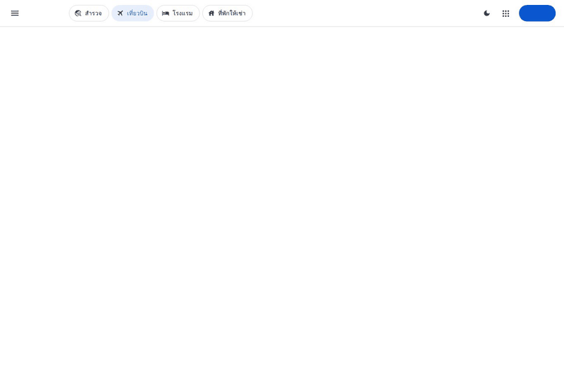
> *GIF จริง 110 เฟรม · ใช้เพื่อการเรียนเท่านั้น · หยุดที่หน้าตัวเลือกการจอง ไม่กดดำเนินการต่อ*

**ทำไมต้องมีทั้ง 3 แบบ:** GIF = ดูเร็ว แชร์ง่าย · วิดีโอ = ความละเอียดเต็ม · trace = ขุดลึกถึง DOM และเครือข่าย ใน LAB 3 yolo1 **อ่านภาพหน้าจอ + snapshot ของข้อที่ไม่ผ่าน** แล้วเจอบั๊กที่ข้อความ error อย่างเดียวบอกไม่ได้ (ดู T6 รอบ 2)

**สรุปสั้น:** trace = กล่องดำ (คำสั่ง + DOM + network + console) · video = ภาพเต็ม · GIF = หลักฐานพกพา · เก็บทุกข้อทั้งผ่านและไม่ผ่าน และค้างภาพท้าย 3 วินาที

---

### T5) กรรมการอิสระ: acceptance test ที่ผู้สร้างไม่ได้เขียนเอง

**คำถาม:** ถ้าให้นักเรียนออกข้อสอบเองแล้วตรวจเอง คะแนนจะเชื่อได้แค่ไหน?

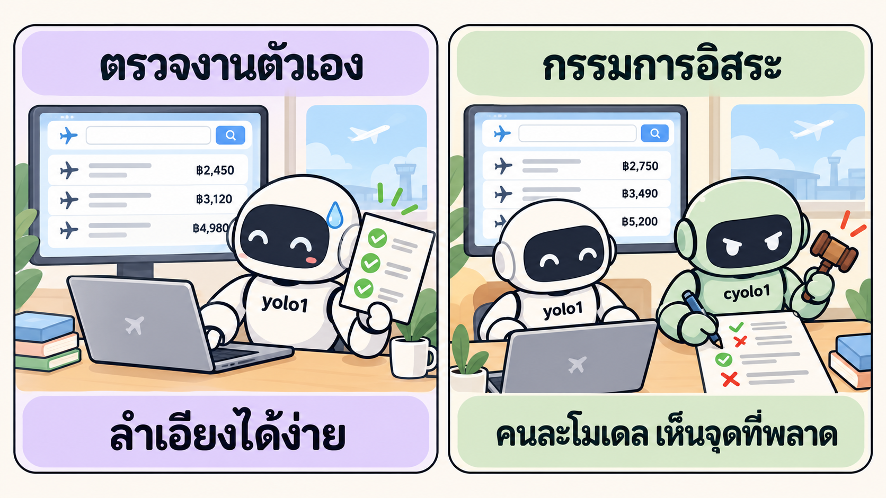
*ตรวจงานตัวเอง = ลำเอียงง่าย · กรรมการคนละโมเดล = เห็นจุดที่ผู้สร้างมองข้าม*

#### ขั้น 1 · คำศัพท์ที่ต้องรู้

| คำ | ความหมาย | ในบทนี้ |
|---|---|---|
| **Acceptance test** | เทสต์ที่ตรวจว่าระบบ "ทำสิ่งที่ผู้ใช้ต้องการ" ได้ไหม มองจากสายตาผู้ใช้ (ไม่สนโค้ดข้างใน) | 82 ข้อใน `accept/` |
| **Test oracle** | "แหล่งความจริง" ที่บอกว่าผลที่ถูกต้องคืออะไร | `EXPLORATION.md` ส่วน B (ฟีเจอร์) · C (กฎ) · F (ข้อมูลเครือข่าย) |
| **Self-grading bias** | ความลำเอียงเมื่อคนสร้างเป็นคนตรวจเอง มักตั้งเกณฑ์ให้ตรงกับสิ่งที่ตัวเองทำ | ปัญหาของชุด 35 ข้อในบทที่ 2 |
| **Independent judge** | ผู้ตัดสินที่ **แยกจากผู้สร้าง**: คนละบัญชี คนละโมเดล ไม่เห็นโค้ด | `cyolo1` (Codex) ตัดสิน `yolo1` (Claude) |

#### ขั้น 2 · ทำไมต้อง "คนละค่ายโมเดล"

โมเดลจากค่ายเดียวกันมักมี **จุดบอดคล้ายกัน**: ตีความโจทย์แบบเดียวกัน พลาดเรื่องเดียวกัน ถ้าใช้ Claude สร้างแล้ว Claude ตรวจ ความผิดพลาดร่วมจะหลุดรอดไปด้วยกัน การใช้ **Codex (`cyolo1`) ตรวจงานของ Claude (`yolo1`)** จึงลดโอกาสนี้ (หลักเดียวกับ code review โดยคนนอกทีม)

#### ขั้น 3 · กติกาที่ทำให้กรรมการ "อิสระจริง"

| กติกา (อยู่ในพรอมต์ LAB 2) | ป้องกันอะไร |
|---|---|
| เขียนจาก `EXPLORATION.md` ส่วน B · C · F **เท่านั้น** (ข้อละ 1 ฟีเจอร์หรือ 1 กฎ) | ข้อสอบยึด "พฤติกรรมของต้นฉบับ" ไม่ใช่ "สิ่งที่แอปเราทำได้" |
| **ห้ามอ่านโค้ดของแอปใด ๆ** | ไม่ให้ข้อสอบโอนอ่อนตามการออกแบบของผู้สร้าง |
| **ห้ามผูกกับ `data-testid`** ใช้ข้อความ / role / label ที่ผู้ใช้เห็น | ผู้สร้างจะ "ใส่ป้ายให้ตรงข้อสอบ" ไม่ได้ ต้องทำ UI ที่ผู้ใช้เห็นจริง |
| ผู้สร้าง **ห้ามแก้ไฟล์ใน `accept/`** (LAB 3) | ไม่ให้แก้ข้อสอบแทนการแก้แอป |
| ไม่มี retry ไม่ลดเกณฑ์ | คะแนนไม่ขึ้นเพราะ "ดวงดี" |

ตัวอย่างโค้ดจริงใน `accept/suite.cjs` (หาแถวเที่ยวบินด้วยชื่อที่ผู้ใช้/screen reader เห็น ไม่ใช่ testid)

```js
const rows = p => p.getByRole('link', { name: /^เที่ยวบิน .*ราคา/ });
test('B15', 'โหลดครบ 300 เที่ยวบิน', async p => {
  await more(p);                                   // กด "ดูเที่ยวบินเพิ่มเติม"
  assert.equal(await rows(p).count(), 300);        // ต้องได้ 300 แถว
  await absent(button(p, /^ดูเที่ยวบินเพิ่มเติม/));  // และปุ่มต้องหายไป
});
```

#### ขั้น 4 · ผลจริง

> **ตัวอย่าง (รันจริงของเรา)**
> - `cyolo1` เขียน **82 test** (B 35 · C 31 · F 16) พร้อมตัวรันและ GIF ทุกข้อ ในเวลา **9 นาที 48 วินาที**
> - baseline v2 (`:5082`): **51/82 (62.2%)**
>
> | หมวด | ทั้งหมด | ผ่าน | ไม่ผ่าน |
> |---|---:|---:|---:|
> | B ฟีเจอร์ | 35 | 23 | 12 |
> | C กฎ | 31 | 24 | 7 |
> | F ข้อมูลเครือข่าย | 16 | 4 | 12 |
> | **รวม** | **82** | **51** | **31** |

**ทำไม v2 ได้ 94.3% ในชุดเก่า แต่ 62.2% ในชุดนี้**

| ปัจจัย | ชุดบทที่ 2 (`yolo2`) | ชุดกรรมการ (`cyolo1`) |
|---|---|---|
| ผู้ออกข้อสอบ | Claude ค่ายเดียวกับผู้สร้าง | Codex คนละค่าย |
| ขอบเขต | ส่วน B 35 ฟีเจอร์ | B + C + F = 82 ข้อ (เพิ่มกฎ 31 และข้อมูลเครือข่าย 16) |
| เกณฑ์ผ่าน | ทำได้ส่วนหลักก็ผ่าน (บันทึกส่วนที่ขาดในหมายเหตุ) | ต้องตรงตัวเลข เช่น B15 ต้อง **300** แถว (v2 ได้ 22 → ไม่ผ่าน) |
| วิธีเตรียมหน้า | เปิด `/` แล้วกด "ค้นหา" | กรอกฟอร์มที่ผู้ใช้เห็นทุกช่อง (รวมปุ่มผู้โดยสาร) |
| การแก้ test | แก้ test แล้วรันซ้ำ 2 รอบ | ห้ามแก้ ไม่มี retry |
| ขนาดจอ | 1280×800 | 1366×900 |

→ ตัวเลข **เทียบข้ามชุดตรง ๆ ไม่ได้** · เทียบได้เฉพาะ "ข้อสอบชุดเดียวกัน" เท่านั้น (นี่คือเหตุผลที่ LAB 4 วัดทั้ง 3 เวอร์ชันด้วย 82 ข้อเดียวกัน)

#### ขั้น 5 · กรรมการก็ผิดได้

กรรมการอิสระ **ไม่ได้แปลว่าถูกเสมอ** ข้อสอบดีได้เท่ากับ oracle ที่มันอ่าน ในรอบของเราพบ 4 แบบ

| ปัญหา | ตัวอย่างจริง | ต้นเหตุ |
|---|---|---|
| **ตัวเลขคาดหวังมาจาก snapshot คนละรอบ** | B20 / C13 คาดเที่ยวบินออก 23:xx **35** ใบ แต่ข้อมูล 300 ใบมี **33** · B22 คาด HKG **76** แต่มี **77** | เลขใน `EXPLORATION.md` ส่วน B/C มาจากการสำรวจบทที่ 2 ส่วนข้อมูลมาจาก HAR อีกรอบ (ราคา/ผลเปลี่ยนตามเวลา F14) |
| **เกณฑ์ขัดกันเอง** | F05 คาดกลุ่มจุดแวะ [18, 201, 32, 47, 1] รวม **299** แต่ต้องมี 300 แถว · ข้อมูลจริงคือ 1 ครั้ง **202** ใบ | yolo1 นับผิด 1 ใบตอนเขียนส่วน F แล้วกรรมการลอกเลขผิดนั้นมาเป็นเกณฑ์ → **oracle ผิด ข้อสอบก็ผิดตาม** |
| **ข้อที่ UI พิสูจน์ไม่ได้** | F08 (สูตรราคาภายใน) · F14 (ราคาเปลี่ยนข้ามเวลา) · F16 (telemetry เบื้องหลัง) | กรรมการเขียนเองใน `accept/README.md` ว่า "ยืนยันไม่ได้ผ่าน UI" → **ไม่ผ่านกับทุกแอปตลอดไป** |
| **locator ไม่เจาะจงพอ** | C31 หาแถวที่มี "23:45" แล้วเจอ **2 แถว** → strict mode error | ข้อมูล 300 ใบมีเที่ยวบินออก 23:45 สองใบ (ใน 22 ใบมีใบเดียว) |
| **setup ผูกติดกัน (coupled setup)** | v1 ได้ **0/82** เพราะ **ทุกข้อ** ต้องกดปุ่มผู้โดยสารตอนเตรียมหน้า แต่ v1 ไม่มีปุ่มนี้ → ล้มก่อนถึงข้อที่ตรวจจริง ทั้งที่ v1 มีเที่ยวบิน 22 ใบ การเรียง และตัวกรองบินตรง | ขั้นเตรียมหน้าตัวเดียวพัง = ทุกข้อพัง · 0/82 **ไม่ได้แปลว่า v1 ไม่มีฟีเจอร์เลย** |

**สรุปสั้น:** acceptance test มองจากผู้ใช้ · oracle = `EXPLORATION.md` · กรรมการคนละโมเดล ไม่เห็นโค้ด ไม่ใช้ testid ลด self-grading bias · ข้อสอบเข้มกว่าทำให้ v2 จาก 94.3% เหลือ 62.2% · แต่กรรมการก็ผิดได้ ต้องอ่านเหตุผลของทุกข้อที่ไม่ผ่าน

---

### T6) วงจรปิด (closed loop): สร้าง → ทดสอบ → แก้ จนถึงเกณฑ์

**คำถาม:** มีข้อสอบที่เป็นกลางแล้ว จะใช้มัน "ดึง" แอปให้ดีขึ้นอย่างเป็นระบบได้อย่างไร?

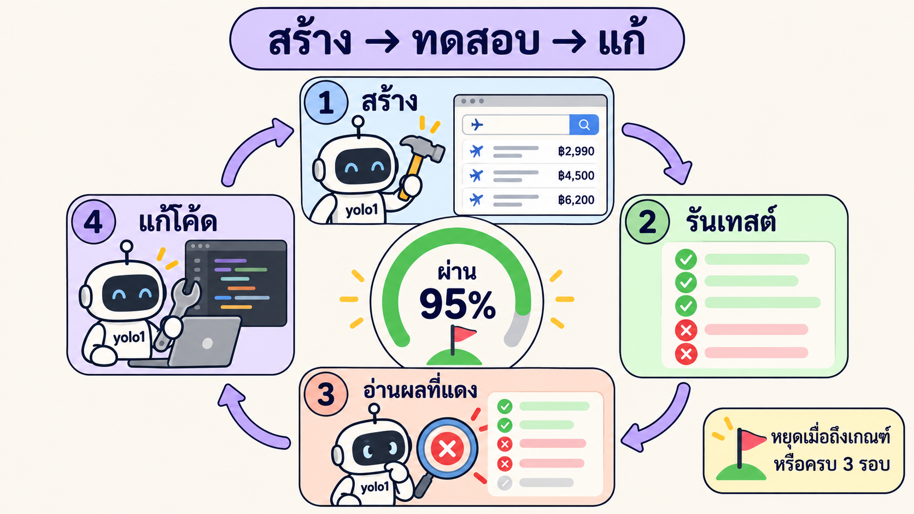
*วงจรปิด: ผลทดสอบย้อนกลับไปเป็นข้อมูลสำหรับรอบแก้ถัดไป (ตัวเลข 95% ในภาพเป็นตัวอย่าง)*

**วงจรเปิด vs วงจรปิด**
- **วงจรเปิด (open loop):** สร้างเสร็จ → ส่ง → จบ ไม่รู้ว่าดีพอไหม (บทที่ 1)
- **วงจรปิด (closed loop / feedback loop):** ผลลัพธ์ถูก **วัด** แล้ว **ป้อนกลับ** ไปเป็นข้อมูลของรอบถัดไป เหมือนเทอร์โมสตัทที่วัดอุณหภูมิแล้วปรับแอร์

**4 ขั้นต่อรอบ**

1. **สร้าง/ปรับ:** `docker compose up -d --build`
2. **ทดสอบ:** รัน `accept/` กับ `http://localhost:5083`
3. **อ่านผลที่แดง:** อ่านเหตุผล + **GIF + ภาพหน้าจอ + snapshot** ของข้อที่ไม่ผ่าน
4. **แก้โค้ด:** แก้แอป (ไม่ใช่แก้ข้อสอบ) แล้ววนกลับขั้น 1

**3 กติกาที่ทำให้วงจรไม่ "โกง"**

| กติกา | เหตุผล |
|---|---|
| **กฎหยุด (stopping rule): ≥ 90% หรือครบ 3 รอบ** | ไม่วนไม่รู้จบ และไม่ไล่ 100% ด้วยวิธีผิด ๆ |
| **ห้ามแก้ไฟล์ของกรรมการ** | ถ้าแก้ข้อสอบได้ คะแนน 100% ก็ไร้ความหมาย · yolo1 รันจากสำเนาที่ **เหมือนต้นฉบับทุกไบต์** ใน `loop/r1`, `loop/r2` และ LAB 4 ตรวจ SHA-256 ซ้ำ (`results/verification.json`) |
| **ห้ามปลอมข้อมูล** | ข้อมูลยังเป็น snapshot จริง ณ วันที่เก็บ ไม่แต่งเลขให้ตรงข้อสอบ |

> **ตัวอย่าง (รันจริงของเรา) · LOOP.md**
>
> | รอบ | ผ่าน/ทั้งหมด | แก้อะไรไปบ้าง |
> |---|---|---|
> | baseline v2 (`:5082`) | 51/82 (62.2%) | จุดเริ่ม |
> | **1** | **73/82 (89.0%)** | ก่อนรอบนี้: เปลี่ยนพอร์ตเป็น 5083 · ใส่ `flights-all.json` ครบ **300 ใบ** ลงฐานข้อมูล + ตารางใหม่ 5 ตาราง (`search_steps`, `flight_appearances`, `snapshot_airlines`, `booking_options`, `booking_insights`) · ปุ่ม "ดูเที่ยวบินเพิ่มเติม" โหลด 300 ใบครั้งเดียว · ตัวกรองค้นจากทั้ง 300 ใบ · ผู้ขาย 2 รายรวม **Gotogate** · ป้ายเตือน **เปลี่ยนสนามบิน** 23 ใบ · ช่วงราคาปกติตามคำค้น · ปฏิทินพร้อมราคา · กราฟราคา ฯลฯ |
> | **2** | **74/82 (90.2%)** ✅ ถึงเกณฑ์ หยุด | ดู **ภาพหน้าจอ + snapshot ของ C29** แล้วพบว่ากด Escape แล้วปลายทางถูกล้างจริง **แต่ป๊อปอัปยังค้างบังปุ่ม "ค้นหาเที่ยวบิน"** → แก้ให้ Escape ปิดป๊อปอัปด้วย |
>
> รอบ 2 คือตัวอย่างที่ดีของ T4: ข้อความ error บอกแค่ "กดปุ่มค้นหาไม่ได้" แต่ **ภาพ** บอกว่า "เพราะมีป๊อปอัปบังอยู่"

**8 ข้อที่เหลือ: yolo1 ไม่ยอมปลอมข้อมูล (รันจริงของเรา)**

| ข้อ | ทำไมไม่ผ่าน | ถ้าจะให้ผ่านต้องทำอะไร |
|---|---|---|
| F08 · F14 · F16 | กรรมการตั้งไว้ให้ไม่ผ่านกับทุกแอป (UI พิสูจน์ไม่ได้) | ทำไม่ได้ |
| F05 | เกณฑ์รวมได้ 299 แต่ต้องมี 300 แถว | ปลอมข้อมูล 1 ใบ |
| B20 · C13 | คาด 35 ใบ ข้อมูลจริง 33 | เพิ่มเที่ยวบินปลอม 2 ใบ |
| B22 | คาด HKG 76 ข้อมูลจริง 77 | ซ่อนเที่ยวบินจริง 1 ใบ |
| C31 | เจอ 23:45 สองแถว | ลดเหลือ 10 แถวแบบ v2 → แต่จะไปตก C26 แทน |

yolo1 สรุปเองว่า **"74/82 คือเพดานของข้อมูลชุดนี้"** และหยุด แทนที่จะโกงให้ได้ 100% → นี่คือพฤติกรรมที่เราต้องการจาก agent

**สรุปสั้น:** วงจรปิด = วัด → ป้อนกลับ → แก้ · มีกฎหยุด (≥90% หรือ 3 รอบ) · ห้ามแก้ข้อสอบ ห้ามปลอมข้อมูล · ของจริง: 51 → 73 → 74/82 ใน 2 รอบ

---

### T7) Visual diff ด้วย pixelmatch: เทียบหน้าตาด้วยตัวเลข

**คำถาม:** "หน้าตาเหมือนต้นฉบับแค่ไหน" ตอบเป็นตัวเลขที่คนอื่นรันซ้ำได้ได้ไหม?

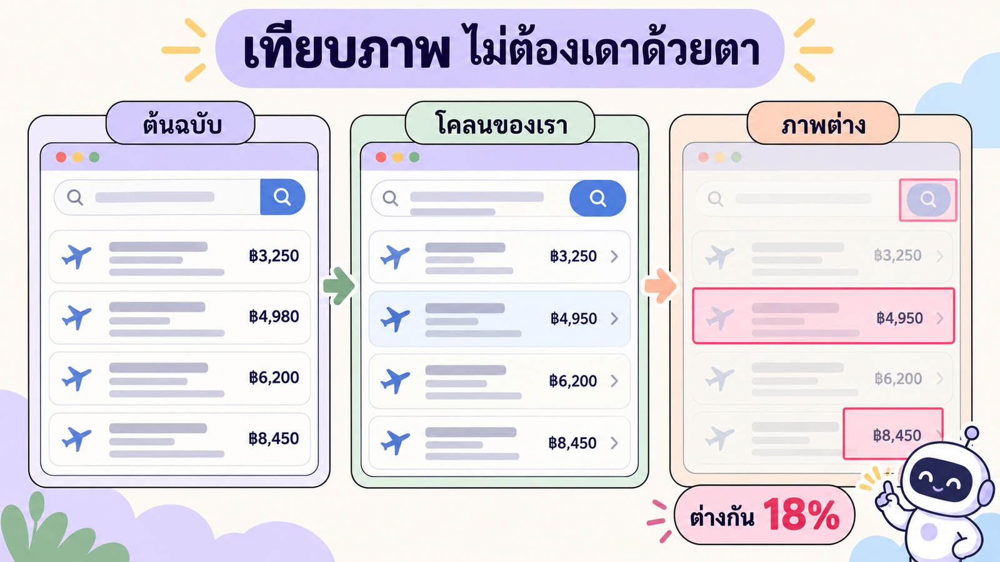
*ต้นฉบับ + โคลน → ภาพไฮไลต์ส่วนที่ต่าง + เปอร์เซ็นต์ (18% ในภาพเป็นตัวอย่าง)*

#### ขั้น 1 · pixelmatch ทำงานอย่างไร

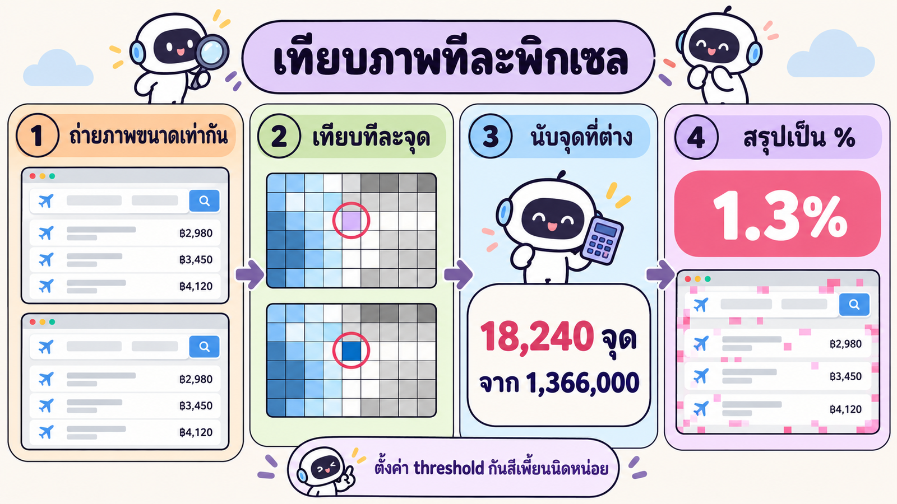
*4 ขั้นของ pixelmatch (ตัวเลขในภาพเป็นตัวอย่าง ผลจริงอยู่ด้านล่าง)*

1. **ถ่ายภาพขนาดเท่ากัน:** pixelmatch ต้องการภาพกว้าง × สูงเท่ากันทุกพิกเซล · เราใช้ Playwright ถ่าย **1366×900** = **1,229,400 พิกเซล** เท่ากับภาพต้นฉบับจากบทที่ 2 (`exploration/results.png`)
2. **เทียบทีละพิกเซล:** สำหรับพิกเซลตำแหน่งเดียวกัน คำนวณ **ระยะห่างของสี** (pixelmatch ใช้สูตรที่ใกล้กับการรับรู้ของตาคน ไม่ใช่แค่ลบค่า RGB ตรง ๆ)
3. **ตัดสินด้วย threshold:** ถ้าระยะห่างเกิน `threshold` (0 ถึง 1 · ยิ่งต่ำยิ่งเข้ม) นับว่า "ต่าง" · เราใช้ **0.1** (ค่าเริ่มต้นของ pixelmatch) กันสีเพี้ยนเล็กน้อย
4. **ขอบตัวอักษร (anti-aliasing):** `includeAA: false` = พิกเซลที่ตรวจพบว่าเป็นขอบเบลอของตัวอักษร/เส้น **ไม่นับ** ว่าต่าง
5. **สรุปเป็น %:** `% ต่าง = จำนวนพิกเซลที่ต่าง ÷ พิกเซลทั้งหมด × 100` และวาด **ภาพ diff**: พิกเซลที่ต่างเป็นสีแดงบนภาพต้นฉบับที่จางลง

#### ขั้น 1.5 · สมการที่ pixelmatch ใช้คำนวณ (ตรงกับซอร์สโค้ด pixelmatch 7.1.0)

ให้ภาพต้นฉบับกับภาพของเรากว้าง $W$ สูง $H$ เท่ากัน แต่ละพิกเซล $(x, y)$ มีสี $(R, G, B)$ ค่าละ 0–255

**สมการ 1 · ผลต่างของสีในแต่ละช่อง**

$$\Delta R = R_1 - R_2,\qquad \Delta G = G_1 - G_2,\qquad \Delta B = B_1 - B_2$$

**สมการ 2 · แปลงผลต่างเป็นระบบสี YIQ** (Y = ความสว่าง · I, Q = สีสัน · ตาคนไวต่อความสว่างมากที่สุด)

$$
\begin{aligned}
Y &= 0.29889531\,\Delta R + 0.58662247\,\Delta G + 0.11448223\,\Delta B \\
I &= 0.59597799\,\Delta R - 0.27417610\,\Delta G - 0.32180189\,\Delta B \\
Q &= 0.21147017\,\Delta R - 0.52261711\,\Delta G + 0.31114694\,\Delta B
\end{aligned}
$$

**สมการ 3 · ระยะห่างของสี** (ให้น้ำหนักความสว่าง $Y$ มากที่สุด)

$$\delta = 0.5053\,Y^2 + 0.299\,I^2 + 0.1957\,Q^2$$

**สมการ 4 · ตัดสินว่าพิกเซลนี้ "ต่าง" ไหม** ($t$ = threshold · ค่า $35215$ คือ $\delta$ สูงสุดที่เป็นไปได้)

$$
d(x, y) =
\begin{cases}
1 & \text{if } \delta > 35215\,t^2 \text{ and the pixel is not anti-aliasing} \\
0 & \text{otherwise}
\end{cases}
\qquad t = 0.1 \Rightarrow 35215 \times 0.1^2 = 352.15
$$

**สมการ 5 · visual diff เป็นเปอร์เซ็นต์**

$$\text{visual diff} = \frac{\sum_{x=1}^{W}\sum_{y=1}^{H} d(x, y)}{W \times H} \times 100\%$$

🧪 **ตัวอย่างคำนวณ 3 พิกเซล** (เกณฑ์ $\delta > 352.15$)

| พิกเซลต้นฉบับ | พิกเซลของเรา | $Y$ · $I$ · $Q$ | $\delta$ | นับว่าต่างไหม |
|---|---|---|---:|---|
| ขาว (255, 255, 255) | เทาอ่อน (245, 245, 245) | 10.00 · 0 · 0 | 50.53 | ❌ ไม่นับ (ต่างนิดเดียว) |
| ขาว (255, 255, 255) | เทา (228, 228, 228) | 27.00 · 0 · 0 | 368.36 | ✅ นับ |
| ขาว (255, 255, 255) | ฟ้าปุ่ม (26, 115, 232) | 153.21 · 90.69 · −17.58 | 14,380.48 | ✅ นับ |

→ สีเทาต้องเข้มขึ้นจากขาวอย่างน้อย **27 ระดับ** ($0.5053 \times 27^2 = 368.36 > 352.15$) ถึงจะนับว่าต่าง สีเพี้ยนเล็กน้อยจากการบีบอัดภาพจึงไม่ถูกนับ

🧪 **แทนค่าจริงในสมการ 5** ($W \times H = 1366 \times 900 = 1{,}229{,}400$)

$$
\text{v1} = \frac{342{,}711}{1{,}229{,}400} \times 100 = 27.88\%
\qquad
\text{v2} = \frac{100{,}641}{1{,}229{,}400} \times 100 = 8.19\%
\qquad
\text{v3} = \frac{102{,}292}{1{,}229{,}400} \times 100 = 8.32\%
$$

#### ขั้น 2 · ผลจริง

> **ตัวอย่าง (รันจริงของเรา)** · ต้นฉบับ vs แต่ละเวอร์ชัน · 1366×900 · threshold 0.1 · includeAA false
>
> | เวอร์ชัน | พิกเซลที่ต่าง | % ต่าง ↓ | เที่ยวบินแรก → ครบ |
> |---|---:|---:|---:|
> | v1 SkyThai Mini | 342,711 | **27.88%** | 22 → 22 |
> | v2 SkyThai Plus | 100,641 | **8.19%** | 10 → 22 |
> | v3 SkyThai Pro | 102,292 | **8.32%** | 22 → 300 |

| ภาพ | ไฟล์ |
|---|---|
| ต้นฉบับ (Google Flights · ใช้เพื่อการเรียน) | 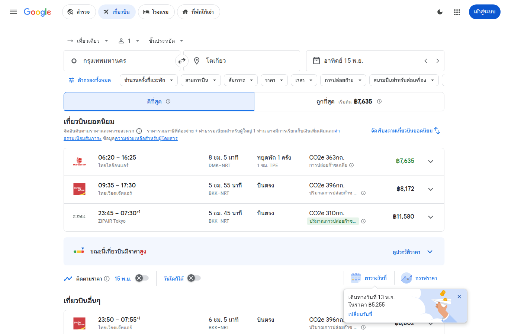 |
| v1 + ภาพต่าง | 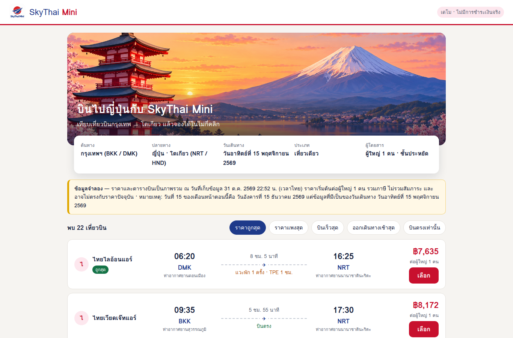 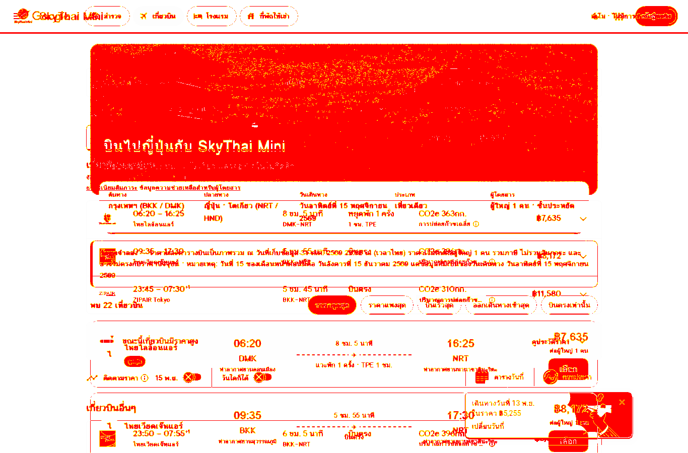 |
| v2 + ภาพต่าง | 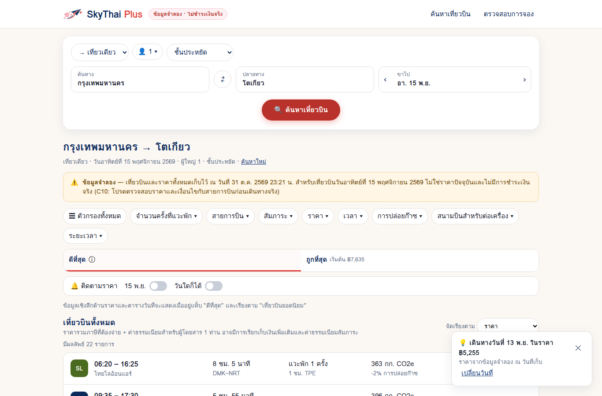 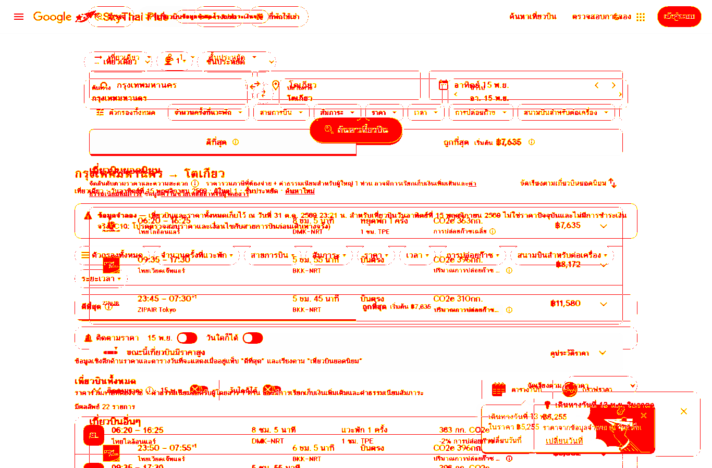 |
| v3 + ภาพต่าง | 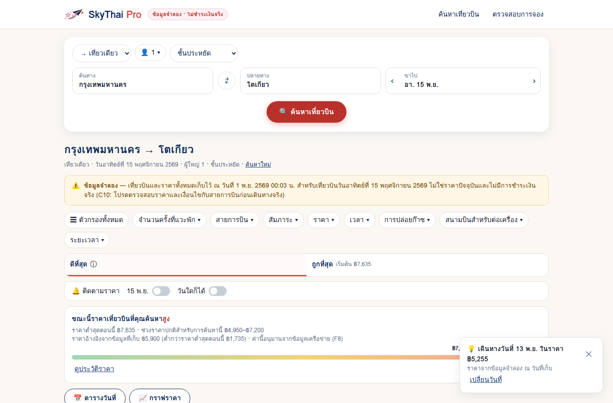 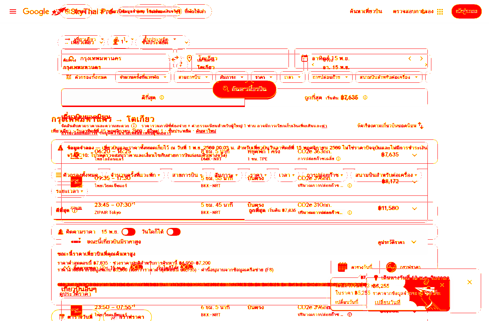 |

#### ขั้น 3 · visual diff วัดอะไร และ "ไม่" วัดอะไร

| วัดได้ | วัดไม่ได้ |
|---|---|
| โครงหน้า (layout) ใกล้ต้นฉบับแค่ไหน ณ จอแรก | **ความครบของฟีเจอร์** (v2 diff ต่ำกว่า v3 นิดหน่อย แต่ v3 ผ่านข้อสอบมากกว่า 23 ข้อ) |
| ตำแหน่งที่ต่าง (จากภาพ diff) ตรวจซ้ำได้ | ความสวย ความใช้ง่าย (UX) |
| การเปลี่ยนแปลงหน้าตาระหว่างเวอร์ชัน (visual regression) | ความหมาย: ข้อความต่างภาษา/ต่างราคา นับเป็นพิกเซลต่างเหมือนกันหมด |

ข้อควรระวัง (รันจริงของเรา · จาก `results/visual/README.md`)
- **แบรนด์ต่างโดยตั้งใจ:** เราออกแบบโลโก้ สี และแบนเนอร์เอง (ห้ามลอก Google) → diff จะไม่มีวันเป็น 0% และ **ไม่ควรเป็นเป้าหมาย**
- **พื้นขาวที่ตรงกัน** ทำให้ diff ต่ำได้ แม้ตรงนั้นจะไม่มีเนื้อหาเลย
- **ราคา/วันที่มาจาก snapshot คนละรอบ** → ข้อความต่างกันอยู่แล้ว
- ถ่ายเฉพาะจอแรก (scroll 0) ไม่ใช่ทั้งหน้า · v2/v3 ใช้พื้นที่ฟอร์มด้านบนมาก รายการเที่ยวบินจึงอยู่ต่ำกว่าต้นฉบับ

**สรุปสั้น:** pixelmatch = ภาพขนาดเท่ากัน → เทียบสีทีละพิกเซล ($\delta = 0.5053Y^2 + 0.299I^2 + 0.1957Q^2$) → นับเมื่อ $\delta > 352.15$ → นับ ÷ ทั้งหมด = % · ผลจริง 27.88% → 8.19% → 8.32% · visual diff ≠ ความครบของฟีเจอร์

---

### T8) รวมภาพ: เครื่องมือแต่ละตัวเพิ่มอะไร

**คำถาม:** ถ้าต้องอธิบายให้เพื่อนฟังใน 1 ตาราง ว่าเครื่องมือแต่ละตัว "ซื้อ" อะไรให้เรา?

| เครื่องมือ | เพิ่มอะไร (หลักฐานจริง) | ยังขาดอะไร |
|---|---|---|
| **REA อย่างเดียว** (v1 · บทที่ 1) | ถอดข้อมูล 22 ใบจาก HTML ได้เร็ว · ได้รายการ + จองจำลอง | ภาพนิ่งสถานะเดียว ไม่รู้พฤติกรรม (ปฏิทิน ผู้โดยสาร ตัวกรอง) |
| **Playwright MCP + REA** (v2 · บทที่ 2) | กดใช้จริง → ฟีเจอร์/กฎใน `EXPLORATION.md` → UI กว้างขึ้นมาก | ไม่ได้เก็บข้อมูลหลังโหลดเพิ่ม → 22 ใบ · ผู้ขายและเกณฑ์ย่อยตกหล่น · ให้คะแนนตัวเอง |
| **HAR + REA** (LAB 1) | 22 → **300** ใบ · ผู้ขาย 2 ราย · ช่วงราคาตามคำค้น · เปลี่ยนสนามบิน 23 ใบ · สายการบิน 64 / สนามบิน 33 | เครือข่ายไม่อธิบาย UX ทั้งหมด · snapshot คนละรอบให้ตัวเลขต่างกัน |
| **Trace + วิดีโอ + GIF** (LAB 1–4) | ทุกข้อมีภาพ ย้อนดูได้ · เจอบั๊ก Escape จากภาพ (รอบ 2) | ไฟล์ใหญ่ (trace 42 MB) และมีข้อมูลอ่อนไหว |
| **กรรมการอิสระ** (LAB 2) | วัดซ้ำได้ ไม่ลำเอียง · 82 ข้อ เข้มกว่าเดิม (v2 62.2%) | ข้อสอบก็ผิดได้ (F05, B20, C31, coupled setup) |
| **วงจรปิด** (LAB 3) | 51 → 73 → **74/82** ใน 2 รอบ · หยุดเมื่อถึงเกณฑ์ | ติดเพดานข้อมูล · ต้องมีคนตรวจว่าข้อที่เหลือเป็นความผิดของใคร |
| **Visual diff** (LAB 4) | ตัวเลขหน้าตาที่ตรวจซ้ำได้: 27.88% → 8.19% / 8.32% | ไม่วัดความครบ ไม่วัด UX |

> **ตัวอย่าง (รันจริงของเรา) · SCOREBOARD สุดท้าย (ข้อสอบ 82 ข้อชุดเดียวกัน ไม่แก้ test)**
>
> | เวอร์ชัน | ผ่าน/ทั้งหมด | เที่ยวบินแรก → ครบ | Visual diff ↓ |
> |---|---:|---:|---:|
> | v1 SkyThai Mini (REA) | 0/82 (0%) | 22 → 22 | 27.88% |
> | v2 SkyThai Plus (Playwright + REA) | 51/82 (62.2%) | 10 → 22 | 8.19% |
> | **v3 SkyThai Pro (HAR + REA + กรรมการ + วงจรปิด)** | **74/82 (90.2%)** | **22 → 300** | 8.32% |
>
> คำตัดสินของ `cyolo1`: **v3 เก็บฟีเจอร์ได้ครบที่สุด** ส่วน v2 visual diff ต่ำสุดเล็กน้อย "ซึ่งไม่ได้หมายถึงฟีเจอร์ครบกว่า"

**สรุปสั้น:** แต่ละเครื่องมืออุดช่องว่างคนละด้าน: ข้อมูล (HAR) · หลักฐาน (trace/GIF) · ความยุติธรรม (กรรมการ) · การพัฒนาต่อเนื่อง (วงจรปิด) · หน้าตา (visual diff) · ใช้ร่วมกันจึงพิสูจน์ได้ว่า v3 ดีขึ้นจริง

---

### 🧠 ทบทวน 10 ข้อ (ลองตอบก่อนเปิดเฉลย)

1. บทที่ 2 ทิ้งช่องว่างอะไรไว้ 3 ข้อ และบทนี้ใช้เครื่องมืออะไรอุดแต่ละข้อ?
2. ใน HAR 1 entry มีส่วนหลักอะไรบ้าง และช่องไหนบอก "ขนาดข้อมูลจริง" กับ "ขนาดบนสาย"?
3. REA ไม่รับ HAR ดิบเพราะอะไร และ yolo1 แก้อย่างไรโดยไม่ทำลายหลักฐาน?
4. ทำไม "ตัวกรองบินตรง" ของ Google จึงเป็นข้อมูลที่บทที่ 2 ไม่มีทางรู้ แต่ HAR บอกได้?
5. ทำไมไฟล์ HAR และ trace ห้าม commit ขึ้น repo?
6. Playwright MCP กับ Playwright script เหมาะกับงานคนละแบบอย่างไร?
7. ทำไมกรรมการต้องเป็นคนละค่ายโมเดล และห้ามใช้ `data-testid`?
8. v2 ได้ 94.3% ในชุดบทที่ 2 แต่ 62.2% ในชุดกรรมการ บอกเหตุผลอย่างน้อย 3 ข้อ
9. ทำไม v1 ได้ 0/82 และตัวเลขนี้แปลว่า "v1 ไม่มีฟีเจอร์เลย" ไหม?
10. v2 visual diff 8.19% ต่ำกว่า v3 8.32% แปลว่า v2 ดีกว่าไหม? เพราะอะไร?

<details>
<summary>เฉลย</summary>

1. (ก) ข้อมูลไม่ครบ 22/300 → **HAR + REA** · (ข) ผู้สร้างให้คะแนนตัวเอง → **กรรมการอิสระ + วงจรปิด** · (ค) ไม่มีการเทียบหน้าตาแบบวัดได้ → **visual diff (pixelmatch)**
2. `request` (method, url, headers, postData) · `response` (status, headers, content) · `timings` · ข้อมูลจริง = `response.content.size` · บนสาย = `response.bodySize`
3. URL ของ Google Fonts มี `|` ที่ไม่ได้ encode → error `/log/entries/2/request/url must match format "uri"` · แก้ด้วย `clean_har.py` แปลงเป็น `%7C` แล้ว **เขียนเป็นไฟล์ใหม่** `flights.clean.har` ไฟล์ดิบไม่ถูกแก้
4. เพราะการกรองเกิดที่ **server** (ส่ง `GetShoppingResults` ใหม่ เปลี่ยนช่องจำนวนจุดแวะ 0 → 1) ไม่ได้กรองในเบราว์เซอร์ · บทที่ 2 เห็นแค่ผลบนจอ ส่วน HAR เห็นคำขอที่ส่งไป
5. HAR/trace เก็บ cookie, token, header และร่องรอยการใช้งาน ถ้าหลุดอาจถูกสวมรอยได้ · ใน repo จึงมีแค่ผลสรุป
6. MCP = AI กดเอง เหมาะ **สำรวจ** ของใหม่ · script = โค้ดเดินเส้นทางเดิม เหมาะ **ทำซ้ำ อัด HAR/trace/วิดีโอ และรันใน CI** เช่น ข้อสอบ 82 ข้อที่รันกับ 3 เวอร์ชันโดยเปลี่ยนแค่ `BASE_URL`
7. คนละค่าย = จุดบอดต่างกัน ลด self-grading bias · ห้าม testid เพื่อให้ตรวจจากสิ่งที่ผู้ใช้เห็น และผู้สร้าง "ใส่ป้ายให้ตรงข้อสอบ" ไม่ได้
8. ผู้ออกข้อสอบคนละค่าย · ขอบเขต 35 → 82 ข้อ (เพิ่ม C และ F) · เกณฑ์เข้มกว่า (B15 ต้อง 300) · ห้ามแก้ test ไม่มี retry · setup กรอกฟอร์มครบทุกช่อง (ข้อใดก็ได้ 3 ข้อ)
9. ทุก test ต้องกดปุ่มผู้โดยสารตอนเตรียมหน้า แต่ v1 ไม่มีปุ่มนี้ → ล้มที่ setup ทั้ง 82 ข้อ (**coupled setup**) · **ไม่ได้แปลว่าไม่มีฟีเจอร์** v1 มี 22 ใบ การเรียง และบินตรง
10. **ไม่** visual diff วัดแค่ความต่างของพิกเซลจอแรก (สี ข้อความ ตำแหน่ง) ไม่วัดความครบ · v3 ผ่านข้อสอบมากกว่า 23 ข้อ (74 vs 51) และแสดงได้ 300 ใบ

</details>

---

## 🗺️ เส้นทาง LAB

**ทุก LAB = วางพรอมต์ 1 ครั้งใน Claude Code Desktop** (เปิดในโฟลเดอร์นี้) แล้วรอผล · ไฟล์ที่ LAB ก่อนสร้างใน `/workspace/rea-flight-v3` คือ "ความจำ" ที่ LAB ถัดไปใช้ต่อ

| LAB | ทำอะไร | ใครทำงาน | ได้อะไร | เวลา AI (รันจริง) |
|---|---|---|---|---|
| 0 | เช็กก่อนเริ่ม | Claude Code Desktop | รู้ว่า v1, v2, ไฟล์บทที่ 2 และบัญชีพร้อม | — |
| 1 | HAR + REA | `yolo1 -p` + Playwright script + REA | `API-INVENTORY.md` · `flights-all.json` (300 ใบ) · ส่วน F · `journey.gif` | ≈14 นาที (23:55 → 00:09) |
| 2 | กรรมการอิสระ | `cyolo1 exec` (Codex) | `accept/` 82 test + GIF · `BASELINE.md` (v2 51/82) | 9 นาที 48 วินาที |
| 3 | วงจรปิด → v3 | `yolo1 -p` | `skythai-pro/` · `LOOP.md` (74/82) → `docker compose` บน Windows (http://localhost:5083) | 16 นาที 50 วินาที |
| 4 | ตารางคะแนน + visual diff | `cyolo1 exec` | `SCOREBOARD.md` · `results/visual/` · GIF 10 เคส × 3 | 4 นาที 51 วินาที |

💡 **พรอมต์มี 2–3 ชั้นเหมือนบทก่อน**
- **ชั้นนอก** (บนเส้น `---` แรก) = คุยกับ Claude Code Desktop ให้ไปทำใน container
- **ชั้นใน** (ระหว่างเส้น `---`) = งานที่ส่งต่อให้ `yolo1 -p` หรือ `cyolo1 exec` (ชุดเดียวกับ `_solution/run/r1.txt`–`r4.txt`)
- **ชั้นท้าย** (ใต้เส้น `---` ที่สอง ถ้ามี) = งานของ Claude Code Desktop หลัง agent ทำเสร็จ เช่น คัดลอกไฟล์ออกมา

> 🔒 ผลจริงทุกพรอมต์อยู่ใน [`_solution/run/`](_solution/run/) ลองทำเองก่อน แล้วค่อยเปิดเทียบ

---

## LAB 0 · เช็กก่อนเริ่ม

🎯 ให้แน่ใจว่าของจากบทที่ 1–2 ยังอยู่ครบ และ v1/v2 เปิดอยู่ใน container (เป็นแค่การเช็กง่าย ๆ ไม่ต้องมีภาพประกอบ)

💬 **คัดลอกพรอมต์นี้**

```text
ใน container multi-account-devtool ช่วยเช็กความพร้อมก่อนเริ่มบทที่ 3 แบบอ่านอย่างเดียว ห้ามแก้หรือลบอะไร
1. container multi-account-devtool รันอยู่ไหม และ /root/ai-accounts/.Claude/shared/mcp/mcp.json มีทั้ง rea และ playwright ไหม
2. มี /workspace/rea-flight/skythai-mini (v1) ไหม และ curl http://localhost:5081/api/health ใน container ตอบอะไร
3. มี /workspace/rea-flight-v2 ที่มี EXPLORATION.md, flights-full.json, โฟลเดอร์ exploration/ และ skythai-plus/ (v2) ไหม และ curl http://localhost:5082/api/health ใน container ตอบอะไร
4. yolo1 และ cyolo1 ล็อกอินอยู่ไหม
สรุปเป็นตาราง ข้อ | ผล | ถ้าไม่ผ่านควรทำอะไร
```

✅ **ผลที่คาดหวัง**

| ข้อ | ผล |
|---|---|
| 1 container + MCP | กำลังรัน · มีทั้ง `rea` และ `playwright` |
| 2 v1 | มีโฟลเดอร์ · `/api/health` ตอบ `{"ok":true}` |
| 3 v2 + ไฟล์บทที่ 2 | มีครบ · `/api/health` ตอบ `{"ok":true}` |
| 4 บัญชี | `yolo1` และ `cyolo1` ล็อกอินอยู่ |

👀 **สังเกต**
- ถ้า v1 หรือ v2 ไม่ตอบ ให้ Claude Code รัน `docker compose up -d` ในโฟลเดอร์ของมัน **ใน container** (LAB 2 และ LAB 4 ก็เขียนไว้แล้วว่าถ้ายังไม่เปิดให้เปิดเอง)
- บทนี้ **ไม่ต้องใช้ Chrome พอร์ต 9222** เพราะ LAB 1 ให้สคริปต์ Playwright เปิดเบราว์เซอร์ของตัวเอง
- `exploration/` ของบทที่ 2 ต้องมี เพราะ LAB 4 ใช้ภาพหน้าผลค้นหาในนั้นเป็นภาพต้นฉบับของ visual diff
- ถ้า `cyolo1` ยังไม่ล็อกอิน ให้กลับไปทำขั้นล็อกอินของ LAB 03 Multi-Account Container ก่อน (LAB 2 และ LAB 4 ต้องใช้)

---

## LAB 1 · HAR + REA: เก็บข้อมูลที่ "โหลดทีหลัง"

🎯 ให้ yolo1 เขียนสคริปต์ Playwright เดินเส้นทางลูกค้า อัด HAR + trace + วิดีโอ แล้วให้ REA อ่าน HAR จนได้เที่ยวบินทั้งหมด (ทฤษฎี: T2, T3, T4)

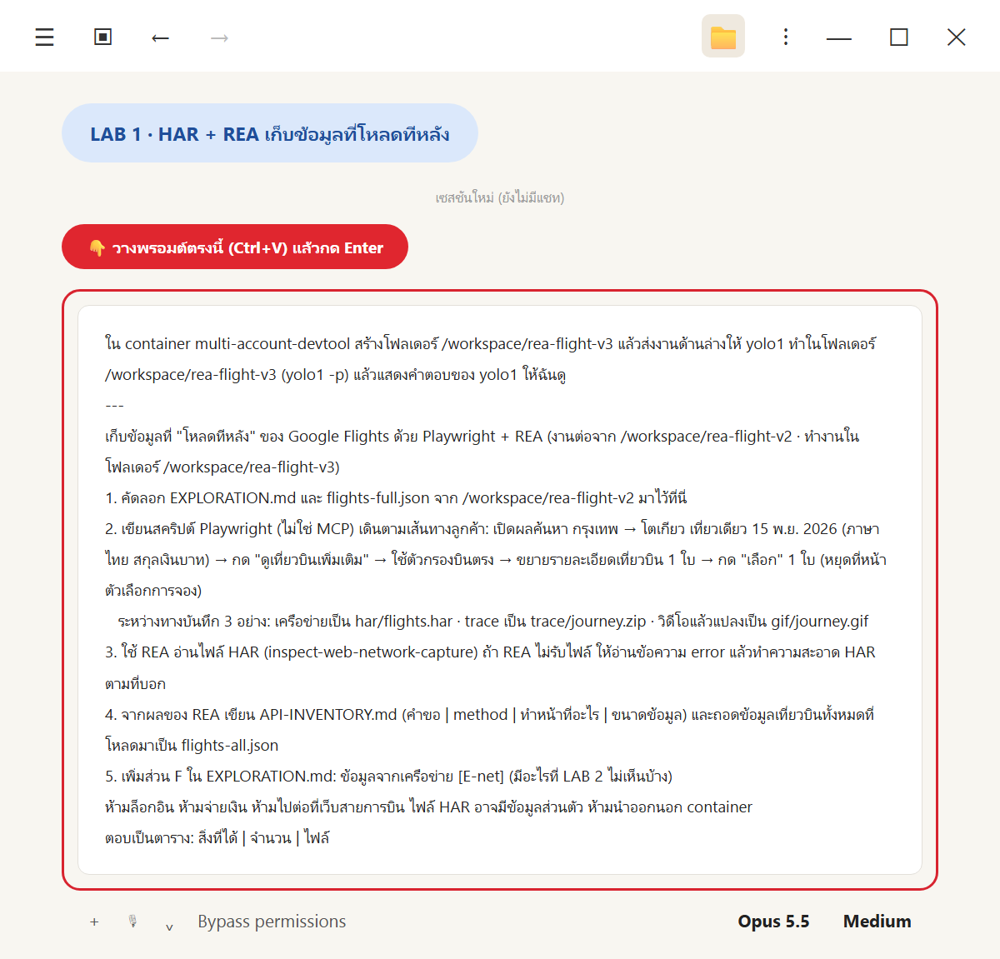
*วางพรอมต์ LAB 1*

💬 **คัดลอกพรอมต์นี้**

```text
ใน container multi-account-devtool สร้างโฟลเดอร์ /workspace/rea-flight-v3 แล้วส่งงานด้านล่างให้ yolo1 ทำในโฟลเดอร์ /workspace/rea-flight-v3 (yolo1 -p) แล้วแสดงคำตอบของ yolo1 ให้ฉันดู
---
เก็บข้อมูลที่ "โหลดทีหลัง" ของ Google Flights ด้วย Playwright + REA (งานต่อจาก /workspace/rea-flight-v2 · ทำงานในโฟลเดอร์ /workspace/rea-flight-v3)
1. คัดลอก EXPLORATION.md และ flights-full.json จาก /workspace/rea-flight-v2 มาไว้ที่นี่
2. เขียนสคริปต์ Playwright (ไม่ใช่ MCP) เดินตามเส้นทางลูกค้า: เปิดผลค้นหา กรุงเทพ → โตเกียว เที่ยวเดียว 15 พ.ย. 2026 (ภาษาไทย สกุลเงินบาท) → กด "ดูเที่ยวบินเพิ่มเติม" → ใช้ตัวกรองบินตรง → ขยายรายละเอียดเที่ยวบิน 1 ใบ → กด "เลือก" 1 ใบ (หยุดที่หน้าตัวเลือกการจอง)
   ระหว่างทางบันทึก 3 อย่าง: เครือข่ายเป็น har/flights.har · trace เป็น trace/journey.zip · วิดีโอแล้วแปลงเป็น gif/journey.gif
3. ใช้ REA อ่านไฟล์ HAR (inspect-web-network-capture) ถ้า REA ไม่รับไฟล์ ให้อ่านข้อความ error แล้วทำความสะอาด HAR ตามที่บอก
4. จากผลของ REA เขียน API-INVENTORY.md (คำขอ | method | ทำหน้าที่อะไร | ขนาดข้อมูล) และถอดข้อมูลเที่ยวบินทั้งหมดที่โหลดมาเป็น flights-all.json
5. เพิ่มส่วน F ใน EXPLORATION.md: ข้อมูลจากเครือข่าย [E-net] (มีอะไรที่ LAB 2 ไม่เห็นบ้าง)
ห้ามล็อกอิน ห้ามจ่ายเงิน ห้ามไปต่อที่เว็บสายการบิน ไฟล์ HAR อาจมีข้อมูลส่วนตัว ห้ามนำออกนอก container
ตอบเป็นตาราง: สิ่งที่ได้ | จำนวน | ไฟล์
```

✅ **ผลจริง** (yolo1 ใช้เวลา **≈14 นาที** · 23:55 → 00:09) เดินถึงหน้า "ตัวเลือกการจอง" ของ VZ 832 (฿8,432) แล้วหยุด ไม่ล็อกอิน ไม่จ่ายเงิน ไม่กด "ดำเนินการต่อ" ทุกคำขอไปที่โดเมนของ Google เท่านั้น

| สิ่งที่ได้ | จำนวน | ไฟล์ |
|---|---|---|
| ไฟล์จาก v2 ที่คัดลอกมา | 2 ไฟล์ | `EXPLORATION.md`, `flights-full.json` |
| สคริปต์ Playwright (ไม่ใช่ MCP) | 5 ขั้น (แถว 22 → 300 → บินตรง 18 → ขยาย 1 ใบ → เลือก 1 ใบ) | `scripts/journey.mjs`, `journey/*.png` |
| บันทึกเครือข่าย | 125 คำขอ (10.9 MB) | `har/flights.har` |
| HAR ที่ทำความสะอาดให้ REA อ่านได้ | แก้ 1 ช่อง | `har/flights.clean.har`, `scripts/clean_har.py` |
| trace | 1 ไฟล์ (42 MB) | `trace/journey.zip` |
| วิดีโอ และ GIF | GIF 110 เฟรม 800 px (5 MB) | `video/journey.webm`, `gif/journey.gif` |
| ผลจาก REA | อ่านครบ 125/125 records · 89 กลุ่ม endpoint | `rea/evidence-bundle.json`, `rea/api-surface.json` |
| API-INVENTORY | 4 คำขอที่มีข้อมูลเที่ยวบิน + 15 แถวสรุปคำขออื่น | `API-INVENTORY.md` |
| เที่ยวบินที่ถอดจากเครือข่าย | **300 ใบ · 711 ขา · ตัวเลือกการจอง 2 ราย** | `flights-all.json` |
| ส่วน F ใน EXPLORATION.md | 16 ข้อที่บทที่ 2 ไม่เห็น + ตอบคำถามส่วน E 4 ข้อ | `EXPLORATION.md` |

ไฟล์เต็ม: [`out-r1.md`](_solution/run/out-r1.md) · [`API-INVENTORY.md`](_solution/run/API-INVENTORY.md) · [`EXPLORATION.md`](_solution/run/EXPLORATION.md) (ส่วน F) · [`flights-all.json`](_solution/run/flights-all.json) · [`scripts/`](_solution/run/scripts/)

👀 **สังเกต**
- **REA ไม่รับ HAR ดิบ** → yolo1 อ่าน error แล้วแก้ตรงจุด (`|` → `%7C`) ในไฟล์ใหม่ ไม่แตะไฟล์ดิบ (T2 ขั้น 3)
- **HAR รอบแรกไม่มีข้อมูลเที่ยวบินเลย** เพราะ stream ถูก abort → แก้ด้วย CDP และ **บอกที่มาใน `_comment`** (ซื่อตรงเรื่องหลักฐาน)
- **ข้อมูลเครือข่ายยืนยันสิ่งที่บทที่ 2 อนุมานไว้:** 22 + 278 = 300 · ตัวกรองบินตรง = server ค้นใหม่ · ช่วงราคาหน้าจองคิดจากเที่ยวบินที่เลือก (ตอบคำถาม E5)
- **ราคาเปลี่ยนภายใน ~40 นาที** (VZ 832 ฿8,172 → ฿8,432) → ข้อมูลของคุณจะไม่ตรงกับตารางนี้ เป็นเรื่องปกติ
- **ยังไม่รู้ (ไม่เดา):** ค่าธรรมเนียม ฿81 คืออะไร · 300 ใบคือทั้งหมดจริงไหม (ขอบบนตัวกรองราคา ฿194,610 สูงกว่าราคาแพงสุดใน 300 ใบ ฿91,085)
- **เรื่องเวอร์ชัน:** ถ้าอัดวิดีโอไม่ได้เพราะหา ffmpeg ไม่เจอ ให้ AI ผูก Playwright กับเวอร์ชันที่ตรงกับ ffmpeg ใน container (รอบเราใช้ `1.64.0-alpha`)
- ไฟล์ `har/`, `trace/`, `video/`, `rea/` **อยู่ใน container เท่านั้น** ใน `_solution/` มีแค่ `gif/journey.gif` กับผลสรุป

---

## LAB 2 · กรรมการอิสระ (cyolo1) เขียนข้อสอบ แล้วตรวจ v2 เป็น baseline

🎯 ให้ `cyolo1` (Codex คนละค่ายกับผู้สร้าง) เขียน acceptance test จาก `EXPLORATION.md` โดยไม่เห็นโค้ดแอป แล้วรันกับ v2 เป็นจุดเริ่มต้น (ทฤษฎี: T5, T4)

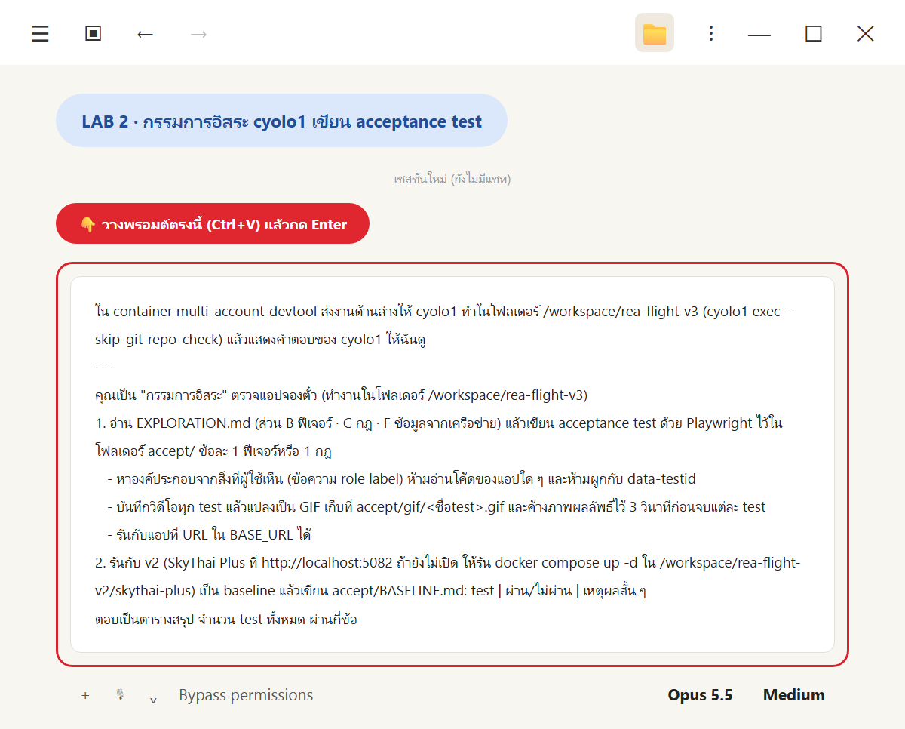
*วางพรอมต์ LAB 2*

💬 **คัดลอกพรอมต์นี้**

```text
ใน container multi-account-devtool ส่งงานด้านล่างให้ cyolo1 ทำในโฟลเดอร์ /workspace/rea-flight-v3 (cyolo1 exec --skip-git-repo-check) แล้วแสดงคำตอบของ cyolo1 ให้ฉันดู
---
คุณเป็น "กรรมการอิสระ" ตรวจแอปจองตั๋ว (ทำงานในโฟลเดอร์ /workspace/rea-flight-v3)
1. อ่าน EXPLORATION.md (ส่วน B ฟีเจอร์ · C กฎ · F ข้อมูลจากเครือข่าย) แล้วเขียน acceptance test ด้วย Playwright ไว้ในโฟลเดอร์ accept/ ข้อละ 1 ฟีเจอร์หรือ 1 กฎ
   - หาองค์ประกอบจากสิ่งที่ผู้ใช้เห็น (ข้อความ role label) ห้ามอ่านโค้ดของแอปใด ๆ และห้ามผูกกับ data-testid
   - บันทึกวิดีโอทุก test แล้วแปลงเป็น GIF เก็บที่ accept/gif/<ชื่อtest>.gif และค้างภาพผลลัพธ์ไว้ 3 วินาทีก่อนจบแต่ละ test
   - รันกับแอปที่ URL ใน BASE_URL ได้
2. รันกับ v2 (SkyThai Plus ที่ http://localhost:5082 ถ้ายังไม่เปิด ให้รัน docker compose up -d ใน /workspace/rea-flight-v2/skythai-plus) เป็น baseline แล้วเขียน accept/BASELINE.md: test | ผ่าน/ไม่ผ่าน | เหตุผลสั้น ๆ
ตอบเป็นตารางสรุป จำนวน test ทั้งหมด ผ่านกี่ข้อ
```

✅ **ผลจริง** (cyolo1 ใช้เวลา **9 นาที 48 วินาที** · 00:14:05 → 00:23:53) เขียน test ครบ **82 ข้อ** พร้อมวิดีโอ/GIF ทุกข้อ ค้างภาพท้าย 3 วินาที ไม่อ่านโค้ดแอป ไม่ใช้ `data-testid`

| หมวด | ทั้งหมด | ผ่าน | ไม่ผ่าน |
|---|---:|---:|---:|
| B ฟีเจอร์ | 35 | 23 | 12 |
| C กฎ | 31 | 24 | 7 |
| F ข้อมูลเครือข่าย | 16 | 4 | 12 |
| **รวม (baseline v2)** | **82** | **51 (62.2%)** | **31** |

ตัวอย่างเหตุผลที่ v2 ไม่ผ่าน (จาก `BASELINE.md`)

| test | เหตุผลสั้น ๆ |
|---|---|
| B01 ประเภทตั๋ว | ไม่พบข้อความตามเกณฑ์ /ไป-กลับ/ |
| B07 ปฏิทินสองเดือนพร้อมราคา | ไม่พบ "เริ่มที่ ฿… สำหรับเที่ยวเดียว" |
| B15 โหลดครบ 300 เที่ยวบิน | พบ 22 คาด 300 |
| B20 ตัวกรองเวลา 23-24 | คาด 35 พบ 5 |

ไฟล์ที่ได้ใน `accept/`: `suite.cjs` (82 ข้อ B01–B35, C01–C31, F01–F16) · `run.cjs` (ตัวรัน + แปลง GIF ด้วย ffmpeg) · `report.cjs` · `README.md` (วิธีรัน) · `BASELINE.md` · `results.json` · `evidence/` (accessibility snapshot ตอนจบแต่ละข้อ)

ไฟล์เต็ม: [`out-r2.md`](_solution/run/out-r2.md) · [`accept/BASELINE.md`](_solution/run/accept/BASELINE.md) · [`accept/README.md`](_solution/run/accept/README.md) · [`accept/suite.cjs`](_solution/run/accept/suite.cjs)

👀 **สังเกต**
- **ข้อสอบเข้มกว่าบทที่ 2 มาก:** v2 ตัวเดิมได้ 33/35 ในชุดเก่า แต่ 51/82 ในชุดนี้ (เหตุผลใน T5 ขั้น 4)
- cyolo1 เขียน **ข้อจำกัดของตัวเอง** ไว้ใน `accept/README.md` ว่า F08/F14/F16 ยืนยันผ่าน UI ไม่ได้ และราคาตัวอย่างมาจากคนละ snapshot → กรรมการที่ดีบอกจุดอ่อนของข้อสอบตัวเอง
- **ทุกข้อเตรียมหน้าด้วยการกรอกฟอร์มที่ผู้ใช้เห็น** (กรุงเทพมหานคร → เมืองโตเกียว · 15 พ.ย. 2026) → ข้อดี: ตรวจเหมือนคนใช้จริง · ข้อเสีย: ถ้าขั้นเตรียมพัง ทุกข้อพัง (จะเห็นใน LAB 4 กับ v1)
- ตัวรันใช้ context ใหม่ทุก test · viewport 1366×900 · ภาษา/เขตเวลาไทย · ทำพร้อมกัน 3 test · **ไม่มี retry**
- GIF ของ baseline อยู่ใน container (`/workspace/rea-flight-v3/accept/gif/`) ส่วนใน repo เก็บ GIF ตัวอย่างไว้ใน `results/` (ดู LAB 4)

---

## LAB 3 · วงจรปิด: yolo1 สร้าง SkyThai Pro (v3) จนผ่านเกณฑ์

🎯 ให้ yolo1 ต่อยอดจาก v2 ด้วยข้อมูล 300 ใบและส่วน F แล้ววน สร้าง → ทดสอบด้วยข้อสอบของกรรมการ → อ่านผลที่แดง + GIF → แก้ จนผ่าน ≥90% หรือครบ 3 รอบ (ทฤษฎี: T6)

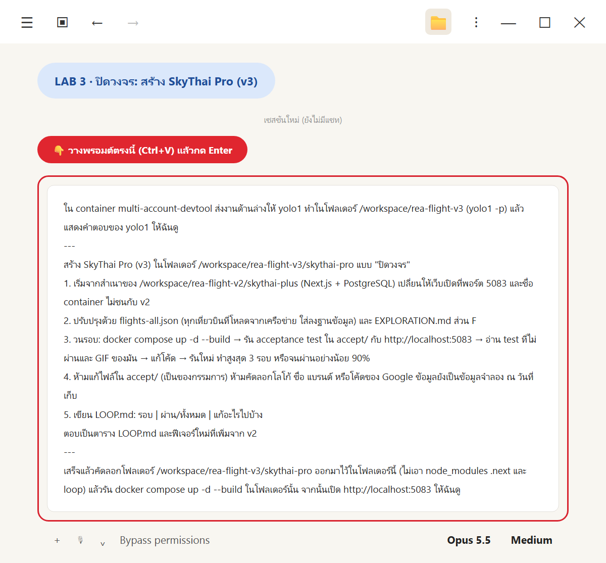
*วางพรอมต์ LAB 3*

💬 **คัดลอกพรอมต์นี้**

```text
ใน container multi-account-devtool ส่งงานด้านล่างให้ yolo1 ทำในโฟลเดอร์ /workspace/rea-flight-v3 (yolo1 -p) แล้วแสดงคำตอบของ yolo1 ให้ฉันดู
---
สร้าง SkyThai Pro (v3) ในโฟลเดอร์ /workspace/rea-flight-v3/skythai-pro แบบ "ปิดวงจร"
1. เริ่มจากสำเนาของ /workspace/rea-flight-v2/skythai-plus (Next.js + PostgreSQL) เปลี่ยนให้เว็บเปิดที่พอร์ต 5083 และชื่อ container ไม่ชนกับ v2
2. ปรับปรุงด้วย flights-all.json (ทุกเที่ยวบินที่โหลดจากเครือข่าย ใส่ลงฐานข้อมูล) และ EXPLORATION.md ส่วน F
3. วนรอบ: docker compose up -d --build → รัน acceptance test ใน accept/ กับ http://localhost:5083 → อ่าน test ที่ไม่ผ่านและ GIF ของมัน → แก้โค้ด → รันใหม่ ทำสูงสุด 3 รอบ หรือจนผ่านอย่างน้อย 90%
4. ห้ามแก้ไฟล์ใน accept/ (เป็นของกรรมการ) ห้ามคัดลอกโลโก้ ชื่อ แบรนด์ หรือโค้ดของ Google ข้อมูลยังเป็นข้อมูลจำลอง ณ วันที่เก็บ
5. เขียน LOOP.md: รอบ | ผ่าน/ทั้งหมด | แก้อะไรไปบ้าง
ตอบเป็นตาราง LOOP.md และฟีเจอร์ใหม่ที่เพิ่มจาก v2
---
เสร็จแล้วคัดลอกโฟลเดอร์ /workspace/rea-flight-v3/skythai-pro ออกมาไว้ในโฟลเดอร์นี้ (ไม่เอา node_modules .next และ loop) แล้วรัน docker compose up -d --build ในโฟลเดอร์นั้น จากนั้นเปิด http://localhost:5083 ให้ฉันดู
```

(บรรทัดสุดท้ายเป็นงานของ Claude Code Desktop: คัดลอกออกจาก container ด้วย `docker cp` แล้วรัน `docker compose up -d --build` บน Windows)

✅ **ผลจริง** (yolo1 ใช้เวลา **16 นาที 50 วินาที** · 00:24:07 → 00:40:57) วน 2 รอบก็ผ่าน **74/82 (90.2%)** ถึงเกณฑ์จึงหยุด · container ชื่อ `skythai-pro-web-1` / `skythai-pro-db-1` ไม่ชนกับ v2

**LOOP.md**

| รอบ | ผ่าน/ทั้งหมด | แก้อะไรไปบ้าง |
|---|---|---|
| baseline v2 (`:5082`) | 51/82 (62.2%) | ผลจาก `accept/BASELINE.md` ไว้เทียบ |
| 1 | 73/82 (89.0%) | พอร์ต 5083 · ใส่ `flights-all.json` ครบ 300 ใบ + ตารางใหม่ 5 ตาราง · เพิ่มฟีเจอร์ตามส่วน F (ตารางถัดไป) |
| 2 | **74/82 (90.2%)** | ดูภาพหน้าจอและ snapshot ของ C29 พบว่ากด Escape แล้วป๊อปอัปยังค้างบังปุ่ม "ค้นหาเที่ยวบิน" → แก้ให้ Escape ปิดป๊อปอัป |

**ฟีเจอร์ใหม่จาก v2 (ย่อ)**

| ฟีเจอร์ | อ้างอิง |
|---|---|
| ข้อมูลครบ 300 ใบ + ตาราง `search_steps`, `flight_appearances`, `snapshot_airlines`, `booking_options`, `booking_insights` | F1 |
| ผลแรก 22 ใบตามลำดับเดิม · "ดูเที่ยวบินเพิ่มเติม" โหลด 300 ใบครั้งเดียวไม่แบ่งหน้า | F2, F3 |
| ตัวกรองค้นจากทั้ง 300 ใบ · กรองบินตรงใช้ลำดับของการค้นหาแบบบินตรง | F4 |
| ช่วงราคาปกติตามคำค้น: ทั้งหมด ฿4,950–7,200 / บินตรง ฿6,400–8,900 / หน้าจอง ฿8,100–11,500 | F7 |
| หน้าจองมีผู้ขาย 2 ราย: ไทยเวียดเจ๊ทแอร์ (ค่าธรรมเนียม ฿81) และ Gotogate ฿9,107 · ปุ่ม "ดำเนินการต่อ" พาไปจองจำลองในเว็บเรา ไม่ส่งต่อผู้ขายจริง | F9 |
| ป้ายเตือน "เปลี่ยนสนามบิน KIX→ITM / TPE→TSA / ICN→GMP" 23 ใบ | F10 |
| ตัวกรองจากข้อมูลชุดเต็ม: สายการบิน 64 + พันธมิตร 3 · สนามบินต่อเครื่อง 33 แห่ง | F15 |
| ปฏิทินพร้อมราคาประมาณ · กราฟราคา · Tokyo Station ในรายการแนะนำ · ส่วน "สำรวจดีลด้วย AI" (เขียนบอกชัดว่าใช้กฎง่าย ๆ ไม่ได้เรียกโมเดล AI จริง) | B7, B30, B4, B34 |

บน Windows (Docker Desktop) `docker compose up -d --build` ในโฟลเดอร์ `skythai-pro/` ใช้เวลา **31 วินาที** แล้วเปิด http://localhost:5083 ได้


*หน้าแรกจริงที่ http://localhost:5083 · NRT 166 + HND 134 = 300 เที่ยวบินจากข้อมูลเครือข่าย*

ไฟล์เต็ม: [`out-r3.md`](_solution/run/out-r3.md) · [`loop/r1/REPORT.md`](_solution/run/loop/r1/REPORT.md) · [`loop/r2/REPORT.md`](_solution/run/loop/r2/REPORT.md) · [`skythai-pro/LOOP.md`](_solution/skythai-pro/LOOP.md) · โค้ดแอป [`_solution/skythai-pro/`](_solution/skythai-pro/)

👀 **สังเกต**
- **กระโดดใหญ่เกิดก่อนรอบ 1** (51 → 73) เพราะข้อมูล 300 ใบ + ส่วน F · รอบ 2 ได้เพิ่มแค่ 1 ข้อ แต่เป็นบั๊กจริงที่เห็นจาก **ภาพ** ไม่ใช่จากข้อความ error
- **yolo1 ไม่แก้ `accept/`** และรันจากสำเนาที่เหมือนต้นฉบับทุกไบต์ใน `loop/r1`, `loop/r2` เพื่อไม่ให้ GIF/รายงาน baseline ถูกเขียนทับ
- **8 ข้อที่เหลือ yolo1 ปฏิเสธที่จะปลอมข้อมูล** (F08/F14/F16 ตั้งไว้ให้ตก · F05 เกณฑ์รวม 299 · B20/C13 คาด 35 มีจริง 33 · B22 คาด 76 มีจริง 77 · C31 เจอ 23:45 สองแถว) และสรุปว่า "74/82 คือเพดานของข้อมูลชุดนี้"
- **แอปยังซื่อตรง:** ไม่มีโลโก้/ชื่อ/โค้ดของ Google ใน `src/` · ทุกหน้ามีป้ายข้อมูลจำลอง ณ 1 พ.ย. 2026 00:03 น. · ปุ่ม "ดำเนินการต่อ" ไม่ส่งไปผู้ขายจริง
- ค่าเริ่มต้นของฟอร์มเป็น **ไป-กลับ** (ตาม Google ในส่วน B1) แต่ข้อมูลจำลองมีแค่ขาไปกรุงเทพ → โตเกียว แอปจึงเขียนบอกไว้บนฟอร์ม

---

## LAB 4 · ตารางคะแนนสุดท้าย + Visual diff

🎯 ให้ `cyolo1` รันข้อสอบ 82 ข้อชุดเดิมกับ v1, v2, v3 (ห้ามแก้ test) แล้วเทียบหน้าผลค้นหากับต้นฉบับด้วย pixelmatch (ทฤษฎี: T7, T8)

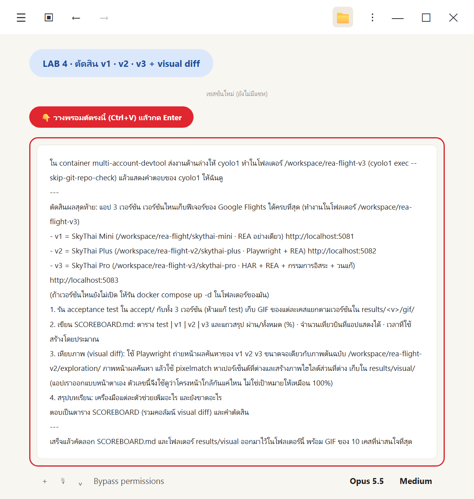
*วางพรอมต์ LAB 4*

💬 **คัดลอกพรอมต์นี้**

```text
ใน container multi-account-devtool ส่งงานด้านล่างให้ cyolo1 ทำในโฟลเดอร์ /workspace/rea-flight-v3 (cyolo1 exec --skip-git-repo-check) แล้วแสดงคำตอบของ cyolo1 ให้ฉันดู
---
ตัดสินผลสุดท้าย: แอป 3 เวอร์ชัน เวอร์ชันไหนเก็บฟีเจอร์ของ Google Flights ได้ครบที่สุด (ทำงานในโฟลเดอร์ /workspace/rea-flight-v3)
- v1 = SkyThai Mini (/workspace/rea-flight/skythai-mini · REA อย่างเดียว) http://localhost:5081
- v2 = SkyThai Plus (/workspace/rea-flight-v2/skythai-plus · Playwright + REA) http://localhost:5082
- v3 = SkyThai Pro (/workspace/rea-flight-v3/skythai-pro · HAR + REA + กรรมการอิสระ + วนแก้) http://localhost:5083
(ถ้าเวอร์ชันไหนยังไม่เปิด ให้รัน docker compose up -d ในโฟลเดอร์ของมัน)
1. รัน acceptance test ใน accept/ กับทั้ง 3 เวอร์ชัน (ห้ามแก้ test) เก็บ GIF ของแต่ละเคสแยกตามเวอร์ชันใน results/<v>/gif/
2. เขียน SCOREBOARD.md: ตาราง test | v1 | v2 | v3 และแถวสรุป ผ่าน/ทั้งหมด (%) · จำนวนเที่ยวบินที่แอปแสดงได้ · เวลาที่ใช้สร้างโดยประมาณ
3. เทียบภาพ (visual diff): ใช้ Playwright ถ่ายหน้าผลค้นหาของ v1 v2 v3 ขนาดจอเดียวกับภาพต้นฉบับ /workspace/rea-flight-v2/exploration/ ภาพหน้าผลค้นหา แล้วใช้ pixelmatch หาเปอร์เซ็นต์ที่ต่างและสร้างภาพไฮไลต์ส่วนที่ต่าง เก็บใน results/visual/ (แอปเราออกแบบหน้าตาเอง ตัวเลขนี้จึงใช้ดูว่าโครงหน้าใกล้กันแค่ไหน ไม่ใช่เป้าหมายให้เหมือน 100%)
4. สรุปบทเรียน: เครื่องมือแต่ละตัวช่วยเพิ่มอะไร และยังขาดอะไร
ตอบเป็นตาราง SCOREBOARD (รวมคอลัมน์ visual diff) และคำตัดสิน
---
เสร็จแล้วคัดลอก SCOREBOARD.md และโฟลเดอร์ results/visual ออกมาไว้ในโฟลเดอร์นี้ พร้อม GIF ของ 10 เคสที่น่าสนใจที่สุด
```

✅ **ผลจริง** (cyolo1 ใช้เวลา **4 นาที 51 วินาที** · 00:41:16 → 00:46:07) รันครบ 82 × 3 = 246 test เก็บ GIF ครบ 246 ไฟล์ใน container · ตรวจ SHA-256 ของ `run.cjs`, `suite.cjs`, `report.cjs` ตรงกับ `accept/` ทุกเวอร์ชัน

| SCOREBOARD | ผ่าน/ทั้งหมด | เที่ยวบินแรก → โหลดครบ | Visual diff ↓ |
|---|---:|---:|---:|
| v1 SkyThai Mini | 0/82 (0.0%) | 22 → 22 | 27.88% |
| v2 SkyThai Plus | 51/82 (62.2%) | 10 → 22 | 8.19% |
| **v3 SkyThai Pro** | **74/82 (90.2%)** | **22 → 300** | 8.32% |

**คำตัดสินของ cyolo1:** v3 เก็บฟีเจอร์ได้ครบที่สุด โดยเฉพาะข้อมูล 300 เที่ยวบิน ตัวกรอง และรายละเอียดหน้าจอง · v2 มี visual diff ต่ำสุดเล็กน้อย ซึ่งไม่ได้หมายถึงฟีเจอร์ครบกว่า

**GIF เทียบ 10 เคส × 3 เวอร์ชัน** (คลิกเพื่อดู GIF จริง)

| test | v1 | v2 | v3 |
|---|---|---|---|
| B02 ผู้โดยสาร | [❌](_solution/run/results/v1/gif/B02.gif) | [✅](_solution/run/results/v2/gif/B02.gif) | [✅](_solution/run/results/v3/gif/B02.gif) |
| B15 โหลดครบ 300 เที่ยวบิน | [❌](_solution/run/results/v1/gif/B15.gif) | [❌](_solution/run/results/v2/gif/B15.gif) | [✅](_solution/run/results/v3/gif/B15.gif) |
| B17 ตัวกรองการบินไทยเท่านั้น | [❌](_solution/run/results/v1/gif/B17.gif) | [✅](_solution/run/results/v2/gif/B17.gif) | [✅](_solution/run/results/v3/gif/B17.gif) |
| B20 ตัวกรองเวลา 23-24 | [❌](_solution/run/results/v1/gif/B20.gif) | [❌](_solution/run/results/v2/gif/B20.gif) | [❌](_solution/run/results/v3/gif/B20.gif) |
| B30 กราฟราคา | [❌](_solution/run/results/v1/gif/B30.gif) | [❌](_solution/run/results/v2/gif/B30.gif) | [✅](_solution/run/results/v3/gif/B30.gif) |
| B32 สรุปการเดินทางและผู้ขาย | [❌](_solution/run/results/v1/gif/B32.gif) | [❌](_solution/run/results/v2/gif/B32.gif) | [✅](_solution/run/results/v3/gif/B32.gif) |
| C02 ทารกบนตักไม่เกินผู้ใหญ่ | [❌](_solution/run/results/v1/gif/C02.gif) | [✅](_solution/run/results/v2/gif/C02.gif) | [✅](_solution/run/results/v3/gif/C02.gif) |
| C23 ราคาผู้ขายต่างกันและมีค่าธรรมเนียม | [❌](_solution/run/results/v1/gif/C23.gif) | [❌](_solution/run/results/v2/gif/C23.gif) | [✅](_solution/run/results/v3/gif/C23.gif) |
| F02 โหลดทั้งหมดครั้งเดียวไม่มีหน้าถัดไป | [❌](_solution/run/results/v1/gif/F02.gif) | [❌](_solution/run/results/v2/gif/F02.gif) | [✅](_solution/run/results/v3/gif/F02.gif) |
| F10 แสดงการเปลี่ยนสนามบินต่อเครื่อง | [❌](_solution/run/results/v1/gif/F10.gif) | [❌](_solution/run/results/v2/gif/F10.gif) | [✅](_solution/run/results/v3/gif/F10.gif) |


*v3 · B15 ✅ กด "ดูเที่ยวบินเพิ่มเติม" แล้วได้ครบ 300 แถว ปุ่มหายไป (v2 ได้แค่ 22)*

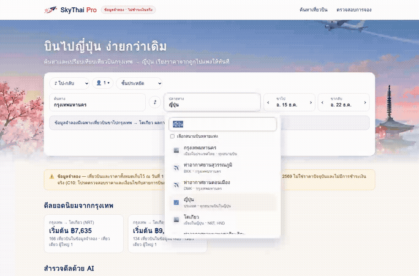
*v3 · C23 ✅ หน้าจองมีผู้ขาย 2 ราย (รวม Gotogate) ราคาต่างกัน และมีค่าธรรมเนียม ฿81 — ข้อมูลนี้มาจาก `GetBookingResults` ใน HAR*


*v1 · B02 ❌ ตัวอย่าง **coupled setup**: ขั้นเตรียมหน้ารอปุ่มผู้โดยสารที่ v1 ไม่มี → ทุกข้อล้มก่อนตรวจจริง*

**Visual diff:** ภาพต้นฉบับ ภาพแต่ละเวอร์ชัน และภาพไฮไลต์ อยู่ใน T7 ขั้น 2 และ [`results/visual/`](_solution/run/results/visual/)

ไฟล์เต็ม: [`out-r4.md`](_solution/run/out-r4.md) · [`SCOREBOARD.md`](_solution/run/SCOREBOARD.md) · [`results/visual/README.md`](_solution/run/results/visual/README.md) · [`metrics.json`](_solution/run/results/visual/metrics.json) · [`results/verification.json`](_solution/run/results/verification.json)

👀 **สังเกต**
- **v1 = 0/82 ไม่ได้แปลว่าไม่มีฟีเจอร์:** cyolo1 เขียนเองว่าห้ามนำ 0/82 ไปเทียบตรง ๆ กับ 4/35 ของบทที่ 2 ที่ใช้คนละเกณฑ์
- **B20 ตกทั้ง 3 เวอร์ชัน** เพราะเกณฑ์ (35 ใบ) มาจาก snapshot คนละรอบ ไม่ใช่เพราะตัวกรองเวลาเสีย → อ่านเหตุผลก่อนสรุปว่าแอปผิดเสมอ
- **C31 ผ่านใน v2 แต่ตกใน v3:** v3 มีข้อมูลมากขึ้นจนเจอเที่ยวบิน 23:45 สองแถว → ข้อมูลครบขึ้นทำให้ locator ที่ไม่เจาะจงพัง (ไม่ได้พิสูจน์ว่าการแสดง +1 ผิด)
- **"เวลาสร้างโดยประมาณ" ใน SCOREBOARD.md** (≈6 / ≈14 / ≈42 นาที) คำนวณจาก timestamp ของไฟล์ รวมเวลารอ และ v3 นับรวมช่วงก่อนเริ่ม LAB 3 จึงยาวกว่าเวลาจริงของ LAB 3 (16 นาที 50 วินาที) → ใช้ดูคร่าว ๆ เท่านั้น
- ใน repo เก็บ GIF แค่ **10 เคส × 3 = 30 ไฟล์** ส่วน 246 ไฟล์ครบอยู่ใน container

---

## ✅ รูบริก: เช็กลิสต์ก่อนส่งงาน

- [ ] อธิบายได้ว่าบทที่ 2 ขาดอะไร 3 ข้อ และเครื่องมือไหนอุดข้อไหน
- [ ] อธิบายโครงสร้าง HAR (`log.entries[]` → request / response / timings / content) และชี้ได้ว่าคำขอไหนทำให้ 22 → 300
- [ ] บอกได้ว่าทำไม HAR / trace / วิดีโอห้าม commit และในงานของตัวเองไฟล์เหล่านี้อยู่ที่ไหน
- [ ] มี `API-INVENTORY.md`, `flights-all.json` และ `EXPLORATION.md` ส่วน F ใน `/workspace/rea-flight-v3` (LAB 1)
- [ ] เปิด trace ด้วย `npx playwright show-trace` หรือดู `journey.gif` แล้วชี้ได้ว่าแต่ละขั้นเกิดอะไร
- [ ] อธิบายได้ว่าทำไมกรรมการต้องเป็นคนละโมเดล ไม่อ่านโค้ด และไม่ใช้ `data-testid`
- [ ] มี `accept/` ที่รันได้ด้วย `BASE_URL=… node accept/run.cjs` และ `BASELINE.md` ของ v2 (LAB 2)
- [ ] มี `LOOP.md` ที่ระบุผลแต่ละรอบ และ `accept/` ไม่ถูกแก้ (LAB 3)
- [ ] `docker compose up -d --build` ใน `skythai-pro/` แล้ว http://localhost:5083 เปิดได้ กด "ดูเที่ยวบินเพิ่มเติม" แล้วได้ 300 เที่ยวบิน และมีป้ายข้อมูลจำลอง
- [ ] มี `SCOREBOARD.md` ที่ใช้ข้อสอบชุดเดียวกันทั้ง 3 เวอร์ชัน + visual diff (LAB 4)
- [ ] ชี้ได้อย่างน้อย 1 ข้อที่ "กรรมการผิด" และอธิบายได้ว่าทำไมไม่ควรแก้แอปให้ตรงข้อสอบข้อนั้น
- [ ] อธิบายได้ว่า visual diff วัดอะไร และไม่วัดอะไร

---

## 🔁 รันซ้ำ / ปิดงาน

**ปิด SkyThai Pro บน Windows** (ในโฟลเดอร์ `skythai-pro/` หรือ `_solution/skythai-pro/`)

```powershell
docker compose down        # ล้างฐานข้อมูลด้วย: docker compose down -v
```

**อยากรันซ้ำ**
1. บทนี้ไม่ต้องใช้ Chrome :9222 และไม่ต้องติดตั้ง REA ใหม่ (ยกเว้นสร้าง container ใหม่แล้วไฟล์ shared หาย)
2. ถ้าอยากเริ่มสะอาด ให้ Claude Code ย้ายโฟลเดอร์เดิมไปเป็น `/workspace/rea-flight-v3-old` ก่อน แล้วค่อยทำ LAB 1–4
3. **ผลรอบใหม่จะต่างจากตารางในบทนี้** (ราคา จำนวนเที่ยวบิน ตัวเลขที่ข้อสอบคาด) เพราะ Google เปลี่ยนตามเวลา → เทียบ "รูปแบบ" ไม่ใช่ตัวเลข
4. **ไฟล์อ่อนไหวใน container:** ถ้าไม่ใช้แล้ว ให้ขอ Claude Code ย้าย `har/`, `trace/`, `video/`, `rea/` ใน `/workspace/rea-flight-v3` ออกไปเก็บที่อื่นหรือลบ **ด้วยตัวเองหลังตรวจรายการไฟล์** อย่าคัดลอกออกมาที่ Windows

---

## ถ้าเจอปัญหา: คัดลอกพรอมต์นี้

```text
LAB บทที่ 3 (REA Toolchain Loop) ใน container multi-account-devtool มีปัญหา ช่วยตรวจทีละข้อแบบอ่านอย่างเดียวก่อน แล้วบอกฉันว่าจะแก้อย่างไร ห้ามลบไฟล์ใน /workspace/rea-flight-v3 ห้ามแก้ไฟล์ใน accept/ และห้ามนำไฟล์ใน har/ trace/ video/ ออกนอก container
1. container multi-account-devtool รันอยู่ไหม และ yolo1 cyolo1 ล็อกอินอยู่ไหม
2. ใน /workspace/rea-flight-v3 มีไฟล์ใดบ้าง: EXPLORATION.md (มีส่วน F ไหม), API-INVENTORY.md, flights-all.json (กี่เที่ยวบิน), accept/, skythai-pro/
3. Playwright ในโฟลเดอร์นี้เวอร์ชันอะไร และหา ffmpeg สำหรับอัดวิดีโอเจอไหม
4. curl http://localhost:5081/api/health, :5082/api/health และ :5083/api/health ใน container ตอบอะไร และ docker compose ps ของแต่ละแอปเป็นอย่างไร
5. ถ้ามี error จาก REA ตอนอ่าน HAR ให้แสดงข้อความ error เต็ม ๆ
สรุปเป็นตาราง ข้อ | ผล | วิธีแก้ที่แนะนำ แล้วรอให้ฉันยืนยันก่อนแก้
```

| อาการ | สาเหตุที่พบบ่อย | วิธีแก้ |
|---|---|---|
| REA ไม่รับ HAR (`must match format "uri"`) | URL ในไฟล์มีอักขระที่ไม่ได้ encode เช่น `\|` | อ่าน entry ที่ error ชี้ แล้ว encode เขียนเป็นไฟล์ใหม่ (`clean_har.py`) ไม่แก้ไฟล์ดิบ |
| HAR ไม่มีข้อมูลเที่ยวบิน (`net::ERR_ABORTED`) | คำตอบเป็น stream ที่หน้าเว็บ abort เอง | เก็บ body ผ่าน CDP `Network.streamResourceContent` และบอกที่มาใน `_comment` |
| ผลจาก REA ใหญ่เกินส่งกลับในครั้งเดียว | HAR 125 คำขอ ~10 MB | ให้ REA ส่งออกเป็นไฟล์ (`rea/evidence-bundle.json`) แล้วถอดจากไฟล์ |
| อัดวิดีโอ/GIF ไม่ได้ | Playwright เวอร์ชันใหม่หา ffmpeg ใน container ไม่เจอ | ผูก Playwright กับเวอร์ชันที่ตรงกับ ffmpeg ที่มี (รอบเรา `1.64.0-alpha`) |
| เจอ CAPTCHA / หน้าบล็อกตอนเดินเส้นทาง | ยิงถี่หรือถูกตรวจจับ | **หยุด** ห้ามหลบ รอแล้วลองใหม่ภายหลัง หรือใช้ผลใน `_solution/` |
| ทุก test ล้มที่ขั้นเตรียมหน้า | แอปไม่มีองค์ประกอบที่ setup ต้องใช้ (coupled setup) เช่น v1 ไม่มีปุ่มผู้โดยสาร | เป็นข้อจำกัดของข้อสอบ ไม่ใช่ทุกฟีเจอร์เสีย · รายงานตามจริง ไม่แก้ test ระหว่างรอบตัดสิน |
| ข้อสอบคาดตัวเลขไม่ตรงข้อมูล (เช่น 35 vs 33) | เกณฑ์มาจาก snapshot คนละรอบ | อย่าปลอมข้อมูลให้ตรง · บันทึกเป็นข้อจำกัดของ oracle |
| http://localhost:5083 ไม่ขึ้น | build ยังไม่เสร็จ / `db` ยังไม่ healthy / พอร์ตชน | ดู `docker compose ps` และ `docker compose logs web` · ใช้ `ss -ltnp` ใน container ดูว่าใครใช้พอร์ตก่อนเปลี่ยน |
| container ชื่อชนกับ v2 | คัดลอกจาก v2 แล้วไม่ได้เปลี่ยนชื่อโปรเจกต์ compose | ตั้ง `name: skythai-pro` ใน `docker-compose.yml` |
| pixelmatch error เรื่องขนาดภาพ | ภาพ 2 ภาพไม่เท่ากัน | ถ่ายด้วย viewport เดียวกับต้นฉบับ (1366×900) และถ่ายเฉพาะจอแรก ไม่ใช่ full page |

---

## 📖 คำศัพท์

| คำ | ความหมายแบบง่าย |
|---|---|
| **HAR (HTTP Archive)** | ไฟล์ JSON ที่บันทึกทุกคำขอ/คำตอบเครือข่ายของหน้าเว็บ (`log.entries[]`) |
| **Request / Response** | สิ่งที่เบราว์เซอร์ขอ / สิ่งที่ server ตอบกลับ |
| **Timings** | เวลาที่ใช้ในแต่ละช่วงของคำขอ (DNS, connect, wait, receive) |
| **`recordHar`** | ตัวเลือกของ Playwright ให้อัด HAR ของทั้ง browser context |
| **`inspect_web_network_capture`** | เครื่องมือของ REA ที่อ่าน HAR แล้วสรุปเป็น API surface พร้อมหลักฐาน |
| **API surface / API inventory** | รายการคำขอที่แอปใช้ จัดกลุ่มว่าไปที่ไหน ทำอะไร ขนาดเท่าไร |
| **Stream / abort** | คำตอบที่ทยอยส่งมาเป็นก้อน / การยกเลิกคำขอกลางทาง |
| **Playwright script / test runner** | โค้ดที่สั่ง Playwright ตามเส้นทางที่เขียนไว้ รันซ้ำได้เหมือนเดิม |
| **Playwright MCP** | ให้ AI สั่ง Playwright ทีละขั้นแบบโต้ตอบ เหมาะกับการสำรวจ |
| **Trace** | บันทึกละเอียดของการทดสอบ (คำสั่ง + ภาพ + DOM + network + console) เปิดด้วย `show-trace` |
| **Acceptance test** | เทสต์ที่ตรวจว่าระบบทำสิ่งที่ผู้ใช้ต้องการได้ มองจากสายตาผู้ใช้ |
| **Test oracle** | แหล่งความจริงที่บอกว่าผลที่ถูกคืออะไร (ในบทนี้ = `EXPLORATION.md`) |
| **Self-grading bias** | ความลำเอียงเมื่อผู้สร้างเป็นผู้ตรวจงานตัวเอง |
| **Independent judge** | ผู้ตัดสินที่แยกจากผู้สร้าง (คนละบัญชี คนละโมเดล ไม่เห็นโค้ด) |
| **Baseline** | ผลวัดจุดเริ่มต้นไว้เทียบ (v2 = 51/82) |
| **Closed loop / feedback loop** | วงจรที่ผลวัดถูกป้อนกลับมาปรับรอบถัดไป |
| **Stopping rule** | กฎว่าจะหยุดวนเมื่อไร (≥90% หรือ 3 รอบ) |
| **Coupled setup** | ขั้นเตรียมที่ทุก test ใช้ร่วมกัน ถ้าพังทุกข้อพังพร้อมกัน |
| **Snapshot drift** | ข้อมูลเปลี่ยนไประหว่างการเก็บแต่ละรอบ ทำให้ตัวเลขไม่ตรงกัน |
| **Visual diff / pixelmatch** | เทียบภาพ 2 ภาพทีละพิกเซล / ไลบรารี JavaScript ที่ใช้ทำ |
| **Threshold (pixelmatch)** | ความต่างของสีขั้นต่ำที่นับว่า "ต่าง" (0–1 · เราใช้ 0.1) |
| **Anti-aliasing (`includeAA`)** | ขอบเบลอของตัวอักษร/เส้น · `false` = ไม่นับเป็นความต่าง |
| **Visual regression** | การใช้ visual diff ตรวจว่าหน้าตาเปลี่ยนโดยไม่ตั้งใจหรือไม่ |
| **`BASE_URL`** | ตัวแปรที่บอกตัวรันเทสต์ว่าจะทดสอบแอปที่ URL ไหน |

---

## 🔒 เฉลย (`_solution/`)

| ส่วน | มีอะไร | ใช้ทำอะไร |
|---|---|---|
| [`_solution/run/`](_solution/run/) | `r1.txt`–`r4.txt` (พรอมต์ชั้นใน) · `out-r1.md`–`out-r4.md` (คำตอบจริง) · `API-INVENTORY.md` · `EXPLORATION.md` (มีส่วน F) · `flights-all.json` (300 ใบ) · `gif/journey.gif` | เทียบผลของเรากับรอบจริง |
| [`_solution/run/scripts/`](_solution/run/scripts/) | `journey.mjs` (เดินเส้นทาง + อัด HAR/trace/วิดีโอ) · `clean_har.py` · `extract_flights.py` · `inventory.py` · `rea_records.py` · `webm2gif.py` | ดูโค้ดจริงของ LAB 1 |
| [`_solution/run/accept/`](_solution/run/accept/) | ชุดข้อสอบของกรรมการ: `suite.cjs` (82 ข้อ) · `run.cjs` · `report.cjs` · `README.md` · `BASELINE.md` · `results.json` · `evidence/` | รันกับแอปใดก็ได้ด้วย `BASE_URL` |
| [`_solution/run/loop/`](_solution/run/loop/) | `r1/`, `r2/` → `REPORT.md` + `results.json` ของแต่ละรอบ | ดูว่าแต่ละรอบผ่าน/ตกข้อไหน |
| [`_solution/run/results/`](_solution/run/results/) | `v1/`, `v2/`, `v3/` (`results.json` + GIF 10 เคส = 30 ไฟล์) · `visual/` (reference, v1–v3, ภาพ diff, `metrics.json`, `compare.cjs`) · `scoreboard.cjs` · `verification.json` (SHA-256 ของตัวรัน) | ตารางคะแนนและ visual diff |
| [`_solution/run/SCOREBOARD.md`](_solution/run/SCOREBOARD.md) | ตารางรายข้อ 82 × 3 + ข้อจำกัด + บทเรียน + คำตัดสิน | ผลสรุปสุดท้าย |
| [`_solution/skythai-pro/`](_solution/skythai-pro/) | SkyThai Pro ฉบับเฉลย (Next.js + PostgreSQL · `docker-compose.yml` ชื่อโปรเจกต์ `skythai-pro` · `web` พอร์ต 5083 + `db` `postgres:16-alpine`) · `LOOP.md` · `README.md` | เปิด v3 ฉบับเฉลยได้ทันที |

> ⚠️ **ไม่มีใน repo โดยตั้งใจ:** `har/` (HAR ดิบและที่ทำความสะอาดแล้ว) · `trace/journey.zip` (42 MB) · `video/` · `rea/` (evidence bundle) · GIF ครบ 246 ไฟล์ · GIF ของ baseline ใน `accept/gif/` → เพราะมี **cookie/token/ร่องรอยการใช้งาน** และ **ขนาดใหญ่** ลิงก์ GIF ภายใน `BASELINE.md` และ `loop/*/REPORT.md` จึงชี้ไปไฟล์ที่อยู่ใน container เท่านั้น

**เปิด SkyThai Pro ฉบับเฉลย** (สั่ง Claude Code หรือรันเองใน PowerShell ที่โฟลเดอร์ `_solution/skythai-pro`)

```powershell
docker compose up -d --build
# รอบเราบน Docker Desktop ใช้ 31 วินาที แล้วเปิด http://localhost:5083
# ปิด: docker compose down   (ล้างฐานข้อมูลด้วย: docker compose down -v)
```

**รันข้อสอบของกรรมการกับแอปใดก็ได้ (ไม่บังคับ)** ต้องมี Node.js, `playwright`, Chromium ของ Playwright และ `ffmpeg` (รายละเอียดใน `accept/README.md`)

```sh
BASE_URL=http://localhost:5083 node accept/run.cjs
```

### ไฟล์ในบทนี้

```text
03_REA_Toolchain_Loop/
├── README.md                       ← ไฟล์นี้
├── img/                            ← lab3-01…08 (ภาพทฤษฎี) · lab1–4-paste.png · real-skythai-pro-home.png
├── skythai-pro/                    ← (สร้างใน LAB 3) แอป v3 ที่คัดลอกออกจาก container
└── _solution/
    ├── run/
    │   ├── r1.txt … r4.txt         ← พรอมต์ชั้นในที่ส่งให้ yolo1 / cyolo1
    │   ├── out-r1.md … out-r4.md   ← คำตอบจริง
    │   ├── API-INVENTORY.md        ← 125 คำขอ จัดกลุ่มจาก REA
    │   ├── EXPLORATION.md          ← ส่วน A–E จากบทที่ 2 + ส่วน F [E-net]
    │   ├── flights-all.json        ← 300 เที่ยวบิน · 711 ขา · ผู้ขาย 2 ราย
    │   ├── gif/journey.gif         ← เส้นทางลูกค้าที่อัด HAR
    │   ├── scripts/                ← journey.mjs · clean_har.py · extract_flights.py · inventory.py · …
    │   ├── accept/                 ← ข้อสอบกรรมการ 82 ข้อ + BASELINE.md (v2 51/82)
    │   ├── loop/r1, loop/r2/       ← REPORT.md + results.json ของแต่ละรอบ (73 → 74/82)
    │   ├── results/
    │   │   ├── v1/ v2/ v3/         ← results.json + gif/ (B02 B15 B17 B20 B30 B32 C02 C23 F02 F10)
    │   │   ├── visual/             ← reference.png · v1–v3.png · v1–v3-diff.png · metrics.json · compare.cjs
    │   │   └── verification.json   ← SHA-256 ของตัวรัน
    │   └── SCOREBOARD.md           ← คำตัดสินสุดท้าย v1 · v2 · v3
    └── skythai-pro/                ← SkyThai Pro ฉบับเฉลย · docker compose up -d --build → http://localhost:5083
        ├── Dockerfile · docker-compose.yml   ← web (5083) + db (postgres:16-alpine)
        ├── LOOP.md · README.md
        ├── data/ · src/ · public/
        └── package.json · next.config.ts · tsconfig.json
```

(ใน container งานทั้งหมดอยู่ที่ `/workspace/rea-flight-v3/` ซึ่งมี `har/`, `trace/`, `video/`, `rea/`, `journey/` และ GIF ครบ 246 ไฟล์เพิ่มด้วย · v1 และ v2 ยังอยู่ที่ `/workspace/rea-flight/` และ `/workspace/rea-flight-v2/`)

---

## 🧭 บทเรียนที่จะต่อยอดใน LAB 4

บทนี้พิสูจน์ได้ว่า v3 ดีขึ้นจริง (51 → 74/82) แต่ก็เผยปัญหาใหม่ 5 ข้อ ที่บทถัดไปจะหยิบมาแก้

| # | บทเรียน | หลักฐานจากบทนี้ | คำถามสำหรับบทถัดไป |
|---|---|---|---|
| 1 | **กรรมการก็ผิดได้ (judge's own errors)** | F05 เกณฑ์รวมได้ 299 แต่ต้องมี 300 · F08/F14/F16 ตั้งไว้ให้ตกทุกแอป · C31 locator ไม่เจาะจง | ใครตรวจกรรมการ? ควรมี "ทบทวนข้อสอบ" ก่อนใช้ตัดสินไหม |
| 2 | **setup ที่ผูกติดกัน (coupled test setup)** | v1 ได้ 0/82 เพราะทุกข้อรอปุ่มผู้โดยสาร ทั้งที่ v1 มีฟีเจอร์บางส่วน | ออกแบบ setup ให้แยกกัน หรือรายงาน "ล้มที่ setup" แยกจาก "ไม่ผ่าน" ได้อย่างไร |
| 3 | **ข้อมูลเปลี่ยนระหว่างรอบ (snapshot drift)** | 23:xx 35 vs 33 · HKG 76 vs 77 · ราคา VZ 832 ฿8,172 → ฿8,432 ใน ~40 นาที | จะผูก oracle กับ snapshot เดียวกัน (มีเวลาและที่มา) ได้อย่างไร |
| 4 | **visual diff ≠ ความครบ** | v2 8.19% < v3 8.32% แต่ v3 ผ่านมากกว่า 23 ข้อ | ต้องใช้ตัววัดหน้าตาแบบไหนเพิ่ม (เช่น เทียบโครงสร้าง/ตำแหน่งองค์ประกอบ) |
| 5 | **เพดานของข้อมูล (data ceiling)** | yolo1 หยุดที่ 74/82 เพราะที่เหลือแก้ได้ด้วยการปลอมข้อมูลเท่านั้น · 300 ใบอาจยังไม่ใช่ทั้งหมด (ขอบตัวกรอง ฿194,610 > ฿91,085) | จะรู้ได้อย่างไรว่าเก็บข้อมูลครบแล้ว และเมื่อไรควรเก็บใหม่แทนการแก้แอป |

---

## 🎉 จบบทแล้ว → บทถัดไป

← ย้อนกลับ [**02 · REA + Playwright Exploration**](../02_REA_Playwright_Exploration/README.md) · [**01 · REA ขั้นพื้นฐาน**](../01_REA_Basics_Flight/README.md)

ตอนนี้เรามีชุดเครื่องมือครบวง: **HAR** ให้ข้อมูลครบ · **trace/GIF** ให้หลักฐาน · **กรรมการอิสระ** ให้คะแนนที่เป็นกลาง · **วงจรปิด** ดึงแอปให้ดีขึ้นจนถึงเกณฑ์ · **visual diff** ให้ตัวเลขหน้าตา และมีตารางคะแนนที่พิสูจน์ว่า v1 0% → v2 62.2% → v3 90.2% บนข้อสอบชุดเดียวกัน

[**บทถัดไป**](../04_REA_Differential_Oracle/README.md) จะต่อยอดจาก 5 บทเรียนข้างบน

---

*ตัวเลขทุกตัวในบทนี้มาจากการรันจริงใน `_solution/run/` เมื่อ 31 ต.ค. – 1 พ.ย. 2569 (ราคาเป็นภาพนิ่งของเที่ยวบิน 15 พ.ย. 2569 เก็บ ณ 1 พ.ย. 2569 ราว 00:03 น.) · HAR: W3C Web Performance WG "HTTP Archive (HAR) format" · Playwright: playwright.dev (Microsoft) — `recordHar`, tracing, trace viewer · pixelmatch: github.com/mapbox/pixelmatch · REA: github.com/morluto/rea (npm `rea-agents`)*
