# Week 03 · บทที่ 4 · REA Differential Oracle: ใช้ต้นฉบับเป็นเฉลย → SkyThai Max (Copy & Paste)

บทที่ 1 เราใช้ **REA อย่างเดียว** ได้ **SkyThai Mini (v1)** ที่พอร์ต 5081
บทที่ 2 เพิ่ม **Playwright MCP** ให้ AI กดใช้เว็บเหมือนลูกค้า ได้ **SkyThai Plus (v2)** ที่พอร์ต 5082
บทที่ 3 เพิ่ม **HAR + กรรมการอิสระ + วงจรปิด + visual diff** ได้ **SkyThai Pro (v3)** ที่พอร์ต 5083 ผ่านข้อสอบกรรมการ **74/82 (90.2%)**

บทนี้เป็นบทสุดท้ายของ Week 03 เราถามคำถามที่ลึกกว่าเดิมอีกขั้น: **"ถ้าข้อสอบเองก็ผิดได้ แล้วอะไรคือเฉลยที่เชื่อได้จริง?"** คำตอบของบทนี้คือ **"ใช้ต้นฉบับเป็นเฉลย"** เราเพิ่มเครื่องมือ 5 อย่าง

1. **ต้นฉบับแช่แข็ง (frozen original)** เล่นซ้ำ Google Flights จากไฟล์ HAR แบบ offline ด้วย Playwright `routeFromHAR` + route ที่เขียนเอง → เปิดกี่ครั้งก็ได้ผลเดิม
2. **Differential testing (ทดสอบเทียบคู่)** ทำสถานการณ์เดียวกันกับต้นฉบับและโคลน แล้วเทียบข้อมูลที่ได้ **ไม่ต้องเขียนเลขคาดหวังเอง**
3. **เทียบโครงสร้างหน้า (accessibility tree)** ด้วย Playwright `ariaSnapshot()` แทนการนับพิกเซล
4. **Mutation testing** ใส่บั๊กจงใจ 10 ตัว เพื่อ "สอบชุดทดสอบ" ว่าจับบั๊กได้จริงไหม
5. **แก้แบบรุม (swarm)** หลายบัญชีทำงานพร้อมกันใน **git worktree** คนละโฟลเดอร์ แล้ว merge รวม

ผลลัพธ์คือแอปเวอร์ชัน 4 **SkyThai Max** (Next.js + PostgreSQL พอร์ต 5084) และ **ตารางตัดสินรวม v1–v4** ที่วัดด้วยเครื่องมือ 4 แบบพร้อมกัน

ทุกอย่างรัน **ใน container `multi-account-devtool`** ผู้เรียนแค่วางพรอมต์ใน **Claude Code Desktop** บน Windows แล้ว Claude Code จะส่งงานเข้า container ผ่าน `docker exec` ให้ `yolo1` (ต้นฉบับแช่แข็ง · differential · หัวหน้า swarm), `yolo3` (เทียบโครงสร้าง) และ `cyolo1` (Codex · mutation testing) · ใน LAB 5 `yolo1` แตกงานต่อให้ `yolo2` · `yolo3` · `cyolo1` ทำพร้อมกัน · **เครื่องมือทุกตัวฟรี** (Playwright, git worktree, Docker, Node.js, Python)


*ภาพรวมของบทนี้: แช่แข็งต้นฉบับ → เทียบคู่ → เทียบโครงสร้าง → ใส่บั๊กกลายพันธุ์สอบชุดทดสอบ → แก้แบบรุม (ราคาในภาพเป็นตัวอย่างประกอบ)*

| สิ่งที่ได้จากบทนี้ | อยู่ที่ไหน |
|---|---|
| เข้าใจทฤษฎีทุกเทคนิคแบบทีละขั้น พร้อมตัวอย่างจริงจากรอบของเรา | หัวข้อ 🎓 ทฤษฎี (T1–T8) |
| ต้นฉบับแช่แข็ง `frozen/open-original.mjs` เล่นซ้ำ offline **22 / 300 / 18** เที่ยวบิน ผลเหมือนกัน 3 รอบ · `FROZEN.md` · `frozen-original.gif` | LAB 1 |
| differential test 8 สถานการณ์ · `DIFF-REPORT.md` **v1 0/8 · v2 3/8 · v3 4/8** + GIF เคียงข้าง 8 ไฟล์ | LAB 2 |
| เทียบโครงสร้าง `STRUCTURE.md` **v1 3.8% · v2 55.8% · v3 70.5%** + รายการองค์ประกอบที่ขาด | LAB 3 |
| mutation testing 10 mutant · `MUTATION.md` คะแนนดิบ 10/10 ทั้งสองชุด · เกณฑ์เข้ม **acceptance 80% · differential 40%** | LAB 4 |
| แอป **SkyThai Max (v4)** จาก swarm 3 กลุ่ม → differential **8/8** · โครงสร้าง **78.6% (38/38)** · visual diff **5.13%** · `FINAL.md` + GIF 2×2 เทียบ v1–v4 | LAB 5 → `skythai-max/` (http://localhost:5084) |

### 🧰 ก่อนเริ่ม ต้องมี

| ✅ | สิ่งที่ต้องมี | ตรวจยังไง |
|---|---|---|
| ☐ | ทำ [บทที่ 1](../01_REA_Basics_Flight/README.md) · [บทที่ 2](../02_REA_Playwright_Exploration/README.md) · [บทที่ 3](../03_REA_Toolchain_Loop/README.md) จบแล้ว | มี v1 · v2 · v3 ใน container |
| ☐ | **HAR ของบทที่ 3** อยู่ใน container | `/workspace/rea-flight-v3/har/flights.har` (125 คำขอ) |
| ☐ | **ข้อสอบกรรมการ 82 ข้อ** ของบทที่ 3 | `/workspace/rea-flight-v3/accept/` (`suite.cjs`, `run.cjs`, `report.cjs`) |
| ☐ | v1 (`:5081`) · v2 (`:5082`) · v3 (`:5083`) เปิดอยู่ **ใน container** | LAB 0 ของบทนี้ตรวจให้ |
| ☐ | **Docker Desktop** และ **Claude Code Desktop** บน Windows | เปิดแอปได้ และเปิดโฟลเดอร์นี้อยู่ |
| ☐ | ล็อกอิน `yolo1` · `yolo2` · `yolo3` · `cyolo1` แล้ว | ใช้ `/maccount` (บทที่ 1 LAB 0) |

⏱️ **เวลาโดยประมาณ:** อ่านทฤษฎี ~75–90 นาที · ลงมือ LAB 0–5 ~90–100 นาที (เวลารอ AI จริงของเรา 00:49:51 → 02:16:36 ≈ **87 นาที** เพราะรัน LAB 3 คู่กับ LAB 2 และ LAB 4 คู่กับ LAB 5 · ถ้ารันทีละ LAB จะนานกว่านี้มาก ดูตัวเลขในแต่ละ LAB)

> ⚠️ **กติกาจริยธรรม (บทนี้ "ไม่ออกอินเทอร์เน็ตเลย" อ่านให้ดี)**
> - ต้นฉบับแช่แข็ง **ไม่ส่งคำขอไป Google อีกเลย** ทุกคำขอตอบจาก HAR ที่อัดไว้ในบทที่ 3 หรือถูกปิดทิ้ง → ทดสอบกี่รอบก็ไม่เพิ่มภาระให้เว็บของคนอื่น
> - **ไฟล์ HAR มี cookie, token และร่องรอยการใช้งาน** → อ่านจากที่เดิมใน container เท่านั้น **ห้ามคัดลอก ห้ามนำออก ห้าม commit** (ใน repo นี้จึงไม่มี HAR)
> - **ห้ามคัดลอกโลโก้ ชื่อแบรนด์ ไอคอน CSS หรือโค้ดของ Google** ลงในแอปของเรา ข้อมูลเที่ยวบิน (ชื่อสายการบิน ราคา เวลา) ถอดจาก HAR และเป็นข้อมูลจำลอง ณ วันที่เก็บ
> - **ห้ามแก้ test เพื่อให้ผ่าน** (ทั้ง `accept/`, `diff/`, `structure/`) และ **ห้ามปลอมข้อมูล** · ทุกบัญชีทำงานในโฟลเดอร์/worktree ของตัวเอง
> - ราคาทุกตัวในบทนี้เป็น **ภาพนิ่ง ณ 1 พ.ย. 2569 (2026) ราว 00:03 น.** ของเที่ยวบินวันที่ 15 พ.ย. 2569 ไม่ใช่ราคาปัจจุบัน

---

## 🎓 ทฤษฎี: เข้าใจทีละขั้นก่อนลงมือ

ทุกหัวข้อมี **ตัวอย่างจริง** จากรอบที่เรารันเมื่อ 1 พ.ย. 2569 (00:49 → 02:16 น.)

- 🧪 ข้อความที่มีป้าย **(รันจริงของเรา)** = ตัวเลขจากไฟล์ใน `_solution/run/` ไม่ได้แต่งขึ้น
- ภาพชื่อ `lab4-*.png` วาดใหม่สำหรับบทนี้ (**ตัวเลขในภาพวาดเป็นตัวอย่างประกอบ ไม่ใช่ผลจริง**) · ภาพ `real-*.png` และ GIF ใน `_solution/` เป็นภาพจริงจากการรัน

| กลุ่ม | หัวข้อ |
|---|---|
| 🕳️ ทำไมต้องมีบทนี้ | T1 บทเรียนจากบทที่ 3 · T2 ปัญหา test oracle และ "ใช้ต้นฉบับเป็นเฉลย" |
| 🧊 สร้างเฉลยที่ไม่ไหล | T3 ต้นฉบับแช่แข็ง: record-replay จาก HAR |
| ⚖️ วัดให้ตรงจุด | T4 Differential testing · T5 เทียบโครงสร้างด้วย accessibility tree · T6 Mutation testing |
| 🐝 แก้ให้เร็ว | T7 Swarm: หลาย agent ใน git worktree |
| 🧩 รวมภาพ | T8 คำตัดสินรวมทุกบท · 🧠 ทบทวน |

---

### T1) ทำไมต้องมีบทนี้: บทเรียนจากบทที่ 3

**คำถาม:** บทที่ 3 ได้ v3 ผ่าน 74/82 (90.2%) แล้ว ยังมีปัญหาอะไรเหลืออยู่อีก?

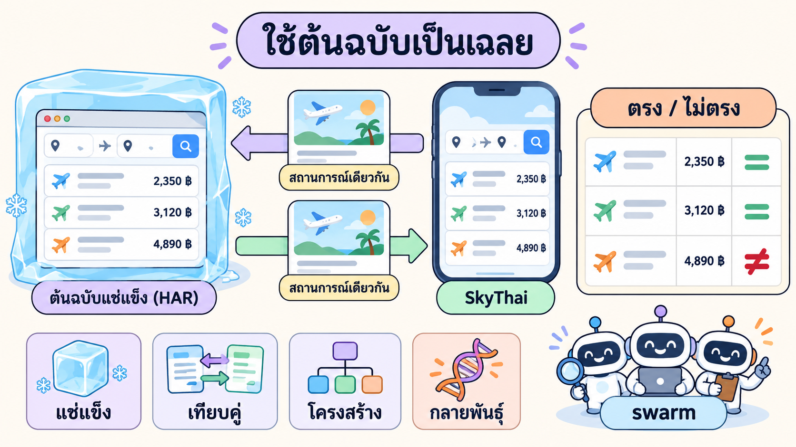
*แนวคิดหลักของบทนี้: เลิกเชื่อ "ตัวเลขที่ใครสักคนจดไว้" แล้วถาม "ต้นฉบับ" โดยตรงทุกครั้ง*

ตอนจบบทที่ 3 เราทิ้ง "บทเรียนที่จะต่อยอด" ไว้ 5 ข้อ เมื่อย้อนดูหลักฐานทีละข้อ จะเห็นว่าเกือบทุกข้อมี **รากเดียวกัน**: เฉลยถูก **จดลงกระดาษ** (เขียนเป็นตัวเลขในข้อสอบ) จากข้อมูล **คนละรอบ** กับที่แอปใช้

| # | ปัญหาจากบทที่ 3 | หลักฐานจริง (รันจริงของเรา) | รากของปัญหา | บทนี้แก้ด้วย |
|---|---|---|---|---|
| 1 | **กรรมการผิดเพราะข้อมูลคนละรอบ (snapshot drift)** | B20/C13 คาดเที่ยวบินออก 23:xx **35** ใบ แต่ข้อมูลจริง **33** · B22 คาด HKG **76** แต่จริง **77** · F05 คาดกลุ่มจุดแวะรวม **299** แต่ต้องมี **300** | เลขคาดหวังมาจาก `EXPLORATION.md` ที่สำรวจคนละรอบกับ HAR (ราคา/ผลเปลี่ยนใน ~40 นาที) | **ต้นฉบับแช่แข็ง** (T3) + **differential** ที่ดึงเฉลยจากต้นฉบับทุกครั้ง (T4) |
| 2 | **setup ผูกติดกัน (coupled setup)** | v1 ได้ **0/82** เพราะทุกข้อต้องกดปุ่มผู้โดยสารก่อน ทั้งที่ v1 มี 22 ใบ การเรียง และบินตรง | ขั้นเตรียมหน้าตัวเดียวพัง = ทุกข้อพัง | differential รายงาน **⛔ ไม่มีฟีเจอร์** แยกจาก **❌ ไม่ตรง** ทีละสถานการณ์ (T4) |
| 3 | **visual diff ≠ ความครบ** | visual diff ให้ v2 **8.19%** ดีกว่า v3 **8.32%** ทั้งที่ v3 ผ่านข้อสอบมากกว่า **23 ข้อ** | นับพิกเซล ไม่รู้ว่าพิกเซลนั้นคือปุ่มหรือพื้นขาว | **เทียบโครงสร้าง** (T5) |
| 4 | **ไม่รู้ว่าข้อสอบเก่งแค่ไหน** | 74/82 บอกว่า "ผ่านเยอะ" แต่ไม่บอกว่าถ้ามีบั๊ก ข้อสอบจะจับได้ไหม | ไม่เคยวัดตัวข้อสอบเอง | **mutation testing** (T6) |
| 5 | **เพดานข้อมูล + แก้ทีละคนช้า** | yolo1 หยุดที่ 74/82 · LAB 3 วนแก้ทีละรอบโดย agent เดียว | ไม่มีตัวชี้ว่ายังผิดตรงไหนอีก · งานต่อคิว | differential บอกจุดผิดเป็นรายแถว + **swarm** (T7) |

> **ตัวอย่าง (รันจริงของเรา) · 90% ที่ยังผิดอยู่**
> v3 ผ่านข้อสอบกรรมการ 74/82 แต่พอเทียบกับต้นฉบับแบบ "ทุกแถว" ใน LAB 2 ของบทนี้ กลับตรงแค่ **4/8 สถานการณ์** และพบว่า **ชื่อสายการบินต่าง 149 จาก 300 ตำแหน่ง** หลังกด "ดูเที่ยวบินเพิ่มเติม" (เช่น v3 แสดง "หลายสายการบิน" แต่ต้นฉบับแสดง "แอร์เอเชีย, แอร์เอเชีย เอ็กซ์") → ข้อสอบ 82 ข้อตรวจทีละฟีเจอร์ จึง **มองไม่เห็นความผิดชนิดนี้เลย**

**สรุปสั้น:** บทที่ 3 วัดได้ว่า "ดีขึ้น" แต่เฉลยยังจดมาจากคนละรอบ วัดหน้าตาด้วยพิกเซล และไม่เคยวัดตัวข้อสอบเอง · บทนี้แก้ด้วยการให้ **ต้นฉบับที่แช่แข็งไว้เป็นเฉลย** แล้วเพิ่มตัววัดที่ชี้จุดผิดได้ตรงกว่า

---

### T2) ปัญหา test oracle และแนวคิด "ใช้ต้นฉบับเป็นเฉลย"

**คำถาม:** test ทุกข้อต้องรู้ว่า "ผลที่ถูกคืออะไร" ความรู้นั้นมาจากไหน และมันผิดได้อย่างไร?

#### ขั้น 1 · test oracle คืออะไร

test 1 ข้อมี 3 ส่วนเสมอ

```text
1. ทำ (act)       เช่น กด "ดูเที่ยวบินเพิ่มเติม"
2. ดูผล (observe) เช่น นับแถวได้ 300
3. ตัดสิน (judge)  300 ถูกไหม?  ← ต้องมี "แหล่งความจริง" มาบอก = test oracle
```

**ปัญหา test oracle (test oracle problem)** คือ ข้อ 3 มักยากที่สุด: เขียนโค้ดกดปุ่มง่าย แต่ "รู้ว่าผลที่ถูกคืออะไร" ยาก โดยเฉพาะเมื่อข้อมูลมีหลายร้อยแถวและเปลี่ยนตามเวลา

#### ขั้น 2 · oracle มีหลายแบบ

| แบบ oracle | ทำงานอย่างไร | ข้อดี | ข้อเสีย | ในคอร์สนี้ |
|---|---|---|---|---|
| **เขียนเลขคาดหวังเอง (specified oracle)** | `assert.equal(count, 300)` | ง่าย อ่านง่าย | เลขเก่าเมื่อข้อมูลเปลี่ยน · คนจดผิดได้ | บทที่ 2–3 (ข้อสอบ 35 และ 82 ข้อ) |
| **oracle โดยนัย (implicit oracle)** | ตรวจแค่ "ไม่ crash / ไม่มี JS error" | ไม่ต้องรู้คำตอบ | จับได้แค่บั๊กรุนแรง | `pageerror` = 0 ใน LAB 1 |
| **คนตัดสิน (human oracle)** | คนดูภาพ/GIF แล้วตัดสิน | เข้าใจบริบท | ช้า ไม่สม่ำเสมอ | ดู GIF ทุกบท |
| **ระบบอ้างอิง (reference / differential oracle)** | รันสิ่งเดียวกันกับ "ระบบที่ถือว่าถูก" แล้วเทียบผล | ไม่ต้องจดเลข · ครอบคลุมทุกแถว | ต้องมีระบบอ้างอิงที่ **นิ่ง** และเข้าถึงได้ | **บทนี้: ต้นฉบับแช่แข็ง** |
| **oracle อนุมาน (derived oracle)** | คำนวณเฉลยจากข้อมูลของระบบอ้างอิง เช่น กรอง 300 ใบเอง | ใช้ได้แม้ระบบอ้างอิงตอบไม่ได้ | เชื่อได้น้อยกว่าผลสด | S2, S5–S7 ในบทนี้ (ป้ายสีส้ม) |

#### ขั้น 3 · ทำไม "ต้นฉบับ" ถึงเป็นเฉลยที่ดีที่สุดสำหรับงานโคลน

เป้าหมายของงาน reverse engineering คือ **"ทำให้เหมือนต้นฉบับ"** ดังนั้นนิยามของ "ถูก" ก็คือ **"ต้นฉบับทำอย่างนั้น"** ไม่มีใครรู้ดีกว่าต้นฉบับเอง

```text
บทที่ 3:  ต้นฉบับ → (คนสำรวจ) → EXPLORATION.md → (กรรมการจด) → assert 35   → แอป
                     ^ รอบหนึ่ง                                  ^ เลขเก่า/จดผิดได้

บทนี้:    ต้นฉบับแช่แข็ง ─┬─ สถานการณ์ X → ผลของต้นฉบับ ─┐
                         │                               ├─ เทียบ → ตรง/ไม่ตรง (ต่างตรงไหน)
          โคลน ──────────┴─ สถานการณ์ X → ผลของโคลน ────┘
```

แต่มี **เงื่อนไขสำคัญ 1 ข้อ**: ต้นฉบับต้อง **นิ่ง** ถ้าเราเทียบกับ Google สด ๆ วันนี้ได้ราคาหนึ่ง พรุ่งนี้ได้อีกราคา (บทที่ 3 เห็นแล้วว่า VZ 832 เปลี่ยนจาก ฿8,172 → ฿8,432 ใน ~40 นาที) เฉลยก็จะไหลไปเรื่อย ๆ → จึงต้อง **แช่แข็ง** ก่อน (T3)

> **ตัวอย่าง (รันจริงของเรา) · เฉลยข้อเดียวกัน สองวิธี**
>
> | | บทที่ 3 (B20 · เขียนเลขเอง) | บทนี้ (S7 · ถามต้นฉบับ) |
> |---|---|---|
> | คำถาม | ตัวกรองออกเดินทาง 23:00–24:00 ได้กี่ใบ | เหมือนกัน |
> | เฉลยมาจาก | เลข **35** ที่จดจาก `EXPLORATION.md` (สำรวจคนละรอบ) | กรอง 300 ใบของต้นฉบับแช่แข็ง **ตอนรัน** ได้ **33** |
> | ผลกับ v3 | ❌ ไม่ผ่านทั้ง 3 เวอร์ชัน (เพราะเฉลยผิด) | จำนวน **33 ตรง** · เหลือต่างแค่ชื่อสายการบิน 18 ใบ (ซึ่งเป็นความต่างจริง) |
>
> โค้ดจริงใน `diff/scenarios.mjs` เขียนกำกับไว้ว่า *"ไม่มีจำนวน/ราคาคาดหวังฝังในไฟล์นี้"* ค่าที่ฝังมีแค่ **พารามิเตอร์ของโจทย์** (การบินไทย · ฿10,000 · 23:00)

**สรุปสั้น:** oracle = แหล่งความจริงที่บอกว่าผลถูกไหม · เลขที่จดไว้เก่าและผิดได้ · งานโคลนมีเฉลยที่ดีที่สุดอยู่แล้วคือ **ต้นฉบับ** แต่ต้อง **แช่แข็ง** ให้นิ่งก่อน

---

### T3) ต้นฉบับแช่แข็ง: record-replay จาก HAR ด้วย `routeFromHAR`

**คำถาม:** จะเปิด Google Flights หน้าเดิม ข้อมูลเดิม ได้ผลเดิมทุกครั้ง โดยไม่ต่ออินเทอร์เน็ตเลย ได้อย่างไร?

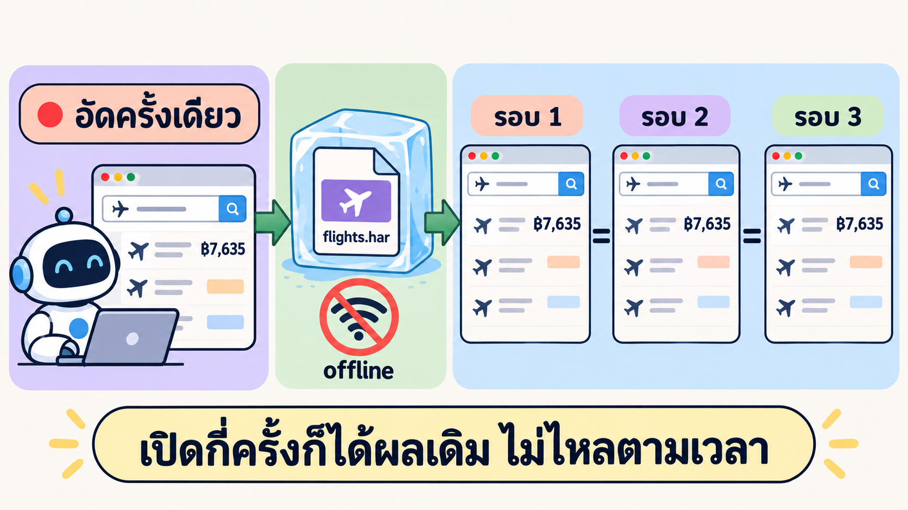
*record-replay: อัดเครือข่ายครั้งเดียว (บทที่ 3) → เล่นซ้ำจากไฟล์แบบ offline → ผลเหมือนเดิมทุกรอบ*

#### ขั้น 1 · คำศัพท์

| คำ | ความหมาย | ในบทนี้ |
|---|---|---|
| **Record-replay** | อัดการสื่อสารจริงครั้งเดียว แล้ว "เล่นซ้ำ" แทนการเรียกของจริง | อัด HAR ในบทที่ 3 · เล่นซ้ำใน LAB 1 |
| **Service virtualization** | ทำ "ของปลอมที่ตอบเหมือนของจริง" แทนบริการที่ควบคุมไม่ได้ (ช้า เปลี่ยน หรือเรียกบ่อยไม่ได้) | Google Flights ถูกแทนด้วย HAR |
| **Determinism** | รันกี่ครั้งก็ได้ผลเดิม | ทดสอบ 3 รอบ ต้อง `identical: true` |
| **`routeFromHAR`** | API ของ Playwright: ดักทุกคำขอของ browser context แล้วหาคำตอบจากไฟล์ HAR | ชั้นที่ 2 ของต้นฉบับแช่แข็ง |

#### ขั้น 2 · `routeFromHAR` จับคู่คำขออย่างไร และทำไม "URL ต้องตรงเป๊ะ"

`routeFromHAR` หาคำตอบโดยจับคู่ **URL + method** (และ body ของ POST) กับ entry ใน HAR **แบบตรงตัวอักษร** ไม่ได้ "เข้าใจ" ว่าสองคำขอหมายถึงสิ่งเดียวกัน

```text
อัดไว้ใน HAR:  /travel/flights?q=Flights+from+Bangkok+to+Tokyo+on+2026-11-15+one+way&hl=th&gl=TH&curr=THB
เราขอ:         /travel/flights?q=Flights%20from%20Bangkok%20to%20Tokyo...     ← ช่องว่างเป็น %20 แทน +
ผล:            ไม่ตรง → ไม่เจอใน HAR → (ถ้าไม่มีทางสำรอง) เปิดหน้าไม่ได้
```

สำหรับมนุษย์ `+` กับ `%20` คือ "ช่องว่าง" เหมือนกัน แต่สำหรับการจับคู่แบบตรงตัวมันคือคนละสตริง → สคริปต์จริงจึงเก็บ URL ไว้เป็นค่าคงที่ **ตรงตามที่อัด** (`SEARCH_URL = '...q=Flights+from+Bangkok+to+Tokyo+on+2026-11-15+one+way&hl=th&gl=TH&curr=THB'`)

ตัวเลือก `notFound` กำหนดว่าถ้าไม่เจอจะทำอะไร: `'abort'` = ตัดทิ้ง · `'fallback'` = ส่งต่อให้ route ถัดไปจัดการ (บทนี้ใช้ `fallback` เพื่อให้ route ที่เขียนเองและตัวปิดทิ้งทำงานต่อ)

#### ขั้น 3 · ทำไม `routeFromHAR` อย่างเดียวไม่พอ: คำขอที่ "เปลี่ยนทุกครั้ง"

ลองใช้ `routeFromHAR` ตรง ๆ แล้ว หน้าเว็บเปิดได้บางส่วน แต่พังหลายจุด yolo1 อ่านปัญหาทีละข้อแล้วแก้ดังนี้ **(รันจริงของเรา · `FROZEN.md`)**

| # | อาการ | สาเหตุ | วิธีแก้ |
|---|---|---|---|
| 1 | JS bundle ของ Google **12 ไฟล์** จับคู่กับ HAR ไม่ได้ | URL ของ gstatic มีรายการโมดูล `m=…` / `exm=…` ที่ **จัดกลุ่มต่างกันทุกครั้ง** ตามจังหวะเวลา | เขียน route เอง: ดูว่าขอโมดูลอะไร แล้ว **ประกอบคำตอบจาก bundle ที่อัดไว้** ที่มีโมดูลนั้น |
| 2 | กด "ดูเที่ยวบินเพิ่มเติม" แล้วไม่ได้ข้อมูล | POST `GetShoppingResults` มี **`_reqid` สุ่มใน URL** (เช่น 201 / 100201 / 300201) | route เอง **จับคู่ด้วย `f.req` ใน body** (เงื่อนไขการค้นหา) ไม่สน `_reqid` แล้วตอบด้วย response แบบ stream ที่อัดไว้ |
| 3 | กดตัวกรองแล้วเจอ `_.QH is not a function` | bundle หลังอ้างฟังก์ชันที่นิยามใน bundle ก่อนหน้า ส่งเฉพาะ bundle ที่มีโมดูลตรงจึงขาดของ | ส่ง **ทุก bundle ที่ยังไม่ส่ง ตั้งแต่ต้นจนถึง bundle ที่ต้องใช้ ตามลำดับการอัด** และ **ไม่ส่งซ้ำ** ในหน้าเดียวกัน (ซ้ำ = ตอบ JS ว่าง) |
| 4 | ตัวกรองบินตรงนับได้ **300** แทน 18 | ตอนกล่องตัวกรองเปิด ส่วนที่เหลือของหน้าหายจาก accessibility tree สคริปต์จึงนับผิดจังหวะ | รอ response ของตัวกรอง → ปิดกล่อง → **รอให้จำนวนแถวนิ่ง** ก่อนนับ |
| 5 | ข้อความที่อิง "วันนี้" อาจเปลี่ยนตามวันที่รัน | หน้าเว็บอ่านนาฬิกาเครื่อง | **ตรึงนาฬิกา** ด้วย `context.clock.setFixedTime('2026-10-31T17:03:15Z')` = เวลาที่อัด HAR |
| 6 | คำขอ telemetry ค่าเปลี่ยนทุกครั้ง | `gen_204`, `/log`, `browserinfo` เป็นการเก็บสถิติ | **ปิดทิ้ง** ไม่กระทบการแสดงผล |
| 7 | กลัวมีคำขอ "หลุด" ออกอินเทอร์เน็ต | — | route สุดท้าย **abort ทุกคำขอ** (`internetdisconnected`) ไม่มีที่ไหนเรียก `continue()` + เบราว์เซอร์ตั้ง proxy ไปพอร์ตที่ไม่มีอยู่ (`127.0.0.1:9`) กันซ้ำอีกชั้น |

#### ขั้น 4 · โครงสร้าง 3 ชั้นในโค้ดจริง

Playwright ลอง route ที่ **ลงทะเบียนทีหลังก่อน** สคริปต์จึงลงทะเบียน "ตัวปิดทิ้ง" ก่อนสุด (ให้ทำงานเป็นด่านสุดท้าย) และ route เขียนเองทีหลังสุด (ให้ทำงานเป็นด่านแรก)

```js
// _solution/run/frozen/open-original.mjs (ย่อ)
await context.route('**/*', (route) => route.abort('internetdisconnected'));   // ชั้น 3: ที่เหลือปิดทิ้งทั้งหมด
await context.routeFromHAR(HAR, { notFound: 'fallback' });                     // ชั้น 2: ตรงกับ HAR พอดี → ตอบจาก HAR
await context.route(/gstatic\.com\/_\/mss\/.*\/m=/, (route) => { /* ประกอบ JS จาก bundle ที่อัดไว้ ตามลำดับ */ });
await context.route(/FlightsFrontendService\/GetShoppingResults/, (route) => {   // ชั้น 1: route เขียนเอง
  const hit = gsr.find((g) => g.freq === fReq(route.request().postData()));     // จับคู่ด้วย f.req ไม่ใช่ URL
  return hit ? route.fulfill({ status: hit.status, headers: hit.headers, body: hit.body }) : route.fallback();
});
await context.clock.setFixedTime(new Date('2026-10-31T17:03:15.000Z'));          // ตรึงเวลา = ตอนอัด
```

```text
คำขอ → [ชั้น 1 route เขียนเอง: JS bundle / GetShoppingResults] ─ไม่ใช่→ [ชั้น 2 routeFromHAR] ─ไม่เจอ→ [ชั้น 3 abort]
```

#### ขั้น 5 · ผลจริง: นิ่งจริงไหม

> **ตัวอย่าง (รันจริงของเรา) · `node frozen/open-original.mjs 3`**
>
> | สิ่งที่ทดสอบ | รอบ 1 | รอบ 2 | รอบ 3 |
> |---|---|---|---|
> | หน้าแรก (คาด 22) | 22 ✅ | 22 ✅ | 22 ✅ |
> | ราคา 5 ใบแรก หน้าแรก | ฿7,635 · ฿8,432 · ฿11,580 · ฿9,062 · ฿9,335 | เหมือนรอบ 1 | เหมือนรอบ 1 |
> | "ดูเที่ยวบินเพิ่มเติม" (คาด 300) | 300 ✅ | 300 ✅ | 300 ✅ |
> | บินตรง (คาด 18) · 5 ราคาแรก | 18 ✅ · ฿8,432 · ฿9,062 · ฿11,580 · ฿12,660 · ฿15,320 | เหมือนรอบ 1 | เหมือนรอบ 1 |
> | ที่มาของคำตอบ | HAR 48 · JS ประกอบเอง 20 · GetShoppingResults 3 · ปิดทิ้ง 18 | เท่ากัน | เท่ากัน |
> | JS error ของหน้า | 0 | 0 | 0 |
> | เวลาต่อรอบ | 9.8 วินาที | 9.3 วินาที | 9.3 วินาที |
>
> `identical: true` · exit 0 · มีโมดูล 7 ตัว (`q92Jgb`, `NzGZOb`, …) ที่ไม่เคยถูกขอแยกตอนอัด แต่โค้ดอยู่ใน bundle ที่อัดไว้แล้ว จึงไม่เกิด error

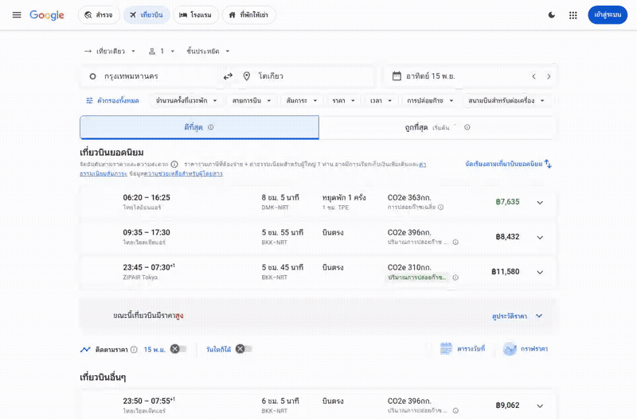
*GIF จริง `frozen-original.gif` (รอบ 1 · 9.6 วินาที · 800 px · 1.5 MB) · ไม่มีคำขอใดออกอินเทอร์เน็ต · ใช้เพื่อการเรียนเท่านั้น*

#### ขั้น 6 · ข้อจำกัด: แช่แข็งได้เฉพาะสิ่งที่อัดไว้

HAR บันทึก `GetShoppingResults` ไว้แค่ **3 ครั้ง** (ค้นหา · ดูเพิ่มเติม · บินตรง) เพราะในบทที่ 3 สคริปต์เดินแค่เส้นทางนั้น ผลคือ

| สิ่งที่ต้นฉบับแช่แข็ง "ตอบได้" | สิ่งที่ "ตอบไม่ได้" (ไม่มีใน HAR) |
|---|---|
| หน้าแรก 22 ใบ · ดูเพิ่ม 300 ใบ · บินตรง 18 ใบ · กล่องรายละเอียดเที่ยวบิน | แท็บ "ถูกที่สุด" (กดแล้วได้ **0 แถว**) · ตัวกรองสายการบิน · ราคา · เวลา |

ทางออกใน LAB 2: **เฉลยอนุมาน (derived oracle)** = กรองรายการ 300 ใบของต้นฉบับด้วยเงื่อนไขเดียวกันตอนรัน และ **แสดงแถบสีส้มใน GIF** บอกว่าเป็นเฉลยอนุมาน (รายละเอียดใน T4 ขั้น 4)

**สรุปสั้น:** ต้นฉบับแช่แข็ง = `routeFromHAR` (ตรงเป๊ะ) + route เขียนเองสำหรับคำขอที่เปลี่ยนทุกครั้ง (JS ที่จัดกลุ่มใหม่ · `_reqid` สุ่ม → จับคู่ด้วย `f.req`) + ส่ง JS ตามลำดับ + ตรึงนาฬิกา + ปิด telemetry + ตัดอินเทอร์เน็ต · ผล 22/300/18 เหมือนกัน 3 รอบ · แต่ตอบได้เฉพาะสิ่งที่อัดไว้

---

### T4) Differential testing: ทำสถานการณ์เดียวกันแล้วเทียบผล

**คำถาม:** ถ้ามีต้นฉบับที่นิ่งแล้ว จะใช้มันตัดสินโคลนแบบละเอียด "ทุกแถว" ได้อย่างไร โดยไม่ต้องเขียนเลขคาดหวังสักตัว?

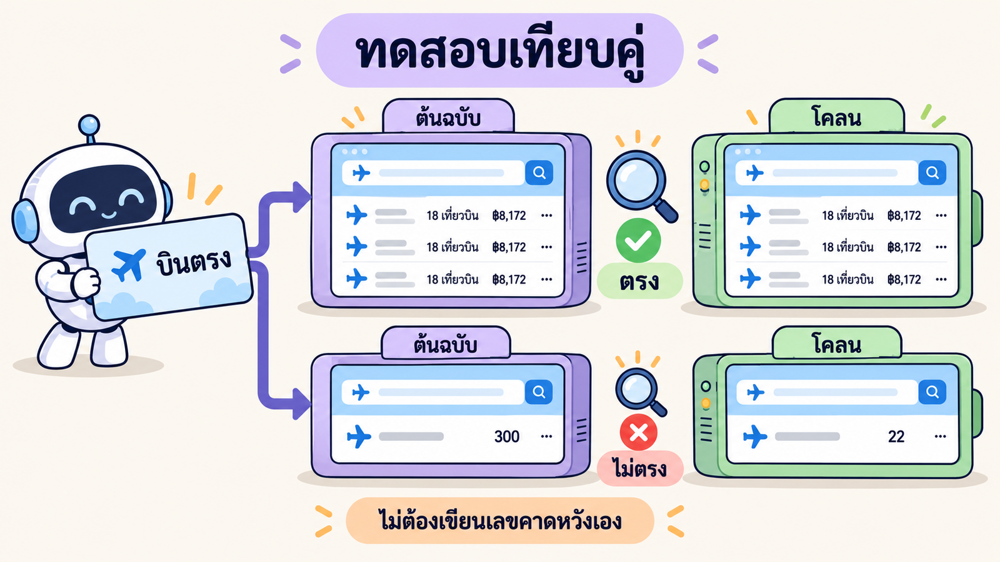
*differential testing: สถานการณ์เดียวกัน → ดึงผลเป็นข้อมูล → เทียบ (ตัวเลขในภาพเป็นตัวอย่างประกอบ)*

#### ขั้น 1 · แนวคิด

**Differential testing** (หรือ **back-to-back testing**) คือการป้อน "อินพุตเดียวกัน" ให้ระบบ 2 ตัวที่ควรทำงานเหมือนกัน แล้ว **เทียบผลลัพธ์** ถ้าต่างกัน = มีอย่างน้อยหนึ่งตัวผิด เทคนิคนี้ใช้จริงในงานใหญ่ เช่น เทียบคอมไพเลอร์หลายตัว เทียบระบบเก่ากับระบบใหม่ก่อนย้ายระบบ

ในงานโคลน เรารู้อยู่แล้วว่าใคร "ถูก" (ต้นฉบับ) ความต่างทุกจุดจึงชี้ไปที่โคลนทันที

#### ขั้น 2 · 4 ขั้นต่อสถานการณ์ (จาก `diff/scenarios.mjs`)

```text
1. orig(page)   ทำสถานการณ์กับต้นฉบับแช่แข็ง      → ได้ "เฉลย" (รายการเที่ยวบิน)
2. clone(page)  ทำสถานการณ์เดียวกันกับโคลน (v1/v2/v3) → ได้ "ผลของโคลน"
3. parseRow     แปลงทุกแถวเป็นข้อมูล { เวลาออก, สายการบิน, ราคา, ... }
4. compare      เทียบ: จำนวน · ลำดับราคา · ลำดับสายการบิน · ลำดับเวลาออก (ทุกตำแหน่ง) · ชุดเที่ยวบิน (ไม่สนลำดับ)
                → รายงาน "ต่างกี่ตำแหน่ง เริ่มที่ #ไหน ได้อะไร แทนอะไร" + ตัวอย่างใบที่ขาด/เกิน
```

ตัดสินได้ 3 แบบ: **✅ ตรง** · **❌ ไม่ตรง** (มีฟีเจอร์แต่ผลต่าง) · **⛔ ไม่มีฟีเจอร์** (หาปุ่ม/ตัวกรองไม่เจอ) → แยก "ทำผิด" ออกจาก "ไม่มี" ซึ่งข้อสอบในบทที่ 3 แยกไม่ได้ (coupled setup ทำให้ v1 ตกทุกข้อแบบเดียวกัน)

#### ขั้น 3 · ตัวอย่างการอ่านผล 1 บรรทัด (รันจริงของเรา)

```text
S1 รายการเริ่มต้น · v3:
❌ ไม่ตรง — สายการบินต่าง 6 ตำแหน่ง เริ่มที่ #13: เจเอแอล แทน เจเอแอล · บางกอกแอร์เวย์ส
           · ขาด 6 ใบ เช่น 07:55 เจเอแอล · บางกอกแอร์เวย์ส ฿16,390 / ...
           · เกิน/ไม่ตรง 6 ใบ เช่น 07:55 เจเอแอล ฿16,390 / ...
```

อ่านทีละส่วน
1. **ไม่มีคำว่า "จำนวน" และ "ราคา"** → จำนวน 22 ตรง ราคาตรงทุกตำแหน่ง เวลาออกตรงทุกตำแหน่ง
2. **"สายการบินต่าง 6 ตำแหน่ง เริ่มที่ #13"** → แถวที่ 13 ต้นฉบับเขียน "เจเอแอล · บางกอกแอร์เวย์ส" (มีพาร์ทเนอร์ร่วมขาย) แต่ v3 เขียนแค่ "เจเอแอล"
3. **"ขาด 6 / เกิน 6"** → ใบเดียวกัน (เวลา/ราคาเดียวกัน) แต่ป้ายชื่อต่าง จึงนับเป็นคนละใบ
4. **ข้อสรุป:** ข้อมูลเที่ยวบินของ v3 ถูกแล้ว เหลือแค่ **ป้ายชื่อสายการบิน** → เป็นงานชิ้นเดียวที่ชัดเจนสำหรับ LAB 5

#### ขั้น 4 · ผลจริง 8 สถานการณ์

> **ตัวอย่าง (รันจริงของเรา) · `DIFF-REPORT.md`** (ย่อ · ⚠️ = เฉลยอนุมาน)
>
> | สถานการณ์ | ต้นฉบับได้ | v1 | v2 | v3 |
> |---|---|---|---|---|
> | S1 รายการเริ่มต้น | 22 ใบ · ฿7,635 · ฿8,432 · ฿11,580 · ฿9,062 · ฿9,335 | ❌ ราคาต่าง 9 ตำแหน่ง (ราคาชุดเก่า ฿8,172) | ❌ แสดง 10 ใบ · ราคาชุดเก่า | ❌ ราคา/เวลาตรงหมด · ชื่อสายการบินต่าง 6 ใบ |
> | S2 แท็บถูกที่สุด ⚠️ | ป้าย "ถูกที่สุด เริ่มต้น ฿7,635" | ❌ ไม่มีแท็บ (มีลิงก์ "ราคาถูกสุด" แทน) | ✅ (มีแค่ 10 ใบ) | ✅ |
> | S3 ดูเที่ยวบินเพิ่มเติม | 300 ใบ | ⛔ ไม่มีปุ่ม | ❌ ได้ 22 ใบ | ❌ 300 ใบ ราคา/เวลาตรง · **สายการบินต่าง 149 ตำแหน่ง** |
> | S4 บินตรง | 18 ใบ (ผลสดจาก HAR) | ❌ ราคาต่าง 5 · ชื่อต่าง 6 | ❌ ราคาต่าง 5 · ชื่อต่าง 6 | ❌ เหลือแค่ชื่อเจเอแอลต่าง 6 ใบ |
> | S5 การบินไทยอย่างเดียว ⚠️ | 5 ใบ | ⛔ ไม่มีตัวกรอง | ✅ | ✅ |
> | S6 ราคาไม่เกิน ฿10,000 ⚠️ | 6 ใบ | ⛔ ไม่มีตัวกรอง | ❌ ได้ 5 ใบ ขาดใบ ฿8,835 | ✅ |
> | S7 ออก 23:00–24:00 ⚠️ | 33 ใบ | ⛔ ไม่มีตัวกรอง | ❌ ได้ 5 ใบ | ❌ 33 ตรง · ชื่อต่าง 18 ใบ |
> | S8 รายละเอียดเที่ยวบินที่แวะพัก | SL 394 · DMK 06:20 → TPE 11:10 / 12:10 → NRT 16:25 · แวะ 1 ชม. @TPE | ⛔ ไม่มีปุ่มรายละเอียด | ✅ | ✅ |
> | **รวม** | 8 | **0/8** | **3/8** | **4/8** |

**ข้อค้นพบสำคัญ:** v3 ได้ **จำนวนและราคาถูกแล้วทุกสถานการณ์** สิ่งที่ทำให้ไม่ตรง 4 ข้อ (S1, S3, S4, S7) มี **สาเหตุเดียว** คือชื่อสายการบิน: ต้นฉบับแสดงพาร์ทเนอร์ร่วมขาย (เช่น "เจเอแอล · บางกอกแอร์เวย์ส") และชื่อจริงของเที่ยวบินหลายสายการบิน (เช่น "แอร์เอเชีย, แอร์เอเชีย เอ็กซ์") แต่ v3 แสดง "เจเอแอล" หรือ "หลายสายการบิน" · ข้อมูลพาร์ทเนอร์นี้ **มีอยู่ใน HAR แต่ไม่ได้ถูกถอดลง `flights-all.json`** ในบทที่ 3

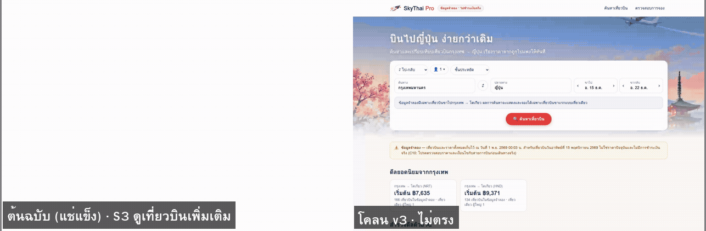
*GIF จริง S3 · ซ้ายต้นฉบับแช่แข็ง | ขวา v3 · จำนวน 300 เท่ากัน ราคา/เวลาตรง แต่ชื่อสายการบินต่าง 149 ตำแหน่ง*

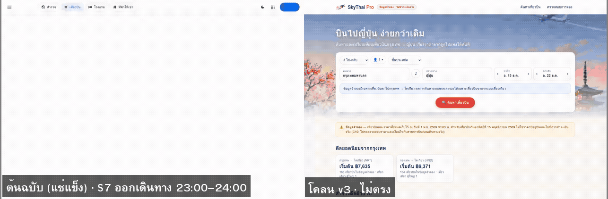
*GIF จริง S7 · ฝั่งต้นฉบับมี **แถบสีส้ม** = เฉลยอนุมาน (HAR ไม่มีคำตอบของตัวกรองเวลา)*

#### ขั้น 5 · เฉลยอนุมานต้องตรวจก่อนใช้

เฉลยอนุมาน (กรอง 300 ใบเอง) เชื่อได้แค่ไหน? yolo1 **ตรวจวิธีนี้กับสถานการณ์ที่มีผลสดให้เทียบ** คือ "บินตรง" **(รันจริงของเรา)**

| | กรอง 300 ใบด้วย "บินตรง" (อนุมาน) | ผลสดจาก HAR (ต้นฉบับจริง) |
|---|---|---|
| จำนวน | 18 | 18 |
| ชุดเที่ยวบิน | เหมือนกันทุกใบ | |
| ลำดับ | **ต่าง 2 ตำแหน่ง** (#2 ฿9,062 แทน ฿11,580) | Google จัดอันดับใหม่หลังกรอง |

→ สรุป: วิธีอนุมานให้ **จำนวน + ชุดเที่ยวบิน** ถูก แต่ **ลำดับเชื่อไม่ได้** · S5–S7 จึงตัดสินจากจำนวน + ชุดเท่านั้น · ส่วน S2 เกณฑ์ "เรียงจากน้อยไปมาก" เป็นข้อสันนิษฐานจากชื่อแท็บ และไม่ได้เทียบจำนวนใบ (v2 จึงผ่าน S2 ทั้งที่มีแค่ 10 ใบ) → **เกณฑ์ที่อ่อนต้องเขียนบอกตรง ๆ** ซึ่ง yolo1 เขียนไว้ใน `DIFF-REPORT.md` หัวข้อ "ที่มาของเฉลย"

#### ขั้น 6 · acceptance vs differential

| | Acceptance (บทที่ 3 · 82 ข้อ) | Differential (บทนี้ · 8 สถานการณ์) |
|---|---|---|
| เฉลยมาจาก | เลขที่กรรมการจดจาก `EXPLORATION.md` | ต้นฉบับแช่แข็ง ดึงใหม่ทุกครั้ง |
| ความกว้าง | **กว้าง**: 82 ฟีเจอร์/กฎ | แคบกว่า: 8 สถานการณ์ |
| ความลึก | ตรวจจุดเดียวต่อข้อ (เช่น นับแถว 300) | **ลึก**: ทุกแถว × 3 ช่อง (ราคา สายการบิน เวลา) |
| เมื่อข้อมูลเปลี่ยน | เลขในข้อสอบเก่า → ตกเพราะเฉลยผิด | เฉลยเปลี่ยนตามต้นฉบับ (ถ้าอัดใหม่) |
| บอกว่าต่างตรงไหน | บอกแค่ข้อที่ตก | บอก "ตำแหน่ง #13 ได้ X แทน Y" |
| จุดอ่อน | snapshot drift · coupled setup | ตอบได้เฉพาะที่อัดไว้ · ต้องใช้เฉลยอนุมานบางข้อ |

**สรุปสั้น:** differential = สถานการณ์เดียวกัน → ดึงผลเป็นข้อมูล → เทียบทุกแถว · ไม่มีเลขคาดหวังในโค้ด · ผลจริง v1 0/8 · v2 3/8 · v3 4/8 · ข้อค้นพบใหญ่: v3 ผิดแค่เรื่องเดียวคือชื่อสายการบิน ซึ่งข้อสอบ 82 ข้อมองไม่เห็น

---

### T5) เทียบโครงสร้างหน้าด้วย accessibility tree (`ariaSnapshot`)

**คำถาม:** visual diff ให้ v2 ชนะ v3 ทั้งที่ v3 ครบกว่า ถ้าไม่นับพิกเซล จะวัด "หน้าตาครบแค่ไหน" ด้วยอะไร?


*เทียบ "ต้นไม้ของ role + ชื่อ" แทนสี · องค์ประกอบที่หายไปเห็นเป็นรายชื่อ (86% ในภาพเป็นตัวอย่างประกอบ)*

#### ขั้น 1 · accessibility tree คืออะไร

เบราว์เซอร์สร้าง **accessibility tree** จาก DOM ให้โปรแกรมอ่านหน้าจอ (screen reader) ใช้ แต่ละ node มี **role** (บทบาท: `button`, `link`, `list`, `tab`, `search` …) และ **name** (ชื่อที่ผู้ใช้ได้ยิน) โดยไม่สนสี ฟอนต์ หรือตำแหน่ง → เป็นตัวแทนของ "หน้านี้มีอะไรให้ผู้ใช้ทำได้บ้าง" ที่ดีมาก (บทที่ 2 ใช้ snapshot นี้ให้ AI "เห็น" หน้าเว็บมาแล้ว)

Playwright มี `locator.ariaSnapshot()` คืนต้นไม้นี้เป็น **YAML**

#### ขั้น 2 · ตัวอย่าง YAML จริง: แถวเที่ยวบินแรก (รันจริงของเรา)

```yaml
# ต้นฉบับ (structure/snapshots/original.yml · ย่อ)
- tabpanel "ดีที่สุดดูข้อมูลเพิ่มเติมเกี่ยวกับการจัดอันดับ":
    - heading "เที่ยวบินยอดนิยม" [level=3]
    - button "ค่าธรรมเนียมสัมภาระ"
    - list:
      - listitem:
        - link "ราคาเริ่มต้นที่ 7635 บาทไทย เดินทางด้วยเที่ยวบินแบบแวะพัก 1 ครั้งกับ ไทยไลอ้อนแอร์ ..."
        - 'button "ปริมาณการปล่อยก๊าซคาร์บอนโดยประมาณ: 363 กิโลกรัม. ..."'
        - button "รายละเอียดเที่ยวบิน ออกเดินทางจาก ท่าอากาศยานดอนเมือง เวลา 06:20 ..."
```

```yaml
# v3 (structure/snapshots/v3.yml · ย่อ)
  - text: มีผลลัพธ์ 22 รายการ
  - link "เที่ยวบิน ไทยไลอ้อนแอร์ ราคา ฿7,635":
    - text: 06:20 – 16:25 ไทยไลอ้อนแอร์ ... 363 กก. CO2e -2% การปล่อยก๊าซ ฿7,635
    - button "รายละเอียดเที่ยวบิน ไทยไลอ้อนแอร์": ˅
```

เทียบด้วยตาก็เห็นทันที: v3 **ไม่มี `tabpanel`** · แถวไม่อยู่ใน **`list` / `listitem`** · **ไม่มีปุ่ม "ค่าธรรมเนียมสัมภาระ"** · การปล่อยก๊าซเป็น **ข้อความ ไม่ใช่ปุ่ม** → ทั้งหมดนี้ visual diff มองไม่เห็นเลย เพราะ "หน้าตา" แทบเหมือนกัน

#### ขั้น 3 · คำนวณความเหมือนทีละขั้น

| ขั้น | ทำอะไร | ตัวอย่างจริง |
|---|---|---|
| 1. เก็บ | `locator('body').ariaSnapshot()` ของสถานะเดียวกัน (หน้าแรก 22 ใบ แท็บดีที่สุด ก่อนกดดูเพิ่ม) | `original.yml` 312 บรรทัด · `v3.yml` 165 บรรทัด |
| 2. ตัดสิ่งที่ตั้งใจให้ต่าง | `banner` ทั้งก้อน (โลโก้ เมนู เข้าสู่ระบบ) · ลิงก์ไปโดเมน Google ในส่วนท้าย · ชื่อที่มี "Google"/"SkyThai" · ป้าย "ข้อมูลจำลอง" ของโคลน | ต้นฉบับตัด 18 · v1 3 · v2 5 · v3 5 → ต้นฉบับเหลือ 119 องค์ประกอบ |
| 3. ทำชื่อให้เป็นมาตรฐาน | ตัดสัญลักษณ์ตกแต่ง (▾ ☰ ⇄ ˅ …) · ตัวเลข → `#` (ราคา/เวลาคนละรอบ) | `link "ราคาเริ่มต้นที่ # บาทไทย…"` |
| 4. ทำเป็นโทเคน | `กลุ่ม role \| คำแรกของชื่อ` (นับ button/combobox/textbox เป็น control เดียวกัน) | ต้นฉบับ `combobox "ต้นทาง"` = โคลน `button "ต้นทาง, กรุงเทพมหานคร"` |
| 5. Jaccard | `\|A ∩ B\| ÷ \|A ∪ B\|` ของเซตโทเคน | v3: 33 ÷ 61 = **54.1%** |
| 6. องค์ประกอบสำคัญ | เช็กลิสต์ **38 ข้อ** ที่เลือกจากต้นฉบับ (ต้นฉบับมีครบ 38/38) เช่น landmark search · ฟอร์ม 7 ช่อง · ชิปตัวกรอง 8 ตัว · แท็บ 2 + tabpanel · list ของใบ · ปุ่มรายละเอียด ≥ 22 · ดูเที่ยวบินเพิ่มเติม | v3: 33 ÷ 38 = **86.8%** |
| 7. คะแนนโครงสร้าง | ค่าเฉลี่ยของข้อ 5 และ 6 | v3: (54.1 + 86.8) ÷ 2 = **70.5%** |

**ลองคิดเอง:** v1 = (5.0 + 2.6) ÷ 2 = **3.8%** · v2 = (45.9 + 65.8) ÷ 2 = **55.8%** · v4 (LAB 5) = (57.1 + 100) ÷ 2 = **78.6%**

> **Jaccard คืออะไร (ตัวอย่างเล็ก)** A = {search, tab, list, button-ดูเพิ่ม} · B = {search, tab, list} → A ∩ B = 3 · A ∪ B = 4 → Jaccard = 3/4 = 75% · ยิ่งใกล้ 100% ยิ่งมีของชุดเดียวกัน

#### ขั้น 4 · ผลจริง และเทียบกับ visual diff

> **ตัวอย่าง (รันจริงของเรา) · `STRUCTURE.md`**
>
> | เวอร์ชัน | acceptance 82 ข้อ | visual diff (ต่ำ = ใกล้) | ความเหมือนเชิงภาพ (100 − diff) | **ความเหมือนของโครงสร้าง** | องค์ประกอบสำคัญ |
> |---|---:|---:|---:|---:|---:|
> | v1 | 0/82 (0.0%) | 27.88% | 72.1% | **3.8%** | 1/38 |
> | v2 | 51/82 (62.2%) | **8.19%** (ดีที่สุด ❗) | 91.8% | **55.8%** | 25/38 |
> | v3 | 74/82 (90.2%) | 8.32% | 91.7% | **70.5%** (ดีที่สุด) | 33/38 |
> | ลำดับตรงกับ acceptance (Spearman) | — | — | 0.5 (v2 ได้ที่ 1 → ผิด) | **1.0** (v3 > v2 > v1 → ถูก) | |
> | สหสัมพันธ์กับ acceptance (Pearson) | — | — | 0.951 | **0.995** | |

**visual diff คำนวณยังไง (ทวน)** (pixelmatch · threshold $t = 0.1$ · ภาพ $W \times H = 1366 \times 900 = 1{,}229{,}400$ พิกเซล)

1. ระยะห่างของสีแต่ละพิกเซล (Y = ความสว่าง · I, Q = สีสัน มาจากผลต่าง R, G, B):

$$\delta = 0.5053\,Y^2 + 0.299\,I^2 + 0.1957\,Q^2$$

2. พิกเซลนับว่า "ต่าง" ($d = 1$) เมื่อ $\delta > 35215\,t^2 = 352.15$ และไม่ใช่ขอบเบลอของตัวอักษร
3. เปอร์เซ็นต์:

$$\text{visual diff} = \frac{\sum d(x, y)}{W \times H} \times 100\%$$

🧪 **แทนค่าจริง:**

$$
\text{v3} = \frac{102{,}292}{1{,}229{,}400} \times 100 = 8.32\%
\qquad
\text{v4} = \frac{63{,}012}{1{,}229{,}400} \times 100 = 5.13\%
$$

ส่วน "ความเหมือนเชิงภาพ" ในตาราง $= 100 - \text{visual diff}$ เช่น v1 $= 100 - 27.88 = 72.1\%$ (สมการเต็มอยู่ใน [บทที่ 3 · T7](../03_REA_Toolchain_Loop/README.md))

**อ่านตารางนี้อย่างไร**
1. **Spearman** = สหสัมพันธ์ของ "อันดับ" acceptance เรียง v1 < v2 < v3 · ความเหมือนเชิงภาพเรียง v1 < v3 < v2 (สลับ 1 คู่) → ρ = 1 − 6·Σd² ÷ (n(n²−1)) = 1 − 6·2 ÷ 24 = **0.5** · โครงสร้างเรียงถูกทั้งหมด → **1.0**
2. **v1 ที่ไม่มีฟอร์มค้นหา ตัวกรอง หรือแท็บเลย ยังได้ความเหมือนเชิงภาพ 72%** เพราะพื้นขาวตรงกับพื้นขาว แต่โครงสร้างได้แค่ **3.8%** → โครงสร้างไม่ถูกหลอกด้วยพื้นหลัง
3. **ช่วงคะแนนกว้าง:** โครงสร้าง 4 → 71 ใกล้กับ acceptance 0 → 90 · ภาพ 72 → 92 แคบเกินจะแยกเวอร์ชัน
4. **บอกงานที่ต้องทำได้:** v3 ขาด 5 ข้อ = **to-do list ของ LAB 5** ทันที

| องค์ประกอบที่ v3 ขาด (5 ข้อ) | ใน LAB 5 ใครแก้ |
|---|---|
| landmark `search` (ฟอร์มอยู่ใน `main`) | yolo3 กลุ่ม 2 |
| `tabpanel` | cyolo1 กลุ่ม 3 |
| ปุ่ม "ค่าธรรมเนียมสัมภาระ" | cyolo1 กลุ่ม 3 |
| ใบเที่ยวบินไม่อยู่ใน `list` / `listitem` | cyolo1 กลุ่ม 3 |
| การปล่อยก๊าซต่อใบเป็นข้อความ ไม่ใช่ปุ่ม | cyolo1 กลุ่ม 3 |

#### ขั้น 5 · ข้อจำกัด (yolo3 เขียนเอง)

- มีแค่ 3 เวอร์ชัน → Spearman/Pearson ใช้ดูทิศทางเท่านั้น ไม่มีนัยสำคัญทางสถิติ
- รายการ 38 ข้อเลือกเองจากต้นฉบับ → คะแนนครึ่งหนึ่งขึ้นกับรายการนี้ (และเมื่อ v4 ได้ 38/38 ส่วนนี้ก็ถึงเพดาน)
- วัดสถานะเดียว (หน้าแรก) ไม่รวมหลังกดดูเพิ่ม/ตัวกรอง (ส่วนนั้นเป็นงานของ differential)
- **visual diff ยังจำเป็น** สำหรับเลย์เอาต์ ระยะห่าง ขนาด ที่โครงสร้างมองไม่เห็น → ใช้คู่กัน

**สรุปสั้น:** `ariaSnapshot()` = ต้นไม้ role + ชื่อเป็น YAML · ตัดแบรนด์ → ทำชื่อเป็นมาตรฐาน → Jaccard + เช็กลิสต์ 38 ข้อ → เฉลี่ย · ผลจริง 3.8% → 55.8% → 70.5% เรียงตรงกับ acceptance (Spearman 1.0) ส่วน visual diff เรียงผิด (0.5) · และได้รายการงานที่ต้องแก้ 5 ข้อ

---

### T6) Mutation testing: สอบ "ชุดทดสอบ" ด้วยบั๊กจงใจ

**คำถาม:** ข้อสอบ 82 ข้อและ differential 8 สถานการณ์ ถ้าแอปมีบั๊กจริง ๆ มันจะจับได้ไหม? เราจะวัด "ความเก่งของข้อสอบ" ได้อย่างไร?


*mutation testing: ใส่บั๊กทีละตัว → ดูว่าชุดทดสอบไหน "จับ" ได้ (แถบคะแนนในภาพเป็นตัวอย่างประกอบ)*

#### ขั้น 1 · คำศัพท์

| คำ | ความหมาย | ตัวอย่างในบทนี้ |
|---|---|---|
| **Mutant** | สำเนาของโปรแกรมที่ถูกแก้ **จุดเดียว** ให้ผิดโดยตั้งใจ | M01 เปลี่ยน `by((f) => f.price)` เป็น `by((f) => -f.price)` |
| **Mutation operator** | ชนิดของการแก้ เช่น กลับเครื่องหมาย เปลี่ยน `>` เป็น `>=` ลบเงื่อนไข off-by-one | M05 `>` → `>=` · M03 `length` → `length - 1` |
| **Killed (ฆ่าได้)** | มี test ล้มอย่างน้อย 1 ข้อเมื่อรันกับ mutant | M04 ทำให้ B15 "โหลดครบ 300" ล้ม |
| **Survived (รอด)** | test ผ่านหมดทั้งที่มีบั๊ก → ชุดทดสอบมีช่องโหว่ | — |
| **Mutation score** | mutant ที่ฆ่าได้ ÷ mutant ทั้งหมด | 10/10 = 100% (ดิบ) |
| **Equivalent mutant** | mutant ที่แก้แล้วพฤติกรรมไม่ต่าง (ฆ่าไม่ได้โดยธรรมชาติ) | อาจเป็นกรณี M05 (ดูขั้น 5) |

หลักคิด: **ถ้าชุดทดสอบจับบั๊กที่เราใส่เองยังไม่ได้ ก็ไม่น่าจะจับบั๊กจริงได้**

#### ขั้น 2 · ขั้นตอนจริงของ cyolo1

```text
1. คัดลอก v3 → mutants/base
2. สร้าง mutant 10 ตัว แต่ละตัวแก้ 1 จุดจากฐานเดียวกัน (manifest.json เก็บ "ก่อน/หลัง" ทุกตัว)
3. ทีละตัว: docker compose -p mutation-<id> up -d --build  → http://localhost:5090 → รอ /api/health
4. รัน acceptance 82 ข้อ (สำเนาที่เหมือนต้นฉบับทุกไบต์) + differential 8 สถานการณ์ (รันต้นฉบับแช่แข็งใหม่ทุกครั้ง)
5. docker compose down -v --remove-orphans (ใน finally) → ตัวถัดไป
6. ตรวจ SHA-256 ว่าไม่ได้แก้ test (verification.json: source_tests_unchanged = true)
```

รันฐาน (v3 ไม่มีบั๊กเพิ่ม) ก่อนด้วย เพื่อรู้ว่า "ปกติ" ล้มข้อไหนอยู่แล้ว

#### ขั้น 3 · ผลตามเกณฑ์ที่ขอ: "ฆ่าได้ = ล้มอย่างน้อย 1 ข้อ"

> **ตัวอย่าง (รันจริงของเรา) · `MUTATION.md`**
>
> | mutant | บั๊กที่ใส่ (ไฟล์) | acceptance ล้ม | differential ล้ม |
> |---|---|---:|---:|
> | M01 | เรียงราคาจากแพงไปถูก (`Results.tsx`) | 9/82 | 5/8 |
> | M02 | ปิดการกรองจำนวนครั้งที่แวะพัก (`filters.ts`) | 11/82 | 4/8 |
> | M03 | แสดงจำนวนผลลัพธ์ขาด 1 (`Results.tsx`) | 15/82 | 4/8 |
> | M04 | โหลดเพิ่มเติมได้สูงสุด 299 (`Results.tsx`) | 13/82 | 4/8 |
> | M05 | ราคาเพดานใช้ < แทน ≤ (`filters.ts`) | 8/82 | 4/8 |
> | M06 | เวลาออกที่แสดงเลื่อน 1 ชั่วโมง (`FlightRow.tsx`) | 18/82 | 7/8 |
> | M07 | ปิดตัวกรองสายการบิน (`filters.ts`) | 10/82 | 5/8 |
> | M08 | ปิดตัวกรองเวลาออกเดินทาง (`filters.ts`) | 8/82 | 4/8 |
> | M09 | ปิดตัวกรองระยะเวลาเดินทางสูงสุด (`filters.ts`) | 9/82 | 4/8 |
> | M10 | รายละเอียดแสดงหมายเลขเที่ยวบินผิดทุกขา (`FlightRow.tsx`) | 9/82 | 5/8 |
> | **Mutation score (ดิบ)** | | **10/10 = 100%** | **10/10 = 100%** |

ดูดี... แต่ **น่าสงสัย** ลองสังเกต M05 กับ M08: acceptance ล้ม **8/82** และ differential ล้ม **4/8** ซึ่ง **เท่ากับฐานพอดี**

#### ขั้น 4 · กับดัก: ฐานล้มอยู่แล้ว คะแนนดิบจึงสูงเกินจริง

ฐาน (v3) **ล้มอยู่แล้ว** acceptance 8 ข้อ (B20 B22 C13 C31 F05 F08 F14 F16) และ differential 4 สถานการณ์ (S1 S3 S4 S7 · เรื่องชื่อสายการบิน) → เกณฑ์ "ล้มอย่างน้อย 1 ข้อ" **ผ่านอัตโนมัติ** กับทุก mutant แม้บั๊กใหม่จะไม่ทำให้อะไรเปลี่ยนเลย

cyolo1 จึงเพิ่ม **เกณฑ์เข้ม: นับเฉพาะข้อที่ "ผ่านบนฐาน แต่ล้มบน mutant" (pass → fail)**

> **ตัวอย่าง (รันจริงของเรา) · เกณฑ์เข้ม**
>
> | mutant | acceptance: ข้อที่ล้มเพิ่มจากฐาน | differential: สถานการณ์ที่ล้มเพิ่มจากฐาน |
> |---|---|---|
> | M01 เรียงแพง→ถูก | B12 | S2 |
> | M02 ปิดกรองจุดแวะ | B16, C14, F04 | — |
> | M03 จำนวนขาด 1 | B09, B16, B17, B19, B25, B33, F03, F04 | — |
> | M04 ดูเพิ่มได้ 299 | B15, C26, F01, F02, F06 | — |
> | M05 ราคา < แทน ≤ | — | — |
> | M06 เวลาออกเลื่อน 1 ชม. | B13, B31, B32, B33, C22, C23, C30, F09, F12, F13 | S5, S6, S8 |
> | M07 ปิดกรองสายการบิน | B17, C15 | S5 |
> | M08 ปิดกรองเวลาออก | — | — |
> | M09 ปิดกรองระยะเวลา | B23 | — |
> | M10 หมายเลขเที่ยวบินผิด | F12 | S8 |
> | **mutant ที่มีหลักฐาน pass→fail** | **8/10 (80%)** | **4/10 (40%)** |

**อ่านผลทีละประเด็น**
1. **M02 ถูกจับจริงแต่ "มองไม่เห็น" ในเกณฑ์เข้ม:** differential S4 รายงาน **300 แทน 18 ใบ** แต่ S4 ล้มบนฐานอยู่แล้ว (เรื่องชื่อสายการบิน) จึงไม่นับเป็น pass→fail · M04 ก็เช่นกัน (S3 เหลือ 299 แทน 300) → **test ที่แดงค้างไว้ ซ่อนบั๊กใหม่** (เหมือนไฟเตือนที่ติดตลอดจนไม่มีใครสนใจ)
2. **M08 รอดทั้งสองชุด:** test ที่เกี่ยวกับตัวกรองเวลาออก (B20 · C13 · S7) **ล้มอยู่แล้วทุกข้อบนฐาน** (B20/C13 เพราะเฉลย 35 vs 33 · S7 เพราะชื่อสายการบิน) → ปิดตัวกรองทั้งตัวก็ไม่มีข้อใหม่ล้ม · นี่คือราคาของ "ข้อสอบที่ผิดค้างไว้" จากบทที่ 3
3. **M05 รอดทั้งสองชุด:** เปลี่ยนแค่ค่าขอบ (เท่ากับเพดานพอดี) ถ้าไม่มีเที่ยวบินที่ราคาเท่าเพดานพอดีในสถานการณ์ที่ทดสอบ พฤติกรรมจะไม่ต่าง (เป็นไปได้ว่าเป็น equivalent mutant บนข้อมูลชุดนี้) → ต้องมี test ค่าขอบโดยเฉพาะ
4. cyolo1 เขียนกำกับเองว่า 80% / 40% เป็น **"ขอบล่าง"** ของการตรวจพบ ไม่ได้แปลว่า mutant ที่ไม่มีข้อใหม่ล้ม "หลุดรอดแน่นอน"

#### ขั้น 5 · บทเรียน: กว้าง vs ลึก ใช้คู่กัน

| ชุดทดสอบ | จุดแข็ง (จับได้ใหม่) | ทำไม |
|---|---|---|
| **acceptance** (กว้าง · 82 ข้อ) | M02 จุดแวะ · M03 นับขาด 1 · M04 299 ใบ · M09 ระยะเวลา (differential จับใหม่ไม่ได้เลยใน 4 ตัวนี้) | มีข้อเฉพาะฟีเจอร์เยอะ เช่น ข้อความ "มีผลลัพธ์ N รายการ" ตัวกรองระยะเวลา |
| **differential** (ลึก · 8 สถานการณ์) | M01 ลำดับ · M06 เวลา · M07 สายการบิน · M10 หมายเลขเที่ยวบิน (acceptance ก็จับ 4 ตัวนี้ได้ แต่ differential บอกได้ว่าแถวไหน ช่องไหนผิด) | เทียบทุกแถวทุกช่องกับต้นฉบับ ความผิดเล็ก ๆ ในข้อมูลไม่รอด |
| ทั้งสองชุดรวมกัน | จับใหม่ได้ 8/10 (รอด M05, M08) | — |

→ **acceptance ให้ความกว้าง · differential ให้ความลึก** · และ **ต้องทำฐานให้เขียวก่อน** คะแนน mutation จึงจะมีความหมาย (หลัง v4 ผ่าน differential 8/8 แล้ว ถ้ารัน mutation ใหม่ differential น่าจะจับได้มากขึ้น · ยังไม่ได้รันจริง)

**สรุปสั้น:** mutation testing = ใส่บั๊กจุดเดียว → ดูว่าชุดทดสอบล้มไหม · คะแนนดิบ 10/10 ทั้งคู่ แต่หลอกตาเพราะฐานล้มอยู่แล้ว · เกณฑ์เข้ม (pass→fail) acceptance 80% · differential 40% · test ที่แดงค้างซ่อนบั๊ก · กว้าง + ลึกต้องใช้คู่กัน

---

### T7) Swarm: หลาย agent แก้พร้อมกันใน git worktree

**คำถาม:** รู้แล้วว่า v3 ต้องแก้อะไร (ชื่อสายการบิน + 5 องค์ประกอบ + เลย์เอาต์) ถ้าให้ agent ตัวเดียวทำทีละอย่างจะช้า ให้หลายตัวทำพร้อมกันได้ไหม โดยไม่แก้ทับกัน?


*swarm: หัวหน้าแบ่งงาน → หลายบัญชีทำพร้อมกัน → รวมกลับ*

#### ขั้น 1 · ทำไมทำพร้อมกันแล้วมักพัง

ถ้า 3 agent แก้ **โฟลเดอร์เดียวกัน** พร้อมกัน จะเจอ: แก้ไฟล์เดียวกันทับกัน · build ของคนหนึ่งพังเพราะอีกคนแก้ครึ่งทาง · รันแอปพอร์ตเดียวกันชนกัน · merge แล้ว conflict

#### ขั้น 2 · 4 หลักที่ทำให้ swarm ไม่ชนกัน

| หลัก | ทำอย่างไร | ในรอบจริง |
|---|---|---|
| **1. แบ่งตามไฟล์ (file ownership)** | แต่ละกลุ่ม "เป็นเจ้าของ" ไฟล์ชุดหนึ่ง ห้ามแตะไฟล์อื่น | g1: `src/lib/*.ts`, `data/airline-labels.json`, `scripts/v4/*` · g2: `SearchForm.tsx`, `layout.tsx`, `page.tsx`, `globals.css` … · g3: `Results.tsx`, `FlightRow.tsx`, `filters.ts`, `results-v4.css` … |
| **2. แยกโฟลเดอร์ด้วย git worktree** | 1 repo มีหลาย working directory คนละ branch ใช้ `.git` ร่วมกัน | `wt/g1` (branch `g1`) · `wt/g2` · `wt/g3` · รอบ 2 `wt/r2` |
| **3. สัญญาร่วม (shared contract) ก่อนแยก** | ถ้ากลุ่มต้องใช้ของกันและกัน ให้ตกลง "หน้าตาข้อมูล" แล้ว commit ก่อนแยกงาน | field `FlightView.airlineLabel` · g1 เติมค่า · g3 ใช้แสดงในแถว |
| **4. ทรัพยากรแยก** | แต่ละกลุ่มเปิดแอปของตัวเองคนละพอร์ต/ชื่อ compose project | g1 :5085 · g2 :5086 · g3 :5087 · r2 :5088 (`skythai-max-g1` …) |

```bash
# git worktree พื้นฐาน (แนวคิด)
git worktree add wt/g1 -b g1        # สร้างโฟลเดอร์ wt/g1 บน branch ใหม่ g1
git worktree add wt/g2 -b g2
git worktree add wt/g3 -b g3
# ... แต่ละ agent ทำงานและ commit ในโฟลเดอร์ของตัวเอง (ห้าม merge/rebase/push เอง) ...
git merge g1 g2 g3                  # หัวหน้า (yolo1) รวมกลับ → ไม่ชน เพราะแก้คนละไฟล์
git worktree remove wt/g1           # เก็บกวาดเมื่อเสร็จ
```

#### ขั้น 3 · การแบ่งงานจริง (รันจริงของเรา · `swarm/jobs-r1.json`)

| กลุ่ม | บัญชี | งาน (มาจากรายงานไหน) | เวลา | ผล |
|---|---|---|---:|---|
| g1 ชื่อสายการบิน | `yolo2` (Claude) | DIFF-REPORT: S1/S3/S4/S7 ไม่ตรงเพราะชื่อสายการบินอย่างเดียว → เขียน `scripts/v4/extract_airline_labels.py` ถอดชื่อพาร์ทเนอร์ร่วมขาย + "ดำเนินการโดย …" **จาก HAR** → `data/airline-labels.json` (300 ใบ) | 684.3 วินาที | ตรงกับต้นฉบับ **300/300** แถว |
| g2 โครงหน้า + เลย์เอาต์ | `yolo3` (Claude) | STRUCTURE: ขาด landmark `search` + visual diff → ฟอร์มเป็น `search` · ความกว้าง 1024 px · ฟอร์มกะทัดรัด · แบนเนอร์ราคาบรรทัดเดียว | 1143.2 วินาที | commit บน branch `g2` |
| g3 รายการผล | `cyolo1` (Codex) | STRUCTURE: ขาด 4 ข้อในรายการ → `tabpanel` · `ul/li` · ปุ่ม "ค่าธรรมเนียมสัมภาระ" · ปุ่มการปล่อยก๊าซต่อใบ · ใช้ `airlineLabel` ในแถว | 248.5 วินาที (รอบที่ 2 ของกลุ่มนี้ · ดูขั้น 5) | commit บน branch `g3` |

> **ตัวอย่าง (รันจริงของเรา) · เร็วขึ้นเท่าไร**
> - ถ้าทำทีละกลุ่ม: 684.3 + 1143.2 + 248.5 = 2,076 วินาที ≈ **35 นาที**
> - ทำพร้อมกัน: เท่ากับกลุ่มที่นานที่สุด (g2) 1,143 วินาที ≈ **19 นาที**
> - merge เข้า master **ไม่ชนกันเลย** · หัวหน้า **วัดทุกตัวเลขซ้ำเองหลัง merge** ไม่เชื่อตัวเลขที่ agent รายงาน

#### ขั้น 4 · วนรอบหลัง merge

| รอบ | ใครแก้อะไร | differential | โครงสร้าง | visual | acceptance |
|---|---|---:|---:|---:|---:|
| เริ่ม (v4 = สำเนา v3) | — | 4/8 | 70.5% | 8.32% | 74/82 |
| 1 (swarm 3 กลุ่ม แล้ว merge) | yolo2 · yolo3 · cyolo1 ตามตารางบน | **8/8** | 78.6% | 6.55% | 74/82 |
| 2 (`yolo3` คนเดียว · 529.5 วินาที) | เรียงหน้าตามต้นฉบับ: ยอดนิยม 3 ใบแรก → แบนเนอร์ราคา → ติดตามราคา/เครื่องมือ → เที่ยวบินอื่นๆ · การ์ดวันที่ถูกกว่าเป็น popover | 8/8 | 78.6% | 5.12% | 74/82 |
| ปิดงาน | เปลี่ยนชื่อแบรนด์บนหน้าเป็น "SkyThai Max" | 8/8 | 78.6% | **5.13%** | 74/82 |

รอบ 2 เป็นตัวอย่าง **"กฎห้ามถอย"**: พรอมต์ของรอบนี้สั่งว่าลด visual diff ได้ แต่ differential ต้อง 8/8 · structure ต้อง 38/38 · acceptance ต้อง 74/82 เหมือนเดิม และ **ห้ามซ่อนเนื้อหาหรือทำภาพขาวโล่งเพื่อลดคะแนน**

#### ขั้น 5 · บันทึกตามจริง: บัญชีและความล้มเหลวกลางทาง

- **พรอมต์รอบจริงตอนแรกสั่งให้ใช้ `cyolo2`** แต่ `cyolo2` (และ `cyolo3`) **ยังไม่ได้ล็อกอิน** และ session นั้นถามผู้ใช้กลางทางไม่ได้ → `yolo1` ให้ **`cyolo1` ทำกลุ่ม 3 แทน** และเขียนบอกไว้ใน `FINAL.md` · **พรอมต์ของผู้เรียนในบทนี้แก้เป็น `cyolo1` แล้ว**
- **cyolo1 รอบแรกของกลุ่ม 3 ล้มใน 21.7 วินาที** (`empty -o answer file` · ไม่มีคำตอบออกมา) → yolo1 สั่งใหม่เป็นงาน `g3-results-b` แล้วสำเร็จใน 248.5 วินาที (`swarm/run-r1.log`, `run-r1-g3.log`) → swarm ที่ดีต้อง **ตรวจผลของแต่ละ agent** และสั่งซ้ำได้

**สรุปสั้น:** swarm = แบ่งงานตามไฟล์ + git worktree คนละ branch + สัญญาร่วม 1 field ที่ commit ก่อนแยก + พอร์ตแยก → merge ไม่ชน · 35 → 19 นาที · หัวหน้าต้องวัดซ้ำเองหลัง merge และพร้อมรับมือ agent ที่ล้ม

---

### T8) คำตัดสินรวม: ทุกบท ทุกตัววัด

**คำถาม:** จาก v1 ถึง v4 แต่ละบทเพิ่มอะไร และตัววัดแต่ละตัวมองเห็นการพัฒนาแค่ไหน?

> **ตัวอย่าง (รันจริงของเรา) · `FINAL.md`**
>
> | เวอร์ชัน | acceptance 82 ข้อ | differential 8 | โครงสร้าง | visual diff ↓ | เที่ยวบิน (แรก → ครบ) | เวลาสร้าง¹ |
> |---|---:|---:|---:|---:|---:|---:|
> | v1 SkyThai Mini (บทที่ 1 · REA) | 0/82 (0.0%) | 0/8 | 3.8% (1/38) | 27.88% | 22 → 22 | ≈6 นาที |
> | v2 SkyThai Plus (บทที่ 2 · + Playwright MCP) | 51/82 (62.2%) | 3/8 | 55.8% (25/38) | 8.19% | 10 → 22 | ≈14 นาที |
> | v3 SkyThai Pro (บทที่ 3 · + HAR · กรรมการ · วนแก้) | 74/82 (90.2%) | 4/8 | 70.5% (33/38) | 8.32% | 22 → 300 | ≈42 นาที |
> | **v4 SkyThai Max (บทที่ 4 · + แช่แข็ง · differential · โครงสร้าง · swarm)** | **74/82 (90.2%)** | **8/8** | **78.6% (38/38)** | **5.13%** | 22 → 300 | ≈51 นาที (swarm รอบ 1 = 19 นาที) |
>
> ¹ v1–v3 ประมาณจาก timestamp ใน `SCOREBOARD.md` ของบทที่ 3 · v4 นับจาก 01:24 ถึงวัดผลรอบสุดท้ายเสร็จ 02:15 รวมเวลาวัดผล · ทุกเวอร์ชันต่อยอดจากเวอร์ชันก่อน **เทียบเวลากันตรง ๆ ไม่ได้**
>
> v1–v3 ถูกรันซ้ำด้วยตัวรันของ `final/` แล้วได้ **ค่าเดิมตรงทุกตัว** · ตัวเลขของ v4 วัดใหม่หลัง merge ทั้งหมด

#### เทคนิคไหนช่วยมากที่สุด (คำตัดสินของ yolo1 ใน `FINAL.md`)

| อันดับ | เทคนิค | หลักฐาน |
|---|---|---|
| 1 | **differential กับต้นฉบับแช่แข็ง + ย้อนกลับไปถอดข้อมูลจาก HAR ต้นทาง** | acceptance 90% ไม่บอกว่ายังผิดตรงไหน · differential ชี้ว่า 4 สถานการณ์ผิดด้วย **สาเหตุเดียว** (ชื่อสายการบิน) · แก้ข้อมูลจุดเดียว (**JSON 310 บรรทัด + โค้ด 7 บรรทัด**) → **4/8 → 8/8** ตรวจกับเฉลยอิสระได้ 300/300 แถว |
| 2 | **เทียบโครงสร้าง** | ให้รายการงานชัดเจน 5 ข้อ ทำครบ → 70.5% → 78.6% (38/38) โดยไม่ต้องเดา |
| 3 | **swarm + worktree + สัญญาร่วม 1 field** | งาน 35 นาที เสร็จใน 19 นาที · merge ไม่ชน |
| 4 | **visual diff** | ช่วยแค่เลย์เอาต์ 8.32% → 5.13% · ที่ยังต่างคือฟอนต์ โลโก้ ไอคอนสายการบิน ซึ่ง **ตั้งใจไม่คัดลอก** จาก Google |

#### ทำไม acceptance ค้างที่ 74/82

8 ข้อที่ไม่ผ่านของ v4 คือ **ชุดเดียวกับ v3 ทุกข้อ**: **B20 · B22 · C13 · C31 · F05 · F08 · F14 · F16**

| ข้อ | ทำไมไม่ผ่าน (จากบทที่ 3) |
|---|---|
| B20 · C13 | เฉลย 35 ใบ แต่ข้อมูลจริง 33 (snapshot drift) |
| B22 | เฉลย HKG 76 แต่จริง 77 |
| F05 | เกณฑ์รวมได้ 299 แต่ต้องมี 300 แถว |
| C31 | locator เจอ 23:45 สองแถว (ข้อมูลครบขึ้นจึงชน) |
| F08 · F14 · F16 | กรรมการเขียนเองว่ายืนยันผ่าน UI ไม่ได้ → ตกกับทุกแอป |

→ จะผ่านได้ก็ต่อเมื่อ **ปลอมข้อมูล** หรือ **แก้ข้อสอบ** ซึ่งเราห้ามทั้งคู่ · ดังนั้น **acceptance แยก v3 กับ v4 ไม่ได้เลย** ความคืบหน้าทั้งหมดของ v4 มองเห็นได้จาก differential และโครงสร้าง **เท่านั้น** → นี่คือเหตุผลที่ต้องมีตัววัดหลายแบบ

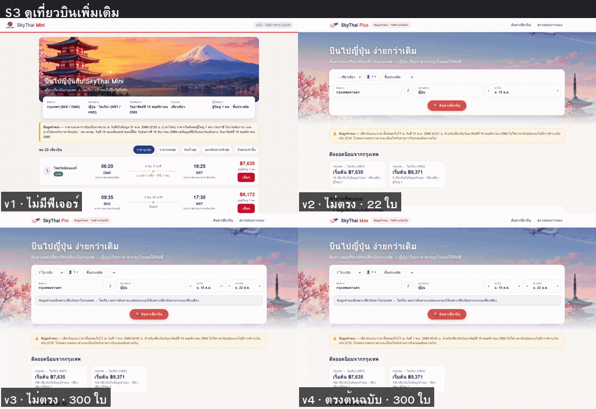
*GIF จริง `final/gif/S3-more.gif` · ซ้ายบน v1 | ขวาบน v2 / ซ้ายล่าง v3 | ขวาล่าง v4 · มีป้ายผล differential และจำนวนใบที่มุมล่างของแต่ละช่อง*

**สรุปสั้น:** v4 เท่ากับ v3 ใน acceptance (ติดเพดานข้อมูล) แต่ดีขึ้นชัดในตัววัดที่เทียบกับต้นฉบับ: differential 4/8 → 8/8 · โครงสร้าง 70.5 → 78.6% · visual 8.32 → 5.13% · เทคนิคที่คุ้มที่สุดคือ differential + กลับไปดูข้อมูลต้นทาง

---

### 🧠 ทบทวน 10 ข้อ (ลองตอบก่อนเปิดเฉลย)

1. บทที่ 3 มีปัญหาเรื่องเฉลยอะไรบ้าง ยกตัวอย่างตัวเลขจริงอย่างน้อย 2 ข้อ และรากของปัญหาคืออะไร?
2. test oracle คืออะไร และ "ใช้ต้นฉบับเป็นเฉลย" ต้องมีเงื่อนไขอะไรก่อนจึงจะใช้ได้?
3. ทำไม `routeFromHAR` อย่างเดียวเปิดต้นฉบับแช่แข็งไม่สำเร็จ บอกอย่างน้อย 3 สาเหตุพร้อมวิธีแก้
4. ต้นฉบับแช่แข็งป้องกันไม่ให้มีคำขอออกอินเทอร์เน็ตด้วยวิธีใดบ้าง และทำไมต้องตรึงนาฬิกา?
5. differential test ของเราเทียบอะไรบ้าง และผล v3 ใน S1 "สายการบินต่าง 6 ตำแหน่ง เริ่มที่ #13" บอกอะไรเรา?
6. "เฉลยอนุมาน" คืออะไร ใช้กับสถานการณ์ไหน และทำไมจึงตัดสินแค่จำนวน + ชุด ไม่ใช่ลำดับ?
7. คำนวณคะแนนโครงสร้างของ v3 จาก Jaccard 54.1% และองค์ประกอบสำคัญ 33/38 แล้วบอกว่าทำไมโครงสร้างจึงบอกความครบได้ดีกว่า visual diff
8. ทำไม mutation score ดิบ 10/10 ของทั้งสองชุดจึง "หลอกตา" และเกณฑ์เข้มให้ผลเท่าไร?
9. ทำไม M08 (ปิดตัวกรองเวลาออก) จึงรอดทั้งสองชุดทดสอบ บทเรียนคืออะไร?
10. swarm ใน LAB 5 merge ได้ไม่ชนกันเพราะอะไร และเร็วขึ้นเท่าไร?

<details>
<summary>เฉลย</summary>

1. เฉลยของกรรมการมาจาก snapshot คนละรอบ: B20/C13 คาด 35 จริง 33 · B22 คาด 76 จริง 77 · F05 รวม 299 แต่ต้องมี 300 · (และ v1 0/82 จาก coupled setup · visual diff ให้ v2 8.19% ดีกว่า v3 8.32%) · รากคือเฉลยถูก **จดเป็นตัวเลข** จากข้อมูลคนละรอบกับที่แอปใช้
2. oracle = แหล่งความจริงที่บอกว่าผลที่ถูกคืออะไร · ใช้ต้นฉบับเป็นเฉลยได้เมื่อต้นฉบับ **นิ่ง** (ได้ผลเดิมทุกครั้ง) จึงต้องแช่แข็งก่อน เพราะของจริงเปลี่ยนตามเวลา (VZ 832 ฿8,172 → ฿8,432 ใน ~40 นาที)
3. (ก) JS bundle 12 ไฟล์มี `m=`/`exm=` จัดกลุ่มใหม่ทุกครั้ง → ประกอบคำตอบจาก bundle ที่อัดไว้ · (ข) `GetShoppingResults` มี `_reqid` สุ่ม → จับคู่ด้วย `f.req` ใน body · (ค) `_.QH is not a function` → ส่งทุก bundle ตามลำดับการอัด ไม่ส่งซ้ำ · (ง) นับแถวตอนกล่องตัวกรองเปิด → ปิดกล่องแล้วรอให้นิ่ง (ข้อใดก็ได้ 3 ข้อ)
4. route สุดท้าย abort ทุกคำขอ (ไม่มี `continue()`) + proxy ไป `127.0.0.1:9` ที่ไม่มีอยู่ + ปิด telemetry (`gen_204`, `/log`, `browserinfo`) · ตรึงนาฬิกาที่เวลาอัด (2026-10-31T17:03:15Z) เพื่อให้ข้อความที่อิง "วันนี้" ไม่เปลี่ยนตามวันที่รัน → ผลเหมือนเดิมทุกรอบ
5. เทียบจำนวน · ลำดับราคา · ลำดับสายการบิน · ลำดับเวลาออก ทุกตำแหน่ง + ชุดเที่ยวบิน · S1 ของ v3 บอกว่าจำนวน ราคา เวลาออกตรงหมด ต่างแค่ป้ายชื่อสายการบินตั้งแต่แถวที่ 13 (ต้นฉบับ "เจเอแอล · บางกอกแอร์เวย์ส" vs v3 "เจเอแอล") → งานที่ต้องแก้คือชื่อพาร์ทเนอร์อย่างเดียว
6. เฉลยที่คำนวณเองจากรายการ 300 ใบของต้นฉบับ ใช้เมื่อ HAR ไม่มีคำตอบของตัวกรอง/แท็บนั้น (S2, S5, S6, S7) · ตรวจกับ "บินตรง" ที่มีผลสดแล้วพบว่าชุดเหมือนกันแต่ลำดับต่าง 2 ตำแหน่ง เพราะ Google จัดอันดับใหม่หลังกรอง → ลำดับเชื่อไม่ได้
7. (54.1 + 86.8) ÷ 2 = **70.5%** · โครงสร้างเรียงเวอร์ชันตรงกับ acceptance (Spearman 1.0 vs visual 0.5) · ไม่ถูกหลอกด้วยพื้นขาว (v1 ภาพ 72% แต่โครงสร้าง 3.8%) · บอกรายชื่อสิ่งที่ขาดได้ (v3 ขาด 5 ข้อ)
8. เพราะฐาน (v3) ล้มอยู่แล้ว acceptance 8/82 และ differential 4/8 เกณฑ์ "ล้มอย่างน้อย 1 ข้อ" จึงผ่านอัตโนมัติ · เกณฑ์เข้ม (pass → fail ใหม่) ได้ acceptance **80%** · differential **40%**
9. test ที่ตรวจตัวกรองเวลา (B20, C13, S7) ล้มอยู่แล้วบนฐาน (เฉลยผิด 35 vs 33 และชื่อสายการบิน) ปิดตัวกรองทั้งตัวจึงไม่มีข้อใหม่ล้ม · บทเรียน: **test ที่แดงค้างไว้ซ่อนบั๊กใหม่** ต้องทำฐานให้เขียว/แก้ oracle ก่อน
10. แบ่งงานตามไฟล์ · แต่ละกลุ่มอยู่ใน git worktree คนละ branch · ตกลงสัญญาร่วม `FlightView.airlineLabel` และ commit ก่อนแยก · เปิดแอปคนละพอร์ต · ทำทีละกลุ่ม ≈35 นาที (684 + 1143 + 248 วินาที) ทำพร้อมกัน ≈19 นาที

</details>

---

## 🗺️ เส้นทาง LAB

**ทุก LAB = วางพรอมต์ 1 ครั้งใน Claude Code Desktop** (เปิดในโฟลเดอร์นี้) แล้วรอผล · ทุก LAB ทำงานในโฟลเดอร์ใหม่ `/workspace/rea-flight-v4` และ **อ่าน** ของจากบทที่ 3 (`/workspace/rea-flight-v3`) โดยไม่แก้

| LAB | ทำอะไร | ใครทำงาน | ได้อะไร | เวลา AI (รันจริง) |
|---|---|---|---|---|
| 0 | เช็กก่อนเริ่ม | Claude Code Desktop | รู้ว่า v1–v3, HAR, ข้อสอบ และบัญชีพร้อม | — |
| 1 | ต้นฉบับแช่แข็ง | `yolo1 -p` | `frozen/open-original.mjs` · `FROZEN.md` · `frozen-original.gif` | 5 นาที 56 วินาที |
| 2 | Differential testing | `yolo1 -p` | `diff/` · `DIFF-REPORT.md` (0/8 · 3/8 · 4/8) · GIF 8 ไฟล์ | 27 นาที 46 วินาที |
| 3 | เทียบโครงสร้าง | `yolo3 -p` | `structure/` · `STRUCTURE.md` (3.8 · 55.8 · 70.5%) | ≈4 นาที (รันคู่กับ LAB 2) |
| 4 | Mutation testing | `cyolo1 exec` | `mutants/` · `MUTATION.md` (ดิบ 10/10 · เข้ม 80% / 40%) | 45 นาที 39 วินาที (รันคู่กับ LAB 5) |
| 5 | Swarm → v4 + ตัดสินรวม | `yolo1 -p` → `yolo2` · `yolo3` · `cyolo1` | `skythai-max/` (http://localhost:5084) · `FINAL.md` · `final/gif/` | 52 นาที 33 วินาที |

⚡ **รันคู่ขนานได้ (แบบที่เราทำจริง)**
- **LAB 3 ใช้แค่ LAB 1** (ต้นฉบับแช่แข็ง) → เปิดแท็บ/session ใหม่ของ Claude Code Desktop วางพรอมต์ LAB 3 **พร้อมกับ LAB 2** ได้เลย (คนละบัญชี: yolo1 vs yolo3)
- **LAB 4 และ LAB 5 ใช้ผลของ LAB 2** (และ LAB 5 ใช้ LAB 3 ด้วย) → หลัง LAB 2–3 เสร็จ วาง LAB 4 กับ LAB 5 **พร้อมกัน** ได้ (mutation ใช้พอร์ต 5090 · swarm ใช้ 5084–5088 ไม่ชนกัน)
- รอบของเรา: LAB 1 00:49:51 → 00:55:47 · LAB 2 00:55:57 → 01:23:43 (LAB 3 ≈00:56 → 01:00) · LAB 4 และ LAB 5 เริ่ม 01:24:03 พร้อมกัน → 02:09:42 / 02:16:36

💡 **พรอมต์มี 2–3 ชั้นเหมือนบทก่อน**
- **ชั้นนอก** (บนเส้น `---` แรก) = คุยกับ Claude Code Desktop ให้ไปทำใน container
- **ชั้นใน** (ระหว่างเส้น `---`) = งานที่ส่งต่อให้ `yolo1 -p`, `yolo3 -p` หรือ `cyolo1 exec` (ชุดเดียวกับ `_solution/run/s1.txt`–`s5.txt`)
- **ชั้นท้าย** (ใต้เส้น `---` ที่สอง ถ้ามี) = งานของ Claude Code Desktop หลัง agent ทำเสร็จ เช่น คัดลอกไฟล์ออกมา

> 🔒 ผลจริงทุกพรอมต์อยู่ใน [`_solution/run/`](_solution/run/) ลองทำเองก่อน แล้วค่อยเปิดเทียบ

---

## LAB 0 · เช็กก่อนเริ่ม

🎯 ให้แน่ใจว่าของจากบทที่ 1–3 ยังอยู่ครบ v1–v3 เปิดอยู่ใน container และบัญชีที่บทนี้ใช้ล็อกอินแล้ว (เป็นแค่การเช็กง่าย ๆ ไม่ต้องมีภาพประกอบ)

💬 **คัดลอกพรอมต์นี้**

```text
ใน container multi-account-devtool ช่วยเช็กความพร้อมก่อนเริ่มบทที่ 4 แบบอ่านอย่างเดียว ห้ามแก้หรือลบอะไร และห้ามคัดลอกไฟล์ HAR ออกนอก container
1. container multi-account-devtool รันอยู่ไหม และ yolo1 yolo2 yolo3 cyolo1 ล็อกอินอยู่ไหม
2. curl http://localhost:5081/api/health, :5082/api/health และ :5083/api/health ใน container ตอบอะไร
3. มี /workspace/rea-flight-v3/har/flights.har ไหม (ขนาดเท่าไร มีกี่ entries) และใน /workspace/rea-flight-v3 มี accept/ (suite.cjs run.cjs report.cjs), skythai-pro/ และ results/visual/reference.png ไหม
4. ใน /workspace/rea-flight-v3/node_modules มี playwright ไหม เวอร์ชันอะไร
5. มีโฟลเดอร์ /workspace/rea-flight-v4 อยู่แล้วไหม และพอร์ต 5084–5090 ใน container ว่างไหม
สรุปเป็นตาราง ข้อ | ผล | ถ้าไม่ผ่านควรทำอะไร
```

✅ **ผลที่คาดหวัง**

| ข้อ | ผล |
|---|---|
| 1 container + บัญชี | กำลังรัน · `yolo1` `yolo2` `yolo3` `cyolo1` ล็อกอินอยู่ |
| 2 v1 · v2 · v3 | `/api/health` ตอบ `{"ok":true}` ทั้ง 3 พอร์ต |
| 3 ไฟล์บทที่ 3 | `flights.har` มีอยู่ (125 entries · ราว 10.9 MB) · มี `accept/`, `skythai-pro/`, `reference.png` |
| 4 Playwright | มี (รอบเรา `1.64.0-alpha` ที่ผูกไว้ในบทที่ 3) |
| 5 โฟลเดอร์/พอร์ต | ยังไม่มี `rea-flight-v4` · พอร์ต 5084–5090 ว่าง |

👀 **สังเกต**
- ถ้า v1/v2/v3 ไม่ตอบ ให้ Claude Code รัน `docker compose up -d` ในโฟลเดอร์ของมัน **ใน container**
- ถ้า **ไม่มี `flights.har`** บทนี้ทำ LAB 1–2 ไม่ได้ (ต้องกลับไปทำบทที่ 3 LAB 1 ใหม่) · ห้ามแก้ด้วยการเปิด Google สดแทน เพราะจะเสียความ "นิ่ง" ทั้งหมด
- พอร์ตที่บทนี้ใช้: **5084** v4 · **5085–5088** แอปของแต่ละกลุ่มใน swarm · **5090** mutant
- ถ้า `yolo2`/`yolo3` ยังไม่ล็อกอิน ให้ล็อกอินก่อน (LAB 03 Multi-Account Container) · LAB 3 ใช้ `yolo3` และ LAB 5 ใช้ทั้ง `yolo2`, `yolo3`, `cyolo1`
- ถ้ามี `/workspace/rea-flight-v4` จากการลองครั้งก่อน ให้ย้ายเป็น `rea-flight-v4-old` ก่อน (ดู 🔁 รันซ้ำ)

---

## LAB 1 · ต้นฉบับแช่แข็ง: เล่นซ้ำ Google Flights จาก HAR แบบ offline

🎯 ให้ yolo1 เขียนสคริปต์ Playwright ที่เปิด "Google Flights ฉบับแช่แข็ง" จาก HAR ของบทที่ 3 โดยไม่ต่ออินเทอร์เน็ต แล้วพิสูจน์ว่าได้ผลเหมือนเดิม 3 รอบ (ทฤษฎี: T2, T3)

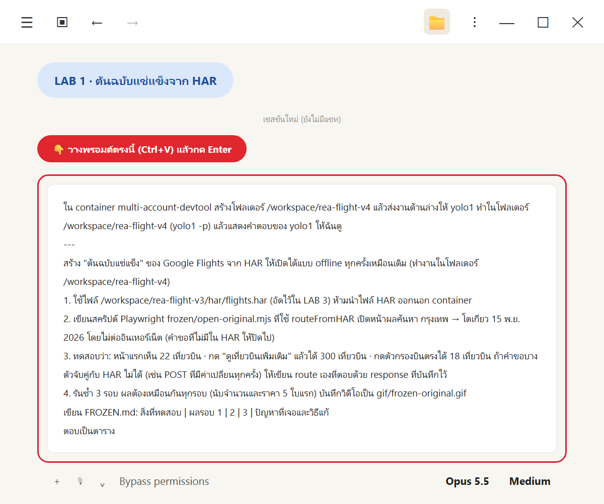
*วางพรอมต์ LAB 1*

💬 **คัดลอกพรอมต์นี้**

```text
ใน container multi-account-devtool สร้างโฟลเดอร์ /workspace/rea-flight-v4 แล้วส่งงานด้านล่างให้ yolo1 ทำในโฟลเดอร์ /workspace/rea-flight-v4 (yolo1 -p) แล้วแสดงคำตอบของ yolo1 ให้ฉันดู
---
สร้าง "ต้นฉบับแช่แข็ง" ของ Google Flights จาก HAR ให้เปิดได้แบบ offline ทุกครั้งเหมือนเดิม (ทำงานในโฟลเดอร์ /workspace/rea-flight-v4)
1. ใช้ไฟล์ /workspace/rea-flight-v3/har/flights.har (อัดไว้ใน LAB 3) ห้ามนำไฟล์ HAR ออกนอก container
2. เขียนสคริปต์ Playwright frozen/open-original.mjs ที่ใช้ routeFromHAR เปิดหน้าผลค้นหา กรุงเทพ → โตเกียว 15 พ.ย. 2026 โดยไม่ต่ออินเทอร์เน็ต (คำขอที่ไม่มีใน HAR ให้ปิดไป)
3. ทดสอบว่า: หน้าแรกเห็น 22 เที่ยวบิน · กด "ดูเที่ยวบินเพิ่มเติม" แล้วได้ 300 เที่ยวบิน · กดตัวกรองบินตรงได้ 18 เที่ยวบิน ถ้าคำขอบางตัวจับคู่กับ HAR ไม่ได้ (เช่น POST ที่มีค่าเปลี่ยนทุกครั้ง) ให้เขียน route เองที่ตอบด้วย response ที่บันทึกไว้
4. รันซ้ำ 3 รอบ ผลต้องเหมือนกันทุกรอบ (นับจำนวนและราคา 5 ใบแรก) บันทึกวิดีโอเป็น gif/frozen-original.gif
เขียน FROZEN.md: สิ่งที่ทดสอบ | ผลรอบ 1 | 2 | 3 | ปัญหาที่เจอและวิธีแก้
ตอบเป็นตาราง
```

✅ **ผลจริง** (yolo1 ใช้เวลา **5 นาที 56 วินาที** · 00:49:51 → 00:55:47) ผ่านทั้ง 3 รอบ ผลเหมือนกันทุกรอบ exit 0

| สิ่งที่ทดสอบ | รอบ 1 | รอบ 2 | รอบ 3 | ปัญหาที่เจอและวิธีแก้ |
|---|---|---|---|---|
| หน้าแรก (คาด 22) | 22 ✅ | 22 ✅ | 22 ✅ | JS bundle 12 ไฟล์จับคู่ HAR ไม่ได้ (`m=`/`exm=` จัดกลุ่มใหม่ทุกครั้ง) → route เองประกอบจาก bundle ที่อัดไว้ |
| ราคา 5 ใบแรก | ฿7,635 · ฿8,432 · ฿11,580 · ฿9,062 · ฿9,335 | เหมือนเดิม | เหมือนเดิม | ข้อมูลหน้าแรกฝังใน HTML (2.7 MB) ซึ่ง `routeFromHAR` ตอบได้ตรงอยู่แล้ว |
| "ดูเที่ยวบินเพิ่มเติม" (คาด 300) | 300 ✅ | 300 ✅ | 300 ✅ | `_reqid` สุ่มใน URL → จับคู่ด้วย `f.req` ใน body |
| บินตรง (คาด 18) | 18 ✅ | 18 ✅ | 18 ✅ | `_.QH is not a function` → ส่ง bundle ตามลำดับการอัด · นับผิดตอนกล่องตัวกรองเปิด → ปิดกล่องแล้วรอให้นิ่ง |
| ผลเหมือนกันทุกรอบ | ✅ | ✅ | ✅ | ตรึงนาฬิกาที่ 2026-10-31T17:03:15Z |
| ไม่ต่ออินเทอร์เน็ต | HAR 48 · JS 20 · GSR 3 · ปิด 18 | เท่ากัน | เท่ากัน | abort ที่เหลือทั้งหมด + proxy `127.0.0.1:9` |
| JS error | 0 | 0 | 0 | — |
| เวลาต่อรอบ | 9.8 วินาที | 9.3 วินาที | 9.3 วินาที | — |

ไฟล์ที่ได้ใน `/workspace/rea-flight-v4`: `frozen/open-original.mjs` (ใช้เป็นโมดูลให้ LAB ถัดไป: `newFrozenContext()`, `installFrozenRoutes()`, `runScenario()`, `SEARCH_URL`) · `frozen/results.json` · `gif/frozen-original.gif` · `FROZEN.md`

ไฟล์เต็ม: [`out-s1.md`](_solution/run/out-s1.md) · [`FROZEN.md`](_solution/run/FROZEN.md) · [`frozen/open-original.mjs`](_solution/run/frozen/open-original.mjs) · [`frozen/results.json`](_solution/run/frozen/results.json) · GIF: [`gif/frozen-original.gif`](_solution/run/gif/frozen-original.gif) (ดูใน T3 ขั้น 5)

👀 **สังเกต**
- **yolo1 ไม่หยุดที่ "routeFromHAR ใช้ไม่ได้"** แต่อ่านอาการทีละข้อ (JS ไม่ตรง → POST สุ่ม → `_.QH` → นับผิดจังหวะ) แล้วแก้ทีละจุด → ตัวอย่างที่ดีของการ debug จากหลักฐาน
- **ใช้ HAR จากที่เดิม** (`/workspace/rea-flight-v3/har/flights.har`) ไม่คัดลอก ไม่ส่งออก · ต้นฉบับแช่แข็งจึงอยู่ใน container เท่านั้น
- เพื่อรัน Playwright ในโฟลเดอร์ใหม่ yolo1 **คัดลอก `node_modules` จาก `rea-flight-v3`** (เวอร์ชันเดียวกับที่ใช้อัด) และบอกตรง ๆ ในคำตอบ
- **9.3 วินาที/รอบ** เร็วกว่าเปิด Google สดมาก และไม่สร้างภาระให้เว็บของคนอื่นเลย → รันกี่ร้อยรอบก็ได้ใน LAB 2 และ LAB 4
- ffmpeg ของระบบมีตัวเข้ารหัส GIF อยู่แล้ว จึงใช้ `palettegen`/`paletteuse` ได้ตรง ๆ

---

## LAB 2 · Differential testing: ใช้ต้นฉบับแช่แข็งเป็นเฉลย

🎯 ให้ yolo1 เขียน test ที่ทำ "สถานการณ์เดียวกัน" กับต้นฉบับแช่แข็งและโคลน v1–v3 แล้วเทียบข้อมูลทุกแถว โดยห้ามเขียนตัวเลขคาดหวังเอง (ทฤษฎี: T4)

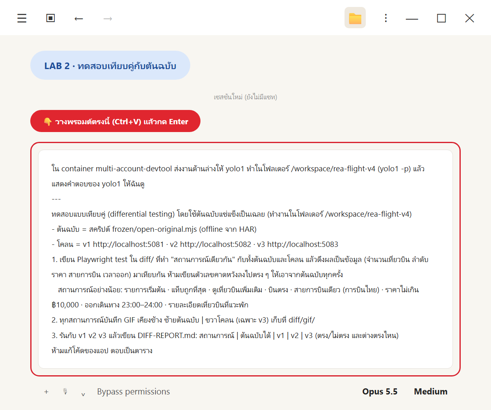
*วางพรอมต์ LAB 2*

💬 **คัดลอกพรอมต์นี้**

```text
ใน container multi-account-devtool ส่งงานด้านล่างให้ yolo1 ทำในโฟลเดอร์ /workspace/rea-flight-v4 (yolo1 -p) แล้วแสดงคำตอบของ yolo1 ให้ฉันดู
---
ทดสอบแบบเทียบคู่ (differential testing) โดยใช้ต้นฉบับแช่แข็งเป็นเฉลย (ทำงานในโฟลเดอร์ /workspace/rea-flight-v4)
- ต้นฉบับ = สคริปต์ frozen/open-original.mjs (offline จาก HAR)
- โคลน = v1 http://localhost:5081 · v2 http://localhost:5082 · v3 http://localhost:5083
1. เขียน Playwright test ใน diff/ ที่ทำ "สถานการณ์เดียวกัน" กับทั้งต้นฉบับและโคลน แล้วดึงผลเป็นข้อมูล (จำนวนเที่ยวบิน ลำดับราคา สายการบิน เวลาออก) มาเทียบกัน ห้ามเขียนตัวเลขคาดหวังลงไปตรง ๆ ให้เอาจากต้นฉบับทุกครั้ง
   สถานการณ์อย่างน้อย: รายการเริ่มต้น · แท็บถูกที่สุด · ดูเที่ยวบินเพิ่มเติม · บินตรง · สายการบินเดียว (การบินไทย) · ราคาไม่เกิน ฿10,000 · ออกเดินทาง 23:00–24:00 · รายละเอียดเที่ยวบินที่แวะพัก
2. ทุกสถานการณ์บันทึก GIF เคียงข้าง ซ้ายต้นฉบับ | ขวาโคลน (เฉพาะ v3) เก็บที่ diff/gif/
3. รันกับ v1 v2 v3 แล้วเขียน DIFF-REPORT.md: สถานการณ์ | ต้นฉบับได้ | v1 | v2 | v3 (ตรง/ไม่ตรง และต่างตรงไหน)
ห้ามแก้โค้ดของแอป ตอบเป็นตาราง
```

✅ **ผลจริง** (yolo1 ใช้เวลา **27 นาที 46 วินาที** · 00:55:57 → 01:23:43 · รวมการรันซ้ำหลายรอบระหว่างพัฒนา) ไม่มีโคลนตรงครบ: **v1 0/8 · v2 3/8 · v3 4/8** (exit 1 เพราะมีข้อไม่ตรง) · ไม่ได้แก้โค้ดแอป

| สถานการณ์ | v1 | v2 | v3 |
|---|---|---|---|
| S1 รายการเริ่มต้น (22 ใบ) | ❌ ราคาชุดเก่า | ❌ 10 ใบ | ❌ ชื่อพาร์ทเนอร์ 6 ใบ |
| S2 แท็บถูกที่สุด ⚠️ | ❌ ไม่มีแท็บ | ✅ | ✅ |
| S3 ดูเที่ยวบินเพิ่มเติม (300 ใบ) | ⛔ | ❌ 22 ใบ | ❌ ชื่อสายการบินต่าง 149 ตำแหน่ง |
| S4 บินตรง (18 ใบ) | ❌ | ❌ | ❌ ชื่อเจเอแอล 6 ใบ |
| S5 การบินไทย ⚠️ | ⛔ | ✅ | ✅ |
| S6 ราคา ≤ ฿10,000 ⚠️ | ⛔ | ❌ 5 ใบ | ✅ |
| S7 ออก 23:00–24:00 ⚠️ | ⛔ | ❌ 5 ใบ | ❌ 33 ตรง · ชื่อต่าง 18 ใบ |
| S8 รายละเอียดที่แวะพัก | ⛔ | ✅ | ✅ |
| **รวม** | **0/8** | **3/8** | **4/8** |

(⚠️ = เฉลยอนุมาน · ⛔ = ไม่มีฟีเจอร์ · ตารางละเอียดพร้อม "ต่างตรงไหน" อยู่ใน T4 ขั้น 4)

ไฟล์ที่ได้: `diff/run.mjs` (`node diff/run.mjs v1,v2,v3`) · `diff/scenarios.mjs` (8 สถานการณ์) · `diff/lib/original.mjs` · `clone.mjs` · `parse.mjs` · `diff/report.mjs` · `diff/gif/S1…S8.gif` · `diff/results/diff-results.json` · `DIFF-REPORT.md`

| GIF เคียงข้าง (ซ้ายต้นฉบับ \| ขวา v3) | |
|---|---|
| [S1 รายการเริ่มต้น](_solution/run/diff/gif/S1-initial.gif) · [S2 แท็บถูกที่สุด](_solution/run/diff/gif/S2-cheapest.gif) · [S3 ดูเพิ่ม](_solution/run/diff/gif/S3-more.gif) · [S4 บินตรง](_solution/run/diff/gif/S4-nonstop.gif) | [S5 การบินไทย](_solution/run/diff/gif/S5-airline.gif) · [S6 ราคา](_solution/run/diff/gif/S6-price.gif) · [S7 เวลาออก](_solution/run/diff/gif/S7-depart.gif) · [S8 รายละเอียด](_solution/run/diff/gif/S8-detail.gif) |

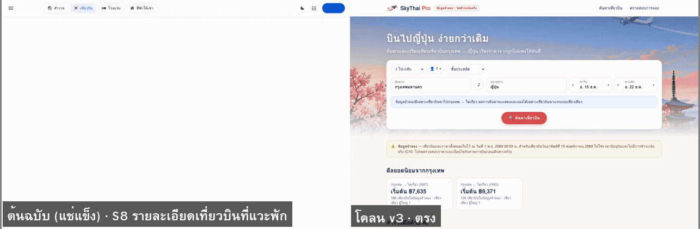
*GIF จริง S8 ✅ · ต้นฉบับ | v3 · SL 394 · DMK 06:20 → TPE 11:10 / 12:10 → NRT 16:25 · แวะ 1 ชม. @TPE*

ไฟล์เต็ม: [`out-s2.md`](_solution/run/out-s2.md) · [`DIFF-REPORT.md`](_solution/run/DIFF-REPORT.md) · [`diff/`](_solution/run/diff/)

👀 **สังเกต**
- **ไม่มีเลขคาดหวังในโค้ด** · ทุกครั้งที่รัน ตัวรันเปิดต้นฉบับแช่แข็งใหม่แล้วดึงเฉลยสด ๆ (`diff/scenarios.mjs` เขียนกำกับไว้ที่บรรทัดแรก)
- **yolo1 ซื่อตรงเรื่องจุดอ่อนของเฉลย:** แยกตาราง "ที่มาของเฉลย" ทุกสถานการณ์ · ตรวจวิธีอนุมานกับ "บินตรง" ก่อนใช้ · บอกว่า S2 อ่อน (v2 ผ่านทั้งที่มี 10 ใบ)
- **GIF ฝั่งต้นฉบับของ S2 และ S5–S7 มีแถบสีส้ม** = เฉลยอนุมาน ผู้ดูจะไม่เข้าใจผิดว่าเป็นผลสดจาก Google
- **v3 ผิดแค่เรื่องเดียว:** จำนวนและราคาถูกหมด เหลือชื่อสายการบิน (พาร์ทเนอร์ร่วมขาย + "หลายสายการบิน") → เป็น "ตั๋วงาน" ชิ้นแรกของ LAB 5
- yolo1 เสนอเองว่า "ถ้าต้องการเทียบแค่สายการบินหลัก แก้เกณฑ์เปรียบเทียบก็พอ" แต่ **ไม่ได้แก้** เพราะต้นฉบับแสดงชื่อพาร์ทเนอร์จริง → แก้ที่แอปถูกกว่าแก้ที่ข้อสอบ

---

## LAB 3 · เทียบโครงสร้างหน้า (ariaSnapshot) แทนพิกเซล

🎯 ให้ `yolo3` เก็บ accessibility tree ของหน้าผลค้นหาจากต้นฉบับแช่แข็งและ v1–v3 แล้วคำนวณความเหมือนของโครงสร้าง เทียบกับ visual diff ของบทที่ 3 (ทฤษฎี: T5) · **รันพร้อมกับ LAB 2 ได้**

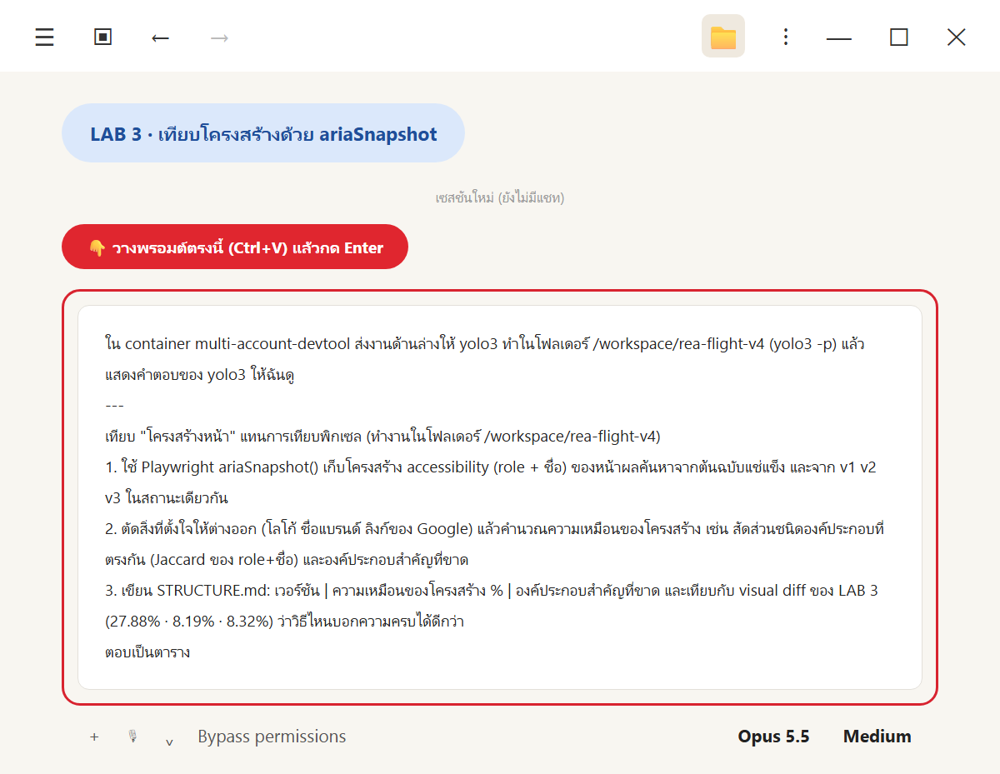
*วางพรอมต์ LAB 3*

💬 **คัดลอกพรอมต์นี้**

```text
ใน container multi-account-devtool ส่งงานด้านล่างให้ yolo3 ทำในโฟลเดอร์ /workspace/rea-flight-v4 (yolo3 -p) แล้วแสดงคำตอบของ yolo3 ให้ฉันดู
---
เทียบ "โครงสร้างหน้า" แทนการเทียบพิกเซล (ทำงานในโฟลเดอร์ /workspace/rea-flight-v4)
1. ใช้ Playwright ariaSnapshot() เก็บโครงสร้าง accessibility (role + ชื่อ) ของหน้าผลค้นหาจากต้นฉบับแช่แข็ง และจาก v1 v2 v3 ในสถานะเดียวกัน
2. ตัดสิ่งที่ตั้งใจให้ต่างออก (โลโก้ ชื่อแบรนด์ ลิงก์ของ Google) แล้วคำนวณความเหมือนของโครงสร้าง เช่น สัดส่วนชนิดองค์ประกอบที่ตรงกัน (Jaccard ของ role+ชื่อ) และองค์ประกอบสำคัญที่ขาด
3. เขียน STRUCTURE.md: เวอร์ชัน | ความเหมือนของโครงสร้าง % | องค์ประกอบสำคัญที่ขาด และเทียบกับ visual diff ของ LAB 3 (27.88% · 8.19% · 8.32%) ว่าวิธีไหนบอกความครบได้ดีกว่า
ตอบเป็นตาราง
```

✅ **ผลจริง** (yolo3 ใช้เวลา **≈4 นาที** · ≈00:56 → 01:00:07 · รันคู่กับ LAB 2) **การเทียบโครงสร้างบอกความครบได้ดีกว่า** เรียง v3 > v2 > v1 ตรงกับ acceptance

| เวอร์ชัน | ความเหมือนของโครงสร้าง % | องค์ประกอบสำคัญที่ขาด |
|---|---:|---|
| v1 SkyThai Mini | **3.8%** (Jaccard 5.0% · ครบ 1/38) | ขาด 37 จาก 38: ฟอร์มค้นหาทั้งชุด · ชิปตัวกรอง · แท็บ · จำนวนผลลัพธ์ · หัวข้อ · จัดเรียง · ปุ่มรายละเอียด · ข้อมูลเชิงลึกด้านราคา · ดูเที่ยวบินเพิ่มเติม ฯลฯ (มีแค่ list ของใบเที่ยวบิน) |
| v2 SkyThai Plus | **55.8%** (Jaccard 45.9% · ครบ 25/38) | ขาด 13: landmark `search` · `tabpanel` · หัวข้อยอดนิยม/อื่นๆ · ปุ่มค่าธรรมเนียมสัมภาระ · ใบไม่อยู่ใน `list` · แสดงแรก 10 ใบ · การปล่อยก๊าซเป็นข้อความ · ปุ่มประวัติราคา/ตารางวันที่/กราฟราคา ฯลฯ |
| v3 SkyThai Pro | **70.5%** (Jaccard 54.1% · ครบ 33/38) | ขาด 5: landmark `search` · `tabpanel` · ปุ่มค่าธรรมเนียมสัมภาระ · ใบไม่อยู่ใน `list`/`listitem` · การปล่อยก๊าซต่อใบเป็นข้อความ |

| ตัววัด | v1 | v2 | v3 | Spearman กับ acceptance |
|---|---:|---:|---:|---:|
| visual diff บทที่ 3 (ต่ำ = ใกล้) | 27.88% | **8.19%** | 8.32% | 0.5 (ผิด) |
| ความเหมือนของโครงสร้าง | 3.8% | 55.8% | **70.5%** | **1.0** (ถูก) |

ไฟล์ที่ได้: `structure/capture.mjs` · `structure/compare.mjs` · `structure/snapshots/{original,v1,v2,v3}.yml` · `structure/metrics.json` · `STRUCTURE.md`

ไฟล์เต็ม: [`out-s3.md`](_solution/run/out-s3.md) · [`STRUCTURE.md`](_solution/run/STRUCTURE.md) · [`structure/snapshots/original.yml`](_solution/run/structure/snapshots/original.yml) · [`v3.yml`](_solution/run/structure/snapshots/v3.yml) · [`metrics.json`](_solution/run/structure/metrics.json)

👀 **สังเกต**
- **เปิด `original.yml` เทียบ `v3.yml` เองสักครั้ง** จะเห็นว่าแถวเที่ยวบินของต้นฉบับอยู่ใน `list` → `listitem` และมีปุ่มการปล่อยก๊าซ ส่วน v3 เป็น `link` เรียงกันเฉย ๆ (T5 ขั้น 2)
- **ตัดสิ่งที่ตั้งใจให้ต่างก่อนเสมอ** (banner, ลิงก์ Google, ป้ายข้อมูลจำลอง) ไม่อย่างนั้นโคลนจะ "เสียคะแนน" จากสิ่งที่เราห้ามลอกอยู่แล้ว
- **ตัวเลข → `#`** เพราะราคาของโคลนมาจากคนละรอบกับ HAR · โครงสร้างไม่ควรขึ้นกับราคา
- yolo3 เขียนข้อจำกัดเอง: มีแค่ 3 จุดข้อมูล · รายการ 38 ข้อเลือกเอง · วัดสถานะเดียว → **ใช้คู่กับ visual diff ไม่ใช่แทนที่**
- LAB นี้ใช้แค่ `frozen/open-original.mjs` จาก LAB 1 จึงรันพร้อม LAB 2 ได้ (คนละบัญชี yolo3 vs yolo1)

---

## LAB 4 · Mutation testing: ชุดทดสอบไหนจับบั๊กเก่งกว่า

🎯 ให้ `cyolo1` (Codex) ใส่บั๊กจงใจ 10 ตัวใน v3 ทีละตัว แล้วดูว่า acceptance 82 ข้อ และ differential 8 สถานการณ์ จับได้แค่ไหน (ทฤษฎี: T6) · **ต้องมี `diff/` จาก LAB 2 ก่อน** แล้วรันพร้อมกับ LAB 5 ได้

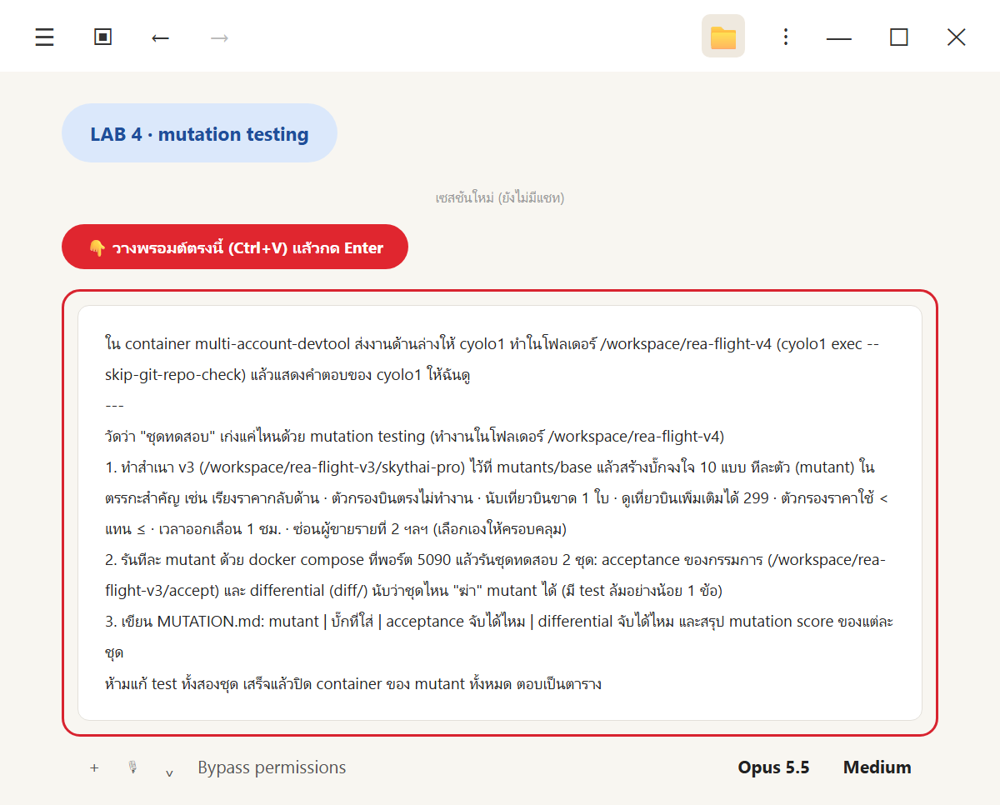
*วางพรอมต์ LAB 4*

💬 **คัดลอกพรอมต์นี้**

```text
ใน container multi-account-devtool ส่งงานด้านล่างให้ cyolo1 ทำในโฟลเดอร์ /workspace/rea-flight-v4 (cyolo1 exec --skip-git-repo-check) แล้วแสดงคำตอบของ cyolo1 ให้ฉันดู
---
วัดว่า "ชุดทดสอบ" เก่งแค่ไหนด้วย mutation testing (ทำงานในโฟลเดอร์ /workspace/rea-flight-v4)
1. ทำสำเนา v3 (/workspace/rea-flight-v3/skythai-pro) ไว้ที่ mutants/base แล้วสร้างบั๊กจงใจ 10 แบบ ทีละตัว (mutant) ในตรรกะสำคัญ เช่น เรียงราคากลับด้าน · ตัวกรองบินตรงไม่ทำงาน · นับเที่ยวบินขาด 1 ใบ · ดูเที่ยวบินเพิ่มเติมได้ 299 · ตัวกรองราคาใช้ < แทน ≤ · เวลาออกเลื่อน 1 ชม. · ซ่อนผู้ขายรายที่ 2 ฯลฯ (เลือกเองให้ครอบคลุม)
2. รันทีละ mutant ด้วย docker compose ที่พอร์ต 5090 แล้วรันชุดทดสอบ 2 ชุด: acceptance ของกรรมการ (/workspace/rea-flight-v3/accept) และ differential (diff/) นับว่าชุดไหน "ฆ่า" mutant ได้ (มี test ล้มอย่างน้อย 1 ข้อ)
3. เขียน MUTATION.md: mutant | บั๊กที่ใส่ | acceptance จับได้ไหม | differential จับได้ไหม และสรุป mutation score ของแต่ละชุด
ห้ามแก้ test ทั้งสองชุด เสร็จแล้วปิด container ของ mutant ทั้งหมด ตอบเป็นตาราง
```

✅ **ผลจริง** (cyolo1 ใช้เวลา **45 นาที 39 วินาที** · 01:24:03 → 02:09:42 · รันคู่กับ LAB 5) รันฐาน + mutant 10 ตัว × 2 ชุดทดสอบ · ตรวจ SHA-256 ว่าไม่ได้แก้ test · ปิด container และลบ volume ของ mutant ทั้งหมดแล้ว (ไม่แตะแอปเดิมที่ 5081–5083)

| Mutant | บั๊กที่ใส่ | Acceptance จับได้* | Differential จับได้* |
|---|---|---|---|
| M01 | เรียงราคาแพงไปถูก | ได้ | ได้ |
| M02 | ตัวกรองบินตรงไม่ทำงาน | ได้ | ได้ |
| M03 | แสดงจำนวนขาด 1 | ได้ | ได้ |
| M04 | โหลดเพิ่มเติมได้ 299 ใบ | ได้ | ได้ |
| M05 | ราคาใช้ < แทน ≤ | ได้ | ได้ |
| M06 | เวลาออกเลื่อน 1 ชั่วโมง | ได้ | ได้ |
| M07 | ตัวกรองสายการบินไม่ทำงาน | ได้ | ได้ |
| M08 | ตัวกรองเวลาออกไม่ทำงาน | ได้ | ได้ |
| M09 | ตัวกรองระยะเวลาไม่ทำงาน | ได้ | ได้ |
| M10 | หมายเลขเที่ยวบินผิด | ได้ | ได้ |
| **Mutation score ตามเกณฑ์ที่ขอ** | | **10/10 = 100%** | **10/10 = 100%** |

\* นับตามเกณฑ์ "มี test ล้มอย่างน้อย 1 ข้อ" แต่ฐานล้มอยู่แล้ว (acceptance 8/82 · differential 4/8) คะแนนดิบจึงสูงเกินจริง · **นับเฉพาะ pass → fail ใหม่: acceptance 80% · differential 40%** (ขอบล่างของการตรวจพบ · ตารางรายข้ออยู่ใน T6 ขั้น 4)

ตัวอย่างการแก้จริงจาก [`mutants/manifest.json`](_solution/run/mutants/manifest.json)

```text
M04  Results.tsx   const visible = sorted;
                →  const visible = loadedAll ? sorted.slice(0, 299) : sorted;
M10  FlightRow.tsx <b>{l.flightNumber}</b>
                →  <b>XX000</b>
```

ไฟล์เต็ม: [`out-s4.md`](_solution/run/out-s4.md) · [`MUTATION.md`](_solution/run/MUTATION.md) · [`mutants/`](_solution/run/mutants/) (`manifest.json` · `outcomes.json` · `run.py` · `prepare.py` · `summarize.py` · `verify.py` · `endpoint.cjs` · `test-hashes.json` · `verification.json`)

👀 **สังเกต**
- **cyolo1 ไม่หยุดที่ 100%** แต่ตั้งคำถามกับคะแนนตัวเองและเพิ่มเกณฑ์เข้ม → กรรมการที่ดีบอกจุดอ่อนของตัวเลขตัวเอง (เหมือนที่ cyolo1 ทำในบทที่ 3)
- **รันทีละ mutant** ด้วย compose project แยก (`mutation-<id>`) ที่พอร์ต 5090 แล้ว `down -v` ใน `finally` เสมอ → ไม่มี container ค้าง และไม่ชนกับ swarm ของ LAB 5 ที่รันพร้อมกัน
- differential ของ LAB 2 ผูกพอร์ต 5083 ไว้ในโค้ด cyolo1 **ไม่แก้ test** แต่เขียน `endpoint.cjs` (โหลดด้วย `node --require`) เปลี่ยนแค่ baseURL เป็น 5090 → ตัวอย่างการ "ห่อ" test โดยไม่แตะ assertion
- **M08 และ M05 รอดทั้งสองชุด** ในเกณฑ์เข้ม → อ่าน T6 ขั้น 4 ว่าทำไม (test ที่แดงค้าง · ค่าขอบ)
- หลักฐานรายรอบ (log, JSON, screenshot, วิดีโอ, GIF ของทุก mutant) อยู่ใน container ที่ `mutants/runs/` ใน repo เก็บเฉพาะสคริปต์และผลรวม

---

## LAB 5 · แก้แบบรุม (swarm) → SkyThai Max (v4) + ตัดสินรวม v1–v4

🎯 ให้ yolo1 เป็นหัวหน้า: คัดลอก v3 เป็น v4 แบ่งงานจาก `DIFF-REPORT.md` + `STRUCTURE.md` เป็น 3 กลุ่ม ส่งให้ `yolo2` · `yolo3` · `cyolo1` ทำพร้อมกันใน git worktree แล้ว merge วนรอบด้วย differential และตัดสินรวม v1–v4 (ทฤษฎี: T7, T8) · **ต้องมีผล LAB 2 และ LAB 3 ก่อน**

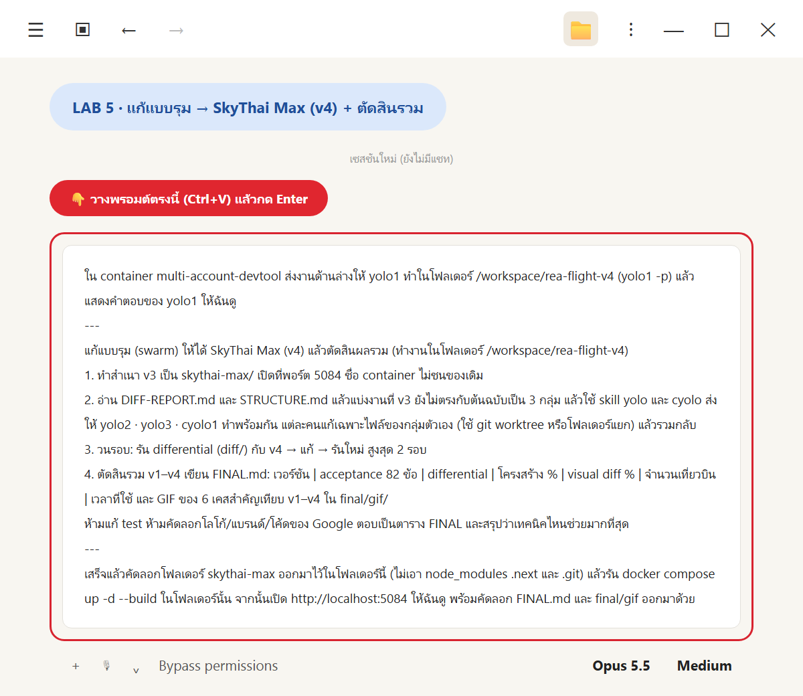
*วางพรอมต์ LAB 5*

💬 **คัดลอกพรอมต์นี้**

```text
ใน container multi-account-devtool ส่งงานด้านล่างให้ yolo1 ทำในโฟลเดอร์ /workspace/rea-flight-v4 (yolo1 -p) แล้วแสดงคำตอบของ yolo1 ให้ฉันดู
---
แก้แบบรุม (swarm) ให้ได้ SkyThai Max (v4) แล้วตัดสินผลรวม (ทำงานในโฟลเดอร์ /workspace/rea-flight-v4)
1. ทำสำเนา v3 เป็น skythai-max/ เปิดที่พอร์ต 5084 ชื่อ container ไม่ชนของเดิม
2. อ่าน DIFF-REPORT.md และ STRUCTURE.md แล้วแบ่งงานที่ v3 ยังไม่ตรงกับต้นฉบับเป็น 3 กลุ่ม แล้วใช้ skill yolo และ cyolo ส่งให้ yolo2 · yolo3 · cyolo1 ทำพร้อมกัน แต่ละคนแก้เฉพาะไฟล์ของกลุ่มตัวเอง (ใช้ git worktree หรือโฟลเดอร์แยก) แล้วรวมกลับ
3. วนรอบ: รัน differential (diff/) กับ v4 → แก้ → รันใหม่ สูงสุด 2 รอบ
4. ตัดสินรวม v1–v4 เขียน FINAL.md: เวอร์ชัน | acceptance 82 ข้อ | differential | โครงสร้าง % | visual diff % | จำนวนเที่ยวบิน | เวลาที่ใช้ และ GIF ของ 6 เคสสำคัญเทียบ v1–v4 ใน final/gif/
ห้ามแก้ test ห้ามคัดลอกโลโก้/แบรนด์/โค้ดของ Google ตอบเป็นตาราง FINAL และสรุปว่าเทคนิคไหนช่วยมากที่สุด
---
เสร็จแล้วคัดลอกโฟลเดอร์ skythai-max ออกมาไว้ในโฟลเดอร์นี้ (ไม่เอา node_modules .next และ .git) แล้วรัน docker compose up -d --build ในโฟลเดอร์นั้น จากนั้นเปิด http://localhost:5084 ให้ฉันดู พร้อมคัดลอก FINAL.md และ final/gif ออกมาด้วย
```

(บรรทัดสุดท้ายเป็นงานของ Claude Code Desktop: คัดลอกออกจาก container ด้วย `docker cp` แล้วรัน `docker compose up -d --build` บน Windows)

✅ **ผลจริง** (yolo1 ใช้เวลา **52 นาที 33 วินาที** · 01:24:03 → 02:16:36 รวมวัดผลทุกตัว) differential **8/8** · โครงสร้าง **78.6% (38/38)** · visual diff **5.13%** · acceptance คงที่ 74/82

| เวอร์ชัน | acceptance 82 ข้อ | differential | โครงสร้าง % | visual diff % | เที่ยวบิน (แรก → ครบ) | เวลาที่ใช้ |
|---|---:|---:|---:|---:|---:|---:|
| v1 Mini | 0/82 (0.0%) | 0/8 | 3.8% (1/38) | 27.88% | 22 → 22 | ≈6 นาที |
| v2 Plus | 51/82 (62.2%) | 3/8 | 55.8% (25/38) | 8.19% | 10 → 22 | ≈14 นาที |
| v3 Pro | 74/82 (90.2%) | 4/8 | 70.5% (33/38) | 8.32% | 22 → 300 | ≈42 นาที |
| **v4 Max** | **74/82 (90.2%)** | **8/8** | **78.6% (38/38)** | **5.13%** | 22 → 300 | ≈51 นาที (swarm รอบ 1 = 19 นาที) |

**แบ่งงานและวนรอบ** (รายละเอียดใน T7)
- **รอบ 1 (พร้อมกัน 3 กลุ่ม):** `yolo2` ชื่อสายการบินจาก HAR (300/300) · `yolo3` landmark `search` + เลย์เอาต์ · `cyolo1` `tabpanel` · `ul/li` · ปุ่มค่าธรรมเนียมสัมภาระ · ปุ่มการปล่อยก๊าซ → differential 4/8 → **8/8** · โครงสร้าง 70.5 → 78.6% · visual 8.32 → 6.55%
- **รอบ 2 (`yolo3`):** differential 8/8 แล้ว จึงใช้รอบนี้ลด visual diff ด้วยการเรียงส่วนในหน้าตามต้นฉบับ 6.55 → 5.12% ตัววัดอื่นไม่ถอย
- **ปิดงาน:** เปลี่ยนชื่อบนหน้าเป็น "SkyThai Max" (5.13%)

**GIF 6 เคสสำคัญ เทียบ v1–v4** (แบ่งจอ 2×2: ซ้ายบน v1 · ขวาบน v2 · ซ้ายล่าง v3 · ขวาล่าง v4 · คลิกเพื่อดู)

| เคส | v1 | v2 | v3 | v4 | GIF |
|---|---|---|---|---|---|
| S1 รายการเริ่มต้น 22 ใบ | ❌ | ❌ (10 ใบ) | ❌ (ชื่อพาร์ทเนอร์) | ✅ | [S1](_solution/run/final/gif/S1-initial.gif) |
| S2 แท็บถูกที่สุด | ❌ (ไม่มีแท็บ) | ✅ | ✅ | ✅ | [S2](_solution/run/final/gif/S2-cheapest.gif) |
| S3 ดูเที่ยวบินเพิ่มเติม 300 ใบ | ⛔ | ❌ (22 ใบ) | ❌ ("หลายสายการบิน") | ✅ | [S3](_solution/run/final/gif/S3-more.gif) |
| S4 บินตรง 18 ใบ | ❌ | ❌ | ❌ (ชื่อพาร์ทเนอร์) | ✅ | [S4](_solution/run/final/gif/S4-nonstop.gif) |
| S6 ราคาไม่เกิน ฿10,000 | ⛔ | ❌ (5 ใบ) | ✅ | ✅ | [S6](_solution/run/final/gif/S6-price.gif) |
| S8 รายละเอียดเที่ยวบินที่แวะพัก | ⛔ | ✅ | ✅ | ✅ | [S8](_solution/run/final/gif/S8-detail.gif) |

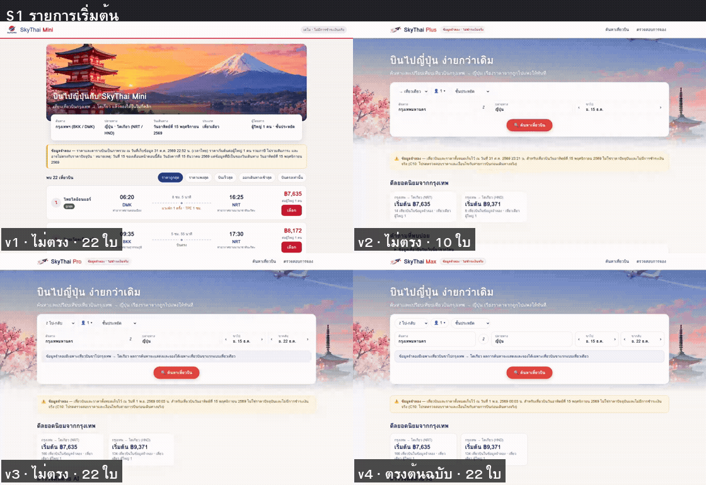
*GIF จริง S1 · v4 (ขวาล่าง) ตรงกับต้นฉบับทั้ง 22 ใบ รวมชื่อพาร์ทเนอร์ เช่น "เจเอแอล · บางกอกแอร์เวย์ส"*

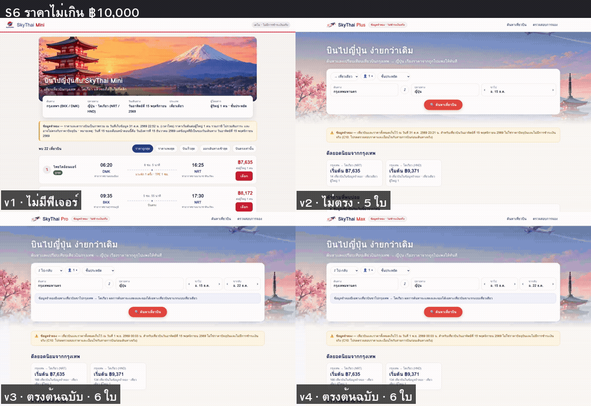
*GIF จริง S6 · v1 ไม่มีตัวกรองราคา · v2 ได้ 5 ใบ (ราคาชุดเก่า) · v3 และ v4 ได้ 6 ใบตรงกับเฉลย*

**บน Windows (Docker Desktop)** `docker compose up -d --build` ในโฟลเดอร์ `skythai-max/` ใช้เวลา **27 วินาที** แล้วเปิด http://localhost:5084 ได้


*หน้าแรกจริงที่ http://localhost:5084 · NRT 166 + HND 134 = 300 เที่ยวบิน · โลโก้และแบรนด์ออกแบบเอง*

ไฟล์เต็ม: [`out-s5.md`](_solution/run/out-s5.md) · [`FINAL.md`](_solution/run/FINAL.md) · [`final/`](_solution/run/final/) (`loop/r1`, `loop/r2`, `accept-v4/`, `structure/`, `visual/`, `gif/`) · [`swarm/`](_solution/run/swarm/) (คำสั่งงานและ log ของแต่ละ agent) · โค้ดแอป [`_solution/skythai-max/`](_solution/skythai-max/)

👀 **สังเกต**
- **ข้อมูลชื่อพาร์ทเนอร์มาจาก HAR ไม่ใช่จาก UI ของต้นฉบับ:** คำสั่งงานกลุ่ม 1 ห้ามถอดจากผล UI และ **ห้ามฝังเฉลยลงโค้ดเพื่อให้ test ผ่าน** · ผลคือ `data/airline-labels.json` (310 บรรทัด · `meta.source` = `flights.clean.har`) + สคริปต์ `scripts/v4/extract_airline_labels.py` ตรวจย้อนได้
- **หัวหน้าวัดซ้ำเองทุกตัวเลขหลัง merge** · v1–v3 ก็ถูกวัดซ้ำด้วยตัวรันใน `final/` แล้วได้ค่าเดิมตรงทุกตัว
- ตัวรันเดิมใน `diff/` และ `structure/` ผูกพอร์ตไว้แค่ v1–v3 yolo1 จึง **เขียนตัวรันเพิ่มใน `final/`** ที่เรียกสถานการณ์และสูตรเดิม แทนการแก้ test และไม่เขียนทับ `DIFF-REPORT.md` / `STRUCTURE.md`
- **cyolo2 ยังไม่ได้ล็อกอิน** ในรอบจริง yolo1 จึงให้ cyolo1 ทำแทน (พรอมต์ของผู้เรียนใช้ cyolo1 แล้ว) · ถ้าอยากใช้ cyolo2 ให้รัน `cyolo2 login` ก่อน · และงานแรกของ cyolo1 ล้มใน 21.7 วินาทีแล้วถูกสั่งซ้ำ (T7 ขั้น 5)
- **yolo3 เปลี่ยนหน้าตาบางจุดให้เหมือนต้นฉบับ** ควรเปิดดูเองว่ารับได้ไหม: ข้อความยาว "ข้อมูลจำลอง" ย้ายไปใต้รายการ (ป้ายสั้นที่หัวเว็บยังอยู่) · ช่วงราคาแสดงหลังกด "ดูประวัติราคา" · การ์ดวันที่ถูกกว่าเลื่อนตามหน้าและอาจบังใบแรกของ "เที่ยวบินอื่นๆ"
- branch `g1` `g2` `g3` `r2` ยังเก็บไว้ใน repo ของ `skythai-max/` ใน container (ตอนคัดลอกออกมาไม่เอา `.git`)

---

## ✅ รูบริก: เช็กลิสต์ก่อนส่งงาน

- [ ] อธิบายได้ว่าปัญหาเฉลยของบทที่ 3 คืออะไร พร้อมตัวเลขจริง (35 vs 33 · 76 vs 77 · 299 vs 300) และทำไม "ใช้ต้นฉบับเป็นเฉลย" แก้ได้
- [ ] อธิบาย test oracle ได้อย่างน้อย 3 แบบ และบอกได้ว่าบทนี้ใช้แบบไหนกับสถานการณ์ใด (ผลสด vs อนุมาน)
- [ ] มี `frozen/open-original.mjs` ที่รัน 3 รอบได้ 22 / 300 / 18 เหมือนกันทุกรอบ โดยไม่มีคำขอออกอินเทอร์เน็ต และ `FROZEN.md` (LAB 1)
- [ ] อธิบายได้อย่างน้อย 3 เหตุผลที่ต้องเขียน route เองนอกจาก `routeFromHAR` (JS จัดกลุ่มใหม่ · `_reqid` สุ่ม · ลำดับ bundle · นาฬิกา · telemetry)
- [ ] มี `diff/` ที่ไม่มีเลขคาดหวังฝังในโค้ด และ `DIFF-REPORT.md` ที่บอก "ต่างตรงไหน" ทุกช่อง (LAB 2)
- [ ] ชี้ได้ว่าสถานการณ์ไหนใช้เฉลยอนุมาน และอธิบายได้ว่าทำไมตัดสินแค่จำนวน + ชุด
- [ ] มี `STRUCTURE.md` และคำนวณคะแนนโครงสร้างของ v3 เองได้ (Jaccard + 38 ข้อ → 70.5%) (LAB 3)
- [ ] มี `MUTATION.md` และอธิบายได้ว่าทำไมคะแนนดิบ 100% หลอกตา และ M08 รอดเพราะอะไร (LAB 4)
- [ ] อธิบายได้ว่า swarm ไม่ชนกันเพราะอะไร (ไฟล์ · worktree · สัญญาร่วม · พอร์ต) (LAB 5)
- [ ] `docker compose up -d --build` ใน `skythai-max/` แล้ว http://localhost:5084 เปิดได้ · กด "ดูเที่ยวบินเพิ่มเติม" ได้ 300 ใบ · เห็นชื่อพาร์ทเนอร์ เช่น "เจเอแอล · บางกอกแอร์เวย์ส" · มีป้ายข้อมูลจำลอง
- [ ] มี `FINAL.md` ที่มีครบ 4 ตัววัด × 4 เวอร์ชัน และอธิบายได้ว่าทำไม acceptance แยก v3 กับ v4 ไม่ได้
- [ ] ยืนยันได้ว่าไม่มีไฟล์ HAR ใน repo / โฟลเดอร์บน Windows ของตัวเอง

---

## 🔁 รันซ้ำ / ปิดงาน

**ปิด SkyThai Max บน Windows** (ในโฟลเดอร์ `skythai-max/` หรือ `_solution/skythai-max/`)

```powershell
docker compose down        # ล้างฐานข้อมูลด้วย: docker compose down -v
```

**อยากรันซ้ำ**
1. ให้ Claude Code ย้ายโฟลเดอร์เดิมไปเป็น `/workspace/rea-flight-v4-old` ก่อน แล้วค่อยทำ LAB 1–5 (อย่าลบ `rea-flight-v3` เพราะมี HAR และข้อสอบที่บทนี้อ่าน)
2. **ผลของ LAB 1–4 ควรได้ตัวเลขเหมือนตารางในบทนี้** เพราะต้นฉบับแช่แข็งจาก HAR ชุดเดิม (นี่คือข้อดีของการแช่แข็ง) · ถ้าคุณอัด HAR ใหม่ในบทที่ 3 ตัวเลขจะต่างแต่ "รูปแบบ" ควรเหมือนกัน
3. ผล swarm (LAB 5) อาจต่างในรายละเอียด เพราะ agent แต่ละตัวตัดสินใจไม่เหมือนเดิมทุกครั้ง · ให้เทียบที่ differential/โครงสร้าง ไม่ใช่โค้ด
4. ตรวจว่าไม่มี container ค้างจาก mutation และ swarm: ให้ Claude Code รัน `docker ps -a` ใน container แล้วดูชื่อ `mutation-*` และ `skythai-max-g1/g2/g3/r2` ถ้ามีให้ `docker compose -p <ชื่อ> down -v`
5. **git worktree ที่ไม่ใช้แล้ว** ลบด้วย `git worktree remove wt/<ชื่อ>` (ไม่ใช่ลบโฟลเดอร์ตรง ๆ) แล้ว `git worktree prune`
6. **ไฟล์อ่อนไหว:** HAR ยังอยู่ที่ `/workspace/rea-flight-v3/har/` · ถ้าไม่ใช้แล้ว ให้จัดการ **ด้วยตัวเองหลังตรวจรายการไฟล์** อย่าคัดลอกออกมาที่ Windows

---

## ถ้าเจอปัญหา: คัดลอกพรอมต์นี้

```text
LAB บทที่ 4 (REA Differential Oracle) ใน container multi-account-devtool มีปัญหา ช่วยตรวจทีละข้อแบบอ่านอย่างเดียวก่อน แล้วบอกฉันว่าจะแก้อย่างไร ห้ามลบไฟล์ใน /workspace/rea-flight-v3 และ /workspace/rea-flight-v4 ห้ามแก้ไฟล์ test (accept/ diff/ structure/) และห้ามนำไฟล์ HAR ออกนอก container
1. container multi-account-devtool รันอยู่ไหม และ yolo1 yolo2 yolo3 cyolo1 ล็อกอินอยู่ไหม
2. ใน /workspace/rea-flight-v4 มีอะไรแล้วบ้าง: frozen/, FROZEN.md, diff/, DIFF-REPORT.md, structure/, STRUCTURE.md, mutants/, MUTATION.md, skythai-max/, FINAL.md
3. รัน node frozen/open-original.mjs 1 ได้ผล 22 / 300 / 18 ไหม ถ้าไม่ได้ให้แสดง error และจำนวนคำขอที่ถูก abort
4. curl http://localhost:5081/api/health ถึง :5084/api/health ใน container ตอบอะไร และมี container ชื่อ mutation-* หรือ skythai-max-g* ค้างอยู่ไหม
5. git worktree list ใน skythai-max/ แสดงอะไร
สรุปเป็นตาราง ข้อ | ผล | วิธีแก้ที่แนะนำ แล้วรอให้ฉันยืนยันก่อนแก้
```

| อาการ | สาเหตุที่พบบ่อย | วิธีแก้ |
|---|---|---|
| ต้นฉบับแช่แข็งเปิดหน้าไม่ขึ้น | URL ไม่ตรงกับที่อัดแบบตัวอักษรต่อตัวอักษร (เช่น `%20` แทน `+`) · method/body ต่าง | ใช้ `SEARCH_URL` ตรงตาม HAR · ตั้ง `notFound: 'fallback'` แล้วดูรายการคำขอที่ถูก abort |
| JS bundle ไม่ตรงกับ HAR | URL `m=`/`exm=` ของ gstatic จัดกลุ่มโมดูลใหม่ทุกครั้ง | route เองประกอบคำตอบจาก bundle ที่อัดไว้ตามโมดูลที่ขอ |
| `_.QH is not a function` | ส่งเฉพาะ bundle ที่มีโมดูลตรง แต่ bundle หลังอ้างฟังก์ชันจาก bundle ก่อน | ส่งทุก bundle ที่ยังไม่ส่งตั้งแต่ต้นจนถึงตัวที่ต้องใช้ **ตามลำดับการอัด** ไม่ส่งซ้ำ |
| "ดูเที่ยวบินเพิ่มเติม" ไม่ได้ข้อมูล | `_reqid` สุ่มใน URL ของ `GetShoppingResults` | จับคู่ด้วย `f.req` ใน body |
| นับแถวได้ 300 ทั้งที่กดบินตรง | นับตอนกล่องตัวกรองเปิด (ส่วนอื่นหายจาก accessibility tree) | รอ response → ปิดกล่อง → รอให้จำนวนแถวนิ่ง |
| ผลแต่ละรอบไม่เหมือนกัน | ข้อความอิงวันที่ปัจจุบัน · telemetry | `context.clock.setFixedTime(<เวลาอัด>)` · ปิด `gen_204`, `/log`, `browserinfo` |
| แท็บ "ถูกที่สุด" ในต้นฉบับได้ 0 แถว | HAR ไม่ได้อัดคำตอบของแท็บนี้ | ใช้เฉลยอนุมานและเขียนบอกชัด (แถบสีส้ม) · หรืออัด HAR ใหม่ให้ครอบคลุม |
| เฉลยอนุมานลำดับไม่ตรงกับผลสด | Google จัดอันดับใหม่หลังกรอง | ตัดสินจากจำนวน + ชุดเที่ยวบิน ไม่ใช่ลำดับ |
| ตัวรัน diff/structure ใช้กับ v4 ไม่ได้ | ผูกพอร์ต 5081–5083 ไว้ในโค้ด | เขียนตัวรันเพิ่มที่รับ URL (แบบ `final/diff-run.mjs`) หรือห่อด้วย `--require` (แบบ `mutants/endpoint.cjs`) **ไม่แก้ test** |
| mutation score 100% ทุกชุด | ฐานล้มอยู่แล้ว | รันฐานก่อน แล้วนับเฉพาะ pass → fail ใหม่ |
| container `mutation-*` ค้าง / พอร์ต 5090 ชน | รันล้มกลางทางแล้วไม่ได้ `down` | `docker compose -p mutation-<id> down -v --remove-orphans` (ใส่ใน `finally` เสมอ) |
| `cyolo2` ใช้ไม่ได้ | ยังไม่ได้ล็อกอิน | `cyolo2 login` หรือใช้ `cyolo1` แทน (แบบรอบจริง) |
| `cyolo1 exec` จบเร็วแต่ไม่มีคำตอบ (`empty -o answer file`) | งานล้มตั้งแต่ต้น | ดู `.err` / log แล้วสั่งซ้ำ (รอบจริงสั่งซ้ำแล้วสำเร็จ) |
| merge แล้ว conflict | หลายกลุ่มแก้ไฟล์เดียวกัน | แบ่งงานตามไฟล์ · commit สัญญาร่วมก่อนแยก · ห้าม agent merge/rebase เอง |
| http://localhost:5084 ไม่ขึ้น | build ยังไม่เสร็จ / `db` ยังไม่ healthy / พอร์ตชน | `docker compose ps` และ `docker compose logs web` · compose project ต้องชื่อ `skythai-max` |

---

## 📖 คำศัพท์

| คำ | ความหมายแบบง่าย |
|---|---|
| **Test oracle** | แหล่งความจริงที่บอกว่าผลที่ถูกคืออะไร |
| **Test oracle problem** | ความยากของการรู้ว่าผลที่ถูกคืออะไร (มักยากกว่าเขียนโค้ดทดสอบ) |
| **Reference / differential oracle** | ใช้ระบบอ้างอิงที่ถือว่าถูกเป็นเฉลย (บทนี้ = ต้นฉบับแช่แข็ง) |
| **Derived oracle (เฉลยอนุมาน)** | เฉลยที่คำนวณเองจากข้อมูลของระบบอ้างอิง เมื่อระบบอ้างอิงตอบตรง ๆ ไม่ได้ |
| **Frozen original (ต้นฉบับแช่แข็ง)** | ต้นฉบับที่เล่นซ้ำจากไฟล์ที่อัดไว้ ได้ผลเดิมทุกครั้ง |
| **Record-replay** | อัดการสื่อสารครั้งเดียว แล้วเล่นซ้ำแทนของจริง |
| **Service virtualization** | ทำของปลอมที่ตอบเหมือนบริการจริงที่ควบคุมไม่ได้ |
| **`routeFromHAR`** | API ของ Playwright ที่ตอบคำขอจากไฟล์ HAR (จับคู่ URL + method + body แบบตรงตัว) |
| **`notFound: 'fallback'`** | ถ้าไม่เจอใน HAR ให้ส่งต่อให้ route ถัดไป (แทนการตัดทิ้งทันที) |
| **`route.fulfill` / `route.abort`** | ตอบคำขอด้วยข้อมูลที่เรากำหนด / ยกเลิกคำขอ |
| **`clock.setFixedTime`** | ตรึงเวลาที่หน้าเว็บอ่านได้ไว้ที่ค่าที่กำหนด |
| **Telemetry** | คำขอเก็บสถิติเบื้องหลัง (เช่น `gen_204`, `/log`) ไม่กระทบการแสดงผล |
| **Determinism** | รันกี่ครั้งก็ได้ผลเดิม |
| **Differential / back-to-back testing** | ป้อนอินพุตเดียวกันให้ 2 ระบบแล้วเทียบผล |
| **Accessibility tree** | ต้นไม้ของ role + ชื่อ ที่เบราว์เซอร์สร้างให้ screen reader |
| **`ariaSnapshot()`** | API ของ Playwright ที่คืน accessibility tree เป็น YAML |
| **Role / name / landmark** | บทบาทขององค์ประกอบ / ชื่อที่ผู้ใช้ได้ยิน / บริเวณหลักของหน้า (`search`, `main`, `banner` …) |
| **Jaccard similarity** | ขนาดส่วนร่วม ÷ ขนาดส่วนรวมของ 2 เซต (0–100%) |
| **Spearman / Pearson** | สหสัมพันธ์ของอันดับ / ของค่าตัวเลข (−1 ถึง 1) |
| **Mutation testing** | ใส่บั๊กจงใจทีละจุดเพื่อวัดว่าชุดทดสอบจับได้ไหม |
| **Mutant / mutation operator** | สำเนาที่มีบั๊กจุดเดียว / ชนิดของการแก้ (กลับเครื่องหมาย, off-by-one, ลบเงื่อนไข) |
| **Killed / survived** | ชุดทดสอบล้ม (จับได้) / ผ่านหมด (หลุด) |
| **Mutation score** | mutant ที่ฆ่าได้ ÷ ทั้งหมด |
| **Equivalent mutant** | mutant ที่พฤติกรรมไม่ต่างจากเดิม จึงฆ่าไม่ได้ |
| **Swarm (แก้แบบรุม)** | หลาย agent ทำงานพร้อมกันคนละส่วน แล้วรวมกลับ |
| **git worktree** | หลาย working directory ของ repo เดียว คนละ branch ใช้ `.git` ร่วมกัน |
| **File ownership** | กติกาว่าแต่ละกลุ่มแก้ได้เฉพาะไฟล์ของตัวเอง |
| **Shared contract (สัญญาร่วม)** | รูปแบบข้อมูลที่ตกลงกันก่อนแยกงาน (บทนี้ = `FlightView.airlineLabel`) |
| **Merge conflict** | git รวมไม่ได้อัตโนมัติเพราะแก้บรรทัดเดียวกัน |

---

## 🔒 เฉลย (`_solution/`)

| ส่วน | มีอะไร | ใช้ทำอะไร |
|---|---|---|
| [`_solution/run/`](_solution/run/) | `s1.txt`–`s5.txt` (พรอมต์ชั้นใน) · `out-s1.md`–`out-s5.md` (คำตอบจริง) · `FROZEN.md` · `DIFF-REPORT.md` · `STRUCTURE.md` · `MUTATION.md` · `FINAL.md` | เทียบผลของเรากับรอบจริง |
| [`_solution/run/frozen/`](_solution/run/frozen/) | `open-original.mjs` (ต้นฉบับแช่แข็ง + โมดูล) · `results.json` (3 รอบ) · GIF ที่ `run/gif/frozen-original.gif` | ดูโค้ดจริงของ LAB 1 |
| [`_solution/run/diff/`](_solution/run/diff/) | `run.mjs` · `scenarios.mjs` · `report.mjs` · `lib/original.mjs` · `lib/clone.mjs` · `lib/parse.mjs` · `results/` · `gif/S1…S8.gif` (ต้นฉบับ \| v3) | differential test ของ LAB 2 |
| [`_solution/run/structure/`](_solution/run/structure/) | `capture.mjs` · `compare.mjs` · `metrics.json` · `snapshots/{original,v1,v2,v3}.yml` + `meta.json` | เทียบโครงสร้างของ LAB 3 |
| [`_solution/run/mutants/`](_solution/run/mutants/) | `manifest.json` (ก่อน/หลังของ 10 mutant) · `outcomes.json` · `run.py` · `prepare.py` · `summarize.py` · `verify.py` · `endpoint.cjs` · `test-hashes.json` · `verification.json` | mutation testing ของ LAB 4 |
| [`_solution/run/swarm/`](_solution/run/swarm/) | `jobs-r1.json` · `jobs-r1-g3.json` · `jobs-r2.json` (คำสั่งงานของแต่ละกลุ่ม) · `run-*.log` · `out-r1/`, `out-r2/` (คำตอบ + `summary.json` เวลาแต่ละ agent) | ดูว่า swarm แบ่งงานอย่างไร |
| [`_solution/run/final/`](_solution/run/final/) | `diff-run.mjs` · `structure-capture.mjs` · `structure-compare.mjs` · `visual.cjs` · `gif.mjs` · `accept-v4/` (82 ข้อกับ v4) · `loop/r1`, `loop/r2` · `structure/` · `visual/` (`v4.png`, `v4-diff.png`, `metrics-v4.json`) · `gif/` (6 เคส 2×2) | ตัดสินรวมของ LAB 5 |
| [`_solution/skythai-max/`](_solution/skythai-max/) | SkyThai Max ฉบับเฉลย (Next.js + PostgreSQL · compose project `skythai-max` · `web` พอร์ต 5084 + `db` `postgres:16-alpine`) · `data/airline-labels.json` · `scripts/v4/extract_airline_labels.py` · `README.md` | เปิด v4 ฉบับเฉลยได้ทันที |

> ⚠️ **ไม่มีใน repo โดยตั้งใจ:** **HAR** (ต้นฉบับแช่แข็งอ่านจาก `/workspace/rea-flight-v3/har/flights.har` ใน container เท่านั้น **HAR ไม่เคยออกนอก container**) · `frozen/video/` · หลักฐานรายรอบของ mutant (`mutants/base/`, `mutants/runs/` ที่มีวิดีโอ/GIF/screenshot) · git worktree และ branch ของ swarm · `node_modules` · `.next` · `.git` → เพราะมี **cookie/token** หรือ **ขนาดใหญ่** · ลิงก์บางตัวภายใน `MUTATION.md` จึงชี้ไปไฟล์ที่อยู่ใน container เท่านั้น
>
> ต้นฉบับแช่แข็งและ differential **รันได้ใน container เท่านั้น** เพราะต้องใช้ HAR ส่วน `_solution/skythai-max/` รันบน Windows ได้เลย

**เปิด SkyThai Max ฉบับเฉลย** (สั่ง Claude Code หรือรันเองใน PowerShell ที่โฟลเดอร์ `_solution/skythai-max`)

```powershell
docker compose up -d --build
# รอบเราบน Docker Desktop ใช้ 27 วินาที แล้วเปิด http://localhost:5084
# ปิด: docker compose down   (ล้างฐานข้อมูลด้วย: docker compose down -v)
```

### ไฟล์ในบทนี้

```text
04_REA_Differential_Oracle/
├── README.md                       ← ไฟล์นี้
├── img/                            ← lab4-01…06 (ภาพทฤษฎี) · lab1–5-paste.png · real-skythai-max-home.png
├── skythai-max/                    ← (สร้างใน LAB 5) แอป v4 ที่คัดลอกออกจาก container
└── _solution/
    ├── run/
    │   ├── s1.txt … s5.txt         ← พรอมต์ชั้นในที่ส่งให้ yolo1 / yolo3 / cyolo1
    │   ├── out-s1.md … out-s5.md   ← คำตอบจริง
    │   ├── FROZEN.md               ← ต้นฉบับแช่แข็ง 3 รอบ (22 / 300 / 18)
    │   ├── DIFF-REPORT.md          ← differential v1 0/8 · v2 3/8 · v3 4/8
    │   ├── STRUCTURE.md            ← โครงสร้าง 3.8 · 55.8 · 70.5%
    │   ├── MUTATION.md             ← mutation 10 ตัว · ดิบ 10/10 · เข้ม 80% / 40%
    │   ├── FINAL.md                ← คำตัดสินรวม v1–v4
    │   ├── gif/frozen-original.gif ← ต้นฉบับแช่แข็งเล่นซ้ำ offline
    │   ├── frozen/                 ← open-original.mjs · results.json
    │   ├── diff/                   ← run.mjs · scenarios.mjs · lib/ · results/ · gif/S1…S8.gif
    │   ├── structure/              ← capture.mjs · compare.mjs · metrics.json · snapshots/*.yml
    │   ├── mutants/                ← manifest.json · outcomes.json · run.py · verify.py · …
    │   ├── swarm/                  ← jobs-*.json · run-*.log · out-r1/ · out-r2/
    │   └── final/                  ← ตัวรันรวม · accept-v4/ · loop/r1, r2 · structure/ · visual/ · gif/ (2×2)
    └── skythai-max/                ← SkyThai Max ฉบับเฉลย · docker compose up -d --build → http://localhost:5084
        ├── Dockerfile · docker-compose.yml   ← web (5084) + db (postgres:16-alpine)
        ├── README.md
        ├── data/ (flights-all.json · flights-full.json · airline-labels.json) · scripts/v4/
        ├── src/ · public/
        └── package.json · next.config.ts · tsconfig.json
```

(ใน container งานทั้งหมดอยู่ที่ `/workspace/rea-flight-v4/` ซึ่งมี `frozen/video/`, `mutants/base/`, `mutants/runs/`, `wt/` (worktree) และ `skythai-max/.git` เพิ่มด้วย · HAR อยู่ที่ `/workspace/rea-flight-v3/har/` · v1–v3 ยังอยู่ที่ `/workspace/rea-flight/`, `/workspace/rea-flight-v2/`, `/workspace/rea-flight-v3/`)

---

## 🎓 สรุปทั้ง Week 03

เราสร้างแอปจองตั๋วตัวเดิม 4 รอบ แต่ละบท **เพิ่มเครื่องมือ 1 ชั้น** แล้ว **วัดผลด้วยหลักฐานจริง** ว่าดีขึ้นจริงไหม

| บท | เครื่องมือที่เพิ่ม | ได้อะไร | หลักฐานว่าดีขึ้น (รันจริงของเรา) | สิ่งที่บทนี้สอนว่า "ยังไม่พอ" |
|---|---|---|---|---|
| [1 · REA ขั้นพื้นฐาน](../01_REA_Basics_Flight/README.md) | **REA** สืบหน้าเว็บแบบอ่านอย่างเดียว | v1 Mini · 22 เที่ยวบิน เรียงถูก → แพง | playlist ผ่าน 5/5 | เห็นแค่ภาพนิ่ง ไม่รู้พฤติกรรม |
| [2 · REA + Playwright](../02_REA_Playwright_Exploration/README.md) | **Playwright MCP** กดใช้เหมือนลูกค้า + `EXPLORATION.md` | v2 Plus · ฟอร์ม ตัวกรอง ปฏิทิน ผู้โดยสาร | ชุดของบท v1 4/35 → v2 33/35 | ข้อมูลแค่ 22 ใบ · ผู้สร้างให้คะแนนตัวเอง |
| [3 · Toolchain Loop](../03_REA_Toolchain_Loop/README.md) | **HAR** · trace/GIF · **กรรมการอิสระ** · วงจรปิด · visual diff | v3 Pro · 300 เที่ยวบิน · ผู้ขาย 2 ราย | กรรมการ 82 ข้อ v1 0 → v2 51 → **v3 74** | เฉลยจดจากคนละรอบ · พิกเซลวัดความครบไม่ได้ |
| **4 · Differential Oracle (บทนี้)** | **ต้นฉบับแช่แข็ง** · **differential** · **โครงสร้าง** · **mutation** · **swarm** | v4 Max · ชื่อพาร์ทเนอร์ครบ · โครงหน้าครบ 38/38 | differential v3 4/8 → **v4 8/8** · โครงสร้าง 70.5 → **78.6%** · visual 8.32 → **5.13%** | acceptance ติดเพดานข้อมูล · เฉลยอนุมานยังอ่อนกว่าผลสด |

**5 ข้อคิดที่ใช้ได้กับทุกงาน reverse engineering**
1. **เก็บให้ครบก่อนสร้าง:** ข้อมูลที่ "โหลดทีหลัง" อยู่ในเครือข่าย (HAR) ไม่ใช่ใน HTML · การกลับไปถอดข้อมูลจาก HAR แก้ปัญหาใหญ่ที่สุดของ v4 ได้ด้วยข้อมูลจุดเดียว
2. **คนสร้างไม่ควรเป็นคนตัดสิน** และ **เฉลยไม่ควรถูกจดด้วยมือ** ถ้ามีต้นฉบับให้ถามได้
3. **ทำให้นิ่งก่อนวัด:** ต้นฉบับแช่แข็งทำให้ผลเหมือนกันทุกรอบ และไม่เพิ่มภาระให้เว็บของคนอื่น
4. **ตัววัดเดียวไม่พอ:** acceptance (กว้าง) · differential (ลึก) · โครงสร้าง (ความครบของหน้า) · visual (เลย์เอาต์) แต่ละตัวมองเห็นคนละมุม และ **ต้องวัดตัววัดเอง** (mutation)
5. **ซื่อตรงเสมอ:** ไม่แก้ test ไม่ปลอมข้อมูล ไม่ลอกแบรนด์ และเขียนจุดอ่อนของตัวเลขทุกตัว (ทุก agent ในคอร์สนี้ทำแบบนี้)

**💡 ไอเดียต่อยอด (ยังไม่ได้ทำจริงในคอร์สนี้)**
- **อัด HAR ให้ครอบคลุมขึ้น** (แท็บถูกที่สุด · ตัวกรองสายการบิน/ราคา/เวลา) เพื่อเปลี่ยนเฉลยอนุมาน S2, S5–S7 เป็นผลสดจากต้นฉบับ
- **สร้างข้อสอบ acceptance ใหม่จากต้นฉบับแช่แข็ง** แทนเลขที่จดจาก `EXPLORATION.md` → B20/B22/C13/F05 จะมีเฉลยที่ถูก และ acceptance อาจขยับเกิน 74/82 โดยไม่ต้องปลอมข้อมูล
- **รัน mutation testing ใหม่กับ v4** ที่ differential เขียวครบ 8/8 แล้ว เพื่อดูว่า differential จับ M02, M04, M08 ได้หรือไม่ · และเพิ่ม test ค่าขอบสำหรับ M05 (ราคาเท่าเพดานพอดี)
- **เทียบโครงสร้างหลายสถานะ** (หลังดูเพิ่ม · หลังกรอง · กล่องรายละเอียด) และเพิ่ม **metamorphic testing** เช่น "กรองบินตรงแล้วจำนวนต้องไม่มากกว่าทั้งหมด"
- **ต่อเข้า CI:** ต้นฉบับแช่แข็ง + differential + structure รันได้ไม่ต้องใช้อินเทอร์เน็ต (ราว 10 วินาทีต่อรอบของต้นฉบับ) จึงรันทุก commit ได้
- **ลองกับเว็บอื่น** เช่น หน้าค้นหาโรงแรมหรือร้านค้าออนไลน์ ด้วยกระบวนการเดียวกัน: สำรวจ → อัด HAR → แช่แข็ง → เทียบคู่ → swarm แก้

---

## 🎉 จบ Week 03 แล้ว

← ย้อนกลับ [**03 · REA Toolchain Loop**](../03_REA_Toolchain_Loop/README.md) · [**02 · REA + Playwright Exploration**](../02_REA_Playwright_Exploration/README.md) · [**01 · REA ขั้นพื้นฐาน**](../01_REA_Basics_Flight/README.md) · [**สารบัญ Week 03**](../README.md)

ตอนนี้เรามีเครื่องมือครบทั้งวงจรของงานโคลน: **สืบ** (REA) · **กดใช้** (Playwright) · **เก็บครบ** (HAR) · **ตัดสินเป็นกลาง** (กรรมการอิสระ) · **เฉลยที่ไม่ไหล** (ต้นฉบับแช่แข็ง) · **วัดลึกทุกแถว** (differential) · **วัดความครบของหน้า** (โครงสร้าง) · **วัดตัววัด** (mutation) · **แก้เร็ว** (swarm) และมีตารางที่พิสูจน์ได้ว่า v1 → v4 ดีขึ้นจริงในทุกตัววัดที่เทียบกับต้นฉบับ

บทถัดไป [**05 · Two-Stage Pipeline**](../05_REA_Two_Stage_Pipeline/README.md) ต่อยอด v4 ด้วยอัลกอริทึม 2 ขั้น (ล็อกโครงสร้างก่อน แล้วค่อยจูนพิกเซลโดยมีตัวกันอ่านไม่ออก) ได้ Score 73.56 → 92.18

---

*ตัวเลขทุกตัวในบทนี้มาจากการรันจริงใน `_solution/run/` เมื่อ 1 พ.ย. 2569 (00:49 → 02:16 น.) · ข้อมูลเที่ยวบินเป็นภาพนิ่งของเที่ยวบิน 15 พ.ย. 2569 เก็บ ณ 1 พ.ย. 2569 ราว 00:03 น. · Playwright: playwright.dev (Microsoft) — `routeFromHAR`, `route`, `clock`, `ariaSnapshot` · git worktree: git-scm.com/docs/git-worktree · HAR: W3C Web Performance WG "HTTP Archive (HAR) format" · pixelmatch: github.com/mapbox/pixelmatch · REA: github.com/morluto/rea (npm `rea-agents`)*
