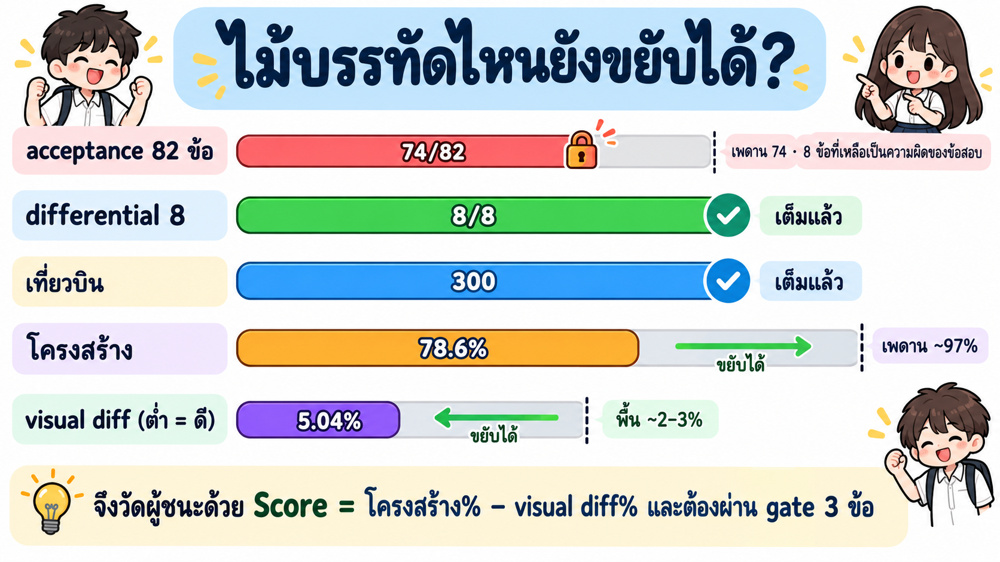
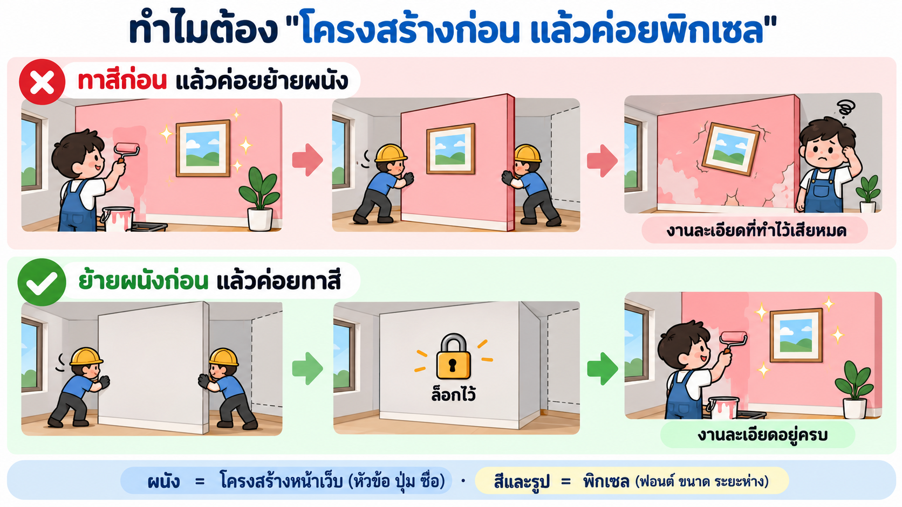
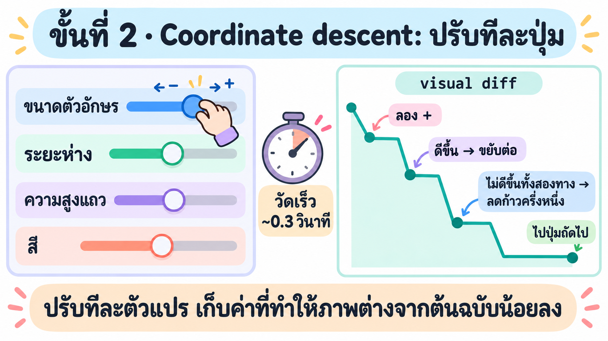
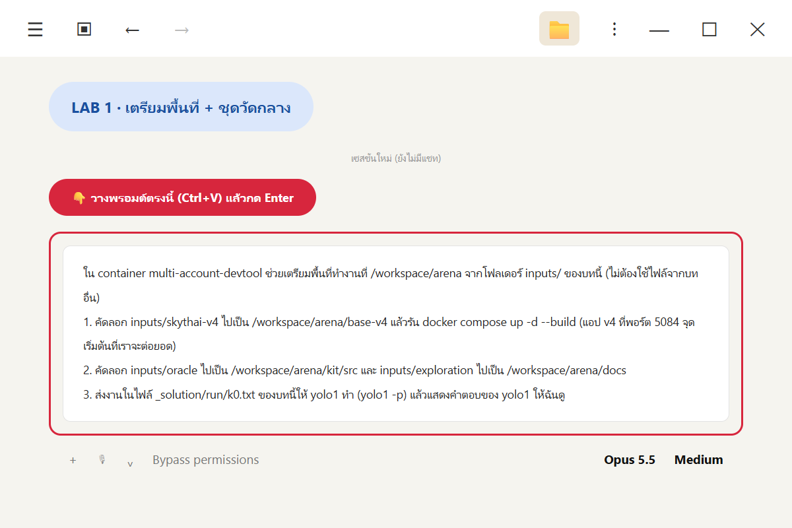
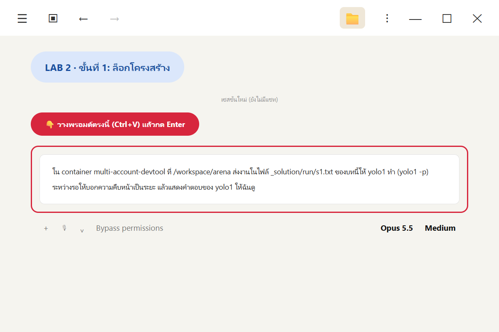
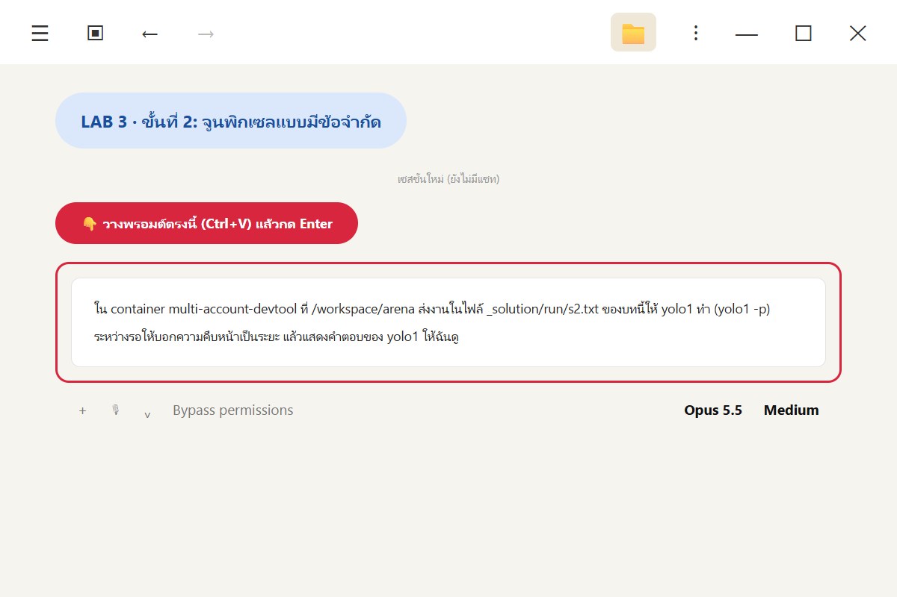
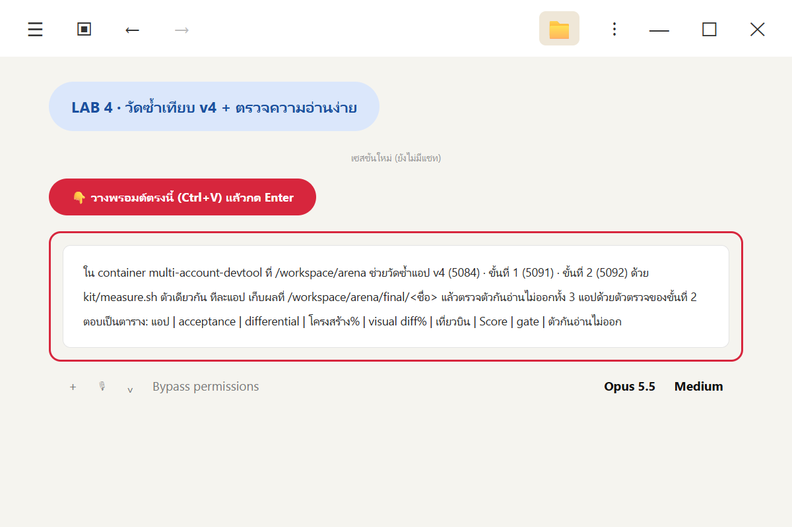
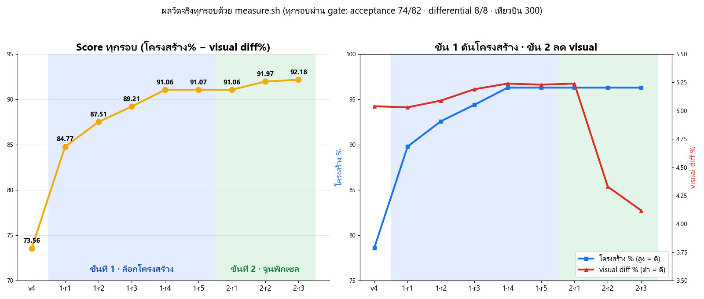
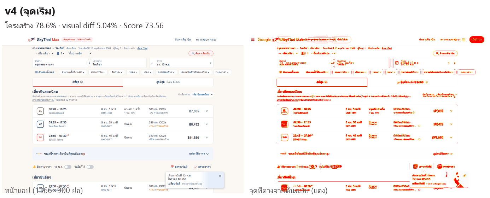

# Week 03 · บทที่ 5 · Two-Stage Pipeline: ล็อกโครงสร้างก่อน แล้วค่อยจูนพิกเซล

บทที่ 4 ได้ **SkyThai Max (v4)** ที่ผ่าน differential 8/8 แล้ว บทนี้ทำให้ **เหมือนต้นฉบับมากขึ้นอีก** ด้วยอัลกอริทึม 2 ขั้น
1. **ขั้นที่ 1 · ล็อกโครงสร้าง:** ทำให้ "ชิ้นส่วน" ของหน้า (หัวข้อ ปุ่ม ชื่อ) ตรงกับต้นฉบับ
2. **ขั้นที่ 2 · จูนพิกเซล:** ปรับฟอนต์ ขนาด ระยะห่าง ให้ภาพใกล้ต้นฉบับ โดย **ห้ามโครงสร้างตก** และ **ห้ามทำให้อ่านยาก**

วัดด้วย **ไม้บรรทัด 5 อันชุดเดิม** ของบทที่ 1–4 ทั้งบทนี้ **ไม่ต่ออินเทอร์เน็ตไป Google** ใช้เฉลยที่บันทึกไว้แล้วเท่านั้น

### 📦 ของที่ใช้ในบทนี้ (อยู่ในโฟลเดอร์นี้ทั้งหมด)

บทนี้ **ต่อยอดจากโค้ด v4** และสร้างขั้นที่ 1 กับขั้นที่ 2 **ขึ้นใหม่เองทั้งหมด (from scratch)** ของที่ใช้ร่วมกับบทก่อนมีแค่ "ข้อมูลต้นฉบับ" กับ "ไม้บรรทัด" ซึ่งคัดลอกมาไว้ใน [`inputs/`](inputs/) แล้ว ไม่ต้องเปิดบทอื่น

| โฟลเดอร์ | คืออะไร | ใช้ทำอะไร |
|---|---|---|
| [`inputs/skythai-v4/`](inputs/skythai-v4/) | โค้ดแอป **SkyThai Max (v4)** Next.js + PostgreSQL | **จุดเริ่มต้น** ที่เราจะต่อยอดเป็น v5 |
| [`inputs/exploration/`](inputs/exploration/) | ผลสำรวจต้นฉบับ `EXPLORATION.md` · `API-INVENTORY.md` และผลวัด v4 เดิม `FINAL.md` · `STRUCTURE.md` · `DIFF-REPORT.md` · `MUTATION.md` | รู้ว่าต้นฉบับมีอะไร และ v4 ยังขาดอะไร |
| [`inputs/oracle/`](inputs/oracle/) | **ไม้บรรทัด 5 อัน**: ชุดทดสอบ acceptance 82 ข้อ · differential + เฉลยของต้นฉบับแช่แข็ง · `original.yml` (โครงสร้างต้นฉบับ) · `reference.png` (ภาพต้นฉบับ) | วัดผลแบบเดียวกับบทก่อน จึงเทียบกันได้ |

| สร้างใหม่ในบทนี้ (ไม่คัดลอกจากที่อื่น) | LAB |
|---|---|
| ชุดวัดกลาง `measure.sh` ที่ห่อไม้บรรทัดทั้ง 5 ไว้ในคำสั่งเดียว | LAB 1 |
| ขั้นที่ 1 · structure compiler + แอปหลังขั้นที่ 1 | LAB 2 |
| ขั้นที่ 2 · ตัววัดเร็ว · optimizer · ตัวล็อกโครงสร้าง · ตัวกันอ่านไม่ออก + แอป v5 | LAB 3 |

---

## 🎓 ทฤษฎี

### T1) ก่อนลงแรง: ไม้บรรทัดไหนยังขยับได้?

💡 **ใจความ:** ปรับปรุงสิ่งที่ยังมีที่ให้ขึ้น ไม่ใช่สิ่งที่ถึงเพดานแล้ว


*3 ไม้บรรทัดถึงเพดานแล้ว เหลือ 2 อันที่ยังขยับได้*

| ไม้บรรทัด | v4 | ยังขึ้นได้ไหม | เหตุผล (จากผลของบทที่ 2–4) |
|---|---:|---|---|
| acceptance | 74/82 | ❌ เพดาน 74 | 8 ข้อที่ไม่ผ่าน **เป็นความผิดของข้อสอบเอง** เช่น เฉลยเขียนว่าต้องได้ 35 ใบ แต่ข้อมูลจริงมี 33 · 3 ข้อตรวจผ่านหน้าจอไม่ได้ |
| differential | 8/8 | ❌ เต็มแล้ว | — |
| เที่ยวบิน | 300 | ❌ | ต้องเก็บข้อมูลใหม่จาก Google ซึ่งบทนี้ห้าม |
| **โครงสร้าง** | 78.6% | ✅ | ยังขาดชื่อที่ต้นฉบับมี 16 รายการ เช่น หัวข้อ "ตัวกรอง" "ผลการค้นหา" |
| **visual diff** | 5.04% | ✅ | ส่วนใหญ่เป็นรูปตัวอักษรและระยะห่างที่เลื่อนไปไม่กี่พิกเซล |

---

### T2) วัดยังไงว่า "ดีขึ้น": Score + gate

💡 **ใจความ:** ใช้ตัวเลขเดียวตัดสิน และมีด่านที่ห้ามตกเสมอ

$$\text{Score} = \text{โครงสร้าง}\% - \text{visual diff}\%$$

- โครงสร้างสูง = ดี จึง **บวก** · visual diff ต่ำ = ดี จึง **ลบ**
- 🧪 v4: $78.57 - 5.04 = 73.53$

**gate (ด่านห้ามตก)** ทุกรอบต้องผ่าน ไม่งั้นย้อนกลับ

$$\text{acceptance} \ge 74/82 \quad\land\quad \text{differential} = 8/8 \quad\land\quad \text{เที่ยวบิน} = 300$$

**ตัดสินด้วย Score รวม** ไม่ใช่ "ห้ามไม้บรรทัดไหนแย่ลงเลย" เพราะการเพิ่มปุ่มจริงที่ต้นฉบับมี อาจทำ visual แย่ลงนิดหน่อย แต่ได้โครงสร้างมากกว่า ถ้าห้ามเด็ดขาดจะทิ้งงานดี ๆ ไป

---

### T3) ทำไมต้อง "โครงสร้างก่อน แล้วค่อยพิกเซล"

💡 **ใจความ:** เหมือนรีโนเวทห้อง ต้องย้ายผนังก่อน แล้วค่อยทาสี ไม่งั้นงานละเอียดที่ทำไว้เสียหมด


*ผนัง = โครงสร้าง · สีและรูป = พิกเซล*

| ถ้าทำ… | เกิดอะไร |
|---|---|
| จูนพิกเซลก่อน → แล้วค่อยเพิ่มหัวข้อ | หัวข้อที่เพิ่มดันทุกอย่างเลื่อนลง ค่าที่จูนไว้ (ระยะ ขนาด) ไม่ตรงตำแหน่งอีกต่อไป ต้องจูนใหม่ |
| **แก้โครงสร้างก่อน → ล็อก → แล้วจูนพิกเซล** | จูนบนหน้าตาสุดท้ายครั้งเดียว และล็อกไว้ให้ทุกค่าที่จูนไม่ทำโครงสร้างเสีย |


---

### T4) ขั้นที่ 1 · Structure compiler

💡 **ใจความ:** เทียบ "ต้นไม้ของหน้า" ของต้นฉบับกับของเรา แล้วแก้ตามรายการ เหมือนคอมไพเลอร์ที่แปลงสิ่งหนึ่งให้ตรงอีกสิ่งหนึ่ง


*เทียบ → ทำรายการแก้ → กรองข้อห้าม → ทำทีละกลุ่มแล้ววัด*

| ขั้น | ทำอะไร |
|---|---|
| 1. เทียบต้นไม้ | อ่านต้นไม้ accessibility (บทบาท + ชื่อ) ของต้นฉบับ (`original.yml`) กับของเรา หาสิ่งที่ **ขาด** และ **เกิน** |
| 2. ทำรายการแก้ | แต่ละข้อเป็น **เปลี่ยนชื่อ · เพิ่ม · ลบ** เรียงตามผลต่อคะแนน · การเปลี่ยนชื่อได้ผลมากสุด เพราะเพิ่มส่วนที่ตรงและลดส่วนเกินพร้อมกัน |
| 3. กรองข้อห้าม | ตัดข้อที่ชนกับชื่อที่ test ใช้หา (เช่น ลิงก์แถวต้องขึ้นต้นด้วย "เที่ยวบิน") |
| 4. ทำทีละกลุ่ม | ทำเป็นของจริงที่ผู้ใช้เห็นและใช้ได้ วางให้ตรงตำแหน่งในภาพต้นฉบับ แล้ววัด เก็บถ้า Score ขึ้น ไม่งั้นย้อนกลับ |

**คะแนนโครงสร้างคิดยังไง (ทวน):** ค่าเฉลี่ยของ Jaccard กับเช็กลิสต์ 38 ชิ้นสำคัญ

$$\text{โครงสร้าง} = \frac{1}{2}\left(\frac{|A \cap B|}{|A \cup B|} + \frac{\text{ชิ้นสำคัญที่มี}}{38}\right) \times 100\%$$

$A$ = ชุดชื่อในต้นฉบับ · $B$ = ชุดชื่อในแอปเรา → เปลี่ยนชื่อ 1 ข้อให้ตรง ทำให้ $|A \cap B|$ เพิ่ม และ $|A \cup B|$ ลดพร้อมกัน

---

### T5) ขั้นที่ 2 · Coordinate descent: จูนทีละตัวแปร

💡 **ใจความ:** มีปุ่มปรับหลายตัว (ขนาดตัวอักษร ระยะห่าง …) ปรับทีละปุ่มไปทางที่ภาพต่างจากต้นฉบับน้อยลง


*ปรับทีละตัวแปร เก็บค่าที่ทำให้ภาพต่างน้อยลง*

ให้ $f(x_1, \dots, x_n)$ = visual diff เมื่อตั้งค่าสไตล์เป็น $x_1, \dots, x_n$ (เช่น $x_1$ = ขนาดตัวอักษร · $x_2$ = ระยะห่าง)

$$x_i \leftarrow \arg\min_{v \,\in\, \{x_i - s,\; x_i,\; x_i + s\}} f(x_1, \dots, x_{i-1}, v, x_{i+1}, \dots, x_n)$$

| ขั้น | ทำอะไร |
|---|---|
| 1. ตัววัดเร็ว | เปิดหน้าครั้งเดียว แล้วลองค่าใหม่ด้วยการใส่ CSS ทันที วัด visual diff ได้ในเสี้ยววินาที (ภาพ 1 ภาพใช้ ~0.08 วินาที · วัดเต็ม 5 ไม้บรรทัดด้วย kit ใช้ ~45 วินาที) |
| 2. หาบริเวณที่ต่างมาก | แบ่งภาพ diff สีแดงเป็นบริเวณ แล้วจับคู่กับ element ที่อยู่ตรงนั้น |
| 3. ปรับทีละตัวแปร | ลอง $x_i \pm s$ ถ้าดีขึ้นขยับต่อ ถ้าไม่ดีขึ้นทั้งสองทาง ให้ลดก้าว $s \leftarrow s/2$ แล้วไปตัวแปรถัดไป |
| 4. ยืนยันด้วยวัดเต็ม | ได้ชุดค่าที่ดีขึ้นชัดเจน → เขียนลง CSS → build → `measure.sh` เต็ม → เก็บหรือย้อนกลับ |

**ข้อดี:** ง่าย เร็ว เข้าใจได้ · **ข้อเสีย:** ติดจุดต่ำสุดเฉพาะที่ได้ และจูนกับภาพอ้างอิงภาพเดียว (ดู T7)

---

### T6) ข้อจำกัดแบบแข็ง: ตัวล็อกโครงสร้าง + ตัวกันอ่านไม่ออก

💡 **ใจความ:** ถ้าให้เครื่องไล่ตัวเลขอย่างเดียว มันจะหาทางลัดที่ทำให้เลขดีแต่คนใช้ไม่ได้ (**Goodhart's law**: เมื่อตัวชี้วัดกลายเป็นเป้าหมาย มันก็ไม่ใช่ตัวชี้วัดที่ดีอีกต่อไป) จึงต้องมีกฎที่ทุกค่าต้องผ่านก่อนเก็บ


*6 ข้อจำกัด และสิ่งที่ตัวกันทำจริงใน LAB 3 (ซ่อม 45 จุดก่อนเริ่ม · ปฏิเสธ 8 ค่าระหว่างค้น)*

| ข้อจำกัด | ตรวจอะไร | ทำไม |
|---|---|---|
| **ตัวล็อกโครงสร้าง** | `ariaSnapshot()` ของหน้าต้องเหมือนตอนจบขั้นที่ 1 ทุกตัวอักษร | ขั้นที่ 2 ต้องไม่ทำลายงานของขั้นที่ 1 |
| ตัวอักษร ≥ 12 px | ขนาดตัวอักษรทุกจุดที่แสดง | ย่อตัวอักษรช่วยลดพิกเซลต่าง แต่อ่านไม่ออก |
| contrast ≥ 4.5 : 1 | สีข้อความเทียบสีพื้น (มาตรฐาน WCAG AA) | ทำตัวอักษรจาง ๆ ช่วยลดพิกเซลต่างได้ |
| opacity ข้อความ = 1 | ความโปร่งใสของข้อความ | กันการซ่อนข้อความ |
| element ≥ 75% ของ v4 | ความกว้างและสูงเทียบกับ v4 | กันการย่อปุ่มหรือไอคอนจนกดยาก |
| ห้ามตัดบรรทัดกลางคำ | ตำแหน่งขึ้นบรรทัดต้องตรงขอบคำ (`Intl.Segmenter('th')`) | ภาษาไทยไม่เว้นวรรค ตัดผิดที่อ่านไม่รู้เรื่อง |

**contrast คิดยังไง** (WCAG) จากความสว่างสัมพัทธ์ $L$ ของสีที่สว่างกว่า $L_1$ และสีที่มืดกว่า $L_2$

$$\text{contrast} = \frac{L_1 + 0.05}{L_2 + 0.05} \qquad \text{เช่น ดำบนขาว} = \frac{1 + 0.05}{0 + 0.05} = 21$$

---

### T7) จุดอ่อนของไม้บรรทัดที่ควรรู้

| จุดอ่อน | ผลที่เกิด | ควรแก้ยังไง |
|---|---|---|
| **โครงสร้างตัดคำด้วยช่องว่าง** แต่ภาษาไทยไม่เว้นวรรค ทั้งวลีจึงนับเป็นคำเดียว | ช่องว่างตัวเดียวทำให้ไม่ตรง แต่ถ้าคำแรกตรง ต่อท้ายอะไรก็ได้ | ตัดคำไทยด้วย `Intl.Segmenter('th')` |
| **visual diff จูนกับภาพอ้างอิงภาพเดียว** | ได้ค่าอย่าง 15.375 px ที่เหมาะแค่จอ 1366×900 | วัดหลายขนาดจอแล้วเฉลี่ย |
| **ไม่มีไม้บรรทัดความอ่านง่าย** | v4 เองก็ไม่ผ่านตัวกันอ่านไม่ออก แต่ไม่มีไม้บรรทัดไหนเห็น | เพิ่มเป็นไม้บรรทัดที่ 6 |
| **Score ให้น้ำหนักไม่สมดุล** | โครงสร้างขยับได้ ~18 จุด visual ขยับได้แค่ ~2–3 จุด | ปรับน้ำหนักตามช่วงที่ขยับได้ |

---

### 🧠 ทบทวน 5 ข้อ

1. ทำไมบทนี้ไม่พยายามเพิ่ม acceptance?
2. Score ของแอปที่มีโครงสร้าง 90% และ visual diff 4.5% คือเท่าไร?
3. ถ้าจูนพิกเซลก่อนแล้วค่อยเพิ่มหัวข้อ จะเกิดอะไรขึ้น?
4. ใน coordinate descent ถ้าลอง $x_i + s$ และ $x_i - s$ แล้วไม่ดีขึ้นทั้งคู่ ต้องทำอะไร?
5. ทำไมต้องมีตัวกันอ่านไม่ออก ยกตัวอย่าง 1 ข้อ

<details>
<summary>เฉลย</summary>

1. 8 ข้อที่ไม่ผ่านเป็นความผิดของข้อสอบเอง แอปทำถูกแล้ว จึงขึ้นได้แค่ 74
2. $90 - 4.5 = 85.5$
3. หัวข้อดันทุกอย่างเลื่อน ค่าระยะห่างและขนาดที่จูนไว้ไม่ตรงตำแหน่งอีกต่อไป visual diff แย่ลงและต้องจูนใหม่
4. ลดก้าวลงครึ่งหนึ่ง ($s \leftarrow s/2$) แล้วไปตัวแปรถัดไป
5. เพราะ optimizer จะหาทางลัดที่ทำให้เลขดีแต่คนอ่านไม่ได้ เช่น ทำตัวอักษรสีขาวบนพื้นขาว (จับด้วย contrast ≥ 4.5:1)

</details>

---

## 🗺️ เส้นทาง LAB

| LAB | ทำอะไร | ใครทำ | เวลา AI (รันจริง) |
|---|---|---|---|
| 1 | เตรียมพื้นที่จาก `inputs/` + สร้างชุดวัดกลาง และตรวจว่าวัด v4 ได้ค่าเดิม | yolo1 | 6 นาที 35 วินาที |
| 2 | ขั้นที่ 1 · ล็อกโครงสร้าง | yolo1 | 11 นาที 7 วินาที |
| 3 | ขั้นที่ 2 · จูนพิกเซลแบบมีข้อจำกัด | yolo1 | 13 นาที 37 วินาที |
| 4 | วัดซ้ำเทียบ v4 + ตรวจตัวกันอ่านไม่ออก | Claude Code | 2 นาที 17 วินาที |

💡 พรอมต์ชั้นในยาว (อัลกอริทึม + กติกา) จึงเก็บเป็นไฟล์ใน [`_solution/run/`](_solution/run/) (`k0.txt` · `s1.txt` · `s2.txt`) พรอมต์ที่เราวางสั่งให้ Claude Code ส่งไฟล์นั้นให้ yolo1

---

## LAB 1 · เตรียมพื้นที่ + ชุดวัดกลาง

🎯 เตรียมพื้นที่ทำงานจาก `inputs/` แล้วสร้าง `measure.sh` ที่วัดแอปเวอร์ชันไหนก็ได้ครบ 5 ไม้บรรทัด และ **ตรวจก่อนว่าวัด v4 ได้ค่าเดิม** (ทฤษฎี: T1, T2)


*วางพรอมต์ LAB 1*

💬 **คัดลอกพรอมต์นี้**

```text
ใน container multi-account-devtool ช่วยเตรียมพื้นที่ทำงานที่ /workspace/arena จากโฟลเดอร์ inputs/ ของบทนี้ (ไม่ต้องใช้ไฟล์จากบทอื่น)
1. คัดลอก inputs/skythai-v4 ไปเป็น /workspace/arena/base-v4 แล้วรัน docker compose up -d --build (แอป v4 ที่พอร์ต 5084 จุดเริ่มต้นที่เราจะต่อยอด)
2. คัดลอก inputs/oracle ไปเป็น /workspace/arena/kit/src และ inputs/exploration ไปเป็น /workspace/arena/docs
3. ส่งงานในไฟล์ _solution/run/k0.txt ของบทนี้ให้ yolo1 ทำ (yolo1 -p) แล้วแสดงคำตอบของ yolo1 ให้ฉันดู
```

✅ **ผลจริง** (yolo1 · 6 นาที 35 วินาที · วัด v4 ซ้ำ 3 รอบได้ค่าเท่ากันทุกรอบ)

| ไม้บรรทัด | v4 วัดได้ | ค่าเดิมใน `FINAL.md` | ตรงไหม |
|---|---:|---:|---|
| acceptance | 74/82 | 74/82 | ✅ (8 ข้อที่ไม่ผ่านเป็นชุดเดิม: B20 B22 C13 C31 F05 F08 F14 F16) |
| differential | 8/8 | 8/8 | ✅ |
| โครงสร้าง | 78.6% (Jaccard 57.1% · ชิ้นสำคัญ 38/38) | 78.6% | ✅ |
| visual diff | **5.04%** (62,003 px) | 5.13% | ⚠️ ต่าง 0.09 จุด |
| เที่ยวบิน | 22 → 300 | 22 → 300 | ✅ |

**Score v4 = 78.6 − 5.04 = 73.56** · gate ผ่านครบ

👀 **สังเกต**
- วัดครบ 5 ไม้บรรทัดใช้ **~42 วินาที ต่อรอบ** (acceptance 18 · differential 14 · เที่ยวบิน 6 · โครงสร้าง 3 · visual 2 วินาที) จึงวัดได้หลายรอบในเวลาไม่กี่นาที
- ถ่ายภาพ 3 รอบได้ไฟล์เหมือนกันทุกไบต์ แต่ visual diff ยังต่างจาก `FINAL.md` 0.09 จุด yolo1 บอกตรง ๆ ว่า **ยังหาสาเหตุไม่ได้แน่ชัด** (น่าจะเป็นฟอนต์ของเครื่อง) จึงใช้ **v4 ที่วัดด้วยชุดนี้ (73.56)** เป็นจุดเริ่ม
- `report.json` มี **รายการปัญหา**: token ที่ขาด 16 ตัว · เกิน 11 ตัว · แถบที่แดงมากสุด (825–900 px แดง 8.08%) ให้ขั้นที่ 1–2 ใช้เลือกงาน
- ไม่แก้ไฟล์ใน `inputs/oracle` เลย (ตรวจด้วย `diff` เทียบกับต้นฉบับใน `inputs/` แล้ว ตรงทุกไฟล์)


---|---:|---:|---|
| acceptance | 74/82 | 74/82 | ✅ |
| differential | 8/8 | 8/8 | ✅ |
| โครงสร้าง | 78.57% | 78.6% | ✅ |
| visual diff | **5.04%** | 5.13% | ⚠️ ต่าง 0.09 จุด |
| เที่ยวบิน | 22 → 300 | 22 → 300 | ✅ |

👀 **สังเกต**
- วัด 1 รอบใช้ **~3 นาที** จึงวัดได้หลายรอบในเวลาไม่กี่สิบนาที
- visual diff ต่าง 0.09 จุด น่าจะมาจากฟอนต์หรือรุ่น Chromium ของเครื่อง จึงใช้ **v4 ที่วัดด้วยชุดนี้ (Score 73.53)** เป็นจุดเริ่ม
- `measure.sh` ส่งออก `report.json` ที่มี **รายการปัญหา** (token ที่ขาด · บริเวณที่ภาพต่าง · test ที่ไม่ผ่าน) ให้อัลกอริทึมใช้

---

## LAB 2 · ขั้นที่ 1: ล็อกโครงสร้าง

🎯 ทำให้โครงสร้างหน้าใกล้ต้นฉบับที่สุดด้วย structure compiler (ทฤษฎี: T3, T4)


*วางพรอมต์ LAB 2*

💬 **คัดลอกพรอมต์นี้**

```text
ใน container multi-account-devtool ที่ /workspace/arena ส่งงานในไฟล์ _solution/run/s1.txt ของบทนี้ให้ yolo1 ทำ (yolo1 -p) ระหว่างรอให้บอกความคืบหน้าเป็นระยะ แล้วแสดงคำตอบของ yolo1 ให้ฉันดู
```

✅ **ผลจริง** (yolo1 · 11 นาที 7 วินาที · 5 รอบ เก็บทุกรอบ · ผ่าน gate ทุกรอบ)

| รอบ | เปลี่ยนอะไร | โครงสร้าง % | visual diff % | Score |
|---|---|---:|---:|---:|
| r0 | v4 (จุดเริ่ม) | 78.6 | 5.04 | 73.56 |
| r1 | **เปลี่ยนชื่อ 7 กลุ่ม** ให้ตรงต้นฉบับ (ส่วนค้นหา · แท็บ "ดีที่สุด" · ตัวเรียง · สวิตช์ติดตามราคา · หัวข้อ "ขณะนี้เที่ยวบินมีราคาสูง") + ลบลิงก์ "ค้นหาใหม่" ที่ซ้ำ | 89.8 | 5.03 | 84.77 |
| r2 | เพิ่มปุ่ม "ความช่วยเหลือสำหรับผู้โดยสาร" + หัวข้อ "ติดตามราคา" พร้อมปุ่ม ⓘ | 92.6 | 5.09 | 87.51 |
| r3 | เพิ่มส่วน "หาราคาที่ดีที่สุด" + หัวข้อ "ข้อมูลเชิงลึกด้านราคา" | 94.4 | 5.19 | 89.21 |
| r4 | เพิ่มหัวข้อที่เห็นบนจอ "ตัวกรอง" และ "ผลการค้นหา" ในขอบซ้ายที่ว่าง | 96.3 | 5.24 | 91.06 |
| r5 | ซ่อมสไตล์ชิป "ตัวกรองทั้งหมด" ที่ r4 ทำเพี้ยน | **96.3** | 5.23 | **91.07** |

👀 **สังเกต**
- **รอบแรกได้มากที่สุด (+11.2)** เพราะเป็นการ **เปลี่ยนชื่อ** ซึ่งเพิ่มส่วนที่ตรงและลดส่วนเกินพร้อมกัน (ตรงกับสูตรใน T4)
- token ที่ขาดลดจาก 16 → 2 · ที่เหลือทำไม่ได้เพราะชนชื่อที่ test ใช้หา (ลิงก์แถวต้องขึ้นต้นด้วย "เที่ยวบิน" · ปุ่ม "ค้นหาเที่ยวบิน") หรือได้คะแนนน้อยกว่าที่จะเสีย visual
- **visual แย่ลงเล็กน้อย** (5.04 → 5.23) เพราะของที่เพิ่มดันหน้าเลื่อน → นี่คืองานของขั้นที่ 2
- ⚠️ **yolo1 รายงานความผิดพลาดของตัวเอง:** คำสั่ง `cd` ล้มเหลว ทำให้คำสั่งเปลี่ยนพอร์ตไปแก้ไฟล์นอกโฟลเดอร์ `pipe1` ราว 20 ไฟล์ (รวม `kit/`) แล้ว yolo1 แก้คืนเองก่อนวัด · **เราตรวจซ้ำแล้ว:** ไฟล์ใน `kit/src` · `docs` · `base-v4` ตรงกับ `inputs/` ทุกไบต์ → AI ทำพลาดได้ ต้องตรวจเสมอ

ไฟล์เต็ม: [`out-s1.md`](_solution/run/out-s1.md) · โค้ดหลังขั้นที่ 1 [`stage1-app/`](_solution/stage1-app/) (รายงาน `REPORT.md`)

---

## LAB 3 · ขั้นที่ 2: จูนพิกเซลแบบมีข้อจำกัด

🎯 ลด visual diff บนหน้าที่ล็อกโครงสร้างแล้ว โดยทุกค่าต้องผ่านตัวล็อกโครงสร้างและตัวกันอ่านไม่ออก (ทฤษฎี: T5, T6)


*วางพรอมต์ LAB 3*

💬 **คัดลอกพรอมต์นี้**

```text
ใน container multi-account-devtool ที่ /workspace/arena ส่งงานในไฟล์ _solution/run/s2.txt ของบทนี้ให้ yolo1 ทำ (yolo1 -p) ระหว่างรอให้บอกความคืบหน้าเป็นระยะ แล้วแสดงคำตอบของ yolo1 ให้ฉันดู
```

✅ **ผลจริง** (yolo1 · 13 นาที 37 วินาที · 3 รอบ เก็บทุกรอบ · ผ่าน gate ทุกรอบ)

| รอบ | เปลี่ยนอะไร | โครงสร้าง % | visual diff % | Score |
|---|---|---:|---:|---:|
| r0 | ผลของขั้นที่ 1 | 96.3 | 5.23 | 91.07 |
| r1 | **ซ่อมให้ผ่านตัวกันอ่านไม่ออกก่อน:** ตัวอักษรเล็กกว่า 12 px 10 จุด · contrast ต่ำกว่า 4.5:1 35 จุด | 96.3 | 5.24 | 91.06 |
| r2 | ค้นรอบ A (ลอง 695 ค่า): ฟอนต์ "Tlwg Typo" + ขนาด · น้ำหนัก · ความสูงแถว 26 ค่า | 96.3 | 4.33 | 91.97 |
| r3 | ค้นรอบ B (ลอง 309 ค่า): สีเส้นใต้แท็บ · ป้ายสายการบินไม่มีกรอบ · ระยะห่างตัวอักษร 8 ค่า | 96.3 | **4.12** | **92.18** |


*v4 → ขั้นที่ 1 → ขั้นที่ 2 → v5 (Score 73.56 → 91.07 → 92.18)*

👀 **สังเกต**
- **ตัวล็อกโครงสร้างได้ผล:** โครงสร้าง 96.3 ทุกรอบ เพราะ `ariaSnapshot()` เหมือนตอนเริ่มทุกไบต์
- **r1 ทำ Score ลด 0.01 แต่ต้องเก็บ** เพราะกติกาบังคับให้แอปอ่านง่ายก่อนเริ่มค้น (ข้อจำกัดแบบแข็งสำคัญกว่าตัวเลข)
- **ตัวกันปฏิเสธ 8 ค่า** ที่ทำ visual ดีขึ้นแต่ย่อข้อความเล็กกว่า 75% ของ v4 เช่น ชื่อแบรนด์ "Max" · บรรทัด "มีผลลัพธ์ 22 รายการ" · ราคา "฿7,635"
- **ตัววัดเร็วแม่นยำ:** ได้จำนวนพิกเซลตรงกับ kit ทุกไบต์ใน r0 · r2 · r3 (ยกเว้น r2 ที่คาดไว้ดีกว่าจริง 1,295 px เพราะไฟล์ฟอนต์ที่โฮสต์เองจับน้ำหนักตัวอักษรต่างไป → รอบ B จึงเริ่มจากแอปที่ build แล้ว)
- ⚠️ **ฟอนต์ที่ได้หน้าตาเหมือนพิมพ์ดีด:** optimizer เลือก "Tlwg Typo" (ฟอนต์เปิด GPL-2+ มีในเครื่อง) เพราะ diff ต่ำสุด แต่เป็นฟอนต์ความกว้างคงที่ ถ้าอยากได้ฟอนต์ทั่วไปกว่านี้ใช้ Loma หรือ Waree ได้แต่ diff จะสูงขึ้น → ตัวเลขดีที่สุดไม่ได้แปลว่าคนชอบที่สุดเสมอ
- **ที่เหลือใน diff:** header/โลโก้ (~4,300 px) · toast (~2,500 px) · ขอบแท็บ ต้องเปลี่ยนเลย์เอาต์หรือแบรนด์ จึงหยุดที่ r3

ไฟล์เต็ม: [`out-s2.md`](_solution/run/out-s2.md) · แอป v5 [`skythai-v5/`](_solution/skythai-v5/) (รายงาน `REPORT.md` · optimizer `scripts/opt/`)

---

## LAB 4 · วัดซ้ำเทียบ v4 + ตรวจความอ่านง่าย

🎯 ไม่เชื่อตัวเลขที่ agent รายงานเอง วัดซ้ำ v4 · ขั้นที่ 1 · ขั้นที่ 2 ด้วยชุดวัดเดียวกันในรอบเดียวกัน


*วางพรอมต์ LAB 4*

💬 **คัดลอกพรอมต์นี้**

```text
ใน container multi-account-devtool ที่ /workspace/arena ช่วยวัดซ้ำแอป v4 (5084) · ขั้นที่ 1 (5091) · ขั้นที่ 2 (5092) ด้วย kit/measure.sh ตัวเดียวกัน ทีละแอป เก็บผลที่ /workspace/arena/final/<ชื่อ> แล้วตรวจตัวกันอ่านไม่ออกทั้ง 3 แอปด้วยตัวตรวจของขั้นที่ 2 ตอบเป็นตาราง: แอป | acceptance | differential | โครงสร้าง% | visual diff% | เที่ยวบิน | Score | gate | ตัวกันอ่านไม่ออก
```

✅ **ผลจริง** (วัดซ้ำ 3 แอปต่อกัน 2 นาที 17 วินาที)

| แอป | acceptance | differential | โครงสร้าง % | visual diff % | เที่ยวบิน | **Score** | gate | ตัวกันอ่านไม่ออก |
|---|---:|---:|---:|---:|---:|---:|---|---|
| v4 (จุดเริ่ม) | 74/82 | 8/8 | 78.6 | 5.04 | 300 | 73.56 | ✅ | ❌ 45 จุด (เล็ก 10 · contrast 35) |
| หลังขั้นที่ 1 | 74/82 | 8/8 | 96.3 | 5.23 | 300 | 91.07 | ✅ | ❌ 45 จุด |
| **v5 (หลังขั้นที่ 2)** | 74/82 | 8/8 | **96.3** | **4.12** | 300 | **92.18** | ✅ | ✅ **ผ่าน** |


*ขั้นที่ 1 ดันโครงสร้าง (78.6 → 96.3) · ขั้นที่ 2 ลด visual (5.23 → 4.12) โดยโครงสร้างไม่ขยับ*


*หลักฐาน: หน้าแอป (ซ้าย) กับจุดที่ต่างจากต้นฉบับ (ขวา สีแดง) ของ v4 → ขั้นที่ 1 → v5*

👀 **สังเกต**
- **ตัวเลขที่วัดซ้ำตรงกับที่ yolo1 รายงานทุกค่า** → เชื่อถือได้
- **Score ขึ้น +18.62** (73.56 → 92.18) · ส่วนใหญ่มาจากขั้นที่ 1 (+17.51) ขั้นที่ 2 เพิ่มอีก +1.11 แต่ทำให้แอป **อ่านง่ายผ่านทุกข้อ** ซึ่ง v4 เองยังไม่ผ่าน
- ไม้บรรทัด 5 อันเดิมไม่ได้วัดความอ่านง่ายเลย จึงต้องมีตัวกันแยกต่างหาก (ดู T6 · T7)

---

## 🔁 ปิดงาน

```text
ใน container multi-account-devtool ช่วยรัน docker compose down -v ในโฟลเดอร์ base-v4 pipe1 pipe2 ใต้ /workspace/arena แล้วบอกว่าพอร์ต 5084 5091 5092 ว่างแล้วหรือยัง
```

---

## 🔒 เฉลย (`_solution/`)

| โฟลเดอร์ | มีอะไร |
|---|---|
| [`run/`](_solution/run/) | พรอมต์ชั้นนอก `lab1–4-outer.txt` · ชั้นใน `k0.txt` `s1.txt` `s2.txt` · คำตอบจริง `out-k0.md` `out-s1.md` `out-s2.md` |
| [`kit/`](_solution/kit/) | ชุดวัดกลางที่สร้างใน LAB 1: `measure.sh` + `lib/` + `README.md` (ใช้ไม้บรรทัดจาก `inputs/oracle`) |
| [`stage1-app/`](_solution/stage1-app/) | แอปหลังขั้นที่ 1 + `REPORT.md` |
| [`skythai-v5/`](_solution/skythai-v5/) | **แอป v5** หลังขั้นที่ 2 + `REPORT.md` + optimizer `scripts/opt/` · `docker compose up -d --build` → http://localhost:5092 |
| [`results/`](_solution/results/) | `rounds/` ผลวัดทุกรอบ · `final/` ผลวัดซ้ำ v4 · ขั้นที่ 1 · v5 พร้อมภาพแอปและภาพ diff |

---

*ตัวเลขทุกตัวในบทนี้มาจากการรันจริงใน container `multi-account-devtool` เมื่อ 1 พ.ย. 2569 · ไม่มีการต่อ Google ระหว่างการทดลอง*
