# Week 03 · บทที่ 6 · จาก URL สู่แอป: Parallel Exploration + Two-Stage Loop → SkyThai Zero (v6)

บทที่ 1–5 สร้างแอปทีละขั้น และแต่ละบท **ต่อยอดของเดิม** (โค้ดเดิม ข้อสอบเดิม เฉลยเดิม)
บทนี้ทำ **ทั้งระบบใหม่จากศูนย์ในบทเดียว** เริ่มจากแค่ URL ของ Google Flights แล้วไปจนถึงแอปที่จูนแล้ว

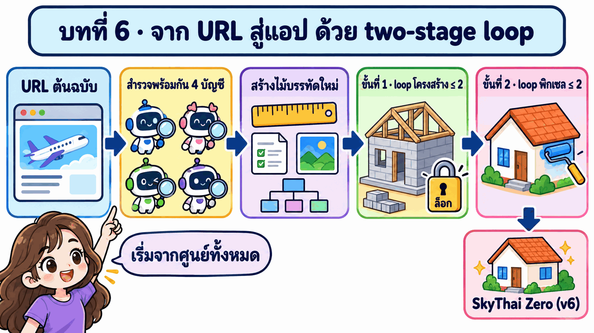
*URL → สำรวจพร้อมกัน → ไม้บรรทัดใหม่ → loop โครงสร้าง (ล็อก) → loop พิกเซล → v6*

| ขั้น | ทำอะไร | ได้อะไร |
|---|---|---|
| 1 | **Parallel Exploration** · 4 บัญชีสำรวจต้นฉบับพร้อมกัน คนละส่วน | `EXPLORATION.md` (A–F) + ข้อมูลเที่ยวบินทั้งหมด |
| 2 | **สร้างไม้บรรทัดใหม่** จากต้นฉบับ | ข้อสอบ · เฉลย differential · ต้นไม้ของหน้า · ภาพต้นฉบับ · จำนวนเที่ยวบิน |
| 3 | **ขั้นที่ 1 · loop โครงสร้าง** ≤ 2 loop (หน้าตาแช่แข็ง) | แอปที่โครงสร้าง + พฤติกรรมตรง แล้ว **ล็อก** |
| 4 | **ขั้นที่ 2 · loop พิกเซล** ≤ 2 รอบ (แก้ได้แค่ตัวเลขหน้าตา) | **SkyThai Zero (v6)** |

ทุกอย่างรันใน container `multi-account-devtool` ผู้เรียนแค่วางพรอมต์ใน Claude Code Desktop

> ⚠️ เราสืบเว็บของคนอื่นเพื่อ **เรียนรู้แนวคิด** เท่านั้น: ไม่ล็อกอิน ไม่จ่ายเงิน ไม่ข้าม CAPTCHA ไม่ลอกโลโก้/โค้ด/แบรนด์ · HAR/trace มี cookie ห้ามนำออกนอก container

### 📊 ผลจริงโดยย่อ (รันใน container 1 พ.ย. 2569 · 17:05–20:47)

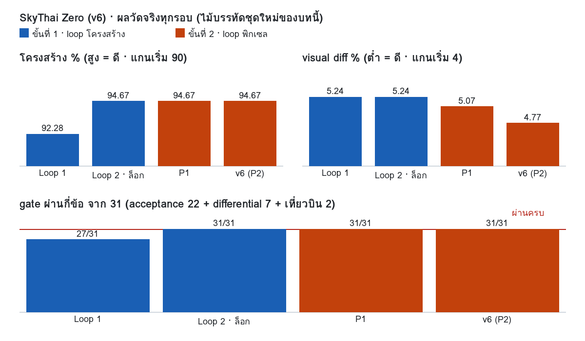
*ขั้นที่ 1 ดัน gate และโครงสร้าง · ขั้นที่ 2 ลด visual diff โดยโครงสร้างและ gate ไม่ขยับ*

| | Loop 1 | Loop 2 (ล็อก) | **v6 (หลังจูนพิกเซล)** |
|---|---:|---:|---:|
| acceptance (ข้อ valid) | 20/22 | 22/22 | **22/22** |
| differential (สถานการณ์ valid) | 5/7 | 7/7 | **7/7** |
| เที่ยวบิน | 21 → 300 | 21 → 300 | **21 → 300** |
| **gate** | ❌ 27/31 | ✅ 31/31 | ✅ **31/31** |
| โครงสร้าง % | 92.28 | 94.67 | **94.67** |
| visual diff % | 5.24 | 5.24 | **4.77** |
| Score | 87.04 | 89.43 | **89.90** |

**ใช้งบ 2 + 2 loop พอดี** · ทุกตัวเลขวัดซ้ำโดย Claude Code ใน LAB 8 แล้วตรงกับที่ agent รายงานทุกค่า · ไม้บรรทัดเป็นชุดใหม่ของบทนี้ จึงเทียบกับตัวเลขของ v1–v5 ตรง ๆ ไม่ได้

---

## 🎓 ทฤษฎี

### T1) ทำไมต้องเริ่มใหม่จาก URL

💡 **ใจความ:** ถ้าอยากรู้ว่ากระบวนการดีจริง ต้องลองกับทั้งระบบ ไม่ใช่แค่ส่วนท้าย

| | บทที่ 1–5 | **บทที่ 6** |
|---|---|---|
| ข้อมูลต้นฉบับ | สำรวจครั้งเดียวในบทที่ 2–3 แล้วใช้ต่อ | **สำรวจใหม่สด ๆ** |
| ข้อสอบ/เฉลย | กรรมการเขียนในบทที่ 3 · เฉลยแช่แข็งในบทที่ 4 | **สร้างใหม่ในบทนี้** และข้อสอบต้องผ่านกับต้นฉบับก่อน |
| แอป | ต่อยอดจาก v(n−1) | **จากโฟลเดอร์ว่าง** |
| วิธีปรับปรุง | วนแก้ + swarm + 2 ขั้น | **2 ขั้นที่แยกขาดตั้งแต่บรรทัดแรก** + งบจำกัด |

ข้อสังเกต: ไม้บรรทัดชุดใหม่วัดกับข้อมูลชุดใหม่ ตัวเลขของ v6 จึง **ไม่ได้อยู่บนสเกลเดียวกับ v1–v5** เทียบได้แค่ "รูปแบบ" (เช่น โครงสร้างขึ้นเร็วไหม พฤติกรรมผ่านไหม)

---

### T2) Parallel Exploration: แบ่งกันสำรวจ

💡 **ใจความ:** เว็บใหญ่สำรวจคนเดียวช้า แบ่งเป็นส่วนให้หลายคนสำรวจพร้อมกัน แต่ละคนมี **ขอบเขต (charter)** ของตัวเอง


*4 บัญชี 4 ขอบเขต เบราว์เซอร์แยกกัน แต่ละคนส่ง `PART.md`*

| ส่วน | บัญชี | ขอบเขต (charter) | ผลที่ต้องได้ |
|---|---|---|---|
| A · ฟอร์มค้นหา | yolo1 | หน้าแรก ประเภทตั๋ว ผู้โดยสาร ชั้นโดยสาร ช่องเมือง ปฏิทิน + "เส้นทางมาตรฐาน" | ฟีเจอร์ + กฎของฟอร์ม · ขั้นตอนค้นหาที่ชุดทดสอบใช้ซ้ำได้ |
| B · ผลค้นหา | yolo2 | แท็บ ตัวเรียง ตัวกรองทุกตัว รายการ ดูเพิ่มเติม ข้อมูลเชิงลึกด้านราคา | ฟีเจอร์ + กฎ + จำนวนเที่ยวบินในแต่ละสถานการณ์ |
| C · หน้าจอง | yolo3 | รายละเอียดเที่ยวบิน 3 แบบ → หน้าตัวเลือกการจอง → ย้อนกลับ | ผู้ขาย ราคา ค่าธรรมเนียม คำเตือน |
| D · เครือข่าย | cyolo1 | สคริปต์เดินเส้นทางลูกค้า + อัด HAR → ถอดข้อมูล | `flights-all.json` · `API-INVENTORY.md` · โมเดลข้อมูล (D) · สิ่งที่เห็นจากเครือข่าย (F) |

**3 กติกาที่ทำให้ทำพร้อมกันได้โดยไม่ชนกัน**

| กติกา | ป้องกันอะไร |
|---|---|
| แต่ละบัญชีมี **โฟลเดอร์ของตัวเอง** ห้ามแตะของคนอื่น | เขียนทับไฟล์กัน |
| ใช้ **สคริปต์ Playwright headless ของตัวเอง** ไม่ใช้ Playwright MCP ตัวกลาง | 4 คนแย่งเบราว์เซอร์ตัวเดียว |
| ทุกคนเขียน `PART.md` **รูปแบบเดียวกัน** (A B C E) + เก็บ `ariaSnapshot` ของสถานะสำคัญ | รวมผลได้ และอ้างชื่อปุ่มตามที่เห็นจริง |

**ทำไมไม่ใช้ swarm แบบบทที่ 4:** swarm ของบทที่ 4 แบ่ง **งานแก้โค้ด** (เขียนพร้อมกันใน git worktree) · บทนี้แบ่ง **งานสำรวจ** (อ่านอย่างเดียว ไม่มีโค้ดให้ชนกัน) จึงไม่ต้อง merge โค้ด แต่ต้อง **รวมความรู้**

---

### T3) รวมความรู้: 4 `PART.md` → `EXPLORATION.md`

💡 **ใจความ:** การรวมไม่ใช่การต่อไฟล์ ต้องเรียงใหม่ ตัดซ้ำ และ **ไม่เดาเมื่อขัดกัน**

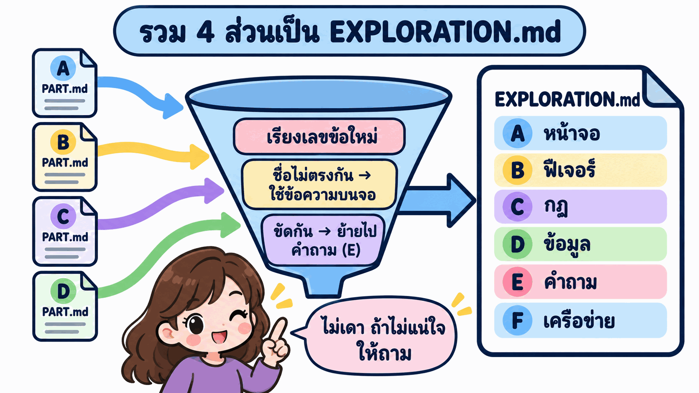
*รวมแล้วได้เอกสารเดียว 6 ส่วน ข้อที่ขัดกันไม่ถูกตัดสินเอง แต่ย้ายไปเป็นคำถาม*

| ปัญหาตอนรวม | ทำยังไง |
|---|---|
| ข้อเดียวกันถูกเขียนสองที่ | รวมเป็นข้อเดียว บอกว่ามาจากส่วนไหน |
| ชื่อปุ่มสะกดไม่ตรงกัน | ใช้ข้อความใน `snapshots/*.yml` (สิ่งที่หน้าจอบอกจริง) |
| ตัวเลขขัดกัน (เช่น จำนวนเที่ยวบินบนจอ ≠ ในข้อมูลเครือข่าย) | ใส่ทั้งสองค่า + เวลาที่เห็น แล้วย้ายไปส่วน E |
| ส่วน B ต้องมีคอลัมน์ "ข้อความ/ชื่อที่เห็นบนจอ" | ผู้สร้างแอปและกรรมการใช้คอลัมน์เดียวกัน → แอปกับข้อสอบพูดภาษาเดียวกัน |

---

### T4) ไม้บรรทัด 5 อัน สร้างใหม่จากต้นฉบับ

💡 **ใจความ:** ไม้บรรทัดทุกอันต้องมี **เฉลยที่มาจากต้นฉบับ** ไม่ใช่จากความเชื่อของผู้สร้าง

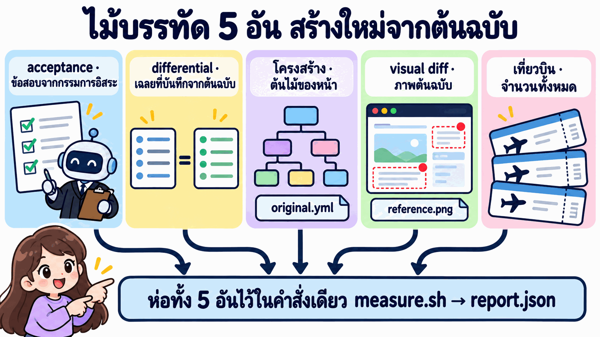
*5 อันห่อไว้ในคำสั่งเดียว `measure.sh` → `report.json`*

| ไม้บรรทัด | เฉลยมาจาก | ใครสร้าง | วัดอะไร |
|---|---|---|---|
| **acceptance** | `EXPLORATION.md` ส่วน B C F | **cyolo1** (กรรมการคนละค่าย) | ฟีเจอร์และกฎทำงานจริงไหม |
| **differential** | รันสถานการณ์กับต้นฉบับสด 1 ครั้ง แล้วแช่แข็งผล (`expected.json`) | yolo2 | ผลลัพธ์ของสถานการณ์เดียวกันตรงกันไหม |
| **โครงสร้าง** | `ariaSnapshot()` ของหน้าผลค้นหาต้นฉบับ (`original.yml`) | yolo2 | ชิ้นส่วน + ชื่อบนหน้าตรงกันไหม |
| **visual diff** | ภาพหน้าผลค้นหาต้นฉบับ 1366×900 (`reference.png`) | yolo2 | พิกเซลต่างกันกี่ % |
| **เที่ยวบิน** | จำนวนใน `flights-all.json` | yolo2 | โหลดครบทุกใบไหม |

**สูตรที่ใช้ (เหมือนบทที่ 4–5)**

$$\text{โครงสร้าง} = \frac{1}{2}\left(\frac{|A \cap B|}{|A \cup B|} + \frac{\text{ชิ้นสำคัญที่มี}}{\text{ชิ้นสำคัญทั้งหมด}}\right) \times 100\% \qquad \text{Score} = \text{โครงสร้าง}\% - \text{visual diff}\%$$

$A$ = ชุด "บทบาท|ชื่อ" ในต้นฉบับ · $B$ = ในแอปเรา

**gate (ด่านห้ามตก):** acceptance ≥ 90% ของข้อที่ใช้ได้ · differential ตรงทุกสถานการณ์ · เที่ยวบินครบ

---

### T5) ข้อสอบต้องผ่านกับต้นฉบับก่อน

💡 **ใจความ:** บทที่ 3 พบว่าข้อสอบ 8 ข้อ **ผิดเอง** (เช่น เฉลยว่า 35 ใบ แต่ข้อมูลจริงมี 33) บทนี้จึงสอบ "ข้อสอบ" ก่อนใช้

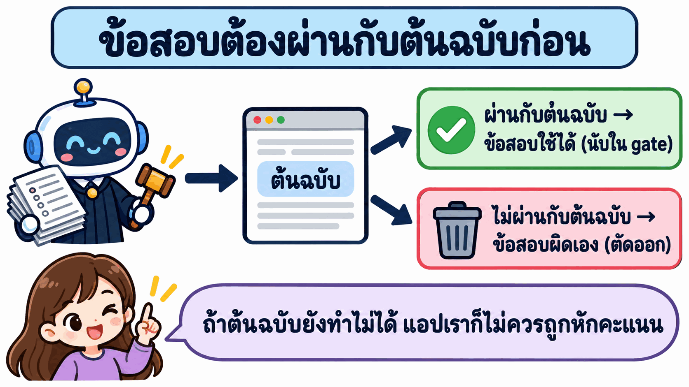
*ถ้าต้นฉบับยังทำไม่ได้ แอปเราก็ไม่ควรถูกหักคะแนน*

| ผลกับต้นฉบับ | แปลว่า | ทำอะไร |
|---|---|---|
| ✅ ผ่าน | ข้อสอบถูก | **valid** · นับใน gate |
| ❌ ไม่ผ่าน เพราะเขียนผิด | ข้อสอบมีบั๊ก | แก้แล้วรันข้อนั้นใหม่ได้ 1 ครั้ง |
| ❌ ไม่ผ่าน เพราะตรวจผ่านหน้าจอไม่ได้ / ต้นฉบับเปลี่ยน | ข้อสอบใช้ไม่ได้ | **invalid** · ไม่นับ พร้อมเหตุผลใน `META.json` |

นี่คือแนวคิด **test oracle** ของบทที่ 4 กลับด้าน: บทที่ 4 ใช้ต้นฉบับเป็นเฉลยของ **แอป** · บทนี้ใช้ต้นฉบับเป็นเฉลยของ **ข้อสอบ** ด้วย

---

### T6) Loop engineering: สัญญา 6 ข้อ

💡 **ใจความ:** loop ที่ดีไม่ใช่ "วนจนกว่าจะดี" แต่คือสัญญาที่เขียนไว้ก่อนเริ่ม และ **ให้เครื่องตรวจได้**

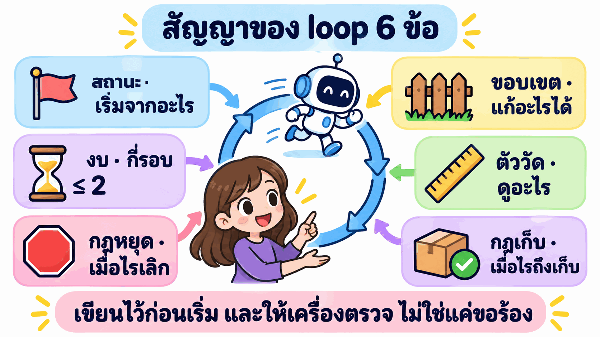
*เขียนไว้ก่อนเริ่ม และให้เครื่องตรวจ ไม่ใช่แค่ขอร้อง*

| ส่วนของ loop | ขั้นที่ 1 · โครงสร้าง | ขั้นที่ 2 · พิกเซล |
|---|---|---|
| **สถานะ** | โฟลเดอร์ว่าง + `tokens.css` แช่แข็ง | แอปที่ tag `structure-lock` |
| **ขอบเขต** | ทุกไฟล์ ยกเว้น `tokens.css` | ค่าใน `tokens.css` เท่านั้น |
| **ตัววัด** | `measure.sh` → gate + โครงสร้าง% | ตัววัดเร็ว + `measure.sh` ตอนจบรอบ |
| **กฎเก็บ** | gate ผ่าน **หรือ** จำนวนข้อที่ผ่านดีขึ้นโดยโครงสร้างไม่ลด | hash ตรง · ตัวกันผ่าน · gate ไม่ต่ำกว่าตอนล็อก · Score ขึ้น |
| **กฎหยุด** | ครบ 2 loop | ครบ 2 รอบ |
| **งบ** | 2 loop · loop ละ ≤ 45 นาที | 2 รอบ · ≤ 45 นาที |

**เครื่องตรวจขอบเขต** `scope-check.sh` อ่าน `git diff` แล้วตอบ ผ่าน/ไม่ผ่าน: ขั้นที่ 1 แตะ `tokens.css` หรือเขียน `14px` `#333` ตรง ๆ ในไฟล์อื่น = ไม่ผ่าน · ขั้นที่ 2 แตะไฟล์อื่นหรือเปลี่ยนชื่อตัวแปร = ไม่ผ่าน

---

### T7) แช่แข็งพิกเซล = ทำหน้าตาเป็นแผงปุ่มปรับ

💡 **ใจความ:** จะจูนทีหลังได้ ต้อง **มีปุ่มให้หมุน** ตั้งแต่แรก และระหว่างสร้างห้ามแตะปุ่ม

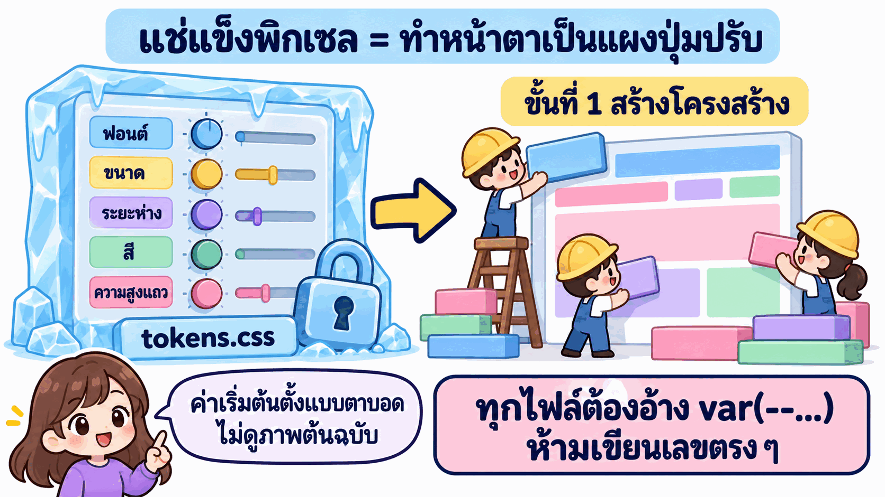
*`tokens.css` = แผงควบคุมหน้าตาทั้งหมด แช่แข็งไว้จนจบขั้นที่ 1*

| กติกา | ทำไม |
|---|---|
| ทุกสไตล์อ้าง `var(--…)` ห้ามมีเลข px หรือสีในไฟล์อื่น | ขั้นที่ 2 แก้ได้แค่ไฟล์นี้ ถ้ามีเลขซ่อนที่อื่นจะจูนไม่ถึง |
| ค่าเริ่มต้นตั้งแบบ **ตาบอด** (ห้ามดูภาพต้นฉบับ) | คะแนนของขั้นที่ 1 ต้องมาจากโครงสร้างจริง ไม่ใช่หน้าตาที่บังเอิญเหมือน |
| ขั้นที่ 1 ห้ามเพิ่มตัวแปร (ใช้ `calc()` ของที่มี) | รายชื่อตัวแปร = แผงควบคุมของขั้นที่ 2 ต้องนิ่ง |

**เส้นแบ่ง:** "**อะไร** อยู่บนหน้า **อยู่ส่วนไหน** และ **ทำงานยังไง**" = โครงสร้าง · "**ใหญ่แค่ไหน ห่างแค่ไหน สีอะไร ฟอนต์อะไร**" = พิกเซล

---

### T8) ขั้นที่ 1 · loop โครงสร้าง 2 รอบ

💡 **ใจความ:** Loop 1 สร้างตามพิมพ์เขียวให้ถูกตั้งแต่แรก · Loop 2 แก้ตามรายการที่ไม้บรรทัดชี้

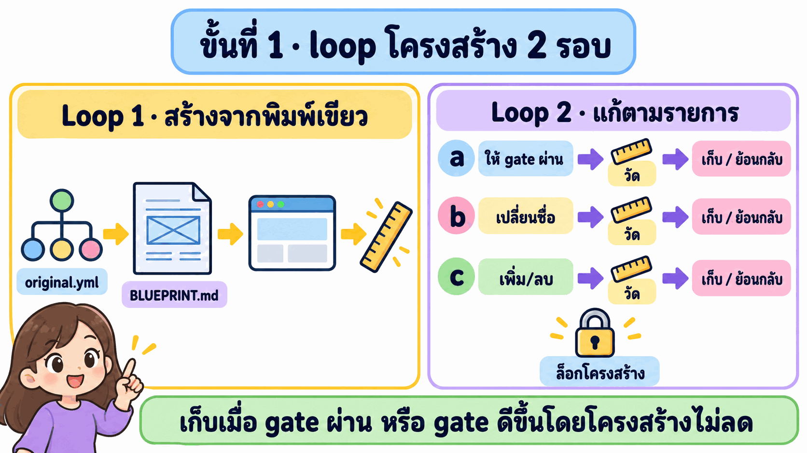
*เก็บเมื่อ gate ผ่าน หรือ gate ดีขึ้นโดยโครงสร้างไม่ลด*

| | Loop 1 · สร้างจากพิมพ์เขียว | Loop 2 · structure compiler |
|---|---|---|
| ข้อมูลเข้า | `EXPLORATION.md` · ข้อมูลเที่ยวบิน · `original.yml` | `report.json` ของ Loop 1 |
| ทำอะไร | เขียน `BLUEPRINT.md` (ส่วนประกอบตามลำดับของ `original.yml`) แล้วเขียนแอปตามนั้น | แก้ 3 กลุ่ม: **a. ให้ gate ผ่าน** → **b. เปลี่ยนชื่อ** → **c. เพิ่ม/ลบ** |
| วัด | เต็ม 1 ครั้งตอนจบ | 1 ครั้งต่อกลุ่ม (ลองเปิดหน้าเองก่อนวัดทุกครั้ง) |
| จบด้วย | tag `s1-loop1` | tag `s1-loop2` + **`structure-lock`** |

**ข้อห้ามที่ทำให้ loop ซื่อตรง:** ผู้สร้างห้ามอ่านซอร์สของข้อสอบและเฉลย differential ใช้ได้แค่ `report.json` · ห้ามปลอมข้อมูล · ครบงบแล้ว gate ไม่ผ่าน ให้ล็อกแล้วรายงานตามจริง

---

### T9) ล็อกโครงสร้าง 3 ชั้น

💡 **ใจความ:** ขั้นที่ 2 ต้อง **ทำโครงสร้างพังไม่ได้** ไม่ใช่แค่ "ไม่ควรทำ"

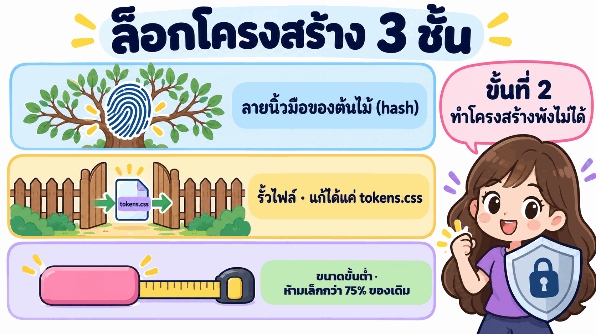
*3 ชั้น: ลายนิ้วมือ · รั้วไฟล์ · ขนาดขั้นต่ำ*

| ชั้น | ล็อกอะไร | ตรวจยังไง |
|---|---|---|
| 1. ลายนิ้วมือ | `ariaSnapshot()` ของหน้าผลค้นหา | SHA-256 ต้องตรง `structure.lock` ทุกชุดค่าที่ลอง |
| 2. รั้วไฟล์ | แตะได้แค่ `tokens.css` | `scope-check.sh stage2` |
| 3. ขนาดขั้นต่ำ | ขนาดของทุก element ตอนล็อก | ห้ามเล็กกว่า 75% ของ `size-baseline.json` |

---

### T10) ขั้นที่ 2 · loop พิกเซล 2 รอบ

💡 **ใจความ:** ปรับไฟทั้งห้องก่อน (ปุ่มรวม) แล้วค่อยปรับโคมทีละดวง (ปุ่มรายส่วน)

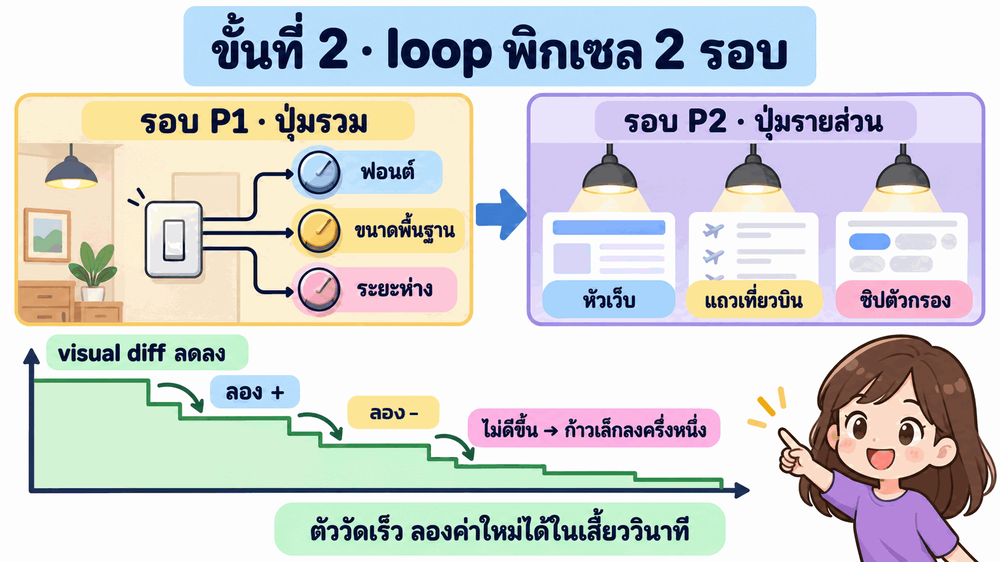
*P1 ปุ่มรวม → P2 ปุ่มรายส่วน · ค้นแบบ coordinate descent*

$$x_i \leftarrow \arg\min_{v \,\in\, \{x_i - s,\; x_i,\; x_i + s\}} f(x_1, \dots, v, \dots, x_n) \qquad \text{ไม่ดีขึ้นทั้งสองทาง} \Rightarrow s \leftarrow s/2$$

$f$ = visual diff · $x_i$ = ตัวแปรใน `tokens.css` · **ตัววัดเร็ว** เปิดหน้าครั้งเดียวแล้วเปลี่ยนค่าใน `:root` ทันที (ไม่ต้อง build) จึงลองได้หลายร้อยชุดในไม่กี่นาที แล้วค่อยยืนยันด้วย `measure.sh` เต็มตอนจบรอบ

---

### T11) ตัวกัน: ไม่ให้เครื่องโกงตัวเลข (Goodhart's law)

💡 **ใจความ:** เมื่อตัวชี้วัดกลายเป็นเป้าหมาย เครื่องจะหาทางลัดที่ทำให้ **เลขดีแต่คนใช้ไม่ได้**


*ตัวเลขดี แต่คนใช้ไม่ได้ = ไม่นับ*

ในรอบทดลองก่อนเขียนบทนี้ optimizer ลด visual diff ได้ด้วยการ **ดันแถวเที่ยวบินพ้นจอแรก · เปลี่ยนสีข้อความเป็นเขียวมะกอก · ทำช่องกรอกแคบจนชื่อเมืองถูกตัด** ทั้งที่ผ่านตัวกันอ่านไม่ออกเดิมทุกข้อ บทนี้จึงเพิ่มตัวกัน 3 ข้อ

| ตัวกัน | ตรวจอะไร | กันทางลัดแบบไหน |
|---|---|---|
| ตัวอักษร ≥ 12 px · contrast ≥ 4.5:1 · opacity = 1 · ห้ามตัดกลางคำ | ความอ่านง่ายพื้นฐาน (บทที่ 5) | ย่อตัวอักษร ทำตัวจาง ซ่อนข้อความ |
| **แถวแรกต้องอยู่ในจอแรก** (ห่างตำแหน่งตอนล็อกไม่เกิน 150 px) | ตำแหน่งแถวเที่ยวบินแรก | ดันเนื้อหาพ้นจอให้พื้นขาวตรงกับพื้นขาว |
| **สีข้อความเป็นสีกลาง** (saturation ≤ 20% · contrast ≥ 7:1) | ตัวแปร `--c-text*` | เปลี่ยนสีข้อความให้ "กลืน" กับภาพต้นฉบับ |
| **ข้อความในช่องกรอกห้ามล้น** | `scrollWidth ≤ clientWidth` | บีบช่องกรอกจนชื่อถูกตัด |

---

### T12) ตรวจเองทุกตัวเลข


*ขั้นสุดท้าย: Claude Code วัดซ้ำ 3 แอปในรอบเดียวกัน ตรวจลายนิ้วมือ ตรวจรั้วไฟล์ และทำ GIF หลักฐาน*

---

### 🧠 ทบทวน 6 ข้อ

1. Parallel Exploration ต่างจาก swarm ของบทที่ 4 ยังไง?
2. ตอนรวม `PART.md` ถ้าตัวเลขสองส่วนขัดกัน ต้องทำอะไร?
3. ทำไมข้อสอบต้องรันกับต้นฉบับก่อนใช้?
4. สัญญาของ loop มี 6 ข้อ อะไรบ้าง?
5. ทำไมขั้นที่ 1 ห้ามเขียน `14px` ตรง ๆ ในไฟล์ component?
6. ยกตัวอย่างทางลัดที่ optimizer ใช้โกง visual diff และตัวกันที่จับได้

<details>
<summary>เฉลย</summary>

1. swarm แบ่ง **งานแก้โค้ด** (ต้อง merge โค้ด) · Parallel Exploration แบ่ง **งานสำรวจ** แบบอ่านอย่างเดียว (ต้องรวมความรู้ ไม่มีโค้ดชนกัน)
2. ไม่เดา ใส่ทั้งสองค่าพร้อมเวลาที่เห็น แล้วย้ายไปส่วน E (คำถามที่ยังไม่รู้)
3. ข้อสอบเองก็ผิดได้ (บทที่ 3 ผิด 8 ข้อ) ถ้าต้นฉบับยังไม่ผ่าน แปลว่าข้อสอบผิดหรือตรวจไม่ได้ ไม่ควรเอามาหักคะแนนแอป
4. สถานะ · ขอบเขต · ตัววัด · กฎเก็บ · กฎหยุด · งบ
5. ขั้นที่ 2 แก้ได้แค่ `tokens.css` ถ้ามีเลขซ่อนในไฟล์อื่น ส่วนนั้นจะจูนไม่ได้ (และ `scope-check.sh stage1` จะไม่ผ่าน)
6. ดันแถวเที่ยวบินพ้นจอแรก → ตัวกัน "แถวแรกต้องอยู่ในจอแรก" · เปลี่ยนสีข้อความให้กลืน → "สีข้อความเป็นสีกลาง" · บีบช่องกรอก → "ข้อความในช่องกรอกห้ามล้น"

</details>

---

## 🗺️ เส้นทาง LAB

| LAB | ทำอะไร | ใครทำ | เวลา AI (รันจริง) |
|---|---|---|---|
| 0 | เช็กบัญชี · เข้า Google ได้ · ติดตั้ง Playwright | Claude Code | ~1 นาที |
| 1 | **Parallel Exploration** 4 ส่วนพร้อมกัน | yolo1 · yolo2 · yolo3 · cyolo1 | 52 นาที 37 วินาที (ส่วนที่นานสุด) |
| 2 | รวมเป็น `EXPLORATION.md` | yolo1 | 10 นาที 51 วินาที |
| 3 | ไม้บรรทัดใหม่: กรรมการ ∥ เฉลยจากต้นฉบับ | cyolo1 ∥ yolo2 | 50 นาที 46 วินาที (ส่วนที่นานสุด) |
| 3b | ข้อมูลของแอปต้องเป็นชุดเดียวกับเฉลย | yolo2 | 5 นาที 26 วินาที |
| 4 | ชุดวัดกลาง + แช่แข็งพิกเซล + สัญญาของ loop | yolo1 | 27 นาที 55 วินาที |
| 5 | ขั้นที่ 1 · Loop 1 สร้างจากพิมพ์เขียว | yolo1 | 20 นาที 12 วินาที |
| 6 | ขั้นที่ 1 · Loop 2 + ล็อกโครงสร้าง | yolo1 | 22 นาที 13 วินาที |
| 7 | ขั้นที่ 2 · loop พิกเซล 2 รอบ | yolo1 | 15 นาที 19 วินาที |
| 8 | วัดซ้ำ · ตรวจ hash · ตรวจขอบเขต · GIF | Claude Code | วัด 3 แอป 11 นาที 39 วินาที |

💡 พรอมต์ชั้นใน (กติกา + อัลกอริทึม) อยู่ใน [`_solution/run/`](_solution/run/) พรอมต์ที่เราวางสั่งให้ Claude Code ส่งไฟล์นั้นให้แต่ละบัญชี · ทุกบัญชีทำงานในโฟลเดอร์ `/workspace/arena6` ใน container

---

## LAB 0 · เช็กก่อนเริ่ม

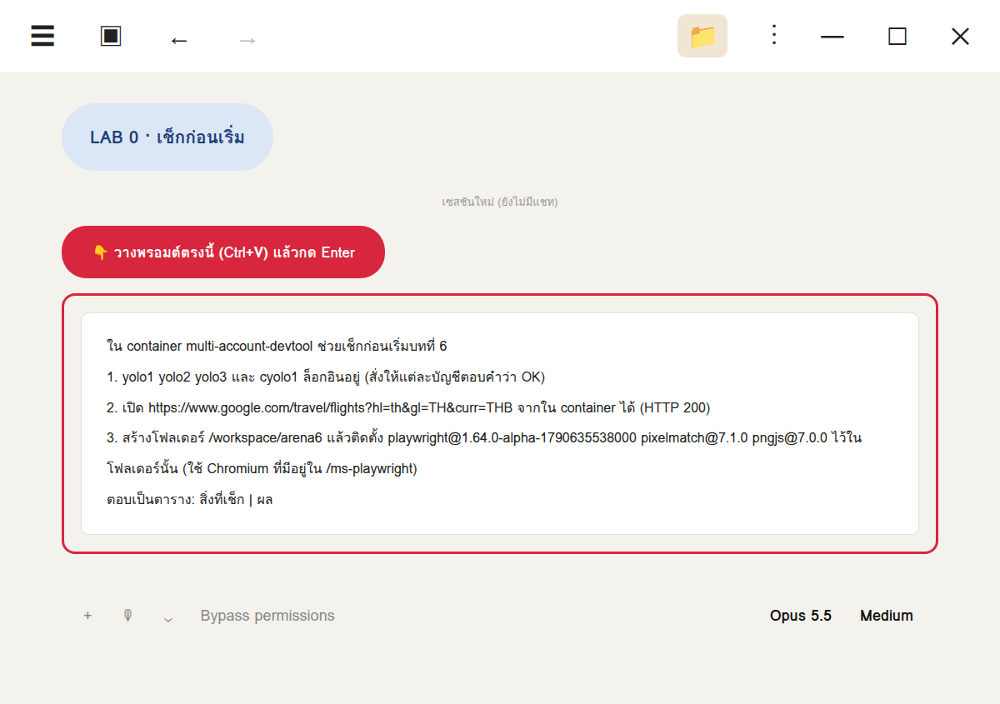
*วางพรอมต์ LAB 0*

💬 **คัดลอกพรอมต์นี้**

```text
ใน container multi-account-devtool ช่วยเช็กก่อนเริ่มบทที่ 6
1. yolo1 yolo2 yolo3 และ cyolo1 ล็อกอินอยู่ (สั่งให้แต่ละบัญชีตอบคำว่า OK)
2. เปิด https://www.google.com/travel/flights?hl=th&gl=TH&curr=THB จากใน container ได้ (HTTP 200)
3. สร้างโฟลเดอร์ /workspace/arena6 แล้วติดตั้ง playwright@1.64.0-alpha-1790635538000 pixelmatch@7.1.0 pngjs@7.0.0 ไว้ในโฟลเดอร์นั้น (ใช้ Chromium ที่มีอยู่ใน /ms-playwright)
ตอบเป็นตาราง: สิ่งที่เช็ก | ผล
```

✅ **ผลจริง:** ทั้ง 4 บัญชีตอบ `OK` · Google ตอบ HTTP 200 · ติดตั้ง 4 แพ็กเกจใน 2 วินาที

---

## LAB 1 · Parallel Exploration: 4 บัญชีสำรวจพร้อมกัน

🎯 **LAB 1 + LAB 2 มีเป้าหมายเดียว: ได้ไฟล์ `EXPLORATION.md` 1 ไฟล์** ที่บอกทุกอย่างของต้นฉบับ (ทฤษฎี: T2, T3)

**เข้าใจง่าย ๆ: เหมือนทำรายงานกลุ่ม**

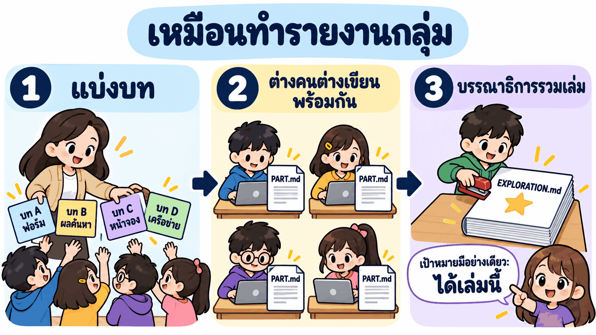

| รายงานกลุ่ม | ในแล็บนี้ |
|---|---|
| ครูแบ่งบทให้แต่ละคน | Claude Code ส่ง **ใบสั่งงาน** `x-a.txt` … `x-d.txt` ให้ 4 agent |
| แต่ละคนเขียนบทของตัวเองพร้อมกัน ไม่ต้องรอกัน | yolo1 · yolo2 · yolo3 · cyolo1 **แต่ละตัวเปิดเบราว์เซอร์ของตัวเอง** สำรวจเฉพาะส่วนของตัวเอง แล้วเขียน `PART.md` → **LAB 1** |
| บรรณาธิการรวมทุกบทเป็นเล่มเดียว | yolo1 รวม `PART.md` 4 ไฟล์เป็น `EXPLORATION.md` 232 ข้อ → **LAB 2** |

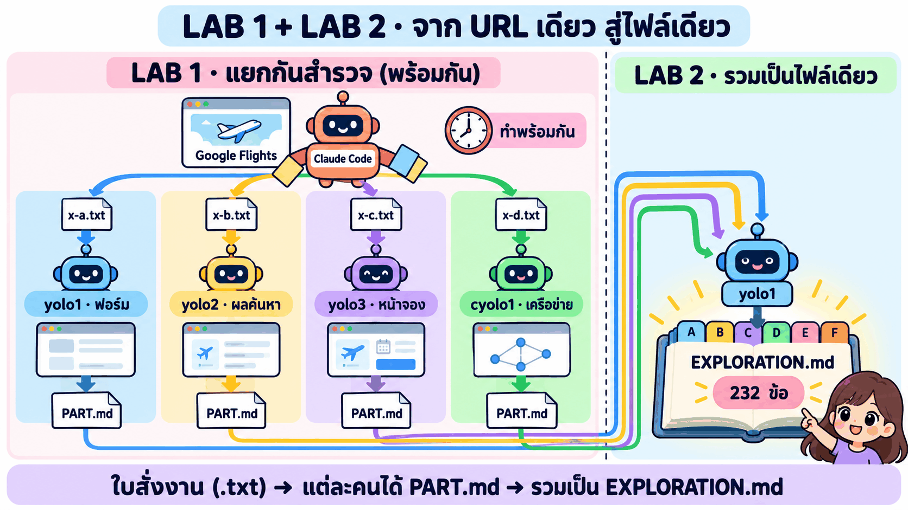

**ทำไมต้องแยก 4 agent แทนที่จะให้ตัวเดียวทำทั้งหมด**
- **เร็วกว่า:** ถ้าทำทีละส่วนรวมเป็น 94 นาที แต่ทำพร้อมกันรอแค่ 53 นาที
- **ละเอียดกว่า:** แต่ละตัวโฟกัสแค่ส่วนเดียว จึงลงลึกได้ (เช่น ส่วน A ลองกฎผู้โดยสารครบทุกกรณี)
- **ไม่ชนกัน:** เบราว์เซอร์และโฟลเดอร์แยกกัน ตัวหนึ่งกดตัวกรองจะไม่ไปกระทบอีกตัว

LAB 1 นี้ทำครึ่งแรก คือ "ต่างคนต่างเขียน" ได้ `PART.md` 4 ไฟล์ ส่วนการรวมเล่มอยู่ใน LAB 2

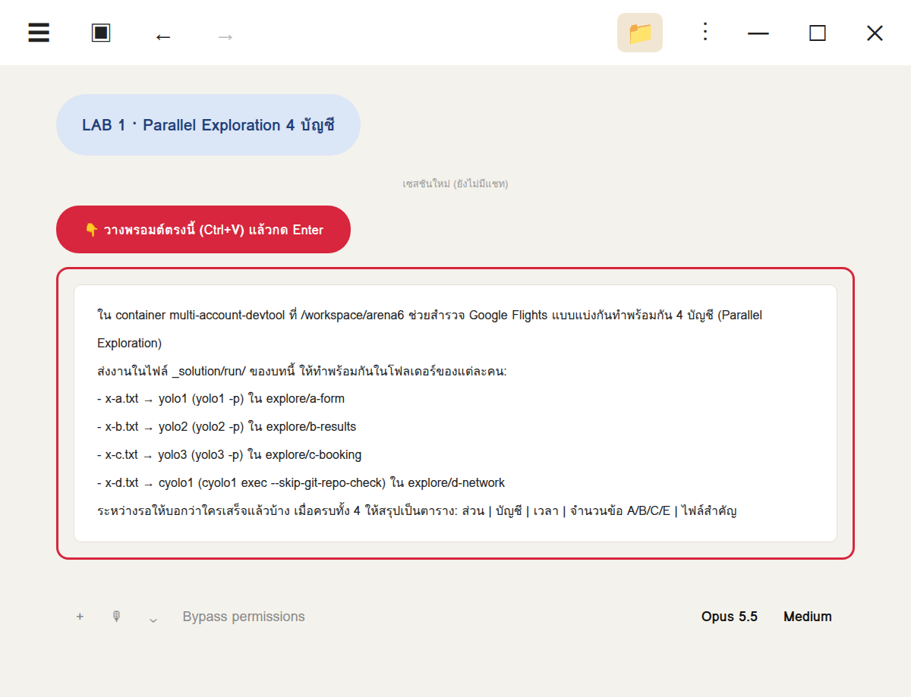
*วางพรอมต์ LAB 1*

💬 **คัดลอกพรอมต์นี้**

```text
ใน container multi-account-devtool ที่ /workspace/arena6 ช่วยสำรวจ Google Flights แบบแบ่งกันทำพร้อมกัน 4 บัญชี (Parallel Exploration)
ส่งงานในไฟล์ _solution/run/ ของบทนี้ ให้ทำพร้อมกันในโฟลเดอร์ของแต่ละคน:
- x-a.txt → yolo1 (yolo1 -p) ใน explore/a-form
- x-b.txt → yolo2 (yolo2 -p) ใน explore/b-results
- x-c.txt → yolo3 (yolo3 -p) ใน explore/c-booking
- x-d.txt → cyolo1 (cyolo1 exec --skip-git-repo-check) ใน explore/d-network
ระหว่างรอให้บอกว่าใครเสร็จแล้วบ้าง เมื่อครบทั้ง 4 ให้สรุปเป็นตาราง: ส่วน | บัญชี | เวลา | จำนวนข้อ A/B/C/E | ไฟล์สำคัญ
```

✅ **ผลจริง** (เริ่มพร้อมกัน 17:05:53 · ครบทั้ง 4 ส่วน 17:58:30)

| ส่วน | บัญชี | เวลา | ภาพ · snapshot | สิ่งสำคัญที่ได้ |
|---|---|---:|---:|---|
| D เครือข่าย | cyolo1 | **5 นาที 30 วินาที** | 10 · 10 | HAR 11 MB · `flights-all.json` **300 ใบ / 695 ขา** · ตัวกรอง · ตัวเลือกการจอง 2 ราย · ตรวจเทียบจอ: จำนวน 300 · ราคา 5 ใบแรก · บินตรง 18 ✅ |
| C หน้าจอง | yolo3 | 17 นาที 5 วินาที | 40 · 18 | รายละเอียด 3 แบบ (บินตรง · แวะพัก · เปลี่ยนสนามบิน) → หน้าตัวเลือกการจอง · ปุ่มย้อนกลับเปิดหน้าใหม่ ไม่ได้ย้อนประวัติ |
| A ฟอร์ม | yolo1 | 19 นาที 4 วินาที | 57 · 29 | ผู้โดยสารรวม ≤ 9 คน · ทารกบนตัก ≤ ผู้ใหญ่ · ปฏิทินเลือกได้ถึง 26 ก.ย. 2027 · ต้นทาง = ปลายทาง ค้นหาได้แต่ "ไม่พบตัวเลือก" · **เส้นทางมาตรฐาน** |
| B ผลค้นหา | yolo2 | **52 นาที 37 วินาที** | 88 · 38 | จำนวนต่อตัวกรอง เช่น การบินไทยเท่านั้น 5 · แวะ ≤ 1 ครั้ง 235 · ≤ ฿30,000 185 · ตัวเรียงและตัวกรองเก็บใน URL |

📁 **ไฟล์ `x-?.txt` คืออะไร และได้ไฟล์อะไรออกมา**

`x-a.txt` … `x-d.txt` เป็น**ใบสั่งงาน** (พรอมต์) ของแต่ละบัญชี ไม่ใช่ผลลัพธ์ บอกว่าต้องสำรวจขอบเขตไหน ทำงานในโฟลเดอร์ไหน และห้ามทำอะไร แต่ละบัญชีเขียนผลลงโฟลเดอร์ของตัวเองใน `explore/` ทุกส่วนได้ไฟล์ชุดเดียวกัน 3 อย่าง และส่วน D ได้ไฟล์เพิ่ม

| ใบสั่งงาน | บัญชี | โฟลเดอร์ผลลัพธ์ | ไฟล์ที่ได้ |
|---|---|---|---|
| `x-a.txt` · ฟอร์มค้นหา | yolo1 | `explore/a-form/` | `PART.md` (151 บรรทัด · มีหัวข้อ **"เส้นทางมาตรฐาน"**) · `shots/` · `snapshots/` · `scripts/` (20 สคริปต์ เช่น `standard-route.mjs`) |
| `x-b.txt` · หน้าผลค้นหา | yolo2 | `explore/b-results/` | `PART.md` (184 บรรทัด) · `shots/` · `snapshots/` · `scripts/` |
| `x-c.txt` · หน้าจอง | yolo3 | `explore/c-booking/` | `PART.md` (106 บรรทัด) · `shots/` · `snapshots/` · `scripts/` |
| `x-d.txt` · เครือข่าย | cyolo1 | `explore/d-network/` | `PART.md` (87 บรรทัด · มีส่วน D และ F เพิ่ม) · `API-INVENTORY.md` · `journey.mjs` · `extract.mjs` · **`data/flights-all.json`** (300 ใบ) · `data/filters.json` · `data/booking-options.json` · `har/flights.har` · `trace/journey.zip` |

| ไฟล์ | คืออะไร |
|---|---|
| `PART.md` | สิ่งที่บัญชีนั้นค้นพบ เขียนเป็นภาษาไทย แบ่งเป็นหัวข้อ A หน้าจอ · B ฟีเจอร์ · C กฎ · E คำถาม (ส่วน D มี D โมเดลข้อมูล และ F เครือข่ายเพิ่ม) **เป็นวัตถุดิบของ LAB 2** |
| `shots/*.png` | ภาพหน้าจอตอนสำคัญ เช่น `a-04-pax-open.png` คือป๊อปอัปผู้โดยสาร |
| `snapshots/*.yml` | `ariaSnapshot()` ของหน้าจอ บอกชื่อปุ่มและช่องตามที่โปรแกรมอ่านหน้าจอเห็น ส่วนอื่นจึงอ้างชื่อปุ่มได้ตรงกัน |
| `scripts/*.mjs` | สคริปต์ Playwright ที่ใช้เดินจริง เปิดรันซ้ำได้ |
| `data/flights-all.json` | ข้อมูลเที่ยวบินทั้ง 300 ใบที่ถอดออกมาจาก HAR **เป็นข้อมูลที่แอปใช้** |
| `har/` · `trace/` | บันทึกเครือข่ายและการเดินหน้าเว็บทั้งหมด **มี cookie จึงเก็บไว้ใน container เท่านั้น** |

(ใน `_solution/explore/` เก็บแค่ `PART.md` และสคริปต์ ส่วนภาพ snapshot และข้อมูลถูกรวมไปไว้ที่ `_solution/spec/` ใน LAB 2 ได้ภาพ 195 ไฟล์และ snapshot 95 ไฟล์)

👀 **สังเกต**
- **ทำพร้อมกันประหยัดเวลา:** รวมเวลาทั้ง 4 ส่วนได้ 94 นาที แต่รอจริงแค่ 53 นาที (เท่ากับส่วนที่นานสุด)
- **ส่วน B นานสุดเพราะต้นฉบับไม่เสถียร:** ราว 6 ใน 40 ครั้ง Google ขึ้น "อ๊ะ มีบางอย่างผิดพลาด" ต้องกด "โหลดซ้ำ" · yolo2 **ไม่สรุปเอง** ว่าเป็นเพราะ 4 บัญชีเปิดพร้อมกันหรือไม่ แต่เก็บเป็นคำถาม
- **yolo2 สังเกตเห็นเพดาน 300 ใบ:** ไม่กรองหยุดที่ 300 พอดี แต่ตัวกรอง "แวะ ≤ 2 ครั้ง" มีใบ ฿197,520 ที่ไม่อยู่ใน 300 ใบ → ส่งต่อให้ส่วน D ตรวจ
- ไม่มีใครล็อกอิน ไม่เจอ CAPTCHA และหยุดก่อน "ดำเนินการต่อ" ทุกคน

ไฟล์เต็ม: [`out-x-a.md`](_solution/run/out-x-a.md) · [`out-x-b.md`](_solution/run/out-x-b.md) · [`out-x-c.md`](_solution/run/out-x-c.md) · [`out-x-d.md`](_solution/run/out-x-d.md)

---

## LAB 2 · รวม 4 ส่วนเป็น `EXPLORATION.md`

🎯 ขั้น "บรรณาธิการรวมเล่ม" ของรายงานกลุ่มใน LAB 1: yolo1 อ่าน `PART.md` ทั้ง 4 ไฟล์ แล้วรวมเป็น `EXPLORATION.md` ไฟล์เดียว เมื่อข้อมูลขัดกันจะไม่เดา แต่ย้ายไปเป็นคำถามในส่วน E (ทฤษฎี: T3)

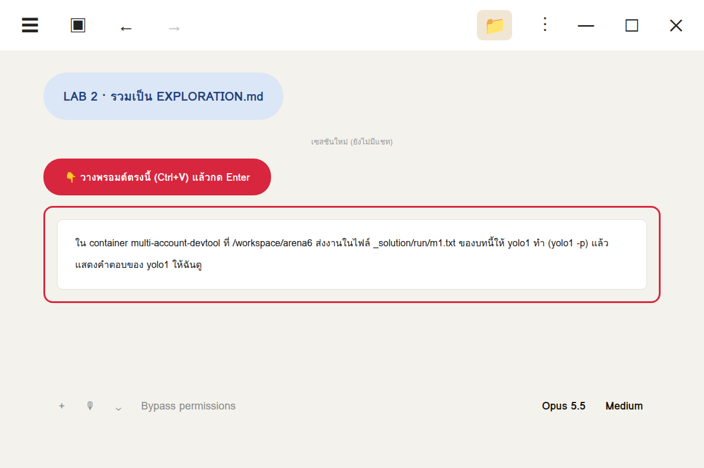
*วางพรอมต์ LAB 2*

💬 **คัดลอกพรอมต์นี้**

```text
ใน container multi-account-devtool ที่ /workspace/arena6 ส่งงานในไฟล์ _solution/run/m1.txt ของบทนี้ให้ yolo1 ทำ (yolo1 -p) แล้วแสดงคำตอบของ yolo1 ให้ฉันดู
```

✅ **ผลจริง** (yolo1 · 10 นาที 51 วินาที · ไม่ต่อ Google เพิ่ม)

`EXPLORATION.md` มีทั้งหมด **232 ข้อ** (A–F) และมีเส้นทางมาตรฐานสำหรับค้นหาจากฟอร์มอีก 9 ขั้น ([ดูไฟล์](_solution/spec/EXPLORATION.md))

| ส่วน | จำนวนข้อ | จาก a | จาก b | จาก c | จาก d |
|---|---:|---:|---:|---:|---:|
| A หน้าจอ | 42 | 20 | 16 | 12 | 7 |
| B ฟีเจอร์ | 66 | 28 | 31 | 23 | 20 |
| C กฎ | 66 | 24 | 33 | 18 | 21 |
| D โมเดลข้อมูล | 13 | 3 | 11 | 10 | 11 |
| E คำถาม | 36 (ขัดกัน 9 + ยังไม่รู้ 27) | 9 | 19 | 13 | 16 |
| F เครือข่าย | 9 + ตารางตรวจความสอดคล้อง | 0 | 2 | 0 | 9 |
| **รวม** | **232** | | | | |

(ข้อที่หลายส่วนเห็นตรงกันถูกรวมเป็นข้อเดียว แต่นับให้ทุกส่วนที่เห็น ผลรวมแต่ละแถวจึงมากกว่าจำนวนข้อ)

**ตัวอย่างข้อใน 232 ข้อ** (ยกมาส่วนละ 2 ข้อ ย่อจากไฟล์จริง)

`EXPLORATION.md` คือ **หัวใจของบทนี้** ทุกขั้นหลังจากนี้อ่านไฟล์นี้: กรรมการใช้ออกข้อสอบ (LAB 3) yolo2 ใช้หาสถานการณ์สำหรับบันทึกเฉลย (LAB 3) และผู้สร้างใช้เป็นสเปกสร้างแอปจากศูนย์ (LAB 5) ทุกข้อจึงต้องตรวจย้อนได้ว่ามาจากส่วนไหน (คอลัมน์ "ที่มา")

| ส่วน | ข้อ | เนื้อหา (ย่อ) | ที่มา |
|---|---|---|---|
| **A หน้าจอ** · หน้าและสถานะทั้งหมด | A1 | หน้าแรกแบบ V1 (มีการ์ดดีล) · ได้เมื่อเปิด URL เริ่มต้น 3 ใน 4 ครั้ง · ภาพ `a-01-home-top.png` | a |
| | A20 | ผลค้นหาแบบเต็ม "มีผลลัพธ์ 300 รายการ" · ได้หลังกด "ดูเที่ยวบินเพิ่มเติม" | b·c·d |
| **B ฟีเจอร์** · ลูกค้าทำอะไรได้ + ชื่อปุ่มบนจอ | B4 | ผู้โดยสาร 4 ประเภท ปรับด้วย − / + แล้วกด "เสร็จ" · ตัวเลขบนปุ่มนับรวมทารกบนตักด้วย · `button "ผู้โดยสาร 1 คน เปลี่ยนจำนวนผู้โดยสาร"` | a·c |
| | B30 | ดูเที่ยวบินเพิ่มเติม · กด 1 ครั้ง "21 รายการ" → "300 รายการ" แล้วปุ่มหายไป (ไม่มีหน้า 2) | b·c·d |
| **C กฎ** · ลองแล้วเห็นผล | C1 | ผู้โดยสารรวมไม่เกิน 9 คน · ลอง 9 ผู้ใหญ่ + เด็ก 1 → "ขออภัย เราไม่รองรับผู้โดยสารมากกว่า 9 ท่าน" | a |
| | C30 | ตัวกรองหลายตัวทำงานแบบ AND · บินตรง 18 → + การบินไทย 5 → + ออกเดินทาง 00–12 น. 1 → + CO2 ต่ำ 0 | b |
| **D โมเดลข้อมูล** · ช่องของข้อมูล | D3 | **Itinerary**: id · สนามบินต้นทาง/ปลายทาง · เวลาออก/ถึง · สายการบิน · ระยะเวลา · จำนวนแวะ · ขา · CO2 · ราคา · ใบแรก SL 394 DMK→NRT ฿7,635 | b·c·d |
| | D9 | **FilterFacets**: ช่วงราคา 7,635–197,520 บาท · สายการบิน 64 ราย · พันธมิตร 3 · สนามบินต่อเครื่อง 34 แห่ง | b·d |
| **E คำถาม** · ขัดกัน / ยังไม่รู้ | E5 | *ขัดกัน:* 21 ใบแรกบนจอเป็นบินตรง 18 + แวะ 3 แต่ใบที่ 1–21 ในข้อมูลเป็นบินตรง 3 + แวะ 18 · ใส่ทั้งสองค่า ไม่เดา | b·d |
| | E31 | *ยังไม่รู้:* หลังกด "ดำเนินการต่อ" จะเกิดอะไร · ห้ามกดตามกติกา | c·d |
| **F เครือข่าย** · เห็นใน HAR แต่ไม่เห็นบนจอ | F1 | RPC `GetShoppingResults` ส่งรายละเอียดทุกขาของทั้ง 300 ใบมาตั้งแต่แรก ทั้งที่จอแสดงแค่สรุป | d |
| | F5 | RPC `GetBookingResults` แยกค่าธรรมเนียม 81 บาทเป็นช่องเฉพาะ · token ของลิงก์ผู้ขายถูกปิดไว้ในสำเนา | d |

**ข้อที่ขัดกัน 9 ข้อ → ส่วน E (ตัวอย่าง)**

| # | เรื่อง | ค่าที่ 1 | ค่าที่ 2 |
|---|---|---|---|
| E1 | จำนวนแวะพัก 1/2/3 ครั้ง | 209/33/40 (17:07) | 214/33/35 (17:17) |
| E5 | 21 ใบแรก | บนจอ: บินตรง 18 + แวะพัก 3 | ใบที่ 1–21 ในข้อมูล: บินตรง 3 + แวะพัก 18 |
| E7 | ราคา JAL 22:05 | ฿25,060 (17:07) | ฿24,990 (17:12) |

👀 **สังเกต**
- **ตรวจความสอดคล้องผ่าน:** ข้อมูลเครือข่ายตรงกับจอทั้ง ทั้งหมด 300 · บินตรง 18 · ยอดนิยม 3 · ราคา 5 ใบแรก
- **ข้อขัดกันส่วนใหญ่มาจาก "เวลา":** Google เปลี่ยนราคาและผลระหว่างการสำรวจ (E1 E7) → เป็นสัญญาณแรกของปัญหาที่เจอใน LAB 3
- yolo1 **ลบ token ของ session/redirect** ออกจากสำเนาข้อมูลใน `spec/` เอง (ต้นฉบับยังอยู่เฉพาะในโฟลเดอร์ของส่วน D)

ไฟล์เต็ม: [`out-m1.md`](_solution/run/out-m1.md)

---

## LAB 3 · ไม้บรรทัดใหม่: กรรมการ ∥ เฉลยจากต้นฉบับ

🎯 สร้าง **ไม้บรรทัด** ไว้วัดแอปที่ยังไม่ได้สร้าง ก่อนเขียนแอปบรรทัดแรก เราต้องรู้ก่อนว่า "แอปที่ดี" วัดด้วยอะไร (ทฤษฎี: T4, T5)

🔗 **LAB 3 ต่อจาก LAB 1–2 อย่างไร**

```text
LAB 1  4 บัญชีสำรวจ ─→ explore/*/PART.md  +  explore/d-network/data/flights-all.json
          │
LAB 2  yolo1 รวม ───→ spec/EXPLORATION.md (232 ข้อ)  ·  spec/snapshots/  ·  spec/data/
          │
          ├─→ j1.txt  (cyolo1 · กรรมการ)  อ่าน B ฟีเจอร์ · C กฎ · F เครือข่าย → ออกข้อสอบ
          │                                              → rulers/accept/
          └─→ o1.txt  (yolo2 · บันทึกเฉลย) อ่าน "เส้นทางมาตรฐาน" + spec/data/ → เปิด Google สดอีกครั้ง
                                                         → rulers/structure · visual · diff · flights
LAB 3b yolo2 ทำให้ข้อมูลของแอปเป็นชุดเดียวกับเฉลย (o2.txt)
          │
LAB 4  รวมไม้บรรทัดทั้ง 5 อันเป็นชุดวัดเดียว (kit/) → LAB 5–8 ใช้วัดแอปทุกรอบ
```

`j1.txt` และ `o1.txt` คือ**ใบสั่งงาน** 2 ใบ (เหมือน `x-a.txt` … ใน LAB 1) ส่งให้ 2 บัญชีทำ**พร้อมกัน** ชื่อไฟล์มาจากบทบาท: **j** = judge (กรรมการ) · **o** = original (เฉลยจากต้นฉบับ)

| ใบสั่งงาน | บัญชี | ใช้อะไรจาก LAB ก่อนหน้า | ทำอะไร | ได้ไฟล์อะไร (ไม้บรรทัด) |
|---|---|---|---|---|
| `j1.txt` | cyolo1 (คนละค่ายกับผู้สร้างแอป) | `EXPLORATION.md` ส่วน **B C F** (เช่น C1 "ผู้โดยสารไม่เกิน 9 คน" → ข้อสอบ 1 ข้อ) · ชื่อปุ่มจาก `spec/snapshots/` · **"เส้นทางมาตรฐาน"** ของส่วน A | เขียนข้อสอบข้อละ 1 ฟีเจอร์/กฎ อ้างรหัสข้อเดิม แล้ว**สอบกับ Google ก่อน** ข้อที่ต้นฉบับยังไม่ผ่านถือว่าข้อสอบใช้ไม่ได้ | ① **acceptance** `rulers/accept/`: `run.mjs` (ตัวรันข้อสอบ) · `META.json` (ข้อ valid/invalid) · `ACCEPT.md` |
| `o1.txt` | yolo2 | **"เส้นทางมาตรฐาน"** (ใช้ไปหน้าผลค้นหาแบบเดียวกับที่ผู้ใช้ทำ) · `spec/data/flights-all.json` จากส่วน D (ใช้ตั้งเป้าจำนวนเที่ยวบิน และตรวจว่าตรงกับเฉลยไหม) | เปิด Google สดอีกรอบ แล้ว**บันทึกคำตอบที่ถูกต้องเป็นไฟล์** (แช่แข็ง) | ② **โครงสร้าง** `rulers/structure/original.yml` + `key.json` (38 ชิ้นสำคัญ) · ③ **ภาพ** `rulers/visual/reference.png` · ④ **differential** `rulers/diff/expected.json` (8 สถานการณ์) · ⑤ **เที่ยวบิน** `rulers/flights/count.mjs` · สรุปใน `rulers/RULERS.md` |

**ทำไมต้อง 2 บัญชี:**
- คนออกข้อสอบไม่ควรเป็นคนเดียวกับคนทำข้อสอบ cyolo1 จึงเป็นกรรมการ ส่วนแอปจะสร้างด้วย yolo ใน LAB 5
- ทั้งสองงานไม่ต้องรอกัน จึงทำพร้อมกันได้เหมือน LAB 1

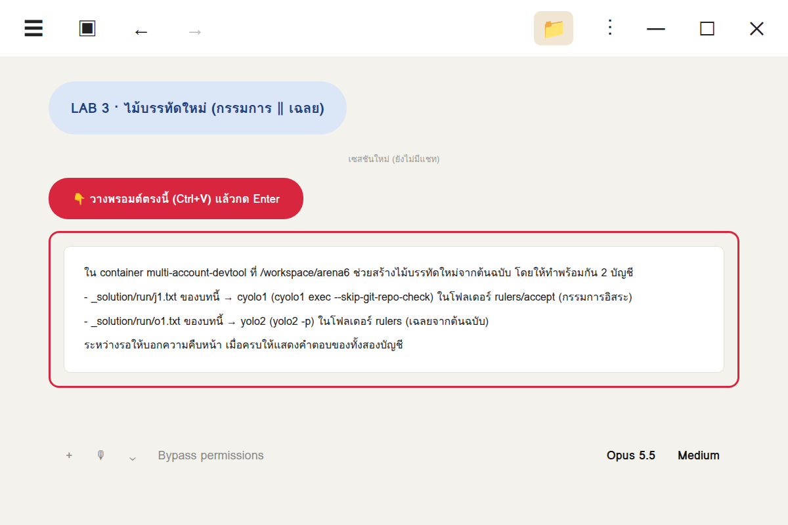
*วางพรอมต์ LAB 3*

💬 **คัดลอกพรอมต์นี้**

```text
ใน container multi-account-devtool ที่ /workspace/arena6 ช่วยสร้างไม้บรรทัดใหม่จากต้นฉบับ โดยให้ทำพร้อมกัน 2 บัญชี
- _solution/run/j1.txt ของบทนี้ → cyolo1 (cyolo1 exec --skip-git-repo-check) ในโฟลเดอร์ rulers/accept (กรรมการอิสระ)
- _solution/run/o1.txt ของบทนี้ → yolo2 (yolo2 -p) ในโฟลเดอร์ rulers (เฉลยจากต้นฉบับ)
ระหว่างรอให้บอกความคืบหน้า เมื่อครบให้แสดงคำตอบของทั้งสองบัญชี
```

✅ **ผลจริง · กรรมการ** (cyolo1 · 8 นาที 5 วินาที · สอบกับ Google สด 1 รอบ 4 นาที 52 วินาที ไม่มี retry)

| รายการ | จำนวน |
|---|---:|
| ข้อสอบทั้งหมด | 47 |
| **valid** (ผ่านกับต้นฉบับ → นับใน gate) | **22** |
| invalid · Google error / ค้างโหลด | 14 |
| invalid · ตรวจได้จากข้อมูลเครือข่ายเท่านั้น (F1–F9) | 9 |
| invalid · ราคาเปลี่ยนจากข้อมูลที่บันทึก | 1 |
| invalid · หาชื่อองค์ประกอบไม่เจอ (B12) | 1 |
| ข้อสอบที่ **เขียนผิดเอง** แล้วแก้ + รันใหม่ 1 ครั้ง | 3 (C23 · C32 · C55) |

✅ **ผลจริง · เฉลยจากต้นฉบับ** (yolo2 · 50 นาที 46 วินาที · รันกับ Google สด 18:13–18:57)

| ไม้บรรทัด | ไฟล์เฉลย | ตรวจตัวเอง |
|---|---|---|
| โครงสร้าง | `original.yml` (21 แถว) · ชิ้นสำคัญ 38 ชิ้น | เทียบตัวเอง **100%** · หน้าแรก 14.5% · หลังกรองบินตรง 88.5% (แยกสถานะได้) |
| ภาพ | `reference.png` 1366×900 | ถ่าย 3 รอบ ต่างกัน **0 px** (ต้นฉบับนิ่ง) |
| differential | `expected.json` 8 สถานการณ์ | เทียบตัวเอง 8/8 · ใส่บั๊กจงใจ 3 แบบ จับได้ 3/3 |
| เที่ยวบิน | ตอนแรก 21 → ทั้งหมด 300 | — |

👀 **สังเกต**
- **ข้อสอบ 25 จาก 47 ข้อใช้ไม่ได้กับต้นฉบับ** ส่วนใหญ่เพราะ Google ไม่เสถียร (14 ข้อ) ถ้าไม่สอบข้อสอบกับต้นฉบับก่อน ข้อเหล่านี้จะไปหักคะแนนแอปทั้งที่แอปไม่ผิด (T5)
- 🚨 **yolo2 พบว่าเฉลยไม่ตรงกับข้อมูลที่จะใช้สร้างแอป:**
  - Google **เปลี่ยนราคา 22 ใบ** ระหว่างตอนสำรวจ (17:07) กับตอนบันทึกเฉลย (18:30) เช่น บินตรง 23:55 ฿12,660 → ฿11,660
  - ผลของตัวกรองมาจาก **เซิร์ฟเวอร์** ไม่ได้กรองจาก 300 ใบ (ตัวกรอง 23:00–24:00 มีใบ ฿66,955 ที่ไม่อยู่ใน 300 ใบเลย)
  - ถ้าปล่อยไว้ แอปที่ทำถูกทุกอย่างก็ยังไม่ผ่าน → yolo2 **ไม่ตัดสินเอง** แต่เสนอทางเลือกให้ผู้ดูแลบท

ไฟล์เต็ม: [`out-j1.md`](_solution/run/out-j1.md) · [`out-o1.md`](_solution/run/out-o1.md)

### LAB 3b · ข้อมูลของแอปต้องเป็นชุดเดียวกับเฉลย

🎯 แก้ปัญหาที่ yolo2 เจอ: ให้แอปใช้ข้อมูลที่บันทึก **พร้อมกับ** เฉลย และผ่อนเกณฑ์เฉพาะส่วนที่ข้อมูลพิสูจน์ไม่ได้

🔗 **ต่อจาก LAB 3 อย่างไร:**
- ข้อมูลของแอป `spec/data/flights-all.json` มาจากส่วน D ใน LAB 1 ตอน 17:07
- เฉลย `rulers/diff/live/` มาจาก LAB 3 ตอน 18:34
- ทั้งสองชุดบันทึกห่างกันเกือบ 1.5 ชั่วโมง จึงไม่ตรงกัน `o2.txt` สั่ง yolo2 (คนเดียวกับ LAB 3 ซึ่งรู้ปัญหาอยู่แล้ว) ให้เปลี่ยนไปใช้ชุดเดียวกัน

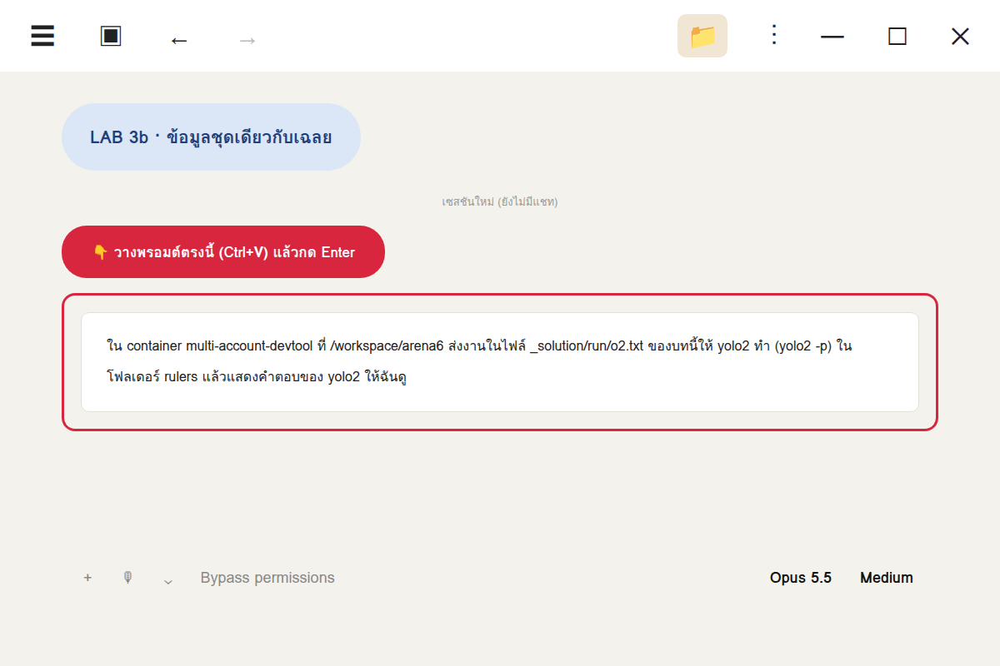
*วางพรอมต์ LAB 3b*

💬 **คัดลอกพรอมต์นี้**

```text
ใน container multi-account-devtool ที่ /workspace/arena6 ส่งงานในไฟล์ _solution/run/o2.txt ของบทนี้ให้ yolo2 ทำ (yolo2 -p) ในโฟลเดอร์ rulers แล้วแสดงคำตอบของ yolo2 ให้ฉันดู
```

✅ **ผลจริง** (yolo2 · 5 นาที 26 วินาที)

| สิ่งที่เปลี่ยน | ก่อน | หลัง | เหตุผล |
|---|---|---|---|
| ข้อมูลของแอป `spec/data/flights-all.json` | ชุด 17:07 (ต่างจากเฉลย 22 ใบ) | ชุด 18:34 ที่บันทึกพร้อมเฉลย · ตรงเฉลย **300/300** · รายการเริ่มต้น `flights-initial.json` **21/21** | เฉลยกับข้อมูลต้องมาจากเวลาเดียวกัน (ชุดเดิมเก็บไว้เป็น `flights-all-1707.json`) |
| 3 แถว "ดีที่สุด" ในรายการที่กรอง | ตัดสินตามลำดับ | ตัดสินเป็น "ชุด" | Google เลือก 3 แถวนี้เอง ข้อมูลพิสูจน์ลำดับไม่ได้ |
| ตรวจตัวเองหลังผ่อน | — | ใส่บั๊กจงใจ 29 แบบ (ราคา +1 บาท · ตัดแถว · เลขเที่ยวบินผิด) **จับได้ 29/29** | ผ่อนแล้วต้องยังจับความผิดได้ |
| ข้อสอบของกรรมการ (อ่านอย่างเดียว) | — | **ข้อ valid 22 ข้อไม่มีข้อไหนเปลี่ยนคำตอบ** | ทุกข้ออ่านข้อมูลจากไฟล์ตอนรัน |

**ข้อตัดสินเพิ่มจากผู้ดูแลบท:** สถานการณ์ "ออกเดินทาง 23:00–24:00" ยัง **ผ่านไม่ได้แม้แอปทำถูกทุกอย่าง** (ต้นฉบับซ่อน 2 ใบที่มีในข้อมูล · yolo2 จำลองแอปที่กรองถูกต้องได้ 7/8 ล้มข้อนี้ข้อเดียว) → ใช้หลักเดียวกับข้อสอบ (T5): ทำเครื่องหมาย **invalid** ใน `rulers/diff/META.json` · gate ของ differential = **7 สถานการณ์**

👀 **บทเรียน:** ต้นฉบับที่ "มีชีวิต" (ราคาเปลี่ยนทุกชั่วโมง ตัวกรองคิดที่เซิร์ฟเวอร์) ทำให้ **เฉลย ข้อมูล และภาพต้องถูกแช่แข็งในช่วงเวลาเดียวกัน** · และต้องถามเสมอว่า "แอปที่ถูกต้องสมบูรณ์ผ่านเกณฑ์นี้ได้ไหม" ถ้าไม่ได้ เกณฑ์นั้นผิด ไม่ใช่แอป

ไฟล์เต็ม: [`out-o2.md`](_solution/run/out-o2.md)

---

## LAB 4 · ชุดวัดกลาง + แช่แข็งพิกเซล + สัญญาของ loop

🎯 ห่อไม้บรรทัด 5 อันเป็นคำสั่งเดียว แช่แข็งหน้าตาไว้ใน `tokens.css` และเขียนกติกาของทั้ง 2 ขั้นให้เครื่องตรวจได้ ก่อนเขียนแอปบรรทัดแรก (ทฤษฎี: T6, T7)

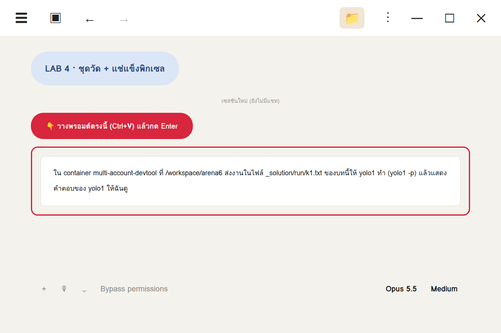
*วางพรอมต์ LAB 4*

💬 **คัดลอกพรอมต์นี้**

```text
ใน container multi-account-devtool ที่ /workspace/arena6 ส่งงานในไฟล์ _solution/run/k1.txt ของบทนี้ให้ yolo1 ทำ (yolo1 -p) แล้วแสดงคำตอบของ yolo1 ให้ฉันดู
```

✅ **ผลจริง** (yolo1 · 27 นาที 55 วินาที)

| สิ่งที่เตรียม | ตรวจแล้วได้อะไร |
|---|---|
| `kit/measure.sh` | ห่อ 5 ไม้บรรทัด → `report.json` (scores · Score · gate · issues) · **gate = acceptance ≥ 20/22 · differential 7/7 · เที่ยวบิน 21 → 300** · ข้อ invalid ยังรันและรายงานแต่ไม่นับ |
| วัดพอร์ตที่ไม่มีแอป | **exit 2** ใน 60 ms |
| ตรวจไม้บรรทัดเทียบตัวเอง | โครงสร้าง **100%** · visual **0%** |
| รันครบกับหน้าเปล่า | exit 1 · gate 0/31 · issues ครบ · checksum ของ `rulers/` ก่อนและหลังวัดเท่ากัน (ไม่มีใครแก้เฉลย) |
| `tokens.css` แช่แข็ง | **174 ตัวแปร** · ฟอนต์ Waree → Loma → Garuda (สัญญาอนุญาตเปิด) · ตัวอักษร ≥ 14 px · คู่สี 17 คู่ contrast ≥ 4.65:1 · ตั้งแบบตาบอด · tag `pixel-freeze` |
| `scope-check.sh` | stage1 ผ่านเมื่อใช้ `var()` · ไม่ผ่าน 6 ข้อเมื่อแตะ `tokens.css` / เขียน `15px` `#1a73e8` `rgba()` ตรง ๆ · stage2 ผ่านเมื่อแก้แค่ค่า · ไม่ผ่าน 4 ข้อเมื่อเพิ่ม/ลบตัวแปรหรือแตะไฟล์อื่น |
| `CONTRACT.md` | ตาราง 2 ขั้น ครบ 6 ข้อของสัญญา + กติกาเมื่อครบงบแล้ว gate ยังไม่ผ่าน |

👀 **สังเกต**
- **วัดหน้าเปล่า 1 รอบใช้ ~24 นาที** เพราะทุกขั้นรอจนหมดเวลา (differential 18 นาที) · กับแอปจริงที่มีฟอร์มจะเร็วกว่ามาก
- `diff/run.mjs` ของ yolo2 เขียนไฟล์ผลไว้ข้างตัวเองใน `rulers/` → yolo1 ให้รันจาก **สำเนาชั่วคราว** แทน เพื่อไม่ให้เฉลยถูกแตะ
- รายชื่อตัวแปรเยอะ (174) และแบ่งเป็นกลุ่มรายส่วน (หัวเว็บ ชิป แถว ราคา คอลัมน์ ฯลฯ) → แผงควบคุมของขั้นที่ 2 ละเอียดพอ

ไฟล์เต็ม: [`out-k1.md`](_solution/run/out-k1.md)

---

## LAB 5 · ขั้นที่ 1 · Loop 1: สร้างจากศูนย์ตามพิมพ์เขียว

🎯 เขียน `BLUEPRINT.md` จาก `original.yml` แล้วสร้างแอปทั้งตัว (Next.js + PostgreSQL) ให้โครงสร้างและพฤติกรรมตรงตั้งแต่ครั้งแรก หน้าตาใช้ค่าแช่แข็ง (ทฤษฎี: T8)

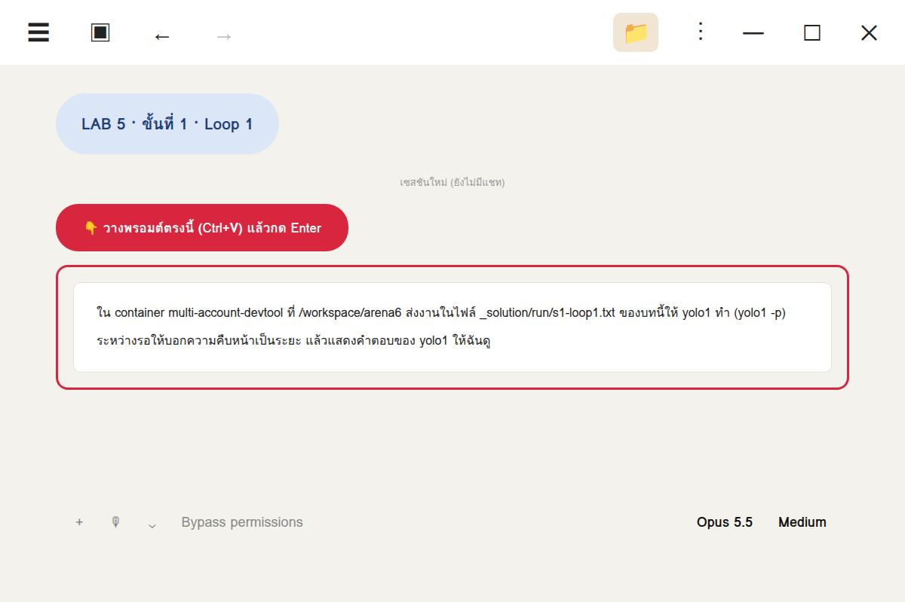
*วางพรอมต์ LAB 5*

💬 **คัดลอกพรอมต์นี้**

```text
ใน container multi-account-devtool ที่ /workspace/arena6 ส่งงานในไฟล์ _solution/run/s1-loop1.txt ของบทนี้ให้ yolo1 ทำ (yolo1 -p) ระหว่างรอให้บอกความคืบหน้าเป็นระยะ แล้วแสดงคำตอบของ yolo1 ให้ฉันดู
```

✅ **ผลจริง** (yolo1 · 20 นาที 12 วินาที · วัดเต็ม 1 ครั้ง ~4 นาที)

| ไม้บรรทัด | Loop 1 | gate ต้องการ |
|---|---:|---:|
| acceptance (valid) | **20/22** ✅ | ≥ 20/22 |
| differential (valid) | 5/7 ❌ | 7/7 |
| เที่ยวบิน | **21 → 300** ✅ | 21 → 300 |
| โครงสร้าง % | **92.28** (Jaccard 84.6 · ชิ้นสำคัญ 38/38) | — |
| visual diff % | 5.24 (ค่าตาบอด) | — |
| Score | 87.04 | — |
| `scope-check stage1` | ✓ ผ่าน | ผ่าน |

👀 **สังเกต**
- **gate ผ่าน 27 จาก 31 ข้อตั้งแต่ Loop แรก** ขาดแค่ differential 2 สถานการณ์ (บินตรง · การบินไทยเท่านั้น): จำนวนแถวถูกแล้ว (18 · 5) แต่ **3 แถว "ดีที่สุด" ที่แอปเลือกไม่ใช่ใบเดียวกับที่ Google เลือก**
- **ต่างจากรอบทดลองก่อนเขียนบทนี้มาก** (รอบนั้นใช้ข้อสอบเก่า 82 ข้อที่ไม่ได้สอบกับต้นฉบับ ได้แค่ 14/82) → ข้อสอบที่ "ผ่านกับต้นฉบับก่อน" และคอลัมน์ "ข้อความที่เห็นบนจอ" ใน `EXPLORATION.md` ทำให้ผู้สร้างกับกรรมการพูดภาษาเดียวกัน
- **ไม่แต่งข้อมูล:** ส่วนที่ไม่มีข้อมูลรองรับ (ราคารายวันในปฏิทิน · ตัวกรองสัมภาระ · พันธมิตรสายการบิน) แอปแสดงตามจริงว่าไม่มี แทนที่จะสร้างตัวเลขเอง
- token ที่ขาดส่วนใหญ่เป็นข้อความเล็ก ๆ (`ตารางวันที่` · `กราฟราคา` · `ภาษา·ไทย`) → งานของ Loop 2 กลุ่ม b–c

ไฟล์เต็ม: [`out-s1-loop1.md`](_solution/run/out-s1-loop1.md)

---

## LAB 6 · ขั้นที่ 1 · Loop 2: structure compiler + ล็อกโครงสร้าง

🎯 แก้ตาม `report.json` เป็น 3 กลุ่ม (gate → เปลี่ยนชื่อ → เพิ่ม/ลบ) วัดหลังทุกกลุ่ม แล้วล็อกโครงสร้าง 3 ชั้น (ทฤษฎี: T8, T9)

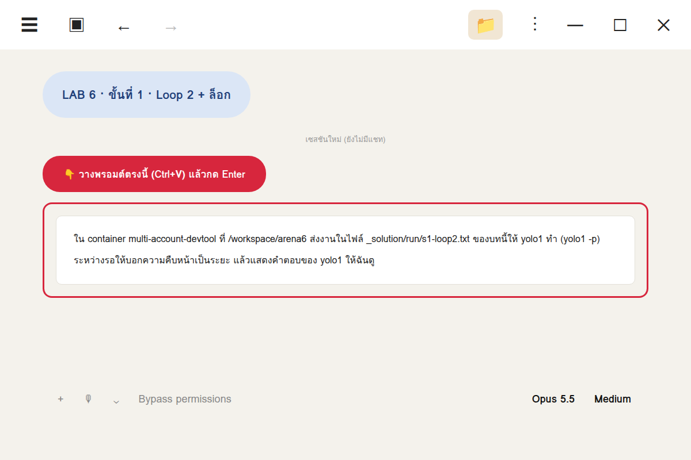
*วางพรอมต์ LAB 6*

💬 **คัดลอกพรอมต์นี้**

```text
ใน container multi-account-devtool ที่ /workspace/arena6 ส่งงานในไฟล์ _solution/run/s1-loop2.txt ของบทนี้ให้ yolo1 ทำ (yolo1 -p) ระหว่างรอให้บอกความคืบหน้าเป็นระยะ แล้วแสดงคำตอบของ yolo1 ให้ฉันดู
```

✅ **ผลจริง** (yolo1 · 22 นาที 13 วินาที · ครบงบ 2 loop)

| กลุ่ม | เปลี่ยนอะไร | acceptance | differential | gate | โครงสร้าง % | Score | เก็บ/ย้อนกลับ |
|---|---|---:|---:|---:|---:|---:|---|
| Loop 1 | จุดเริ่ม | 20/22 | 5/7 | 27/31 | 92.28 | 87.04 | — |
| a | สูตรเลือก "ดีที่สุด" หลังกรอง · ชื่อในกล่องตัวกรองสนามบินต่อเครื่อง (B45) และตัวกรองทั้งหมด (B47) · ตัวกรองเวลาแวะพักขั้นต่ำและตั๋วแยกที่กรองได้จริง | **22/22** | 6/7 | 30/31 | 92.28 | — | เก็บ (gate ดีขึ้น) |
| b | เปลี่ยนชื่อให้ตรงต้นฉบับ (ปุ่ม+ลิงก์ราคาที่ติดตาม · ย่อหน้าสกุลเงิน) + ปรับสูตร "ดีที่สุด" ต่อจาก a | 22/22 | **7/7** | **31/31 ✅** | **94.67** | **89.43** | เก็บ |
| c | ไอคอนเป็นรูป · เมนูหัวเว็บ · ลบย่อหน้าเครดิต | 22/22 | 7/7 | 31/31 | 94.36 ↓ | — | **ย้อนกลับ** (ไอคอนเพิ่มชื่อที่ต้นฉบับไม่มี 12 รายการ) |

| ตัวล็อกโครงสร้าง (T9) | ผล |
|---|---|
| `structure.lock` | SHA-256 `381e1e23…294cd1` · รันซ้ำ 3 รอบได้ hash เดิม |
| `size-baseline.json` | ขนาดของ 298 element |
| `visual-baseline.json` | แถวเที่ยวบินแรกที่ y = 623 px (1016×92) · สีของ `--color-text*` · ข้อความในช่องกรอก |
| `scope-check stage1 pixel-freeze` | ✓ ผ่าน · tag `s1-loop2` + `structure-lock` |

👀 **สังเกต**
- **gate ผ่านครบ 31/31 ใน 2 loop จากโฟลเดอร์ว่าง** (acceptance 22/22 · differential 7/7 · เที่ยวบิน 21 → 300)
- **กฎเก็บแบบใหม่ได้ผล:** กลุ่ม a ยังไม่ผ่าน gate แต่ "ดีขึ้น" (27 → 30) จึงเก็บไว้ได้ ถ้าใช้กฎเดิม "ต้องผ่าน gate เท่านั้น" งานนี้จะถูกทิ้ง
- **ตัววัดกันงานที่ดูดีแต่ทำให้แย่:** กลุ่ม c (ไอคอนเป็นรูป) ฟังดูถูก แต่ทำโครงสร้างลด 0.31 → ย้อนกลับด้วย `git revert`
- **สูตร "ดีที่สุด" ไม่ได้ฝังคำตอบ:** เราตรวจโค้ดแล้ว ไม่มีเลขเที่ยวบินหรือราคาจากเฉลยอยู่ในโค้ด เป็นสูตรทั่วไป (ยอดนิยมก่อน → ราคา + ระยะเวลา + จำนวนแวะ − โบนัสเที่ยวบินถึงเช้าวันถัดไป) · ⚠️ แต่ **ค่าโบนัส 5,000 ถูกปรับจนผ่านเฉลย** = เสี่ยง overfit กับสถานการณ์ที่มีอยู่ ควรทดสอบกับตัวกรองอื่นเพิ่มถ้าจะใช้จริง
- **ที่ยังไม่ 100%:** ไอคอนที่ต้นฉบับประกาศให้ screen reader (9 ชื่อ) · `link|SkyThai` (ต้นฉบับชื่อ "Google" เราไม่ใช้แบรนด์เขา) · ตัวประกาศหน้าของ Next.js (ลบไม่ได้)
- ⚠️ **yolo1 บอกเอง:** ตัวแปรสีข้อความในแอปชื่อ `--color-text*` ไม่ใช่ `--c-text*` ตามพรอมต์ → เราแก้ชื่อในพรอมต์ของขั้นที่ 2 ให้ตรง

ไฟล์เต็ม: [`out-s1-loop2.md`](_solution/run/out-s1-loop2.md)

---

## LAB 7 · ขั้นที่ 2 · loop พิกเซล 2 รอบ

🎯 ลด visual diff ด้วยการเปลี่ยน **ค่า** ใน `tokens.css` เท่านั้น ทุกชุดค่าต้องผ่านลายนิ้วมือโครงสร้าง ตัวกันอ่านไม่ออก และตัวกันช่องโหว่ของตัววัด (ทฤษฎี: T9, T10, T11)

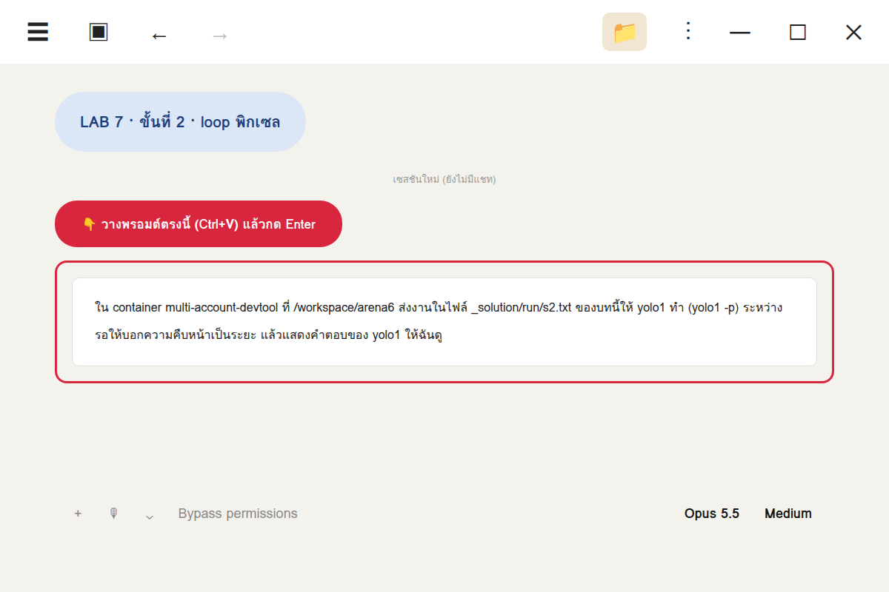
*วางพรอมต์ LAB 7*

💬 **คัดลอกพรอมต์นี้**

```text
ใน container multi-account-devtool ที่ /workspace/arena6 ส่งงานในไฟล์ _solution/run/s2.txt ของบทนี้ให้ yolo1 ทำ (yolo1 -p) ระหว่างรอให้บอกความคืบหน้าเป็นระยะ แล้วแสดงคำตอบของ yolo1 ให้ฉันดู
```

✅ **ผลจริง** (yolo1 · 15 นาที 19 วินาที · 2 รอบ เก็บทั้ง 2 รอบ)

| รอบ | เปลี่ยนอะไร | ลองกี่ชุด | ตัวกันทิ้ง | gate | โครงสร้าง % | visual diff % | Score | ผล |
|---|---|---:|---:|---:|---:|---:|---:|---|
| ตอนล็อก | — | — | — | 31/31 | 94.67 | 5.24 | 89.43 | ฐาน |
| P0 | ไม่ต้องทำ (ค่าตาบอดผ่านตัวกันทุกข้อ) | — | — | — | — | — | — | — |
| **P1** ปุ่มรวม | ฟอนต์ Garuda/Loma · ขนาดตัวอักษรบางระดับ · น้ำหนัก · สเกลระยะห่าง · สีหลัก | 245 | 7 | 31/31 | 94.67 | 5.07 | 89.60 | เก็บ · tag `p1` |
| **P2** ปุ่มรายส่วน | แถวเที่ยวบิน (ระยะ · ความกว้างคอลัมน์ · ตัวอักษร) · ขอบและเงาของฟอร์ม · ชิป · หัวเว็บ | 247 | 0 | 31/31 | 94.67 | **4.77** | **89.90** | เก็บ · tag `p2` |

| ตัวกันของแอปสุดท้าย | ผล |
|---|---|
| ลายนิ้วมือโครงสร้าง | ✅ ตรง `381e1e23…` |
| อ่านไม่ออก (217 จุดข้อความ รวม `::before/::after`) | ✅ ตัวอักษร ≥ 12 px · contrast ≥ 4.5 · opacity = 1 · ไม่ตัดกลางคำ |
| ขนาดขั้นต่ำ | ✅ 298/298 element ≥ 75% |
| **ใหม่ · แถวแรกอยู่ในจอแรก** | ✅ y = 602 (ตอนล็อก 623 · ห่าง 21 px) |
| **ใหม่ · สีข้อความเป็นสีกลาง** | ✅ ไม่ได้เปลี่ยน · contrast 16.1:1 |
| **ใหม่ · ช่องกรอกไม่ล้น** | ✅ 5/5 ช่อง |
| `scope-check stage2` | ✅ ทุก commit |

👀 **สังเกต**
- **ตัวกันใหม่ได้ผล:** รอบทดลองก่อน optimizer ดันแถวเที่ยวบินพ้นจอและเปลี่ยนสีข้อความเป็นเขียวมะกอก · รอบนี้แถวแรก **ขยับขึ้น** มาใกล้ต้นฉบับ (623 → 602) และสีข้อความไม่ถูกแตะ
- **ตัวกันทิ้ง 7 ชุด** ทั้งหมดเพราะ "ย่อเกิน 75%" เช่น เปลี่ยนเป็นฟอนต์ Liberation Sans / FreeSans / Sawasdee หรือย่อ `--font-size-xl` จนโลโก้และข้อความเล็กลงมาก
- **ตัววัดเร็วตรงกับ kit ทุกพิกเซล** (64,415 px ตอนเริ่ม) ลองได้ ~490 ชุดใน 2 รอบ
- **ทำไมลดได้แค่ 0.47 จุด:** ต้นฉบับมีแถวแรกที่ y ≈ 399 แต่แอปเราอยู่ที่ ~600 เพราะเลย์เอาต์ (ส่วนที่อยู่เหนือรายการ) เป็นงานของขั้นที่ 1 ที่ถูกล็อกแล้ว · ตัวกันยอมให้ขยับไม่เกิน 150 px → ส่วนที่เหลือต้องกลับไปแก้ที่ **โครงสร้าง** ไม่ใช่พิกเซล
- **yolo1 บอกเองว่ายังมีของที่ไม่เรียบร้อย:** คอมเมนต์ใน `tokens.css` ยังเขียนว่า "ตัวอักษร ≥ 14px" แต่ค่าจริงบางตัวเป็น 12 px แล้ว (ยังผ่านเกณฑ์ ≥ 12 px) · ตัวแปรเส้นขอบหลายตัวที่ตั้งตอนแช่แข็งเป็นแค่สี ไม่ใช่ `1px solid …` เส้นขอบจึงไม่แสดง

ไฟล์เต็ม: [`out-s2.md`](_solution/run/out-s2.md)

---

## LAB 8 · ตรวจเองทุกตัวเลข

🎯 ไม่เชื่อตัวเลขที่ agent รายงานเอง วัด 3 แอปด้วยชุดวัดเดียวกันในรอบเดียวกัน ตรวจลายนิ้วมือ ตรวจรั้วไฟล์ และทำ GIF หลักฐาน (ทฤษฎี: T12)

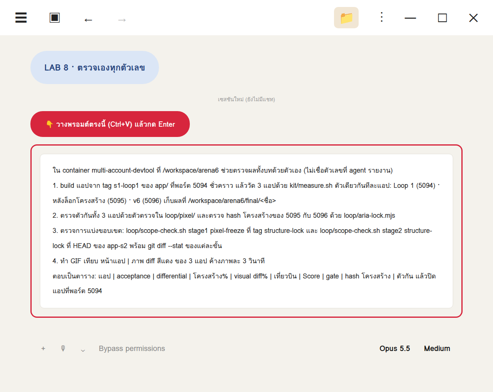
*วางพรอมต์ LAB 8*

💬 **คัดลอกพรอมต์นี้**

```text
ใน container multi-account-devtool ที่ /workspace/arena6 ช่วยตรวจผลทั้งบทด้วยตัวเอง (ไม่เชื่อตัวเลขที่ agent รายงาน)
1. build แอปจาก tag s1-loop1 ของ app/ ที่พอร์ต 5094 ชั่วคราว แล้ววัด 3 แอปด้วย kit/measure.sh ตัวเดียวกันทีละแอป: Loop 1 (5094) · หลังล็อกโครงสร้าง (5095) · v6 (5096) เก็บผลที่ /workspace/arena6/final/<ชื่อ>
2. ตรวจตัวกันทั้ง 3 แอปด้วยตัวตรวจใน loop/pixel/ และตรวจ hash โครงสร้างของ 5095 กับ 5096 ด้วย loop/aria-lock.mjs
3. ตรวจการแบ่งขอบเขต: loop/scope-check.sh stage1 pixel-freeze ที่ tag structure-lock และ loop/scope-check.sh stage2 structure-lock ที่ HEAD ของ app-s2 พร้อม git diff --stat ของแต่ละขั้น
4. ทำ GIF เทียบ หน้าแอป | ภาพ diff สีแดง ของ 3 แอป ค้างภาพละ 3 วินาที
ตอบเป็นตาราง: แอป | acceptance | differential | โครงสร้าง% | visual diff% | เที่ยวบิน | Score | gate | hash โครงสร้าง | ตัวกัน แล้วปิดแอปที่พอร์ต 5094
```

✅ **ผลจริง** (Claude Code · วัด 3 แอปต่อกัน 11 นาที 39 วินาที · แอปละ ~4 นาที)

| แอป | acceptance | differential | โครงสร้าง % | visual diff % | เที่ยวบิน | Score | gate | hash โครงสร้าง | ตัวกัน |
|---|---:|---:|---:|---:|---:|---:|---|---|---|
| Loop 1 (5094) | 20/22 | 5/7 | 92.28 | 5.24 | 21 → 300 | 87.04 | ❌ 27/31 | `368db695…` (ก่อนล็อก) | อ่านง่ายครบ (ไม่ผ่านแค่ hash/ขนาด ที่อิงตอนล็อก) |
| หลังล็อก (5095) | 22/22 | 7/7 | 94.67 | 5.24 | 21 → 300 | 89.43 | ✅ 31/31 | `381e1e23…` | ✅ ผ่านทุกข้อ |
| **v6 · SkyThai Zero (5096)** | **22/22** | **7/7** | **94.67** | **4.77** | **21 → 300** | **89.90** | ✅ **31/31** | `381e1e23…` ✅ ตรง | ✅ ผ่านทุกข้อ · แถวแรก y = 602 |

| การตรวจขอบเขต | ผล |
|---|---|
| `scope-check stage1` (`pixel-freeze` → `structure-lock`) | ✅ ผ่าน · 43 ไฟล์ · `tokens.css` ไม่ถูกแตะ (0 ครั้ง) |
| `scope-check stage2` (`structure-lock` → `p2`) | ✅ ผ่าน · 1 ไฟล์ (`tokens.css`) · เปลี่ยนค่า 24 ตัวแปร |
| ลายนิ้วมือ 5095 = 5096 | ✅ `381e1e239c4f…294cd1` ทั้งคู่ |

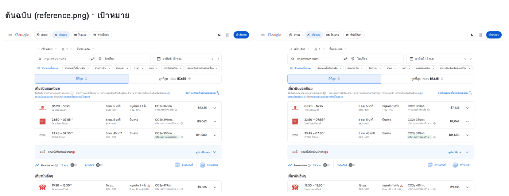
*หลักฐาน: ต้นฉบับ → Loop 1 → หลังล็อก → v6 (ซ้าย = หน้าแอป · ขวา = จุดที่ต่างจากต้นฉบับ สีแดง)*

👀 **สังเกต**
- **ตัวเลขที่วัดซ้ำตรงกับที่ agent รายงานทุกค่า** ทั้ง 3 แอป (visual diff ตรงทุกพิกเซล: 64,415 · 64,415 · 58,703 px)
- **Loop 1 กับหลังล็อก visual diff เท่ากันทุกพิกเซล** เพราะ Loop 2 แก้แต่ชื่อ พฤติกรรม และตัวกรอง (สิ่งที่ไม่ได้อยู่บนจอแรก) → ยืนยันว่าขั้นที่ 1 ไม่ได้แอบปรับหน้าตา
- **ใน GIF ยังเห็นสีแดงมากในส่วนบน** (ฟอร์มและตัวกรองของเราอยู่คนละตำแหน่งกับต้นฉบับ) → ต้องแก้ที่ **เลย์เอาต์ (ขั้นที่ 1)** ไม่ใช่พิกเซล ถ้าจะทำรอบต่อไป ควรใส่ "ตำแหน่งของส่วนหลัก" เป็นเป้าหมายของ loop โครงสร้างด้วย

---

## 🎓 สรุปบทเรียนจากการรันจริง

| เรื่อง | สิ่งที่เห็นจริง |
|---|---|
| Parallel Exploration | 4 ส่วนใช้เวลารวม 94 นาที แต่รอจริง 53 นาที · ต้นฉบับไม่เสถียร (error ~15% ของการกด) ทำให้ส่วนผลค้นหานานสุด |
| รวมความรู้ | ข้อขัดกัน 9 ข้อส่วนใหญ่มาจาก "เวลา" (ราคาเปลี่ยนระหว่างสำรวจ) → ไม่เดา ใส่ไว้ในคำถาม |
| ข้อสอบต้องผ่านกับต้นฉบับก่อน | 47 ข้อ ใช้ได้ 22 · ถ้าไม่สอบข้อสอบก่อน 25 ข้อจะหักคะแนนแอปทั้งที่แอปไม่ผิด |
| เฉลยกับข้อมูลต้องมาจากเวลาเดียวกัน | ราคาเปลี่ยน 22 ใบใน 1 ชั่วโมง · ตัวกรองคิดที่เซิร์ฟเวอร์ → ต้องแช่แข็งเฉลยและข้อมูลพร้อมกัน และตัดเกณฑ์ที่แอปที่ถูกสมบูรณ์ก็ผ่านไม่ได้ |
| loop โครงสร้าง 2 รอบ | จากโฟลเดอร์ว่าง → gate 27/31 → **31/31** · กฎ "เก็บเมื่อ gate ดีขึ้น" ทำให้ไม่ทิ้งงานที่ถูกทาง |
| loop พิกเซล 2 รอบ | visual 5.24 → 4.77 · ตัวกันใหม่ 3 ข้อไม่ถูกละเมิดเลย (ต่างจากรอบทดลองที่ optimizer โกง) · แต่ลดได้ไม่มากเพราะต้นเหตุอยู่ที่เลย์เอาต์ |
| ตรวจเอง | ตรงทุกค่า · รั้วไฟล์และลายนิ้วมือยืนยันว่า 2 ขั้นแยกกันจริง |

---

## 🔁 ปิดงาน

```text
ใน container multi-account-devtool ช่วยรัน docker compose down -v ของแอปที่พอร์ต 5095 และ 5096 ใต้ /workspace/arena6 (app และ app-s2) แล้วบอกว่าพอร์ต 5094 5095 5096 ว่างแล้วหรือยัง · ไฟล์ HAR และ trace ใน explore/d-network ห้ามนำออกนอก container
```

---

## 🔒 เฉลย (`_solution/`)

| โฟลเดอร์ | มีอะไร |
|---|---|
| [`run/`](_solution/run/) | พรอมต์ชั้นนอก `lab0–8-outer.txt` (+ `lab3b`) · ชั้นใน `x-a…x-d` `m1` `j1` `o1` `o2` `k1` `s1-loop1` `s1-loop2` `s2` · คำตอบจริง `out-*.md` · เวลาเริ่ม/จบทุกงาน `events.log` |
| [`explore/`](_solution/explore/) | `PART.md` + สคริปต์ของแต่ละส่วน (ไม่มี HAR/trace) |
| [`spec/`](_solution/spec/) | `EXPLORATION.md` · `API-INVENTORY.md` · `data/` (ข้อมูลที่แอปใช้ + ชุด 17:07 เดิม) · `shots/` · `snapshots/` |
| [`rulers/`](_solution/rulers/) | ไม้บรรทัด 5 อัน: `accept/` (กรรมการ + `META.json`) · `structure/` · `visual/` · `diff/` (+ `META.json`) · `flights/` · `RULERS.md` |
| [`kit/`](_solution/kit/) · [`loop/`](_solution/loop/) | `measure.sh` · `scope-check.sh` · `CONTRACT.md` · `aria-lock.mjs` · `structure.lock` · baseline · `pixel/` (ตัววัดเร็ว + ตัวกัน + optimizer) |
| [`stage1-app/`](_solution/stage1-app/) | แอปหลังขั้นที่ 1 (tag `structure-lock`) + `BLUEPRINT.md` + `LOOP.md` |
| [`skythai-v6/`](_solution/skythai-v6/) | **SkyThai Zero (v6)** (tag `p2`) + `LOOP.md` · `docker compose -f docker-compose.yml -f compose.5096.yml up -d --build` → http://localhost:5096 |
| [`results/`](_solution/results/) | `rounds/` ผลวัดทุก loop/รอบ · `final/` ผลวัดซ้ำ 3 แอป (report · ตัวกัน · hash · ภาพแอป · ภาพ diff) + ผล scope-check |

---

*ตัวเลขทุกตัวในบทนี้มาจากการรันจริงใน container `multi-account-devtool` เมื่อ 1 พ.ย. 2569 (17:05–20:47) · ต้นฉบับถูกเปิดสดเฉพาะ LAB 1 และ LAB 3 · ราคาในแอปเป็นข้อมูล ณ วันนั้น*
