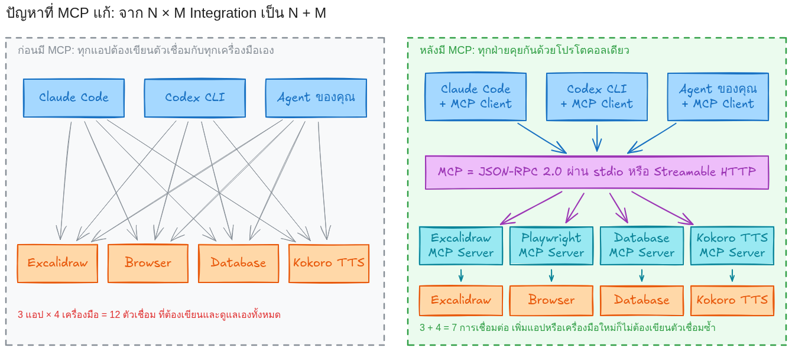

# เรียนรู้ Model Context Protocol (MCP): จากแนวคิดพื้นฐานสู่การสร้าง MCP Server ของตัวเอง

<a id="prep"></a>
## สิ่งที่ต้องเตรียม และสิ่งที่ต้องส่ง

**เครื่องมือที่ใช้ในบทเรียนนี้**

| เครื่องมือ | ใช้ทำอะไร |
| --- | --- |
| Claude Code | Host ของ MCP (AI Agent ที่นักศึกษาสั่งงาน) |
| Codex CLI | Host ของ MCP (AI Agent ที่นักศึกษาสั่งงาน) |
| Node.js | รัน MCP server ที่เขียนด้วย JavaScript |

---

<a id="ch1"></a>
## บทที่ 1 MCP คืออะไร และถูกสร้างมาเพื่อแก้ปัญหาอะไร

### 1.1 ปัญหาก่อนมี MCP: ทุกแอปต้องเขียนตัวเชื่อมกับทุกเครื่องมือ

LLM (เช่น Claude) เก่งเรื่องอ่านและเขียนข้อความ แต่ **ทำอะไรกับโลกภายนอกไม่ได้เอง** มันไม่รู้เวลาปัจจุบัน วาดรูปลง canvas ไม่ได้ กดปุ่มบนเว็บไม่ได้ และเรียกฟังก์ชัน Python ของเราไม่ได้ วิธีที่ใช้กันคือ "tool calling": โปรแกรมที่ครอบ LLM (เรียกว่า Host เช่น Claude Code, Codex CLI, หรือแอปที่เราเขียนเอง) บอก LLM ว่ามีเครื่องมืออะไรบ้าง แล้ว LLM ตอบกลับว่าอยากเรียกเครื่องมือไหนด้วย argument อะไร

ปัญหาคือ **แต่ละ Host ต้องเขียนโค้ดเชื่อมกับแต่ละเครื่องมือเอง** ถ้ามีแอป AI 3 ตัว และเครื่องมือ 4 อย่าง ต้องเขียนตัวเชื่อม 3 × 4 = 12 ชุด ต่างคนต่างกำหนดรูปแบบ ต่างคนต่างดูแล เพิ่มเครื่องมือใหม่ 1 อย่างต้องแก้ทุกแอป



*ซ้าย: ก่อนมี MCP แอป 3 ตัว × เครื่องมือ 4 อย่าง = ตัวเชื่อม 12 ชุด · ขวา: หลังมี MCP ทุกฝ่ายพูดโปรโตคอลเดียวกัน เหลือ 3 + 4 = 7 การเชื่อมต่อ*

### 1.2 MCP คืออะไร

**Model Context Protocol (MCP)** คือโปรโตคอลเปิด (open protocol) ที่ Anthropic เผยแพร่เมื่อ 25 พฤศจิกายน 2024 ([ประกาศ](https://www.anthropic.com/news/model-context-protocol)) และปัจจุบันดูแลเป็นมาตรฐานเปิดที่ [modelcontextprotocol.io](https://modelcontextprotocol.io) สเปกรุ่น **2026-07-28** ที่บทเรียนนี้อ้าง ([หน้าสเปก](https://modelcontextprotocol.io/specification/2026-07-28)) นิยามไว้ว่า

> MCP is an open protocol that enables seamless integration between LLM applications and external data sources and tools.

คำว่า "โปรโตคอล" หมายถึง **ข้อตกลง** ไม่ใช่โปรแกรมหรือไลบรารี สองฝ่ายที่ไม่เคยเห็นโค้ดของกันและกันตกลงกันว่าจะส่งข้อความรูปแบบไหน คำขอชื่ออะไรแปลว่าอะไร และคำตอบต้องมีหน้าตาอย่างไร Claude Code จึงไม่ต้องรู้เลยว่า `mcp-excalidraw-server` เขียนด้วยภาษาอะไรหรือวาดรูปลง canvas อย่างไร รู้แค่ว่าส่งคำขอตามข้อตกลงแล้วจะได้ผลกลับมา ผู้สอนจึงไม่ต้องเขียนโค้ดเชื่อม Excalidraw กับ Claude แม้แต่บรรทัดเดียว

หัวใจของ MCP มี 3 อย่าง

1. **ภาษากลางแบบเดียว** — ทุกข้อความเป็น [JSON-RPC 2.0](https://www.jsonrpc.org/specification) ใช้ JSON ที่มี field ตามชนิดข้อความ เช่น request มี `method` และ `id` ส่วน response มี `result` หรือ `error` (ชนิดข้อความ request / response / notification และตัวอย่างจริงที่ดักได้จากสายอยู่ในข้อ 2.2)
2. **การค้นพบ (discovery) ตอนรันจริง** — หลังต่อกันแล้ว Host เรียก `tools/list` ถามว่า server มีเครื่องมืออะไร แต่ละตัวมี `name`, `inputSchema` และอาจมี `description` ช่วยให้ LLM เลือกใช้; `inputSchema` คือ (JSON Schema บอกว่ารับ argument อะไร ตัวไหนบังคับ) แล้วเรียกใช้ด้วย `tools/call {name, arguments}` ได้ผลกลับมาใน `content` ([Tools](https://modelcontextprotocol.io/specification/2026-07-28/server/tools))
3. **แยกบทบาทชัดเจน** — **Host** คือแอป AI ที่ผู้ใช้ใช้งาน (Claude Code, Codex CLI) เป็นเจ้าของ LLM และผู้คุมสิทธิ์; **Client** คือตัวเชื่อมที่ Host สร้าง 1 ตัวต่อ 1 server; **Server** คือโปรแกรมที่ถือเครื่องมือจริงและประกาศ Tools / Resources / Prompts (ในบทเรียนนี้คือ `mcp-excalidraw-server`, `playwright-mcp`, `tts_server.py`) ใครเขียนฝั่งไหนก็ได้ ภาษาอะไรก็ได้ ([Architecture](https://modelcontextprotocol.io/specification/2026-07-28/architecture) ตารางเต็มอยู่ในข้อ 2.1)

ข้อควรระวังเรื่อง discovery: มันไม่ได้แปลว่า Host ไปหา server มาติดตั้งเอง นักศึกษายังต้องติดตั้งและลงทะเบียน server กับ Host ก่อน (บทที่ 4) สิ่งที่อัตโนมัติคือ "หลังต่อกันแล้ว Host ไม่ต้องรู้ล่วงหน้าว่ามีเครื่องมืออะไร"

MCP ยังอยู่คนละชั้นกับ LLM และ tool calling ซึ่งมักถูกพูดปนกัน

- **LLM** เป็นผู้ "ตัดสินใจ" ว่าจะตอบข้อความหรือจะเรียกเครื่องมือชื่ออะไรด้วย argument อะไร
- **tool calling** คือรูปแบบที่แต่ละค่ายโมเดล (Anthropic, OpenAI ฯลฯ) ใช้คุยกับ Host มีมาก่อน MCP และใช้ได้โดยไม่มี MCP
- **MCP** คือข้อตกลงระหว่าง Host กับ server Host เป็นตัวแปลระหว่างสองชั้น (Claude Code ตั้งชื่อให้โมเดลเห็นเป็น `mcp__<server>__<tool>` ตามหลักฐานในบทที่ 3) และ MCP client ก็เรียกเครื่องมือได้โดยไม่มีโมเดลเลย (บทที่ 7.3) MCP จึงไม่ได้ทำให้โมเดลฉลาดขึ้น แค่ทำให้รายการเครื่องมือที่โมเดลเห็นมาจากมาตรฐานเดียว

**flow สั้น ๆ ในหนึ่งบรรทัด** (Lab 5.1 สั่งวาด architecture diagram): เปิด Claude Code → Host เรียก `tools/list` จาก Excalidraw server → ผู้ใช้พิมพ์ prompt → LLM เลือก `batch_create_elements` พร้อม JSON ของกล่องและลูกศร → Host ตรวจนโยบายอนุมัติแล้วส่ง `tools/call` → server วาดลง canvas แล้วตอบ `content` → วนซ้ำจนพอใจแล้ว `export_to_image` ได้ PNG (ลำดับจริงที่ AI เรียกอยู่ใน [`trace.md`](lab-results/excalidraw/run-2026-09-19-062505/trace.md))

เว็บ MCP เปรียบ MCP กับ **พอร์ต USB-C ของแอป AI** ([Introduction](https://modelcontextprotocol.io/introduction)) และสเปกบอกว่าได้แรงบันดาลใจจาก [Language Server Protocol (LSP)](https://microsoft.github.io/language-server-protocol/) ที่ทำให้ editor ทุกตัวรองรับภาษาโปรแกรมผ่านมาตรฐานเดียว อุปมานี้อธิบายเรื่อง "หัวต่อเดียว" ได้ดี แต่ไม่ครอบคลุมเรื่องการอนุมัติ ความปลอดภัย และการต่อรองเวอร์ชัน (ข้อ 1.4)

### 1.3 ทำไม AI Agent / LLM จึงต้องใช้ MCP

| ประโยชน์ | ตัวอย่างในบทเรียนนี้ |
| --- | --- |
| **ไม่ต้องบอกรายชื่อเครื่องมือล่วงหน้า** — Host ได้ชื่อ คำอธิบาย และ `inputSchema` จาก `tools/list` ตอนรันจริง เมื่อ server เพิ่มเครื่องมือ Host ก็เห็นโดยไม่ต้องแก้ตัวเชื่อม ตราบใดที่รุ่นและฟีเจอร์ยังเข้ากันได้ | `playwright-mcp` ประกาศ `browser_navigate`, `browser_snapshot`, `browser_fill_form`, `browser_click` ฯลฯ ผู้สอนไม่เคยพิมพ์ชื่อเหล่านี้ลงในการตั้งค่า Claude Code เลย |
| **glue code รูปแบบเดียว** — Host ส่ง `tools/call {name, arguments}` เหมือนกันทุกเครื่องมือ server เป็นผู้แปลงไปเรียกของจริง | Excalidraw (canvas), Playwright (เบราว์เซอร์), Kokoro (ไลบรารี Python ครอบด้วย `tts_server.py`) ถูกเรียกด้วยข้อความรูปแบบเดียวกันทั้งหมด |
| **server เดียวใช้ได้หลาย Host (reuse / interoperability)** — ใช้ server ที่คนอื่นเขียนได้ทันทีโดยไม่ต้องอ่านโค้ดข้างใน มีเงื่อนไขว่าทั้งสองฝั่งต้องรองรับ **เวอร์ชันโปรโตคอล capability และ transport** ที่ตรงกัน ไม่เช่นนั้น MCP ก็ไม่ช่วยอะไร (ข้อ 2.3–2.4) | Playwright MCP ของ Microsoft และ Excalidraw MCP ของชุมชน ตั้งค่าได้ทั้ง Claude Code และ Codex CLI แต่หลักฐานการรันจริงมีเฉพาะฝั่ง Claude Code (ดู [`lab-results/codex-setup/`](lab-results/codex-setup/run-2026-09-19-093629/evidence.md)) |
| **จุดอนุมัติร่วมกัน** — สเปกให้ทุก Host มีจุดเดียวกันก่อน `tools/call` ที่คนอนุมัติหรือปฏิเสธได้ ("there SHOULD always be a human in the loop with the ability to deny tool invocations" — [Tools](https://modelcontextprotocol.io/specification/2026-07-28/server/tools)) | Claude Code ให้ผู้ใช้อนุมัติล่วงหน้าได้ หลักฐานหลายรอบในบทเรียนนี้ (เช่น `run-info.json` ของบทที่ 7) รันแบบข้ามการถามเพื่อบันทึกผลอัตโนมัติ |

ต้องเข้าใจให้ตรง: **ไม่ใช่ทุกงานต้องใช้ MCP** ถ้ามีแอปเดียว เครื่องมือเดียว และไม่ต้องให้ LLM เลือกเอง การเรียกฟังก์ชันหรือ API ตรง ๆ ง่ายและเร็วกว่า และแอปที่ไม่ใช้ MCP ก็ทำ approval และ discovery เองได้ (เครื่องมือในตัวของ Claude Code เช่นอ่านไฟล์หรือรันคำสั่ง ไม่ใช่ MCP tool แต่ก็ถามอนุมัติ และแอปทั่วไปโหลดรายการ API จากไฟล์ OpenAPI ตอนรันได้) สิ่งที่ MCP เพิ่มคือ "ทำแบบเดียวกันทุกแอปทุกเครื่องมือ" จึงคุ้มเมื่อมีหลาย Host หลายเครื่องมือ หรือต้องการใช้ server ที่คนอื่นเขียนแล้ว

### 1.4 สิ่งที่ MCP ไม่ใช่

- **ไม่ใช่โมเดล AI และไม่ใช่ agent framework** — MCP ไม่ตัดสินใจอะไรเลย ผู้เลือกว่าจะเรียก `browser_click` หรือไม่คือ LLM ผู้จัดลำดับงาน วนลูป และคุมสิทธิ์คือ Host
- **ไม่ได้มาแทน REST API หรือ Python function** — `tts_server.py` แค่ครอบไลบรารี Kokoro ให้ AI ค้นพบและเรียกได้ ของเดิมยังอยู่และยังเรียกตรงได้เหมือนเดิม (บทที่ 3)
- **ไม่ได้ทำให้ AI ทำอะไรก็ได้ และไม่ได้บังคับให้ถามทุก call** — สเปกใช้คำว่า SHOULD ระดับการอนุมัติเป็นนโยบายที่ Host และผู้ใช้ตั้งค่าตามผลกระทบของงาน trace และ wire log ช่วยตรวจย้อนหลังแต่ไม่ทดแทนการจำกัดสิทธิ์และขอบเขตก่อนรัน
- **ไม่รับประกันว่าเครื่องมือปลอดภัยหรือถูกต้อง** — สเปกบอกตรง ๆ ว่า "MCP itself cannot enforce these security principles at the protocol level" และให้ client ถือว่าคำอธิบายเครื่องมือจาก server ที่ไม่น่าเชื่อถือเป็นข้อมูลที่เชื่อไม่ได้ ([หน้าสเปก](https://modelcontextprotocol.io/specification/2026-07-28) หัวข้อ Security and Trust & Safety) server ที่พูด MCP ถูกต้องทุกประการก็ตอบผิดหรือหลอกโมเดลได้ ความรับผิดชอบอยู่ที่ผู้เขียนและผู้เลือกใช้ server
- **ไม่ใช่ "รุ่นเดียวใช้ได้ตลอดไป"** — MCP มีหลายรุ่น (ระบุด้วยวันที่) แต่ละฝั่งอาจรองรับไม่ครบ SDK ช่วยต่อรองให้ แต่บนสายมีการต่อรองรุ่นและ capability อยู่จริง เช่น Claude Code รุ่นที่ทดลองยังส่ง `2025-11-25` ขณะที่ Python SDK `mcp` 2.0.0 ใช้ `2026-07-28` (ข้อ 2.4 และหน้า [Versioning](https://modelcontextprotocol.io/specification/versioning))

---

<a id="ch2"></a>
## บทที่ 2 โครงสร้างการทำงานของ MCP

### 2.1 Host, MCP Client, MCP Server, Tools / Resources / Prompts


| องค์ประกอบ | หน้าที่ | ตัวอย่างจริงในบทเรียนนี้ |
| --- | --- | --- |
| **Host** | โปรแกรม AI ที่ผู้ใช้ใช้ สร้างและจัดการ MCP Client, คุมสิทธิ์, ถามผู้ใช้ก่อนเรียก tool, รวมผล tool กลับเข้า LLM | Claude Code 2.1.258, Codex CLI 0.154 |
| **LLM** | อ่านรายการ tool ใน context แล้วตัดสินใจว่าจะเรียก tool ใดด้วย argument อะไร | claude-sonnet-5 (รอบทดสอบบทที่ 7), Claude Fable 5.1 (รอบวาดภาพและ Playwright) |
| **MCP Client** | ตัวเชื่อม 1 ตัวต่อ 1 server อยู่ใน Host ส่ง/รับ JSON-RPC | Claude Code สร้าง client ให้ `excalidraw`, `playwright`, `hello-lab`, `kokoro-tts` |
| **MCP Server** | process แยก ประกาศ Tools / Resources / Prompts และทำงานจริงกับเครื่องมือ | `mcp-excalidraw-server` (Node), `playwright-mcp` (Node), `hello_server.py` และ `tts_server.py` (Python) |
| **Tools** | ฟังก์ชันให้โมเดลเรียก (model-controlled) มีชื่อ คำอธิบาย `inputSchema` | `batch_create_elements`, `browser_click`, `add(a, b)`, `speak(text, voice)` |
| **Resources** | ข้อมูลให้อ่าน ระบุด้วย URI | `lab://info` ของ hello-lab |
| **Prompts** | แม่แบบข้อความที่ server เตรียมไว้ | `explain_mcp(topic)` ของ hello-lab |

กติกาสำคัญจากสเปก (หน้า Architecture):

- "Each client is created by the host and communicates with exactly one server" — 1 Client ต่อ 1 Server
- "Servers should be extremely easy to build" — server เล็ก ๆ ทำงานอย่างเดียว Host เป็นคนจัดการเรื่องยาก
- "Servers should not be able to read the whole conversation, nor 'see into' other servers" — server เห็นเฉพาะ argument ที่ถูกส่งมา ไม่เห็นบทสนทนา

### 2.2 ลำดับข้อความเมื่อผู้ใช้สั่งงาน 1 ครั้ง


ข้อความในภาพเป็น JSON-RPC จริง ด้านล่างคือข้อความที่**ดักได้จากสายจริง**ระหว่าง Python client กับ `hello_server.py` (ไฟล์ [`wire-hello.jsonl`](lab-results/own-server/run-2026-09-19-062712/wire-hello.jsonl) ตัดให้สั้น)

**Client ขอรายการ tool (`tools/list`)**

```json
{"jsonrpc": "2.0", "id": 2, "method": "tools/list",
 "params": {"_meta": {"io.modelcontextprotocol/protocolVersion": "2026-07-28",
                      "io.modelcontextprotocol/clientInfo": {"name": "mcp", "version": "0.1.0"}}}}
```

**Server ตอบรายการ tool พร้อม `inputSchema` ที่สร้างจาก type hint ของ Python**

```json
{"jsonrpc": "2.0", "id": 2, "result": {"resultType": "complete", "tools": [
  {"name": "add",
   "description": "บวกเลขจำนวนเต็มสองจำนวน / Add two integers and return the sum.",
   "inputSchema": {"type": "object",
                   "properties": {"a": {"title": "A", "type": "integer"}, "b": {"title": "B", "type": "integer"}},
                   "required": ["a", "b"]},
   "outputSchema": {"type": "object", "properties": {"result": {"type": "integer"}}, "required": ["result"]}},
  ...]}}
```

**Client เรียก tool (`tools/call`) และ Server ตอบผล**

```json
{"jsonrpc": "2.0", "id": 5, "method": "tools/call", "params": {"name": "add", "arguments": {"a": 17, "b": 25}, "_meta": {...}}}
{"jsonrpc": "2.0", "id": 5, "result": {"content": [{"type": "text", "text": "42"}], "isError": false,
                                       "resultType": "complete", "structuredContent": {"result": 42}}}
```

สังเกตว่า `tools/list` เกิดครั้งเดียวตอนต่อ server ส่วน `tools/call` เกิดทุกครั้งที่ LLM เลือกใช้ tool และผลลัพธ์กลับมาใน `content` (ข้อความ/รูป/เสียง) กับ `structuredContent` (JSON ตาม `outputSchema`) ถ้า tool ทำงานไม่สำเร็จ server ตอบ `isError: true` พร้อมข้อความให้ LLM แก้ตัวได้ (ต่างจาก JSON-RPC error ที่แปลว่า request ผิดรูป)

### 2.3 Transport: stdio และ Streamable HTTP

โปรโตคอลเหมือนกันทุก transport ต่างกันแค่ "วิธีส่งข้อความ"

| Transport | วิธีทำงาน | ใช้เมื่อ | ตัวอย่างในบทเรียน |
| --- | --- | --- | --- |
| **stdio** | Host เปิด server เป็น subprocess แล้วส่ง JSON-RPC ทีละบรรทัดผ่าน stdin/stdout (stderr ไว้ log) | server อยู่บนเครื่องเดียวกัน (กรณีส่วนใหญ่) | Excalidraw MCP, Playwright MCP, `hello_server.py` |
| **Streamable HTTP** | server เปิด endpoint เดียว (เช่น `/mcp`) client ส่ง HTTP POST ทีละข้อความ คำตอบเป็น JSON หรือ SSE stream | server อยู่คนละเครื่อง/บริการกลาง | `hello_server.py --http` ที่ `http://127.0.0.1:8766/mcp` (บทที่ 7.6) |

ข้อควรจำของ stdio: **ห้าม `print()` ลง stdout ใน server** เพราะ stdout คือช่องส่ง JSON-RPC ถ้าอยาก log ให้เขียนไป stderr

### 2.4 เวอร์ชันโปรโตคอลที่พบจริงบนสาย

สเปก MCP ปรับใหญ่ในรุ่น 2026-07-28: ทุก request แนบเวอร์ชันและ capability ของ client มาใน `_meta` และมี `server/discover` สำหรับถาม capability ของ server แทน handshake `initialize` แบบเดิม แต่รุ่นเก่ายังต้องใช้งานได้ ผลที่ดักได้จากสายในบทที่ 7 ยืนยันเรื่องนี้

| Client | ข้อความแรกที่ส่ง | เวอร์ชันที่ประกาศ | หลักฐาน |
| --- | --- | --- | --- |
| Python SDK `mcp` 2.0.0 (`mcp.Client`) | `server/discover` (ไม่มี `initialize`) แล้วต่อด้วย `tools/list` | `_meta.io.modelcontextprotocol/protocolVersion = "2026-07-28"` ทุก request | [`wire-hello.jsonl`](lab-results/own-server/run-2026-09-19-062712/wire-hello.jsonl) |
| Claude Code 2.1.258 | `initialize` → `notifications/initialized` → `tools/list`, `prompts/list`, `resources/list` | `protocolVersion: "2025-11-25"`, `clientInfo: {"name": "claude-code", "version": "2.1.258"}` | [`claude-use-wire-hello.jsonl`](lab-results/own-server/run-2026-09-19-062712/claude-use-wire-hello.jsonl) |

server ตัวเดียวกัน (`hello_server.py` ที่เขียนด้วย SDK 2.0) ตอบได้ทั้งสองแบบ นี่คือข้อดีของการใช้ SDK: เรื่องเวอร์ชันและ transport SDK จัดการให้

---

<a id="ch3"></a>
## บทที่ 3 เรียกใช้ Kokoro (TTS) และ Whisper (STT) ผ่าน MCP ด้วย `MCPServer`

Kokoro คือโมเดล Text-to-Speech (TTS) แบบ open-weight ที่แปลงข้อความเป็นเสียงพูด รุ่น Kokoro-82M มีพารามิเตอร์ประมาณ 82 ล้านตัว (ต้นทาง: [GitHub hexgrad/kokoro](https://github.com/hexgrad/kokoro), [Hugging Face hexgrad/Kokoro-82M](https://huggingface.co/hexgrad/Kokoro-82M)) แพ็กเกจ Python ชื่อ `kokoro` ให้เรียกใช้โมเดลผ่านคลาส `KPipeline` และในบทนี้ใช้ข้อความภาษาอังกฤษกับเสียง `af_heart` เป็นตัวอย่าง ข้อสำคัญคือ repo ต้นทางเป็นไลบรารี ไม่ได้ให้ MCP server สำเร็จรูปมา ดังนั้นเราจะใช้ `MCPServer` ห่อความสามารถนี้เป็น tool ให้ Host เรียกเอง

ตัวอย่างนี้เปิดความสามารถ **สังเคราะห์เสียงภาษาอังกฤษด้วย Kokoro-82M** เป็น MCP tool ชื่อ `speak` ในไฟล์เดียว โค้ดเรียก `from kokoro import KPipeline` ตรง ๆ ไม่พึ่งโมดูลอื่นของแล็บ จึงอ่านแล้วเห็นครบว่า MCP server ทำอะไรบ้าง (ฉบับแล็บที่แยกชั้นเป็น `kokoro_core` + เว็บ ดูบทที่ 7.5)

**ติดตั้งบน Linux (Ubuntu/Debian)** — รันจากโฟลเดอร์ `03_MCP` ใช้ venv แยกที่ `work/.venv` จึงไม่ทับ `labs/.venv` ของบทที่ 4 ติดตั้ง torch รุ่น CPU ก่อนเพื่อไม่ให้ `kokoro` ดึง torch รุ่น CUDA หลาย GB:

```bash
python3 -m venv work/.venv
work/.venv/bin/pip install --upgrade pip
work/.venv/bin/pip install torch --index-url https://download.pytorch.org/whl/cpu
work/.venv/bin/pip install "mcp[cli]>=2,<3" kokoro soundfile numpy
sudo apt-get update && sudo apt-get install -y espeak-ng   # ตัวช่วยอ่านคำนอกคลังของ Kokoro
```

**สร้าง MCP server** — บันทึกเป็น `work/kokoro_mcp_demo.py` (ยังไม่มีในแล็บ ให้พิมพ์เอง):

```python
"""kokoro_mcp_demo.py — MCP server ที่เรียก Kokoro โดยตรงในไฟล์เดียว"""
import contextlib
import pathlib
import sys
import uuid

import numpy as np
import soundfile as sf
from mcp.server import MCPServer

AUDIO_DIR = pathlib.Path(__file__).resolve().parent / "audio_out"
SAMPLE_RATE = 24_000          # Kokoro ให้เสียง 24 kHz เสมอ
_pipeline = None


def get_pipeline():
    """โหลดโมเดลครั้งแรกที่ถูกเรียก แล้วใช้ตัวเดิมซ้ำทุกครั้ง"""
    global _pipeline
    if _pipeline is None:
        # import/โหลดโมเดลอาจ print ลง stdout จึงเบี่ยงไป stderr ชั่วคราว ไม่ให้ปนกับ JSON-RPC
        with contextlib.redirect_stdout(sys.stderr):
            from kokoro import KPipeline
            _pipeline = KPipeline(lang_code="a", repo_id="hexgrad/Kokoro-82M", device="cpu")
    return _pipeline


mcp = MCPServer("kokoro-demo", instructions="สร้างเสียงภาษาอังกฤษด้วย Kokoro-82M")


@mcp.tool()
def speak(text: str, voice: str = "af_heart") -> dict:
    """สร้างเสียงภาษาอังกฤษจากข้อความ แล้วคืน path ของไฟล์ .wav และข้อมูลเสียง"""
    text = text.strip()
    if not text:
        raise ValueError("text must not be empty")

    pipe = get_pipeline()
    chunks = []
    with contextlib.redirect_stdout(sys.stderr):
        for _graphemes, _phonemes, audio in pipe(text, voice=voice):
            chunks.append(np.asarray(audio))
    if not chunks:
        raise ValueError("Kokoro produced no audio")

    wav = np.concatenate(chunks)          # รวมทุก chunk ก่อนเขียน ไม่งั้นจะได้แค่ประโยคสุดท้าย
    AUDIO_DIR.mkdir(exist_ok=True)
    path = AUDIO_DIR / f"{uuid.uuid4().hex[:8]}.wav"
    sf.write(str(path), wav, SAMPLE_RATE)
    return {
        "path": str(path),
        "duration_sec": round(len(wav) / SAMPLE_RATE, 2),
        "sample_rate": SAMPLE_RATE,
        "voice": voice,
    }


if __name__ == "__main__":
    mcp.run()   # stdio — ห้ามครอบด้วย redirect_stdout เพราะโปรโตคอลต้องส่งคำตอบทาง stdout
```

- `MCPServer(...)` สร้าง server พร้อมชื่อและคำแนะนำการใช้งาน โดยใช้คลาสจาก MCP Python SDK 2.x ของบทเรียน
- `@mcp.tool()` ประกาศฟังก์ชันเป็น tool: docstring เป็นคำอธิบาย และ type hint ช่วยสร้าง `inputSchema` โดย `text` จำเป็น ส่วน `voice` มีค่าเริ่มต้น ถ้าโยน `ValueError` Host จะได้ผล `isError: true`
- `KPipeline(lang_code="a", ...)` คือ Kokoro โดยตรง (`a` = American English) โหลดแบบ lazy ครั้งแรกที่มีคนเรียก `speak` แล้วเก็บไว้ใช้ซ้ำ ครั้งแรกจะดาวน์โหลดโมเดล `hexgrad/Kokoro-82M` จาก Hugging Face จึงช้ากว่าครั้งถัดไป
- `mcp.run()` เริ่มรับข้อความผ่าน **stdio** ให้ Host เปิด server เป็น subprocess ได้ stdout เป็นช่อง JSON-RPC ดังนั้นจุดที่ไลบรารีอาจ `print` (import และสังเคราะห์) ถูกครอบด้วย `redirect_stdout(sys.stderr)` เฉพาะจุด ไม่ครอบ `mcp.run()`

<a id="ch3-1"></a>
### 3.1 เรียก MCP tool ผ่าน Host

ลงทะเบียนในชื่อ `kokoro-demo` (แยกจาก `kokoro-tts` ของแล็บบทที่ 4) รันจาก `03_MCP`:

```bash
claude mcp add --scope user kokoro-demo -- "$(pwd)/work/.venv/bin/python" "$(pwd)/work/kokoro_mcp_demo.py"
```

ถ้าใช้ Codex CLI ให้ใช้รูปแบบ `codex mcp add` ตามข้อ 4.6 โดยใช้ชื่อ `kokoro-demo` และ path เดียวกันนี้ จากนั้นเปิด Host session ใหม่ แล้วส่งคำขอ:

```text
ใช้ tool speak ของ kokoro-demo สร้างเสียงจากข้อความ
"Model Context Protocol lets one server serve many agents."
แล้วบอก path ของไฟล์เสียงและความยาวเป็นวินาที
```

**ลำดับการทำงาน:** Host เรียก `tools/list` เพื่อรู้จัก `speak` → โมเดลเลือก tool และ argument → Host ตรวจนโยบายอนุมัติแล้วส่ง `tools/call` → server สร้างเสียงและคืนผลให้ Host สรุป

**ผลที่ควรได้:** path ของไฟล์ `.wav` ใน `work/audio_out/`, `duration_sec`, `sample_rate` (24000) และ `voice` โดยไฟล์เสียงต้องเปิดได้และความยาวมากกว่า 0 หากผล tool มี `isError: true` ให้ตรวจข้อความ error ก่อนถือว่าผ่าน

<a id="ch3-2"></a>
### 3.2 ตัวอย่างที่สอง: Whisper แปลงเสียงเป็นข้อความ (STT) ด้วย `MCPServer`

Whisper คือโมเดล Speech-to-Text (STT) แบบ open-source ของ OpenAI ทำงาน **กลับทิศกับ Kokoro**: Kokoro รับข้อความแล้วให้ไฟล์เสียง ส่วน Whisper รับไฟล์เสียงแล้วให้ข้อความ

ในบทนี้เราโหลด Whisper **จาก Hugging Face Hub ด้วยไลบรารี Transformers** เพื่อให้เห็นวิธีดึงโมเดลจาก Hub ซึ่งเป็นแพตเทิร์นเดียวกับที่ Kokoro ใช้ (`hexgrad/Kokoro-82M`) แยกให้ชัด 2 ชั้น:

- **โมเดล** ยังคือ Whisper ของ OpenAI อยู่ที่ repo id [`openai/whisper-base`](https://huggingface.co/openai/whisper-base)
- **ไลบรารี** ที่ใช้ดาวน์โหลดและรันคือ [`transformers`](https://huggingface.co/docs/transformers/en/main_classes/pipelines#transformers.AutomaticSpeechRecognitionPipeline) ของ Hugging Face

`MODEL_ID = "openai/whisper-base"` คือ **repo id** บน Hub (รูปแบบ `องค์กร/ชื่อโมเดล` — เปิดดูไฟล์ทั้งหมดได้ที่หน้าโมเดล) เมื่อเรียก `from_pretrained(MODEL_ID)` ไลบรารีจะดาวน์โหลดไฟล์น้ำหนักและไฟล์ตั้งค่าของ repo นั้นมาเก็บใน cache เครื่อง (ค่าเริ่มต้น `~/.cache/huggingface/hub`, เปลี่ยนได้ด้วย `HF_HOME`) เมื่อยังไม่มีไฟล์ใน cache ครั้งถัดไปนำไฟล์เดิมกลับมาใช้ได้ แต่โหมดปกติอาจติดต่อ Hub เพื่อตรวจเวอร์ชัน หากต้องการออฟไลน์ ให้ดาวน์โหลดไฟล์ให้ครบก่อนแล้วตั้ง `HF_HUB_OFFLINE=1` โมเดลนี้เป็น public **ไม่ต้องใช้ API key หรือ token** และการถอดเสียงทั้งหมดรันบนเครื่องตัวเอง (ต้องต่อเน็ตเมื่อดาวน์โหลดไฟล์ที่ยังไม่มีใน cache) รุ่น `base` เป็นแบบหลายภาษา (ต่างจาก `base.en` ที่รับเฉพาะอังกฤษ) จึงระบุ `language="th"` ได้ แต่บทเรียนยังไม่ได้วัดคุณภาพภาษาไทยของรุ่นนี้

**ติดตั้งเพิ่ม** ใน `work/.venv` เดิมที่มี torch รุ่น CPU และ `mcp` อยู่แล้ว (รันจาก `03_MCP`) — `transformers` จะดึง `tokenizers`/`safetensors`/`huggingface_hub` ให้เอง ส่วน `ffmpeg` จำเป็นเพราะ pipeline อ่านไฟล์เสียงจาก path ผ่าน ffmpeg:

```bash
sudo apt-get update && sudo apt-get install -y ffmpeg
work/.venv/bin/pip install -U "transformers>=5,<6"
```

**สร้าง MCP server** — บันทึกเป็น `work/whisper_mcp_demo.py` (ยังไม่มีในแล็บ ให้พิมพ์เอง):

```python
"""whisper_mcp_demo.py — MCP server ที่โหลด Whisper จาก Hugging Face แล้วถอดเสียง"""
import contextlib
import pathlib
import sys

from mcp.server import MCPServer

MODEL_ID = "openai/whisper-base"   # repo id บน Hugging Face Hub
_asr = None


def get_asr():
    """โหลดโมเดล+processor จาก Hub ครั้งแรกที่ถูกเรียก แล้วใช้ pipeline เดิมซ้ำ"""
    global _asr
    if _asr is None:
        # import/ดาวน์โหลด/โหลดโมเดลอาจ print ลง stdout จึงเบี่ยงไป stderr ไม่ให้ปนกับ JSON-RPC
        with contextlib.redirect_stdout(sys.stderr):
            import torch
            from transformers import AutoModelForSpeechSeq2Seq, AutoProcessor, pipeline

            processor = AutoProcessor.from_pretrained(MODEL_ID)
            model = AutoModelForSpeechSeq2Seq.from_pretrained(MODEL_ID, dtype=torch.float32)
            _asr = pipeline(
                "automatic-speech-recognition",
                model=model,
                tokenizer=processor.tokenizer,
                feature_extractor=processor.feature_extractor,
                device=-1,               # -1 = CPU
            )
    return _asr


mcp = MCPServer("whisper-demo", instructions="ถอดเสียงพูดจากไฟล์เสียงเป็นข้อความด้วย Whisper")


@mcp.tool()
def transcribe(audio_path: str, language: str = "en") -> dict:
    """ถอดเสียงจากไฟล์เสียง (path สัมบูรณ์บนเครื่องที่รัน server) แล้วคืนข้อความ"""
    path = pathlib.Path(audio_path)
    if not path.is_absolute():
        raise ValueError("audio_path must be an absolute path")
    if not path.is_file():
        raise ValueError(f"audio file not found: {path}")

    asr = get_asr()
    with contextlib.redirect_stdout(sys.stderr):
        result = asr(
            str(path),
            # ส่งต่อให้ model.generate() — บังคับ "ถอดเสียงภาษาเดิม" ไม่ใช่แปลเป็นอังกฤษ
            generate_kwargs={"language": language, "task": "transcribe"},
        )
    return {"text": result["text"].strip(), "language": language}


if __name__ == "__main__":
    mcp.run()   # stdio — ห้ามครอบด้วย redirect_stdout เช่นเดียวกับตัวอย่าง Kokoro
```


**ลงทะเบียนและทดลอง** ในชื่อ `whisper-demo` รันจาก `03_MCP` (Codex CLI ใช้ `codex mcp add` ตามข้อ 4.6 ด้วยชื่อและ path เดียวกัน):

```bash
claude mcp add --scope user whisper-demo -- "$(pwd)/work/.venv/bin/python" "$(pwd)/work/whisper_mcp_demo.py"
```

เปิด Host session ใหม่แล้วต่อจากผลของข้อ 3.1 — ให้ TTS สร้าง WAV แล้วส่ง path นั้นให้ STT อ่านกลับ:

```text
ใช้ tool transcribe ของ whisper-demo อ่านไฟล์เสียงที่ kokoro-demo เพิ่งสร้าง
(ใช้ path จากผลของ speak) ด้วย language "en" แล้วบอกข้อความที่ถอดได้
```

**ลำดับการทำงาน:** ข้อความ → `speak` (Kokoro) → ไฟล์ `.wav` ใน `work/audio_out/` → `transcribe` (Whisper) → ข้อความ ผลที่ควรได้คือข้อความใกล้เคียงประโยคต้นฉบับ แต่ไม่จำเป็นต้องตรงทุกตัวอักษร (ตัวพิมพ์ เครื่องหมายวรรคตอน หรือคำบางคำอาจต่างไป) ถ้าได้ข้อความว่างหรือ `isError: true` ให้ตรวจ path และ `ffmpeg` ก่อน


