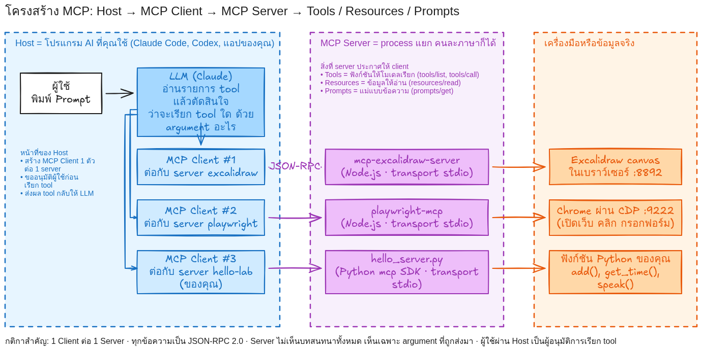
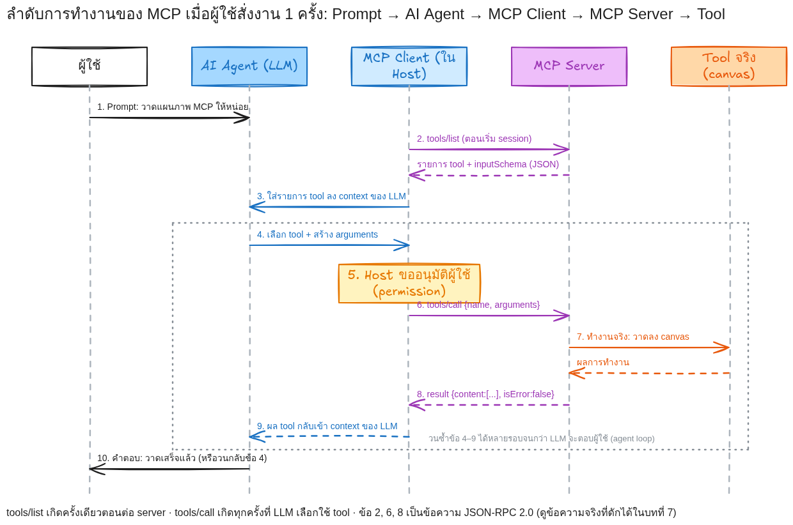
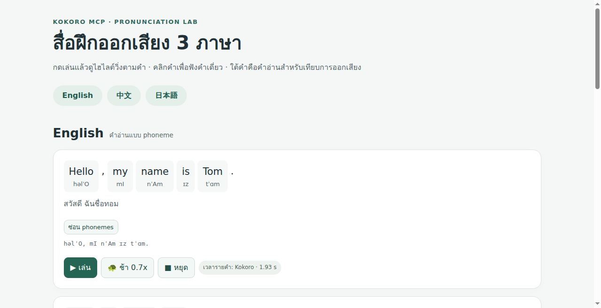
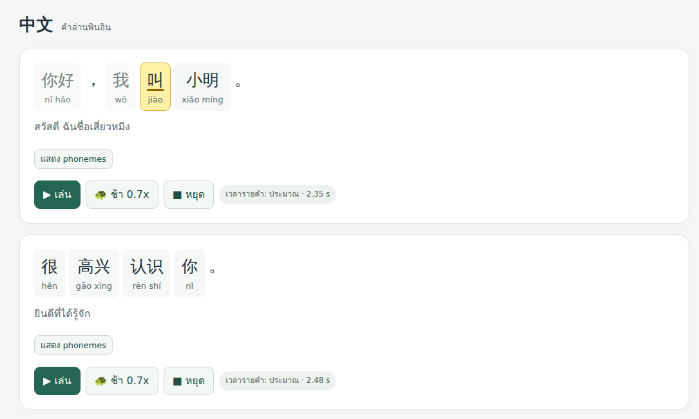
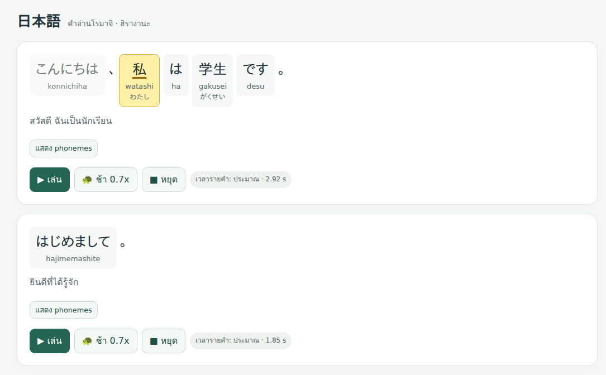
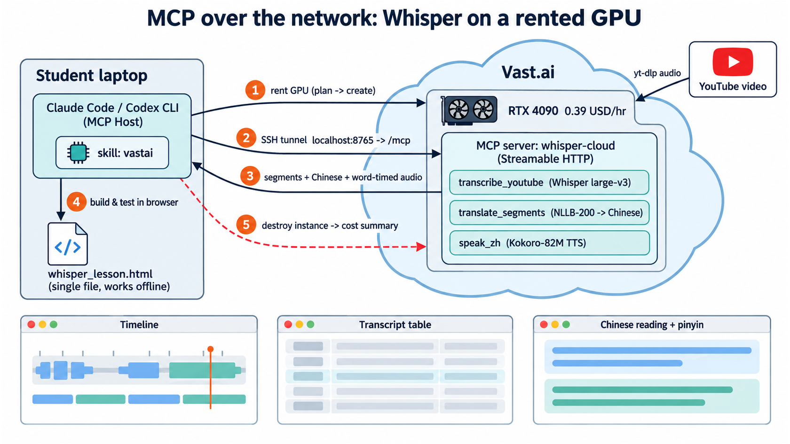
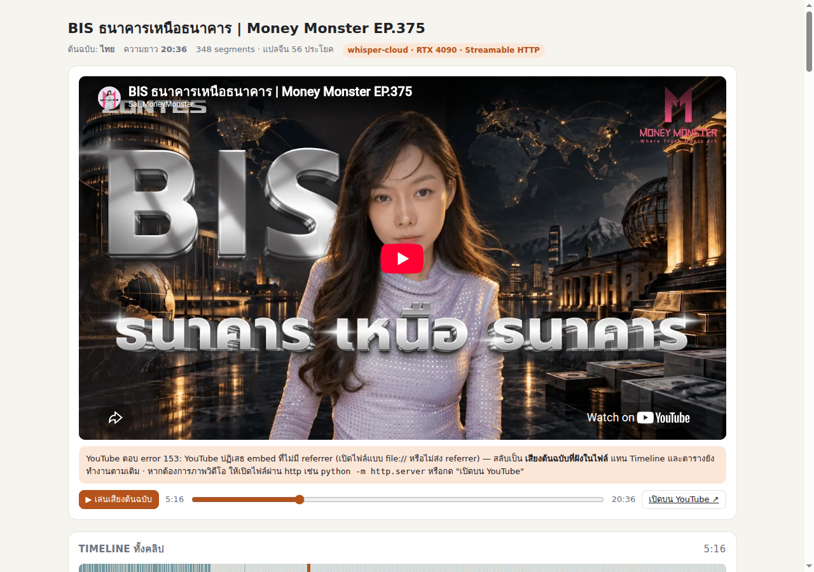
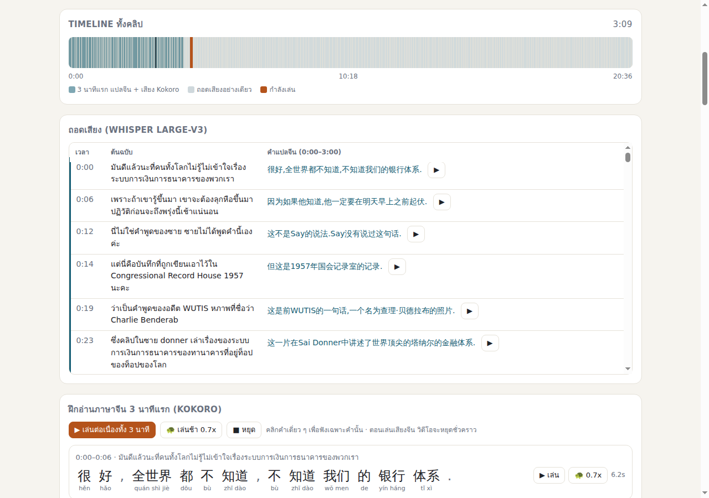
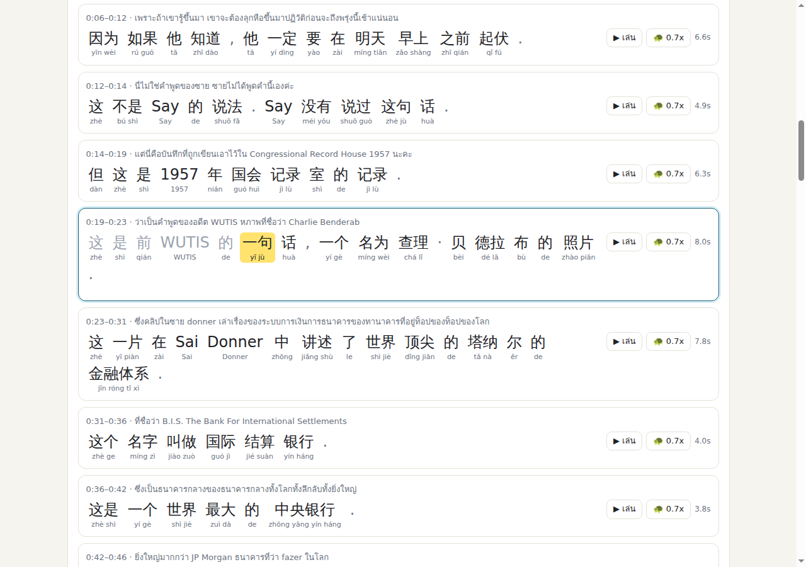

# เรียนรู้ Model Context Protocol (MCP): จากแนวคิดพื้นฐานสู่การสร้าง MCP Server ของตัวเอง

<a id="prep"></a>
## สิ่งที่ต้องเตรียม และสิ่งที่ต้องส่ง

**เครื่องมือที่ใช้ในบทเรียนนี้**

| เครื่องมือ | ใช้ทำอะไร |
| --- | --- |
| Claude Code | Host ของ MCP (AI Agent ที่นักศึกษาสั่งงาน) |
| Codex CLI | Host ของ MCP (AI Agent ที่นักศึกษาสั่งงาน) |
| Node.js | รัน MCP server ที่เขียนด้วย JavaScript |

---

<a id="ch1"></a>
## บทที่ 1 MCP คืออะไร และถูกสร้างมาเพื่อแก้ปัญหาอะไร

### 1.1 ปัญหาก่อนมี MCP: ทุกแอปต้องเขียนตัวเชื่อมกับทุกเครื่องมือ

LLM (เช่น Claude) เก่งเรื่องอ่านและเขียนข้อความ แต่ **ทำอะไรกับโลกภายนอกไม่ได้เอง** มันไม่รู้เวลาปัจจุบัน วาดรูปลง canvas ไม่ได้ กดปุ่มบนเว็บไม่ได้ และเรียกฟังก์ชัน Python ของเราไม่ได้ วิธีที่ใช้กันคือ "tool calling": โปรแกรมที่ครอบ LLM (เรียกว่า Host เช่น Claude Code, Codex CLI, หรือแอปที่เราเขียนเอง) บอก LLM ว่ามีเครื่องมืออะไรบ้าง แล้ว LLM ตอบกลับว่าอยากเรียกเครื่องมือไหนด้วย argument อะไร

ปัญหาคือ **แต่ละ Host ต้องเขียนโค้ดเชื่อมกับแต่ละเครื่องมือเอง** ถ้ามีแอป AI 3 ตัว และเครื่องมือ 4 อย่าง ต้องเขียนตัวเชื่อม 3 × 4 = 12 ชุด ต่างคนต่างกำหนดรูปแบบ ต่างคนต่างดูแล เพิ่มเครื่องมือใหม่ 1 อย่างต้องแก้ทุกแอป


*ซ้าย: ก่อนมี MCP แอป 3 ตัว × เครื่องมือ 4 อย่าง = ตัวเชื่อม 12 ชุด · ขวา: หลังมี MCP ทุกฝ่ายพูดโปรโตคอลเดียวกัน เหลือ 3 + 4 = 7 การเชื่อมต่อ*

### 1.2 MCP คืออะไร

**Model Context Protocol (MCP)** คือโปรโตคอลเปิด (open protocol) ที่ Anthropic เผยแพร่เมื่อ 25 พฤศจิกายน 2024 ([ประกาศ](https://www.anthropic.com/news/model-context-protocol)) และปัจจุบันดูแลเป็นมาตรฐานเปิดที่ [modelcontextprotocol.io](https://modelcontextprotocol.io) สเปกรุ่น **2026-07-28** ที่บทเรียนนี้อ้าง ([หน้าสเปก](https://modelcontextprotocol.io/specification/2026-07-28)) นิยามไว้ว่า

> MCP is an open protocol that enables seamless integration between LLM applications and external data sources and tools.

คำว่า "โปรโตคอล" หมายถึง **ข้อตกลง** ไม่ใช่โปรแกรมหรือไลบรารี สองฝ่ายที่ไม่เคยเห็นโค้ดของกันและกันตกลงกันว่าจะส่งข้อความรูปแบบไหน คำขอชื่ออะไรแปลว่าอะไร และคำตอบต้องมีหน้าตาอย่างไร Claude Code จึงไม่ต้องรู้เลยว่า `mcp-excalidraw-server` เขียนด้วยภาษาอะไรหรือวาดรูปลง canvas อย่างไร รู้แค่ว่าส่งคำขอตามข้อตกลงแล้วจะได้ผลกลับมา ผู้สอนจึงไม่ต้องเขียนโค้ดเชื่อม Excalidraw กับ Claude แม้แต่บรรทัดเดียว

หัวใจของ MCP มี 3 อย่าง

1. **ภาษากลางแบบเดียว** — ทุกข้อความเป็น [JSON-RPC 2.0](https://www.jsonrpc.org/specification) ใช้ JSON ที่มี field ตามชนิดข้อความ เช่น request มี `method` และ `id` ส่วน response มี `result` หรือ `error` (ชนิดข้อความ request / response / notification และตัวอย่างจริงที่ดักได้จากสายอยู่ในข้อ 2.2)
2. **การค้นพบ (discovery) ตอนรันจริง** — หลังต่อกันแล้ว Host เรียก `tools/list` ถามว่า server มีเครื่องมืออะไร แต่ละตัวมี `name`, `inputSchema` และอาจมี `description` ช่วยให้ LLM เลือกใช้; `inputSchema` คือ (JSON Schema บอกว่ารับ argument อะไร ตัวไหนบังคับ) แล้วเรียกใช้ด้วย `tools/call {name, arguments}` ได้ผลกลับมาใน `content` ([Tools](https://modelcontextprotocol.io/specification/2026-07-28/server/tools))
3. **แยกบทบาทชัดเจน** — **Host** คือแอป AI ที่ผู้ใช้ใช้งาน (Claude Code, Codex CLI) เป็นเจ้าของ LLM และผู้คุมสิทธิ์; **Client** คือตัวเชื่อมที่ Host สร้าง 1 ตัวต่อ 1 server; **Server** คือโปรแกรมที่ถือเครื่องมือจริงและประกาศ Tools / Resources / Prompts (ในบทเรียนนี้คือ `mcp-excalidraw-server`, `playwright-mcp`, `tts_server.py`) ใครเขียนฝั่งไหนก็ได้ ภาษาอะไรก็ได้ ([Architecture](https://modelcontextprotocol.io/specification/2026-07-28/architecture) ตารางเต็มอยู่ในข้อ 2.1)

ข้อควรระวังเรื่อง discovery: มันไม่ได้แปลว่า Host ไปหา server มาติดตั้งเอง นักศึกษายังต้องติดตั้งและลงทะเบียน server กับ Host ก่อน (บทที่ 4) สิ่งที่อัตโนมัติคือ "หลังต่อกันแล้ว Host ไม่ต้องรู้ล่วงหน้าว่ามีเครื่องมืออะไร"

MCP ยังอยู่คนละชั้นกับ LLM และ tool calling ซึ่งมักถูกพูดปนกัน

- **LLM** เป็นผู้ "ตัดสินใจ" ว่าจะตอบข้อความหรือจะเรียกเครื่องมือชื่ออะไรด้วย argument อะไร
- **tool calling** คือรูปแบบที่แต่ละค่ายโมเดล (Anthropic, OpenAI ฯลฯ) ใช้คุยกับ Host มีมาก่อน MCP และใช้ได้โดยไม่มี MCP
- **MCP** คือข้อตกลงระหว่าง Host กับ server Host เป็นตัวแปลระหว่างสองชั้น (Claude Code ตั้งชื่อให้โมเดลเห็นเป็น `mcp__<server>__<tool>` ตามหลักฐานในบทที่ 3) และ MCP client ก็เรียกเครื่องมือได้โดยไม่มีโมเดลเลย (บทที่ 7.3) MCP จึงไม่ได้ทำให้โมเดลฉลาดขึ้น แค่ทำให้รายการเครื่องมือที่โมเดลเห็นมาจากมาตรฐานเดียว

**flow สั้น ๆ ในหนึ่งบรรทัด** (Lab 5.1 สั่งวาด architecture diagram): เปิด Claude Code → Host เรียก `tools/list` จาก Excalidraw server → ผู้ใช้พิมพ์ prompt → LLM เลือก `batch_create_elements` พร้อม JSON ของกล่องและลูกศร → Host ตรวจนโยบายอนุมัติแล้วส่ง `tools/call` → server วาดลง canvas แล้วตอบ `content` → วนซ้ำจนพอใจแล้ว `export_to_image` ได้ PNG (ลำดับจริงที่ AI เรียกอยู่ใน [`trace.md`](lab-results/excalidraw/run-2026-09-19-062505/trace.md))

เว็บ MCP เปรียบ MCP กับ **พอร์ต USB-C ของแอป AI** ([Introduction](https://modelcontextprotocol.io/introduction)) และสเปกบอกว่าได้แรงบันดาลใจจาก [Language Server Protocol (LSP)](https://microsoft.github.io/language-server-protocol/) ที่ทำให้ editor ทุกตัวรองรับภาษาโปรแกรมผ่านมาตรฐานเดียว อุปมานี้อธิบายเรื่อง "หัวต่อเดียว" ได้ดี แต่ไม่ครอบคลุมเรื่องการอนุมัติ ความปลอดภัย และการต่อรองเวอร์ชัน (ข้อ 1.4)

### 1.3 ทำไม AI Agent / LLM จึงต้องใช้ MCP

| ประโยชน์ | ตัวอย่างในบทเรียนนี้ |
| --- | --- |
| **ไม่ต้องบอกรายชื่อเครื่องมือล่วงหน้า** — Host ได้ชื่อ คำอธิบาย และ `inputSchema` จาก `tools/list` ตอนรันจริง เมื่อ server เพิ่มเครื่องมือ Host ก็เห็นโดยไม่ต้องแก้ตัวเชื่อม ตราบใดที่รุ่นและฟีเจอร์ยังเข้ากันได้ | `playwright-mcp` ประกาศ `browser_navigate`, `browser_snapshot`, `browser_fill_form`, `browser_click` ฯลฯ ผู้สอนไม่เคยพิมพ์ชื่อเหล่านี้ลงในการตั้งค่า Claude Code เลย |
| **glue code รูปแบบเดียว** — Host ส่ง `tools/call {name, arguments}` เหมือนกันทุกเครื่องมือ server เป็นผู้แปลงไปเรียกของจริง | Excalidraw (canvas), Playwright (เบราว์เซอร์), Kokoro (ไลบรารี Python ครอบด้วย `tts_server.py`) ถูกเรียกด้วยข้อความรูปแบบเดียวกันทั้งหมด |
| **server เดียวใช้ได้หลาย Host (reuse / interoperability)** — ใช้ server ที่คนอื่นเขียนได้ทันทีโดยไม่ต้องอ่านโค้ดข้างใน มีเงื่อนไขว่าทั้งสองฝั่งต้องรองรับ **เวอร์ชันโปรโตคอล capability และ transport** ที่ตรงกัน ไม่เช่นนั้น MCP ก็ไม่ช่วยอะไร (ข้อ 2.3–2.4) | Playwright MCP ของ Microsoft และ Excalidraw MCP ของชุมชน ตั้งค่าได้ทั้ง Claude Code และ Codex CLI แต่หลักฐานการรันจริงมีเฉพาะฝั่ง Claude Code (ดู [`lab-results/codex-setup/`](lab-results/codex-setup/run-2026-09-19-093629/evidence.md)) |
| **จุดอนุมัติร่วมกัน** — สเปกให้ทุก Host มีจุดเดียวกันก่อน `tools/call` ที่คนอนุมัติหรือปฏิเสธได้ ("there SHOULD always be a human in the loop with the ability to deny tool invocations" — [Tools](https://modelcontextprotocol.io/specification/2026-07-28/server/tools)) | Claude Code ให้ผู้ใช้อนุมัติล่วงหน้าได้ หลักฐานหลายรอบในบทเรียนนี้ (เช่น `run-info.json` ของบทที่ 7) รันแบบข้ามการถามเพื่อบันทึกผลอัตโนมัติ |

ต้องเข้าใจให้ตรง: **ไม่ใช่ทุกงานต้องใช้ MCP** ถ้ามีแอปเดียว เครื่องมือเดียว และไม่ต้องให้ LLM เลือกเอง การเรียกฟังก์ชันหรือ API ตรง ๆ ง่ายและเร็วกว่า และแอปที่ไม่ใช้ MCP ก็ทำ approval และ discovery เองได้ (เครื่องมือในตัวของ Claude Code เช่นอ่านไฟล์หรือรันคำสั่ง ไม่ใช่ MCP tool แต่ก็ถามอนุมัติ และแอปทั่วไปโหลดรายการ API จากไฟล์ OpenAPI ตอนรันได้) สิ่งที่ MCP เพิ่มคือ "ทำแบบเดียวกันทุกแอปทุกเครื่องมือ" จึงคุ้มเมื่อมีหลาย Host หลายเครื่องมือ หรือต้องการใช้ server ที่คนอื่นเขียนแล้ว

### 1.4 สิ่งที่ MCP ไม่ใช่

- **ไม่ใช่โมเดล AI และไม่ใช่ agent framework** — MCP ไม่ตัดสินใจอะไรเลย ผู้เลือกว่าจะเรียก `browser_click` หรือไม่คือ LLM ผู้จัดลำดับงาน วนลูป และคุมสิทธิ์คือ Host
- **ไม่ได้มาแทน REST API หรือ Python function** — `tts_server.py` แค่ครอบไลบรารี Kokoro ให้ AI ค้นพบและเรียกได้ ของเดิมยังอยู่และยังเรียกตรงได้เหมือนเดิม (บทที่ 3)
- **ไม่ได้ทำให้ AI ทำอะไรก็ได้ และไม่ได้บังคับให้ถามทุก call** — สเปกใช้คำว่า SHOULD ระดับการอนุมัติเป็นนโยบายที่ Host และผู้ใช้ตั้งค่าตามผลกระทบของงาน trace และ wire log ช่วยตรวจย้อนหลังแต่ไม่ทดแทนการจำกัดสิทธิ์และขอบเขตก่อนรัน
- **ไม่รับประกันว่าเครื่องมือปลอดภัยหรือถูกต้อง** — สเปกบอกตรง ๆ ว่า "MCP itself cannot enforce these security principles at the protocol level" และให้ client ถือว่าคำอธิบายเครื่องมือจาก server ที่ไม่น่าเชื่อถือเป็นข้อมูลที่เชื่อไม่ได้ ([หน้าสเปก](https://modelcontextprotocol.io/specification/2026-07-28) หัวข้อ Security and Trust & Safety) server ที่พูด MCP ถูกต้องทุกประการก็ตอบผิดหรือหลอกโมเดลได้ ความรับผิดชอบอยู่ที่ผู้เขียนและผู้เลือกใช้ server
- **ไม่ใช่ "รุ่นเดียวใช้ได้ตลอดไป"** — MCP มีหลายรุ่น (ระบุด้วยวันที่) แต่ละฝั่งอาจรองรับไม่ครบ SDK ช่วยต่อรองให้ แต่บนสายมีการต่อรองรุ่นและ capability อยู่จริง เช่น Claude Code รุ่นที่ทดลองยังส่ง `2025-11-25` ขณะที่ Python SDK `mcp` 2.0.0 ใช้ `2026-07-28` (ข้อ 2.4 และหน้า [Versioning](https://modelcontextprotocol.io/specification/versioning))

---

<a id="ch2"></a>
## บทที่ 2 โครงสร้างการทำงานของ MCP

### 2.1 Host, MCP Client, MCP Server, Tools / Resources / Prompts



| องค์ประกอบ | หน้าที่ | ตัวอย่างจริงในบทเรียนนี้ |
| --- | --- | --- |
| **Host** | โปรแกรม AI ที่ผู้ใช้ใช้ สร้างและจัดการ MCP Client, คุมสิทธิ์, ถามผู้ใช้ก่อนเรียก tool, รวมผล tool กลับเข้า LLM | Claude Code 2.1.258, Codex CLI 0.154 |
| **LLM** | อ่านรายการ tool ใน context แล้วตัดสินใจว่าจะเรียก tool ใดด้วย argument อะไร | claude-sonnet-5 (รอบทดสอบบทที่ 7), Claude Fable 5.1 (รอบวาดภาพและ Playwright) |
| **MCP Client** | ตัวเชื่อม 1 ตัวต่อ 1 server อยู่ใน Host ส่ง/รับ JSON-RPC | Claude Code สร้าง client ให้ `excalidraw`, `playwright`, `hello-lab`, `kokoro-tts` |
| **MCP Server** | process แยก ประกาศ Tools / Resources / Prompts และทำงานจริงกับเครื่องมือ | `mcp-excalidraw-server` (Node), `playwright-mcp` (Node), `hello_server.py` และ `tts_server.py` (Python) |
| **Tools** | ฟังก์ชันให้โมเดลเรียก (model-controlled) มีชื่อ คำอธิบาย `inputSchema` | `batch_create_elements`, `browser_click`, `add(a, b)`, `speak(text, voice)` |
| **Resources** | ข้อมูลให้อ่าน ระบุด้วย URI | `lab://info` ของ hello-lab |
| **Prompts** | แม่แบบข้อความที่ server เตรียมไว้ | `explain_mcp(topic)` ของ hello-lab |

กติกาสำคัญจากสเปก (หน้า Architecture):

- "Each client is created by the host and communicates with exactly one server" — 1 Client ต่อ 1 Server
- "Servers should be extremely easy to build" — server เล็ก ๆ ทำงานอย่างเดียว Host เป็นคนจัดการเรื่องยาก
- "Servers should not be able to read the whole conversation, nor 'see into' other servers" — server เห็นเฉพาะ argument ที่ถูกส่งมา ไม่เห็นบทสนทนา

### 2.2 ลำดับข้อความเมื่อผู้ใช้สั่งงาน 1 ครั้ง



ข้อความในภาพเป็น JSON-RPC จริง ด้านล่างคือข้อความที่**ดักได้จากสายจริง**ระหว่าง Python client กับ `hello_server.py` (ไฟล์ [`wire-hello.jsonl`](lab-results/own-server/run-2026-09-19-062712/wire-hello.jsonl) ตัดให้สั้น)

**Client ขอรายการ tool (`tools/list`)**

```json
{"jsonrpc": "2.0", "id": 2, "method": "tools/list",
 "params": {"_meta": {"io.modelcontextprotocol/protocolVersion": "2026-07-28",
                      "io.modelcontextprotocol/clientInfo": {"name": "mcp", "version": "0.1.0"}}}}
```

**Server ตอบรายการ tool พร้อม `inputSchema` ที่สร้างจาก type hint ของ Python**

```json
{"jsonrpc": "2.0", "id": 2, "result": {"resultType": "complete", "tools": [
  {"name": "add",
   "description": "บวกเลขจำนวนเต็มสองจำนวน / Add two integers and return the sum.",
   "inputSchema": {"type": "object",
                   "properties": {"a": {"title": "A", "type": "integer"}, "b": {"title": "B", "type": "integer"}},
                   "required": ["a", "b"]},
   "outputSchema": {"type": "object", "properties": {"result": {"type": "integer"}}, "required": ["result"]}},
  ...]}}
```

**Client เรียก tool (`tools/call`) และ Server ตอบผล**

```json
{"jsonrpc": "2.0", "id": 5, "method": "tools/call", "params": {"name": "add", "arguments": {"a": 17, "b": 25}, "_meta": {...}}}
{"jsonrpc": "2.0", "id": 5, "result": {"content": [{"type": "text", "text": "42"}], "isError": false,
                                       "resultType": "complete", "structuredContent": {"result": 42}}}
```

สังเกตว่า `tools/list` เกิดครั้งเดียวตอนต่อ server ส่วน `tools/call` เกิดทุกครั้งที่ LLM เลือกใช้ tool และผลลัพธ์กลับมาใน `content` (ข้อความ/รูป/เสียง) กับ `structuredContent` (JSON ตาม `outputSchema`) ถ้า tool ทำงานไม่สำเร็จ server ตอบ `isError: true` พร้อมข้อความให้ LLM แก้ตัวได้ (ต่างจาก JSON-RPC error ที่แปลว่า request ผิดรูป)

### 2.3 Transport: stdio และ Streamable HTTP

โปรโตคอลเหมือนกันทุก transport ต่างกันแค่ "วิธีส่งข้อความ"

| Transport | วิธีทำงาน | ใช้เมื่อ | ตัวอย่างในบทเรียน |
| --- | --- | --- | --- |
| **stdio** | Host เปิด server เป็น subprocess แล้วส่ง JSON-RPC ทีละบรรทัดผ่าน stdin/stdout (stderr ไว้ log) | server อยู่บนเครื่องเดียวกัน (กรณีส่วนใหญ่) | Excalidraw MCP, Playwright MCP, `hello_server.py` |
| **Streamable HTTP** | server เปิด endpoint เดียว (เช่น `/mcp`) client ส่ง HTTP POST ทีละข้อความ คำตอบเป็น JSON หรือ SSE stream | server อยู่คนละเครื่อง/บริการกลาง | `hello_server.py --http` ที่ `http://127.0.0.1:8766/mcp` (บทที่ 7.6) |

ข้อควรจำของ stdio: **ห้าม `print()` ลง stdout ใน server** เพราะ stdout คือช่องส่ง JSON-RPC ถ้าอยาก log ให้เขียนไป stderr

### 2.4 เวอร์ชันโปรโตคอลที่พบจริงบนสาย

สเปก MCP ปรับใหญ่ในรุ่น 2026-07-28: ทุก request แนบเวอร์ชันและ capability ของ client มาใน `_meta` และมี `server/discover` สำหรับถาม capability ของ server แทน handshake `initialize` แบบเดิม แต่รุ่นเก่ายังต้องใช้งานได้ ผลที่ดักได้จากสายในบทที่ 7 ยืนยันเรื่องนี้

| Client | ข้อความแรกที่ส่ง | เวอร์ชันที่ประกาศ | หลักฐาน |
| --- | --- | --- | --- |
| Python SDK `mcp` 2.0.0 (`mcp.Client`) | `server/discover` (ไม่มี `initialize`) แล้วต่อด้วย `tools/list` | `_meta.io.modelcontextprotocol/protocolVersion = "2026-07-28"` ทุก request | [`wire-hello.jsonl`](lab-results/own-server/run-2026-09-19-062712/wire-hello.jsonl) |
| Claude Code 2.1.258 | `initialize` → `notifications/initialized` → `tools/list`, `prompts/list`, `resources/list` | `protocolVersion: "2025-11-25"`, `clientInfo: {"name": "claude-code", "version": "2.1.258"}` | [`claude-use-wire-hello.jsonl`](lab-results/own-server/run-2026-09-19-062712/claude-use-wire-hello.jsonl) |

server ตัวเดียวกัน (`hello_server.py` ที่เขียนด้วย SDK 2.0) ตอบได้ทั้งสองแบบ นี่คือข้อดีของการใช้ SDK: เรื่องเวอร์ชันและ transport SDK จัดการให้

---

<a id="ch3"></a>
## บทที่ 3 เรียกใช้ Kokoro (TTS) และ Whisper (STT) ผ่าน MCP ด้วย `MCPServer`

Kokoro คือโมเดล Text-to-Speech (TTS) แบบ open-weight ที่แปลงข้อความเป็นเสียงพูด รุ่น Kokoro-82M มีพารามิเตอร์ประมาณ 82 ล้านตัว (ต้นทาง: [GitHub hexgrad/kokoro](https://github.com/hexgrad/kokoro), [Hugging Face hexgrad/Kokoro-82M](https://huggingface.co/hexgrad/Kokoro-82M)) แพ็กเกจ Python ชื่อ `kokoro` ให้เรียกใช้โมเดลผ่านคลาส `KPipeline` และในบทนี้ใช้ข้อความภาษาอังกฤษกับเสียง `af_heart` เป็นตัวอย่าง ข้อสำคัญคือ repo ต้นทางเป็นไลบรารี ไม่ได้ให้ MCP server สำเร็จรูปมา ดังนั้นเราจะใช้ `MCPServer` ห่อความสามารถนี้เป็น tool ให้ Host เรียกเอง

ตัวอย่างนี้เปิดความสามารถ **สังเคราะห์เสียงภาษาอังกฤษด้วย Kokoro-82M** เป็น MCP tool ชื่อ `speak` ในไฟล์เดียว โค้ดเรียก `from kokoro import KPipeline` ตรง ๆ ไม่พึ่งโมดูลอื่นของแล็บ จึงอ่านแล้วเห็นครบว่า MCP server ทำอะไรบ้าง (ฉบับแล็บที่แยกชั้นเป็น `kokoro_core` + เว็บ ดูบทที่ 7.5)

การติดตั้งมี 2 แบบ **เลือกทำแบบใดแบบหนึ่ง** ก็พอ:

| แบบ | เหมาะกับ | หัวข้อ |
| --- | --- | --- |
| **A. Prompt-based** สั่ง AI ให้ติดตั้งให้ด้วยภาษาคน | อยากใช้งานเร็ว ไม่สนใจโค้ดข้างใน | [3.1](#ch3-1) |
| **B. Direct** ติดตั้งและเขียน server เองทีละขั้น | อยากเห็นว่า MCP server เขียนอย่างไร | [3.2](#ch3-2) |


*ภาพรวมบทนี้: Host ตัวเดียวเปิด MCP client แยกกันให้ server แต่ละตัว (1)(2) คุยกันผ่าน stdio ด้วย JSON-RPC ตามลำดับ `tools/list` → `tools/call` ทั้ง `kokoro-demo` และ `whisper-demo` เขียนด้วยคลาส `MCPServer` เดียวกัน ต่างกันแค่ tool และโมเดลที่ครอบไว้ โมเดลทั้งสองดึงจาก Hugging Face Hub ครั้งแรกแล้วเก็บใน cache ไฟล์ `.wav` ที่ `speak` สร้าง (3) คือ input ของ `transcribe` (4) จึงต่อกันเป็นวง TTS → STT ได้ในข้อ 3.4 แถวล่างคือหัวข้อย่อยที่ต่อยอดจากสองตัวนี้*

<a id="ch3-1"></a>
### 3.1 แบบ A: Prompt-based ให้ AI ติดตั้ง Kokoro MCP ให้เอง

ไม่ต้องลงอะไรเอง ให้ Host ทำแทนทั้งหมด **copy 2 บรรทัดนี้** แล้ววาง prompt ตาม:

```bash
mkdir -p ~/kokoro-mcp && cd ~/kokoro-mcp
claude          # หรือ codex
```

วาง prompt นี้ใน Claude Code (หรือ Codex CLI):

```text
ช่วยติดตั้ง Kokoro TTS (โมเดล hexgrad/Kokoro-82M) ให้เป็น MCP server ชื่อ kokoro-demo
ทำในโฟลเดอร์ ~/kokoro-mcp ลงทะเบียนให้ฉันด้วย mcp add --scope user
ทำให้จบจนใช้งานได้ ทดสอบสร้างเสียงให้ดูด้วย ถ้า error ให้แก้เองจนผ่าน ไม่ต้องถามฉัน
```

`--scope user` ทำให้ kokoro-demo ใช้ได้จากทุกโฟลเดอร์ ไม่ผูกกับ `~/kokoro-mcp`

**ตรวจสอบว่าติดตั้งสำเร็จ** (ใช้ได้ทั้งแบบ A และ B) ตรวจ 2 ชั้น: ลงทะเบียนแล้วหรือยัง (สั่งจาก shell) และ Host ต่อติดและเห็น tool ไหม (สั่งใน session)

**Claude Code**

```bash
claude mcp list              # ต้องมีบรรทัด  kokoro-demo: ... - ✔ Connected
claude mcp get kokoro-demo   # ดู command และ path ที่ลงทะเบียนไว้ พร้อมสถานะการเชื่อมต่อ
```

จากนั้นเปิด `claude` แล้วพิมพ์ `/mcp` เลือก `kokoro-demo` ต้องเห็น tool สำหรับสร้างเสียง (แบบ B ชื่อ `speak` แบบ A ชื่ออาจต่างไปตามที่ AI ตั้ง)

**Codex CLI**

```bash
codex mcp list               # ต้องมี kokoro-demo (คำสั่งนี้แสดง config อย่างเดียว ยังไม่ได้ลองต่อ)
codex mcp get kokoro-demo    # ดู command และ path ที่ลงทะเบียนไว้
```

จากนั้นเปิด `codex` แล้วพิมพ์ `/mcp` ต้องเห็น `kokoro-demo` พร้อม tool สำหรับสร้างเสียง (Codex จะต่อ server จริงตอนเปิด session จึงต้องเช็กในนี้)

**ทดสอบเรียกจริง** ปิดแล้วเปิด Host ใหม่ แล้วลองสั่ง:

```text
ใช้ kokoro-demo อ่านประโยค "Hello from MCP" ให้ฟังหน่อย แล้วบอก path ไฟล์เสียง
```

ได้ path ไฟล์ `.wav` ที่เปิดฟังได้ = ผ่าน

**ถ้าไม่ผ่าน**

| อาการ | สาเหตุที่พบบ่อย | ทางแก้ |
| --- | --- | --- |
| ไม่มีชื่อ `kokoro-demo` ใน `list` | ยังไม่ได้ `mcp add` หรือ add ไว้คนละ scope/โฟลเดอร์ | รัน `mcp add` ใหม่จากโฟลเดอร์เดิม |
| `✘ Failed to connect` หรือ `/mcp` ไม่ขึ้น server | path ของ python หรือไฟล์ผิด, `import kokoro` ไม่ได้ | รัน server ตรง ๆ ด้วยคำสั่งที่ `mcp get kokoro-demo` แสดง (แบบ B คือ `work/.venv/bin/python work/kokoro_mcp_demo.py`) ถ้ารอเงียบ ๆ ไม่มี error คือปกติ (กด Ctrl+C) ถ้ามี error ให้แก้ตามนั้น |
| เห็น server แต่ไม่เห็น tool | Host ยังใช้ session เก่าก่อน add | ปิดแล้วเปิด Host ใหม่ |
| เรียก tool แล้ว `isError: true` | ยังไม่ลง `espeak-ng` หรือดาวน์โหลดโมเดลครั้งแรกยังไม่เสร็จ | ลง `espeak-ng` แล้วลองใหม่ รอครั้งแรกให้จบก่อน |

ถ้าติดตั้งแบบ A แล้วไม่ผ่าน วาง error ให้ AI ใน session เดิมแล้วสั่ง "แก้ให้จนผ่าน" ได้เลย

<a id="ch3-2"></a>
### 3.2 แบบ B: Direct ติดตั้งและเขียน MCP server เองทีละขั้น

แบบนี้ทำ 3 ขั้น: **ติดตั้งไลบรารี → เขียน server → ลงทะเบียนกับ Host**

**ขั้น 1 ติดตั้งบน Linux (Ubuntu/Debian)** — รันจากโฟลเดอร์ `03_MCP` ใช้ venv แยกที่ `work/.venv` จึงไม่ทับ `labs/.venv` ของบทที่ 4 ติดตั้ง torch รุ่น CPU ก่อนเพื่อไม่ให้ `kokoro` ดึง torch รุ่น CUDA หลาย GB:

```bash
python3 -m venv work/.venv
work/.venv/bin/pip install --upgrade pip
work/.venv/bin/pip install torch --index-url https://download.pytorch.org/whl/cpu
work/.venv/bin/pip install "mcp[cli]>=2,<3" kokoro soundfile numpy
sudo apt-get update && sudo apt-get install -y espeak-ng   # ตัวช่วยอ่านคำนอกคลังของ Kokoro
```

**ขั้น 2 สร้าง MCP server** — บันทึกเป็น `work/kokoro_mcp_demo.py` (ยังไม่มีในแล็บ ให้พิมพ์เอง):

```python
"""kokoro_mcp_demo.py — MCP server ที่เรียก Kokoro โดยตรงในไฟล์เดียว"""
import contextlib
import pathlib
import sys
import uuid

import numpy as np
import soundfile as sf
from mcp.server import MCPServer

AUDIO_DIR = pathlib.Path(__file__).resolve().parent / "audio_out"
SAMPLE_RATE = 24_000          # Kokoro ให้เสียง 24 kHz เสมอ
_pipeline = None


def get_pipeline():
    """โหลดโมเดลครั้งแรกที่ถูกเรียก แล้วใช้ตัวเดิมซ้ำทุกครั้ง"""
    global _pipeline
    if _pipeline is None:
        # import/โหลดโมเดลอาจ print ลง stdout จึงเบี่ยงไป stderr ชั่วคราว ไม่ให้ปนกับ JSON-RPC
        with contextlib.redirect_stdout(sys.stderr):
            from kokoro import KPipeline
            _pipeline = KPipeline(lang_code="a", repo_id="hexgrad/Kokoro-82M", device="cpu")
    return _pipeline


mcp = MCPServer("kokoro-demo", instructions="สร้างเสียงภาษาอังกฤษด้วย Kokoro-82M")


@mcp.tool()
def speak(text: str, voice: str = "af_heart") -> dict:
    """สร้างเสียงภาษาอังกฤษจากข้อความ แล้วคืน path ของไฟล์ .wav และข้อมูลเสียง"""
    text = text.strip()
    if not text:
        raise ValueError("text must not be empty")

    pipe = get_pipeline()
    chunks = []
    with contextlib.redirect_stdout(sys.stderr):
        for _graphemes, _phonemes, audio in pipe(text, voice=voice):
            chunks.append(np.asarray(audio))
    if not chunks:
        raise ValueError("Kokoro produced no audio")

    wav = np.concatenate(chunks)          # รวมทุก chunk ก่อนเขียน ไม่งั้นจะได้แค่ประโยคสุดท้าย
    AUDIO_DIR.mkdir(exist_ok=True)
    path = AUDIO_DIR / f"{uuid.uuid4().hex[:8]}.wav"
    sf.write(str(path), wav, SAMPLE_RATE)
    return {
        "path": str(path),
        "duration_sec": round(len(wav) / SAMPLE_RATE, 2),
        "sample_rate": SAMPLE_RATE,
        "voice": voice,
    }


if __name__ == "__main__":
    mcp.run()   # stdio — ห้ามครอบด้วย redirect_stdout เพราะโปรโตคอลต้องส่งคำตอบทาง stdout
```

- `MCPServer(...)` สร้าง server พร้อมชื่อและคำแนะนำการใช้งาน โดยใช้คลาสจาก MCP Python SDK 2.x ของบทเรียน
- `@mcp.tool()` ประกาศฟังก์ชันเป็น tool: docstring เป็นคำอธิบาย และ type hint ช่วยสร้าง `inputSchema` โดย `text` จำเป็น ส่วน `voice` มีค่าเริ่มต้น ถ้าโยน `ValueError` Host จะได้ผล `isError: true`
- `KPipeline(lang_code="a", ...)` คือ Kokoro โดยตรง (`a` = American English) โหลดแบบ lazy ครั้งแรกที่มีคนเรียก `speak` แล้วเก็บไว้ใช้ซ้ำ ครั้งแรกจะดาวน์โหลดโมเดล `hexgrad/Kokoro-82M` จาก Hugging Face จึงช้ากว่าครั้งถัดไป
- `mcp.run()` เริ่มรับข้อความผ่าน **stdio** ให้ Host เปิด server เป็น subprocess ได้ stdout เป็นช่อง JSON-RPC ดังนั้นจุดที่ไลบรารีอาจ `print` (import และสังเคราะห์) ถูกครอบด้วย `redirect_stdout(sys.stderr)` เฉพาะจุด ไม่ครอบ `mcp.run()`

**ขั้น 3 ลงทะเบียนและเรียก tool ผ่าน Host** — ลงทะเบียนในชื่อ `kokoro-demo` (แยกจาก `kokoro-tts` ของแล็บบทที่ 4) รันจาก `03_MCP`:

```bash
claude mcp add --scope user kokoro-demo -- "$(pwd)/work/.venv/bin/python" "$(pwd)/work/kokoro_mcp_demo.py"
```

ถ้าใช้ Codex CLI ให้ใช้รูปแบบ `codex mcp add` ตามข้อ 4.6 โดยใช้ชื่อ `kokoro-demo` และ path เดียวกันนี้ ตรวจว่า Host เห็น server ด้วยคำสั่ง `mcp list` / `/mcp` ตามส่วน **ตรวจสอบว่าติดตั้งสำเร็จ** ในข้อ 3.1 จากนั้นเปิด Host session ใหม่ แล้วส่งคำขอ:

```text
ใช้ tool speak ของ kokoro-demo สร้างเสียงจากข้อความ
"Model Context Protocol lets one server serve many agents."
แล้วบอก path ของไฟล์เสียงและความยาวเป็นวินาที
```

**ลำดับการทำงาน:** Host เรียก `tools/list` เพื่อรู้จัก `speak` → โมเดลเลือก tool และ argument → Host ตรวจนโยบายอนุมัติแล้วส่ง `tools/call` → server สร้างเสียงและคืนผลให้ Host สรุป

**ผลที่ควรได้:** path ของไฟล์ `.wav` ใน `work/audio_out/`, `duration_sec`, `sample_rate` (24000) และ `voice` โดยไฟล์เสียงต้องเปิดได้และความยาวมากกว่า 0 หากผล tool มี `isError: true` ให้ตรวจข้อความ error ก่อนถือว่าผ่าน

<a id="ch3-3"></a>
### 3.3 ต่อยอด: สร้างสื่อสอนภาษาอังกฤษ จีน ญี่ปุ่น เป็น single HTML ด้วย kokoro-demo

ตัวอย่างนี้ใช้ kokoro-demo ที่ติดตั้งไว้แล้วมาทำ **สื่อสอนออกเสียง** เป็นไฟล์ HTML ไฟล์เดียว เปิดได้โดยไม่ต้องต่อเน็ต (ไม่มี CDN เสียงฝังเป็น base64 ในไฟล์) หน้าตาที่ต้องการคือ

- แต่ละประโยคมีปุ่มเล่นเสียง ตอนเล่น **ไฮไลต์วิ่งตามคำที่กำลังออกเสียง** ทีละคำ
- ใต้แต่ละคำมีคำอ่านให้เทียบว่าออกเสียงถูกไหม: **pinyin** (จีน) **โรมาจิ** (ญี่ปุ่น) และ **phoneme** (อังกฤษ)
- คลิกคำเดี่ยว ๆ ฟังเฉพาะคำนั้นได้ และมีปุ่มเล่นช้าสำหรับฝึกตาม

ข้อเท็จจริงจากการทดลอง (Kokoro-82M, kokoro 0.9.4): Kokoro พูดจีนและญี่ปุ่นได้แต่ต้องลงส่วนเสริม `misaki[zh]` และ `misaki[ja]` เพิ่ม และให้ **เวลาเริ่ม-จบรายคำเฉพาะภาษาอังกฤษ** จีน/ญี่ปุ่นต้องสังเคราะห์ทีละคำแล้วต่อเสียงกันจึงจะรู้เวลาแต่ละคำ ส่วนคำอ่านได้จาก `pypinyin` (มากับ misaki[zh]) และ `pykakasi` (โรมาจิ) รายละเอียดเหล่านี้ใส่ไว้ใน prompt ให้แล้ว นักศึกษาแค่ copy

**ขั้น 1 อัปเกรด kokoro-demo ให้พูด 3 ภาษาและบอกเวลารายคำ** เปิด `claude` (หรือ `codex`) จาก `~/kokoro-mcp` แล้ววาง (ถ้าติดตั้งแบบ B ให้เปลี่ยน `~/kokoro-mcp` เป็น `03_MCP/work`):

```text
ช่วยอัปเกรด kokoro-demo ใน ~/kokoro-mcp ให้พูดได้ 3 ภาษา: อังกฤษ (lang a) จีน (lang z) ญี่ปุ่น (lang j)
ลง misaki[zh] misaki[ja] pykakasi ให้ด้วย และให้ tool speak คืนเวลาเริ่ม-จบของแต่ละคำมาด้วย
(อังกฤษ Kokoro ให้ timestamp มาอยู่แล้ว จีน/ญี่ปุ่นให้สังเคราะห์ทีละคำแล้วต่อเสียงกัน)
พร้อม pinyin / โรมาจิ / phoneme ของแต่ละคำ ทำให้จบ ทดสอบทั้ง 3 ภาษาให้ดู ถ้า error แก้เองจนผ่าน ไม่ต้องถามฉัน
```

เสร็จแล้วปิดเปิด Host ใหม่ ตรวจด้วย `claude mcp list` ว่า kokoro-demo ยัง `✔ Connected` (วิธีตรวจเต็มดูข้อ 3.1)

**ขั้น 2 สร้างสื่อการสอน** เปิด Host จากโฟลเดอร์ที่อยากได้ไฟล์ แล้ววาง (แก้ประโยคได้ตามใจ):

```text
ใช้ kokoro-demo สร้างสื่อสอนภาษาเป็นไฟล์เดียวชื่อ lesson.html ในโฟลเดอร์นี้
ห้ามใช้ CDN หรือโหลดอะไรจากเน็ต ฝังเสียงเป็น base64 ในไฟล์ เปิดออฟไลน์ได้
ประโยคที่ต้องมี:
- อังกฤษ: Hello, my name is Tom. / Nice to meet you.
- จีน: 你好，我叫小明。/ 很高兴认识你。
- ญี่ปุ่น: こんにちは、私は学生です。/ はじめまして。
แต่ละประโยคมีปุ่มเล่น ตอนเล่นให้ไฮไลต์วิ่งตามคำที่กำลังออกเสียง
ใต้แต่ละคำแสดง pinyin (จีน) โรมาจิ (ญี่ปุ่น) phoneme (อังกฤษ)
คลิกคำเดี่ยว ๆ ให้เล่นเฉพาะคำนั้น มีปุ่มเล่นช้า 0.7x
เสร็จแล้วเปิดไฟล์ใน browser ทดสอบให้ดูด้วย ถ้า error แก้เองจนผ่าน ไม่ต้องถามฉัน
```

**ผลที่ควรได้** ไฟล์ `lesson.html` ไฟล์เดียว (ราว 3 MB เพราะฝังเสียง WAV ทั้งประโยคและรายคำ) ดับเบิลคลิกเปิดใน browser ได้ทันที ปิดเน็ตแล้วยังเล่นได้ กดเล่นแล้วไฮไลต์เลื่อนตามคำ ทั้ง 3 ภาษามีคำอ่านใต้คำ คลิกคำแล้วได้ยินเฉพาะคำนั้น

**ตัวอย่างที่ทำเสร็จแล้ว** ในโฟลเดอร์นี้มี [`lesson.html`](lesson.html) ที่สร้างจากขั้นตอนข้างบนจริง (6 ประโยค 3 ภาษา) ข้อมูลกลางคือ `lesson_data.json` (เสียง base64 + เวลารายคำ + คำอ่าน) ก่อนประกอบเป็น HTML ตรวจด้วย Playwright แล้วว่า: โหลดไฟล์เดียวไม่มี request ออกเน็ต, ไฮไลต์จีนวิ่ง 你好 → 我 → 叫 → 小明 ตรงเวลาที่คำนวณ, ปุ่มช้า 0.7x ยังไฮไลต์ตรงคำ, คลิก "Tom" ได้ยินเฉพาะคำนั้น สคริปต์ที่ใช้อยู่ที่ `~/kokoro-mcp/build_lesson_data.py` (สังเคราะห์เสียง) และ `~/kokoro-mcp/make_lesson_html.py` (ประกอบ HTML) ในเครื่องผู้สอน

**หน้าตาเว็บตัวอย่าง** (จับภาพจาก `lesson.html` ในโฟลเดอร์นี้) GitHub แสดงไฟล์ `.html` เป็นโค้ด ไม่ได้ render เป็นเว็บ ถ้าอยากลองกดเล่นจริงให้ดาวน์โหลด `lesson.html` (ปุ่ม Raw → บันทึกไฟล์ หรือ clone repo) แล้วดับเบิลคลิกเปิดใน browser ไม่ต้องต่อเน็ต



*ส่วนภาษาอังกฤษ: ปุ่มสลับภาษา English / 中文 / 日本語 อยู่ด้านบน ใต้แต่ละคำคือ phoneme และปุ่ม "ซ่อน phonemes" ใช้เปิด-ปิดสายอักขระ phoneme ของทั้งประโยค ป้าย "เวลารายคำ: Kokoro" บอกว่าเวลารายคำมาจาก timestamp ของ Kokoro โดยตรง*



*ส่วนภาษาจีนขณะเล่นเสียง: คำที่กำลังออกเสียง (叫 jiào) เป็นสีเหลืองมีเส้นใต้ คำที่พูดผ่านไปแล้ว (你好 我) จางลง ใต้แต่ละคำคือ pinyin คลิกคำใดคำหนึ่งจะได้ยินเฉพาะคำนั้น*



*ส่วนภาษาญี่ปุ่นขณะเล่นเสียง: คำที่มีคันจิ (私 学生) แสดงคำอ่าน 2 บรรทัดคือโรมาจิและฮิรางานะ ประโยคที่เป็นคำเดียว (はじめまして) ก็ยังมีปุ่มเล่นและปุ่มช้าครบ*

**ถ้าไม่ผ่าน**

| อาการ | สาเหตุที่พบบ่อย | ทางแก้ |
| --- | --- | --- |
| จีน/ญี่ปุ่นไม่มีเสียงหรือ `isError: true` | ยังไม่ลง `misaki[zh]` / `misaki[ja]` หรือยังไม่ได้ `python -m unidic download` (ญี่ปุ่น) | ทำขั้น 1 ให้จบก่อน หรือวาง error ให้ AI แก้ |
| ไฮไลต์วิ่งไม่ตรงกับเสียง (จีน/ญี่ปุ่น) | AI ใช้วิธีประมาณเวลาแทนการสังเคราะห์ทีละคำ | สั่งต่อว่า "จีน/ญี่ปุ่นให้สังเคราะห์ทีละคำแล้วต่อเสียง เอาเวลาจริงมาใช้" |
| เปิดไฟล์แล้วไม่มีเสียง | เสียงไม่ได้ฝัง base64 แต่ชี้ไปไฟล์ `.wav` ข้างนอก | สั่งต่อว่า "ฝังเสียงทั้งหมดเป็น base64 ในไฟล์ ให้เหลือไฟล์เดียว" |
| browser ขึ้นว่าโหลดจากเน็ตไม่ได้ | มี `<script src=https://...>` หลุดมา | สั่งต่อว่า "เอา CDN ออกให้หมด เขียน JS/CSS ในไฟล์เอง" |

<a id="ch3-4"></a>
### 3.4 Whisper แปลงเสียงเป็นข้อความ (STT) ด้วย `MCPServer`

Whisper คือโมเดล Speech-to-Text (STT) แบบ open-source ของ OpenAI ทำงาน **กลับทิศกับ Kokoro**: Kokoro รับข้อความแล้วให้ไฟล์เสียง ส่วน Whisper รับไฟล์เสียงแล้วให้ข้อความ

ในบทนี้เราโหลด Whisper **จาก Hugging Face Hub ด้วยไลบรารี Transformers** เพื่อให้เห็นวิธีดึงโมเดลจาก Hub ซึ่งเป็นแพตเทิร์นเดียวกับที่ Kokoro ใช้ (`hexgrad/Kokoro-82M`) แยกให้ชัด 2 ชั้น:

- **โมเดล** ยังคือ Whisper ของ OpenAI อยู่ที่ repo id [`openai/whisper-base`](https://huggingface.co/openai/whisper-base)
- **ไลบรารี** ที่ใช้ดาวน์โหลดและรันคือ [`transformers`](https://huggingface.co/docs/transformers/en/main_classes/pipelines#transformers.AutomaticSpeechRecognitionPipeline) ของ Hugging Face

`MODEL_ID = "openai/whisper-base"` คือ **repo id** บน Hub (รูปแบบ `องค์กร/ชื่อโมเดล` — เปิดดูไฟล์ทั้งหมดได้ที่หน้าโมเดล) เมื่อเรียก `from_pretrained(MODEL_ID)` ไลบรารีจะดาวน์โหลดไฟล์น้ำหนักและไฟล์ตั้งค่าของ repo นั้นมาเก็บใน cache เครื่อง (ค่าเริ่มต้น `~/.cache/huggingface/hub`, เปลี่ยนได้ด้วย `HF_HOME`) เมื่อยังไม่มีไฟล์ใน cache ครั้งถัดไปนำไฟล์เดิมกลับมาใช้ได้ แต่โหมดปกติอาจติดต่อ Hub เพื่อตรวจเวอร์ชัน หากต้องการออฟไลน์ ให้ดาวน์โหลดไฟล์ให้ครบก่อนแล้วตั้ง `HF_HUB_OFFLINE=1` โมเดลนี้เป็น public **ไม่ต้องใช้ API key หรือ token** และการถอดเสียงทั้งหมดรันบนเครื่องตัวเอง (ต้องต่อเน็ตเมื่อดาวน์โหลดไฟล์ที่ยังไม่มีใน cache) รุ่น `base` เป็นแบบหลายภาษา (ต่างจาก `base.en` ที่รับเฉพาะอังกฤษ) จึงระบุ `language="th"` ได้ แต่บทเรียนยังไม่ได้วัดคุณภาพภาษาไทยของรุ่นนี้

การติดตั้งมี 2 แบบเหมือน Kokoro **เลือกทำแบบใดแบบหนึ่ง**

**แบบ A: Prompt-based ให้ AI ติดตั้ง Whisper MCP ให้เอง**

```bash
mkdir -p ~/whisper-mcp && cd ~/whisper-mcp
claude          # หรือ codex
```

วาง prompt นี้ใน Claude Code (หรือ Codex CLI):

```text
ช่วยติดตั้ง Whisper STT (โมเดล openai/whisper-base) ให้เป็น MCP server ชื่อ whisper-demo
ทำในโฟลเดอร์ ~/whisper-mcp ลงทะเบียนให้ฉันด้วย mcp add --scope user
ทำให้จบจนใช้งานได้ ทดสอบถอดเสียงจากไฟล์ .wav ให้ดูด้วย ถ้า error ให้แก้เองจนผ่าน ไม่ต้องถามฉัน
```

**ตรวจสอบว่าติดตั้งสำเร็จ** (ใช้ได้ทั้งแบบ A และ B) ตรวจ 2 ชั้น: ลงทะเบียนแล้วหรือยัง (สั่งจาก shell) และ Host ต่อติดและเห็น tool ไหม (สั่งใน session)

**Claude Code**

```bash
claude mcp list               # ต้องมีบรรทัด  whisper-demo: ... - ✔ Connected
claude mcp get whisper-demo   # ดู command และ path ที่ลงทะเบียนไว้ พร้อมสถานะการเชื่อมต่อ
```

จากนั้นเปิด `claude` แล้วพิมพ์ `/mcp` เลือก `whisper-demo` ต้องเห็น tool สำหรับถอดเสียง (แบบ B ชื่อ `transcribe` แบบ A ชื่ออาจต่างไปตามที่ AI ตั้ง)

**Codex CLI**

```bash
codex mcp list                # ต้องมี whisper-demo (คำสั่งนี้แสดง config อย่างเดียว ยังไม่ได้ลองต่อ)
codex mcp get whisper-demo    # ดู command และ path ที่ลงทะเบียนไว้
```

จากนั้นเปิด `codex` แล้วพิมพ์ `/mcp` ต้องเห็น `whisper-demo` พร้อม tool สำหรับถอดเสียง (Codex จะต่อ server จริงตอนเปิด session จึงต้องเช็กในนี้)

**ทดสอบเรียกจริง** ปิดแล้วเปิด Host ใหม่ แล้วลองสั่ง (ถ้ายังไม่มีไฟล์เสียง ให้ kokoro-demo สร้างก่อน หรือใช้ไฟล์ `.wav` ใดก็ได้ในเครื่อง):

```text
ใช้ whisper-demo ถอดเสียงไฟล์ .wav ที่ kokoro-demo สร้างไว้ล่าสุด แล้วบอกข้อความที่ได้
```

ได้ข้อความใกล้เคียงกับที่พูดในไฟล์ = ผ่าน

**ถ้าไม่ผ่าน**

| อาการ | สาเหตุที่พบบ่อย | ทางแก้ |
| --- | --- | --- |
| ไม่มีชื่อ `whisper-demo` ใน `list` | ยังไม่ได้ `mcp add` หรือ add ไว้คนละ scope/โฟลเดอร์ | รัน `mcp add` ใหม่จากโฟลเดอร์เดิม |
| `✘ Failed to connect` หรือ `/mcp` ไม่ขึ้น server | path ของ python หรือไฟล์ผิด, `import transformers` ไม่ได้ | รัน server ตรง ๆ ด้วยคำสั่งที่ `mcp get whisper-demo` แสดง (แบบ B คือ `work/.venv/bin/python work/whisper_mcp_demo.py`) ถ้ารอเงียบ ๆ ไม่มี error คือปกติ (กด Ctrl+C) ถ้ามี error ให้แก้ตามนั้น |
| เห็น server แต่ไม่เห็น tool | Host ยังใช้ session เก่าก่อน add | ปิดแล้วเปิด Host ใหม่ |
| เรียก tool แล้ว `isError: true` หรือได้ข้อความว่าง | ยังไม่ลง `ffmpeg`, path ไฟล์เสียงผิด หรือดาวน์โหลดโมเดลครั้งแรกยังไม่เสร็จ | ลง `ffmpeg` ตรวจ path แล้วลองใหม่ รอครั้งแรกให้จบก่อน |

ถ้าติดตั้งแบบ A แล้วไม่ผ่าน วาง error ให้ AI ใน session เดิมแล้วสั่ง "แก้ให้จนผ่าน" ได้เลย

**แบบ B: Direct ติดตั้งและเขียน MCP server เองทีละขั้น**

**ขั้น 1 ติดตั้งเพิ่ม** ใน `work/.venv` เดิมที่มี torch รุ่น CPU และ `mcp` อยู่แล้ว (รันจาก `03_MCP`) — `transformers` จะดึง `tokenizers`/`safetensors`/`huggingface_hub` ให้เอง ส่วน `ffmpeg` จำเป็นเพราะ pipeline อ่านไฟล์เสียงจาก path ผ่าน ffmpeg:

```bash
sudo apt-get update && sudo apt-get install -y ffmpeg
work/.venv/bin/pip install -U "transformers>=5,<6"
```

**ขั้น 2 สร้าง MCP server** — บันทึกเป็น `work/whisper_mcp_demo.py` (ยังไม่มีในแล็บ ให้พิมพ์เอง):

```python
"""whisper_mcp_demo.py — MCP server ที่โหลด Whisper จาก Hugging Face แล้วถอดเสียง"""
import contextlib
import pathlib
import sys

from mcp.server import MCPServer

MODEL_ID = "openai/whisper-base"   # repo id บน Hugging Face Hub
_asr = None


def get_asr():
    """โหลดโมเดล+processor จาก Hub ครั้งแรกที่ถูกเรียก แล้วใช้ pipeline เดิมซ้ำ"""
    global _asr
    if _asr is None:
        # import/ดาวน์โหลด/โหลดโมเดลอาจ print ลง stdout จึงเบี่ยงไป stderr ไม่ให้ปนกับ JSON-RPC
        with contextlib.redirect_stdout(sys.stderr):
            import torch
            from transformers import AutoModelForSpeechSeq2Seq, AutoProcessor, pipeline

            processor = AutoProcessor.from_pretrained(MODEL_ID)
            model = AutoModelForSpeechSeq2Seq.from_pretrained(MODEL_ID, dtype=torch.float32)
            _asr = pipeline(
                "automatic-speech-recognition",
                model=model,
                tokenizer=processor.tokenizer,
                feature_extractor=processor.feature_extractor,
                device=-1,               # -1 = CPU
            )
    return _asr


mcp = MCPServer("whisper-demo", instructions="ถอดเสียงพูดจากไฟล์เสียงเป็นข้อความด้วย Whisper")


@mcp.tool()
def transcribe(audio_path: str, language: str = "en") -> dict:
    """ถอดเสียงจากไฟล์เสียง (path สัมบูรณ์บนเครื่องที่รัน server) แล้วคืนข้อความ"""
    path = pathlib.Path(audio_path)
    if not path.is_absolute():
        raise ValueError("audio_path must be an absolute path")
    if not path.is_file():
        raise ValueError(f"audio file not found: {path}")

    asr = get_asr()
    with contextlib.redirect_stdout(sys.stderr):
        result = asr(
            str(path),
            # ส่งต่อให้ model.generate() — บังคับ "ถอดเสียงภาษาเดิม" ไม่ใช่แปลเป็นอังกฤษ
            generate_kwargs={"language": language, "task": "transcribe"},
        )
    return {"text": result["text"].strip(), "language": language}


if __name__ == "__main__":
    mcp.run()   # stdio — ห้ามครอบด้วย redirect_stdout เช่นเดียวกับตัวอย่าง Kokoro
```


**ขั้น 3 ลงทะเบียน** ในชื่อ `whisper-demo` รันจาก `03_MCP` (Codex CLI ใช้ `codex mcp add` ตามข้อ 4.6 ด้วยชื่อและ path เดียวกัน) แบบ A ข้ามขั้นนี้เพราะ AI ลงทะเบียนให้แล้ว:

```bash
claude mcp add --scope user whisper-demo -- "$(pwd)/work/.venv/bin/python" "$(pwd)/work/whisper_mcp_demo.py"
```

**ทดลองใช้งาน** (ใช้ได้ทั้งแบบ A และ B) เปิด Host session ใหม่แล้วต่อจากผลของข้อ 3.1 หรือ 3.2 — ให้ TTS สร้าง WAV แล้วส่ง path นั้นให้ STT อ่านกลับ:

```text
ใช้ whisper-demo อ่านไฟล์เสียงที่ kokoro-demo เพิ่งสร้าง แล้วบอกข้อความที่ถอดได้
```

**ลำดับการทำงาน:** ข้อความ → `speak` (Kokoro) → ไฟล์ `.wav` ใน `work/audio_out/` → `transcribe` (Whisper) → ข้อความ ผลที่ควรได้คือข้อความใกล้เคียงประโยคต้นฉบับ แต่ไม่จำเป็นต้องตรงทุกตัวอักษร (ตัวพิมพ์ เครื่องหมายวรรคตอน หรือคำบางคำอาจต่างไป) ถ้าได้ข้อความว่างหรือ `isError: true` ให้ตรวจ path และ `ffmpeg` ก่อน

<a id="ch3-5"></a>
### 3.5 ต่อยอด Whisper: ถอดเสียง YouTube บน GPU cloud แล้วทำสื่อสอน `whisper_lesson.html` ด้วย prompt เดียว

ข้อ 3.4 รัน `whisper-base` บน CPU ในเครื่องเรา พอสำหรับไฟล์เสียงสั้น ๆ แต่คลิป YouTube ยาว 20 นาทีด้วยโมเดลใหญ่ (`large-v3`) บน CPU จะช้ามาก ตัวอย่างนี้จึง **เช่า GPU รายชั่วโมงจาก Vast.ai** แล้วให้ MCP server ไปอยู่บนเครื่อง cloud คุยกับ Host ในเครื่องเราผ่าน **Streamable HTTP** (ข้อ 2.3) เป็นครั้งแรกในบทเรียนที่ server กับ Host อยู่คนละเครื่อง



*ภาพรวม: (1) Host เช่า GPU ผ่าน skill `vastai` (2) ต่อ SSH tunnel ไปหา `whisper-cloud` บน GPU (3) ได้ segments + คำแปลจีน + เสียงพร้อมเวลารายคำกลับมา (4) ประกอบเป็นไฟล์เดียวแล้วทดสอบใน browser (5) ลบเครื่องแล้วสรุปราคา*

**ก่อนวาง prompt** ต้องมี skill `vastai` พร้อม `VAST_API_KEY` และ SSH key ที่ผูกกับบัญชี Vast แล้ว (เครดิตอย่างน้อย 1 USD) และเปิด Host จากโฟลเดอร์ที่อยากได้ไฟล์ ส่วน Kokoro ไม่จำเป็นต้องมีในเครื่อง เพราะ prompt สั่งให้ไปอยู่บน GPU ด้วย

**GPU ใช้แค่ตอนสร้าง** เครื่อง cloud ทำงาน 3 อย่างคือถอดเสียง แปล และสังเคราะห์เสียง ผลทั้งหมดถูกฝังลงในไฟล์ HTML ดังนั้น `whisper_lesson.html` ที่ได้ **เปิดใช้ได้เองโดยไม่ต้องต่อ server cloud อีก** และเครื่อง cloud ถูกลบทิ้งทันทีที่ไฟล์ผ่านการทดสอบ

**เรื่องตัวเล่น YouTube ที่ต้องรู้** ตั้งแต่ปี 2025 YouTube ปฏิเสธ embed ที่ไม่มี referrer (error 153) การดับเบิลคลิกเปิดไฟล์แบบ `file://` จึงเห็นแต่ "Video unavailable" ไฟล์ตัวอย่างจึงมี 2 โหมด: ถ้าเปิดผ่าน http (เช่น `python -m http.server` แล้วเข้า `http://localhost:8000/whisper_lesson.html`) จะได้ภาพวิดีโอ YouTube ตามปกติ แต่ถ้าเปิดแบบ `file://` ไม่มีเน็ต หรือ YouTube ตอบ error หน้าเว็บจะสลับเป็น **เสียงต้นฉบับที่ฝังไว้ในไฟล์** (mono 32 kbps) เองอัตโนมัติ Timeline ตาราง และเสียงจีนทำงานเหมือนเดิม prompt ด้านล่างจึงสั่งให้มีโหมดสำรองนี้ด้วย

> **ค่าใช้จ่าย** คิดเงินตั้งแต่ `create` สำเร็จจนถึง `destroy` งานทั้งชุดใช้เวลาราว 25–40 นาที ที่ราคาไม่เกิน 0.4 USD/ชม. ค่าเช่า GPU จึงอยู่ในหลัก 0.2–0.3 USD **แต่ระวังค่าดาวน์โหลด**: บางเครื่องคิดค่า internet แยกต่อ GB (รอบตัวอย่างโดนไป 0.34 USD จาก 11.8 GB ที่ 0.029 USD/GB มากกว่าค่า GPU เสียอีก) prompt ด้านล่างจึงกำหนดให้เลือกเครื่องที่ค่าดาวน์โหลดถูกด้วย prompt สั่งให้ AI ลบเครื่องทันทีที่งานผ่าน แต่ **ให้เปิด https://cloud.vast.ai/instances/ ดูด้วยตัวเองอีกครั้งเสมอ** ว่าไม่มีเครื่องค้าง

**Prompt** (copy ทั้งก้อน เปลี่ยน URL วิดีโอได้ตามใจ):

```text
ใช้ skill vastai เช่า GPU 1 เครื่อง: RTX 4090 ราคาไม่เกิน 0.4 USD/ชม. เน็ตเร็วกว่า 1000 Mbps
ค่าดาวน์โหลดไม่เกิน 0.01 USD/GB (inet_down_cost) เพราะต้องโหลดโมเดลราว 12 GB
ตั้ง label whisper-lab เช่าได้เลยไม่ต้องถาม แต่ห้ามขยายเพดานราคาเอง ถ้าไม่มีเครื่องให้บอกฉัน

บนเครื่อง cloud สร้าง MCP server ชื่อ whisper-cloud (Streamable HTTP ผ่าน SSH tunnel) มี 3 tools:
- transcribe_youtube   ถอดเสียงทั้งคลิปด้วย Whisper large-v3 คืน segments พร้อมเวลาเริ่ม-จบ
- translate_segments   แปลข้อความเป็นภาษาจีน
- speak_zh             อ่านภาษาจีนด้วย Kokoro พร้อมเวลาเริ่ม-จบรายคำ
ลงทะเบียนในเครื่องฉันด้วย mcp add แล้วต้องเห็น ✔ Connected ก่อนไปต่อ

จากนั้นสร้างสื่อสอนเป็นไฟล์เดียวชื่อ whisper_lesson.html ในโฟลเดอร์นี้ จากวิดีโอ
https://www.youtube.com/watch?v=uPKMWr1fmYs
ไฟล์ต้องเปิดใช้เองได้โดยไม่ต้องต่อ server cloud อีก: ห้ามใช้ CDN ฝังเสียงและข้อมูลทั้งหมดในไฟล์
โหลดจากเน็ตได้เฉพาะตัวเล่น YouTube (ถ้าไม่มีเน็ต ตาราง Timeline และเสียงจีนต้องยังใช้ได้)
- ฝังวิดีโอ + Timeline ทั้งคลิป คลิก segment แล้ววิดีโอกระโดดไปเวลานั้น
- ถ้า YouTube เล่นไม่ได้ (เปิดแบบ file:// หรือไม่มีเน็ต) ให้สลับไปใช้เสียงต้นฉบับที่ฝังในไฟล์แทนอัตโนมัติ
- ตารางถอดเสียง เวลา / ต้นฉบับ / คำแปลจีน ไฮไลต์แถวตามวิดีโอที่กำลังเล่น
- เฉพาะ 3 นาทีแรก: แปลจีนแล้วให้ Kokoro อ่าน ไฮไลต์วิ่งตามคำ มี pinyin ใต้คำ
  คลิกคำเดี่ยว ๆ เล่นเฉพาะคำนั้น มีปุ่มเล่นช้า 0.7x
เสร็จแล้วเปิดไฟล์ใน browser ทดสอบให้ดู ถ้า error แก้เองจนผ่าน ไม่ต้องถามฉัน

ผ่านแล้วให้ destroy เครื่อง cloud ทันที เช็กว่าไม่เหลือเครื่องค้าง
แล้วสรุปค่าใช้จ่ายจาก invoice จริงของ Vast: ค่า GPU + storage + ค่าดาวน์โหลด รวมเป็น USD
```

**ผลที่ควรได้**

- ระหว่างทำ AI แสดง offer ที่เลือก (`RTX 4090` ราคา ≤ 0.4 USD/ชม. เน็ต > 1000 Mbps) แล้วสร้างเครื่อง ตามด้วยบรรทัด `whisper-cloud: http://127.0.0.1:8765/mcp (HTTP) - ✔ Connected` จาก `claude mcp list`
- ไฟล์ `whisper_lesson.html` ไฟล์เดียว เปิดแล้ววิดีโอเล่นได้ Timeline คลิกแล้ววิดีโอกระโดด แถวตารางไฮไลต์วิ่งตามวิดีโอ กดเล่นเสียงจีนแล้วคำจีนไฮไลต์ทีละคำพร้อม pinyin
- ท้ายสุด AI แสดงผล `destroy` และตารางค่าใช้จ่าย

**ตัวอย่างที่ทำเสร็จแล้ว** ในโฟลเดอร์นี้มี [`whisper_lesson.html`](whisper_lesson.html) ที่สร้างจาก prompt ข้างบนจริง (ดาวน์โหลดแล้วดับเบิลคลิกเปิด GitHub ไม่ render ไฟล์ .html) สิ่งที่เกิดขึ้นจริงในรอบนั้น:

| ขั้น | สิ่งที่เกิดขึ้นจริง (20 ก.ย. 2026) |
| --- | --- |
| เลือกเครื่อง | `plan` พบ 4090 ตรงเกณฑ์ 1 เครื่อง (US, 1391 Mbps, 0.388 USD/ชม.) แต่พอใช้จริงดาวน์โหลดได้แค่ 1.8 MB/s จึงลบแล้วเช่าเครื่องที่สอง (Texas, 6861 Mbps, 0.387 USD/ชม.) ซึ่งโหลดได้ 550 MB/s (`create` ครั้งแรกตอบ `no_such_ask` ครั้งที่สองผ่าน) |
| ติดตั้งบน cloud | apt + venv + torch cu124 + faster-whisper + transformers + kokoro + misaki[zh] ใช้เวลา 4.5 นาที |
| MCP server | `whisper_cloud_mcp.py` ใช้ `MCPServer` ตัวเดียวกับข้อ 3.2 แต่ `mcp.run(transport="streamable-http", host="127.0.0.1", port=8765)` แล้วต่อด้วย `ssh -N -L 8765:127.0.0.1:8765` จากเครื่องเรา ลงทะเบียน `claude mcp add --transport http --scope user whisper-cloud http://127.0.0.1:8765/mcp` ได้ `✔ Connected` |
| ถอดเสียง | yt-dlp บน cloud โดน YouTube บล็อก (bot check) จึงส่งไฟล์เสียงที่โหลดจากเครื่องเราขึ้นไปแทน Whisper large-v3 ถอดคลิปไทย 20:36 นาที ได้ 348 segments ใน 310 วินาที |
| แปล + อ่าน | NLLB-200 แปล 56 segments ของ 3 นาทีแรกเป็นจีนใน 16 วินาที Kokoro (เสียง `zf_xiaoxiao`) สังเคราะห์ทีละคำ 515 คำ รวมเสียง 239 วินาที ใน 56 วินาที |
| ไฟล์ที่ได้ | `whisper_lesson.html` 9 MB (เสียงจีน 2.6 MB + เสียงต้นฉบับสำรอง 6.6 MB) ทดสอบด้วย Playwright: โหลดจากเน็ตเฉพาะโดเมนของ YouTube, จำลอง error 153 แล้วหน้าเว็บสลับเป็นเสียงต้นฉบับและ Timeline ยังคลิกได้, คลิก Timeline แล้ววิดีโอไปที่ 316.0 s ตรงกับ segment, ไฮไลต์คำจีนวิ่งตามเสียงทั้งความเร็วปกติและ 0.7x, คลิกคำ 全世界 ได้ยินเฉพาะคำนั้นแล้วหยุด |
| ลบเครื่อง + ค่าใช้จ่าย | เครื่องแรก 15 นาที: GPU 0.108 + storage 0.004 + download 0.009 (3.5 GB × 0.003) = **0.12 USD** · เครื่องที่สอง 26 นาที: GPU 0.162 + storage 0.006 + download **0.338** (11.8 GB × 0.029) + upload 0.001 = **0.51 USD** · รวมทั้งรอบ **0.63 USD** (`sweep` ยืนยัน 0 เครื่องค้าง) |

สคริปต์ที่ AI เขียนในรอบนั้นเก็บไว้ให้ดูใน [`whisper_cloud_scripts/`](whisper_cloud_scripts/): `setup.sh` (ติดตั้งบน cloud) `whisper_cloud_mcp.py` (MCP server 3 tools) `build_whisper_lesson.py` (MCP client ฝั่งเครื่องเราที่เรียก tools ผ่าน tunnel) และ `make_whisper_lesson_html.py` (ประกอบ HTML)



*โหมดสำรอง (จำลอง error 153 ด้วย Playwright): ใต้วิดีโอมีแถบแจ้งสาเหตุ และแถบเล่นเสียงต้นฉบับพร้อม seek bar กับปุ่ม "เปิดบน YouTube" Timeline และตารางเลื่อนตามเสียงนี้แทน*



*Timeline ทั้งคลิป 20:36 นาที ช่วง 3 นาทีแรกเป็นสีเขียวน้ำเงิน (มีคำแปลจีนและเสียง) ช่วงที่เหลือถอดเสียงอย่างเดียว เส้นสีส้มคือตำแหน่งวิดีโอหลังคลิก Timeline ไปที่ 3:09 ใต้ลงมาคือตารางเวลา / ต้นฉบับไทย / คำแปลจีน พร้อมปุ่มเล่นเสียงจีนในแถวของ 3 นาทีแรก*



*ส่วนล่าง: ประโยคจีนที่แปลจาก 3 นาทีแรก คำที่กำลังออกเสียงเป็นสีเหลือง ใต้คำคือ pinyin คลิกคำเดี่ยว ๆ ได้ยินเฉพาะคำนั้น*

**ถ้าไม่ผ่าน**

| อาการ | สาเหตุที่พบบ่อย | ทางแก้ |
| --- | --- | --- |
| `ไม่มี offer <= $0.4/hr ที่ตรงเกณฑ์` | ช่วงนั้น 4090 ที่เน็ตเร็วราคาเกิน 0.4 ทั้งหมด | รอสักครู่แล้วสั่งใหม่ หรือลดเกณฑ์เน็ตเป็น 500 **อย่าให้ AI ขยายเพดานราคาเอง** |
| `create` ตอบ `no_such_ask` | offer ถูกคนอื่นเช่าไปพอดี หรือรายการ search ค้าง | สั่ง "plan ใหม่แล้วเช่าอีกครั้ง" (ในรอบตัวอย่างเกิดขึ้นครั้งหนึ่งและสำเร็จในครั้งที่สอง) |
| เครื่องที่ได้ดาวน์โหลดช้ามาก (ต่ำกว่า 5 MB/s) ทั้งที่ประกาศเน็ตเร็ว | เน็ตของเครื่องนั้นแชร์กับผู้เช่าคนอื่น | สั่ง "วัดความเร็วดาวน์โหลด ถ้าช้ากว่า 20 MB/s ให้ลบแล้วเช่าเครื่องอื่น" (รอบตัวอย่างเจอเครื่องแรกได้ 1.8 MB/s จึงเปลี่ยนเครื่อง) |
| ค่าใช้จ่ายใน invoice สูงกว่าค่า GPU × เวลา | เครื่องนั้นคิดค่าดาวน์โหลดต่อ GB (ดูฟิลด์ `inet_down_cost` ของ offer) | ครั้งหน้าใส่เกณฑ์ `inet_down_cost<0.01` ใน plan หรือให้ AI แสดงค่านี้ก่อนเช่า |
| `whisper-cloud … ✘ Failed to connect` | server ยังโหลดโมเดลไม่เสร็จ หรือ SSH tunnel หลุด | สั่งต่อว่า "เช็กว่า server ยังรันอยู่และเปิด tunnel ใหม่" |
| เปิดไฟล์แล้ว YouTube ขึ้น "Video unavailable" / error 153 | เปิดแบบ `file://` ไม่มี referrer | เปิดผ่าน `python -m http.server` หรือใช้โหมดเสียงต้นฉบับที่หน้าเว็บสลับให้เอง ถ้า AI ไม่ได้ทำโหมดสำรองไว้ให้สั่ง "ฝังเสียงต้นฉบับเป็น fallback เมื่อ YouTube เล่นไม่ได้" |
| `transcribe_youtube` error `Sign in to confirm you're not a bot` | YouTube บล็อก yt-dlp จาก IP ของ datacenter | สั่งต่อว่า "ดาวน์โหลดเสียงในเครื่องฉันแล้ว push ขึ้นเครื่อง cloud แล้วถอดเสียงจากไฟล์แทน" |
| ไฮไลต์คำจีนไม่ตรงเสียง | AI ประมาณเวลาแทนสังเคราะห์ทีละคำ | สั่งต่อว่า "จีนให้สังเคราะห์ทีละคำแล้วต่อเสียง เอาเวลาจริงมาใช้" |
| AI หยุดก่อนถึงขั้น destroy หรือ session หลุด | โควตาหมด หรือปิด terminal ก่อน | **รีบรัน** `python /tmp/vast.py sweep` แล้ว `python /tmp/vast.py destroy --label whisper-lab --yes` เอง แล้วเช็กหน้า Instances บนเว็บ Vast ซ้ำ |

**ทำไมต้อง Streamable HTTP + SSH tunnel** เครื่อง cloud อยู่คนละเครื่องกับ Host จึงใช้ stdio ไม่ได้ (stdio ต้องให้ Host spawn process ของ server เอง) HTTP ให้ server รันค้างอยู่ที่ไหนก็ได้ที่ Host ต่อ URL ถึง ส่วน SSH tunnel ทำให้ URL นั้นเป็น `http://127.0.0.1:8765/mcp` ในเครื่องเราโดยไม่ต้องเปิด port สาธารณะบน cloud (Vast map ให้แค่ port 22) นี่คือเหตุผลที่ MCP ออกแบบให้ Host เรียก `tools/list` ตอนต่อครั้งแรก: Host ในเครื่องเราไม่เคยเห็นโค้ดของ `whisper-cloud` เลย แต่ใช้ 3 tools ได้ทันทีที่ต่อติด
