# เรียนรู้ Model Context Protocol (MCP): จากแนวคิดพื้นฐานสู่การสร้าง MCP Server ของตัวเอง

บทเรียนนี้ต่อจากบทที่ 02 (Loop / Graph / Dynamic Workflow) ซึ่งนักศึกษาเขียน Prompt ให้ AI ทำงานเป็นเวิร์กโฟลว์ คราวนี้เราจะดูว่า **AI Agent ไปทำงานกับโลกภายนอกได้อย่างไร** เช่น วาดรูปลง canvas, ควบคุมเบราว์เซอร์, หรือเรียกโค้ด Python ของเรา คำตอบคือ **Model Context Protocol (MCP)** มาตรฐานเปิดที่ทำให้ AI ค้นพบและเรียกใช้เครื่องมือภายนอกได้โดยไม่ต้องเขียนตัวเชื่อมใหม่ทุกครั้ง

บทเรียนแบ่งเป็น 8 บท: ทฤษฎี (บทที่ 1–4) → ใช้ MCP server ที่มีอยู่แล้ว (Case Study 1 Excalidraw MCP, Case Study 2 Playwright MCP) → สร้าง MCP server เอง (บทที่ 7) → สรุปและงานส่ง (บทที่ 8) **ทุกภาพในบทเรียนวาดด้วย Excalidraw MCP โดย AI Agent** และ**ทุกตัวเลข ข้อความ error และผลลัพธ์มาจากการรันจริง**บนเครื่องเรียนเมื่อวันที่ 19 กันยายน 2026 เก็บไว้ใน `lab-results/`

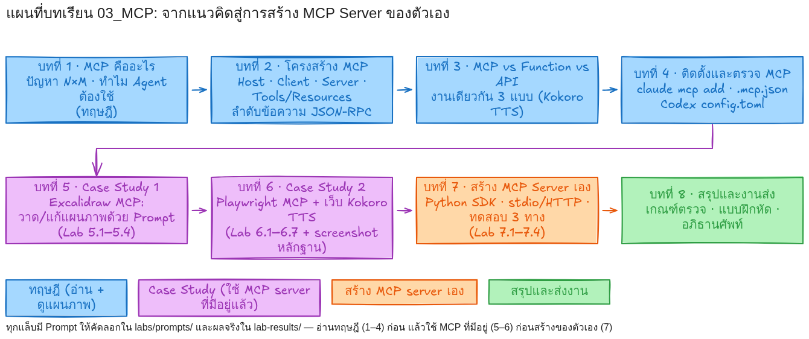

**เลือกอ่าน:** [เตรียมตัวและงานส่ง](#prep) · [บทที่ 1 MCP คืออะไร](#ch1) · [บทที่ 2 โครงสร้าง](#ch2) · [บทที่ 3 MCP vs Function vs API](#ch3) · [บทที่ 4 ติดตั้ง](#ch4) · [บทที่ 5 Excalidraw MCP](#ch5) · [บทที่ 6 Playwright MCP](#ch6) · [บทที่ 7 สร้าง MCP server](#ch7) · [บทที่ 8 สรุป](#ch8) · [ภาคผนวก](#appendix)

<a id="prep"></a>
## สิ่งที่ต้องเตรียม และสิ่งที่ต้องส่ง

**เครื่องมือที่ใช้ในบทเรียนนี้ (เวอร์ชันที่ทดลองจริง)**

| เครื่องมือ | เวอร์ชัน | ใช้ทำอะไร |
| --- | --- | --- |
| Claude Code | 2.1.258 | Host ของ MCP (AI Agent ที่นักศึกษาสั่งงาน) |
| Node.js | v24.20.0 | รัน MCP server ที่เขียนด้วย JavaScript |
| `mcp-excalidraw-server` | 2.0.0 | Excalidraw MCP (Case Study 1) |
| `@playwright/mcp` | 0.0.80 | Playwright MCP (Case Study 2) ต่อ headless Chrome 153 ผ่าน CDP |
| Python | 3.12.3 (`/opt/venv/bin/python`) | เขียน MCP server เองและเว็บทดลอง |
| `mcp` (Python SDK) | 2.0.0 (รองรับ spec 2026-07-28) | สร้าง MCP server / client |
| `kokoro` | 0.9.4 (+ `espeak-ng` 1.51) | สังเคราะห์เสียงภาษาอังกฤษในเว็บทดลอง |
| FastAPI / uvicorn | 0.136.3 / 0.52.4 | เว็บทดลอง Kokoro TTS |

ติดตั้งส่วนที่ยังไม่มี: `/opt/venv/bin/pip install "mcp[cli]" kokoro soundfile fastapi uvicorn` และ `apt-get install -y espeak-ng` (Kokoro ใช้ CPU ได้ ไม่จำเป็นต้องมี GPU)

**โครงสร้างโฟลเดอร์**

| ที่อยู่ | เนื้อหา |
| --- | --- |
| `readme.md` | สื่อการสอนไฟล์นี้ |
| `img/` | แผนภาพ 9 ภาพ (PNG + ไฟล์ต้นฉบับ `.excalidraw`) วาดด้วย Excalidraw MCP |
| `labs/design-spec.md` | สเปกการออกแบบบทเรียนและกติกาหลักฐาน |
| `labs/prompts/` | Prompt พร้อมคัดลอกของ Lab 5.1–5.4, 6, 7 |
| `labs/kokoro-web/` | เว็บทดลอง Kokoro TTS (Text Input → Button → Result → Audio Player) |
| `labs/my-mcp-server/` | MCP server ที่นักศึกษาสร้างเอง + client ทดสอบ + ตัวดักข้อความ JSON-RPC |
| `lab-results/excalidraw/run-2026-09-19-062505/` | บันทึก tool ที่ AI เรียกจริงตอนวาดทุกภาพ + ภาพก่อน/หลังแก้ของ Lab 5.4 |
| `lab-results/playwright/run-2026-09-19-064547/` | screenshot, accessibility snapshot, console, network, trace ของ Case Study 2 |
| `lab-results/own-server/run-2026-09-19-062712/` | wire log JSON-RPC, ผลจาก Python client, ผลจาก Claude Code, ผล curl ของ MCP server ที่สร้างเอง |

**งานที่นักศึกษาต้องส่ง** (เกณฑ์ละเอียดอยู่ในบทที่ 8)

1. Lab 5: ภาพจาก Excalidraw MCP อย่างน้อย 3 ภาพ (architecture, workflow, flow) + ภาพที่แก้จาก Prompt 1 ภาพ + บันทึกลำดับ tool ที่ AI เรียก
2. Lab 6: screenshot ชุดของการควบคุมเว็บ Kokoro ผ่าน Playwright MCP + snapshot + บันทึกขั้นตอน
3. Lab 7: MCP server ของตัวเอง (มี tool ที่เพิ่มเองอย่างน้อย 1 ตัว) + wire log + ผลที่ Claude Code เรียก tool ได้จริง
4. รายงานสั้น 1 หน้า: MCP แก้ปัญหาอะไร และสิ่งที่ค้นพบระหว่างทดลอง (ต้องอ้างไฟล์หลักฐานของตัวเอง)

---

<a id="ch1"></a>
## บทที่ 1 MCP คืออะไร และถูกสร้างมาเพื่อแก้ปัญหาอะไร

### 1.1 ปัญหาก่อนมี MCP: ทุกแอปต้องเขียนตัวเชื่อมกับทุกเครื่องมือ

LLM (เช่น Claude) เก่งเรื่องอ่านและเขียนข้อความ แต่ **ทำอะไรกับโลกภายนอกไม่ได้เอง** มันไม่รู้เวลาปัจจุบัน วาดรูปลง canvas ไม่ได้ กดปุ่มบนเว็บไม่ได้ และเรียกฟังก์ชัน Python ของเราไม่ได้ วิธีที่ใช้กันคือ "tool calling": โปรแกรมที่ครอบ LLM (เรียกว่า Host เช่น Claude Code, Codex CLI, หรือแอปที่เราเขียนเอง) บอก LLM ว่ามีเครื่องมืออะไรบ้าง แล้ว LLM ตอบกลับว่าอยากเรียกเครื่องมือไหนด้วย argument อะไร

ปัญหาคือ **แต่ละ Host ต้องเขียนโค้ดเชื่อมกับแต่ละเครื่องมือเอง** ถ้ามีแอป AI 3 ตัว และเครื่องมือ 4 อย่าง ต้องเขียนตัวเชื่อม 3 × 4 = 12 ชุด ต่างคนต่างกำหนดรูปแบบ ต่างคนต่างดูแล เพิ่มเครื่องมือใหม่ 1 อย่างต้องแก้ทุกแอป

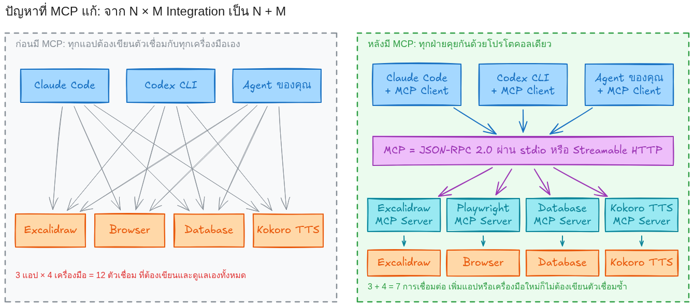

*ซ้าย: ก่อนมี MCP แอป 3 ตัว × เครื่องมือ 4 อย่าง = ตัวเชื่อม 12 ชุด · ขวา: หลังมี MCP ทุกฝ่ายพูดโปรโตคอลเดียวกัน เหลือ 3 + 4 = 7 การเชื่อมต่อ*

### 1.2 MCP คืออะไร

**Model Context Protocol (MCP)** คือโปรโตคอลเปิด (open protocol) ที่ Anthropic เผยแพร่ในเดือนพฤศจิกายน 2024 และปัจจุบันดูแลโดยชุมชนที่ [modelcontextprotocol.io](https://modelcontextprotocol.io) สเปกฉบับล่าสุดที่ใช้ในบทเรียนนี้คือรุ่น **2026-07-28** ซึ่งนิยามไว้ว่า

> MCP is an open protocol that enables seamless integration between LLM applications and external data sources and tools.

หัวใจของ MCP มี 3 อย่าง

1. **ภาษากลางแบบเดียว** — ทุกข้อความเป็น [JSON-RPC 2.0](https://www.jsonrpc.org/) (JSON ที่มี `method`, `params`, `id`, `result`)
2. **การค้นพบอัตโนมัติ** — server "ประกาศ" ว่ามีเครื่องมืออะไร รับ argument แบบไหน (`tools/list`) โดย Host ไม่ต้องรู้ล่วงหน้า
3. **แยกบทบาทชัดเจน** — Host/Client เป็นฝั่ง AI, Server เป็นฝั่งเครื่องมือ ใครเขียนฝั่งไหนก็ได้ ภาษาอะไรก็ได้

สเปกเปรียบ MCP กับ Language Server Protocol (LSP) ที่ทำให้ editor ทุกตัวรองรับภาษาโปรแกรมได้ผ่านมาตรฐานเดียว หลายคนจึงเรียก MCP ว่า "USB-C ของ AI"

### 1.3 ทำไม AI Agent / LLM จึงต้องใช้ MCP

| ถ้าไม่มี MCP | เมื่อมี MCP |
| --- | --- |
| ต้องเขียนโค้ดบอก LLM เองว่า tool แต่ละตัวชื่ออะไร รับ argument อะไร | Host เรียก `tools/list` แล้วได้ชื่อ คำอธิบาย และ `inputSchema` (JSON Schema) จาก server อัตโนมัติ |
| ต้องเขียน glue code แปลงคำตอบของ LLM ไปเรียก API จริง | Host ส่ง `tools/call {name, arguments}` ตามมาตรฐาน server ทำงานแล้วตอบ `result` |
| เครื่องมือที่ทำให้ Claude Code ใช้ ไม่ได้ทำให้ Codex ใช้ | server เดียวใช้ได้กับทุก Host ที่พูด MCP (บทเรียนนี้ใช้ Excalidraw MCP และ Playwright MCP ตัวเดียวกันทั้งใน Claude Code และ Codex) |
| ไม่มีจุดกลางสำหรับขออนุมัติผู้ใช้ | สเปกกำหนดให้ Host ถามผู้ใช้ก่อนเรียก tool ("there SHOULD always be a human in the loop") |

ตัวอย่างในบทเรียนนี้เอง: **แผนภาพทั้ง 9 ภาพวาดโดย AI Agent (Claude Code) ผ่าน Excalidraw MCP** และ **การกรอกฟอร์มบนเว็บ Kokoro ทำผ่าน Playwright MCP** โดยผู้สอนไม่ได้เขียนโค้ดเชื่อม Excalidraw หรือเบราว์เซอร์กับ Claude เลย เพียงตั้งค่าให้ Claude Code รู้จัก MCP server สองตัวนี้

### 1.4 สิ่งที่ MCP ไม่ใช่

- ไม่ใช่โมเดล AI และไม่ใช่ agent framework — เป็นแค่ "ภาษากลาง" ระหว่าง AI กับเครื่องมือ
- ไม่ได้มาแทน REST API หรือ Python function — แต่ครอบของเดิมให้ AI ค้นพบและเรียกได้ (ดูบทที่ 3)
- ไม่ได้ทำให้ AI ทำอะไรก็ได้ — Host ยังเป็นผู้คุมสิทธิ์และผู้ใช้เป็นผู้อนุมัติ

---

<a id="ch2"></a>
## บทที่ 2 โครงสร้างการทำงานของ MCP

### 2.1 Host, MCP Client, MCP Server, Tools / Resources / Prompts


| องค์ประกอบ | หน้าที่ | ตัวอย่างจริงในบทเรียนนี้ |
| --- | --- | --- |
| **Host** | โปรแกรม AI ที่ผู้ใช้ใช้ สร้างและจัดการ MCP Client, คุมสิทธิ์, ถามผู้ใช้ก่อนเรียก tool, รวมผล tool กลับเข้า LLM | Claude Code 2.1.258, Codex CLI 0.154 |
| **LLM** | อ่านรายการ tool ใน context แล้วตัดสินใจว่าจะเรียก tool ใดด้วย argument อะไร | claude-sonnet-5 (รอบทดสอบบทที่ 7), Claude Fable 5.1 (รอบวาดภาพและ Playwright) |
| **MCP Client** | ตัวเชื่อม 1 ตัวต่อ 1 server อยู่ใน Host ส่ง/รับ JSON-RPC | Claude Code สร้าง client ให้ `excalidraw`, `playwright`, `hello-lab`, `kokoro-tts` |
| **MCP Server** | process แยก ประกาศ Tools / Resources / Prompts และทำงานจริงกับเครื่องมือ | `mcp-excalidraw-server` (Node), `playwright-mcp` (Node), `hello_server.py` และ `tts_server.py` (Python) |
| **Tools** | ฟังก์ชันให้โมเดลเรียก (model-controlled) มีชื่อ คำอธิบาย `inputSchema` | `batch_create_elements`, `browser_click`, `add(a, b)`, `speak(text, voice)` |
| **Resources** | ข้อมูลให้อ่าน ระบุด้วย URI | `lab://info` ของ hello-lab |
| **Prompts** | แม่แบบข้อความที่ server เตรียมไว้ | `explain_mcp(topic)` ของ hello-lab |

กติกาสำคัญจากสเปก (หน้า Architecture):

- "Each client is created by the host and communicates with exactly one server" — 1 Client ต่อ 1 Server
- "Servers should be extremely easy to build" — server เล็ก ๆ ทำงานอย่างเดียว Host เป็นคนจัดการเรื่องยาก
- "Servers should not be able to read the whole conversation, nor 'see into' other servers" — server เห็นเฉพาะ argument ที่ถูกส่งมา ไม่เห็นบทสนทนา

### 2.2 ลำดับข้อความเมื่อผู้ใช้สั่งงาน 1 ครั้ง

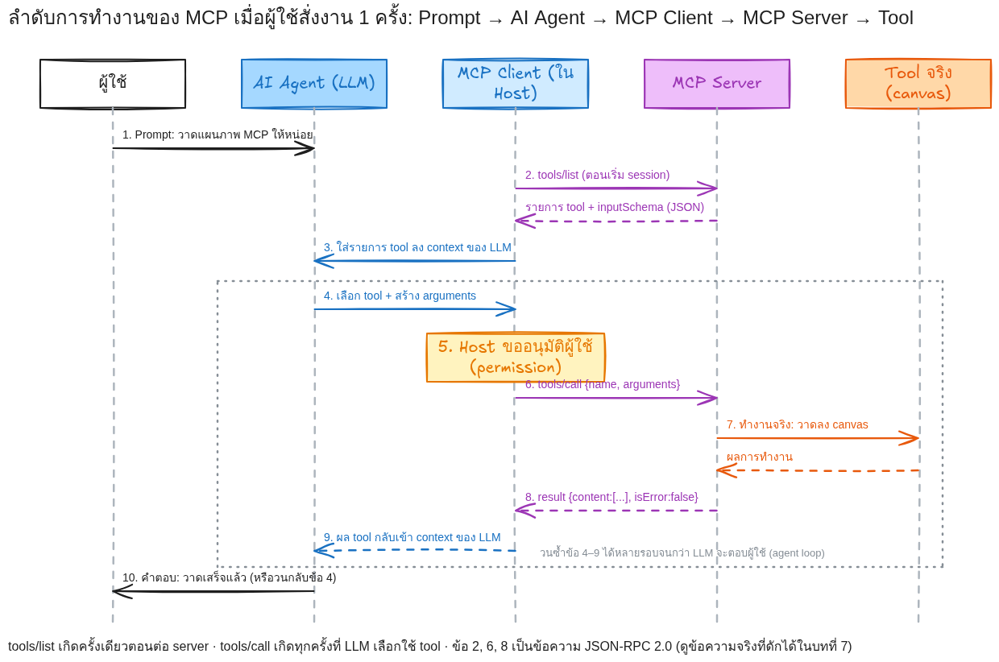

ข้อความในภาพเป็น JSON-RPC จริง ด้านล่างคือข้อความที่**ดักได้จากสายจริง**ระหว่าง Python client กับ `hello_server.py` (ไฟล์ [`wire-hello.jsonl`](lab-results/own-server/run-2026-09-19-062712/wire-hello.jsonl) ตัดให้สั้น)

**Client ขอรายการ tool (`tools/list`)**

```json
{"jsonrpc": "2.0", "id": 2, "method": "tools/list",
 "params": {"_meta": {"io.modelcontextprotocol/protocolVersion": "2026-07-28",
                      "io.modelcontextprotocol/clientInfo": {"name": "mcp", "version": "0.1.0"}}}}
```

**Server ตอบรายการ tool พร้อม `inputSchema` ที่สร้างจาก type hint ของ Python**

```json
{"jsonrpc": "2.0", "id": 2, "result": {"resultType": "complete", "tools": [
  {"name": "add",
   "description": "บวกเลขจำนวนเต็มสองจำนวน / Add two integers and return the sum.",
   "inputSchema": {"type": "object",
                   "properties": {"a": {"title": "A", "type": "integer"}, "b": {"title": "B", "type": "integer"}},
                   "required": ["a", "b"]},
   "outputSchema": {"type": "object", "properties": {"result": {"type": "integer"}}, "required": ["result"]}},
  ...]}}
```

**Client เรียก tool (`tools/call`) และ Server ตอบผล**

```json
{"jsonrpc": "2.0", "id": 5, "method": "tools/call", "params": {"name": "add", "arguments": {"a": 17, "b": 25}, "_meta": {...}}}
{"jsonrpc": "2.0", "id": 5, "result": {"content": [{"type": "text", "text": "42"}], "isError": false,
                                       "resultType": "complete", "structuredContent": {"result": 42}}}
```

สังเกตว่า `tools/list` เกิดครั้งเดียวตอนต่อ server ส่วน `tools/call` เกิดทุกครั้งที่ LLM เลือกใช้ tool และผลลัพธ์กลับมาใน `content` (ข้อความ/รูป/เสียง) กับ `structuredContent` (JSON ตาม `outputSchema`) ถ้า tool ทำงานไม่สำเร็จ server ตอบ `isError: true` พร้อมข้อความให้ LLM แก้ตัวได้ (ต่างจาก JSON-RPC error ที่แปลว่า request ผิดรูป)

### 2.3 Transport: stdio และ Streamable HTTP

โปรโตคอลเหมือนกันทุก transport ต่างกันแค่ "วิธีส่งข้อความ"

| Transport | วิธีทำงาน | ใช้เมื่อ | ตัวอย่างในบทเรียน |
| --- | --- | --- | --- |
| **stdio** | Host เปิด server เป็น subprocess แล้วส่ง JSON-RPC ทีละบรรทัดผ่าน stdin/stdout (stderr ไว้ log) | server อยู่บนเครื่องเดียวกัน (กรณีส่วนใหญ่) | Excalidraw MCP, Playwright MCP, `hello_server.py` |
| **Streamable HTTP** | server เปิด endpoint เดียว (เช่น `/mcp`) client ส่ง HTTP POST ทีละข้อความ คำตอบเป็น JSON หรือ SSE stream | server อยู่คนละเครื่อง/บริการกลาง | `hello_server.py --http` ที่ `http://127.0.0.1:8766/mcp` (บทที่ 7.6) |

ข้อควรจำของ stdio: **ห้าม `print()` ลง stdout ใน server** เพราะ stdout คือช่องส่ง JSON-RPC ถ้าอยาก log ให้เขียนไป stderr

### 2.4 เวอร์ชันโปรโตคอลที่พบจริงบนสาย

สเปก MCP ปรับใหญ่ในรุ่น 2026-07-28: ทุก request แนบเวอร์ชันและ capability ของ client มาใน `_meta` และมี `server/discover` สำหรับถาม capability ของ server แทน handshake `initialize` แบบเดิม แต่รุ่นเก่ายังต้องใช้งานได้ ผลที่ดักได้จากสายในบทที่ 7 ยืนยันเรื่องนี้

| Client | ข้อความแรกที่ส่ง | เวอร์ชันที่ประกาศ | หลักฐาน |
| --- | --- | --- | --- |
| Python SDK `mcp` 2.0.0 (`mcp.Client`) | `server/discover` (ไม่มี `initialize`) แล้วต่อด้วย `tools/list` | `_meta.io.modelcontextprotocol/protocolVersion = "2026-07-28"` ทุก request | [`wire-hello.jsonl`](lab-results/own-server/run-2026-09-19-062712/wire-hello.jsonl) |
| Claude Code 2.1.258 | `initialize` → `notifications/initialized` → `tools/list`, `prompts/list`, `resources/list` | `protocolVersion: "2025-11-25"`, `clientInfo: {"name": "claude-code", "version": "2.1.258"}` | [`claude-use-wire-hello.jsonl`](lab-results/own-server/run-2026-09-19-062712/claude-use-wire-hello.jsonl) |

server ตัวเดียวกัน (`hello_server.py` ที่เขียนด้วย SDK 2.0) ตอบได้ทั้งสองแบบ นี่คือข้อดีของการใช้ SDK: เรื่องเวอร์ชันและ transport SDK จัดการให้

---

<a id="ch3"></a>
## บทที่ 3 MCP ต่างจากการเรียก Python Function หรือ API โดยตรงอย่างไร

ใช้งานเดียวกันตลอดบทเรียน: **สังเคราะห์เสียงภาษาอังกฤษด้วย Kokoro-82M** เราเปิดความสามารถนี้ให้เรียกได้ 3 แบบ โดยโค้ด Kokoro ไม่ต้องแก้เลย

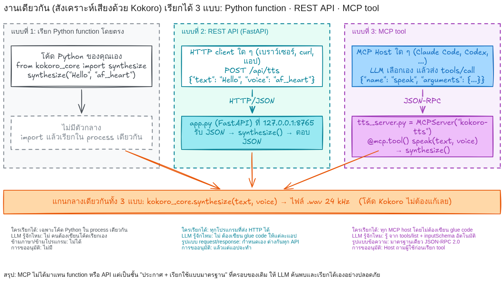

**แบบที่ 1 — Python function** ([`labs/kokoro-web/kokoro_core.py`](labs/kokoro-web/kokoro_core.py))

```python
def synthesize(text: str, voice: str = "af_heart") -> dict:
    """แปลงข้อความภาษาอังกฤษเป็นไฟล์เสียง .wav"""
    ...
    return {"path": str(path), "duration_sec": ..., "sample_rate": 24000, "gen_ms": gen_ms, "voice": voice}
```

ใครเรียกได้: เฉพาะโค้ด Python ใน process เดียวกัน (`from kokoro_core import synthesize`)

**แบบที่ 2 — REST API ด้วย FastAPI** ([`labs/kokoro-web/app.py`](labs/kokoro-web/app.py))

```python
@app.post("/api/tts")
async def tts(req: TTSRequest):
    result = await run_in_threadpool(kokoro_core.synthesize, req.text, req.voice)
    return {"audio_url": f"/audio/{result['filename']}", "duration_sec": result["duration_sec"], ...}
```

ใครเรียกได้: ทุกโปรแกรมที่ส่ง HTTP ได้ (เบราว์เซอร์, curl, แอปอื่น) ผลจริงจาก curl: [`web-curl-tts.json`](lab-results/own-server/run-2026-09-19-062712/web-curl-tts.json) ได้เสียงยาว 3.98 วินาที ใช้เวลาสร้าง 672 ms บน CPU · ส่งข้อความว่างได้ `{"error":"text must not be empty"}` HTTP 400 ([`web-curl-tts-empty.txt`](lab-results/own-server/run-2026-09-19-062712/web-curl-tts-empty.txt))

**แบบที่ 3 — MCP tool** ([`labs/my-mcp-server/tts_server.py`](labs/my-mcp-server/tts_server.py))

```python
mcp = MCPServer("kokoro-tts", instructions="แปลงข้อความภาษาอังกฤษเป็นไฟล์เสียง .wav ด้วย Kokoro-82M")

@mcp.tool()
def speak(text: str, voice: str = "af_heart") -> dict:
    """สังเคราะห์เสียงภาษาอังกฤษจากข้อความ แล้วคืน path ของไฟล์ .wav พร้อมความยาว (วินาที)"""
    r = kokoro_core.synthesize(text, voice)
    return {"path": r["path"], "duration_sec": r["duration_sec"], "sample_rate": r["sample_rate"], "gen_ms": r["gen_ms"], "voice": r["voice"]}
```

ใครเรียกได้: ทุก MCP host โดย LLM ค้นพบเองจาก `tools/list` ผลจริง: Claude Code เรียก `mcp__kokoro-tts__speak {"text": "Model Context Protocol lets one server serve many agents."}` แล้วได้ไฟล์เสียงยาว 4.45 วินาที ([`claude-tts-summary.md`](lab-results/own-server/run-2026-09-19-062712/claude-tts-summary.md))

**ตารางเปรียบเทียบ**

| ประเด็น | Python function | REST API | MCP tool |
| --- | --- | --- | --- |
| ใครเรียกได้ | โค้ดใน process เดียวกัน | ทุกโปรแกรมที่ส่ง HTTP ได้ | ทุก MCP host (Claude Code, Codex, แอปของคุณ) |
| LLM รู้จักได้เองไหม | ไม่ ต้องเขียนโค้ดเรียกเอง | ไม่ ต้องเขียน glue code + อธิบาย API ให้ LLM ทุกแอป | รู้ จาก `tools/list` + `inputSchema` อัตโนมัติ |
| รูปแบบข้อความ | การเรียกฟังก์ชัน | กำหนดเองต่อ API (path, JSON ต่างกัน) | มาตรฐานเดียว JSON-RPC 2.0 |
| การอนุมัติจากผู้ใช้ | ไม่มี | แล้วแต่แอป | Host ถามผู้ใช้ก่อนเรียก tool |
| ข้ามภาษา/ข้ามเครื่อง | ไม่ได้ | ได้ | ได้ (stdio ในเครื่อง, Streamable HTTP ข้ามเครื่อง) |
| เหมาะกับ | logic ภายในโปรแกรม | ให้บริการแอปอื่น/หน้าเว็บ | ให้ AI Agent ใช้เป็นเครื่องมือ |

สรุป: MCP ไม่ได้มาแทน function หรือ API แต่เป็น "ชั้นประกาศและเรียกใช้แบบมาตรฐาน" ที่ครอบของเดิม ในบทที่ 7 นักศึกษาจะเห็นว่าห่อ function เป็น MCP tool ใช้โค้ดเพิ่มไม่ถึง 20 บรรทัด

---

<a id="ch4"></a>
## บทที่ 4 ติดตั้ง ตั้งค่า และตรวจสอบ MCP Server ใน Claude Code และ Codex

### 4.1 Claude Code

Claude Code เก็บรายชื่อ MCP server ไว้ในไฟล์ตั้งค่า (`~/.claude.json` ต่อผู้ใช้ หรือ `.mcp.json` ต่อโปรเจกต์) เพิ่มได้ 3 ทาง

| วิธี | คำสั่ง / ไฟล์ | เมื่อไรควรใช้ |
| --- | --- | --- |
| เพิ่มถาวรด้วยคำสั่ง | `claude mcp add hello-lab -- /opt/venv/bin/python /path/to/hello_server.py` | ใช้ทุก session |
| ไฟล์ต่อโปรเจกต์ | `.mcp.json` ในโฟลเดอร์โปรเจกต์ (รูปแบบเดียวกับด้านล่าง) | แชร์ให้ทีมผ่าน git |
| ชั่วคราวเฉพาะคำสั่ง | `claude -p --strict-mcp-config --mcp-config labs/my-mcp-server/mcp.json "<prompt>"` | ทดลอง/เก็บหลักฐานในแล็บ |

ตัวอย่าง [`labs/my-mcp-server/mcp.json`](labs/my-mcp-server/mcp.json) ที่ใช้จริงในบทที่ 7 (ห่อ server ด้วย `wire_capture.py` เพื่อดักข้อความบนสาย ถอดออกได้โดยชี้ `command` ไปที่ server ตรง ๆ)

```json
{
  "mcpServers": {
    "hello-lab": {
      "command": "/opt/venv/bin/python",
      "args": [".../wire_capture.py", "--log", ".../wire-claude-hello.jsonl", "--", "/opt/venv/bin/python", ".../hello_server.py"]
    },
    "kokoro-tts": {
      "command": "/opt/venv/bin/python",
      "args": [".../wire_capture.py", "--log", ".../wire-claude-tts.jsonl", "--", "/opt/venv/bin/python", ".../tts_server.py"],
      "env": {"KOKORO_DEVICE": "cpu"}
    }
  }
}
```

ตรวจว่าต่อได้: `claude mcp list` บนเครื่องเรียนแสดง (ตัดเฉพาะ server ที่ใช้ในบทเรียน)

```text
playwright: playwright-mcp --cdp-endpoint http://127.0.0.1:9222 --output-dir /root/workspace/.mcp/playwright/output ... - ✔ Connected
excalidraw: mcp-excalidraw-server  - ✔ Connected
```

เมื่อต่อสำเร็จ Claude Code จะมองเห็น tool ในชื่อ `mcp__<ชื่อ server>__<ชื่อ tool>` เช่น `mcp__hello-lab__add` และ `mcp__kokoro-tts__speak` (ดู [`claude-discover-summary.md`](lab-results/own-server/run-2026-09-19-062712/claude-discover-summary.md)) ส่วน resource อ่านผ่านเครื่องมือกลาง `ReadMcpResourceTool {"server": "hello-lab", "uri": "lab://info"}`

### 4.2 Codex CLI

Codex ใช้ไฟล์ `~/.codex/config.toml` (หรือ `$CODEX_HOME/config.toml`) ตั้งค่าจริงบนเครื่องเรียนของ server สองตัวที่ใช้ในบทนี้

```toml
[mcp_servers.playwright]
command = "playwright-mcp"
args = ["--cdp-endpoint", "http://127.0.0.1:9222", "--output-dir", "/root/workspace/.mcp/playwright/output", "--secrets", "/root/workspace/.mcp/playwright/secrets.env"]

[mcp_servers.excalidraw]
command = "mcp-excalidraw-server"

[mcp_servers.excalidraw.env]
EXCALIDRAW_EXPORT_DIR = "/root/workspace/.mcp/excalidraw/diagrams"
EXCALIDRAW_NO_AUTOSTART = "1"
EXPRESS_SERVER_URL = "http://127.0.0.1:8892"
```

สำหรับ server ของนักศึกษามีตัวอย่างใน [`labs/my-mcp-server/codex-config-snippet.toml`](labs/my-mcp-server/codex-config-snippet.toml) (**แนวทาง — ยังไม่ได้ทดลองกับ Codex ในรอบนี้** เพราะโควตาบัญชี Codex ของผู้สอนใกล้หมด)

### 4.3 ข้อควรระวังตอนตั้งค่า

1. ใช้ path แบบเต็ม (absolute) ใน `command`/`args` เพราะ Host เป็นคนเปิด process ไม่ใช่เรา และ working directory อาจไม่ใช่ที่เราคิด
2. server แบบ stdio ห้ามพิมพ์อะไรลง stdout นอกจาก JSON-RPC
3. Excalidraw MCP บนเครื่องเรียนเขียน/อ่านไฟล์ได้เฉพาะใน `EXCALIDRAW_EXPORT_DIR` (`/root/workspace/.mcp/excalidraw/diagrams`) ถ้าสั่ง export ไปที่อื่นจะได้ `Path traversal blocked` ต้องคัดลอกไฟล์ออกมาเอง (พบจริงใน Lab 5.4)
4. Playwright MCP บนเครื่องเรียนต่อกับ headless Chrome ตัวเดียวกับที่ Excalidraw ใช้แสดง canvas ถ้าแท็บของเว็บที่ทดสอบอยู่เบื้องหลัง การคลิกจะ timeout (พบจริงใน Lab 6 ดูวิธีแก้ในบทที่ 6.4)

---

<a id="ch5"></a>
## บทที่ 5 Case Study 1: Excalidraw MCP — ให้ AI วาดและแก้แผนภาพจาก Prompt

### 5.1 รู้จัก Excalidraw MCP

`mcp-excalidraw-server` เปิด canvas ในเบราว์เซอร์ (`http://127.0.0.1:8892`) และประกาศ tool ให้ AI สร้าง/แก้/ตรวจ/ส่งออกภาพ tool ที่ใช้บ่อย

| tool | ทำอะไร |
| --- | --- |
| `read_diagram_guide` | คู่มือสี ขนาด และ layout ที่ควรใช้ (AI ควรอ่านก่อนวาด) |
| `describe_scene` / `query_elements` / `get_element` | ดูว่าบน canvas มีอะไร (id, ตำแหน่ง, ข้อความ) |
| `batch_create_elements` / `create_element` | สร้างกล่อง ข้อความ ลูกศร (ลูกศรผูกกับกล่องด้วย `startElementId`/`endElementId`) |
| `update_element` / `delete_element` | แก้หรือลบทีละ element ตาม id |
| `set_viewport` / `get_canvas_screenshot` | จัดมุมมองแล้วถ่ายภาพ canvas กลับมาให้ AI ตรวจ |
| `export_to_image` / `export_scene` / `import_scene` | ส่งออก PNG/SVG, ส่งออก/นำเข้าไฟล์ `.excalidraw` |
| `create_from_mermaid` | แปลง Mermaid เป็น element บน canvas |

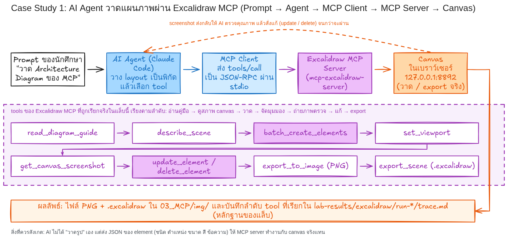

สิ่งที่ควรสังเกต: AI ไม่ได้ "วาดรูป" เอง แต่**ส่ง JSON ของ element** (ชนิด ตำแหน่ง ขนาด สี ข้อความ) ให้ server ทำงานกับ canvas จริง แล้วขอ screenshot กลับมาตรวจ ถ้าข้อความล้นกล่องหรือลูกศรทับกันก็สั่ง `update_element` แก้ วนจนผ่าน แล้วจึง export

### 5.2 Lab 5.1 — วาด Architecture Diagram

Prompt: [`labs/prompts/lab5-1-architecture-diagram.md`](labs/prompts/lab5-1-architecture-diagram.md)

```text
ใช้ Excalidraw MCP วาด Architecture Diagram ของ MCP บนเครื่องนี้ 1 ภาพ
โครงสร้างที่ต้องมี (ซ้ายไปขวา 3 โซน): Host (ผู้ใช้, LLM, MCP Client 3 ตัว) · MCP Server 3 ตัว · เครื่องมือจริง
ลูกศร: ผู้ใช้→LLM, LLM→Client, Client→Server (ป้าย JSON-RPC 1 เส้น), Server→เครื่องมือ
กติกา: อ่าน read_diagram_guide ก่อน · ห้ามใส่ text บนกล่องโซน · screenshot ตรวจแล้วแก้จนผ่าน · export PNG + .excalidraw
สุดท้ายรายงานลำดับ tool ที่เรียกทั้งหมด จำนวนรอบที่ต้องแก้ และปัญหาที่พบ
```

ผลจริง: ภาพ `img/d02-mcp-architecture.png` (บทที่ 2.1) การวาดรอบแรกพบว่าลูกศรจาก LLM ไป Client #2 และ #3 **ลากทะลุกล่อง Client #1** AI จึง `delete_element` ลูกศร 2 เส้น แล้ว `batch_create_elements` ลูกศรหักมุมอ้อมด้านซ้ายแทน ก่อน export (ดูแถวที่ 2 ใน [`trace.md`](lab-results/excalidraw/run-2026-09-19-062505/trace.md))

### 5.3 Lab 5.2 — วาด MCP Workflow

Prompt: [`labs/prompts/lab5-2-mcp-workflow.md`](labs/prompts/lab5-2-mcp-workflow.md) — ให้วาด sequence 5 คอลัมน์ 10 ข้อความ พร้อมกรอบ agent loop

ผลจริง: `img/d03-mcp-sequence.png` (บทที่ 2.2) ปัญหาที่พบ: ป้าย "วนซ้ำข้อ 4–9" วางทับลูกศรข้อ 9 แก้ด้วย `update_element` ย้ายป้าย 1 ครั้ง

### 5.4 Lab 5.3 — วาด Flow AI Agent → MCP Client → MCP Server → Tool

Prompt: [`labs/prompts/lab5-3-agent-client-server-tool-flow.md`](labs/prompts/lab5-3-agent-client-server-tool-flow.md)

ผลจริง: `img/d05-case1-excalidraw-flow.png` (ด้านบน) รอบแรกกล่องชื่อ tool กว้าง 140 px ทำให้ชื่อถูกตัดคำ (`describe_sce/ne`, `export_to_i/mage`) AI แก้ด้วย `update_element` 14 ครั้ง จัดใหม่เป็น 2 แถว กล่องกว้าง 280 px แล้วจึงผ่าน — บทเรียนคือ **screenshot ตรวจก่อน export เสมอ**

### 5.5 Lab 5.4 — ปรับแก้ Diagram จาก Prompt

Prompt: [`labs/prompts/lab5-4-modify-diagram.md`](labs/prompts/lab5-4-modify-diagram.md) สั่งให้เพิ่ม MCP Client #4 → `kokoro-tts` และเปลี่ยนสี server ที่นักศึกษาเขียนเองเป็นสีเขียว

| ก่อนแก้ | หลังแก้ตาม Prompt |
| --- | --- |
| 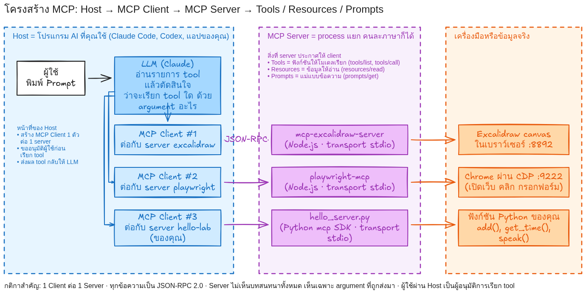 | 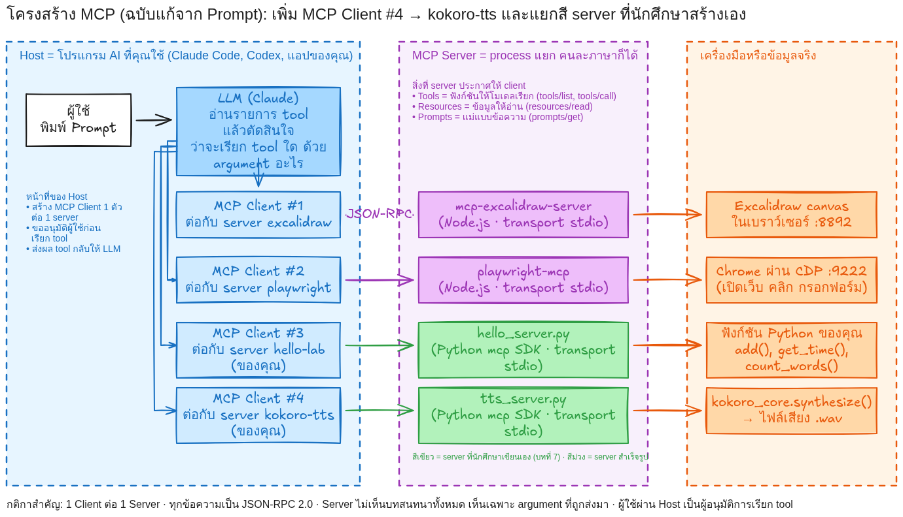 |

สิ่งที่เกิดขึ้นจริง (แถวที่ 9 ใน trace):

1. `import_scene` จากไฟล์ใน `img/` → error `Path traversal blocked: ... resolves outside the allowed directory "/root/workspace/.mcp/excalidraw/diagrams"` ต้อง import จากโฟลเดอร์ที่ server อนุญาต
2. import สำเร็จ 43 elements และแก้ต่อด้วย `update_element` ×5 + `batch_create_elements` แต่ screenshot พบว่า**กล่องกับข้อความเลื่อนไม่เท่ากัน** (กล่องเลื่อนขวา ราว 570 px ข้อความไม่เลื่อน)
3. AI ตัดสินใจ `clear_canvas` แล้วสร้างใหม่ทั้งภาพจาก JSON ต้นฉบับ + ส่วนที่ Prompt สั่งเพิ่ม (38 elements) → ผ่านและ export เป็น `img/d02b-mcp-architecture-modified.png`

บทเรียน: การ "แก้จาก Prompt" ทำได้จริง แต่ควรเก็บ JSON/ไฟล์ `.excalidraw` ต้นฉบับไว้ และเมื่อ tool ให้ผลผิดคาด ให้ตรวจด้วย screenshot แล้วเปลี่ยนวิธี ไม่ฝืนแก้ต่อ

### 5.6 หลักฐานและสิ่งที่เรียนรู้จาก Case Study 1

จาก [`trace.md`](lab-results/excalidraw/run-2026-09-19-062505/trace.md) (บันทึกทุก tool ที่เรียกในการวาด 9 ภาพ) และ [`run-info.json`](lab-results/excalidraw/run-2026-09-19-062505/run-info.json)

| ตัวเลขจากการทดลอง | ค่า |
| --- | --- |
| ภาพที่วาด | 9 (d01–d08 + d02b) |
| ภาพที่ผ่านรอบแรกโดยไม่ต้องแก้ | 2 (d01, d08) |
| ภาพที่ต้องแก้อย่างน้อย 1 รอบหลังดู screenshot | 7 |
| `batch_create_elements` / `update_element` / `delete_element` | 16 / 49 / 10 ครั้ง |
| `get_canvas_screenshot` | 19 ครั้ง |
| ปัญหาที่พบบ่อยที่สุด | ข้อความล้นกล่อง (กล่องแคบเกินสำหรับฟอนต์ลายมือ) รองลงมาคือลูกศรทับกล่อง/ป้ายทับลูกศร |

สิ่งที่นักศึกษาควรได้: (1) MCP ทำให้ AI ใช้เครื่องมือวาดภาพได้โดยไม่ต้องเขียน integration (2) คุณภาพงานมาจาก "วงจร วาด → ดู → แก้" ซึ่ง MCP รองรับผ่าน `get_canvas_screenshot` (3) Prompt ที่ดีต้องระบุ layout กติกา และวิธีตรวจ ไม่ใช่แค่ "วาดให้หน่อย"

### 5.7 เกณฑ์ตรวจ Lab 5

| เกณฑ์ | ผ่านเมื่อ |
| --- | --- |
| C1 ครบ 3 ภาพ + 1 ภาพแก้ | มี PNG และ `.excalidraw` ของ architecture, workflow, flow และภาพหลังแก้ (ก่อน/หลังต้องเทียบกันได้) |
| C2 อ่านได้ | ข้อความไม่ล้นกล่อง ลูกศรไม่ทับกล่อง (ตรวจจาก screenshot สุดท้าย) |
| C3 มีบันทึก tool | trace ระบุลำดับ tool ที่เรียก จำนวนรอบที่แก้ และ error ที่พบตามจริง |

---

<a id="ch6"></a>
## บทที่ 6 Case Study 2: Playwright MCP — ให้ AI ควบคุมเว็บ Kokoro TTS จริง

### 6.1 เว็บทดลอง Kokoro TTS Lab

เว็บอยู่ที่ [`labs/kokoro-web/`](labs/kokoro-web/) (FastAPI + หน้าเว็บเดียว) ใช้ [Kokoro-82M](https://github.com/hexgrad/kokoro) สังเคราะห์เสียงภาษาอังกฤษบน CPU มีองค์ประกอบครบตามโจทย์

| องค์ประกอบ | element | หมายเหตุ |
| --- | --- | --- |
| Text Input | `<textarea id="text">` ป้าย "ข้อความภาษาอังกฤษ" | Kokoro ยังไม่รองรับภาษาไทย จำกัด 500 ตัวอักษร |
| ตัวเลือกเสียง | `<select id="voice">` af_heart, af_bella, am_adam, am_michael | เสียงที่ทดสอบแล้วว่าโหลดได้ |
| Button | `<button id="speak-btn">Speak</button>` | ส่ง `POST /api/tts` |
| Result | `#status` + รายละเอียด ความยาวเสียง / เวลาที่ใช้สร้าง / sample rate / เสียง / ไฟล์ | ข้อความสำเร็จคือ "สร้างเสียงสำเร็จ" ข้อความผิดพลาดขึ้นต้นด้วย "เกิดข้อผิดพลาด" |
| Audio Player | `<audio id="player" controls>` | `src` ชี้ไปที่ `/audio/<file>.wav` |

เริ่มเว็บ: `labs/kokoro-web/run.sh` (เปิดที่ `http://127.0.0.1:8765` เก็บ pid ใน `server.pid`) ตรวจ: `curl http://127.0.0.1:8765/api/health` → `{"ok":true,"device":"cpu","model_loaded":true,...}` ครั้งแรกที่กด Speak จะช้ากว่าปกติเพราะโหลดโมเดล (จาก curl: ครั้งแรก 6.66 วินาที ครั้งต่อไป 0.55 วินาที ตาม [`web-curl-tts-time.txt`](lab-results/own-server/run-2026-09-19-062712/web-curl-tts-time.txt) และ [`web-curl-tts-second.txt`](lab-results/own-server/run-2026-09-19-062712/web-curl-tts-second.txt))

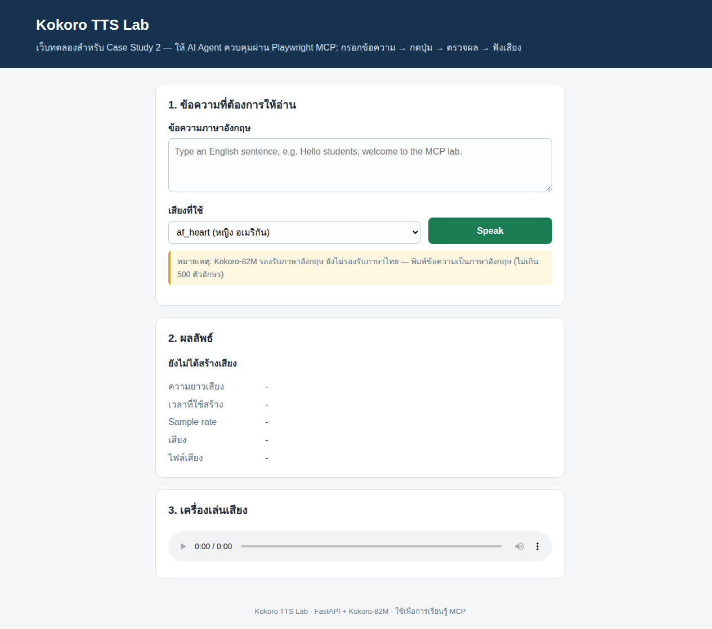

### 6.2 Playwright MCP มองเห็นหน้าเว็บอย่างไร

`@playwright/mcp` ต่อกับ Chrome (บนเครื่องเรียนเป็น headless Chrome ผ่าน CDP พอร์ต 9222) และให้ AI "มองเห็น" หน้าเว็บผ่าน **accessibility snapshot** คือต้นไม้ของ element พร้อม role ชื่อ และ ref ไม่ใช่รูปภาพ ตัวอย่างจริงจาก [`snapshot-01-loaded.yml`](lab-results/playwright/run-2026-09-19-064547/snapshot-01-loaded.yml)

```yaml
- textbox "ข้อความภาษาอังกฤษ" [ref=e9]
- combobox "เสียงที่ใช้" [ref=e13]:
    - option "af_heart (หญิง อเมริกัน)" [selected]
    - option "am_adam (ชาย อเมริกัน)"
- button "Speak" [ref=e14] [cursor=pointer]
- paragraph [ref=e18]: ยังไม่ได้สร้างเสียง
- generic "เครื่องเล่นเสียงที่สร้างจาก Kokoro" [ref=e32]
```

AI ใช้ ref (เช่น `e14`) อ้างถึง element ในคำสั่งถัดไป ดังนั้น**เว็บที่ใส่ `<label>` และ `aria-label` ดีจะถูกควบคุมด้วย AI ได้แม่นกว่า** และประหยัดโทเคนกว่าการดูรูป

tool ที่ใช้ในแล็บนี้: `browser_navigate`, `browser_snapshot`, `browser_fill_form`, `browser_click`, `browser_wait_for`, `browser_take_screenshot`, `browser_evaluate`, `browser_console_messages`, `browser_network_requests`, `browser_tabs`

### 6.3 Lab 6.1–6.7 — Prompt ที่ให้นักศึกษาใช้

Prompt เต็ม: [`labs/prompts/lab6-playwright-kokoro.md`](labs/prompts/lab6-playwright-kokoro.md)

```text
ใช้ Playwright MCP ทำตามลำดับต่อไปนี้กับเว็บ http://127.0.0.1:8765/ และรายงานผลทุกขั้น
1. เปิดเว็บไซต์ และบอกชื่อหน้า
2. ทำ accessibility snapshot แล้วสรุปว่ามี element อะไรบ้าง พร้อม ref
3. กรอกข้อความ "Hello students. This audio was generated by Kokoro through a web form controlled by Playwright MCP." และเลือกเสียง am_adam
4. กดปุ่ม Speak
5. รอจนข้อความ "สร้างเสียงสำเร็จ" ปรากฏ แล้วอ่านค่า ความยาวเสียง เวลาที่ใช้สร้าง sample rate เสียง และ URL ไฟล์เสียง
6. ถ่าย screenshot ทั้งหน้า ชื่อ cs2-03-result.png
7. ใช้ screenshot และค่าที่อ่านได้เป็นหลักฐาน พร้อมตรวจ console และ network ว่า POST /api/tts ได้ 200 และไม่มี error
เพิ่มเติม: ล้าง textbox ให้ว่างแล้วกด Speak อีกครั้ง บันทึกข้อความผิดพลาดที่แสดง
กติกา: ถ้า tool ใดล้มเหลว ห้ามเดา ให้ใช้ browser_evaluate ตรวจสถานะหน้าเว็บหาสาเหตุ แก้ แล้วลองใหม่ และบันทึก error ตามจริง
```

**สิ่งที่ต้องแสดงให้เห็นในรายงานของนักศึกษา** คือสายงานทั้งเส้น

```text
Prompt (นักศึกษาพิมพ์ใน Claude Code)
↓
AI Agent (LLM ใน Claude Code อ่าน snapshot แล้วเลือก tool + argument)
↓
Playwright MCP Server (playwright-mcp รับ tools/call แล้วสั่ง Playwright)
↓
Browser (headless Chrome ผ่าน CDP :9222 เปิดเว็บ กรอกฟอร์ม คลิก)
↓
Web Application (Kokoro TTS Lab: Text Input → Button → POST /api/tts → Result → Audio Player)
↓
ผลลัพธ์ที่ตรวจได้ + Screenshot (หลักฐานของการทดลอง)
```

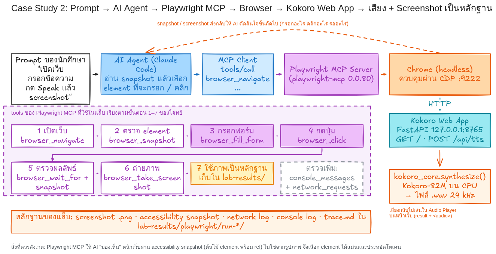

### 6.4 ผลการทดลองจริง (19 กันยายน 2026)

บันทึกเต็ม: [`trace.md`](lab-results/playwright/run-2026-09-19-064547/trace.md) · ข้อมูลรอบทดลอง: [`run-info.json`](lab-results/playwright/run-2026-09-19-064547/run-info.json)

| ขั้น | tool | ผลจริง |
| --- | --- | --- |
| 1 เปิดเว็บ | `browser_navigate` | title "Kokoro TTS Lab — ทดลอง Playwright MCP" · Console: 1 error (favicon 404 ไม่กระทบการทำงาน) |
| 2 ตรวจ element | `browser_snapshot` | เห็น textbox (e9), combobox (e13), button Speak (e14), ผลลัพธ์ (e18), เครื่องเล่นเสียง (e32) |
| 3 กรอกฟอร์ม | `browser_fill_form` | Playwright รัน `fill(...)` และ `selectOption('am_adam (ชาย อเมริกัน)')` |
| 4 กดปุ่ม (ครั้งที่ 1–2) | `browser_click` | **ล้มเหลว** `TimeoutError: browserBackend.callTool: Timeout 5000ms exceeded ... waiting for element to be visible, enabled and stable` |
| 4 วินิจฉัย | `browser_evaluate` | `document.visibilityState === "hidden"` ปุ่มอยู่ที่ (753, 386) ขนาด 220×47 `disabled: false` → แท็บอยู่เบื้องหลัง (Excalidraw MCP ใช้เบราว์เซอร์ตัวเดียวกันก่อนหน้า) แท็บที่ซ่อนไม่ render เฟรมใหม่ Playwright จึงรอ "stable" ไม่ผ่าน |
| 4 แก้ | `browser_tabs` select 0 → `browser_evaluate` | `visibilityState === "visible"` |
| 4 กดปุ่ม (ครั้งที่ 3) | `browser_click` | สำเร็จ `page.getByRole('button', { name: 'Speak' }).click()` |
| 5 ตรวจผล | `browser_wait_for` + `browser_snapshot` + `browser_evaluate` | "สร้างเสียงสำเร็จ" · ความยาวเสียง 7 วินาที · เวลาที่ใช้สร้าง 576 ms (cpu) · 24000 Hz · am_adam · `/audio/20260919-064750-65e6a515.wav` · `audio.duration = 7`, `readyState = 4` |
| 5 ตรวจ network / console | `browser_network_requests`, `browser_console_messages` | `[POST] /api/tts => [200] OK`, `[GET] /audio/....wav => [206] Partial Content` · console มีเพียง favicon 404 |
| 6 ถ่ายภาพ | `browser_take_screenshot` fullPage | `cs2-03-result.png` |
| 7 กรณีผิดพลาด | `browser_fill_form` (ว่าง) → `browser_click` → `browser_wait_for` | หน้าเว็บแสดง `เกิดข้อผิดพลาด: กรุณาพิมพ์ข้อความก่อน` (`cs2-04-error-empty.png`) |

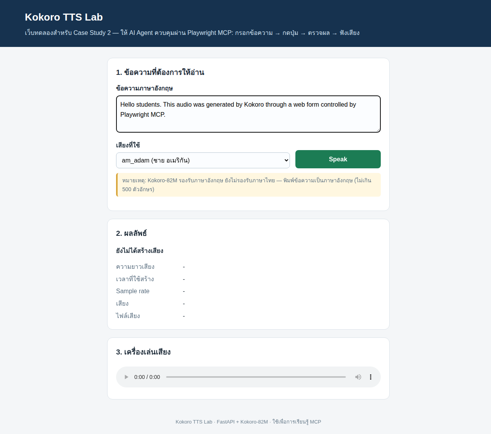

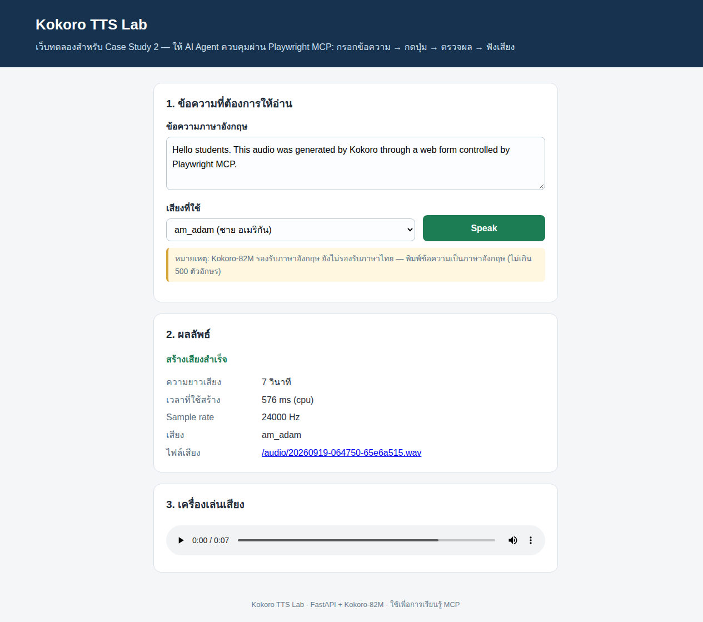

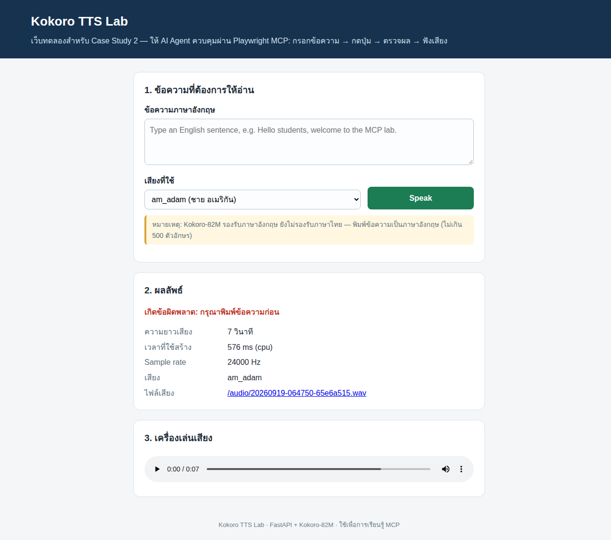

ไฟล์เสียงที่เว็บสร้างในรอบนี้: [`result-audio.wav`](lab-results/playwright/run-2026-09-19-064547/result-audio.wav) (24000 Hz, 7.0 วินาที ตรวจด้วย soundfile) · snapshot หลังสำเร็จ: [`snapshot-03-result.yml`](lab-results/playwright/run-2026-09-19-064547/snapshot-03-result.yml) · console: [`console.log`](lab-results/playwright/run-2026-09-19-064547/console.log)

### 6.5 สิ่งที่เรียนรู้จาก Case Study 2

1. **ใช้ screenshot เป็นหลักฐาน แต่ตัดสินด้วยข้อมูล** — ค่าที่อ่านจาก snapshot/`browser_evaluate` (7 วินาที, 576 ms, HTTP 200) ตรวจซ้ำได้ ส่วน screenshot ยืนยันว่าผู้ใช้เห็นแบบเดียวกัน
2. **error ของ tool ไม่ได้แปลว่าเว็บพัง** — click timeout 2 ครั้งเกิดจากแท็บอยู่เบื้องหลัง วิธีที่ถูกคือใช้ tool วินิจฉัย (`browser_evaluate`) หาสาเหตุ ไม่ใช่สุ่มลองใหม่หรือเดาว่าเว็บมีบั๊ก
3. **ข้อจำกัดของเครื่องมือมีจริง** — screenshot ที่สั่งด้วยชื่อไฟล์แบบ relative ถูกบันทึกที่ working directory ของ process `playwright-mcp` ไม่ใช่ `--output-dir` ต้องย้ายเข้าโฟลเดอร์หลักฐานเอง (บันทึกไว้ใน trace)
4. งานเดียวกันนี้ทำผ่าน MCP tool `speak` ได้โดยไม่ต้องเปิดเบราว์เซอร์ (บทที่ 7.5) — Playwright MCP เหมาะกับการ**ทดสอบเว็บที่มีอยู่แล้ว** ส่วน MCP server ของเราเองเหมาะกับการ**ให้ AI เรียกความสามารถโดยตรง**

### 6.6 เกณฑ์ตรวจ Lab 6

| เกณฑ์ | ผ่านเมื่อ |
| --- | --- |
| C1 ครบ 7 ขั้น | มีหลักฐานของ เปิดเว็บ / snapshot / กรอกฟอร์ม / คลิก / ตรวจผล / screenshot / สรุปโดยอ้าง screenshot |
| C2 ผลตรวจได้ | รายงานระบุความยาวเสียง เวลาที่ใช้ และสถานะ HTTP ของ `POST /api/tts` จาก tool จริง ไม่ใช่จากการเดา |
| C3 จัดการความผิดพลาด | ถ้ามี tool ล้มเหลว ต้องบันทึกข้อความ error ตามจริงและวิธีหาสาเหตุ; ทดสอบกรณีข้อความว่างและบันทึกข้อความผิดพลาดของเว็บ |

---

<a id="ch7"></a>
## บทที่ 7 สร้าง MCP Server ของตัวเองด้วย Python

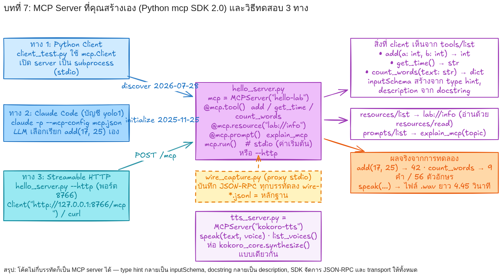

### 7.1 ติดตั้งและโครงสร้างไฟล์

```bash
/opt/venv/bin/pip install "mcp[cli]"      # Python SDK 2.0 (มี mcp dev / mcp run ด้วย)
cd labs/my-mcp-server && cat README-run.md   # คำสั่งทั้งหมดของแล็บนี้
```

| ไฟล์ใน [`labs/my-mcp-server/`](labs/my-mcp-server/) | หน้าที่ |
| --- | --- |
| `hello_server.py` | MCP server ตัวแรก: 3 tools, 1 resource, 1 prompt รันได้ทั้ง stdio และ `--http` |
| `tts_server.py` | MCP server ตัวที่สอง: ห่อ Kokoro (`speak`, `list_voices`) |
| `client_test.py` | MCP client ทดสอบโดยไม่ใช้ LLM (`--server hello|tts|http`, `--wire` บันทึกสาย) |
| `wire_capture.py` | proxy stdio ดักทุกบรรทัด JSON-RPC ลง `.jsonl` |
| `mcp.json`, `codex-config-snippet.toml` | ตั้งค่าให้ Claude Code / Codex รู้จัก server |
| `claude_lab.sh`, `summarize_stream.py` | รัน `claude -p` แล้วสรุป tool ที่ถูกเรียกเป็น Markdown |

### 7.2 Lab 7.1 — เขียน `hello_server.py`

โค้ดเต็ม: [`labs/my-mcp-server/hello_server.py`](labs/my-mcp-server/hello_server.py) ส่วนสำคัญ

```python
from mcp.server import MCPServer

mcp = MCPServer("hello-lab", instructions="MCP server สำหรับแล็บ 03_MCP: เครื่องมือคำนวณและนับคำอย่างง่าย")

@mcp.tool()
def add(a: int, b: int) -> int:
    """บวกเลขจำนวนเต็มสองจำนวน / Add two integers and return the sum."""
    return a + b

@mcp.tool()
def count_words(text: str) -> dict:
    """นับจำนวนคำและตัวอักษรในข้อความ / Count words and characters in a text."""
    words = text.split()
    return {"words": len(words), "characters": len(text), "longest_word": max(words, key=len) if words else ""}

@mcp.resource("lab://info")
def lab_info() -> str:
    """ข้อมูลของแล็บนี้ (resource = ข้อมูลให้อ่าน ไม่ใช่การกระทำ)"""
    return "hello-lab: MCP server ตัวอย่างของบทเรียน 03_MCP (KMITL). ..."

@mcp.prompt()
def explain_mcp(topic: str) -> str:
    """แม่แบบข้อความขอให้อธิบายหัวข้อเกี่ยวกับ MCP แบบเข้าใจง่าย"""
    return f"อธิบายเรื่อง '{topic}' ในบริบทของ Model Context Protocol ให้นักศึกษาปีหนึ่งเข้าใจ ..."

if __name__ == "__main__":
    if "--http" in sys.argv:
        mcp.run(transport="streamable-http", host="127.0.0.1", port=8766)
    else:
        mcp.run()  # stdio: อ่าน JSON-RPC จาก stdin เขียนคำตอบลง stdout (ห้าม print() ลง stdout!)
```

สิ่งที่**ไม่ต้องเขียน**: JSON Schema (type hint `a: int, b: int` กลายเป็น `inputSchema`), การ parse JSON-RPC, การจัดการ transport และเวอร์ชันโปรโตคอล — SDK ทำให้ทั้งหมด docstring กลายเป็น `description` ที่ LLM อ่านเพื่อตัดสินใจเลือก tool จึงควรเขียนให้ชัด

งานของนักศึกษา: เพิ่ม tool ของตัวเองอย่างน้อย 1 ตัว (เช่น `to_upper(text)` หรือ `bmi(weight_kg, height_m)`) แล้วทำ Lab 7.2–7.3 ให้เห็นว่า LLM เรียกได้

### 7.3 Lab 7.2 — ทดสอบด้วย Python client และดูข้อความจริงบนสาย

```bash
cd labs/my-mcp-server
/opt/venv/bin/python client_test.py --server hello --wire wire-hello.jsonl
```

`client_test.py` ทำหน้าที่เหมือน MCP Client ใน Host: เชื่อมต่อ → `list_tools` / `list_resources` / `list_prompts` → `call_tool` / `read_resource` / `get_prompt` (ใช้ `from mcp import Client` และ `stdio_client(StdioServerParameters(command=..., args=[...]))`)

ผลจริง ([`client-hello-output.txt`](lab-results/own-server/run-2026-09-19-062712/client-hello-output.txt))

```text
== connected ==
protocol_version: 2026-07-28
server_info: {"name": "hello-lab", "version": ""}
server_capabilities: {"prompts": {"listChanged": true}, "resources": {"subscribe": true, "listChanged": true}, "tools": {"listChanged": true}}
== tools/list ==
{"name": "add", "description": "บวกเลขจำนวนเต็มสองจำนวน / Add two integers and return the sum.",
 "inputSchema": {"type": "object", "properties": {"a": {"title": "A", "type": "integer"}, "b": {"title": "B", "type": "integer"}}, "required": ["a", "b"]}}
...
== tools/call add(17, 25) ==   → content: [{"type": "text", "text": "42"}], structuredContent: {"result": 42}
== tools/call count_words(...) ==  → {"words": 9, "characters": 56, "longest_word": "Protocol"}
```

ข้อความบนสาย ([`wire-hello.jsonl`](lab-results/own-server/run-2026-09-19-062712/wire-hello.jsonl) 18 บรรทัด): ข้อความแรกคือ `server/discover` (client แบบ 2026-07-28 ไม่ส่ง `initialize`) ตามด้วย `tools/list`, `resources/list`, `prompts/list`, `tools/call` ×3, `resources/read`, `prompts/get` ทุก request แนบ `_meta.io.modelcontextprotocol/protocolVersion: "2026-07-28"` ดูตัวอย่างข้อความเต็มในบทที่ 2.2

### 7.4 Lab 7.3 — ให้ Claude Code ค้นพบและเรียก tool ของเรา

รัน 3 รอบด้วยบัญชี Claude Code อีกบัญชี (`--model sonnet --effort medium`, ผ่าน `--mcp-config mcp.json` ที่ห่อ server ด้วย `wire_capture.py`) Prompt และผลอยู่ใน [`labs/prompts/lab7-own-mcp-server.md`](labs/prompts/lab7-own-mcp-server.md) และ `lab-results/own-server/run-2026-09-19-062712/`

| รอบ | Prompt (ย่อ) | สิ่งที่ Claude ทำจริง | หลักฐาน |
| --- | --- | --- | --- |
| discover | แสดงรายชื่อ tool จาก hello-lab และ kokoro-tts พร้อมพารามิเตอร์ ไม่ต้องเรียก | system/init รายงาน server ทั้งสอง `connected`; Claude ใช้ `ToolSearch` โหลด schema ของ `mcp__hello-lab__add`, `count_words`, `get_time`, `mcp__kokoro-tts__list_voices`, `speak` แล้วตอบรายการพร้อมชนิดพารามิเตอร์ ไม่เรียก tool (7.1 วินาที) | [`claude-discover-summary.md`](lab-results/own-server/run-2026-09-19-062712/claude-discover-summary.md) |
| use | บวก 17 กับ 25, บอกเวลา, นับคำในประโยค, อ่าน resource lab://info แล้วสรุปว่าเรียกอะไรบ้าง | `mcp__hello-lab__add {"a":17,"b":25}` → 42 · `get_time` → `2026-09-19T06:30:20Z` · `count_words` → 9 คำ 56 ตัวอักษร · `ReadMcpResourceTool {"server":"hello-lab","uri":"lab://info"}` (6 turn, 9.7 วินาที) | [`claude-use-summary.md`](lab-results/own-server/run-2026-09-19-062712/claude-use-summary.md), [`claude-use-stream.jsonl`](lab-results/own-server/run-2026-09-19-062712/claude-use-stream.jsonl) |
| tts | ใช้ tool speak สร้างเสียงจากประโยคที่กำหนด แล้วบอก path และความยาว | `mcp__kokoro-tts__speak {"text": "Model Context Protocol lets one server serve many agents."}` → ไฟล์ `.wav` ยาว 4.45 วินาที gen 684 ms (13.7 วินาที) | [`claude-tts-summary.md`](lab-results/own-server/run-2026-09-19-062712/claude-tts-summary.md) |

บนสาย ([`claude-use-wire-hello.jsonl`](lab-results/own-server/run-2026-09-19-062712/claude-use-wire-hello.jsonl)) Claude Code 2.1.258 เริ่มด้วย

```json
{"method": "initialize", "params": {"protocolVersion": "2025-11-25",
  "capabilities": {"roots": {"listChanged": true}, "elicitation": {}},
  "clientInfo": {"name": "claude-code", "title": "Claude Code", "version": "2.1.258"}}, "jsonrpc": "2.0", "id": 0}
```

แล้วส่ง `notifications/initialized`, `tools/list`, `prompts/list`, `resources/list` และเมื่อ LLM เลือก tool จึงส่ง `tools/call` (มี `_meta.claudecode/toolUseId` แนบมาด้วย) — เป็นภาพเดียวกับแผนภาพลำดับในบทที่ 2.2 แต่เป็นของจริง

### 7.5 Lab 7.4 — เปิด Kokoro เป็น MCP tool (`tts_server.py`)

โค้ดอยู่ในบทที่ 3 (แบบที่ 3) ทดสอบด้วย `client_test.py --server tts --wire wire-tts.jsonl` ได้ไฟล์เสียง 4.45 วินาที gen 693 ms ([`client-tts-output.txt`](lab-results/own-server/run-2026-09-19-062712/client-tts-output.txt), [`speak-output.wav`](lab-results/own-server/run-2026-09-19-062712/speak-output.wav)) และ Claude Code เรียกได้ตามตารางด้านบน

เปรียบเทียบกับ Lab 6: งานเดียวกัน (สังเคราะห์เสียง) แต่ผ่าน MCP tool AI ไม่ต้องเปิดเบราว์เซอร์ ไม่ต้องรู้ URL และผลกลับมาเป็น JSON ที่ตรวจได้ทันที นี่คือความหมายของ "MCP เป็นตัวกลางที่ทำให้ AI ใช้ tool ภายนอกได้โดยไม่ต้องเขียน integration ใหม่ทุกครั้ง"

### 7.6 Streamable HTTP: server เดิม เปิดเป็นบริการผ่านเครือข่าย

```bash
/opt/venv/bin/python hello_server.py --http            # เทอร์มินัล 1: http://127.0.0.1:8766/mcp
/opt/venv/bin/python client_test.py --server http      # เทอร์มินัล 2: Client("http://127.0.0.1:8766/mcp")
```

ผ่านครบเหมือน stdio ([`client-http-output.txt`](lab-results/own-server/run-2026-09-19-062712/client-http-output.txt)) เมื่อลองยิงด้วย curl ตรง ๆ ([`http-curl.txt`](lab-results/own-server/run-2026-09-19-062712/http-curl.txt)) จะเห็นว่า transport นี้มีกติกาเพิ่ม: ไม่ใส่ header พิเศษได้ `400 Bad Request: Missing session ID`; ใส่ `mcp-session-id` ที่ server แจกได้ `-32602 Invalid request parameters` (เข้าโหมด session แบบเก่า); ต้องใส่ `MCP-Protocol-Version: 2026-07-28` พร้อม `Mcp-Method: <method>` (และ `Mcp-Name: add` สำหรับ `tools/call`) จึงได้ 200 ทั้ง `server/discover`, `tools/list`, `tools/call` (ผล 42) โดยไม่ต้องมี session — บทเรียนคือ**ใช้ SDK client เถอะ** แต่รู้ไว้ว่าข้างล่างเป็น HTTP ธรรมดา

### 7.7 ข้อผิดพลาดที่พบระหว่างทำแล็บ (จาก [`trace.md`](lab-results/own-server/run-2026-09-19-062712/trace.md))

| ปัญหา | สาเหตุ | วิธีแก้ |
| --- | --- | --- |
| `ModuleNotFoundError: No module named 'mcp.server.fastmcp'` | SDK 2.0 เปลี่ยน API จาก `FastMCP` เป็น `MCPServer` (`from mcp.server import MCPServer`) | ใช้ API ใหม่ ตรวจ `pip show mcp` ก่อนเขียน |
| GPU: `RuntimeError: GET was unable to find an engine to execute this computation` | cuDNN กับ torch nightly บน RTX 5090 | ใช้ CPU (ค่าเริ่มต้น) หรือ `torch.backends.cudnn.enabled = False` ก่อนสร้าง pipeline |
| `pkill -f 'hello_server.py --http'` ฆ่า shell ของตัวเอง (exit 144) | pattern ตรงกับคำสั่ง shell ที่กำลังรัน | เก็บ pid แล้ว `kill <pid>` |
| curl ยิง Streamable HTTP ได้ 400 / -32602 | ไม่ได้ใส่ header ตามสเปก 2026-07-28 | ใส่ `MCP-Protocol-Version` และ `Mcp-Method` (ดู 7.6) |

### 7.8 เกณฑ์ตรวจ Lab 7

| เกณฑ์ | ผ่านเมื่อ |
| --- | --- |
| C1 server ทำงาน | `client_test.py` เห็น tool ที่เพิ่มเองใน `tools/list` และเรียกได้ผลถูกต้อง |
| C2 มี wire log | `wire-*.jsonl` แสดง `tools/list` และ `tools/call` ของ tool ที่เพิ่มเอง พร้อมระบุเวอร์ชันโปรโตคอลที่เห็น |
| C3 LLM เรียกได้จริง | `claude -p --mcp-config` แล้ว stream-json แสดง `mcp__<server>__<tool>` ถูกเรียกพร้อม argument และผล |

---

<a id="ch8"></a>
## บทที่ 8 สรุป แบบฝึกหัด และเกณฑ์ตรวจงานส่ง

### 8.1 สรุปสิ่งที่ต้องตอบได้

1. **MCP คืออะไร** — โปรโตคอลเปิด (JSON-RPC 2.0) ให้แอป AI ค้นพบและเรียกใช้เครื่องมือ/ข้อมูลภายนอกผ่านมาตรฐานเดียว
2. **แก้ปัญหาอะไร** — ตัวเชื่อม N×M ระหว่างแอป AI กับเครื่องมือ กลายเป็น N+M
3. **ทำไม Agent ต้องใช้** — LLM ทำอะไรกับโลกภายนอกเองไม่ได้ MCP ให้ tool ถูกค้นพบ (`tools/list`) และเรียก (`tools/call`) แบบมาตรฐาน พร้อมจุดขออนุมัติผู้ใช้
4. **โครงสร้าง** — Host (มี LLM + MCP Client 1 ตัวต่อ 1 server) ↔ MCP Server (Tools / Resources / Prompts) ↔ เครื่องมือจริง; transport stdio หรือ Streamable HTTP
5. **ต่างจาก function/API** — function เรียกได้ใน process เดียว, API เรียกได้ทุกที่แต่ LLM ไม่รู้จักเอง, MCP ให้ LLM รู้จักและเรียกได้เองพร้อม schema และการอนุมัติ
6. **ใช้ MCP ที่มีอยู่** — Excalidraw MCP วาด/แก้ภาพจาก Prompt ได้จริง (9 ภาพ), Playwright MCP ควบคุมเว็บได้จริง (กรอก คลิก ตรวจ screenshot)
7. **สร้างเอง** — `MCPServer` + `@mcp.tool()` ไม่กี่บรรทัด ทดสอบได้ 3 ทาง (Python client, Claude Code, HTTP) และเห็นข้อความจริงบนสายด้วย `wire_capture.py`
8. **หลักฐาน** — ทุกผลต้องย้อนไปหาไฟล์ใน `lab-results/` ได้ และ error ที่พบต้องบันทึกตามจริง

### 8.2 แบบฝึกหัดต่อยอด

1. เพิ่ม tool `read_csv_summary(path)` ใน `hello_server.py` ที่คืนจำนวนแถวและชื่อคอลัมน์ แล้วให้ Claude Code สรุปไฟล์ CSV ผ่าน tool นี้ (ระวังเรื่องความปลอดภัยของ path)
2. เพิ่ม resource `lab://voices` ใน `tts_server.py` และดูว่า Claude Code อ่านผ่าน `ReadMcpResourceTool` ได้ไหม
3. ใช้ Playwright MCP ทดสอบเว็บ Mock-up จองห้องประชุมจากบทที่ 02 ครบ 5 ฟีเจอร์ แล้วเทียบกับที่เคยใช้ Python Playwright ตรง ๆ ว่าต่างกันอย่างไร
4. ใช้ Excalidraw MCP วาดสถาปัตยกรรมของโปรเจกต์ตัวเอง แล้วสั่งแก้ 2 รอบด้วย Prompt เก็บภาพก่อน/หลัง
5. (ท้าทาย) รัน `hello_server.py --http` แล้วตั้งค่าให้ Claude Code ต่อผ่าน URL แทน stdio (`claude mcp add --transport http ...`) แล้วเทียบ wire log — **แนวทาง ยังไม่ได้ทดลองในบทเรียนนี้**

### 8.3 เกณฑ์ตรวจงานส่งรวม

| ส่วน | น้ำหนัก | ผ่านเมื่อ |
| --- | --- | --- |
| Lab 5 Excalidraw MCP | 25% | C1–C3 ในบทที่ 5.7 |
| Lab 6 Playwright MCP | 25% | C1–C3 ในบทที่ 6.6 |
| Lab 7 MCP server ของตัวเอง | 35% | C1–C3 ในบทที่ 7.8 |
| รายงานสั้น | 15% | อธิบาย N×M → N+M ด้วยตัวอย่างของตัวเอง, ระบุความต่างจาก API, และอ้างไฟล์หลักฐานของตัวเองอย่างน้อย 3 ไฟล์ |

ทุกส่วนหักคะแนนเมื่อ: อ้างตัวเลขที่ไม่มีไฟล์รองรับ, ไม่บันทึก error ที่เกิดจริง, หรือใช้ภาพที่ไม่ได้สร้างผ่าน MCP

### 8.4 อภิธานศัพท์

| คำ | ความหมายแบบสั้น |
| --- | --- |
| MCP (Model Context Protocol) | โปรโตคอลเปิดให้แอป AI ต่อกับเครื่องมือ/ข้อมูลภายนอก |
| Host | โปรแกรม AI ที่ผู้ใช้ใช้ เช่น Claude Code, Codex; เป็นเจ้าของ LLM และ MCP Client |
| MCP Client | ตัวเชื่อมใน Host ที่คุยกับ MCP Server 1 ตัว |
| MCP Server | โปรแกรมที่ประกาศ Tools / Resources / Prompts และทำงานจริง |
| Tool | ฟังก์ชันที่ LLM เรียกได้ (model-controlled) มี `inputSchema` |
| Resource | ข้อมูลที่อ่านได้ผ่าน URI เช่น `lab://info` |
| Prompt | แม่แบบข้อความที่ server เตรียมไว้ให้ผู้ใช้/โมเดล |
| JSON-RPC 2.0 | รูปแบบข้อความ `{jsonrpc, id, method, params}` / `{jsonrpc, id, result}` ที่ MCP ใช้ |
| `tools/list`, `tools/call` | คำขอ "มี tool อะไรบ้าง" และ "เรียก tool นี้ด้วย argument นี้" |
| Transport | วิธีส่งข้อความ: stdio (subprocess) หรือ Streamable HTTP (POST + SSE) |
| stdio | ส่ง JSON-RPC ทีละบรรทัดผ่าน stdin/stdout ของ subprocess |
| Streamable HTTP | ส่งผ่าน HTTP endpoint เดียว ตอบเป็น JSON หรือ SSE stream |
| `inputSchema` | JSON Schema ของ argument ที่ tool รับ (SDK สร้างจาก type hint) |
| accessibility snapshot | ต้นไม้ element ของหน้าเว็บที่ Playwright MCP ให้ AI "มองเห็น" |
| wire log | บันทึกข้อความ JSON-RPC ทุกบรรทัดที่วิ่งระหว่าง client กับ server |

### 8.5 อ้างอิง

- สเปก MCP รุ่น 2026-07-28: https://modelcontextprotocol.io/specification/2026-07-28 (Architecture, Transports, Server features → Tools)
- Python SDK: https://py.sdk.modelcontextprotocol.io/ (แพ็กเกจ `mcp` 2.0.0)
- Playwright MCP: https://github.com/microsoft/playwright-mcp (`@playwright/mcp` 0.0.80)
- Excalidraw MCP: แพ็กเกจ `mcp-excalidraw-server` 2.0.0 (npm)
- Kokoro TTS: https://github.com/hexgrad/kokoro (`kokoro` 0.9.4, โมเดล Kokoro-82M)
- เอกสาร Claude Code เรื่อง MCP: `claude mcp --help`

---

<a id="appendix"></a>
## ภาคผนวก: ดัชนีไฟล์หลักฐาน

| โฟลเดอร์ | ไฟล์สำคัญ |
| --- | --- |
| `lab-results/excalidraw/run-2026-09-19-062505/` | `trace.md` (ทุก tool ที่เรียกตอนวาด 9 ภาพ + ข้อค้นพบ), `lab54-before.png`, `lab54-after.png`, `run-info.json`, `sha256.txt` |
| `lab-results/playwright/run-2026-09-19-064547/` | `trace.md`, `cs2-01-loaded.png`, `cs2-02-filled.png`, `cs2-03-result.png`, `cs2-04-error-empty.png`, `snapshot-*.yml`, `console.log`, `result-audio.wav`, `run-info.json`, `sha256.txt` |
| `lab-results/own-server/run-2026-09-19-062712/` | `trace.md`, `run-info.json`, `wire-hello.jsonl`, `wire-tts.jsonl`, `client-hello-output.txt`, `client-tts-output.txt`, `client-http-output.txt`, `http-curl.txt`, `http-server.log`, `claude-{discover,use,tts}-{prompt.txt,stream.jsonl,summary.md,wire-hello.jsonl,wire-tts.jsonl}`, `web-curl-*.json/txt`, `web-wav-check.txt`, `speak-output.wav`, `sha256.json` |
| `img/` | `d01`–`d08` และ `d02b` ทั้ง `.png` และ `.excalidraw` |
| `labs/` | `design-spec.md`, `prompts/`, `kokoro-web/`, `my-mcp-server/` |

**วิธีรันซ้ำทั้งบทเรียน**: (1) `labs/kokoro-web/run.sh` (2) เปิด Claude Code ในโฟลเดอร์นี้ ตรวจ `claude mcp list` ว่ามี `excalidraw` และ `playwright` (3) ใช้ Prompt ใน `labs/prompts/` ทีละแล็บ (4) สำหรับบทที่ 7 ทำตาม `labs/my-mcp-server/README-run.md`

*บทเรียนนี้ออกแบบและสร้างหลักฐานโดย Claude Fable 5.1 ผ่าน Claude Code 2.1.258 เมื่อ 19 กันยายน 2026 (สเปกการออกแบบ: `labs/design-spec.md`) — โค้ดเว็บและ MCP server ของนักศึกษาเขียนใน session เดียวกัน ไม่ได้ใช้ Codex ในรอบนี้*
