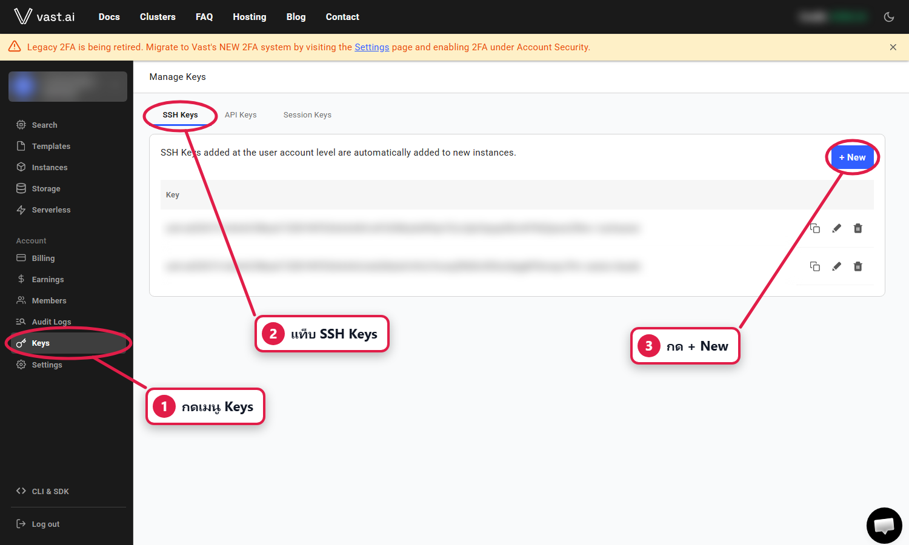
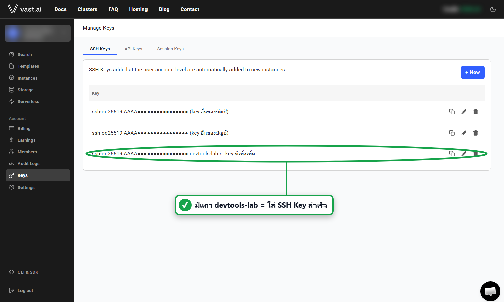
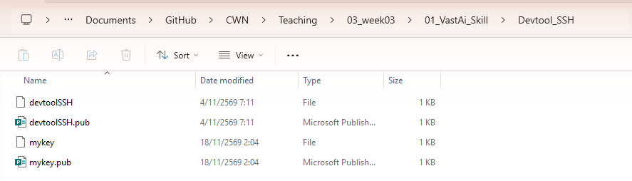
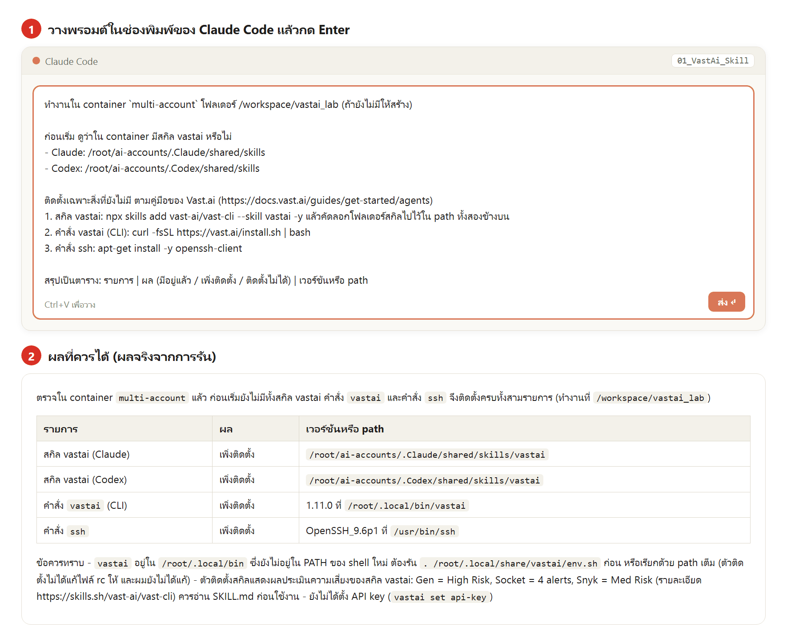

# เช่า GPU บน Vast.ai ด้วยสกิล `vastai` ของ Vast.ai

บทนี้ให้ Claude Code **เช่า GPU จริงบน Vast.ai แทนเรา** โดยสั่งเป็นภาษาไทย แล้วใช้ GPU นั้นรันโมเดลภาษาให้แชทบอทของร้านค้า

สกิลที่ใช้คือสกิล **`vastai` ที่ Vast.ai ทำเอง** ติดตั้งตามคู่มือ [Using Vast.ai with Agents](https://docs.vast.ai/guides/get-started/agents) · ทุกขั้นทำด้วยพรอมต์ Copy & Paste ใน **Claude Code** และงานทั้งหมดเกิดใน container `multi-account` ตัวเดียวกับบทก่อน

> 🚧 **บทนี้กำลังเรียบเรียงและรันใหม่ทีละ LAB** · ตาราง "สถานะ" ด้านล่างบอกว่า LAB ไหนรันจริงเสร็จแล้ว

| LAB | ทำอะไร | ค่าใช้จ่าย | สถานะ |
|---|---|---|---|
| [LAB 0](#lab-0--เตรียมบัญชี-vastai-และกุญแจ-2-ดอก) | เตรียมบัญชี Vast.ai · API key · กุญแจ SSH | เติมเครดิต $5–10 | ✅ เสร็จ |
| [LAB 1](#lab-1--ติดตั้งสกิล-vastai-ใน-container) | ติดตั้งสกิล `vastai` ใน container | ฟรี | ✅ รันจริงแล้ว (18 พ.ย. 2026) |
| LAB 2 | ตั้งค่าบัญชีให้พร้อมเช่า | ฟรี | ⏳ กำลังรัน |
| LAB 3 | เช่า RTX 4090 → ssh → ลบเครื่อง | ≈ $0.2 | ⏳ |
| LAB 4 | เช่า RTX 5090 แล้วเปิด AI server (NInfer + Qwen) | ≈ $0.3–0.7 | ⏳ |
| LAB 5 | ต่อแชทบอทร้านค้าเข้ากับ AI server แล้วทดสอบ 26 เคส | (เครื่องเดิม) | ⏳ |
| LAB 6 | ปิดทุกอย่าง | หยุดเสียเงิน | ⏳ |

**ต้องมีก่อน**
- container `multi-account` **รันอยู่** และล็อกอิน `yolo1` แล้ว — ทำไว้ใน [บท 03](../../01_week02/03_MultiAccount_Container/README.md) และ [บท 04](../../01_week02/04_MultiAccount_Skill/README.md) ของสัปดาห์ก่อน
- Claude Code เปิดที่โฟลเดอร์ของบทนี้ (`03_week03/01_VastAi_Skill`) · "โฟลเดอร์ปัจจุบัน" ในทุกพรอมต์หมายถึงโฟลเดอร์นี้

> ⚠️ **เสียเงินจริง** — ทดลองเสร็จทุกครั้งต้องสั่ง **ลบเครื่อง (destroy)** แล้วดูหน้า [Instances](https://cloud.vast.ai/instances/) ว่าว่าง

---

# ภาคทฤษฎี

## 1 · สกิล `vastai` ของ Vast.ai

Vast.ai คือตลาดเช่า GPU รายชั่วโมง · Vast.ai ทำ **สกิล** ให้ AI ใช้บัญชีของเราได้ คือ ค้นหาเครื่อง เช่า ต่อ ssh ดูบิล และลบเครื่อง

สกิลนี้ต้องมี 3 ชิ้นจึงทำงานได้

| ชิ้น | คืออะไร | ติดตั้งด้วย |
|---|---|---|
| **สกิล `vastai`** | คู่มือที่บอก AI ว่าคำสั่งไหนใช้ทำอะไร (ไฟล์ `SKILL.md`) | `npx skills add vast-ai/vast-cli --skill vastai` |
| **คำสั่ง `vastai`** (CLI) | โปรแกรมที่คุยกับ Vast.ai จริง · สกิลเรียกโปรแกรมนี้อยู่เบื้องหลัง | `curl -fsSL https://vast.ai/install.sh \| bash` |
| **API key** | รหัสยืนยันว่าคำสั่งมาจากบัญชีของเรา | `vastai set api-key` |

ทั้ง 3 ชิ้นติดตั้ง**ใน container** ไม่ได้ติดตั้งบนเครื่อง Windows ของเรา · เราเป็นคนสั่ง Claude Code ให้เข้าไปทำ

## 2 · กุญแจ 2 ดอก

| กุญแจ | ใช้ทำอะไร | เก็บที่ไหน |
|---|---|---|
| 🟠 **API key** | สั่งงานบัญชี: เช่า · ลบเครื่อง · ดูบิล (ตัดเงินจากเครดิต) | ไฟล์ `.env` ในโฟลเดอร์ปัจจุบัน |
| 🔵 **กุญแจ SSH** | เข้าไปใช้งาน**เครื่องที่เช่า** | โฟลเดอร์ `Devtool_SSH/` ในโฟลเดอร์ปัจจุบัน |

กุญแจ SSH มี 2 ไฟล์เสมอ

| ไฟล์ | ชื่อเรียก | ทำอะไรกับมัน |
|---|---|---|
| `devtoolSSH.pub` | public key | เอาไป**ใส่ในเว็บ Vast.ai** · เปิดเผยได้ |
| `devtoolSSH` | private key | **เก็บไว้กับเรา** ใช้ตอน ssh · ห้ามส่งให้ใคร |

เครื่องที่เช่าจะรับเฉพาะคนที่ถือ private key คู่กับ public key ที่ลงทะเบียนไว้

## 3 · เครื่องคิดเงินตอนไหน


*ภาพแนวคิด (Imagegen ด้วย cyolo): **stop ≠ destroy** — stopped ยังเสียค่า disk · destroy เท่านั้นที่หยุดจ่ายทั้งหมด*

สกิลของ Vast.ai **ไม่มีเพดานราคาในตัว** · เราจึงเขียนเพดานราคาไว้ในพรอมต์เองทุกครั้งที่สั่งเช่า เช่น "ราคารวมไม่เกิน $0.70/ชม. ถ้าไม่มีให้หยุดแล้วถามฉัน"

## 4 · โมเดลบน GPU และแชทบอทร้านค้า

⏳ ส่วนนี้ (NInfer คืออะไร · โมเดล Qwen · แชทบอททำงานอย่างไร) กำลังเรียบเรียงใหม่พร้อมภาพชุดใหม่ และจะขึ้นพร้อม LAB 4–5

---

# ภาค LAB

ทุกขั้นมี 2 ส่วน: **พรอมต์** ที่คัดลอกไปวางใน Claude Code และ **ผลที่ควรได้** ซึ่งเป็นผลจริงจากการรัน

## LAB 0 · เตรียมบัญชี Vast.ai และกุญแจ 2 ดอก

LAB นี้ทำบนเว็บและบนเครื่องเราเอง ยังไม่ใช้ Claude Code

### ขั้นที่ 1 · สมัครและเติมเครดิต

1. สมัครที่ https://cloud.vast.ai/
2. เมนูซ้าย **Billing** → **Add Credit** → เติม $5–10 — **ทำเองเท่านั้น ห้ามให้ AI กรอกข้อมูลบัตร**


*ภาพจริง: ยอดเครดิต ข้อมูลบัตร และอีเมลถูกเบลอไว้*

### ขั้นที่ 2 · ใส่กุญแจ SSH ในเว็บ

บทนี้เตรียมกุญแจไว้ให้แล้วในโฟลเดอร์ `Devtool_SSH/` · ถ้าไม่อยากสร้างเอง ใช้คู่นี้ได้เลย (อยากสร้างเอง ดู [หัวข้อถัดไป](#ทางเลือก--สร้างกุญแจ-ssh-ของตัวเอง))

1. เปิดไฟล์ `Devtool_SSH/devtoolSSH.pub` ด้วย Notepad แล้วคัดลอกทั้งบรรทัดที่ขึ้นต้นด้วย `ssh-ed25519 AAAA…`
2. เปิด https://cloud.vast.ai/manage-keys/ → ทำตามเลข **①–⑤**


*ภาพจริง: ① เมนู **Keys** → ② แท็บ **SSH Keys** → ③ **+ New***


*ภาพจริง: ④ วางบรรทัด `ssh-ed25519 AAAA…` → ⑤ **Save***


*ภาพจริง: ✔ มีแถวใหม่ = ใส่กุญแจ SSH สำเร็จ*

> ⚠️ private key `Devtool_SSH/devtoolSSH` อยู่ใน repo นี้เพื่อความสะดวกในห้องเรียน ใครมี repo ก็เข้าเครื่องที่เราเช่าได้ระหว่างที่เครื่องยังเปิด → **ลบเครื่องทันทีหลังใช้** และงานส่วนตัวให้สร้างกุญแจของตัวเอง

### ทางเลือก · สร้างกุญแจ SSH ของตัวเอง

ทำเมื่อไม่อยากใช้กุญแจที่เตรียมไว้ · คำสั่งเดียวกันทั้ง Windows และ macOS

| ระบบ | เปิดโปรแกรม | ไปที่โฟลเดอร์ของบทนี้ |
|---|---|---|
| **Windows** | Git Bash | คลิกขวาที่โฟลเดอร์ `01_VastAi_Skill` → **Open Git Bash here** |
| **macOS** | Terminal | `cd <ที่เก็บ repo>/03_week03/01_VastAi_Skill` |

```bash
ssh-keygen -t ed25519 -f Devtool_SSH/mykey -C my-vast-key
```

โปรแกรมถาม passphrase 2 ครั้ง → กด **Enter** ทั้ง 2 ครั้ง (ไม่ตั้งรหัส เพื่อให้ AI ใช้กุญแจได้)

**ผลที่ควรได้** (ผลจริงบน Windows · fingerprint ถูกปิดบางส่วน)

```text
Generating public/private ed25519 key pair.
Your identification has been saved in Devtool_SSH/mykey
Your public key has been saved in Devtool_SSH/mykey.pub
The key fingerprint is:
SHA256:xxxxxxxxxxxxxxxxxxxx… my-vast-key
```


*ภาพจริงบน Windows: ได้ไฟล์ใหม่ 2 ไฟล์ในโฟลเดอร์ของบทนี้ — `mykey` (private key เก็บไว้) และ `mykey.pub` (public key เอาไปใส่เว็บตามขั้นที่ 2)*

ใช้กุญแจของตัวเองแล้ว ให้เปลี่ยนคำว่า `devtoolSSH` ในพรอมต์ของ LAB ถัดไปเป็น `mykey`

### ขั้นที่ 3 · สร้าง API key แล้วใส่ใน `.env`

ทำตามเลข **①–⑧**


*ภาพจริง: ① เมนู **Keys** → ② แท็บ **API Keys** → ③ **+ New***


*ภาพจริง: ④ ตั้งชื่อ → ⑤ **เอาติ๊กออกที่ Billing/Earning → Write** → ⑥ **Save** · AI เช่าและลบเครื่องได้ แต่แก้การเงินของบัญชีไม่ได้*


*ภาพจริง: ⑦ กดคัดลอก **ทันที** (เห็นได้ครั้งเดียว) → ⑧ วางลง `.env` ก่อน แล้วค่อยกด **Close** · key ในภาพถูกเบลอไว้*

คัดลอกไฟล์ `.env_example` ในโฟลเดอร์ของบทนี้เป็น `.env` แล้วเปิดด้วย Notepad ใส่ key ที่คัดลอกมา

```text
VAST_API_KEY=<key ที่คัดลอกมา>
```

ห้ามใส่เครื่องหมายคำพูดครอบ key และห้ามเขียน comment ต่อท้ายบรรทัด · ไฟล์ `.env` ไม่ถูก commit

## LAB 1 · ติดตั้งสกิล `vastai` ใน container

เปิด Claude Code ที่โฟลเดอร์ของบทนี้ แล้ววางพรอมต์

```text
ทำงานใน container `multi-account` โฟลเดอร์ /workspace/vastai_lab (ถ้ายังไม่มีให้สร้าง)

ก่อนเริ่ม ดูว่าใน container มีสกิล vastai หรือไม่
- Claude: /root/ai-accounts/.Claude/shared/skills
- Codex: /root/ai-accounts/.Codex/shared/skills

ติดตั้งเฉพาะสิ่งที่ยังไม่มี ตามคู่มือของ Vast.ai (https://docs.vast.ai/guides/get-started/agents)
1. สกิล vastai: npx skills add vast-ai/vast-cli --skill vastai -y แล้วคัดลอกโฟลเดอร์สกิลไปไว้ใน path ทั้งสองข้างบน
2. คำสั่ง vastai (CLI): curl -fsSL https://vast.ai/install.sh | bash
3. คำสั่ง ssh: apt-get install -y openssh-client

สรุปเป็นตาราง: รายการ | ผล (มีอยู่แล้ว / เพิ่งติดตั้ง / ติดตั้งไม่ได้) | เวอร์ชันหรือ path
```


*ผลจริง (18 พ.ย. 2026): 42 วินาที · 5 คำสั่ง · ไม่มีคำสั่งล้ม*

**อ่านผลอย่างไร**

- ต้องได้ **4 แถว** และไม่มีแถวไหนขึ้น "ติดตั้งไม่ได้"
- Claude Code อาจ**ถามขออนุญาต**ก่อนรัน `curl … | bash` เพราะเป็นการรันสคริปต์จากอินเทอร์เน็ต · คำสั่งนี้มาจากคู่มือของ Vast.ai จึงกดอนุญาตได้ (รอบแรกที่ทดสอบ คำสั่งนี้ถูกระบบสิทธิ์ปฏิเสธจนกว่าจะอนุญาต)
- ตัวติดตั้งสกิลแสดง **ผลประเมินความเสี่ยง** ของสกิล (รอบที่ทดสอบ: Gen = High Risk · Socket = 4 alerts · Snyk = Med Risk) เพราะสกิลนี้สั่งเช่าเครื่องและตัดเงินได้จริง → เราจึงจำกัดสิทธิ์ของ API key ใน LAB 0 และเขียนเพดานราคาในพรอมต์เสมอ
- สกิลอยู่ใน volume `ai-accounts` จึงไม่หายเมื่อสร้าง container ใหม่ · คำสั่ง `vastai` กับ `ssh` อยู่ใน container ถ้าสร้าง container ใหม่ให้วางพรอมต์นี้ซ้ำ (ของที่มีอยู่แล้วจะถูกข้าม)

## LAB 2–6

⏳ กำลังรันจริงทีละ LAB · แต่ละ LAB จะขึ้นที่นี่พร้อมพรอมต์และผลจริงเมื่อรันเสร็จ

---

## ไฟล์ในโฟลเดอร์นี้

| ไฟล์ / โฟลเดอร์ | คืออะไร |
|---|---|
| `.env_example` | ตัวอย่างไฟล์ `.env` (มีบรรทัดเดียวคือ `VAST_API_KEY`) |
| `Devtool_SSH/` | กุญแจ SSH ที่เตรียมไว้ให้ใช้ใน LAB |
| `chatbot/` | โค้ดแชทบอทร้านค้าและชุดทดสอบ สำหรับ LAB 5 (กำลังปรับ) |
| `image/` | ภาพประกอบและภาพหน้าจอจริง |
