# เช่า GPU บน Vast.ai ด้วยสกิล `vastai` ของ Vast.ai


สไลด์ประกอบการสอน: [VastAi_Skill_Slides.html](VastAi_Skill_Slides.html)

> ⚠️ **เสียเงินจริง** — ทดลองเสร็จทุกครั้งต้องสั่ง **ลบเครื่อง (destroy)** แล้วดูหน้า [Instances](https://cloud.vast.ai/instances/) ว่าว่าง

---

# ภาคทฤษฎี

## 1 · สกิล `vastai` ของ Vast.ai

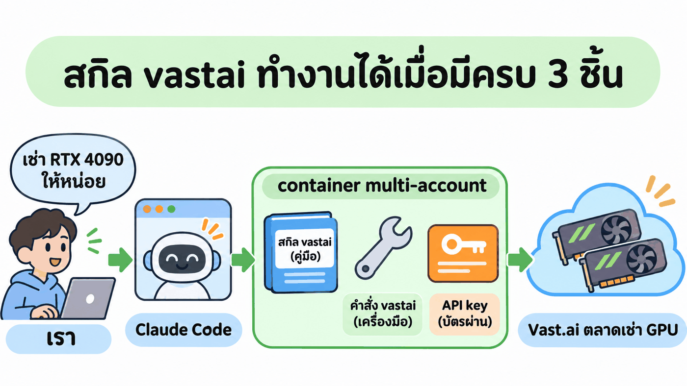

Vast.ai คือตลาดเช่า GPU รายชั่วโมง · Vast.ai ทำ **สกิล** ให้ AI ใช้บัญชีของเราได้ คือ ค้นหาเครื่อง เช่า ต่อ ssh ดูบิล และลบเครื่อง

สกิลนี้ต้องมี 3 ชิ้นจึงทำงานได้

| ชิ้น | คืออะไร | ติดตั้งด้วย |
|---|---|---|
| **สกิล `vastai`** | คู่มือที่บอก AI ว่าคำสั่งไหนใช้ทำอะไร (ไฟล์ `SKILL.md`) | `npx skills add vast-ai/vast-cli --skill vastai` |
| **คำสั่ง `vastai`** (CLI) | โปรแกรมที่คุยกับ Vast.ai จริง · สกิลเรียกโปรแกรมนี้อยู่เบื้องหลัง | `curl -fsSL https://vast.ai/install.sh \| bash` |
| **API key** | รหัสยืนยันว่าคำสั่งมาจากบัญชีของเรา | `vastai set api-key` |

ทั้ง 3 ชิ้นติดตั้ง**ใน container** ไม่ได้ติดตั้งบนเครื่อง Windows ของเรา · เราเป็นคนสั่ง Claude Code ให้เข้าไปทำ

## 2 · กุญแจ 2 ดอก

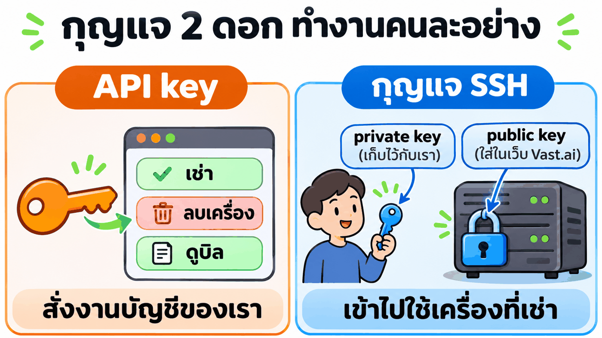

| กุญแจ | ใช้ทำอะไร | เก็บที่ไหน |
|---|---|---|
| 🟠 **API key** | สั่งงานบัญชี: เช่า · ลบเครื่อง · ดูบิล (ตัดเงินจากเครดิต) | ไฟล์ `.env` ในโฟลเดอร์ปัจจุบัน |
| 🔵 **กุญแจ SSH** | เข้าไปใช้งาน**เครื่องที่เช่า** | โฟลเดอร์ `Devtool_SSH/` ในโฟลเดอร์ปัจจุบัน |

กุญแจ SSH มี 2 ไฟล์เสมอ

| ไฟล์ | ชื่อเรียก | ทำอะไรกับมัน |
|---|---|---|
| `devtoolSSH.pub` | public key | เอาไป**ใส่ในเว็บ Vast.ai** · เปิดเผยได้ |
| `devtoolSSH` | private key | **เก็บไว้กับเรา** ใช้ตอน ssh · ห้ามส่งให้ใคร |

เครื่องที่เช่าจะรับเฉพาะคนที่ถือ private key คู่กับ public key ที่ลงทะเบียนไว้

## 3 · เครื่องคิดเงินตอนไหน

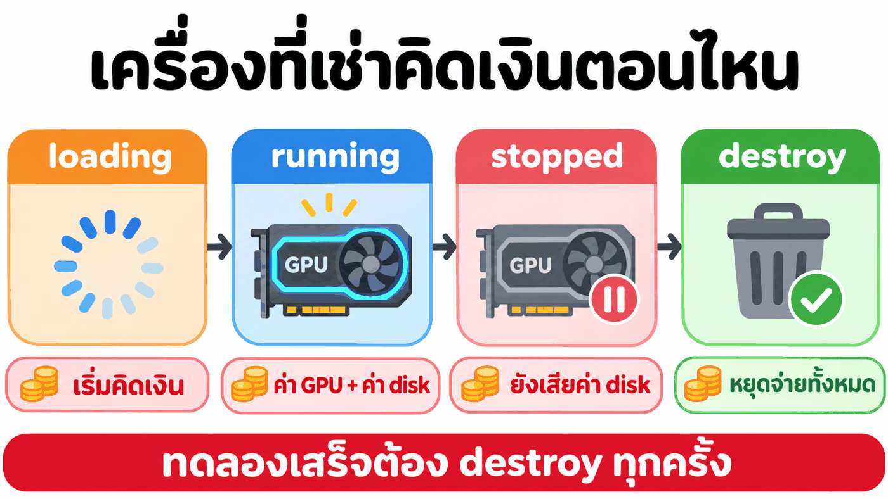
***stop ไม่เท่ากับ destroy** — เครื่องที่ stop ยังเสียค่า disk*

## 4 · เพดานราคาอยู่ในพรอมต์


สกิลของ Vast.ai **ไม่มีเพดานราคาในตัว** · เราจึงเขียนเพดานราคาไว้ในพรอมต์เองทุกครั้งที่สั่งเช่า เช่น "ราคารวมไม่เกิน $0.70/ชม. ถ้าไม่มีให้หยุดแล้วถามฉัน"

## 5 · โมเดลใหญ่เกิน GPU จึงต้องบีบอัด

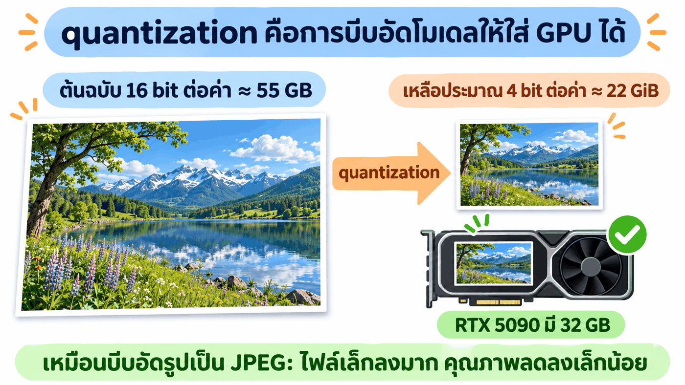

โมเดล Qwen 27B ต้นฉบับใหญ่ประมาณ 55 GB ใส่ RTX 5090 ไม่ได้ · **quantization** คือการเก็บตัวเลขแต่ละตัวให้หยาบลง ไฟล์จึงเหลือประมาณ 22 GiB โดยคะแนนทดสอบลดลงเล็กน้อย

---

# ภาค LAB

ทุกขั้นมี 2 ส่วน: **พรอมต์** ที่คัดลอกไปวางใน Claude Code และ **ผลที่ควรได้**

## LAB 0 · เตรียมบัญชี Vast.ai และกุญแจ 2 ดอก

LAB นี้ทำบนเว็บและบนเครื่องเราเอง ยังไม่ใช้ Claude Code

### ขั้นที่ 1 · สมัครและเติมเครดิต

1. สมัครที่ https://cloud.vast.ai/
2. เมนูซ้าย **Billing** → **Add Credit** → เติม $5–10 — **ทำเองเท่านั้น ห้ามให้ AI กรอกข้อมูลบัตร**


*ภาพจริง: ยอดเครดิต ข้อมูลบัตร และอีเมลถูกเบลอไว้*

### ขั้นที่ 2 · ใส่กุญแจ SSH ในเว็บ

บทนี้เตรียมกุญแจไว้ให้แล้วในโฟลเดอร์ `Devtool_SSH/` · ถ้าไม่อยากสร้างเอง ใช้คู่นี้ได้เลย (อยากสร้างเอง ดู [หัวข้อถัดไป](#ทางเลือก--สร้างกุญแจ-ssh-ของตัวเอง))

1. เปิดไฟล์ `Devtool_SSH/devtoolSSH.pub` ด้วย Notepad แล้วคัดลอกทั้งบรรทัดที่ขึ้นต้นด้วย `ssh-ed25519 AAAA…`
2. เปิด https://cloud.vast.ai/manage-keys/ → ทำตามเลข **①–⑤**


*ภาพจริง: ① เมนู **Keys** → ② แท็บ **SSH Keys** → ③ **+ New***


*ภาพจริง: ④ วางบรรทัด `ssh-ed25519 AAAA…` → ⑤ **Save***


*ภาพจริง: ✔ มีแถวใหม่ = ใส่กุญแจ SSH สำเร็จ*

> ⚠️ private key `Devtool_SSH/devtoolSSH` อยู่ใน repo นี้เพื่อความสะดวกในห้องเรียน ใครมี repo ก็เข้าเครื่องที่เราเช่าได้ระหว่างที่เครื่องยังเปิด → **ลบเครื่องทันทีหลังใช้** และงานส่วนตัวให้สร้างกุญแจของตัวเอง

### ทางเลือก · สร้างกุญแจ SSH ของตัวเอง

ทำเมื่อไม่อยากใช้กุญแจที่เตรียมไว้ · คำสั่งเดียวกันทั้ง Windows และ macOS

| ระบบ | เปิดโปรแกรม | ไปที่โฟลเดอร์ของบทนี้ |
|---|---|---|
| **Windows** | Git Bash | คลิกขวาที่โฟลเดอร์ `01_VastAi_Skill` → **Open Git Bash here** |
| **macOS** | Terminal | `cd <ที่เก็บ repo>/03_week03/01_VastAi_Skill` |

```bash
ssh-keygen -t ed25519 -f Devtool_SSH/mykey -C my-vast-key
```

โปรแกรมถาม passphrase 2 ครั้ง → กด **Enter** ทั้ง 2 ครั้ง (ไม่ตั้งรหัส เพื่อให้ AI ใช้กุญแจได้)

**ผลที่ควรได้**

```text
Generating public/private ed25519 key pair.
Your identification has been saved in Devtool_SSH/mykey
Your public key has been saved in Devtool_SSH/mykey.pub
The key fingerprint is:
SHA256:xxxxxxxxxxxxxxxxxxxx… my-vast-key
```


*ได้ไฟล์ใหม่ 2 ไฟล์ในโฟลเดอร์ของบทนี้ — `mykey` (private key เก็บไว้) และ `mykey.pub` (public key เอาไปใส่เว็บตามขั้นที่ 2)*

ใช้กุญแจของตัวเองแล้ว ให้เปลี่ยนคำว่า `devtoolSSH` ในพรอมต์ของ LAB ถัดไปเป็น `mykey`

### ขั้นที่ 3 · สร้าง API key แล้วใส่ใน `.env`

ทำตามเลข **①–⑧**

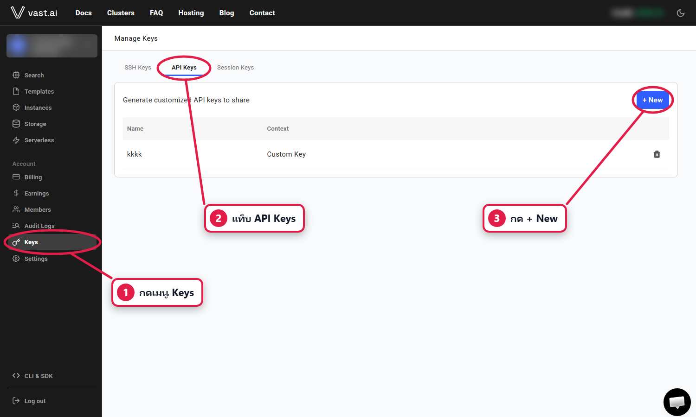
*ภาพจริง: ① เมนู **Keys** → ② แท็บ **API Keys** → ③ **+ New***


*ภาพจริง: ④ ตั้งชื่อ → ⑤ **เอาติ๊กออกที่ Billing/Earning → Write** → ⑥ **Save** · AI เช่าและลบเครื่องได้ แต่แก้การเงินของบัญชีไม่ได้*

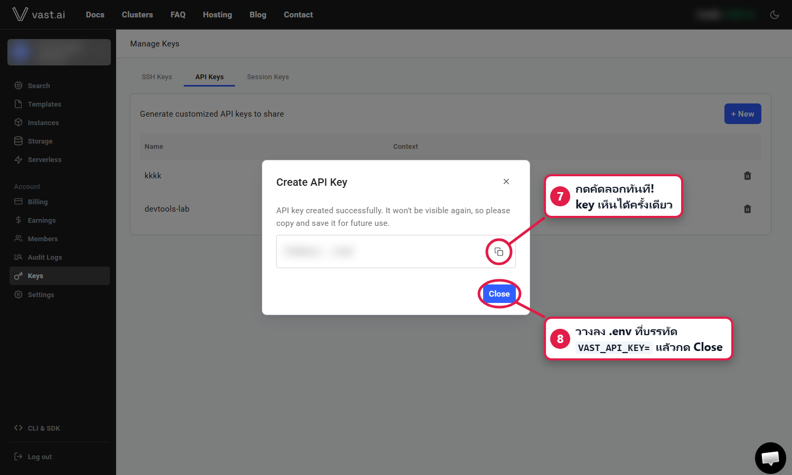
*ภาพจริง: ⑦ กดคัดลอก **ทันที** (เห็นได้ครั้งเดียว) → ⑧ วางลง `.env` ก่อน แล้วค่อยกด **Close** · key ในภาพถูกเบลอไว้*

คัดลอกไฟล์ `.env_example` ในโฟลเดอร์ของบทนี้เป็น `.env` แล้วเปิดด้วย Notepad ใส่ key ที่คัดลอกมา

```text
VAST_API_KEY=<key ที่คัดลอกมา>
```

ห้ามใส่เครื่องหมายคำพูดครอบ key และห้ามเขียน comment ต่อท้ายบรรทัด · ไฟล์ `.env` ไม่ถูก commit

## LAB 1 · ติดตั้งสกิล `vastai` ใน container

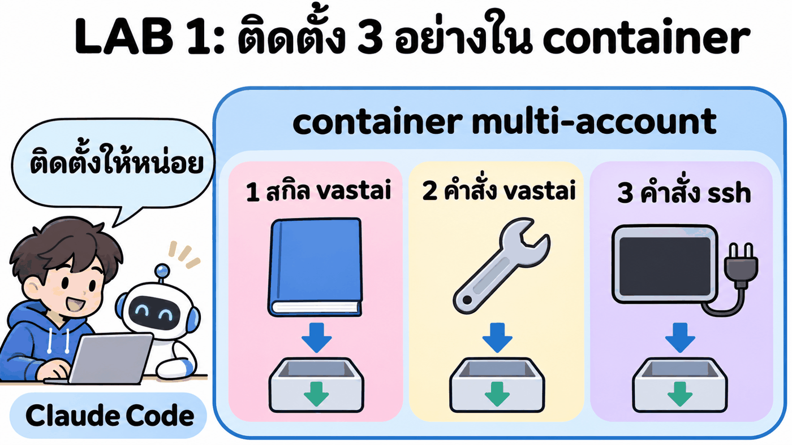

เปิด Claude Code ที่โฟลเดอร์ของบทนี้ แล้ววางพรอมต์

```text
ทำงานใน container `multi-account` โฟลเดอร์ /workspace/vastai_lab (ถ้ายังไม่มีให้สร้าง)

ก่อนเริ่ม ดูว่าใน container มีสกิล vastai หรือไม่
- Claude: /root/ai-accounts/.Claude/shared/skills
- Codex: /root/ai-accounts/.Codex/shared/skills

ติดตั้งเฉพาะสิ่งที่ยังไม่มี ตามคู่มือของ Vast.ai (https://docs.vast.ai/guides/get-started/agents)
1. สกิล vastai: npx skills add vast-ai/vast-cli --skill vastai -y แล้วคัดลอกโฟลเดอร์สกิลไปไว้ใน path ทั้งสองข้างบน
2. คำสั่ง vastai (CLI): curl -fsSL https://vast.ai/install.sh | bash
3. คำสั่ง ssh: apt-get install -y openssh-client

สรุปเป็นตาราง: รายการ | ผล (มีอยู่แล้ว / เพิ่งติดตั้ง / ติดตั้งไม่ได้) | เวอร์ชันหรือ path
```


*ใช้เวลาประมาณ 1 นาที*

**อ่านผลอย่างไร**

- ต้องได้ **4 แถว** และไม่มีแถวไหนขึ้น "ติดตั้งไม่ได้"
- Claude Code อาจ**ถามขออนุญาต**ก่อนรัน `curl … | bash` เพราะเป็นการรันสคริปต์จากอินเทอร์เน็ต · คำสั่งนี้มาจากคู่มือของ Vast.ai จึงกดอนุญาตได้
- ตัวติดตั้งสกิลแสดง **ผลประเมินความเสี่ยง** ของสกิล (เช่น High Risk) เพราะสกิลนี้สั่งเช่าเครื่องและตัดเงินได้จริง → เราจึงจำกัดสิทธิ์ของ API key ใน LAB 0 และเขียนเพดานราคาในพรอมต์เสมอ
- สกิลอยู่ใน volume `ai-accounts` จึงไม่หายเมื่อสร้าง container ใหม่ · คำสั่ง `vastai` กับ `ssh` อยู่ใน container ถ้าสร้าง container ใหม่ให้วางพรอมต์นี้ซ้ำ (ของที่มีอยู่แล้วจะถูกข้าม)

## LAB 2 · ตั้งค่าบัญชีให้พร้อมเช่า


LAB นี้นำกุญแจ 2 ดอกจาก LAB 0 เข้าไปใน container · ยังไม่เช่าเครื่องและไม่เสียเงิน

```text
ทำงานใน container `multi-account` โฟลเดอร์ /workspace/vastai_lab ด้วยสกิล vastai

ตั้งค่าบัญชี Vast.ai ให้พร้อมเช่าเครื่อง
1. API key: ใช้ค่า VAST_API_KEY จากไฟล์ .env ในโฟลเดอร์ปัจจุบัน ตั้งด้วย vastai set api-key ห้ามแสดงค่า key
2. กุญแจ SSH: คัดลอกโฟลเดอร์ Devtool_SSH จากโฟลเดอร์ปัจจุบันเข้าไปที่ /workspace/vastai_lab แล้วตรวจว่า public key นี้ลงทะเบียนกับบัญชีแล้ว ถ้ายังให้ลงทะเบียน
3. ตรวจบัญชี: เครดิตคงเหลือ และเครื่องที่เปิดค้างอยู่

สรุปเป็นตาราง: รายการ | ผล ห้ามแสดงอีเมล key หรือ token
```


*ใช้เวลาประมาณครึ่งนาที · ยอดเครดิตในภาพถูกปิดไว้*

**อ่านผลอย่างไร**

- ต้องเห็น **เครดิตมากกว่า 0** และ **เครื่องที่เปิดค้าง 0 เครื่อง** ก่อนไป LAB ถัดไป
- แถว "Public key กับบัญชี" ขึ้นว่าลงทะเบียนอยู่แล้ว เพราะเราใส่ไว้ในเว็บตั้งแต่ LAB 0 · ถ้าข้ามขั้นนั้นมา AI จะลงทะเบียนให้ในขั้นนี้
- API key ถูกเก็บใน container ครั้งเดียว LAB ถัดไปจึงไม่ต้องส่ง key อีก · ถ้าสร้าง container ใหม่ให้วางพรอมต์นี้ซ้ำ

## LAB 3 · หาเครื่องและเปรียบเทียบราคา


LAB นี้**ไม่เช่าเครื่องและไม่เสียเงิน** · ให้ AI ค้นตลาดตามเงื่อนไขของเรา แล้วเทียบราคาให้ดูก่อนตัดสินใจ

### ขั้นที่ 1 · เทียบราคา 3 ส่วน

ราคาของเครื่องบน Vast.ai มี 3 ส่วน

| ส่วน | คิดอย่างไร |
|---|---|
| **ค่า GPU** | ต่อชั่วโมง ตลอดเวลาที่เครื่อง running |
| **ค่า disk** | ต่อ GB ต่อเดือน ตลอดเวลาที่เครื่องยังอยู่ (รวมตอน stop) |
| **ค่ารับส่งข้อมูล** | ต่อ GB ที่ดาวน์โหลดหรืออัปโหลด |

```text
ทำงานใน container `multi-account` โฟลเดอร์ /workspace/vastai_lab ด้วยสกิล vastai

หาเครื่อง RTX 4090 1 ใบที่เช่าได้ตอนนี้ ยังไม่ต้องเช่า
- เงื่อนไข: verified · ต่อ ssh แบบ direct ได้ · ไม่เอาเครื่องในจีน
- ตารางที่ 1: 10 เครื่องที่ราคา GPU ต่อชั่วโมงถูกที่สุด เรียงจากถูกไปแพง แต่ละเครื่องแสดง ที่ตั้ง · ราคา GPU ต่อชั่วโมง · ค่า disk ต่อ GB ต่อเดือน · ค่าดาวน์โหลดต่อ GB · ความเร็วดาวน์โหลด · ความน่าเชื่อถือ
- ตารางที่ 2: คำนวณค่าใช้จ่ายรวมของงานตัวอย่าง (ใช้เครื่อง 1 ชั่วโมง · disk 50 GB · ดาวน์โหลดโมเดล 25 GB) ของ 10 เครื่องเดิม แล้วเรียงใหม่จากถูกไปแพง

บอกด้วยว่าเครื่องที่ถูกที่สุดของสองตารางเป็นเครื่องเดียวกันหรือไม่ เพราะอะไร
```

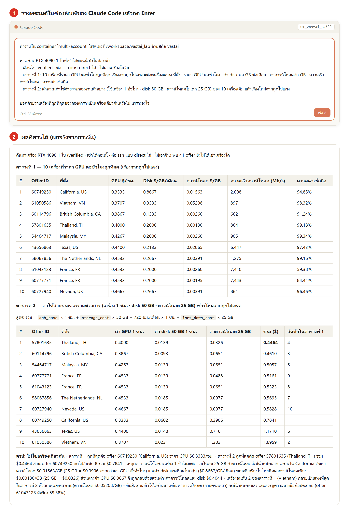
*ผลวันที่ 18 พ.ย. 2026: พบ 41 เครื่องที่ผ่านเงื่อนไข · ราคาในตลาดเปลี่ยนตลอดเวลา ผลของคุณจะไม่เหมือนนี้*

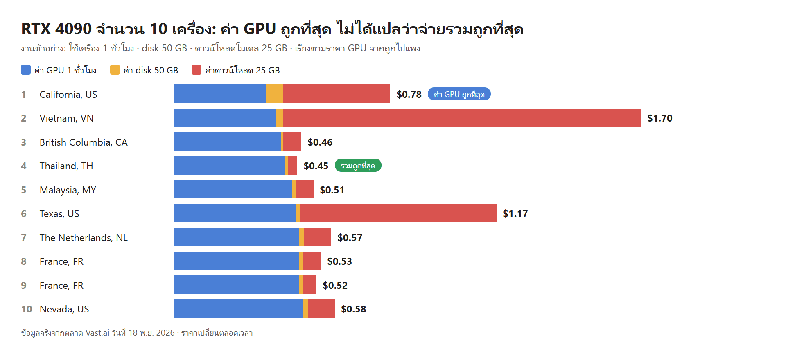
*กราฟจากข้อมูลจริงของผลข้างบน*

**อ่านผลอย่างไร**

- เครื่องที่ **ค่า GPU ถูกที่สุด** (California $0.33/ชม.) จ่ายรวม $0.78 เพราะค่าดาวน์โหลด 25 GB แพงกว่าค่า GPU ทั้งชั่วโมง
- เครื่องที่ **จ่ายรวมถูกที่สุด** (Thailand $0.45) อยู่อันดับ 4 ของราคา GPU
- เครื่องอันดับ 2 ของราคา GPU (Vietnam) กลายเป็นแพงที่สุด คือ $1.70
- ดู **ความน่าเชื่อถือ** ด้วย: เครื่องหนึ่งใน France ราคาดีแต่ความน่าเชื่อถือ 59%
- ยิ่งใช้เครื่องนาน ค่าดาวน์โหลด (จ่ายครั้งเดียว) ยิ่งมีน้ำหนักน้อยลง

**ลองเปลี่ยนเงื่อนไขเอง** — แก้บรรทัดในพรอมต์แล้ววางใหม่ได้เลย ไม่เสียเงิน

| อยากได้ | แก้ในพรอมต์เป็น |
|---|---|
| เฉพาะเครื่องในอเมริกา | `เอาเฉพาะเครื่องในสหรัฐอเมริกา` |
| ดู 20 เครื่อง | เปลี่ยน `10 เครื่อง` เป็น `20 เครื่อง` |
| GPU รุ่นอื่น | เปลี่ยน `RTX 4090` เป็น `RTX 5090` หรือ `RTX 3090` |
| งานที่ใช้นานขึ้น | เปลี่ยน `1 ชั่วโมง` เป็น `24 ชั่วโมง` แล้วดูว่าอันดับเปลี่ยนหรือไม่ |
| เน็ตเร็ว | เพิ่มเงื่อนไข `ความเร็วดาวน์โหลดมากกว่า 2000 Mbps` |
| เครื่องที่ไว้ใจได้ | เพิ่มเงื่อนไข `ความน่าเชื่อถือมากกว่า 99%` |

### ขั้นที่ 2 · ค้นได้สูงสุดกี่เครื่อง

ขั้นนี้ทดลองว่าการค้น 1 ครั้งเห็นตลาดครบหรือไม่ · ไม่เช่าเครื่องและไม่เสียเงิน

```text
ทำงานใน container `multi-account` โฟลเดอร์ /workspace/vastai_lab ด้วยสกิล vastai

ทดลองขีดจำกัดของการค้นหาเครื่อง ยังไม่ต้องเช่า
1. ค้น RTX 4090 1 ใบ โดยไม่ใส่เงื่อนไขอื่น 3 แบบ: ไม่กำหนดจำนวน · ขอ 100 เครื่อง · ขอ 1000 เครื่อง แต่ละแบบได้กี่เครื่อง
2. ค้นแบบขอ 1000 เครื่องซ้ำ 3 ครั้ง ได้จำนวนเท่ากันทุกครั้งหรือไม่
3. ค้นทุกรุ่น GPU (ไม่ระบุรุ่น) แบบขอ 1000 และ 10000 เครื่อง เพื่อดูว่าการค้นครั้งเดียวได้สูงสุดกี่เครื่อง
4. กลับมาที่ RTX 4090 เติมเงื่อนไขทีละข้อแล้วนับจำนวนที่เหลือ: เช่าได้ตอนนี้ → verified → ต่อ ssh แบบ direct ได้ → ไม่เอาจีน → ความน่าเชื่อถือมากกว่า 99% → ราคารวมไม่เกิน $0.50/ชม.
5. บอกเงื่อนไขที่ใช้ค้นได้ทั้งหมด จัดเป็นกลุ่ม

สรุปเป็นตารางของแต่ละข้อ แล้วบอกข้อควรระวังเมื่อผลการค้นถูกตัดจำนวน
```


*ผลวันที่ 18 พ.ย. 2026 · จำนวนเครื่องในตลาดเปลี่ยนตลอดเวลา*

**อ่านผลอย่างไร**

- **การค้น 1 ครั้งได้สูงสุด 64 เครื่อง** ขอ 100, 1000 หรือ 10000 ก็ได้ 64 เท่าเดิม และระบบไม่เตือนว่าผลถูกตัด
- ตลาดจริงมี RTX 4090 ทั้งหมด 293 เครื่อง การค้นครั้งเดียวจึงเห็นแค่ประมาณ 1 ใน 5
- ค้นซ้ำ 3 ครั้งได้ 64 เครื่องทุกครั้ง แต่**เป็นคนละชุดกัน** มีเครื่องที่ซ้ำกันทั้ง 3 ครั้งเพียง 10 เครื่อง
- ถ้าได้ **64 เครื่องพอดี** ให้สงสัยว่าผลถูกตัด → เติมเงื่อนไขให้แคบลงก่อน แล้วจึงเรียงหาเครื่องที่ถูกที่สุด
- แม้ผลจะต่ำกว่า 64 เครื่อง การค้นแต่ละครั้งก็อาจได้**ชุดเครื่องไม่เหมือนกัน** → ก่อนสรุปว่า "ถูกที่สุด" ให้ AI ค้นซ้ำ หรือแบ่งค้นตามช่วงราคา แล้วรวมผล
- เงื่อนไขที่ใช้ค้นได้มี 49 อย่าง ใน 8 กลุ่ม: GPU · CPU และ RAM · disk · เครือข่าย · ราคา · ความคุ้มค่า · ความน่าเชื่อถือ · ที่ตั้ง

<details>
<summary>ผลที่ควรได้ฉบับเต็ม (ตารางของทั้ง 5 ข้อ)</summary>

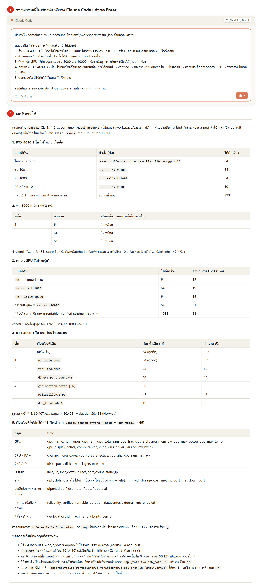

</details>

### ขั้นที่ 3 · ถามตลาดด้วยสถานการณ์จริง

ขั้นนี้ลองถามแบบที่คนทำงานจริงถาม เพื่อดูว่าสกิลทำอะไรได้และทำอะไรไม่ได้ · ทุกคำถามไม่เช่าเครื่องและไม่เสียเงิน · วางทีละคำถาม หรือแก้เป็นโจทย์ของตัวเอง

**สถานการณ์ 1 · หลาย GPU ในเครื่องเดียว**

```text
ทำงานใน container `multi-account` โฟลเดอร์ /workspace/vastai_lab ด้วยสกิล vastai

หาเครื่องที่มี RTX 4090 4 ใบในเครื่องเดียว (verified · เช่าได้ตอนนี้) แสดง 5 เครื่องที่ถูกที่สุด
แล้วเทียบราคาต่อใบกับเครื่อง RTX 4090 1 ใบที่ถูกที่สุด 5 เครื่อง
สรุปว่าแบบไหนถูกกว่าต่อใบ ยังไม่ต้องเช่า
```

**ข้อสรุป:** เครื่อง RTX 4090 1 ใบถูกกว่าต่อใบ ($0.34 เทียบกับ $0.37 ต่อใบต่อชั่วโมง) · เครื่อง 4 ใบแพงกว่าราว 10% จึงเลือกเมื่องานต้องใช้ 4 ใบในเครื่องเดียวกันจริง

<details>
<summary>ผลที่ควรได้ของสถานการณ์ 1</summary>

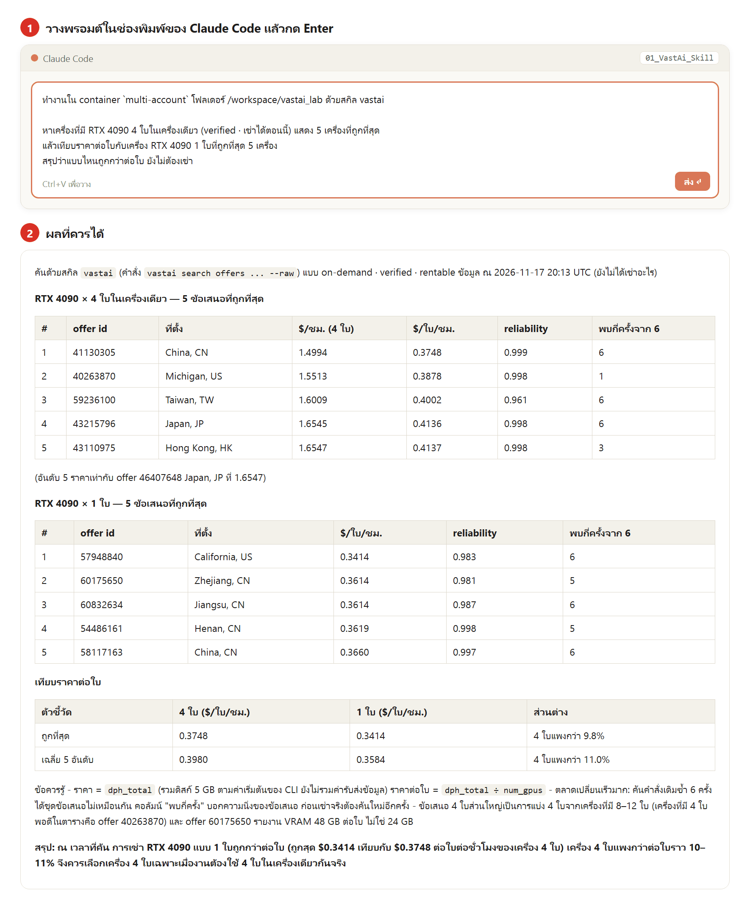

</details>

**สถานการณ์ 2 · ทำคลัสเตอร์หลายเครื่อง**

```text
ทำงานใน container `multi-account` โฟลเดอร์ /workspace/vastai_lab ด้วยสกิล vastai

ถ้าจะเช่า RTX 4090 4 เครื่องมาทำงานร่วมกันเป็นคลัสเตอร์
- Vast.ai และสกิลนี้มีอะไรให้ใช้บ้าง เช่น คำสั่งกลุ่ม cluster หรือเครือข่ายระหว่างเครื่อง
- ตอนนี้มีเครื่องที่อยู่ data center เดียวกันให้เช่าครบ 4 เครื่องหรือไม่
ตอบจากคำสั่งและข้อมูลจริงเท่านั้น อะไรที่ทำไม่ได้ให้บอกตรง ๆ ยังไม่ต้องเช่า
```

**ข้อสรุป:** คำสั่งกลุ่ม cluster ใช้ไม่ได้ในรุ่นนี้ และยืนยันไม่ได้ว่ามีเครื่องใน data center เดียวกันครบ 4 เครื่อง → ทางเลือกคือเช่า 4 เครื่องแยกแล้วต่อกันเองผ่าน IP หรือเช่าเครื่องเดียวที่มี 4 ใบ

<details>
<summary>ผลที่ควรได้ของสถานการณ์ 2</summary>

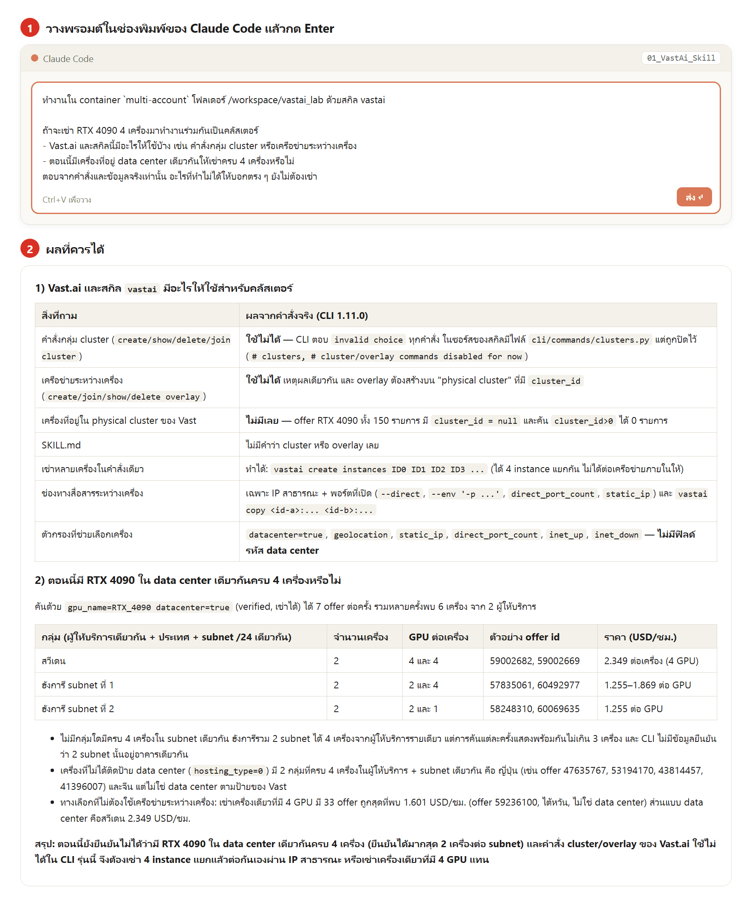

</details>

**สถานการณ์ 3 · งานที่ถูกขัดจังหวะได้**

```text
ทำงานใน container `multi-account` โฟลเดอร์ /workspace/vastai_lab ด้วยสกิล vastai

เทียบราคาเช่าแบบปกติกับแบบ interruptible ของ RTX 4090 1 ใบ (verified) จาก 10 เครื่องที่ถูกที่สุด
ถูกลงกี่เปอร์เซ็นต์ และแบบ interruptible เสี่ยงอะไร ยังไม่ต้องเช่า
```

**ข้อสรุป:** แบบ interruptible ถูกลงเฉลี่ยราว 14% (ช่วง 0–46%) แลกกับงานที่ถูกหยุดได้ทุกเมื่อ และค่า disk ยังเดินต่อ

<details>
<summary>ผลที่ควรได้ของสถานการณ์ 3</summary>

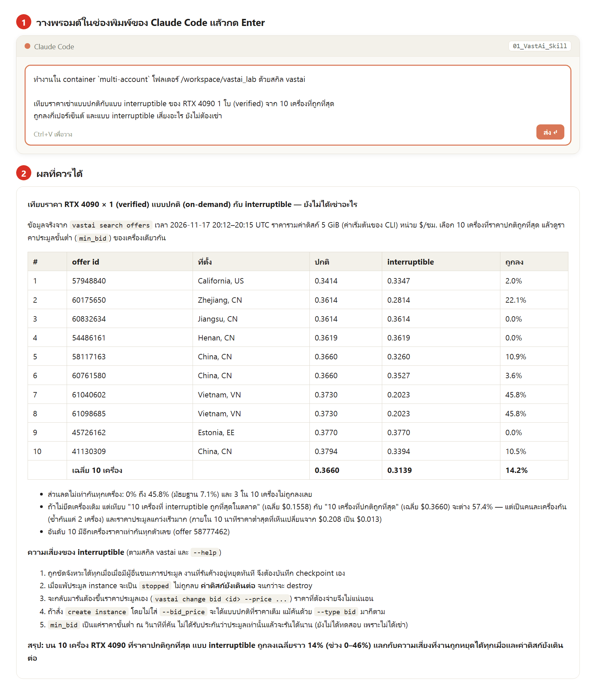

</details>

**สถานการณ์ 4 · แบ่งงานเทรนให้หลายเครื่องช่วยกัน**

```text
ทำงานใน container `multi-account` โฟลเดอร์ /workspace/vastai_lab ด้วยสกิล vastai

มีงานเทรนที่ใช้ RTX 4090 1 ใบ 8 ชั่วโมง ถ้าแบ่งเป็น 4 เครื่องทำพร้อมกันเครื่องละ 2 ชั่วโมง
คำนวณจากราคาจริงตอนนี้: ค่าใช้จ่ายรวมและเวลาที่ใช้ของทั้งสองแบบ
โดยทุกเครื่องต้องดาวน์โหลดข้อมูล 100 GB และใช้ disk 150 GB
สรุปเป็นตารางเทียบ ยังไม่ต้องเช่า
```

**ข้อสรุป:** แบ่ง 4 เครื่องเสร็จเร็วขึ้นราว 6 ชั่วโมง แต่จ่ายเพิ่ม 20% ($3.58 เป็น $4.32) เพราะต้องดาวน์โหลดข้อมูล 4 รอบ

<details>
<summary>ผลที่ควรได้ของสถานการณ์ 4</summary>

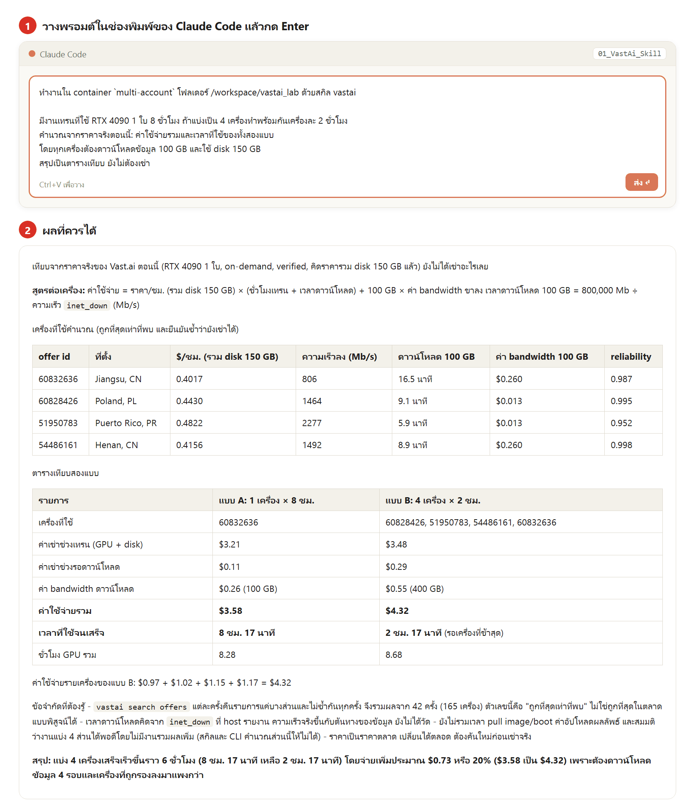

</details>

**สถานการณ์ 5 · เลือกตามงบ**

```text
ทำงานใน container `multi-account` โฟลเดอร์ /workspace/vastai_lab ด้วยสกิล vastai

มีงบ $5 ต้องการใช้ GPU 10 ชั่วโมง (verified · เช่าได้ตอนนี้)
แนะนำ 5 ตัวเลือกที่คุ้มที่สุดจาก GPU ทุกรุ่น บอกรุ่น · VRAM · ราคารวมต่อชั่วโมง · เหตุผลที่คุ้ม
ยังไม่ต้องเช่า
```

**ข้อสรุป:** งบ $5 ใช้ 10 ชั่วโมง ตัวเลือกที่คุ้มที่สุดคือ RTX 5070 Ti ที่ $0.16/ชม. (รวม $1.60) · RTX 5090 ก็อยู่ในงบ ถ้างานต้องการ VRAM 32 GB

<details>
<summary>ผลที่ควรได้ของสถานการณ์ 5</summary>

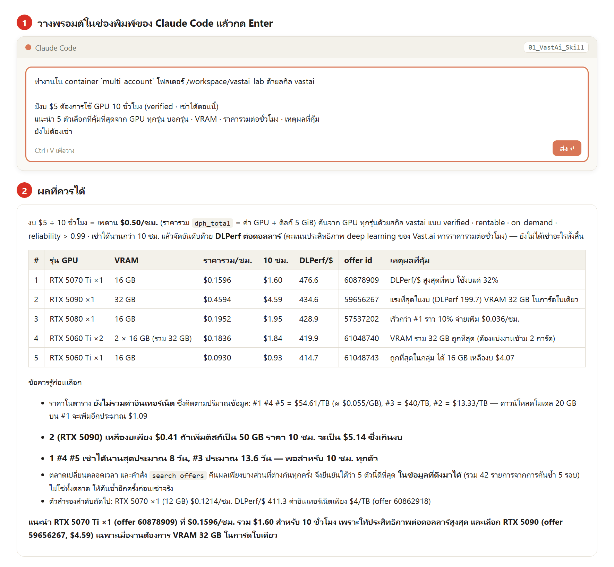

</details>

**สิ่งที่ได้จากทั้ง 5 สถานการณ์**

- สกิล**ค้นและคำนวณ**ให้ได้ทุกแบบที่ถาม โดยใช้ราคาจริงของตลาดตอนนั้น
- สกิล**บอกตรง ๆ เมื่อทำไม่ได้** เช่น คำสั่งกลุ่ม cluster ที่ยังไม่เปิดใช้ → คำตอบว่า "ทำไม่ได้" ก็เป็นข้อมูลสำหรับตัดสินใจ
- ราคาเปลี่ยนตลอดเวลา ผลของคุณจะไม่เหมือนในภาพ ให้ดูที่**วิธีคิด** ไม่ใช่ตัวเลข

## LAB 4 · เช่า RTX 4090 → ssh → ลบเครื่อง

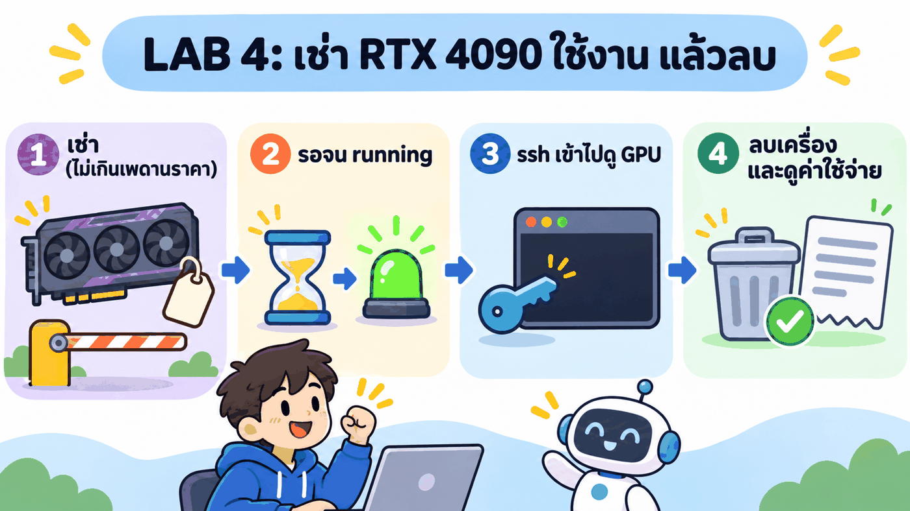

LAB นี้**เสียเงินจริง** (ประมาณ $0.02 ถ้าลบเครื่องภายใน 5 นาที) · มี 2 พรอมต์ และต้องทำให้ครบทั้งสองในรอบเดียว

### ขั้นที่ 1 · เช่าเครื่องและเข้าไปดู GPU

```text
ทำงานใน container `multi-account` โฟลเดอร์ /workspace/vastai_lab ด้วยสกิล vastai

เช่า RTX 4090 1 เครื่อง ตั้งชื่อ lab-4090
- ราคารวมไม่เกิน $0.70/ชม. ถ้าไม่มีเครื่องในราคานี้ให้หยุดแล้วถามฉัน ห้ามขึ้นราคาเอง
- เลือกเครื่อง verified ที่ต่อ ssh แบบ direct ได้ และราคาถูกที่สุด · disk 20 GB
- รอจนเครื่อง running แล้ว ssh เข้าไปรัน nvidia-smi และ vast-capabilities ด้วยกุญแจ Devtool_SSH/devtoolSSH
- ถ้าเครื่องไม่พร้อมใน 10 นาที ให้ลบแล้วเช่าเครื่องอื่น

สรุปเป็นตาราง: GPU · ราคาต่อชั่วโมง · ที่ตั้ง · คำสั่ง ssh · ผล nvidia-smi
ห้ามลบเครื่องจนกว่าฉันจะสั่ง
```


*ใช้เวลาประมาณ 2 นาที · IP และ port ในภาพเป็นค่าตัวอย่าง ของคุณจะไม่เหมือนนี้*

**อ่านผลอย่างไร**

- **ราคา** ต้องไม่เกินเพดานที่เขียนในพรอมต์ · รอบนี้ AI เลือกเครื่องที่ถูกที่สุดจาก 10 เครื่องที่ผ่านเงื่อนไข
- **nvidia-smi** ต้องเห็นชื่อ `RTX 4090` และหน่วยความจำ `24564MiB` = คำสั่งรันบนเครื่องที่เช่าจริง
- **vast-capabilities** คือคำสั่งที่ Vast.ai ใส่ไว้ในเครื่อง ให้ AI ถามเครื่องได้ว่าติดตั้งอะไรไว้บ้าง
- คำสั่ง ssh มี 2 แบบ: **direct** ต่อตรงไปที่เครื่อง · **proxy** ผ่านเซิร์ฟเวอร์ของ Vast.ai ใช้เมื่อ direct ต่อไม่ได้

เปิด https://cloud.vast.ai/instances/ จะเห็นเครื่องเดียวกัน


*ภาพจริง: ① ป้าย `lab-4090` = เครื่องที่ AI เช่าให้ · ② ราคาต่อชั่วโมง · ③ สถานะ `running` · IP และเลขประจำเครื่องถูกเบลอ*

### ขั้นที่ 2 · ลบเครื่องและดูค่าใช้จ่าย (ห้ามข้าม)

```text
ทำงานใน container `multi-account` โฟลเดอร์ /workspace/vastai_lab ด้วยสกิล vastai

ลบเครื่อง lab-4090 ตรวจว่าไม่มีเครื่องค้างในบัญชี แล้วสรุปค่าใช้จ่ายของเครื่องนี้
```

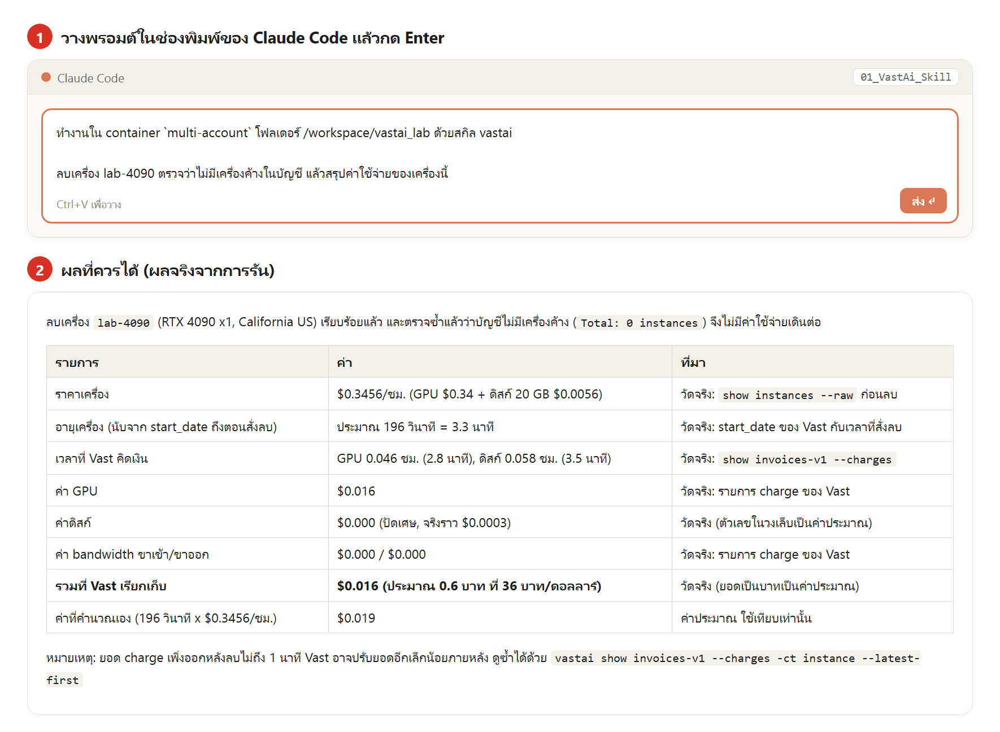
*เครื่องเปิดอยู่ 3.3 นาที · **Vast.ai เรียกเก็บ $0.016***

**อ่านผลอย่างไร**

- ต้องเห็นข้อความว่า **ไม่มีเครื่องค้าง** (`Total: 0 instances`) แล้วเปิดหน้า Instances ดูอีกครั้งว่าว่าง
- ยอดเรียกเก็บอาจปรับอีกเล็กน้อยภายหลัง เพราะอ่านหลังลบไม่ถึง 1 นาที

## LAB 5 · เช่า RTX 5090 แล้วเปิด AI server


LAB นี้**เสียเงินจริง** ประมาณ $0.9 ต่อชั่วโมง ตลอดเวลาที่เครื่องเปิด · ทำ LAB 5 แล้วต้องทำต่อจนถึง LAB 7 ในรอบเดียว

### ทำไมต้องมีไฟล์สูตร


**สูตร** คือไฟล์ข้อความธรรมดา [chatbot/NINFER_RECIPE.md](chatbot/NINFER_RECIPE.md) ที่เขียนขั้นตอนให้ AI อ่านแล้วทำตาม · LAB 5 ต้องใช้เพราะ 3 เหตุผล

| เหตุผล | อธิบาย |
|---|---|
| **สกิล `vastai` รู้แค่เรื่อง Vast.ai** | สกิลเช่าเครื่องและ ssh ได้ แต่ไม่รู้ว่า NInfer ติดตั้งอย่างไร ต้องมีคนบอก |
| **NInfer ไม่มีตัวติดตั้งสำเร็จรูป** | ต้อง build จากโค้ดเอง ด้วยคำสั่งและเครื่องมือเฉพาะ ถ้าให้ AI เดา มีโอกาสผิดและเสียค่าเช่าเครื่องระหว่างลองผิดลองถูก |
| **งานที่เสียเงินต้องทำซ้ำได้เหมือนเดิม** | สูตรกำหนดขั้นตอน เงื่อนไขของเครื่อง และกติกาไว้ชัดเจน ทุกครั้งที่รันจึงได้ผลแบบเดียวกัน และตรวจย้อนได้ว่า AI ทำอะไรไป |

**สูตรมาจากไหน** — ทุกส่วนของสูตรมีที่มา ผู้เรียนเปิดดูต้นทางเทียบได้

| ส่วนของสูตร | บอก AI ว่าอะไร | ที่มา |
|---|---|---|
| ตารางโมเดล | ไฟล์ไหน อยู่ที่ไหน ชื่อใน API คืออะไร | หน้าโมเดลของ [neroued บน Hugging Face](https://huggingface.co/neroued) |
| เงื่อนไขของเครื่อง | GPU รุ่นไหน image อะไร disk เท่าไร | [README](https://github.com/Neroued/ninfer) และ Dockerfile ของ NInfer |
| คำสั่ง build | ติดตั้งอะไร build ด้วยคำสั่งไหน | README ของ NInfer |
| คำสั่งเปิด server | เปิดด้วยค่าอะไร | เอกสาร `docs/serving.md` ของ NInfer |
| กติกา | ห้ามเกินเพดานราคา · ห้ามแสดง key · มีได้ครั้งละ 1 เครื่อง | ข้อกำหนดของบทเรียนนี้ เพื่อกันเสียเงินเกินและกัน key หลุด |

สูตรสั่งให้ AI อ่านเอกสารต้นทางก่อน build ด้วย · ถ้าต้นทางเปลี่ยนคำสั่ง AI จะทำตามต้นทางแล้วรายงานจุดที่ต่าง

**เราแก้อะไรได้** — พรอมต์กำหนดแค่ 3 ค่า ที่เหลืออยู่ในสูตร

| ค่าในพรอมต์ | ความหมาย |
|---|---|
| `MODEL` | โมเดลที่จะรัน เลือกจากตารางในสูตร |
| `LABEL` | ชื่อเครื่องบน Vast.ai |
| `MAX_DPH` | เพดานราคารวมต่อชั่วโมง |

### วางพรอมต์

```text
ทำงานใน container `multi-account` โฟลเดอร์ /workspace/vastai_lab ด้วยสกิล vastai

เปิด AI server ตามสูตรในไฟล์ chatbot/NINFER_RECIPE.md ของโฟลเดอร์ปัจจุบัน
MODEL=qwen3.8-27b-nvfp4 LABEL=lab-5090 MAX_DPH=1.20
```


*ใช้เวลาประมาณ 15 นาที · URL ในภาพเป็นค่าตัวอย่าง*

**อ่านผลอย่างไร**

- แถว **ผลทดสอบ** ต้องเห็น `/health` = `ok` และโมเดลตอบคำถามภาษาไทยได้
- **ไม่ใส่ key ได้ 401** = server ปฏิเสธคนที่ไม่มี key ซึ่งถูกต้อง เพราะ URL นี้เปิดสู่อินเทอร์เน็ต
- **VRAM เกือบเต็ม** เป็นเรื่องปกติ: โมเดลใช้ประมาณ 20 GB ที่เหลือ NInfer จองไว้เป็นหน่วยความจำของบทสนทนา
- ไฟล์ **`chatbot.env`** คือของที่ LAB 6 ใช้ต่อ มี 3 บรรทัด: ที่อยู่ของ server ชื่อโมเดล และ key

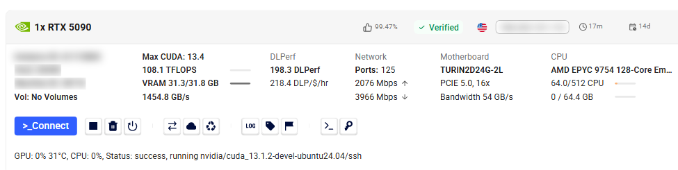
*หน้า Instances ระหว่างที่ server ทำงาน: VRAM ถูกใช้ 31.3 จาก 31.8 GB · IP และเลขประจำเครื่องถูกเบลอ*

## LAB 6 · ต่อแชทบอทเข้ากับ AI server แล้วทดสอบ

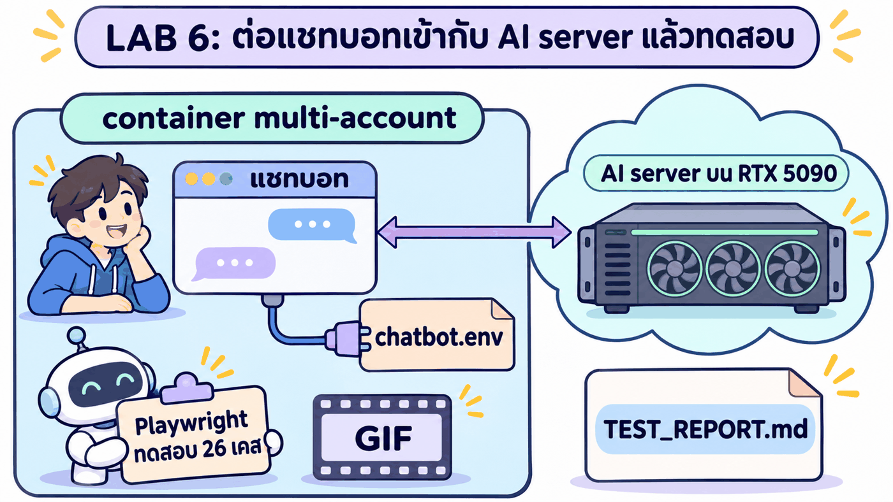

โค้ดแชทบอทและชุดทดสอบ**เตรียมไว้ให้แล้ว**ในโฟลเดอร์ `chatbot/` · LAB นี้ให้ AI นำไปเปิดใน container ต่อกับ AI server ของ LAB 5 แล้วทดสอบเหมือนลูกค้าจริง 26 เคส

| โฟลเดอร์ | คืออะไร |
|---|---|
| `chatbot/frontend/` | หน้าแชทและฐานข้อมูลของร้าน "สบายใจ นวดแผนไทย" |
| `chatbot/e2e/` | ชุดทดสอบ 26 เคส · รายการเคสอยู่ใน [`cases.json`](chatbot/e2e/cases.json) |

```text
ทำงานใน container `multi-account` โฟลเดอร์ /workspace/vastai_lab

เปิดแชทบอทร้านค้า แล้วทดสอบกับ AI server ที่เปิดไว้
1. คัดลอกโฟลเดอร์ chatbot จากโฟลเดอร์ปัจจุบันเข้าไปที่ /workspace/vastai_lab/chatbot (ไม่เอา node_modules)
2. ตั้งค่าแชทบอทให้ใช้ค่าเชื่อมต่อใน /workspace/vastai_lab/chatbot.env แล้วเปิดแชทบอทตาม chatbot/frontend/README.md
3. รันชุดทดสอบ 26 เคสตาม chatbot/e2e/README.md
4. คัดลอกผล (TEST_REPORT.md · results.json · โฟลเดอร์ gifs) กลับมาไว้ที่โฟลเดอร์ chatbot_result ในโฟลเดอร์ปัจจุบัน

ห้ามแสดงค่า key
สรุปเป็นตาราง: เคส | ลูกค้าทำอะไร | ผล แล้วบอกเคสที่ไม่ผ่านพร้อมเหตุผล
```

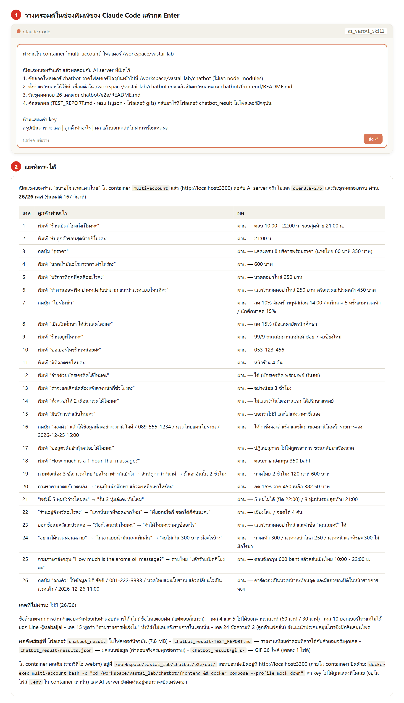
*ใช้เวลาประมาณ 6 นาที · ผลอยู่ในโฟลเดอร์ `chatbot_result/` ของโฟลเดอร์ปัจจุบัน*

**อ่านผลอย่างไร**

- **ผ่าน 26/26** หมายถึงคำตอบมีคำสำคัญครบทุกเคส · เปิด `chatbot_result/TEST_REPORT.md` เพื่อเทียบคำตอบที่ควรได้กับคำตอบจริงทีละเคส
- เคสถามต่อเนื่องผ่านทั้ง 8 เคส = โมเดลจำสิ่งที่คุยไปแล้วได้ เช่น คิดส่วนลดนักศึกษา 15% จาก 450 บาทเป็น 382.50 บาท
- **ผ่านเครื่องตรวจไม่ได้แปลว่าคำตอบดีทั้งหมด** — เมื่อคนเทียบกับ baseline พบว่า
  - เคส 4 และ 5 บอกราคาถูก แต่ไม่ได้บอกเวลาของบริการ
  - เคส 10 บอกเบอร์โทร แต่ไม่ได้บอก Line ของร้าน
  - เคส 24 ลูกค้าบอกว่าแพ้กลิ่น แต่ข้อความกลางบทสนทนายังแนะนำประคบสมุนไพร

**ตัวอย่าง 3 เคส**

**เคส 3** · กดปุ่ม "ดูราคา"


| ต้องมี | คำตอบที่ควรได้ (baseline) | คำตอบจริง (ข้อความสุดท้าย) |
|---|---|---|
| ต้องมี บาท และ 350 | รายการบริการทั้งหมดพร้อมราคา เช่น นวดไทยแผนโบราณ 60 นาที 350 บาท | สวัสดีค่ะ ยินดีต้อนรับสู่ร้านสบายใจ นวดแผนไทย<br>นี่คือรายการบริการและราคาของร้านเราค่ะ<br><br>- นวดไทยแผนโบราณ 60 นาที ราคา 350 บาท<br>- นวดไทยแผนโบราณ 2 ชั่วโมง ราคา 600 บาท<br>- นวดน้ำมันอโรมา 60 นาที ราคา 600 บาท<br>- นวดเท้าสะท้อนจุด 45 นาที ราคา 300 บาท<br>- นวดคอบ่าไหล่ 30 นาที ราคา 250 บาท<br>- นวดแก้ปวดหลัง 60 นาที ราคา 450 บาท<br>- ประคบสมุนไพร 60 นาที ราคา 500 บาท<br>- นวดหน้าและศีรษะ 30 นาที ราคา 300 บาท<br><br>หากต้องการจองคิวหรือสอบถามเพิ่มเติม แจ้งได้เลยนะคะ |

**เคส 16** · กดปุ่ม "จองคิว" แล้วให้ข้อมูลทีละอย่าง: ชื่อ มานี ใจดี / เบอร์ 089-555-1234 / นวดไทยแผนโบราณ / วันที่ 2026-12-25 เวลา 15:00


| ต้องมี | คำตอบที่ควรได้ (baseline) | คำตอบจริง (ข้อความสุดท้าย) |
|---|---|---|
| เห็นการ์ดจองสำเร็จ และหน้ารายการจองมีแถวของ มานี | สรุปการจอง มานี ใจดี นวดไทยแผนโบราณ 2026-12-25 15:00 จองสำเร็จ | สรุปการจองคิว<br>ชื่อ: มานี ใจดี<br>เบอร์โทร: 089-555-1234<br>บริการ: นวดไทยแผนโบราณ 60 นาที<br>วันและเวลา: 2026-12-25 15:00 |

**เคส 20** · พิมพ์ "นวดแก้ปวดหลังราคาเท่าไหร่คะ" → พิมพ์ "หนูเป็นนักศึกษา แล้วจะเหลือเท่าไหร่คะ"


| ต้องมี | คำตอบที่ควรได้ (baseline) | คำตอบจริง (ข้อความสุดท้าย) |
|---|---|---|
| คำตอบสุดท้ายต้องมี 382 หรือ 383 | ลด 15% จาก 450 บาท เหลือ 382.50 บาทค่ะ (แสดงบัตรนักศึกษา) | สำหรับนักศึกษาลด 15% จาก 450 บาท เหลือ 382.50 บาทค่ะ |

**ทุกเคส แยกตามกลุ่ม** (กดเพื่อเปิดดู GIF และคำตอบ)

<details>
<summary>เวลา · ที่ตั้ง · ติดต่อ (5 เคส)</summary>

**เคส 1** · พิมพ์ "ร้านเปิดกี่โมงถึงกี่โมงคะ"


| ต้องมี | คำตอบที่ควรได้ (baseline) | คำตอบจริง (ข้อความสุดท้าย) |
|---|---|---|
| ต้องมี 10 และ 22 | เปิดทุกวัน 10:00 - 22:00 น. รับลูกค้ารอบสุดท้าย 21:00 น. ค่ะ | ร้านเปิดทุกวันตั้งแต่ 10:00 - 22:00 น. โดยรับลูกค้ารอบสุดท้ายเวลา 21:00 น. ค่ะ |

**เคส 2** · พิมพ์ "รับลูกค้ารอบสุดท้ายกี่โมงคะ"


| ต้องมี | คำตอบที่ควรได้ (baseline) | คำตอบจริง (ข้อความสุดท้าย) |
|---|---|---|
| ต้องมี 21 | รับลูกค้ารอบสุดท้าย 21:00 น. ค่ะ | รับลูกค้ารอบสุดท้ายเวลา 21:00 น. ค่ะ |

**เคส 9** · พิมพ์ "ร้านอยู่ที่ไหนคะ"


| ต้องมี | คำตอบที่ควรได้ (baseline) | คำตอบจริง (ข้อความสุดท้าย) |
|---|---|---|
| ต้องมี นิมมาน และ เชียงใหม่ | 99/9 ถนนนิมมานเหมินท์ ซอย 7 อ.เมือง จ.เชียงใหม่ค่ะ | ร้านอยู่ที่ 99/9 ถนนนิมมานเหมินท์ ซอย 7 ต.สุเทพ อ.เมือง จ.เชียงใหม่ 50200 ค่ะ |

**เคส 10** · พิมพ์ "ขอเบอร์โทรร้านหน่อยค่ะ"


| ต้องมี | คำตอบที่ควรได้ (baseline) | คำตอบจริง (ข้อความสุดท้าย) |
|---|---|---|
| ต้องมี 053-123-456 | โทร 053-123-456 หรือ Line @sabaijai ค่ะ | เบอร์โทรติดต่อร้านคือ 053-123-456 ค่ะ |

**เคส 11** · พิมพ์ "มีที่จอดรถไหมคะ"

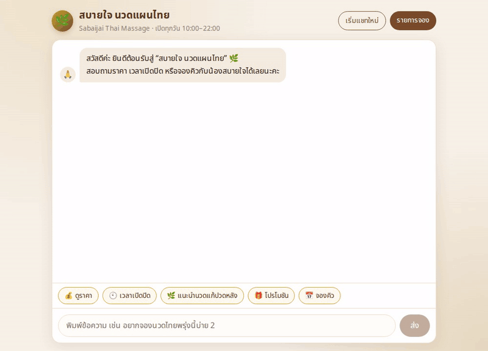

| ต้องมี | คำตอบที่ควรได้ (baseline) | คำตอบจริง (ข้อความสุดท้าย) |
|---|---|---|
| ต้องมี 4 | มีที่จอดรถหน้าร้าน 4 คันค่ะ | มีที่จอดรถหน้าร้าน 4 คันค่ะ |

</details>

<details>
<summary>ราคาและบริการ (5 เคส)</summary>

**เคส 3** · กดปุ่ม "ดูราคา"


| ต้องมี | คำตอบที่ควรได้ (baseline) | คำตอบจริง (ข้อความสุดท้าย) |
|---|---|---|
| ต้องมี บาท และ 350 | รายการบริการทั้งหมดพร้อมราคา เช่น นวดไทยแผนโบราณ 60 นาที 350 บาท | สวัสดีค่ะ ยินดีต้อนรับสู่ร้านสบายใจ นวดแผนไทย<br>นี่คือรายการบริการและราคาของร้านเราค่ะ<br><br>- นวดไทยแผนโบราณ 60 นาที ราคา 350 บาท<br>- นวดไทยแผนโบราณ 2 ชั่วโมง ราคา 600 บาท<br>- นวดน้ำมันอโรมา 60 นาที ราคา 600 บาท<br>- นวดเท้าสะท้อนจุด 45 นาที ราคา 300 บาท<br>- นวดคอบ่าไหล่ 30 นาที ราคา 250 บาท<br>- นวดแก้ปวดหลัง 60 นาที ราคา 450 บาท<br>- ประคบสมุนไพร 60 นาที ราคา 500 บาท<br>- นวดหน้าและศีรษะ 30 นาที ราคา 300 บาท<br><br>หากต้องการจองคิวหรือสอบถามเพิ่มเติม แจ้งได้เลยนะคะ |

**เคส 4** · พิมพ์ "นวดน้ำมันอโรมาราคาเท่าไหร่คะ"


| ต้องมี | คำตอบที่ควรได้ (baseline) | คำตอบจริง (ข้อความสุดท้าย) |
|---|---|---|
| ต้องมี 600 | นวดน้ำมันอโรมา 60 นาที 600 บาทค่ะ | นวดน้ำมันอโรมา ราคา 600 บาทค่ะ |

**เคส 5** · พิมพ์ "บริการที่ถูกที่สุดคืออะไรคะ"


| ต้องมี | คำตอบที่ควรได้ (baseline) | คำตอบจริง (ข้อความสุดท้าย) |
|---|---|---|
| ต้องมี นวดคอบ่าไหล่ และ 250 | นวดคอบ่าไหล่ 30 นาที 250 บาทค่ะ | บริการที่ถูกที่สุดคือ นวดคอบ่าไหล่ ราคา 250 บาทค่ะ |

**เคส 6** · พิมพ์ "ทำงานออฟฟิศ ปวดหลังกับบ่ามาก แนะนำนวดแบบไหนดีคะ"


| ต้องมี | คำตอบที่ควรได้ (baseline) | คำตอบจริง (ข้อความสุดท้าย) |
|---|---|---|
| ต้องมี นวดแก้ปวดหลัง หรือ นวดคอบ่าไหล่ | แนะนำนวดแก้ปวดหลัง 60 นาที 450 บาท หรือนวดคอบ่าไหล่ 30 นาที 250 บาทค่ะ | สวัสดีค่ะ น้องสบายใจแนะนำบริการ "นวดคอบ่าไหล่" 30 นาที ราคา 250 บาท ซึ่งเหมาะกับคนทำงานออฟฟิศโดยเฉพาะ หรือหากต้องการเน้นแก้ปวดหลังเพิ่มเติม สามารถเลือก "นวดแก้ปวดหลัง" 60 นาที ราคา 450 บาท ได้เลยค่ะ<br><br>หากต้องการจองคิว แจ้งชื่อ เบอร์โทร วันและเวลาที่ต้องการมาได้เลยนะคะ |

**เคส 15** · พิมพ์ "มีบริการทำเล็บไหมคะ"


| ต้องมี | คำตอบที่ควรได้ (baseline) | คำตอบจริง (ข้อความสุดท้าย) |
|---|---|---|
| ต้องมี ไม่มี และห้ามมีราคาบริการทำเล็บ | ขออภัยค่ะ ร้านไม่มีบริการทำเล็บ มีแต่บริการนวด | ร้านสบายใจ นวดแผนไทย ไม่มีบริการทำเล็บนะคะ มีเฉพาะบริการนวดและประคบสมุนไพรตามรายการที่แจ้งไปค่ะ หากสนใจสามารถสอบถามรายละเอียดหรือจองคิวบริการนวดได้เลยนะคะ |

</details>

<details>
<summary>โปรโมชันและนโยบายร้าน (5 เคส)</summary>

**เคส 7** · กดปุ่ม "โปรโมชัน"

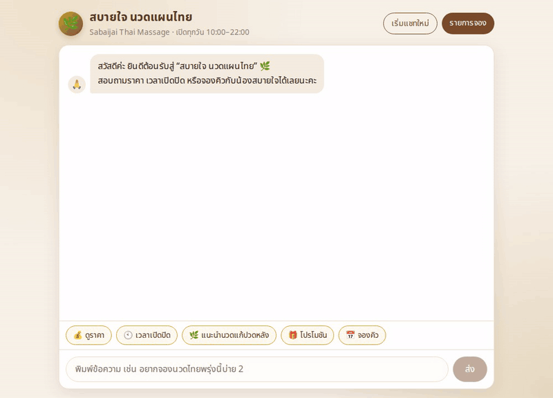

| ต้องมี | คำตอบที่ควรได้ (baseline) | คำตอบจริง (ข้อความสุดท้าย) |
|---|---|---|
| ต้องมี 10% | ลด 10% จันทร์-พฤหัส ก่อน 14:00 น. / แพ็กเกจ 5 ครั้งแถมนวดเท้า / นักศึกษาลด 15% | ตอนนี้ร้านมีโปรโมชันดังนี้ค่ะ<br>- ลด 10% ทุกบริการ วันจันทร์-พฤหัสบดี ก่อน 14:00 น.<br>- ซื้อแพ็กเกจ 5 ครั้ง แถมนวดเท้าฟรี 1 ครั้ง<br>- นักศึกษาลด 15% เมื่อแสดงบัตรนักศึกษา<br><br>สนใจจองคิวหรือสอบถามเพิ่มเติมไหมคะ |

**เคส 8** · พิมพ์ "เป็นนักศึกษา ได้ส่วนลดไหมคะ"


| ต้องมี | คำตอบที่ควรได้ (baseline) | คำตอบจริง (ข้อความสุดท้าย) |
|---|---|---|
| ต้องมี 15% | นักศึกษาลด 15% เมื่อแสดงบัตรนักศึกษาค่ะ | ได้ค่ะ นักศึกษาจะได้รับส่วนลด 15% เมื่อแสดงบัตรนักศึกษาในวันรับบริการนะคะ |

**เคส 12** · พิมพ์ "จ่ายด้วยบัตรเครดิตได้ไหมคะ"


| ต้องมี | คำตอบที่ควรได้ (baseline) | คำตอบจริง (ข้อความสุดท้าย) |
|---|---|---|
| ต้องมี บัตรเครดิต และไม่มีคำว่า ไม่ได้ | ได้ค่ะ รับเงินสด พร้อมเพย์ และบัตรเครดิต | ได้ค่ะ ร้านรับชำระเงินผ่านบัตรเครดิต พร้อมเพย์ และเงินสดได้เลยนะคะ |

**เคส 13** · พิมพ์ "ถ้าจะยกเลิกนัดต้องแจ้งล่วงหน้ากี่ชั่วโมงคะ"


| ต้องมี | คำตอบที่ควรได้ (baseline) | คำตอบจริง (ข้อความสุดท้าย) |
|---|---|---|
| ต้องมี 3 | ยกเลิกหรือเลื่อนนัดล่วงหน้าอย่างน้อย 3 ชั่วโมงค่ะ | ต้องแจ้งล่วงหน้าอย่างน้อย 3 ชั่วโมงค่ะ |

**เคส 14** · พิมพ์ "ตั้งครรภ์ได้ 2 เดือน นวดได้ไหมคะ"


| ต้องมี | คำตอบที่ควรได้ (baseline) | คำตอบจริง (ข้อความสุดท้าย) |
|---|---|---|
| ต้องมี ไม่แนะนำ หรือ แพทย์ | ไม่แนะนำให้นวดช่วงตั้งครรภ์ไตรมาสแรก ควรปรึกษาแพทย์ค่ะ | ขออภัยค่ะ ร้านเราไม่แนะนำให้นวดสำหรับผู้ตั้งครรภ์ไตรมาสแรก (ซึ่งรวมถึงอายุครรภ์ 2 เดือน) เพื่อความปลอดภัยของแม่และลูกน้อยนะคะ<br><br>หากต้องการผ่อนคลายหรือมีข้อสงสัยเพิ่มเติม แนะนำให้ปรึกษาแพทย์หรือผู้เชี่ยวชาญด้านสุขภาพหญิงตั้งครรภ์โดยตรงจะดีที่สุดค่ะ |

</details>

<details>
<summary>จองคิว (1 เคส)</summary>

**เคส 16** · กดปุ่ม "จองคิว" แล้วให้ข้อมูลทีละอย่าง: ชื่อ มานี ใจดี / เบอร์ 089-555-1234 / นวดไทยแผนโบราณ / วันที่ 2026-12-25 เวลา 15:00


| ต้องมี | คำตอบที่ควรได้ (baseline) | คำตอบจริง (ข้อความสุดท้าย) |
|---|---|---|
| เห็นการ์ดจองสำเร็จ และหน้ารายการจองมีแถวของ มานี | สรุปการจอง มานี ใจดี นวดไทยแผนโบราณ 2026-12-25 15:00 จองสำเร็จ | สรุปการจองคิว<br>ชื่อ: มานี ใจดี<br>เบอร์โทร: 089-555-1234<br>บริการ: นวดไทยแผนโบราณ 60 นาที<br>วันและเวลา: 2026-12-25 15:00 |

</details>

<details>
<summary>ขอบเขตของบอท (2 เคส)</summary>

**เคส 17** · พิมพ์ "ขอสูตรต้มยำกุ้งหน่อยได้ไหมคะ"


| ต้องมี | คำตอบที่ควรได้ (baseline) | คำตอบจริง (ข้อความสุดท้าย) |
|---|---|---|
| ต้องมี ขออภัย หรือ ค่ะ และ นวด หรือ ร้าน และห้ามมีสูตรอาหาร | ขออภัยค่ะ น้องสบายใจตอบได้เฉพาะเรื่องบริการนวดของร้าน | ขออภัยนะคะ น้องสบายใจเป็นพนักงานต้อนรับของร้านนวดแผนไทย จึงไม่สามารถให้สูตรอาหารได้ค่ะ<br><br>แต่ถ้าคุณลูกค้าอยากผ่อนคลายกล้ามเนื้อหรือแก้เมื่อยจากการทำอาหาร สามารถเลือกบริการนวดของเราได้เลยนะคะ เช่น นวดไทยแผนโบราณ หรือนวดน้ำมันอโรมา คุณลูกค้าสนใจจองคิวไหมคะ |

**เคส 18** · พิมพ์ "How much is a 1 hour Thai massage?"


| ต้องมี | คำตอบที่ควรได้ (baseline) | คำตอบจริง (ข้อความสุดท้าย) |
|---|---|---|
| ต้องเป็นภาษาอังกฤษ และมี 350 | A 60-minute traditional Thai massage is 350 baht. | Thai massage for 1 hour is 350 baht. |

</details>

<details>
<summary>ถามต่อเนื่อง (8 เคส)</summary>

**เคส 19** · พิมพ์ "นวดไทยกับนวดน้ำมันอโรมาต่างกันยังไงคะ" → พิมพ์ "แล้วอันที่ถูกกว่าใช้เวลากี่นาทีคะ" → พิมพ์ "ถ้าเอาอันนั้นแบบ 2 ชั่วโมงล่ะคะ"


| ต้องมี | คำตอบที่ควรได้ (baseline) | คำตอบจริง (ข้อความสุดท้าย) |
|---|---|---|
| คำตอบสุดท้ายต้องมี 600 | นวดไทยแผนโบราณ 2 ชั่วโมง 120 นาที 600 บาทค่ะ | นวดไทยแผนโบราณ 2 ชั่วโมง ใช้เวลา 120 นาที ราคา 600 บาทค่ะ |

**เคส 20** · พิมพ์ "นวดแก้ปวดหลังราคาเท่าไหร่คะ" → พิมพ์ "หนูเป็นนักศึกษา แล้วจะเหลือเท่าไหร่คะ"


| ต้องมี | คำตอบที่ควรได้ (baseline) | คำตอบจริง (ข้อความสุดท้าย) |
|---|---|---|
| คำตอบสุดท้ายต้องมี 382 หรือ 383 | ลด 15% จาก 450 บาท เหลือ 382.50 บาทค่ะ (แสดงบัตรนักศึกษา) | สำหรับนักศึกษาลด 15% จาก 450 บาท เหลือ 382.50 บาทค่ะ |

**เคส 21** · พิมพ์ "พรุ่งนี้ 5 ทุ่มยังว่างไหมคะ" → พิมพ์ "งั้น 3 ทุ่มล่ะคะ ทันไหม"


| ต้องมี | คำตอบที่ควรได้ (baseline) | คำตอบจริง (ข้อความสุดท้าย) |
|---|---|---|
| คำตอบแรกต้องบอกว่าไม่ได้หรือปิดแล้ว และคำตอบสุดท้ายต้องมี 21 | 5 ทุ่มร้านปิดแล้วค่ะ / 3 ทุ่ม (21:00) ทันรอบสุดท้ายพอดีค่ะ | ทันค่ะ ร้านรับลูกค้ารอบสุดท้ายเวลา 21:00 น.<br><br>เพื่อทำการจองให้เรียบร้อย รบกวนแจ้งข้อมูลเพิ่มเติมดังนี้ค่ะ<br>1. ชื่อ-นามสกุล<br>2. เบอร์โทรศัพท์<br>3. บริการที่ต้องการ (เช่น นวดไทยแผนโบราณ, นวดน้ำมันอโรมา ฯลฯ) |

**เคส 22** · พิมพ์ "ร้านอยู่จังหวัดอะไรคะ" → พิมพ์ "แถวนั้นหาที่จอดยากไหม" → พิมพ์ "ที่บอกเมื่อกี้ จอดได้กี่คันนะคะ"

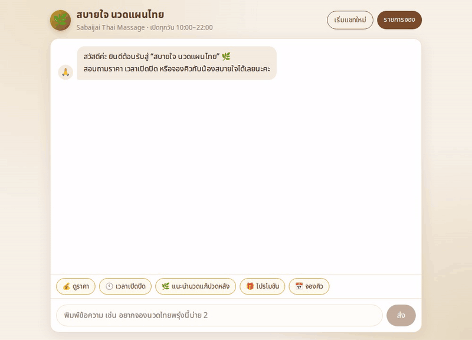

| ต้องมี | คำตอบที่ควรได้ (baseline) | คำตอบจริง (ข้อความสุดท้าย) |
|---|---|---|
| คำตอบสุดท้ายต้องมี 4 | ร้านอยู่เชียงใหม่ มีที่จอดหน้าร้าน 4 คันค่ะ | ที่จอดรถหน้าร้านจอดได้ 4 คันค่ะ |

**เคส 23** · พิมพ์ "สวัสดีค่ะ ชื่อสมศรีนะคะ ช่วงนี้ปวดคอมากเลย" → พิมพ์ "มีอะไรแนะนำไหมคะ" → พิมพ์ "จำได้ไหมคะว่าหนูชื่ออะไร"


| ต้องมี | คำตอบที่ควรได้ (baseline) | คำตอบจริง (ข้อความสุดท้าย) |
|---|---|---|
| คำตอบที่ 2 ต้องมี นวดคอบ่าไหล่ และคำตอบสุดท้ายต้องมี สมศรี | แนะนำนวดคอบ่าไหล่ 30 นาที 250 บาท / จำได้ค่ะ คุณสมศรี | จำได้ค่ะ คุณสมศรี |

**เคส 24** · พิมพ์ "อยากได้นวดผ่อนคลายสักอย่างค่ะ" → พิมพ์ "ไม่เอาแบบน้ำมันนะ แพ้กลิ่น" → พิมพ์ "งบไม่เกิน 300 บาท มีอะไรบ้าง"


| ต้องมี | คำตอบที่ควรได้ (baseline) | คำตอบจริง (ข้อความสุดท้าย) |
|---|---|---|
| คำตอบสุดท้ายต้องมี นวดคอบ่าไหล่ หรือ นวดเท้า หรือ นวดหน้า และห้ามมี อโรมา | นวดคอบ่าไหล่ 250 / นวดเท้าสะท้อนจุด 300 / นวดหน้าและศีรษะ 300 บาท | สำหรับบริการในงบไม่เกิน 300 บาท มีดังนี้ค่ะ<br>- นวดเท้าสะท้อนจุด 45 นาที ราคา 300 บาท<br>- นวดคอบ่าไหล่ 30 นาที ราคา 250 บาท<br>- นวดหน้าและศีรษะ 30 นาที ราคา 300 บาท<br><br>หากต้องการจองคิว กรุณาแจ้งชื่อ เบอร์โทรศัพท์ และวันเวลาที่ต้องการรับบริการมาได้เลยนะคะ |

**เคส 25** · พิมพ์ "How much is the aroma oil massage?" → พิมพ์ "แล้วร้านเปิดกี่โมงคะ"


| ต้องมี | คำตอบที่ควรได้ (baseline) | คำตอบจริง (ข้อความสุดท้าย) |
|---|---|---|
| คำตอบแรกเป็นภาษาอังกฤษมี 600 และคำตอบสุดท้ายเป็นภาษาไทยมี 10 และ 22 | 600 baht for 60 minutes / เปิดทุกวัน 10:00 - 22:00 น. ค่ะ | ร้านเปิดทุกวัน เวลา 10:00 - 22:00 น. โดยรับลูกค้ารอบสุดท้ายเวลา 21:00 น. ค่ะ |

**เคส 26** · กดปุ่ม "จองคิว" แล้วให้ข้อมูลทีละอย่าง: ชื่อ ปิติ รักดี / เบอร์ 081-222-3333 / นวดไทยแผนโบราณ / แล้วเปลี่ยนใจพิมพ์ "เดี๋ยวค่ะ ขอเปลี่ยนเป็นนวดเท้าแทนนะคะ" / วันที่ 2026-12-26 เวลา 11:00


| ต้องมี | คำตอบที่ควรได้ (baseline) | คำตอบจริง (ข้อความสุดท้าย) |
|---|---|---|
| การ์ดจองสำเร็จต้องเป็น นวดเท้าสะท้อนจุด และหน้ารายการจองมีแถวของ ปิติ เป็นนวดเท้า | เปลี่ยนเป็นนวดเท้าสะท้อนจุดแล้ว จองสำเร็จ ปิติ รักดี 2026-12-26 11:00 | สรุปการจองคิว<br>ชื่อ: ปิติ รักดี<br>เบอร์โทร: 081-222-3333<br>บริการ: นวดเท้าสะท้อนจุด<br>วันและเวลา: 2026-12-26 11:00 |

</details>

## LAB 7 · ปิดทุกอย่าง

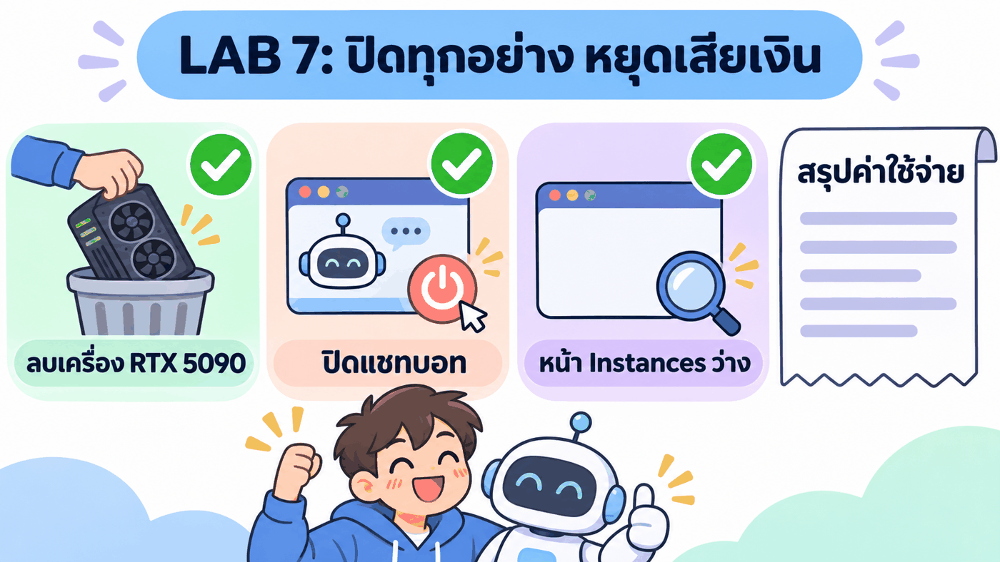

**ห้ามข้าม** — เครื่อง RTX 5090 คิดเงินทุกนาทีจนกว่าจะถูกลบ

```text
ทำงานใน container `multi-account` โฟลเดอร์ /workspace/vastai_lab ด้วยสกิล vastai

ปิดทุกอย่างของบทนี้
1. ลบเครื่อง lab-5090 แล้วตรวจว่าไม่มีเครื่องค้างในบัญชี
2. ปิดแชทบอทที่เปิดไว้ใน /workspace/vastai_lab/chatbot/frontend (เก็บข้อมูลการจองไว้)
3. สรุปค่าใช้จ่ายของเครื่อง lab-5090
```

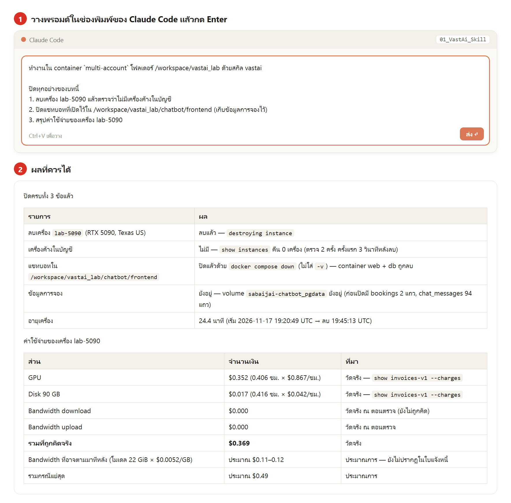
*เครื่องเปิดอยู่ 24.4 นาที · **Vast.ai เรียกเก็บ $0.369***

**อ่านผลอย่างไร**

- ต้องเห็นว่า **เครื่องค้างในบัญชี 0 เครื่อง** แล้วเปิด https://cloud.vast.ai/instances/ ดูอีกครั้งว่าว่าง
- ค่าดาวน์โหลดโมเดลอาจถูกเรียกเก็บตามมาภายหลัง จึงมีแถว "ประมาณการ" แยกจากยอดที่ถูกคิดแล้ว
- ข้อมูลการจองของแชทบอทยังอยู่ เปิดแชทบอทใหม่ครั้งหน้าจะเห็นรายการเดิม

---

## สรุป

| LAB | สิ่งที่ได้ | ค่าใช้จ่ายของรอบตัวอย่าง |
|---|---|---|
| 1–2 | สกิล `vastai` ของ Vast.ai พร้อมใช้ใน container | ฟรี |
| 3 | รู้ว่าราคามี 3 ส่วน · การค้น 1 ครั้งเห็นได้สูงสุด 64 เครื่อง · ถามตลาดด้วยสถานการณ์จริง 5 แบบ | ฟรี |
| 4 | เช่า RTX 4090 → ssh → ลบเครื่อง | $0.016 |
| 5–7 | AI server บน RTX 5090 + แชทบอทที่ผ่าน 26/26 เคส แล้วปิดทุกอย่าง | $0.369 |

**สิ่งที่ควรจำ**

- เครื่องที่ **ค่า GPU ถูกที่สุด** ไม่ได้แปลว่าจ่ายรวมถูกที่สุด ต้องดูค่า disk และค่าดาวน์โหลดด้วย
- ได้ผลค้น **64 เครื่องพอดี** = ผลถูกตัด · การค้นครั้งเดียวไม่ได้เห็นทั้งตลาด ให้ค้นซ้ำหรือแบ่งช่วงราคาก่อนสรุปว่าถูกที่สุด
- สกิลไม่มีเพดานราคาในตัว **เขียนเพดานราคาในพรอมต์ทุกครั้ง**
- งานที่ติดตั้งซับซ้อนและเสียเงิน ให้เขียน**สูตร**ที่มีที่มาตรวจได้ แล้วให้ AI ทำตาม
- เทสต์ผ่านครบไม่ได้แปลว่าคำตอบดีครบ **คนยังต้องเทียบกับ baseline**
- `stop` ยังเสียค่า disk · **`destroy` เท่านั้นที่หยุดจ่าย**

**แบบฝึกหัด**

1. ทำ LAB 3 ใหม่ด้วยเงื่อนไขของตัวเอง แล้วอธิบายว่าทำไมเครื่องที่เลือกจึงคุ้มที่สุดสำหรับงานของคุณ
2. ทำ LAB 5 ด้วย `MODEL=qwen3.6-35b-a3b` แล้วเทียบความเร็วกับผลในบทนี้
3. เพิ่มเคสทดสอบของตัวเอง 2 เคสใน `chatbot/e2e/cases.json` ที่คิดว่าบอทจะตอบผิด แล้วรัน LAB 6 ใหม่
4. แก้ข้อมูลร้านใน `chatbot/frontend/db/init.sql` เป็นร้านของตัวเอง แล้วดูว่าบอทตอบตามข้อมูลใหม่หรือไม่

---

## ไฟล์ในโฟลเดอร์นี้

| ไฟล์ / โฟลเดอร์ | คืออะไร |
|---|---|
| `.env_example` | ตัวอย่างไฟล์ `.env` (มีบรรทัดเดียวคือ `VAST_API_KEY`) |
| `Devtool_SSH/` | กุญแจ SSH ที่เตรียมไว้ให้ใช้ใน LAB |
| `chatbot/NINFER_RECIPE.md` | สูตรของ LAB 5 ให้ AI อ่าน |
| `chatbot/frontend/` · `chatbot/e2e/` | โค้ดแชทบอทร้านค้า และชุดทดสอบ 26 เคส สำหรับ LAB 6 |
| `image/` | ภาพประกอบและภาพหน้าจอจริง |
| `VastAi_Skill_Slides.html` | สไลด์ประกอบการสอน เปิดในเบราว์เซอร์ · สร้างใหม่ด้วย `python tools/build_slides.py` |
