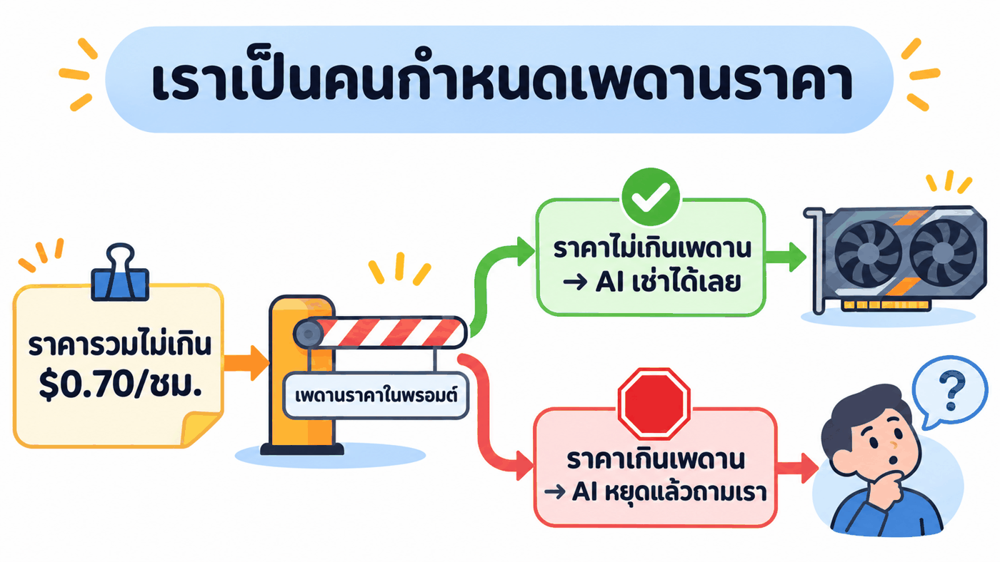
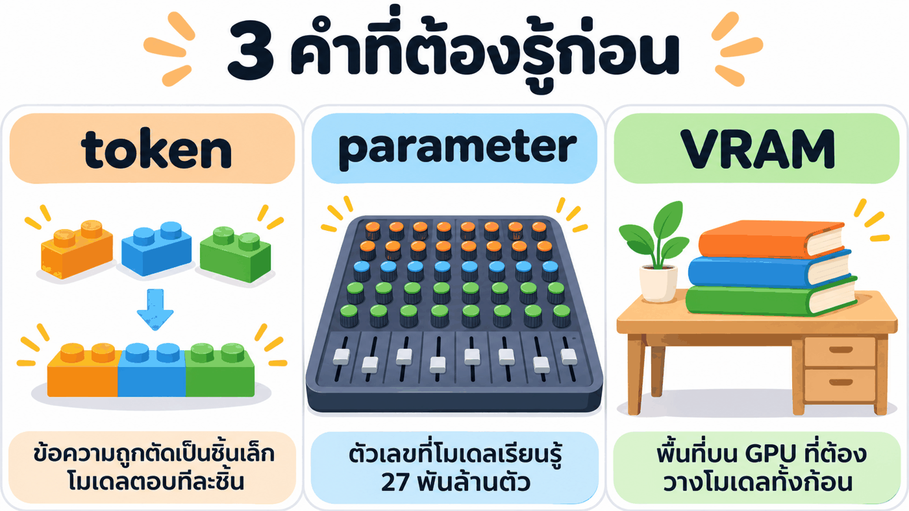
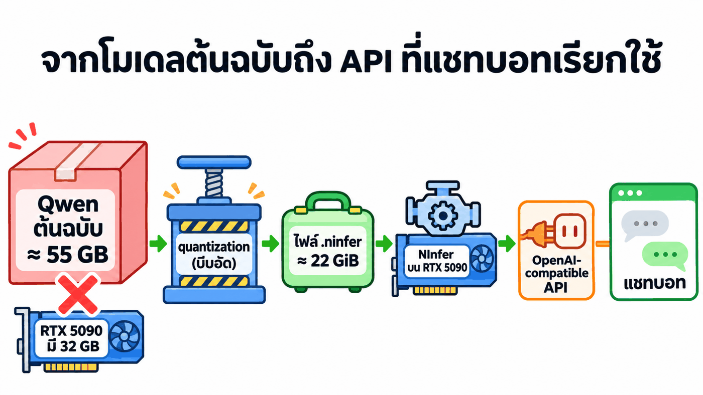
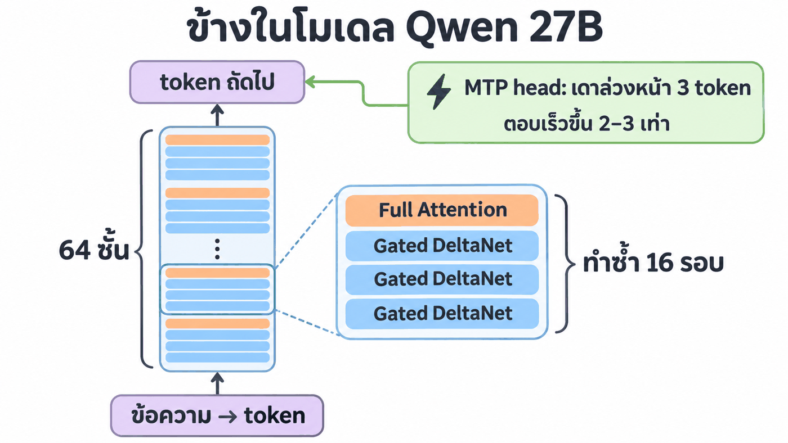
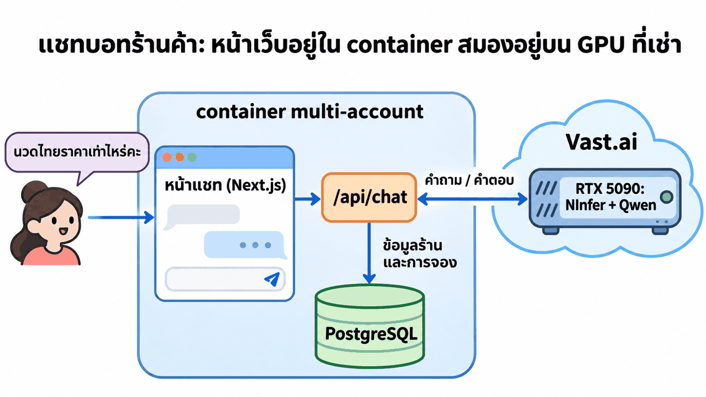
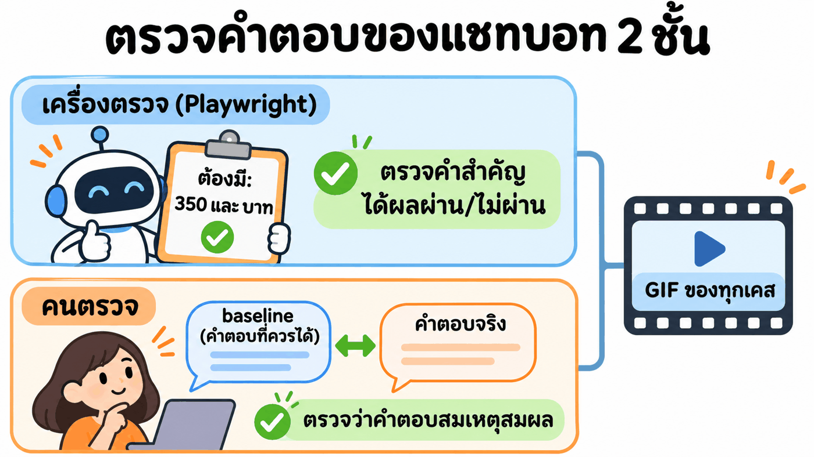
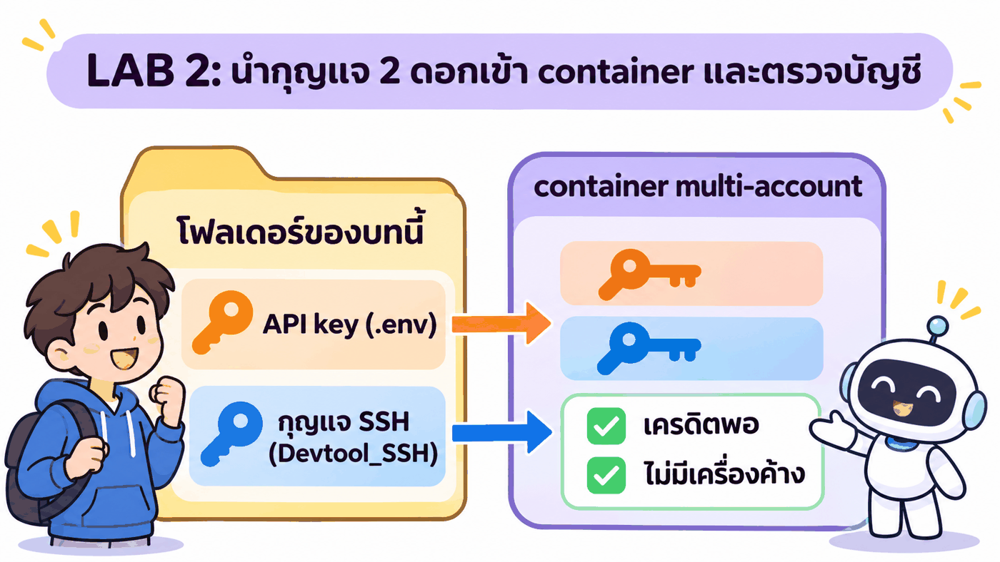
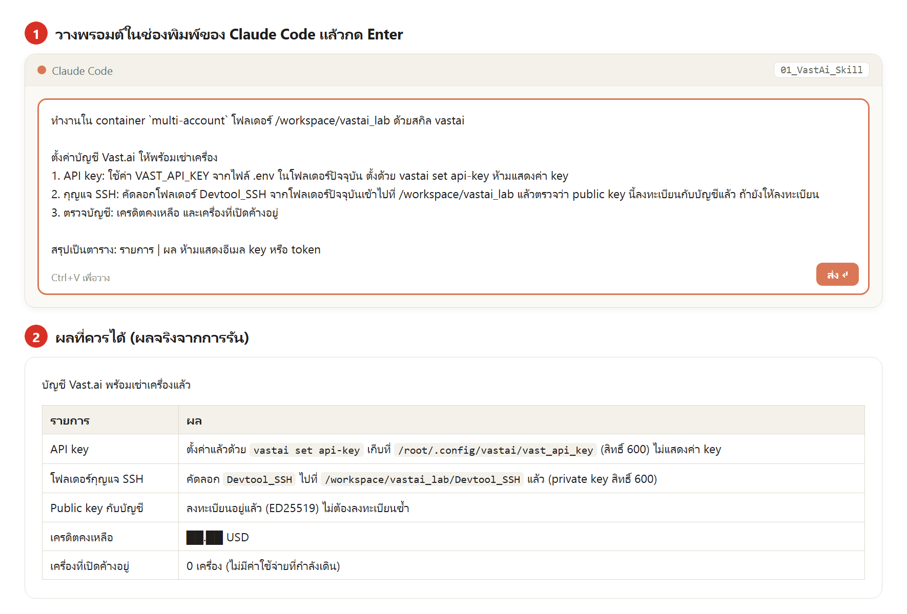
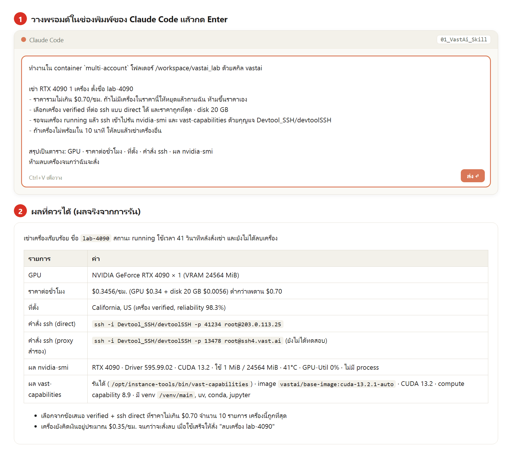
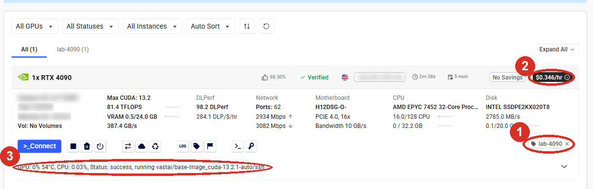

# เช่า GPU บน Vast.ai ด้วยสกิล `vastai` ของ Vast.ai


บทนี้ให้ Claude Code **เช่า GPU จริงบน Vast.ai แทนเรา** โดยสั่งเป็นภาษาไทย แล้วใช้ GPU นั้นรันโมเดลภาษาให้แชทบอทของร้านค้า

สกิลที่ใช้คือสกิล **`vastai` ที่ Vast.ai ทำเอง** ติดตั้งตามคู่มือ [Using Vast.ai with Agents](https://docs.vast.ai/guides/get-started/agents) · ทุกขั้นทำด้วยพรอมต์ Copy & Paste ใน **Claude Code** และงานทั้งหมดเกิดใน container `multi-account` ตัวเดียวกับบทก่อน

| LAB | ทำอะไร | ค่าใช้จ่าย |
|---|---|---|
| [LAB 0](#lab-0--เตรียมบัญชี-vastai-และกุญแจ-2-ดอก) | เตรียมบัญชี Vast.ai · API key · กุญแจ SSH | เติมเครดิต $5–10 |
| [LAB 1](#lab-1--ติดตั้งสกิล-vastai-ใน-container) | ติดตั้งสกิล `vastai` ใน container | ฟรี |
| [LAB 2](#lab-2--ตั้งค่าบัญชีให้พร้อมเช่า) | ตั้งค่าบัญชีให้พร้อมเช่า | ฟรี |
| [LAB 3](#lab-3--หาเครื่องและเปรียบเทียบราคา) | หาเครื่องและเปรียบเทียบราคา | ฟรี |
| [LAB 4](#lab-4--เช่า-rtx-4090--ssh--ลบเครื่อง) | เช่า RTX 4090 → ssh → ลบเครื่อง | ≈ $0.02 |
| [LAB 5](#lab-5--เช่า-rtx-5090-แล้วเปิด-ai-server) | เช่า RTX 5090 แล้วเปิด AI server (NInfer + Qwen) | ≈ $0.9 ต่อชั่วโมง |
| LAB 6 | ต่อแชทบอทร้านค้าเข้ากับ AI server แล้วทดสอบ 26 เคส | (เครื่องเดิม) |
| LAB 7 | ปิดทุกอย่าง | หยุดเสียเงิน |

**ต้องมีก่อน**
- container `multi-account` **รันอยู่** และล็อกอิน `yolo1` แล้ว — ทำไว้ใน [บท 03](../../01_week02/03_MultiAccount_Container/README.md) และ [บท 04](../../01_week02/04_MultiAccount_Skill/README.md) ของสัปดาห์ก่อน
- Claude Code เปิดที่โฟลเดอร์ของบทนี้ (`03_week03/01_VastAi_Skill`) · "โฟลเดอร์ปัจจุบัน" ในทุกพรอมต์หมายถึงโฟลเดอร์นี้

> ⚠️ **เสียเงินจริง** — ทดลองเสร็จทุกครั้งต้องสั่ง **ลบเครื่อง (destroy)** แล้วดูหน้า [Instances](https://cloud.vast.ai/instances/) ว่าว่าง

---

# ภาคทฤษฎี

## 1 · สกิล `vastai` ของ Vast.ai


Vast.ai คือตลาดเช่า GPU รายชั่วโมง · Vast.ai ทำ **สกิล** ให้ AI ใช้บัญชีของเราได้ คือ ค้นหาเครื่อง เช่า ต่อ ssh ดูบิล และลบเครื่อง

สกิลนี้ต้องมี 3 ชิ้นจึงทำงานได้

| ชิ้น | คืออะไร | ติดตั้งด้วย |
|---|---|---|
| **สกิล `vastai`** | คู่มือที่บอก AI ว่าคำสั่งไหนใช้ทำอะไร (ไฟล์ `SKILL.md`) | `npx skills add vast-ai/vast-cli --skill vastai` |
| **คำสั่ง `vastai`** (CLI) | โปรแกรมที่คุยกับ Vast.ai จริง · สกิลเรียกโปรแกรมนี้อยู่เบื้องหลัง | `curl -fsSL https://vast.ai/install.sh \| bash` |
| **API key** | รหัสยืนยันว่าคำสั่งมาจากบัญชีของเรา | `vastai set api-key` |

ทั้ง 3 ชิ้นติดตั้ง**ใน container** ไม่ได้ติดตั้งบนเครื่อง Windows ของเรา · เราเป็นคนสั่ง Claude Code ให้เข้าไปทำ

## 2 · กุญแจ 2 ดอก


| กุญแจ | ใช้ทำอะไร | เก็บที่ไหน |
|---|---|---|
| 🟠 **API key** | สั่งงานบัญชี: เช่า · ลบเครื่อง · ดูบิล (ตัดเงินจากเครดิต) | ไฟล์ `.env` ในโฟลเดอร์ปัจจุบัน |
| 🔵 **กุญแจ SSH** | เข้าไปใช้งาน**เครื่องที่เช่า** | โฟลเดอร์ `Devtool_SSH/` ในโฟลเดอร์ปัจจุบัน |

กุญแจ SSH มี 2 ไฟล์เสมอ

| ไฟล์ | ชื่อเรียก | ทำอะไรกับมัน |
|---|---|---|
| `devtoolSSH.pub` | public key | เอาไป**ใส่ในเว็บ Vast.ai** · เปิดเผยได้ |
| `devtoolSSH` | private key | **เก็บไว้กับเรา** ใช้ตอน ssh · ห้ามส่งให้ใคร |

เครื่องที่เช่าจะรับเฉพาะคนที่ถือ private key คู่กับ public key ที่ลงทะเบียนไว้

## 3 · เครื่องคิดเงินตอนไหน


***stop ไม่เท่ากับ destroy** — เครื่องที่ stop ยังเสียค่า disk*

## 4 · เพดานราคาอยู่ในพรอมต์



สกิลของ Vast.ai **ไม่มีเพดานราคาในตัว** · เราจึงเขียนเพดานราคาไว้ในพรอมต์เองทุกครั้งที่สั่งเช่า เช่น "ราคารวมไม่เกิน $0.70/ชม. ถ้าไม่มีให้หยุดแล้วถามฉัน"

## 5 · โมเดลภาษาบน GPU

ส่วนนี้อธิบาย "สมอง" ของแชทบอทใน LAB 5 สำหรับคนที่ยังไม่เคยรันโมเดลเอง

### 5.1 สามคำที่ต้องรู้ก่อน



- **token** — โมเดลตอบออกมาทีละ token ความเร็วจึงวัดเป็น token ต่อวินาที
- **parameter** — ยิ่งมาก โมเดลยิ่งเก่ง แต่ไฟล์ยิ่งใหญ่ · โมเดลที่ใช้มี 27 พันล้านตัว เขียนย่อว่า **27B**
- **VRAM** — โมเดลต้องวางทั้งก้อนบน GPU จึงจะคำนวณได้เร็ว · RTX 5090 มี 32 GB

### 5.2 โมเดลใหญ่เกิน GPU จึงต้องบีบอัด


โมเดล Qwen 27B ต้นฉบับใหญ่ประมาณ 55 GB ใส่ RTX 5090 ไม่ได้ · **quantization** คือการเก็บตัวเลขแต่ละตัวให้หยาบลง ไฟล์จึงเหลือประมาณ 22 GiB โดยคะแนนทดสอบลดลงเล็กน้อย

### 5.3 NInfer คืออะไร และทำไมใช้ตัวนี้



| คำถาม | คำตอบ |
|---|---|
| **NInfer คืออะไร** | โปรแกรมรันโมเดลภาษา เขียนด้วย C++/CUDA สำหรับ GPU เฉพาะรุ่น (RTX 5090 และ DGX Spark) |
| **มาจากไหน** | โค้ดเปิดที่ [github.com/Neroued/ninfer](https://github.com/Neroued/ninfer) (Apache-2.0) · ไฟล์โมเดลอยู่ที่ [huggingface.co/neroued](https://huggingface.co/neroued) |
| **ไฟล์ `.ninfer` คืออะไร** | โมเดลที่บีบอัดแล้ว รวมทุกอย่างที่ต้องใช้ไว้ใน**ไฟล์เดียว** |
| **ทำไมใช้ตัวนี้** | โหลดไฟล์เดียว build ครั้งเดียว แล้วเปิดเป็น **API แบบเดียวกับ OpenAI** ได้ทันที · โค้ดที่เขียนไว้เรียก OpenAI จึงเรียก server ของเราได้ โดยเปลี่ยนแค่ที่อยู่ ชื่อโมเดล และ key |

### 5.4 ข้างในโมเดล Qwen 27B


*ตัวเลขจาก `config.json` ของ Qwen/Qwen3.8-27B*

- ข้อความผ่าน **64 ชั้น** แล้วได้ token ถัดไป 1 ตัว วนซ้ำจนจบคำตอบ
- **MTP head** เดา token ล่วงหน้า 3 ตัว แล้วให้โมเดลหลักตรวจพร้อมกัน ตัวที่เดาถูกก็ใช้เลย คำตอบจึงเหมือนเดิมแต่ออกมาเร็วขึ้น

### 5.5 Dense กับ MoE


LAB 5 ใช้โมเดล Dense ชื่อ `qwen3.8-27b-nvfp4` เป็นค่าเริ่มต้น · อยากได้คำตอบเร็วขึ้นให้เปลี่ยนเป็น `qwen3.6-35b-a3b` (MoE) · รายชื่อโมเดลทั้งหมดอยู่ใน [chatbot/NINFER_RECIPE.md](chatbot/NINFER_RECIPE.md)

## 6 · แชทบอทร้านค้า



- โค้ดแชทบอท**เตรียมไว้ให้แล้ว**ในโฟลเดอร์ `chatbot/` ผู้เรียนไม่ต้องสร้างเอง · LAB 6 แค่ต่อแชทบอทเข้ากับ AI server ที่เปิดใน LAB 5
- ทุกคำถาม `/api/chat` ดึงข้อมูลร้านจากฐานข้อมูลไปแนบให้โมเดล → **ข้อมูลร้านในฐานข้อมูลคือสิ่งเดียวที่บอทรู้**
- โมเดลเขียนข้อความได้อย่างเดียว เมื่อลูกค้าให้ข้อมูลจองครบ โมเดลจะปิดท้ายคำตอบด้วยบรรทัด `[BOOKING]{…}` แล้วโค้ดฝั่ง server เป็นผู้บันทึกลงฐานข้อมูล



เครื่องตรวจได้แค่ว่าคำตอบ**มีคำสำคัญ**หรือไม่ · คำตอบที่ผ่านเครื่องตรวจอาจยังผิดความหมาย คนจึงต้องเทียบกับ baseline อีกชั้น

---

# ภาค LAB

ทุกขั้นมี 2 ส่วน: **พรอมต์** ที่คัดลอกไปวางใน Claude Code และ **ผลที่ควรได้**

## LAB 0 · เตรียมบัญชี Vast.ai และกุญแจ 2 ดอก

LAB นี้ทำบนเว็บและบนเครื่องเราเอง ยังไม่ใช้ Claude Code

### ขั้นที่ 1 · สมัครและเติมเครดิต

1. สมัครที่ https://cloud.vast.ai/
2. เมนูซ้าย **Billing** → **Add Credit** → เติม $5–10 — **ทำเองเท่านั้น ห้ามให้ AI กรอกข้อมูลบัตร**


*ภาพจริง: ยอดเครดิต ข้อมูลบัตร และอีเมลถูกเบลอไว้*

### ขั้นที่ 2 · ใส่กุญแจ SSH ในเว็บ

บทนี้เตรียมกุญแจไว้ให้แล้วในโฟลเดอร์ `Devtool_SSH/` · ถ้าไม่อยากสร้างเอง ใช้คู่นี้ได้เลย (อยากสร้างเอง ดู [หัวข้อถัดไป](#ทางเลือก--สร้างกุญแจ-ssh-ของตัวเอง))

1. เปิดไฟล์ `Devtool_SSH/devtoolSSH.pub` ด้วย Notepad แล้วคัดลอกทั้งบรรทัดที่ขึ้นต้นด้วย `ssh-ed25519 AAAA…`
2. เปิด https://cloud.vast.ai/manage-keys/ → ทำตามเลข **①–⑤**


*ภาพจริง: ① เมนู **Keys** → ② แท็บ **SSH Keys** → ③ **+ New***


*ภาพจริง: ④ วางบรรทัด `ssh-ed25519 AAAA…` → ⑤ **Save***


*ภาพจริง: ✔ มีแถวใหม่ = ใส่กุญแจ SSH สำเร็จ*

> ⚠️ private key `Devtool_SSH/devtoolSSH` อยู่ใน repo นี้เพื่อความสะดวกในห้องเรียน ใครมี repo ก็เข้าเครื่องที่เราเช่าได้ระหว่างที่เครื่องยังเปิด → **ลบเครื่องทันทีหลังใช้** และงานส่วนตัวให้สร้างกุญแจของตัวเอง

### ทางเลือก · สร้างกุญแจ SSH ของตัวเอง

ทำเมื่อไม่อยากใช้กุญแจที่เตรียมไว้ · คำสั่งเดียวกันทั้ง Windows และ macOS

| ระบบ | เปิดโปรแกรม | ไปที่โฟลเดอร์ของบทนี้ |
|---|---|---|
| **Windows** | Git Bash | คลิกขวาที่โฟลเดอร์ `01_VastAi_Skill` → **Open Git Bash here** |
| **macOS** | Terminal | `cd <ที่เก็บ repo>/03_week03/01_VastAi_Skill` |

```bash
ssh-keygen -t ed25519 -f Devtool_SSH/mykey -C my-vast-key
```

โปรแกรมถาม passphrase 2 ครั้ง → กด **Enter** ทั้ง 2 ครั้ง (ไม่ตั้งรหัส เพื่อให้ AI ใช้กุญแจได้)

**ผลที่ควรได้**

```text
Generating public/private ed25519 key pair.
Your identification has been saved in Devtool_SSH/mykey
Your public key has been saved in Devtool_SSH/mykey.pub
The key fingerprint is:
SHA256:xxxxxxxxxxxxxxxxxxxx… my-vast-key
```


*ได้ไฟล์ใหม่ 2 ไฟล์ในโฟลเดอร์ของบทนี้ — `mykey` (private key เก็บไว้) และ `mykey.pub` (public key เอาไปใส่เว็บตามขั้นที่ 2)*

ใช้กุญแจของตัวเองแล้ว ให้เปลี่ยนคำว่า `devtoolSSH` ในพรอมต์ของ LAB ถัดไปเป็น `mykey`

### ขั้นที่ 3 · สร้าง API key แล้วใส่ใน `.env`

ทำตามเลข **①–⑧**


*ภาพจริง: ① เมนู **Keys** → ② แท็บ **API Keys** → ③ **+ New***


*ภาพจริง: ④ ตั้งชื่อ → ⑤ **เอาติ๊กออกที่ Billing/Earning → Write** → ⑥ **Save** · AI เช่าและลบเครื่องได้ แต่แก้การเงินของบัญชีไม่ได้*


*ภาพจริง: ⑦ กดคัดลอก **ทันที** (เห็นได้ครั้งเดียว) → ⑧ วางลง `.env` ก่อน แล้วค่อยกด **Close** · key ในภาพถูกเบลอไว้*

คัดลอกไฟล์ `.env_example` ในโฟลเดอร์ของบทนี้เป็น `.env` แล้วเปิดด้วย Notepad ใส่ key ที่คัดลอกมา

```text
VAST_API_KEY=<key ที่คัดลอกมา>
```

ห้ามใส่เครื่องหมายคำพูดครอบ key และห้ามเขียน comment ต่อท้ายบรรทัด · ไฟล์ `.env` ไม่ถูก commit

## LAB 1 · ติดตั้งสกิล `vastai` ใน container


เปิด Claude Code ที่โฟลเดอร์ของบทนี้ แล้ววางพรอมต์

```text
ทำงานใน container `multi-account` โฟลเดอร์ /workspace/vastai_lab (ถ้ายังไม่มีให้สร้าง)

ก่อนเริ่ม ดูว่าใน container มีสกิล vastai หรือไม่
- Claude: /root/ai-accounts/.Claude/shared/skills
- Codex: /root/ai-accounts/.Codex/shared/skills

ติดตั้งเฉพาะสิ่งที่ยังไม่มี ตามคู่มือของ Vast.ai (https://docs.vast.ai/guides/get-started/agents)
1. สกิล vastai: npx skills add vast-ai/vast-cli --skill vastai -y แล้วคัดลอกโฟลเดอร์สกิลไปไว้ใน path ทั้งสองข้างบน
2. คำสั่ง vastai (CLI): curl -fsSL https://vast.ai/install.sh | bash
3. คำสั่ง ssh: apt-get install -y openssh-client

สรุปเป็นตาราง: รายการ | ผล (มีอยู่แล้ว / เพิ่งติดตั้ง / ติดตั้งไม่ได้) | เวอร์ชันหรือ path
```


*ใช้เวลาประมาณ 1 นาที*

**อ่านผลอย่างไร**

- ต้องได้ **4 แถว** และไม่มีแถวไหนขึ้น "ติดตั้งไม่ได้"
- Claude Code อาจ**ถามขออนุญาต**ก่อนรัน `curl … | bash` เพราะเป็นการรันสคริปต์จากอินเทอร์เน็ต · คำสั่งนี้มาจากคู่มือของ Vast.ai จึงกดอนุญาตได้
- ตัวติดตั้งสกิลแสดง **ผลประเมินความเสี่ยง** ของสกิล (เช่น High Risk) เพราะสกิลนี้สั่งเช่าเครื่องและตัดเงินได้จริง → เราจึงจำกัดสิทธิ์ของ API key ใน LAB 0 และเขียนเพดานราคาในพรอมต์เสมอ
- สกิลอยู่ใน volume `ai-accounts` จึงไม่หายเมื่อสร้าง container ใหม่ · คำสั่ง `vastai` กับ `ssh` อยู่ใน container ถ้าสร้าง container ใหม่ให้วางพรอมต์นี้ซ้ำ (ของที่มีอยู่แล้วจะถูกข้าม)

## LAB 2 · ตั้งค่าบัญชีให้พร้อมเช่า



LAB นี้นำกุญแจ 2 ดอกจาก LAB 0 เข้าไปใน container · ยังไม่เช่าเครื่องและไม่เสียเงิน

```text
ทำงานใน container `multi-account` โฟลเดอร์ /workspace/vastai_lab ด้วยสกิล vastai

ตั้งค่าบัญชี Vast.ai ให้พร้อมเช่าเครื่อง
1. API key: ใช้ค่า VAST_API_KEY จากไฟล์ .env ในโฟลเดอร์ปัจจุบัน ตั้งด้วย vastai set api-key ห้ามแสดงค่า key
2. กุญแจ SSH: คัดลอกโฟลเดอร์ Devtool_SSH จากโฟลเดอร์ปัจจุบันเข้าไปที่ /workspace/vastai_lab แล้วตรวจว่า public key นี้ลงทะเบียนกับบัญชีแล้ว ถ้ายังให้ลงทะเบียน
3. ตรวจบัญชี: เครดิตคงเหลือ และเครื่องที่เปิดค้างอยู่

สรุปเป็นตาราง: รายการ | ผล ห้ามแสดงอีเมล key หรือ token
```


*ใช้เวลาประมาณครึ่งนาที · ยอดเครดิตในภาพถูกปิดไว้*

**อ่านผลอย่างไร**

- ต้องเห็น **เครดิตมากกว่า 0** และ **เครื่องที่เปิดค้าง 0 เครื่อง** ก่อนไป LAB ถัดไป
- แถว "Public key กับบัญชี" ขึ้นว่าลงทะเบียนอยู่แล้ว เพราะเราใส่ไว้ในเว็บตั้งแต่ LAB 0 · ถ้าข้ามขั้นนั้นมา AI จะลงทะเบียนให้ในขั้นนี้
- API key ถูกเก็บใน container ครั้งเดียว LAB ถัดไปจึงไม่ต้องส่ง key อีก · ถ้าสร้าง container ใหม่ให้วางพรอมต์นี้ซ้ำ

## LAB 3 · หาเครื่องและเปรียบเทียบราคา


LAB นี้**ไม่เช่าเครื่องและไม่เสียเงิน** · ให้ AI ค้นตลาดตามเงื่อนไขของเรา แล้วเทียบราคาให้ดูก่อนตัดสินใจ

### ขั้นที่ 1 · เทียบราคา 3 ส่วน

ราคาของเครื่องบน Vast.ai มี 3 ส่วน

| ส่วน | คิดอย่างไร |
|---|---|
| **ค่า GPU** | ต่อชั่วโมง ตลอดเวลาที่เครื่อง running |
| **ค่า disk** | ต่อ GB ต่อเดือน ตลอดเวลาที่เครื่องยังอยู่ (รวมตอน stop) |
| **ค่ารับส่งข้อมูล** | ต่อ GB ที่ดาวน์โหลดหรืออัปโหลด |

```text
ทำงานใน container `multi-account` โฟลเดอร์ /workspace/vastai_lab ด้วยสกิล vastai

หาเครื่อง RTX 4090 1 ใบที่เช่าได้ตอนนี้ ยังไม่ต้องเช่า
- เงื่อนไข: verified · ต่อ ssh แบบ direct ได้ · ไม่เอาเครื่องในจีน
- ตารางที่ 1: 10 เครื่องที่ราคา GPU ต่อชั่วโมงถูกที่สุด เรียงจากถูกไปแพง แต่ละเครื่องแสดง ที่ตั้ง · ราคา GPU ต่อชั่วโมง · ค่า disk ต่อ GB ต่อเดือน · ค่าดาวน์โหลดต่อ GB · ความเร็วดาวน์โหลด · ความน่าเชื่อถือ
- ตารางที่ 2: คำนวณค่าใช้จ่ายรวมของงานตัวอย่าง (ใช้เครื่อง 1 ชั่วโมง · disk 50 GB · ดาวน์โหลดโมเดล 25 GB) ของ 10 เครื่องเดิม แล้วเรียงใหม่จากถูกไปแพง

บอกด้วยว่าเครื่องที่ถูกที่สุดของสองตารางเป็นเครื่องเดียวกันหรือไม่ เพราะอะไร
```


*ผลวันที่ 18 พ.ย. 2026: พบ 41 เครื่องที่ผ่านเงื่อนไข · ราคาในตลาดเปลี่ยนตลอดเวลา ผลของคุณจะไม่เหมือนนี้*


*กราฟจากข้อมูลจริงของผลข้างบน*

**อ่านผลอย่างไร**

- เครื่องที่ **ค่า GPU ถูกที่สุด** (California $0.33/ชม.) จ่ายรวม $0.78 เพราะค่าดาวน์โหลด 25 GB แพงกว่าค่า GPU ทั้งชั่วโมง
- เครื่องที่ **จ่ายรวมถูกที่สุด** (Thailand $0.45) อยู่อันดับ 4 ของราคา GPU
- เครื่องอันดับ 2 ของราคา GPU (Vietnam) กลายเป็นแพงที่สุด คือ $1.70
- ดู **ความน่าเชื่อถือ** ด้วย: เครื่องหนึ่งใน France ราคาดีแต่ความน่าเชื่อถือ 59%
- ยิ่งใช้เครื่องนาน ค่าดาวน์โหลด (จ่ายครั้งเดียว) ยิ่งมีน้ำหนักน้อยลง

**ลองเปลี่ยนเงื่อนไขเอง** — แก้บรรทัดในพรอมต์แล้ววางใหม่ได้เลย ไม่เสียเงิน

| อยากได้ | แก้ในพรอมต์เป็น |
|---|---|
| เฉพาะเครื่องในอเมริกา | `เอาเฉพาะเครื่องในสหรัฐอเมริกา` |
| ดู 20 เครื่อง | เปลี่ยน `10 เครื่อง` เป็น `20 เครื่อง` |
| GPU รุ่นอื่น | เปลี่ยน `RTX 4090` เป็น `RTX 5090` หรือ `RTX 3090` |
| งานที่ใช้นานขึ้น | เปลี่ยน `1 ชั่วโมง` เป็น `24 ชั่วโมง` แล้วดูว่าอันดับเปลี่ยนหรือไม่ |
| เน็ตเร็ว | เพิ่มเงื่อนไข `ความเร็วดาวน์โหลดมากกว่า 2000 Mbps` |
| เครื่องที่ไว้ใจได้ | เพิ่มเงื่อนไข `ความน่าเชื่อถือมากกว่า 99%` |

### ขั้นที่ 2 · ค้นได้สูงสุดกี่เครื่อง

ขั้นนี้ทดลองว่าการค้น 1 ครั้งเห็นตลาดครบหรือไม่ · ไม่เช่าเครื่องและไม่เสียเงิน

```text
ทำงานใน container `multi-account` โฟลเดอร์ /workspace/vastai_lab ด้วยสกิล vastai

ทดลองขีดจำกัดของการค้นหาเครื่อง ยังไม่ต้องเช่า
1. ค้น RTX 4090 1 ใบ โดยไม่ใส่เงื่อนไขอื่น 3 แบบ: ไม่กำหนดจำนวน · ขอ 100 เครื่อง · ขอ 1000 เครื่อง แต่ละแบบได้กี่เครื่อง
2. ค้นแบบขอ 1000 เครื่องซ้ำ 3 ครั้ง ได้จำนวนเท่ากันทุกครั้งหรือไม่
3. ค้นทุกรุ่น GPU (ไม่ระบุรุ่น) แบบขอ 1000 และ 10000 เครื่อง เพื่อดูว่าการค้นครั้งเดียวได้สูงสุดกี่เครื่อง
4. กลับมาที่ RTX 4090 เติมเงื่อนไขทีละข้อแล้วนับจำนวนที่เหลือ: เช่าได้ตอนนี้ → verified → ต่อ ssh แบบ direct ได้ → ไม่เอาจีน → ความน่าเชื่อถือมากกว่า 99% → ราคารวมไม่เกิน $0.50/ชม.
5. บอกเงื่อนไขที่ใช้ค้นได้ทั้งหมด จัดเป็นกลุ่ม

สรุปเป็นตารางของแต่ละข้อ แล้วบอกข้อควรระวังเมื่อผลการค้นถูกตัดจำนวน
```


*ผลวันที่ 18 พ.ย. 2026 · จำนวนเครื่องในตลาดเปลี่ยนตลอดเวลา*

**อ่านผลอย่างไร**

- **การค้น 1 ครั้งได้สูงสุด 64 เครื่อง** ขอ 100, 1000 หรือ 10000 ก็ได้ 64 เท่าเดิม และระบบไม่เตือนว่าผลถูกตัด
- ตลาดจริงมี RTX 4090 ทั้งหมด 293 เครื่อง การค้นครั้งเดียวจึงเห็นแค่ประมาณ 1 ใน 5
- ค้นซ้ำ 3 ครั้งได้ 64 เครื่องทุกครั้ง แต่**เป็นคนละชุดกัน** มีเครื่องที่ซ้ำกันทั้ง 3 ครั้งเพียง 10 เครื่อง
- ถ้าได้ **64 เครื่องพอดี** ให้สงสัยว่าผลถูกตัด → เติมเงื่อนไขจนเหลือต่ำกว่า 64 ก่อน แล้วจึงเรียงหาเครื่องที่ถูกที่สุด
- เงื่อนไขที่ใช้ค้นได้มี 49 อย่าง ใน 8 กลุ่ม: GPU · CPU และ RAM · disk · เครือข่าย · ราคา · ความคุ้มค่า · ความน่าเชื่อถือ · ที่ตั้ง

<details>
<summary>ผลที่ควรได้ฉบับเต็ม (ตารางของทั้ง 5 ข้อ)</summary>


</details>

## LAB 4 · เช่า RTX 4090 → ssh → ลบเครื่อง


LAB นี้**เสียเงินจริง** (ประมาณ $0.02 ถ้าลบเครื่องภายใน 5 นาที) · มี 2 พรอมต์ และต้องทำให้ครบทั้งสองในรอบเดียว

### ขั้นที่ 1 · เช่าเครื่องและเข้าไปดู GPU

```text
ทำงานใน container `multi-account` โฟลเดอร์ /workspace/vastai_lab ด้วยสกิล vastai

เช่า RTX 4090 1 เครื่อง ตั้งชื่อ lab-4090
- ราคารวมไม่เกิน $0.70/ชม. ถ้าไม่มีเครื่องในราคานี้ให้หยุดแล้วถามฉัน ห้ามขึ้นราคาเอง
- เลือกเครื่อง verified ที่ต่อ ssh แบบ direct ได้ และราคาถูกที่สุด · disk 20 GB
- รอจนเครื่อง running แล้ว ssh เข้าไปรัน nvidia-smi และ vast-capabilities ด้วยกุญแจ Devtool_SSH/devtoolSSH
- ถ้าเครื่องไม่พร้อมใน 10 นาที ให้ลบแล้วเช่าเครื่องอื่น

สรุปเป็นตาราง: GPU · ราคาต่อชั่วโมง · ที่ตั้ง · คำสั่ง ssh · ผล nvidia-smi
ห้ามลบเครื่องจนกว่าฉันจะสั่ง
```


*ใช้เวลาประมาณ 2 นาที · IP และ port ในภาพเป็นค่าตัวอย่าง ของคุณจะไม่เหมือนนี้*

**อ่านผลอย่างไร**

- **ราคา** ต้องไม่เกินเพดานที่เขียนในพรอมต์ · รอบนี้ AI เลือกเครื่องที่ถูกที่สุดจาก 10 เครื่องที่ผ่านเงื่อนไข
- **nvidia-smi** ต้องเห็นชื่อ `RTX 4090` และหน่วยความจำ `24564MiB` = คำสั่งรันบนเครื่องที่เช่าจริง
- **vast-capabilities** คือคำสั่งที่ Vast.ai ใส่ไว้ในเครื่อง ให้ AI ถามเครื่องได้ว่าติดตั้งอะไรไว้บ้าง
- คำสั่ง ssh มี 2 แบบ: **direct** ต่อตรงไปที่เครื่อง · **proxy** ผ่านเซิร์ฟเวอร์ของ Vast.ai ใช้เมื่อ direct ต่อไม่ได้

เปิด https://cloud.vast.ai/instances/ จะเห็นเครื่องเดียวกัน


*ภาพจริง: ① ป้าย `lab-4090` = เครื่องที่ AI เช่าให้ · ② ราคาต่อชั่วโมง · ③ สถานะ `running` · IP และเลขประจำเครื่องถูกเบลอ*

### ขั้นที่ 2 · ลบเครื่องและดูค่าใช้จ่าย (ห้ามข้าม)

```text
ทำงานใน container `multi-account` โฟลเดอร์ /workspace/vastai_lab ด้วยสกิล vastai

ลบเครื่อง lab-4090 ตรวจว่าไม่มีเครื่องค้างในบัญชี แล้วสรุปค่าใช้จ่ายของเครื่องนี้
```


*เครื่องเปิดอยู่ 3.3 นาที · **Vast.ai เรียกเก็บ $0.016***

**อ่านผลอย่างไร**

- ต้องเห็นข้อความว่า **ไม่มีเครื่องค้าง** (`Total: 0 instances`) แล้วเปิดหน้า Instances ดูอีกครั้งว่าว่าง
- ยอดเรียกเก็บอาจปรับอีกเล็กน้อยภายหลัง เพราะอ่านหลังลบไม่ถึง 1 นาที

## LAB 5 · เช่า RTX 5090 แล้วเปิด AI server


LAB นี้**เสียเงินจริง** ประมาณ $0.9 ต่อชั่วโมง ตลอดเวลาที่เครื่องเปิด · ทำ LAB 5 แล้วต้องทำต่อจนถึง LAB 7 ในรอบเดียว

### ทำไมต้องมีไฟล์สูตร


**สูตร** คือไฟล์ข้อความธรรมดา [chatbot/NINFER_RECIPE.md](chatbot/NINFER_RECIPE.md) ที่เขียนขั้นตอนให้ AI อ่านแล้วทำตาม · LAB 5 ต้องใช้เพราะ 3 เหตุผล

| เหตุผล | อธิบาย |
|---|---|
| **สกิล `vastai` รู้แค่เรื่อง Vast.ai** | สกิลเช่าเครื่องและ ssh ได้ แต่ไม่รู้ว่า NInfer ติดตั้งอย่างไร ต้องมีคนบอก |
| **NInfer ไม่มีตัวติดตั้งสำเร็จรูป** | ต้อง build จากโค้ดเอง ด้วยคำสั่งและเครื่องมือเฉพาะ ถ้าให้ AI เดา มีโอกาสผิดและเสียค่าเช่าเครื่องระหว่างลองผิดลองถูก |
| **งานที่เสียเงินต้องทำซ้ำได้เหมือนเดิม** | สูตรกำหนดขั้นตอน เงื่อนไขของเครื่อง และกติกาไว้ชัดเจน ทุกครั้งที่รันจึงได้ผลแบบเดียวกัน และตรวจย้อนได้ว่า AI ทำอะไรไป |

**สูตรมาจากไหน** — ทุกส่วนของสูตรมีที่มา ผู้เรียนเปิดดูต้นทางเทียบได้

| ส่วนของสูตร | บอก AI ว่าอะไร | ที่มา |
|---|---|---|
| ตารางโมเดล | ไฟล์ไหน อยู่ที่ไหน ชื่อใน API คืออะไร | หน้าโมเดลของ [neroued บน Hugging Face](https://huggingface.co/neroued) |
| เงื่อนไขของเครื่อง | GPU รุ่นไหน image อะไร disk เท่าไร | [README](https://github.com/Neroued/ninfer) และ Dockerfile ของ NInfer |
| คำสั่ง build | ติดตั้งอะไร build ด้วยคำสั่งไหน | README ของ NInfer |
| คำสั่งเปิด server | เปิดด้วยค่าอะไร | เอกสาร `docs/serving.md` ของ NInfer |
| กติกา | ห้ามเกินเพดานราคา · ห้ามแสดง key · มีได้ครั้งละ 1 เครื่อง | ข้อกำหนดของบทเรียนนี้ เพื่อกันเสียเงินเกินและกัน key หลุด |

สูตรสั่งให้ AI อ่านเอกสารต้นทางก่อน build ด้วย · ถ้าต้นทางเปลี่ยนคำสั่ง AI จะทำตามต้นทางแล้วรายงานจุดที่ต่าง

**เราแก้อะไรได้** — พรอมต์กำหนดแค่ 3 ค่า ที่เหลืออยู่ในสูตร

| ค่าในพรอมต์ | ความหมาย |
|---|---|
| `MODEL` | โมเดลที่จะรัน เลือกจากตารางในสูตร |
| `LABEL` | ชื่อเครื่องบน Vast.ai |
| `MAX_DPH` | เพดานราคารวมต่อชั่วโมง |

### วางพรอมต์

```text
ทำงานใน container `multi-account` โฟลเดอร์ /workspace/vastai_lab ด้วยสกิล vastai

เปิด AI server ตามสูตรในไฟล์ chatbot/NINFER_RECIPE.md ของโฟลเดอร์ปัจจุบัน
MODEL=qwen3.8-27b-nvfp4 LABEL=lab-5090 MAX_DPH=1.20
```


*ใช้เวลาประมาณ 15 นาที · URL ในภาพเป็นค่าตัวอย่าง*

**อ่านผลอย่างไร**

- แถว **ผลทดสอบ** ต้องเห็น `/health` = `ok` และโมเดลตอบคำถามภาษาไทยได้
- **ไม่ใส่ key ได้ 401** = server ปฏิเสธคนที่ไม่มี key ซึ่งถูกต้อง เพราะ URL นี้เปิดสู่อินเทอร์เน็ต
- **VRAM เกือบเต็ม** เป็นเรื่องปกติ: โมเดลใช้ประมาณ 20 GB ที่เหลือ NInfer จองไว้เป็นหน่วยความจำของบทสนทนา
- ไฟล์ **`chatbot.env`** คือของที่ LAB 6 ใช้ต่อ มี 3 บรรทัด: ที่อยู่ของ server ชื่อโมเดล และ key


*หน้า Instances ระหว่างที่ server ทำงาน: VRAM ถูกใช้ 31.3 จาก 31.8 GB · IP และเลขประจำเครื่องถูกเบลอ*

<!-- LAB 6–7: เพิ่มเมื่อรันเสร็จ -->

---

## ไฟล์ในโฟลเดอร์นี้

| ไฟล์ / โฟลเดอร์ | คืออะไร |
|---|---|
| `.env_example` | ตัวอย่างไฟล์ `.env` (มีบรรทัดเดียวคือ `VAST_API_KEY`) |
| `Devtool_SSH/` | กุญแจ SSH ที่เตรียมไว้ให้ใช้ใน LAB |
| `chatbot/` | โค้ดแชทบอทร้านค้าและชุดทดสอบ สำหรับ LAB 6 |
| `image/` | ภาพประกอบและภาพหน้าจอจริง |
