# LAB 1 · เทรน YOLO ตรวจหมวกนิรภัย แล้วต่อเข้าเว็บ

[← กลับหน้ารวมของบท](../README.md) · เปิด Claude Code ที่โฟลเดอร์ของบท `02_VastAi_Application` ("โฟลเดอร์ปัจจุบัน" ในพรอมต์หมายถึงโฟลเดอร์นั้น) · ทำ [LAB 0](../README.md#lab-0--เตรียม-key-3-ตัว) ก่อน

สไลด์ประกอบการสอน: [LAB1_YOLO_Slides.html](LAB1_YOLO_Slides.html)

## ทำไปเพื่ออะไร

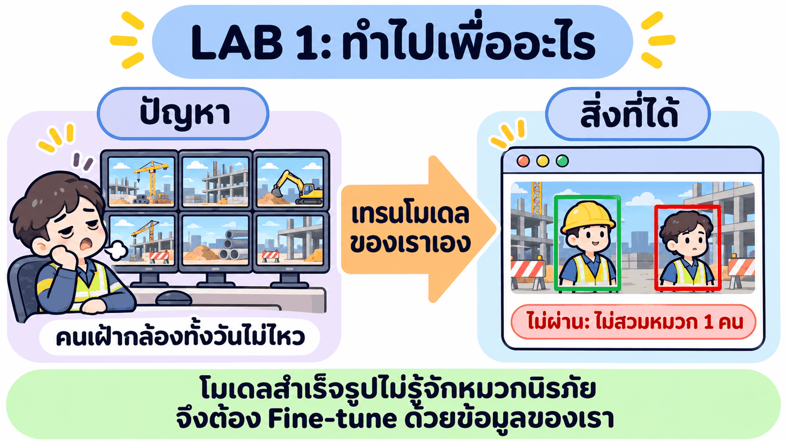

โมเดลสำเร็จรูปรู้จัก "คน" แต่ไม่รู้จัก "หมวกนิรภัย" หรือ "ไม่สวมหมวก" · คำถามของ LAB นี้คือ **เช่า GPU มาเทรนต่อด้วยข้อมูลของเราไม่กี่นาที แล้วโมเดลดีขึ้นแค่ไหน** และนำไปต่อกับเว็บจริงได้อย่างไร

LAB นี้มี **10 ขั้น** · ทุกขั้นคือ 1 พรอมต์ · โค้ดทุกไฟล์ AI เขียนให้จากพรอมต์ เริ่มจากโฟลเดอร์ว่าง · ขั้นที่ 1–8 คืองานหลัก ขั้นที่ 9–10 เก็บงานทั้งหมดเป็น **สกิลเวอร์ชัน 0**


## รู้จัก Dataset

| หัวข้อ | รายละเอียด |
|---|---|
| ชื่อ | [Construction Site Safety](https://universe.roboflow.com/roboflow-universe-projects/construction-site-safety) รุ่น 28 |
| เกี่ยวกับอะไร | ภาพหน้างานก่อสร้างและคนทำงาน พร้อมกรอบที่บอกว่าใครสวมหรือไม่สวมอุปกรณ์ความปลอดภัย (PPE) รวมถึงเครื่องจักร ยานพาหนะ และกรวย |
| ใครทำ | Roboflow Universe Projects บน Roboflow Universe |
| สัญญาอนุญาต | CC BY 4.0 (ใช้และดัดแปลงได้ ต้องให้เครดิต) |
| รูปแบบ | YOLO: ภาพ 640 × 640 คู่กับไฟล์ `.txt` 1 ไฟล์ต่อภาพ |
| การแบ่งชุด | Training Set 2,605 ภาพ (36,895 กรอบ) · Validation Set 114 ภาพ (697 กรอบ) · Test Set 82 ภาพ (760 กรอบ) |
| คลาส (10) | Hardhat · Mask · NO-Hardhat · NO-Mask · NO-Safety Vest · Person · Safety Cone · Safety Vest · machinery · vehicle |

ภาพตัวอย่างจริงที่ AI ทำให้ในขั้นที่ 2 · 8 รูปจาก Training Set พร้อมกรอบเฉลยและชื่อคลาส

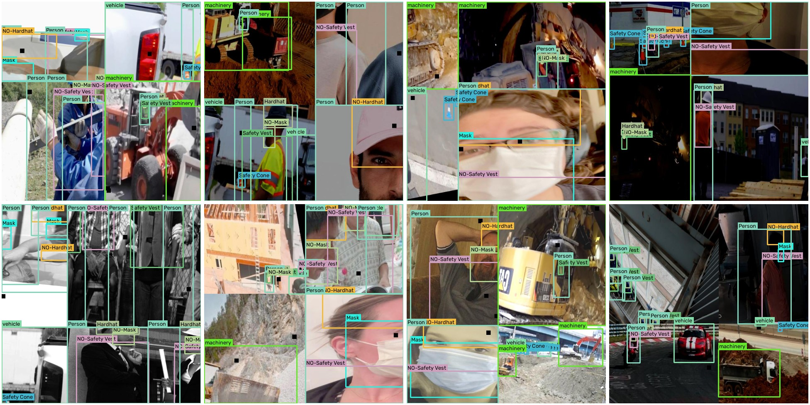

**label 1 รายการหน้าตาเป็นอย่างไร** · ไฟล์ `.txt` มีบรรทัดละ 1 กรอบ รูปแบบ `คลาส x_กลาง y_กลาง กว้าง สูง` (ค่า 0–1 เทียบกับขนาดภาพ) เช่น

```
5 0.52 0.48 0.21 0.67
```

หมายถึง คลาสหมายเลข 5 (Person) จุดกลางกรอบอยู่กลางภาพ กว้าง 21% และสูง 67% ของภาพ · ภาพ 1 ภาพมีได้หลายสิบกรอบ

| คลาส | กรอบใน Training Set | คลาส | กรอบใน Training Set |
|---|---|---|---|
| Person | 9,532 | NO-Mask | 3,097 |
| machinery | 5,247 | Safety Vest | 3,033 |
| NO-Safety Vest | 3,962 | NO-Hardhat | 2,317 |
| Safety Cone | 3,366 | Mask | 1,651 |
| Hardhat | 3,145 | vehicle | 1,545 |

**ข้อสังเกต**

- คู่คลาส "มี / ไม่มี" (Hardhat กับ NO-Hardhat) คือสิ่งที่ทำให้ตัดสิน ผ่าน/ไม่ผ่าน ได้
- **คลาสไม่สมดุล**: Person มีกรอบมากกว่า vehicle หรือ Mask ราว 6 เท่า
- ภาพ Training Set จำนวนมากเป็น **mosaic** (4 ภาพต่อกันเป็นภาพเดียว) เพราะผู้ทำ Dataset ทำ Data Augmentation ไว้แล้ว · Validation Set และ Test Set เป็นภาพปกติ
- Validation Set และ Test Set เล็กมาก (4% และ 3%) ตัวเลขรายคลาสจึงแกว่งง่าย เช่น NO-Hardhat ใน Test Set มีเพียง 41 กรอบ

## รู้จักโมเดลที่ใช้

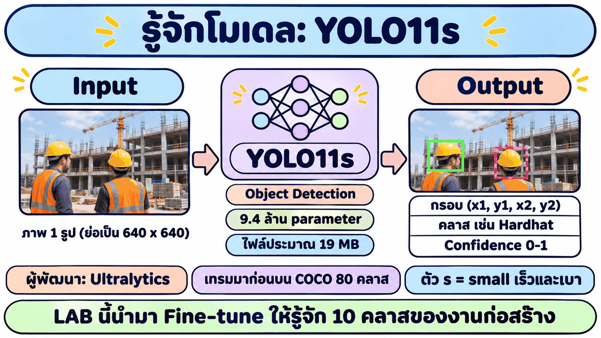

| หัวข้อ | YOLO11s |
|---|---|
| ประเภท | Object Detection |
| Input | ภาพ 1 รูป (ย่อเป็น 640 × 640) |
| Output | รายการกรอบ แต่ละกรอบมีพิกัด คลาส และ Confidence |
| ขนาด | 9.4 ล้าน parameter · ไฟล์ประมาณ 19 MB |
| ที่มา | [Ultralytics](https://docs.ultralytics.com/models/yolo11/) · เทรนมาก่อนบน COCO 80 คลาส · ตัว `s` คือรุ่น small |
| LAB นี้ใช้ทำอะไร | เป็นโมเดลตั้งต้น (ก่อนเทรน) และนำมา Fine-tune ให้รู้จัก 10 คลาสของงานก่อสร้าง (หลังเทรน) |

## ทฤษฎีที่ต้องรู้

### 1 · Object Detection

- **คืออะไร**: รับรูป 1 รูป แล้วตอบว่า "มีอะไร อยู่ตรงไหน" เป็นรายการกรอบ แต่ละกรอบมี **คลาส + Confidence + พิกัด**
- **ทำไมต้องใช้**: การจำแนกทั้งรูป (Classification) ตอบได้คำเดียวต่อรูป แต่งานความปลอดภัยต้องรู้ว่า "คนไหน" ไม่สวมหมวกและมีกี่คน
- **ทำงานอย่างไร**: YOLO มองรูปครั้งเดียว ทำนายกรอบและคลาสทั้งรูปพร้อมกัน แล้วตัดกรอบซ้ำและกรอบที่ Confidence ต่ำทิ้ง
- **ตัวเลขจาก LAB นี้**: ใช้ 8.5 ms ต่อรูปบน RTX 4090 · รูปตัวอย่าง `no_hardhat_1` ได้ 33 กรอบในครั้งเดียว

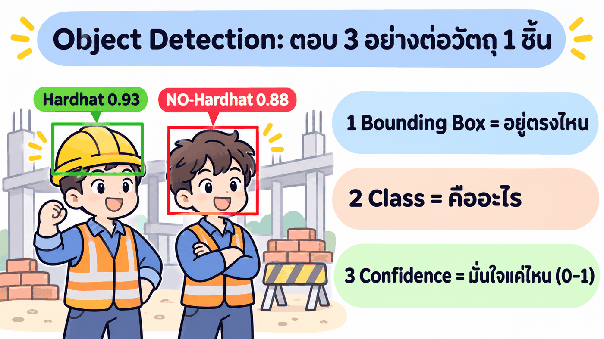

### 2 · Pre-trained Model และ Fine-tuning

- **คืออะไร**: เริ่มจากโมเดลที่เทรนกับ Dataset ใหญ่มาแล้ว (Pre-trained บน COCO 80 คลาส) แล้ว **เทรนต่อ** ด้วยข้อมูลของเรา
- **ทำไมต้องใช้**: เทรนจากศูนย์ต้องใช้ภาพจำนวนมากและเวลานาน · โมเดล Pre-trained รู้จักขอบ รูปร่าง และ "คน" อยู่แล้ว

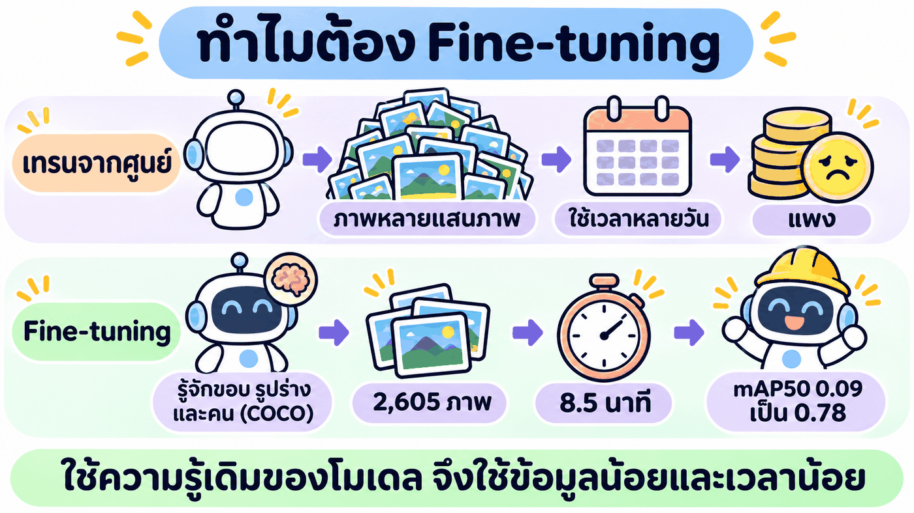

- **ทำงานอย่างไร**: ส่วนที่สกัดลักษณะของภาพถูกใช้ต่อ ส่วนที่ทำนายคลาสถูกเปลี่ยนจาก 80 คลาสของ COCO เป็น 10 คลาสของเรา แล้วปรับ weight ทั้งโมเดล
- **ตัวเลขจาก LAB นี้**: 2,605 ภาพ · เทรน 508 วินาที · mAP50 จาก 0.090 เป็น 0.782

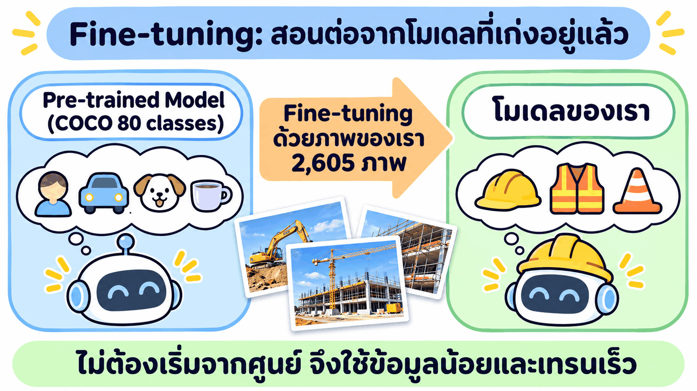

### 3 · Training / Validation / Test Set

- **คืออะไร**: ข้อมูล 3 ชุดที่ไม่ซ้ำกัน
- **ทำไมต้องใช้**: ถ้าวัดผลด้วยภาพที่โมเดลเคยเห็น คะแนนจะสูงเกินจริง จึง **ตัดสินผลด้วยชุดที่โมเดลไม่เคยเห็น**

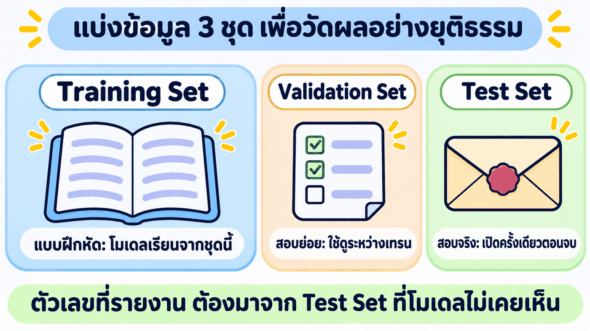

| ชุด | จำนวนภาพ | ใช้ทำอะไร |
|---|---|---|
| Training Set | 2,605 (93%) | ปรับ weight ของโมเดล |
| Validation Set | 114 (4%) | ดูระหว่างเทรน และเลือกโมเดลที่ดีที่สุด (`best.pt`) |
| Test Set | 82 (3%) | ตัดสินครั้งเดียวตอนจบ ใช้เทียบก่อนกับหลังเทรน |

**ตัวเลขจาก LAB นี้**: mAP50 บน Validation Set ได้ 0.819 แต่บน Test Set ได้ 0.782

### 4 · Epoch, Loss และกราฟการเรียนรู้

- **คืออะไร**: 1 Epoch = โมเดลเห็นภาพ Training Set ครบ 1 รอบ · Loss = ค่าความผิดที่โมเดลพยายามลด
- **ทำไมต้องใช้**: บอกว่าควรเทรนนานแค่ไหน และโมเดลเริ่มท่องจำ (Overfitting) หรือยัง
- **ทำงานอย่างไร**: หลังจบทุก Epoch โมเดลถูกวัดกับ Validation Set · ถ้า loss ของ Training ลดแต่ของ Validation กลับเพิ่ม แปลว่าเริ่ม Overfitting
- **ตัวเลขจาก LAB นี้**: ราว 10 วินาทีต่อ Epoch · mAP50 บน Validation Set ที่ Epoch 10 = 0.661 · 25 = 0.767 · 50 = 0.819

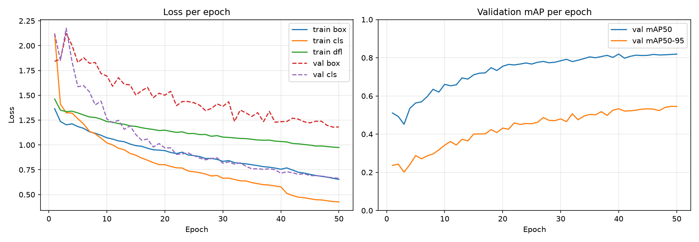

### 5 · IoU, AP และ mAP

- **คืออะไร**: IoU = พื้นที่ซ้อนทับ ÷ พื้นที่รวมของกรอบทำนายกับกรอบเฉลย · AP = คะแนนของ 1 คลาส · mAP = ค่าเฉลี่ย AP ของทุกคลาส (0–1 ยิ่งสูงยิ่งดี)
- **ทำไมต้องใช้**: Detection ผิดได้หลายแบบ (กรอบเลื่อน ทายคลาสผิด หาไม่เจอ) จึงต้องมีตัวเลขเดียวที่ใช้เทียบโมเดลกันได้

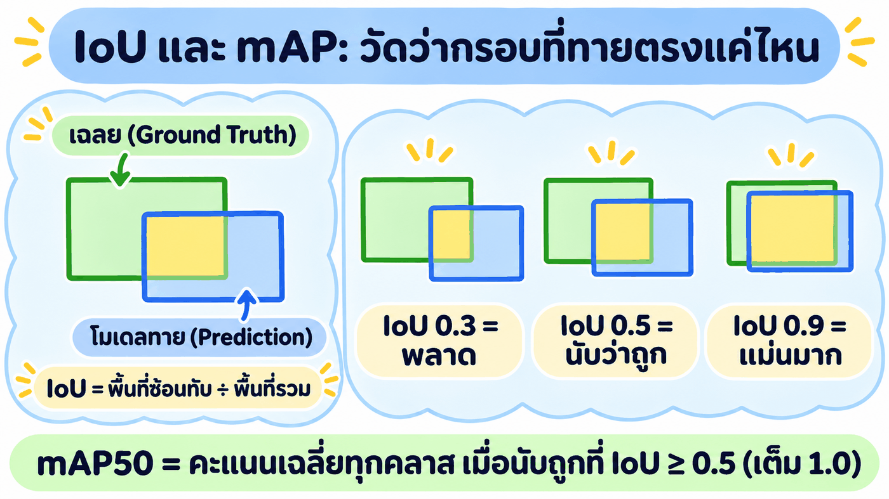

| ตัวชี้วัด | ความหมาย | ผลใน LAB นี้ (หลังเทรน) |
|---|---|---|
| mAP50 | นับว่าถูกเมื่อ IoU ≥ 0.5 | 0.782 |
| mAP50-95 | เฉลี่ยเกณฑ์ IoU 0.5 ถึง 0.95 · เข้มกว่า ตัวเลขจึงต่ำกว่า | 0.504 |
| AP50 รายคลาส | คะแนนของคลาสเดียว ใช้ดูว่าคลาสไหนยังอ่อน | Hardhat 0.940 สูงสุด · Safety Cone 0.485 ต่ำสุด |

### 6 · Confidence Threshold

- **คืออะไร**: เกณฑ์ตัดกรอบที่โมเดลไม่มั่นใจ · AI server ของ LAB นี้ส่งเฉพาะกรอบที่ได้ 0.35 ขึ้นไป
- **ทำไมต้องใช้**: โมเดลให้กรอบออกมาจำนวนมาก ส่วนใหญ่มีค่าความมั่นใจต่ำ ต้องมีเส้นตัดว่าจะเชื่อกรอบไหน
- **ทำงานอย่างไร**: ตั้งต่ำ = เจอมากขึ้นแต่เตือนผิดมากขึ้น · ตั้งสูง = เตือนผิดน้อยลงแต่หลุดมากขึ้น
- **ตัวเลขจาก LAB นี้**: เว็บตัดสิน "ไม่ผ่าน" เมื่อมีกรอบ NO-Hardhat ที่ผ่านเกณฑ์ 0.35 อย่างน้อย 1 กรอบ · ในภาพเทียบของขั้นที่ 4 มีกรอบ NO-Hardhat ที่ได้เพียง 0.37

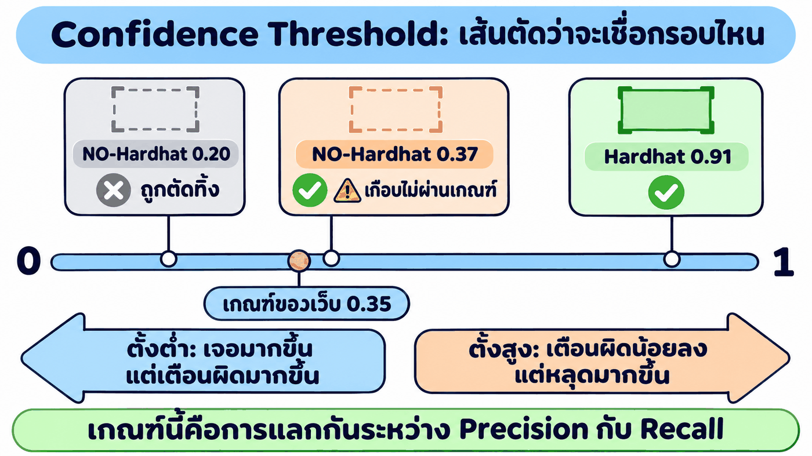

### 7 · Inference Server และ API key

- **คืออะไร**: โปรแกรมที่โหลดโมเดลค้างไว้บน GPU แล้วรอรับรูปทาง HTTP ตอบกลับเป็น JSON
- **ทำไมต้องใช้**: โหลดโมเดลครั้งเดียว ใช้ได้หลายแอป · เว็บไม่ต้องมี GPU · server เปิดสู่อินเทอร์เน็ตจึงต้องมี **API key**
- **ทำงานอย่างไร**: เบราว์เซอร์ → เว็บ Next.js บนเครื่องเรา → ฝั่ง server ของเว็บแนบ key → AI server บนเครื่องเช่า → กรอบกลับมา → เก็บลง PostgreSQL · key ไม่ถูกส่งถึงเบราว์เซอร์
- **ตัวเลขจาก LAB นี้**: โมเดลใช้ราว 20 ms ต่อรูป แต่เวลาส่งรูปไป-กลับคือ 540–2,077 ms (เครื่องเช่าอยู่ California) · เวลาที่ผู้ใช้รอเกือบทั้งหมดคือเครือข่าย

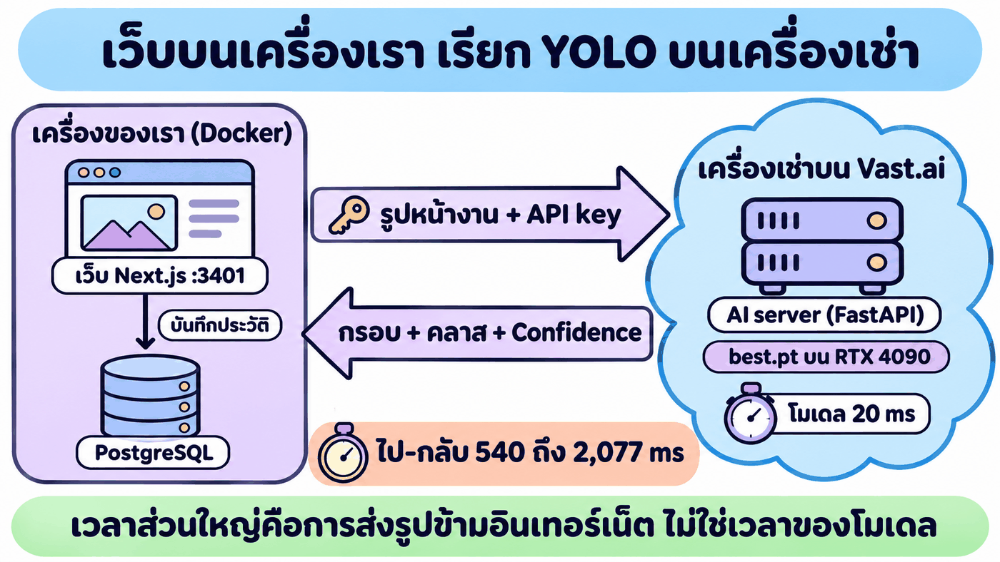

### 8 · ค่าใช้จ่ายของ GPU เช่า

- **คืออะไร**: คิดเงินตาม **เวลาที่เครื่องเปิด** (GPU + disk) บวกค่ารับส่งข้อมูล ไม่ใช่ตามเวลาที่เทรน
- **ทำไมต้องรู้**: เครื่องที่ลืมลบคิดเงินต่อไปเรื่อย ๆ · เครื่องที่เช่าแล้วเปิดไม่ขึ้นก็ถูกคิดเงิน
- **ทำงานอย่างไร**: ค่า GPU เริ่มคิดเมื่อเครื่องขึ้นสถานะ running ส่วนค่า disk คิดตั้งแต่สร้างเครื่อง · ราคาตอนค้นหา ($0.366) คิด disk ขนาดเริ่มต้น เมื่อขอ disk 40 GB ราคาจริงเป็น $0.408 ต่อชั่วโมง
- **ตัวเลขจาก LAB นี้**: เทรน 8.5 นาที แต่เครื่องเปิด 52 นาที · GPU $0.266 + disk $0.041 + ดาวน์โหลด $0.007 = $0.314 · เครื่องที่เปิดไม่ขึ้น 3 เครื่องอีก $0.067 · รวม **$0.381**

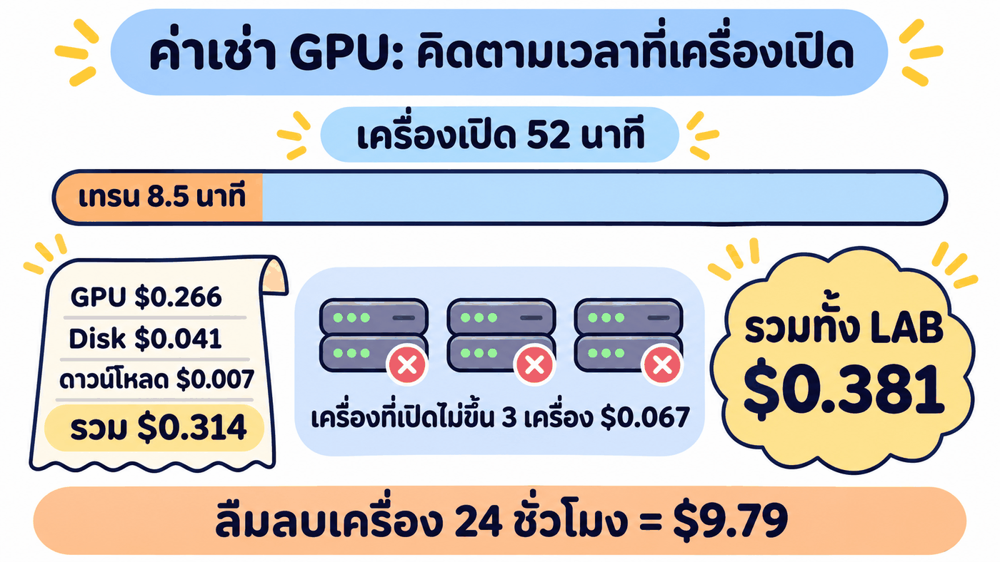

### 9 · Vibe coding: จาก requirement เป็นโค้ด

- **คืออะไร**: เราบอก "ต้องการอะไร" เป็นข้อ ๆ แล้ว AI เขียนโค้ด รัน แก้เอง และอธิบายโค้ดให้ฟัง
- **ทำไมต้องใช้**: เห็นที่มาของโค้ดทุกไฟล์ และได้ฝึกเขียน requirement ที่ทำให้ผลการทดลองเทียบกันได้
- **ทำงานอย่างไร**: requirement ต้องมี **ค่าที่ต้องตรึง** (โมเดลตั้งต้น · Epoch · ขนาดภาพ · batch · seed · วิธีวัด · รูปแบบข้อมูลระหว่าง server กับเว็บ) ส่วนวิธีเขียนโค้ดปล่อยให้ AI เลือก
- **ตัวเลขจาก LAB นี้**: AI เขียนสคริปต์ 5 ไฟล์ (486 บรรทัด) และเว็บ 30 ไฟล์ · โค้ดเทรนล้มในการรันครั้งแรก 1 จุด แล้ว AI แก้เอง


## การทดลอง

| หัวข้อ | รายละเอียด |
|---|---|
| Dataset | Construction Site Safety รุ่น 28 · 10 คลาส · Training 2,605 / Validation 114 / Test 82 ภาพ |
| โมเดล | YOLO11s (Ultralytics) |
| เทียบ A กับ B | **ก่อนเทรน** = `yolo11s` ที่เทรนบน COCO · **หลังเทรน** = โมเดลเดิมเทรนต่อ 50 Epoch (ภาพ 640 · batch 32 · seed 0) |
| วิธีวัด | Test Set 82 ภาพ ด้วยสคริปต์เดียวกันทั้งสองโมเดล: mAP50 · mAP50-95 · AP50 รายคลาส · เวลาต่อรูป |
| เครื่อง | RTX 4090 1 ใบ · เพดาน $0.70 ต่อชั่วโมง (ได้จริง $0.408) |
| เวลาและค่าเช่าจริง | ขั้นที่ 2–8 รวมราว 38 นาที · ขั้นที่ 1 ปกติราว 3 นาที (รอบจริงใช้ 38 นาที เพราะเครื่อง 3 เครื่องแรกเปิดไม่ขึ้น) · ค่าเช่า **$0.381** |

ทำตามลำดับขั้นที่ 1 → 10 ให้ครบในรอบเดียว · คัดลอกพรอมต์ไปวางในช่องพิมพ์ของ Claude Code ทีละขั้น · โค้ดที่ AI เขียนจะอยู่ในโฟลเดอร์ `lab1_yolo/code/` ซึ่งตอนเริ่มยังไม่มี

## ขั้นที่ 1 · เช่าเครื่อง GPU

AI ค้นหาเครื่องตามเกณฑ์ เช่า รอจนพร้อม แล้วเข้าไปตรวจว่าเห็น GPU จริง

```text
ทำงานใน container `multi-account` โฟลเดอร์ /workspace/vastapp_lab ด้วยสกิล vastai
โฟลเดอร์ปัจจุบัน คือโฟลเดอร์บนเครื่องนี้ที่เปิด Claude Code อยู่ ไฟล์ของ LAB (โค้ดและผล) ให้เขียนไว้ที่นี่ ไม่ใช่ใน container

เช่าเครื่อง GPU สำหรับเทรนโมเดล
1. เช่า RTX 4090 1 ใบ ราคารวมไม่เกิน $0.70 ต่อชั่วโมง ตั้งป้ายเครื่องว่า vapp-lab1
2. เลือกเครื่อง verified ที่เน็ตเร็วทั้งขาเข้าและขาออก (500 Mbps ขึ้นไป) มี CPU 12 cores ขึ้นไป แล้วเอาเครื่องที่ถูกที่สุด
3. ใช้ image PyTorch 2.8 กับ CUDA 12.8 แบบ runtime (ขนาดเล็ก ดึงเร็ว) disk 40 GB และเปิดพอร์ต 8080 ไว้ให้ AI server
4. รอจนเครื่องพร้อมและเข้าไปเห็น GPU จริง ถ้าเกิน 10 นาทียังไม่พร้อม ให้ลบแล้วเช่าเครื่องอื่น
กุญแจ SSH อยู่ที่ /workspace/vastai_lab/Devtool_SSH/devtoolSSH

สรุปเป็นตารางภาษาไทย: GPU · ราคาต่อชั่วโมง · ที่ตั้ง · CPU cores · เวลาที่รอจนเครื่องพร้อม แล้วบอกว่าเครื่องยังเปิดอยู่
```

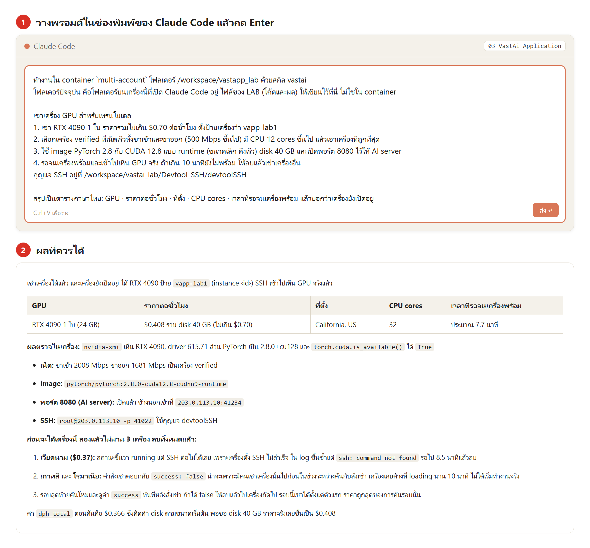
*ปกติใช้ราว 3 นาที · รอบจริงใช้ 38 นาที เพราะเครื่อง 3 เครื่องแรกเปิดไม่ขึ้น · ที่อยู่เครื่องในภาพเป็นค่าตัวอย่าง*

**อ่านผลอย่างไร**

- **เครื่องเช่าเปิดไม่ขึ้นได้** และอาจเจอติดกันหลายเครื่อง: บางเครื่องขึ้นสถานะ running แต่ SSH เข้าไม่ได้ บางเครื่องค้างที่ loading · จึงสั่งไว้ในข้อ 4 ให้ลบแล้วเช่าเครื่องอื่นเมื่อเกิน 10 นาที
- เครื่องที่เปิดไม่ขึ้นก็ถูกคิดเงิน (รอบนี้ 3 เครื่องรวม $0.067) ต้องลบทันที
- ราคาตอนค้นหาคือ $0.366 แต่ราคาจริงเป็น $0.408 เพราะขอ disk 40 GB
- **ตั้งแต่ขั้นนี้เงินเริ่มเดิน** ชั่วโมงละ $0.41 จนกว่าจะลบเครื่องในขั้นที่ 8

## ขั้นที่ 2 · เตรียม Dataset และดูตัวอย่างภาพ

AI เขียน `download_dataset.py` และ `dataset_samples.py` เอง · ดาวน์โหลด Dataset ลงเครื่องเช่าโดยตรง แล้วทำภาพตัวอย่าง 8 รูปกลับมา

```text
ทำงานใน container `multi-account` โฟลเดอร์ /workspace/vastapp_lab ด้วยสกิล vastai
โฟลเดอร์ปัจจุบัน คือโฟลเดอร์บนเครื่องนี้ที่เปิด Claude Code อยู่ ไฟล์ของ LAB (โค้ดและผล) ให้เขียนไว้ที่นี่ ไม่ใช่ใน container
เครื่องที่ใช้คือเครื่องป้าย vapp-lab1 · กุญแจ SSH อยู่ที่ /workspace/vastai_lab/Devtool_SSH/devtoolSSH

เตรียม Dataset ภาพหน้างานก่อสร้างบนเครื่องที่เช่า แล้วทำภาพตัวอย่างให้เห็นว่าข้อมูลหน้าตาเป็นอย่างไร
1. ติดตั้ง ultralytics และ roboflow ให้ใช้งานได้
2. ดาวน์โหลด Dataset construction-site-safety รุ่น 28 ของ roboflow-universe-projects จาก Roboflow ในรูปแบบ YOLO
3. ใช้ ROBOFLOW_API_KEY จากไฟล์ .env ของโฟลเดอร์ปัจจุบัน ห้ามแสดงค่า key และห้ามทิ้ง key ไว้บนเครื่องที่เช่า
4. ทำภาพตัวอย่าง 1 ภาพ เป็นตาราง 8 รูปจาก Training Set ที่วาดกรอบเฉลยพร้อมชื่อคลาส เลือกรูปให้เห็นคลาสหลากหลาย แล้วเก็บกลับมาที่ lab1_yolo/results/dataset_samples.jpg ของโฟลเดอร์ปัจจุบัน

สรุปเป็นตารางภาษาไทย: จำนวนภาพของ Training Set · Validation Set · Test Set · รายชื่อคลาสพร้อมจำนวนกรอบของแต่ละคลาสใน Training Set แล้วบอกว่าเครื่องยังเปิดอยู่
```

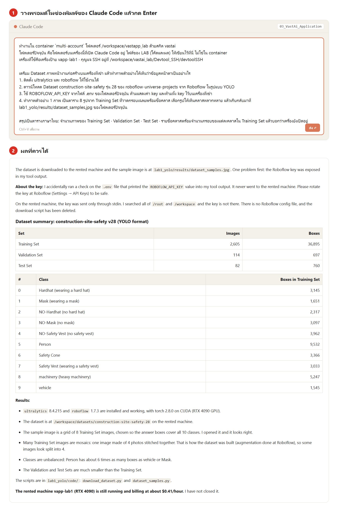
*ใช้เวลา 4 นาที*

ตัวอย่างโค้ดที่ AI เขียนให้ในรอบจริง (ของคุณอาจต่างกัน): [code_reference/download_dataset.py](code_reference/download_dataset.py) · [code_reference/dataset_samples.py](code_reference/dataset_samples.py)

**อ่านผลอย่างไร**

- ต้องได้ **2,605 / 114 / 82 ภาพ และ 10 คลาส** · เปิดดู `results/dataset_samples.jpg` ว่ากรอบและชื่อคลาสตรงกับสิ่งที่เห็นในภาพ (ดูหัวข้อ [รู้จัก Dataset](#รู้จัก-dataset))
- **เรื่อง key**: ในรอบจริง AI เผลอสั่งตรวจไฟล์ `.env` จนค่า key ไปปรากฏในผลคำสั่งของตัวเอง แล้วแจ้งให้เปลี่ยน key · ถ้าเจอแบบนี้ให้สร้าง key ใหม่ที่ Roboflow ทันที
- คำตอบของรอบนี้เป็นภาษาอังกฤษทั้งที่สั่งให้สรุปภาษาไทย · AI ไม่ได้ทำตามทุกคำเสมอไป ถ้าต้องการให้พิมพ์ต่อว่า "สรุปอีกครั้งเป็นภาษาไทย"

## ขั้นที่ 3 · เขียนโค้ดเทรน แล้ว Training 50 Epoch

AI เขียน `train.py` จาก requirement ในข้อ 1–2 แล้วนำไปรันบนเครื่องเช่า

```text
ทำงานใน container `multi-account` โฟลเดอร์ /workspace/vastapp_lab ด้วยสกิล vastai
โฟลเดอร์ปัจจุบัน คือโฟลเดอร์บนเครื่องนี้ที่เปิด Claude Code อยู่ ไฟล์ของ LAB (โค้ดและผล) ให้เขียนไว้ที่นี่ ไม่ใช่ใน container
เครื่องที่ใช้คือเครื่องป้าย vapp-lab1 · กุญแจ SSH อยู่ที่ /workspace/vastai_lab/Devtool_SSH/devtoolSSH

เขียนโค้ดเทรนโมเดลตรวจอุปกรณ์ความปลอดภัย แล้วเทรนบนเครื่องที่เช่า
1. เขียนสคริปต์เทรนไว้ที่ lab1_yolo/code/train.py ของโฟลเดอร์ปัจจุบัน ให้เริ่มจากโมเดล yolo11s ที่เทรนบน COCO มาแล้ว และเทรนต่อด้วย Dataset ที่เตรียมไว้
2. ค่าการเทรน: 50 Epoch ภาพขนาด 640 batch 32 seed 0 ให้พิมพ์ความคืบหน้าทุก Epoch และบันทึกเวลาที่ใช้เทรน
3. นำสคริปต์ไปรันบนเครื่องที่เช่า ให้เทรนต่อได้แม้การเชื่อมต่อหลุด และรายงานทุก 2 นาทีว่าถึง Epoch ไหน mAP50 บน Validation Set เท่าไร
4. อธิบายโค้ดที่เขียนสั้น ๆ 3–5 บรรทัดว่าแต่ละส่วนทำอะไร

สรุปตอนจบเป็นภาษาไทย: เวลาที่ใช้เทรน · mAP50 บน Validation Set ที่ Epoch 10, 25, 50 แล้วบอกว่าเครื่องยังเปิดอยู่
```

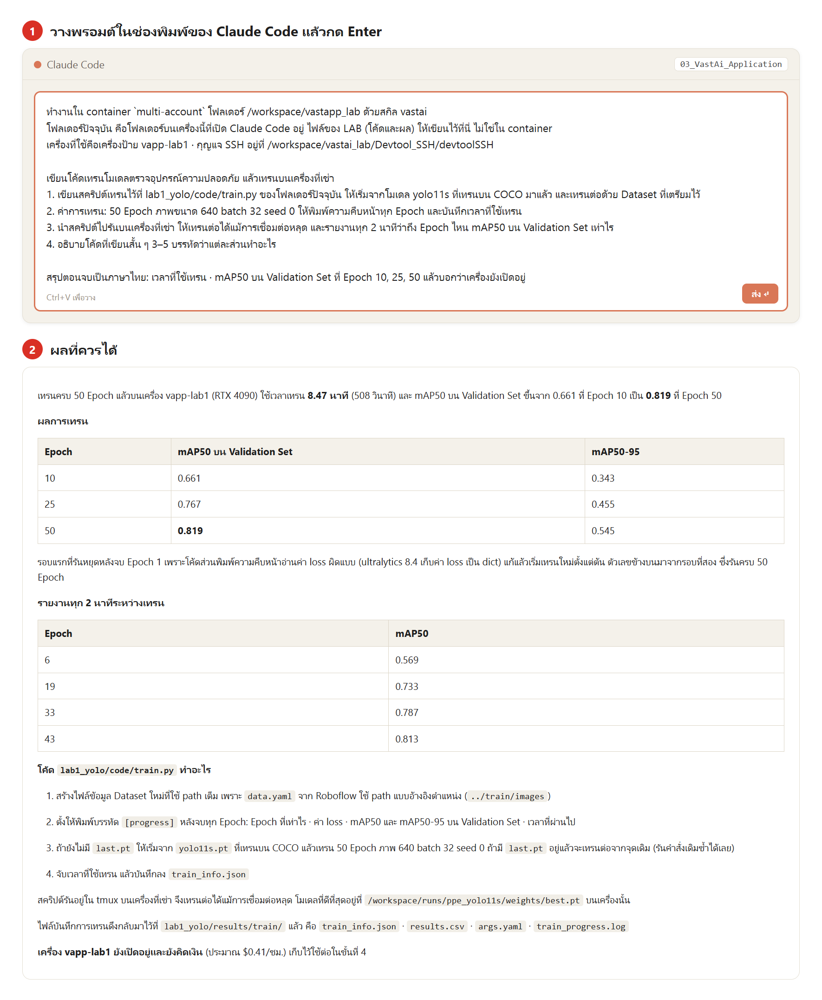
*ใช้เวลา 14 นาที · เทรนจริง 8.5 นาที*

ตัวอย่างโค้ดที่ AI เขียนให้ในรอบจริง (ของคุณอาจต่างกัน): [code_reference/train.py](code_reference/train.py) (74 บรรทัด)

**อ่านผลอย่างไร**

- mAP50 ขึ้นเร็วช่วงแรกแล้วแบน: 10 Epoch แรกได้ 0.661 (81% ของผลสุดท้าย) ส่วน Epoch 43 → 50 เพิ่มเพียง 0.006 = เทรนนานกว่านี้ได้เพิ่มไม่มาก (ดูกราฟในทฤษฎีข้อ 4)
- loss ของ Training และ Validation ลดลงพร้อมกัน = ยังไม่ Overfitting
- การรันครั้งแรกหยุดหลัง Epoch 1 เพราะโค้ดส่วนพิมพ์ความคืบหน้าอ่านค่า loss ผิดชนิด AI แก้เองแล้วเทรนใหม่ · **โค้ดที่ AI เขียนพังได้ สิ่งสำคัญคือ AI ต้องรันจริงและแก้จนผ่าน**
- สคริปต์ของรอบนี้เทรนต่อจากจุดเดิมได้ถ้ารันซ้ำ ซึ่งมาจากข้อ 3 ของพรอมต์ ("เทรนต่อได้แม้การเชื่อมต่อหลุด")

## ขั้นที่ 4 · เขียนโค้ดวัดผล แล้ว Evaluation ก่อน vs หลังเทรน

AI เขียน `eval.py` วัดสองโมเดลด้วยวิธีเดียวกัน ทำกราฟและภาพเทียบ แล้วเก็บผลพร้อม `best.pt` กลับมา

```text
ทำงานใน container `multi-account` โฟลเดอร์ /workspace/vastapp_lab ด้วยสกิล vastai
โฟลเดอร์ปัจจุบัน คือโฟลเดอร์บนเครื่องนี้ที่เปิด Claude Code อยู่ ไฟล์ของ LAB (โค้ดและผล) ให้เขียนไว้ที่นี่ ไม่ใช่ใน container
เครื่องที่ใช้คือเครื่องป้าย vapp-lab1 · กุญแจ SSH อยู่ที่ /workspace/vastai_lab/Devtool_SSH/devtoolSSH

เขียนโค้ดวัดผล แล้วเทียบโมเดลก่อนเทรนกับหลังเทรนบน Test Set ที่ไม่ได้ใช้เทรน
1. เขียนสคริปต์วัดผลไว้ที่ lab1_yolo/code/eval.py ของโฟลเดอร์ปัจจุบัน: วัดโมเดลก่อนเทรน (yolo11s ของ COCO) กับโมเดลหลังเทรน ด้วยวิธีเดียวกัน ได้ mAP50 · mAP50-95 · AP50 รายคลาส · เวลาต่อรูป
2. โมเดล COCO ไม่มีคลาสของ Dataset นี้ ให้นับเฉพาะคลาสที่ตรงกัน คือ person เป็น Person และ car, bus, truck เป็น vehicle ส่วนคลาสอื่นได้ 0
3. ให้สคริปต์บันทึกตัวเลขทั้งหมดลง metrics.json และทำภาพ 3 ชนิด: ภาพเทียบก่อน/หลัง 5 ภาพที่มีทั้งคนสวมและไม่สวมหมวก · กราฟแท่ง AP50 รายคลาสก่อน vs หลัง · กราฟ loss และ mAP ต่อ Epoch
4. รันบนเครื่องที่เช่า แล้วเก็บผลทั้งหมดพร้อมไฟล์โมเดลที่ดีที่สุด กลับมาไว้ในโฟลเดอร์ lab1_yolo/results ของโฟลเดอร์ปัจจุบัน
5. เลือกรูปจาก Test Set 6 รูป ตามผลของโมเดลหลังเทรน คือ 3 รูปที่พบคนไม่สวมหมวก และ 3 รูปที่ทุกคนสวมหมวก เก็บกลับมาที่ lab1_yolo/results/samples ไว้ใช้เป็นรูปตัวอย่างของเว็บ

สรุปเป็นตารางภาษาไทย ก่อน vs หลัง: mAP50 · mAP50-95 · AP50 ของ Hardhat, NO-Hardhat, Safety Vest, NO-Safety Vest, Person · เวลาต่อรูป แล้วบอกว่าเครื่องยังเปิดอยู่
```

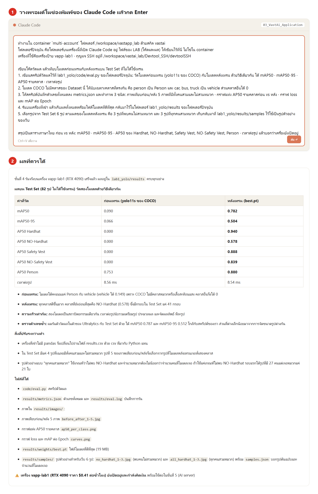
*ใช้เวลา 5 นาที*

| ตัวชี้วัด (Test Set 82 ภาพ) | ก่อนเทรน (COCO) | หลังเทรน |
|---|---|---|
| mAP50 | 0.090 | **0.782** |
| mAP50-95 | 0.066 | **0.504** |
| เวลาต่อรูป | 8.56 ms | 8.54 ms |

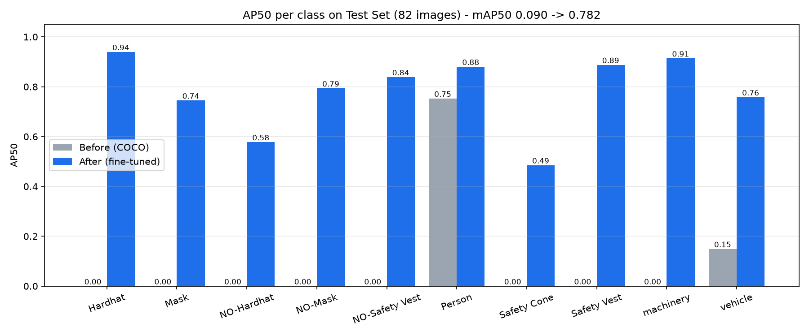

ตัวอย่างจริง 1 ภาพ · ซ้ายก่อนเทรน เห็นแค่ Person · ขวาหลังเทรน เห็น Hardhat, NO-Hardhat และ NO-Safety Vest

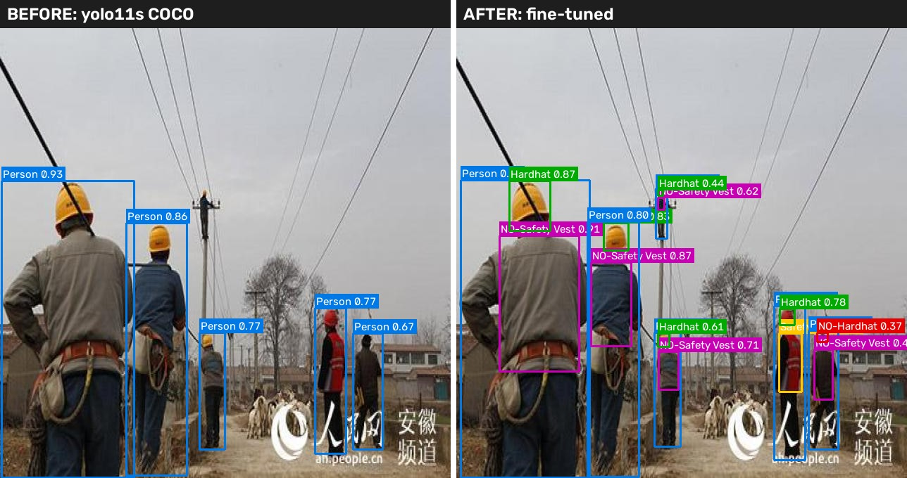

ตัวอย่างโค้ดที่ AI เขียนให้ในรอบจริง (ของคุณอาจต่างกัน): [code_reference/eval.py](code_reference/eval.py) (240 บรรทัด) · ตัวเลขทั้งหมดอยู่ใน [results/metrics.json](results/metrics.json)

**อ่านผลอย่างไร**

- ก่อนเทรน โมเดลได้คะแนนเฉพาะคลาสที่ COCO มี (Person 0.753 · vehicle 0.149) คลาสอื่นได้ 0 เพราะ **โมเดลไม่มีคลาสนั้น** ไม่ใช่เพราะมองไม่เห็น
- Validation ได้ 0.819 แต่ Test ได้ 0.782 · ต่ำกว่าเล็กน้อยเป็นเรื่องปกติ เพราะ `best.pt` ถูกเลือกจาก Validation Set
- **ค่าเฉลี่ยสูงไม่ได้แปลว่าดีทุกคลาส**: NO-Hardhat ได้ 0.578 ทั้งที่เป็นคลาสสำคัญที่สุดของงานนี้ (ใน Test Set มีเพียง 41 กรอบ) · ก่อนใช้งานจริงต้องเก็บภาพคลาสนี้เพิ่ม
- ความเร็วเท่าเดิม เพราะเป็นโมเดลขนาดเดิม
- รูปตัวอย่างของเว็บ 6 รูปใน `results/samples/` ถูกเลือก **ตามผลของโมเดลหลังเทรน** (ข้อ 5) เว็บในขั้นถัดไปจึงมีทั้งรูปที่ผ่านและไม่ผ่าน

## ขั้นที่ 5 · เขียนโค้ด AI server แล้วเปิดใช้งาน

AI เขียน `serve.py` เปิดบนเครื่องเช่า ทดสอบจากนอกเครื่อง แล้วเขียนไฟล์ `.env` ให้เว็บ

```text
ทำงานใน container `multi-account` โฟลเดอร์ /workspace/vastapp_lab ด้วยสกิล vastai
โฟลเดอร์ปัจจุบัน คือโฟลเดอร์บนเครื่องนี้ที่เปิด Claude Code อยู่ ไฟล์ของ LAB (โค้ดและผล) ให้เขียนไว้ที่นี่ ไม่ใช่ใน container
เครื่องที่ใช้คือเครื่องป้าย vapp-lab1 · กุญแจ SSH อยู่ที่ /workspace/vastai_lab/Devtool_SSH/devtoolSSH

เขียนโค้ด AI server แล้วเปิดบนเครื่องที่เช่า ให้เว็บส่งรูปมาถามโมเดลที่เทรนได้
1. เขียน AI server ไว้ที่ lab1_yolo/code/serve.py ของโฟลเดอร์ปัจจุบัน: โหลดโมเดลที่เทรนได้ค้างไว้บน GPU เปิดที่พอร์ต 8080 และสุ่ม API key เองตอนเปิดครั้งแรก
2. ทาง /health ตอบว่าพร้อมไหม ชื่อโมเดล ppe-yolo11s และรายชื่อคลาส โดยไม่ต้องใช้ key
3. ทาง /v1/detect รับรูป 1 รูปในช่องชื่อ file พร้อม key แบบ Authorization: Bearer ถ้าไม่มี key หรือ key ผิดให้ตอบ 401
4. คำตอบเป็น JSON ที่มี model, width, height, inference_ms และ detections แต่ละกรอบมี class, confidence, box เป็น x1 y1 x2 y2 เอาเฉพาะกรอบที่ confidence 0.35 ขึ้นไป
5. เปิด server บนเครื่องที่เช่าให้ทำงานต่อได้แม้การเชื่อมต่อหลุด แล้วทดสอบจากนอกเครื่อง 3 ข้อ: server ตอบว่าพร้อม · ส่งรูปจาก Test Set พร้อม key แล้วได้กรอบ · ส่งแบบไม่มี key ต้องถูกปฏิเสธ
6. เขียนไฟล์ lab1_yolo/code/web/.env ของโฟลเดอร์ปัจจุบัน ให้มี YOLO_BASE_URL YOLO_API_KEY และ YOLO_MODEL=ppe-yolo11s ไว้ให้เว็บใช้ต่อ server นี้

ห้ามแสดงค่า key · สรุปเป็นภาษาไทย: ผลทดสอบ 3 ข้อ และเวลาที่โมเดลใช้ต่อรูป แล้วบอกว่าเครื่องยังเปิดอยู่
```

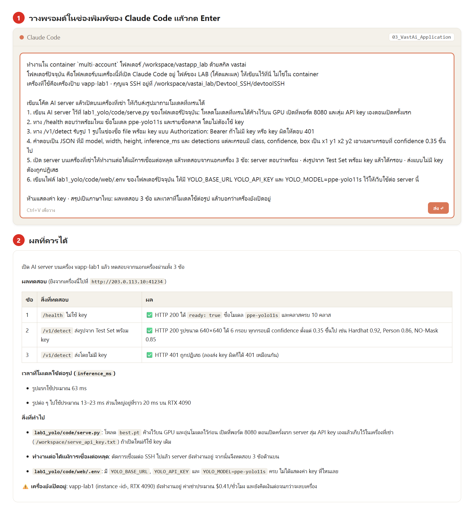
*ใช้เวลา 7 นาที*

ตัวอย่างโค้ดที่ AI เขียนให้ในรอบจริง (ของคุณอาจต่างกัน): [code_reference/serve.py](code_reference/serve.py) (94 บรรทัด)

**อ่านผลอย่างไร**

- server นี้เปิดสู่อินเทอร์เน็ต จึงต้องมี **API key** · ข้อทดสอบที่ 3 (ได้ 401) ยืนยันว่าคนไม่มี key ใช้ไม่ได้
- ข้อ 2–4 ของพรอมต์คือ **สัญญา API**: ชื่อช่อง ชื่อ field และรูปแบบ key ต้องตรงกันระหว่าง server กับเว็บ จึงเขียนซ้ำอีกครั้งในพรอมต์ขั้นที่ 6
- รูปแรกใช้ 63 ms จากนั้นราว 20 ms · มากกว่า 8.5 ms ของขั้นที่ 4 เพราะ server จับเวลาทั้งคำสั่งทำนาย ไม่ใช่เฉพาะช่วงของโมเดล
- ไฟล์ `lab1_yolo/code/web/.env` คือสิ่งที่เชื่อมเว็บบนเครื่องเรากับโมเดลบนเครื่องเช่า · ไฟล์นี้ไม่ถูกเก็บขึ้น git

## ขั้นที่ 6 · สร้างเว็บตรวจความปลอดภัยหน้างาน

AI เขียนเว็บ SiteSafe ทั้งเว็บ (Next.js + PostgreSQL + `docker-compose.yml`) บนเครื่องเรา แล้วเปิดและลองส่งรูปจริง

```text
สร้างเว็บตรวจความปลอดภัยหน้างานชื่อ SiteSafe ไว้ที่ lab1_yolo/code/web ของโฟลเดอร์ปัจจุบันบนเครื่องนี้ (Docker Desktop) ให้ต่อกับ AI server บน Vast.ai
1. ใช้ Next.js กับ PostgreSQL เปิดด้วย docker compose ที่ http://localhost:3401 ตั้งชื่อ project ว่า vapp-lab1 หน้าตาสะอาดเหมือนแอปจริง ภาษาไทย
2. หน้าแรก: อัปโหลดรูปหรือกดรูปตัวอย่าง (ใช้รูปใน lab1_yolo/results/samples) แล้วแสดงรูปพร้อมกรอบ และป้ายผล ผ่าน หรือ ไม่ผ่าน (ไม่ผ่านเมื่อพบ NO-Hardhat อย่างน้อย 1 กรอบ)
3. ใต้ป้ายผลแสดงจำนวนคน สวมหมวก ไม่สวมหมวก ไม่สวมเสื้อสะท้อนแสง เวลาที่โมเดลใช้ และเวลาส่งรูปไป-กลับ
4. หน้าประวัติ: ผลตรวจทุกครั้งเก็บใน PostgreSQL แสดงเป็นตารางพร้อมยอดรวม ผ่าน/ไม่ผ่าน และกดดูรายละเอียดแต่ละครั้งได้
5. ฝั่ง server ของเว็บส่งรูปต่อไปที่ /v1/detect ของ AI server (ช่อง file พร้อม key แบบ Authorization: Bearer) ห้ามส่ง key ไปถึงเบราว์เซอร์
6. ที่อยู่และ key ของ AI server อ่านจาก YOLO_BASE_URL และ YOLO_API_KEY ในไฟล์ .env ที่มีอยู่แล้วใน lab1_yolo/code/web ห้ามลบไฟล์นี้
7. AI server ตอบ JSON ที่มี model, width, height, inference_ms และ detections (class, confidence, box เป็น x1 y1 x2 y2) และมีทาง /health ให้เว็บแสดงที่มุมบนว่า AI server พร้อมไหม
8. เปิดเว็บ รอจนเข้าได้ แล้วลองส่งรูปตัวอย่าง 1 รูปว่าได้ผลจริง

สรุปเป็นภาษาไทย: โครงสร้างไฟล์ของเว็บแบบย่อ · หน้าที่มี · ผลลองส่งรูป 1 รูป ห้ามแสดงค่า key แล้วบอกว่าเครื่องบน Vast.ai ยังเปิดอยู่
```

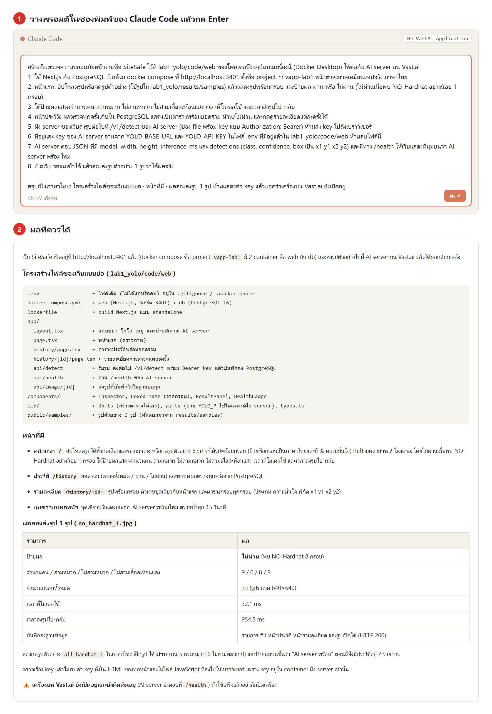
*ใช้เวลา 5 นาที*

ตัวอย่างโค้ดที่ AI เขียนให้ในรอบจริง (ของคุณอาจต่างกัน): [code_reference/web/](code_reference/web/) (30 ไฟล์)

**อ่านผลอย่างไร**

- พรอมต์ขั้นนี้ไม่มีบรรทัด container เพราะเว็บทำงานบนเครื่องเราด้วย Docker Desktop ไม่ใช่บนเครื่องเช่า
- key อยู่ใน container ฝั่ง server ของเว็บเท่านั้น (ข้อ 5) · AI ตรวจแล้วว่าไม่มีค่า key ในหน้าเว็บที่ส่งให้เบราว์เซอร์
- หน้าตาเว็บของคุณอาจต่างจากภาพในขั้นถัดไป เพราะพรอมต์กำหนดเฉพาะสิ่งที่เว็บต้องทำ ไม่ได้กำหนดการออกแบบ

## ขั้นที่ 7 · ทดสอบเว็บกับรูปตัวอย่าง

AI ส่งรูปตัวอย่างทั้ง 6 รูปให้เว็บตรวจ แล้วตรวจว่าผลขึ้นในหน้าประวัติครบ

```text
ทดสอบเว็บ SiteSafe ที่ http://localhost:3401 (โค้ดอยู่ที่ lab1_yolo/code/web) ซึ่งต่อกับ AI server บน Vast.ai
1. ตรวจว่าเว็บเปิดอยู่และต่อ AI server ได้ ถ้าเว็บปิดอยู่ให้เปิดด้วย docker compose
2. ส่งรูปใน lab1_yolo/results/samples ให้เว็บตรวจทีละรูปจนครบ 6 รูป
3. ตรวจว่าผลทั้ง 6 ครั้งขึ้นในหน้าประวัติ

สรุปเป็นตารางภาษาไทย: รูป · ผล (ผ่าน/ไม่ผ่าน) · จำนวนคนไม่สวมหมวก · เวลาที่โมเดลใช้ (ms) · เวลาส่งรูปไป-กลับ (ms) ห้ามแสดงค่า key แล้วบอกว่าเครื่องบน Vast.ai ยังเปิดอยู่
```

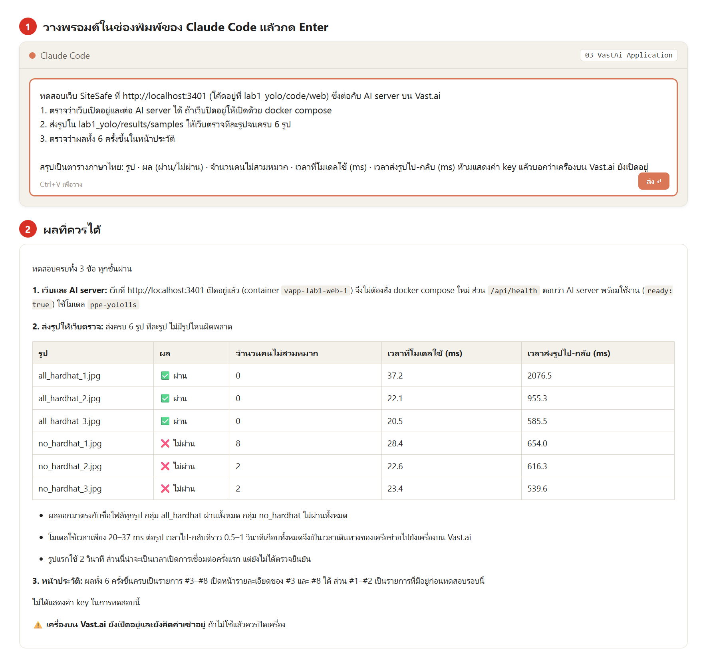
*ใช้เวลา 1 นาที*

จากนั้นเปิด **http://localhost:3401** ในเบราว์เซอร์ → กดรูปตัวอย่าง หรืออัปโหลดรูปเอง

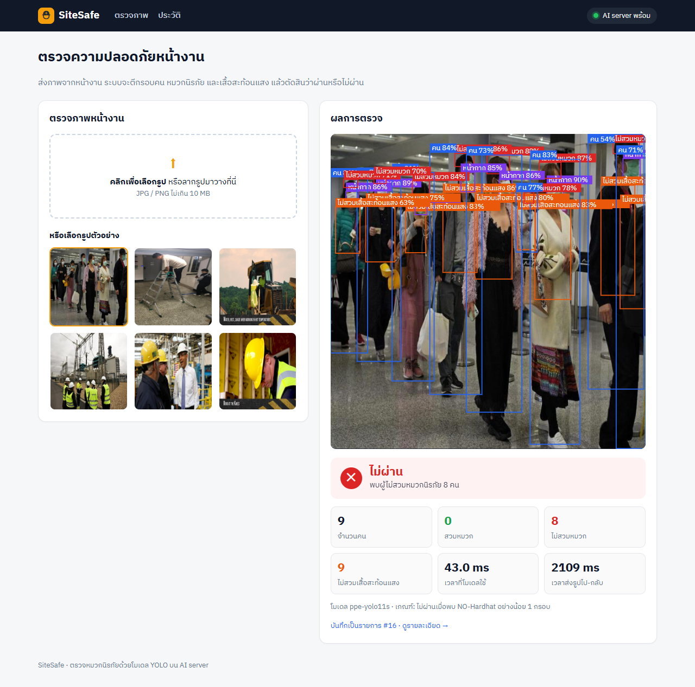

| อัปโหลดรูปเอง → ไม่ผ่าน | กดรูปตัวอย่าง → ไม่ผ่าน |
|---|---|
|  | 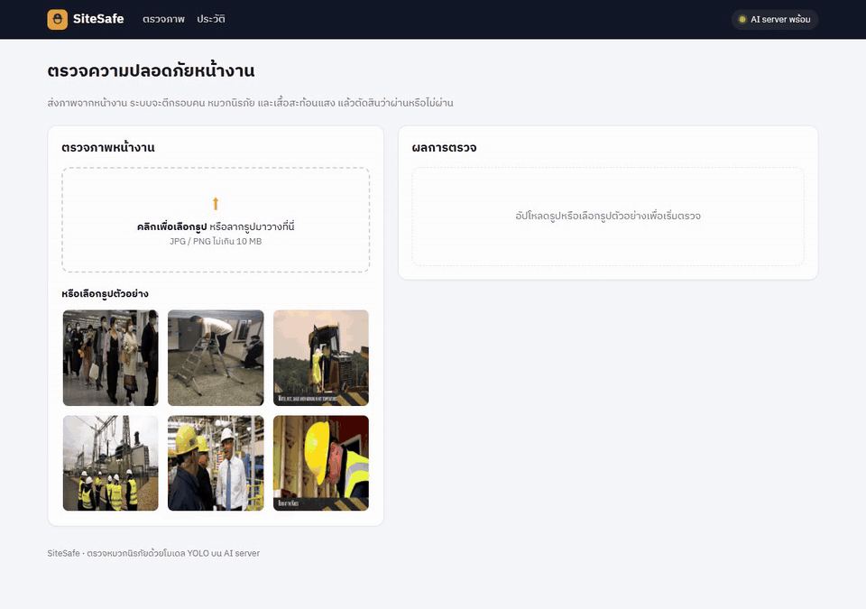 |

| กดรูปตัวอย่าง → ผ่าน | หน้าประวัติ → รายละเอียด 1 รายการ |
|---|---|
| 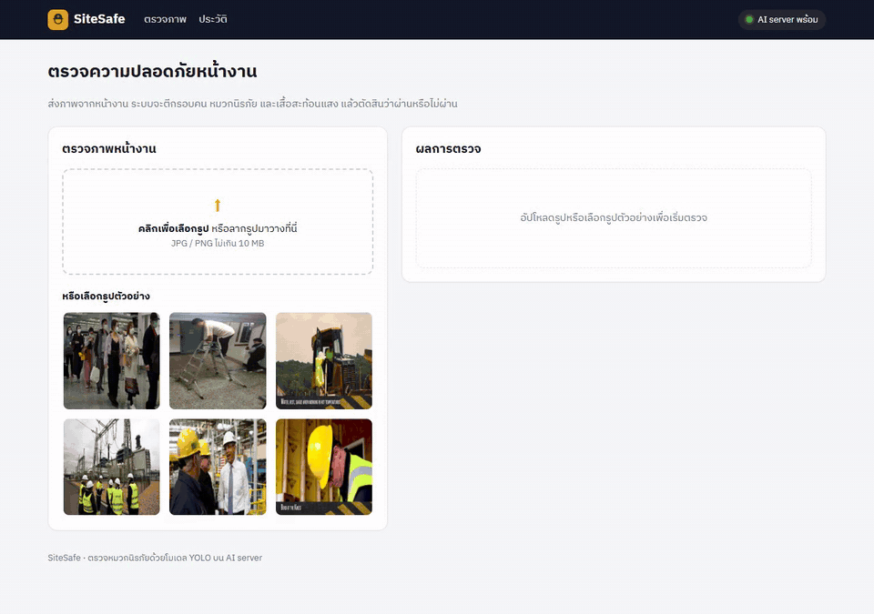 | 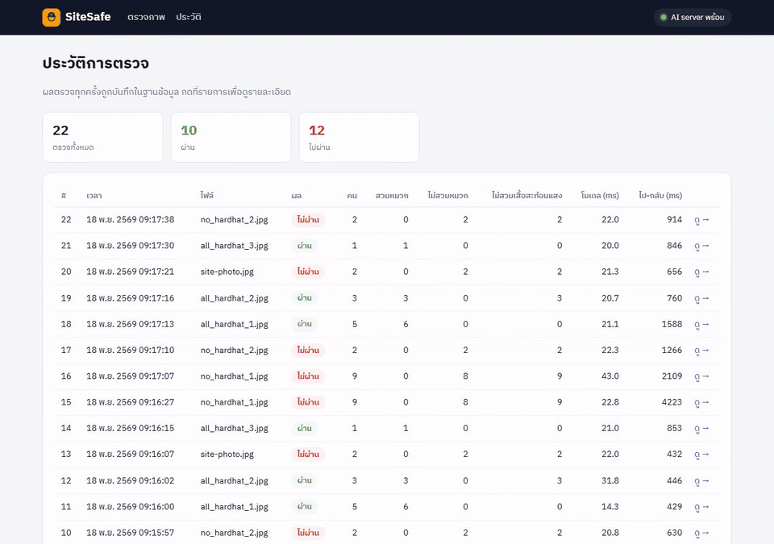 |

ผลทุกครั้งถูกเก็บใน PostgreSQL ดูได้ที่หน้า **ประวัติ**

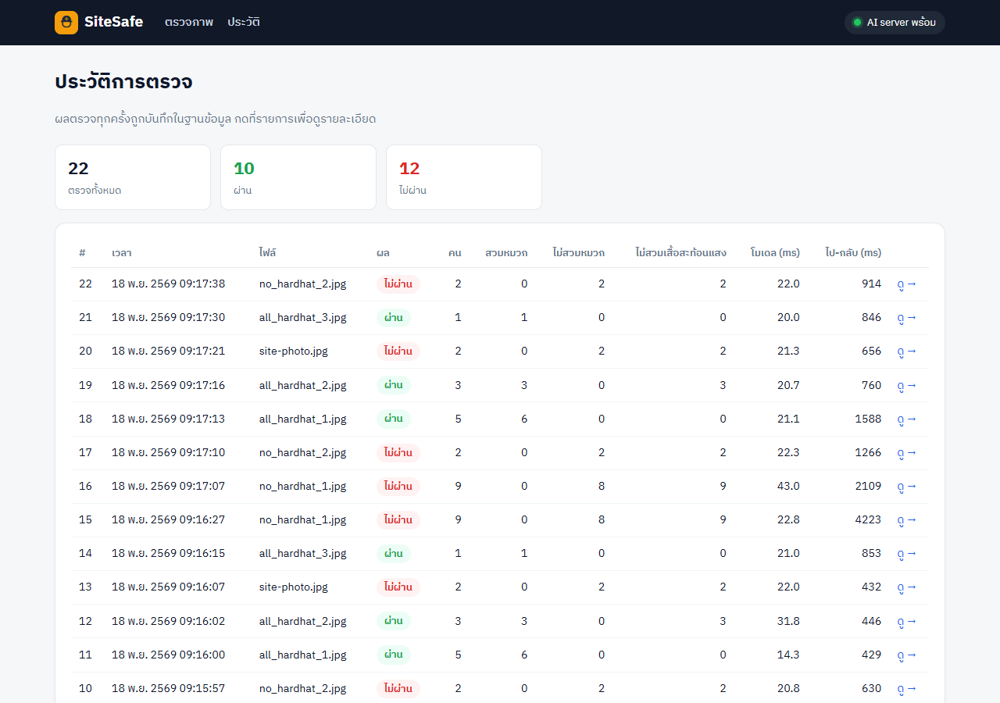

**อ่านผลอย่างไร**

- ผลตรงกับชื่อรูปทุกรูป: กลุ่ม `all_hardhat` ผ่านทั้งหมด กลุ่ม `no_hardhat` ไม่ผ่านทั้งหมด
- **โมเดลใช้ 20–37 ms แต่ผู้ใช้รอ 540–2,077 ms** เวลาเกือบทั้งหมดคือการส่งรูปข้ามอินเทอร์เน็ตไปเครื่องเช่า · รูปแรกช้าที่สุด
- รูปชุดนี้ถูกเลือกตามผลของโมเดลเอง จึงตรงทุกรูป · กับรูปใหม่จากหน้างานจริง โมเดลยังหลุดได้ เพราะ AP50 ของ NO-Hardhat คือ 0.578

## ขั้นที่ 8 · ลบเครื่องและสรุปค่าใช้จ่าย (ห้ามข้าม)

AI ลบเครื่องเช่า ตรวจว่าไม่มีเครื่องค้าง ปิดเว็บ แล้วสรุปบิลจริง

```text
ทำงานใน container `multi-account` โฟลเดอร์ /workspace/vastapp_lab ด้วยสกิล vastai
โฟลเดอร์ปัจจุบัน คือโฟลเดอร์บนเครื่องนี้ที่เปิด Claude Code อยู่ ไฟล์ของ LAB (โค้ดและผล) ให้เขียนไว้ที่นี่ ไม่ใช่ใน container

ปิดทุกอย่างของ LAB 1
1. ลบเครื่องป้าย vapp-lab1 แล้วตรวจว่าไม่มีเครื่องป้ายนี้ค้างในบัญชี (ห้ามแตะเครื่องป้ายอื่น)
2. ปิดเว็บในโฟลเดอร์ lab1_yolo/code/web ของโฟลเดอร์ปัจจุบัน โดยเก็บประวัติการตรวจไว้

สรุปเป็นภาษาไทย ค่าใช้จ่ายจริงของเครื่อง vapp-lab1: อายุเครื่อง · ราคาต่อชั่วโมง · ยอดที่ถูกคิด (GPU · disk · รับส่งข้อมูล)
```

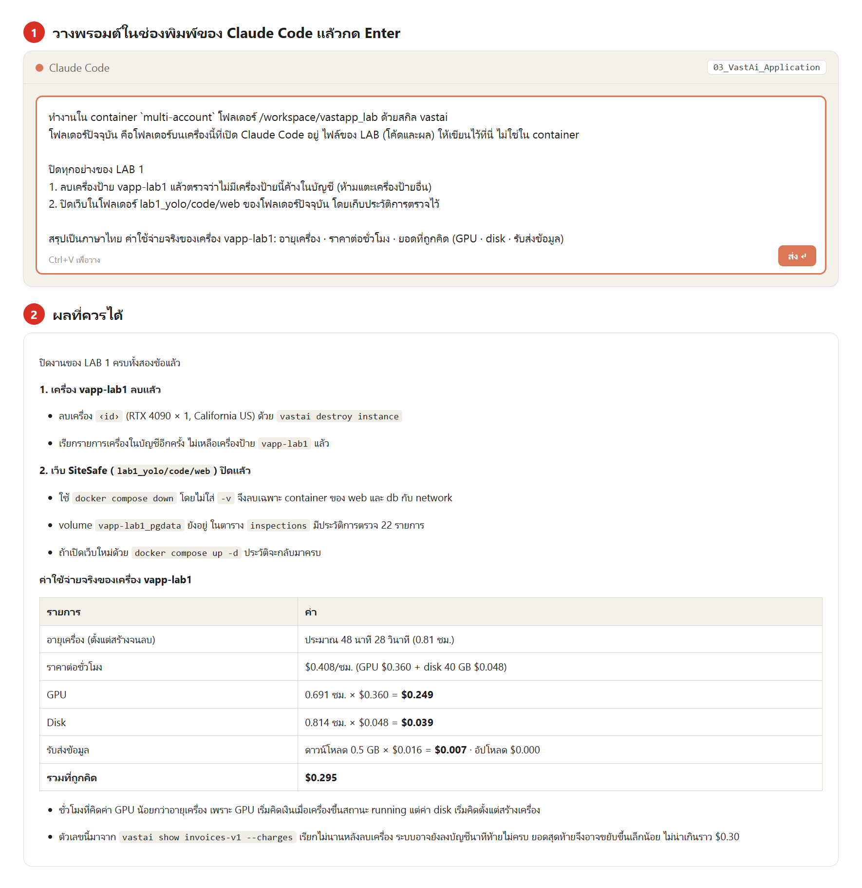
*ใช้เวลา 2 นาที · ยอดในคำตอบ ($0.295) ถูกอ่านทันทีหลังลบเครื่อง · ยอดสุดท้ายในใบแจ้งหนี้ของ Vast.ai คือ **$0.314** และเมื่อรวมเครื่องที่เปิดไม่ขึ้น 3 เครื่องเป็น **$0.381***

**อ่านผลอย่างไร**

- ต้องเห็นว่า **ไม่มีเครื่องป้ายนี้เหลือ** แล้วเปิดหน้า [Instances](https://cloud.vast.ai/instances/) ดูอีกครั้ง
- เทรนจริง 8.5 นาที แต่เครื่องเปิดอยู่ 52 นาที · **เงินเดินตลอดเวลาที่เครื่องเปิด** ไม่ใช่เฉพาะตอนเทรน
- บิลลงบัญชีช้ากว่าเวลาจริงเล็กน้อย ยอดที่อ่านทันทีหลังลบเครื่องจึงต่ำกว่ายอดสุดท้าย
- โมเดลที่เทรนได้ถูกเก็บกลับมาที่ `lab1_yolo/results/weights/best.pt` ตั้งแต่ขั้นที่ 4 · ลบเครื่องแล้วทุกอย่างบนเครื่องหายหมด

---

## ปิดท้าย · เก็บงานทั้ง LAB เป็นสกิลเวอร์ชัน 0

เราเพิ่งสั่งงาน 8 ขั้นจนสำเร็จ ถ้าต้องทำซ้ำ (เช่น เปลี่ยนจำนวน Epoch) ไม่ควรต้องวาง 8 พรอมต์และให้ AI เขียนโค้ดใหม่ทุกครั้ง · **สกิล** คือโฟลเดอร์ที่เก็บวิธีทำงานที่สำเร็จแล้ว (`SKILL.md`) พร้อมโค้ดที่ใช้ได้แล้ว (`scripts/`) ให้ AI ทำซ้ำได้ในคำสั่งเดียว

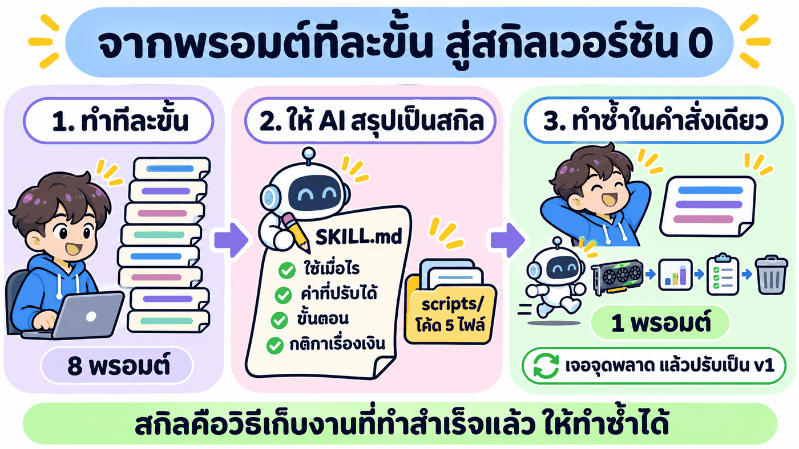

### ขั้นที่ 9 · สร้างสกิลเวอร์ชัน 0 จากงานของ LAB นี้

AI อ่านพรอมต์ โค้ด และผลของขั้นที่ 1–8 แล้วเขียน `SKILL.md` และเก็บโค้ดเข้า `scripts/`

```text
สร้างสกิลเวอร์ชัน 0 จากงานของ LAB 1 ที่เพิ่งทำเสร็จ เพื่อให้ครั้งหน้าสั่งทำซ้ำได้ในคำสั่งเดียว
1. ดูงานทั้งหมดจากพรอมต์ทุกขั้นใน lab1_yolo/PROMPTS.md โค้ดใน lab1_yolo/code และผลใน lab1_yolo/results
2. เขียนเป็นสกิลชื่อ yolo-ppe-train เก็บที่ lab1_yolo/skill_v0/SKILL.md ให้มี name กับ description (บอกว่าใช้เมื่อไร) · ค่าที่ปรับได้พร้อมค่าเริ่มต้น · ขั้นตอน · เกณฑ์ตรวจผ่าน · กติกาเรื่องเงิน (ลบเครื่องเสมอ)
3. เก็บโค้ดที่ใช้ได้แล้วจาก lab1_yolo/code (สคริปต์เทรน วัดผล และ AI server) เข้าไปไว้ใน lab1_yolo/skill_v0/scripts เพื่อให้ครั้งหน้าไม่ต้องเขียนโค้ดใหม่
4. ให้สกิลนี้เรียกใช้สกิล vastai ต่อ ไม่เขียนวิธีใช้ Vast.ai ซ้ำ
5. ติดตั้งเป็นสกิลของโปรเจกต์ที่ .claude/skills/yolo-ppe-train ของโฟลเดอร์ปัจจุบัน

สรุปเป็นภาษาไทย: สกิลทำอะไรได้ · ค่าที่ปรับได้ · ไฟล์ที่สร้าง
ไม่ต้อง commit
```

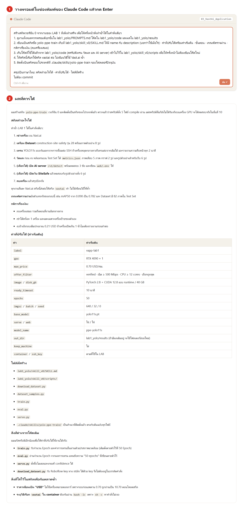
*ใช้เวลา 3 นาที · ไม่ต้องเช่าเครื่อง · สกิลที่ได้: [skill_v0/SKILL.md](skill_v0/SKILL.md) และ [skill_v0/scripts/](skill_v0/scripts/) 5 ไฟล์*

> ⚠️ หลังขั้นนี้ให้ปิดแล้วเปิด Claude Code ใหม่ 1 ครั้ง สกิลที่เพิ่งติดตั้งจึงถูกมองเห็น · ถ้า AI ตอบว่าไม่รู้จักสกิล ให้เปิดใหม่อีกครั้ง

### ขั้นที่ 10 · ลองใช้สกิลทำซ้ำในคำสั่งเดียว

AI ตัวใหม่ทำตามสกิล: เช่าเครื่อง เตรียม Dataset เทรน 10 Epoch วัดผล ลบเครื่อง และสรุปบิล โดยใช้โค้ดใน `scripts/` ไม่ต้องเขียนใหม่

```text
ใช้สกิล yolo-ppe-train เทรนโมเดลตรวจหมวกนิรภัย 10 Epoch บนเครื่องป้าย vapp-lab1-skill ไม่ต้องเปิดเว็บ เสร็จแล้วลบเครื่อง
เก็บผลไว้ที่ lab1_yolo/results/skill_v0_run ห้ามเขียนทับผลเดิมใน lab1_yolo/results
สรุปเป็นภาษาไทย: mAP50 ก่อน vs หลังบน Test Set · เวลาแต่ละขั้น · ค่าใช้จ่ายจริง
ไม่ต้อง commit
```

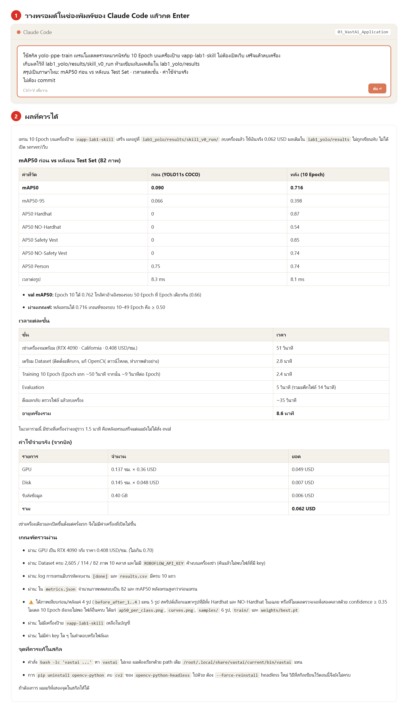
*ใช้เวลา 10 นาที · เช่าเครื่องจริงและลบเครื่องจริง · ยอดสุดท้ายในใบแจ้งหนี้คือ $0.066 · ผลอยู่ที่ [results/skill_v0_run/](results/skill_v0_run/)*

| | สั่งทีละขั้น (ขั้นที่ 1–4 และ 8) | สกิล v0 คำสั่งเดียว |
|---|---|---|
| จำนวนพรอมต์ | 5 | **1** |
| ต้องเขียนโค้ดใหม่ | ใช่ (3 ขั้น) | ไม่ (ใช้ `scripts/`) |
| จำนวน Epoch | 50 | 10 |
| เวลาเทรน | 508 วินาที | 141 วินาที |
| เวลารวม | ราว 64 นาที (รวมหาเครื่อง 38 นาที) | 10 นาที |
| mAP50 บน Test Set | 0.782 | 0.716 |
| ค่าเช่า | $0.381 (รวม AI server และเว็บ) | $0.066 |

**อ่านผลอย่างไร**

- สกิล v0 **ผ่านในรอบแรก**: AI ตัวใหม่ได้คำสั่ง 4 บรรทัด แล้วเช่า เตรียม Dataset เทรน วัดผล ลบเครื่อง และสรุปบิลเองทั้งหมด
- สกิลจดบทเรียนของรอบจริงไว้เอง เช่น เครื่องที่ running แต่ SSH ไม่ติดให้ลบทันที และถ้าเครื่องเปิดเกิน 1 ชั่วโมงให้รายงานก่อนทำต่อ
- เทรน 10 Epoch ได้ 0.716 คือ 92% ของผล 50 Epoch ด้วยเวลาเทรนไม่ถึง 1 ใน 3
- รอบนี้ได้เครื่องใน 51 วินาที ขณะที่ขั้นที่ 1 ใช้ 38 นาที · เวลาเปิดเครื่องเช่าแกว่งมาก

**v0 ยังไม่สมบูรณ์** · จุดที่ AI ต้องแก้เองระหว่างรอบทดสอบ และควรแก้ในเวอร์ชันถัดไป

| จุดที่ v0 ยังพลาด | ควรแก้อย่างไรใน v1 |
|---|---|
| วิธีเรียกคำสั่ง `vastai` ที่สกิลเขียนไว้ยังหาโปรแกรมไม่เจอ AI ต้องหาที่อยู่เต็มเอง | ระบุที่อยู่เต็มของคำสั่งไว้ในสกิล |
| ขั้นแก้ OpenCV ไม่ครบ ถอดแพ็กเกจแล้ว `cv2` หายไปด้วย AI ต้องติดตั้งซ้ำ | เขียนขั้นติดตั้ง OpenCV ที่ใช้ได้จริงให้ครบ |
| ได้ภาพเทียบก่อน/หลัง 4 ภาพแทน 5 เพราะโมเดล 10 Epoch ยังเจอทั้งสองคลาสไม่พอ | เกณฑ์ตรวจผ่านเผื่อกรณี Epoch น้อย หรือให้สคริปต์เติมภาพจากเกณฑ์อื่น |
| เครื่องว่างราว 1.5 นาทีระหว่างเทรนจบกับเริ่มวัดผล | สั่งให้วัดผลต่อทันทีเมื่อเทรนจบ |
| ป้ายเครื่องเริ่มต้น `vapp-lab1` ซ้ำกับ LAB หลัก อาจชนกับเครื่องที่เปิดค้าง | ตั้งป้ายเริ่มต้นแยก |
| งบอ้างอิงในสกิล (เครื่องเปิดราว 21 นาที · 0.21 USD) ต่ำกว่าที่รอบเต็มใช้จริง (52 นาที · $0.381) | แก้งบอ้างอิงตามบิลจริง |

วิธีปรับคือสั่ง AI ด้วยพรอมต์อีก 1 อันให้แก้สกิลตามตารางนี้ แล้วลองใช้ซ้ำ · สกิลจึงดีขึ้นทีละเวอร์ชันจากหลักฐานของการรันจริง

---

## ไฟล์ในโฟลเดอร์นี้

| ไฟล์ / โฟลเดอร์ | คืออะไร |
|---|---|
| `PROMPTS.md` | พรอมต์ทั้ง 10 ขั้นสำหรับคัดลอก |
| `code/` | โค้ดของคุณเอง · **ตอนเริ่มยังไม่มีโฟลเดอร์นี้** AI จะสร้างและเขียนทุกไฟล์จากพรอมต์ขั้นที่ 2–6 (ไม่ถูกเก็บขึ้น git) |
| `code_reference/` | ตัวอย่างโค้ดที่ AI เขียนให้ในรอบจริง: `download_dataset.py` · `dataset_samples.py` (ขั้นที่ 2) · `train.py` (ขั้นที่ 3) · `eval.py` (ขั้นที่ 4) · `serve.py` (ขั้นที่ 5) · `web/` (ขั้นที่ 6) · มีไว้เทียบ ไม่ต้องคัดลอกไปใช้ |
| `skill_v0/` | สกิลที่ AI สร้างในขั้นที่ 9: `SKILL.md` และ `scripts/` |
| `results/` | ผลจากการรันจริง: `metrics.json` · `dataset_samples.jpg` · กราฟและภาพก่อน/หลังใน `images/` · รูปตัวอย่างของเว็บใน `samples/` · โมเดล `weights/best.pt` · คำตอบของทุกขั้นใน `answers/` · ภาพหน้าจอและ GIF ของเว็บใน `web/` · ผลของรอบสกิลใน `skill_v0_run/` |
| `image/` | ภาพประกอบของ LAB นี้ |
