# LAB 2 · เทรนงานเดิมบน 1 GPU เทียบ 2 GPU: เร็วขึ้นกี่เท่า คุ้มเงินไหม

[← กลับหน้ารวมของบท](../README.md) · เปิด Claude Code ที่โฟลเดอร์ของบท `03_VastAi_Application` ("โฟลเดอร์ปัจจุบัน" ในพรอมต์หมายถึงโฟลเดอร์นั้น) · ทำ [LAB 0](../README.md#lab-0--เตรียม-key-3-ตัว) ก่อน

## ทำไปเพื่ออะไร


เครื่องเช่าที่มี GPU 2 ใบ ราคาเกือบ 2 เท่าของเครื่อง 1 ใบ · คำถามของ LAB นี้คือ **เพิ่ม GPU จาก 1 เป็น 2 ใบ แล้วเทรนเร็วขึ้นกี่เท่า และคุ้มเงินไหม**

เราไม่เดา แต่ **วัดจริง**: เทรนงานเดียวกัน 2 รอบบนเครื่องเดียวกัน ต่างกันแค่จำนวน GPU แล้วเทียบเวลาและเงินต่อ 1 Epoch

LAB นี้มี **6 ขั้น ทุกขั้นคือ 1 พรอมต์ · โค้ดทุกไฟล์ AI เขียนให้จากพรอมต์ เริ่มจากโฟลเดอร์ว่าง** · ปิดท้ายด้วยอีก 2 ขั้นที่เก็บงานทั้งหมดเป็น **สกิลเวอร์ชัน 0**


## รู้จัก Dataset

| หัวข้อ | รายละเอียด |
|---|---|
| ชื่อ | [hard-hat-workers](https://universe.roboflow.com/joseph-nelson/hard-hat-workers) รุ่น 13 ของ joseph-nelson บน Roboflow Universe |
| เกี่ยวกับอะไร | ภาพคนงานหน้างาน ตีกรอบที่ศีรษะ บอกว่าสวมหมวกนิรภัยหรือไม่ |
| ที่มา | ชุด Hard Hat Workers ของ Northeastern University (2019) · รุ่นนี้ Roboflow เพิ่ม Augmentation ให้แล้ว (หมุนภาพ ทำขาวดำ และแปะสี่เหลี่ยมดำ) |
| สัญญาอนุญาต | Public Domain (ตามหน้า Dataset บน Roboflow Universe) |
| คลาส (2) | `0 head` = ไม่สวมหมวก · `1 helmet` = สวมหมวกนิรภัย |
| ขนาด | 16,867 ภาพ · 63,013 กรอบ · ทุกภาพ 416 × 416 · 557 MB |

| ชุด | จำนวนภาพ | กรอบ `head` | กรอบ `helmet` |
|---|---:|---:|---:|
| Training Set | 14,748 | 13,670 | 41,450 |
| Validation Set | 1,413 | 1,339 | 3,913 |
| Test Set | 706 | 726 | 1,915 |

ภาพตัวอย่างนี้ได้จากพรอมต์ขั้นที่ 2 · กรอบวาดจาก label จริง

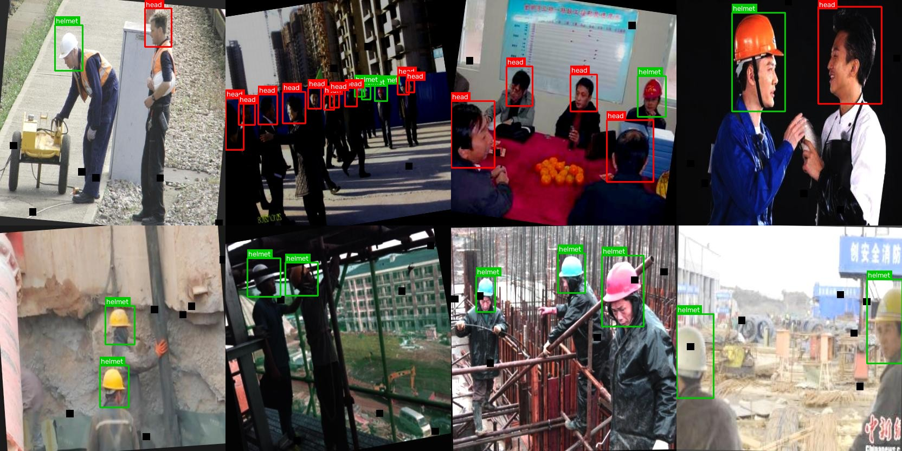

label ของ 1 กรอบคือ 1 บรรทัด มี 5 ช่อง ทุกค่าเป็นสัดส่วนของภาพ (0–1)

`1 0.5697 0.3029 0.1226 0.1779`

| ช่อง | ค่า | ความหมาย |
|---|---|---|
| 1 | `1` | คลาส `helmet` |
| 2–3 | `0.5697` `0.3029` | จุดกลางกรอบ x, y (ราว 237, 126 px) |
| 4–5 | `0.1226` `0.1779` | กว้าง, สูง ของกรอบ (ราว 51 × 74 px) |

**ทำไมใช้ชุดนี้** งานเดียวกับ LAB 1 (ตรวจหมวกนิรภัย) แต่ภาพมากกว่าราว 5.7 เท่า · 1 Epoch จึงมีหลายร้อย step เวลาที่วัดได้นิ่งพอจะเทียบกัน

## รู้จักโมเดลที่ใช้

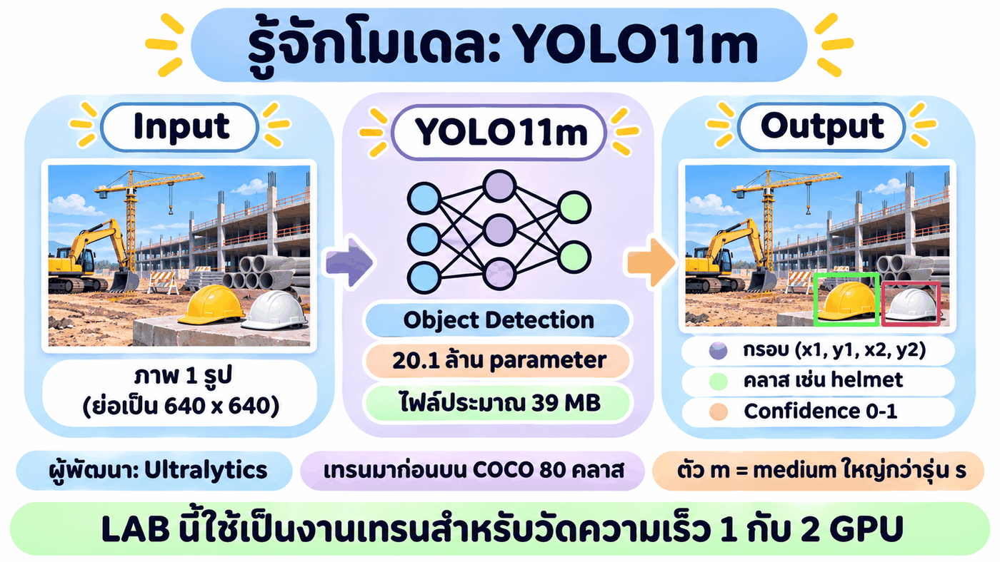

| หัวข้อ | YOLO11m |
|---|---|
| ประเภท | Object Detection |
| Input | ภาพ 1 รูป (ย่อเป็น 640 × 640) |
| Output | รายการกรอบ แต่ละกรอบมีพิกัด คลาส และ Confidence |
| ขนาด | 20.1 ล้าน parameter · ไฟล์ประมาณ 39 MB |
| ที่มา | [Ultralytics](https://docs.ultralytics.com/models/yolo11/) · เทรนมาก่อนบน COCO 80 คลาส · ตัว `m` คือรุ่น medium |
| LAB นี้ใช้ทำอะไร | เป็น "งานเทรน" ที่หนักพอให้ GPU ทำงานเต็ม (ใหญ่กว่า `yolo11s` ของ LAB 1 ราว 2 เท่า) · เป้าหมายคือวัดความเร็ว ไม่ใช่ทำโมเดลให้แม่นที่สุด |

## ทฤษฎีที่ต้องรู้

### 1 · Data-parallel Multi-GPU Training (DDP)

**คืออะไร** เทรนโมเดลเดียวบน GPU หลายใบ · ทุกใบมี **สำเนาโมเดลครบชุด** แล้วแบ่งภาพใน Batch กันคนละส่วน · ใน PyTorch เรียกว่า Distributed Data Parallel (DDP)

**ทำไมต้องใช้** โมเดลใส่ใน GPU ใบเดียวได้อยู่แล้ว แต่อยากให้ 1 Epoch เสร็จเร็วขึ้น

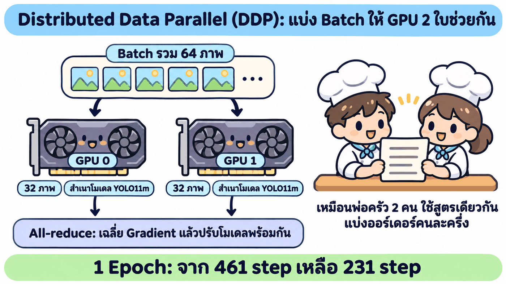

**ทำงานอย่างไร** ทุก step มี 3 ช่วง

1. แต่ละ GPU รับภาพ 32 ภาพ คำนวณ Forward + Backward ได้ Gradient ของตัวเอง
2. **All-reduce** เฉลี่ย Gradient ของทุกใบให้เป็นค่าเดียวกัน
3. ทุกใบปรับ (Update) โมเดลด้วยค่าเดียวกัน โมเดลทุกสำเนาจึงยังเหมือนกัน

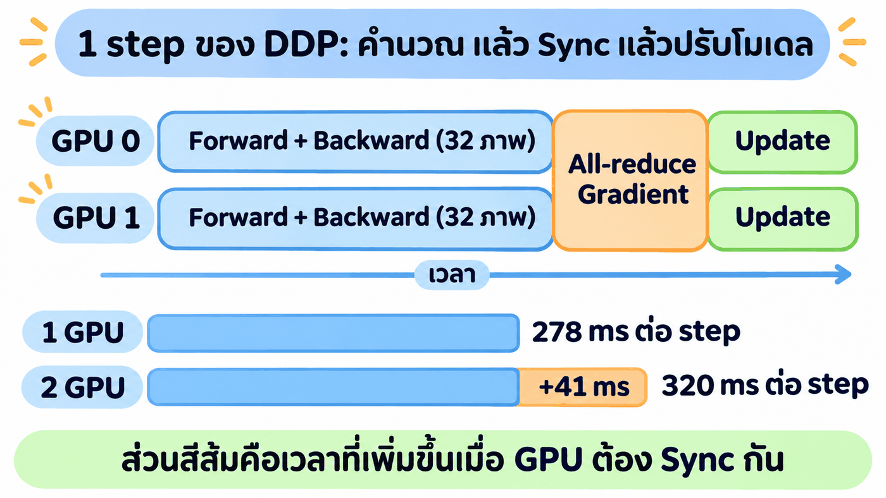

**ตัวเลขจาก LAB นี้**

| | 1 GPU | 2 GPU |
|---|---|---|
| Batch รวม (32 ภาพต่อ GPU) | 32 | 64 |
| step ต่อ Epoch | 461 | 231 |
| ภาพต่อวินาที | 114.9 | 199.6 |

Batch รวมโตขึ้น 2 เท่า จำนวน step จึงเหลือครึ่งเดียว · ถ้าแต่ละ step ใช้เวลาเท่าเดิม Epoch จะเร็วขึ้น 2 เท่าพอดี

### 2 · Speedup และ Scaling Efficiency

**คืออะไร**

| ค่า | สูตร | ความหมาย |
|---|---|---|
| Speedup | เวลา 1 GPU ÷ เวลา N GPU | เร็วขึ้นกี่เท่า |
| Ideal | N เท่า | เร็วขึ้นเท่าจำนวน GPU พอดี |
| Efficiency | Speedup ÷ N | ได้กี่ % ของ Ideal |

**ทำไมต้องใช้** เป็นตัวเลขที่บอกว่า GPU ที่จ่ายเพิ่ม "ได้งานจริงเท่าไร"

**วัดอย่างไร** ใช้เครื่องเดียวกัน ค่าการเทรนเดียวกัน เปลี่ยนแค่จำนวน GPU · วัดเป็น **วินาทีต่อ Epoch** โดยไม่นับ Epoch แรก (ช่วงเริ่มต้น) และ Epoch สุดท้าย (มีการวัด Validation)

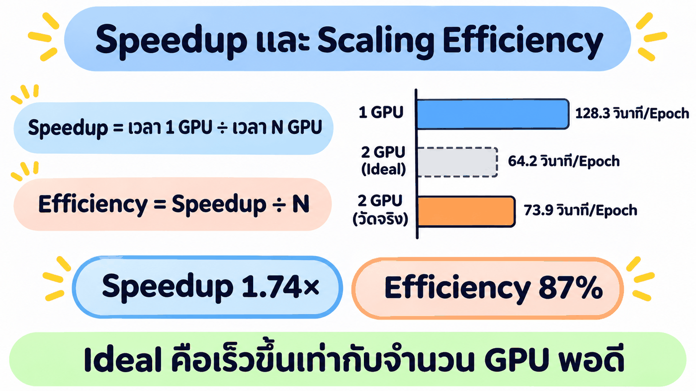

**ตัวเลขจาก LAB นี้** 128.3 ÷ 73.9 = **1.74 เท่า** · 1.74 ÷ 2 = **87%**

### 3 · ทำไม Scaling ไม่เป็นเส้นตรง

**คืออะไร** ส่วนของงานที่ **แบ่งให้ GPU ทำพร้อมกันไม่ได้** คือการ Sync ระหว่าง GPU · ส่วนนี้ไม่เร็วขึ้นตามจำนวน GPU จึงเป็นเพดานของ Speedup (หลักเดียวกับ Amdahl's law)

**ทำไมต้องรู้** จะได้แยกออกว่าช้าเพราะอะไร: ทางเชื่อมระหว่าง GPU หรือ CPU เตรียมภาพไม่ทัน

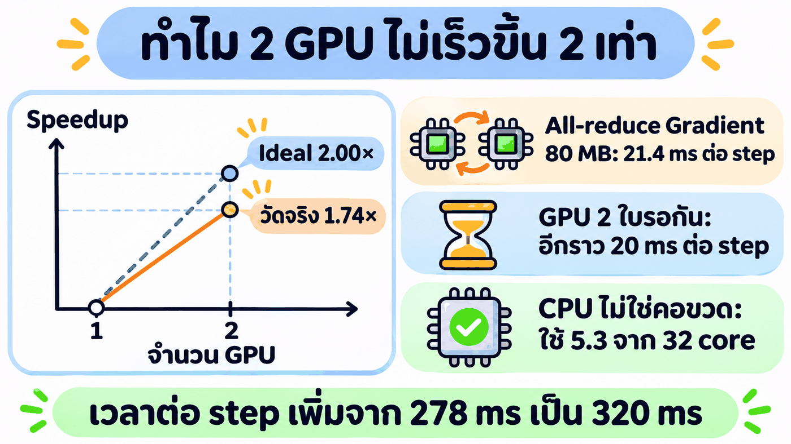

**ทำงานอย่างไร** Gradient ของ YOLO11m ราว 80 MB ต้องถูกส่งข้าม GPU ทุก step · ความเร็วขึ้นกับ **ทางเชื่อม** ระหว่าง GPU ของเครื่องนั้น

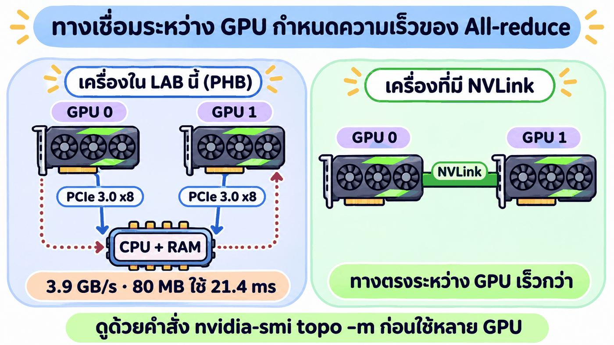

ระดับของทางเชื่อมที่คำสั่ง `nvidia-smi topo -m` รายงาน เรียงจากดีไปแย่

| ค่า | ความหมาย |
|---|---|
| `NV#` | NVLink: สายตรงระหว่าง GPU |
| `PIX` / `PXB` | อยู่ใต้ PCIe switch เดียวกัน ไม่ผ่าน CPU |
| **`PHB`** | ผ่าน PCIe Host Bridge ของ CPU · **เครื่องใน LAB นี้** |
| `NODE` / `SYS` | ข้าม Host Bridge หรือข้าม CPU socket |

**ตัวเลขจาก LAB นี้**

| ค่าที่วัด | 1 GPU | 2 GPU |
|---|---|---|
| วินาทีต่อ step | 0.278 | 0.320 (+41 ms) |
| All-reduce 80 MB | – | 21.4 ms (3.9 GB/s) |
| GPU util เฉลี่ย | 85.5% | 81.1% / 81.3% |
| CPU ที่ใช้จริง | 2.8 core | 5.3 core (เครื่องให้ 32 core) |

- เวลาที่เพิ่ม 41 ms ราวครึ่งหนึ่งคือ All-reduce (21.4 ms) ที่เหลือคือเวลาที่ GPU ใบหนึ่งรออีกใบ
- **CPU ไม่ใช่คอขวด** ใช้เพียง 5.3 core · คอขวดที่วัดได้คือการ Sync ผ่าน PCIe
- CPU ที่ใช้จริงคิดจากเวลา CPU ที่งานใช้ ÷ เวลาจริง ไม่ใช่จำนวน core ที่เครื่องมี

### 4 · Cost per Epoch

**คืออะไร** เงินที่จ่ายเพื่อเทรน 1 Epoch = ราคาต่อชั่วโมง × วินาทีต่อ Epoch ÷ 3600

**ทำไมต้องใช้** เร็วขึ้นไม่ได้แปลว่าถูกลง · ถ้าราคาเพิ่มเร็วกว่า Speedup เงินต่อ Epoch จะแพงขึ้น

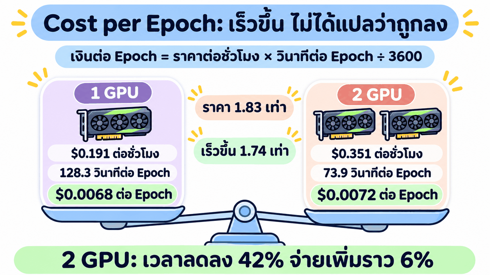

**ตัวเลขจาก LAB นี้** (ราคาตลาดที่ถูกที่สุดของ RTX 3090 ตอนที่วัด)

| | 1 GPU | 2 GPU |
|---|---|---|
| ราคาต่อชั่วโมง | $0.191 | $0.351 (1.83 เท่า) |
| วินาทีต่อ Epoch | 128.3 | 73.9 (เร็วขึ้น 1.74 เท่า) |
| **เงินต่อ Epoch** | **$0.0068** | $0.0072 |

**ควรใช้หลาย GPU เมื่อไร**

- งานใหญ่ เทรนนาน และ **เวลาสำคัญกว่าเงินเล็กน้อย**
- ราคาเครื่อง N ใบ ไม่เกิน N เท่าของเครื่อง 1 ใบ
- เครื่องมีทางเชื่อมที่ดี (NVLink หรืออยู่ใต้ PCIe switch เดียวกัน) · ดู `nvidia-smi topo -m` ทุกครั้ง
- งานเล็กหรือเน้นประหยัด → 1 GPU

## การทดลอง

| หัวข้อ | รายละเอียด |
|---|---|
| Dataset | hard-hat-workers รุ่น 13 · Training Set 14,748 ภาพ |
| โมเดล | `yolo11m` ที่เทรนบน COCO มาแล้ว |
| เทียบ A กับ B | **A** = เทรนด้วย GPU 1 ใบ · **B** = เทรนงานเดิมด้วย GPU 2 ใบ (DDP) บนเครื่องเดียวกัน |
| ค่าที่ตรึงไว้ | 5 Epoch · ภาพ 640 · batch 32 ภาพต่อ GPU · seed 0 · วัด Validation ครั้งเดียวตอนจบ |
| วิธีวัด | วินาทีต่อ Epoch (เฉลี่ย Epoch 2–4) · วินาทีต่อ step · GPU util · CPU ที่ใช้จริง · เวลา All-reduce 80 MB · mAP50 |
| เครื่อง | RTX 3090 2 ใบในเครื่องเดียว · เพดาน $0.60/ชม. · ได้เครื่อง $0.414/ชม. |
| เวลาและค่าเช่าจริง | 6 ขั้นรวมราว 64 นาที · เครื่องเปิด 76.5 นาที · **$0.51** |

ทำตามลำดับขั้นที่ 1 → 6 ให้ครบในรอบเดียว · คัดลอกพรอมต์ไปวางในช่องพิมพ์ของ Claude Code ทีละขั้น · โค้ดที่ AI เขียนจะอยู่ในโฟลเดอร์ `lab2_multigpu/code` ซึ่งเริ่มจากว่าง

## ขั้นที่ 1 · เช่าเครื่อง 2 GPU

AI ค้นหาเครื่องที่มี RTX 3090 2 ใบในเครื่องเดียว เช่า รอจนพร้อม แล้วรายงานว่า GPU ต่อถึงกันแบบไหน

```text
ทำงานใน container `multi-account` โฟลเดอร์ /workspace/vastapp_lab ด้วยสกิล vastai

เช่าเครื่องที่มี GPU 2 ใบในเครื่องเดียว สำหรับเทียบความเร็ว 1 กับ 2 GPU
1. เช่าเครื่อง RTX 3090 2 ใบ ราคารวมไม่เกิน $0.60 ต่อชั่วโมง ตั้งป้ายเครื่องว่า vapp-lab2
2. เลือกเครื่อง verified ที่ต่อ SSH ได้ตรง เน็ตเร็ว มี CPU 16 cores ขึ้นไป ไม่อยู่ในจีน แล้วเอาเครื่องที่ถูกที่สุด
3. ใช้ image PyTorch 2.8 ที่มี CUDA 12.8 disk 60 GB
4. รอจนเครื่องพร้อมและเข้าไปเห็น GPU ครบ 2 ใบ ถ้าเกิน 10 นาทียังไม่พร้อม ให้ลบแล้วเช่าเครื่องอื่น
กุญแจ SSH อยู่ที่ /workspace/vastai_lab/Devtool_SSH/devtoolSSH

สรุปเป็นตารางภาษาไทย: GPU · ราคาต่อชั่วโมง · ที่ตั้ง · CPU cores · GPU ต่อถึงกันแบบไหน (NVLink หรือ PCIe และข้าม CPU socket ไหม) แล้วบอกว่าเครื่องยังเปิดอยู่
```

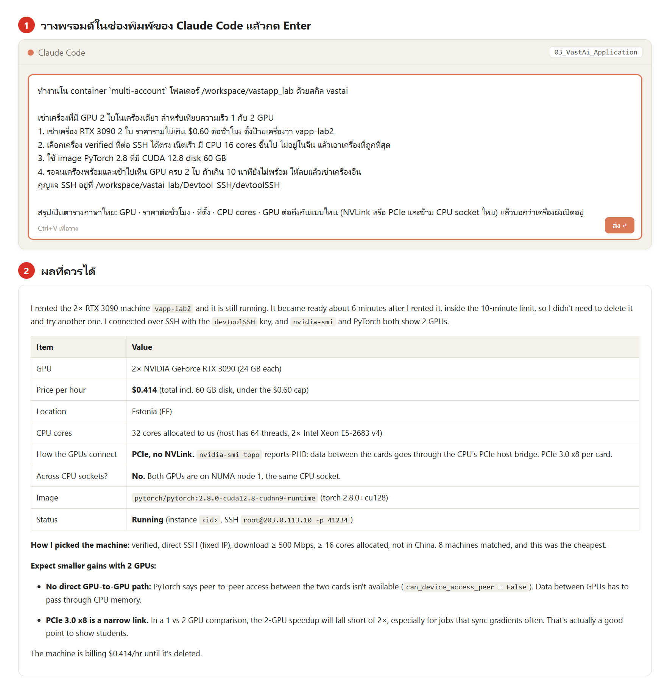
*ใช้เวลา 7 นาที (รอเครื่องพร้อมราว 6 นาที) · ที่อยู่เครื่องในภาพเป็นค่าตัวอย่าง*

**อ่านผลอย่างไร**

- ดูแถว **GPU ต่อถึงกันแบบไหน** ก่อน: เครื่องนี้เป็น `PHB` ไม่มี NVLink → คาดได้เลยว่า 2 GPU จะไม่ถึง 2 เท่า (ทฤษฎีข้อ 3)
- 2 ใบอยู่ CPU socket เดียวกัน ซึ่งดีกว่าแบบข้าม socket
- **ตั้งแต่ขั้นนี้เงินเริ่มเดิน** ชั่วโมงละ $0.414 จนกว่าจะลบเครื่องในขั้นที่ 6

## ขั้นที่ 2 · เตรียม Dataset และดูภาพตัวอย่าง

AI ดาวน์โหลด Dataset ลงเครื่องเช่า และเขียน `code/show_samples.py` (ทำภาพตัวอย่าง) พร้อมสคริปต์ดาวน์โหลดและสคริปต์นับจำนวน

```text
ทำงานใน container `multi-account` โฟลเดอร์ /workspace/vastapp_lab ด้วยสกิล vastai
เครื่องที่ใช้คือเครื่องป้าย vapp-lab2 · กุญแจ SSH อยู่ที่ /workspace/vastai_lab/Devtool_SSH/devtoolSSH
โค้ดและผลที่เก็บกลับ ให้อยู่ในโฟลเดอร์ lab2_multigpu ของโฟลเดอร์ที่เปิด Claude Code อยู่ (ไม่ใช่ใน container)

เตรียม Dataset ภาพคนงานสวม/ไม่สวมหมวกนิรภัยบนเครื่องที่เช่า
1. ติดตั้ง ultralytics และ roboflow ให้ใช้งานได้
2. ดาวน์โหลด Dataset hard-hat-workers รุ่น 13 ของ joseph-nelson จาก Roboflow ในรูปแบบ YOLO
3. ใช้ ROBOFLOW_API_KEY จากไฟล์ .env ของโฟลเดอร์ปัจจุบัน ห้ามแสดงค่า key และห้ามทิ้ง key ไว้บนเครื่องที่เช่า
4. เขียนสคริปต์ไว้ที่ lab2_multigpu/code/show_samples.py ทำภาพตัวอย่าง 8 รูปจาก Training Set เรียงเป็นตาราง วาดกรอบและชื่อคลาสจาก label จริงทับบนรูป
   แล้วเก็บภาพกลับมาที่ lab2_multigpu/results/dataset_samples.jpg

สรุปเป็นตารางภาษาไทย: จำนวนภาพของ Training Set · Validation Set · Test Set · จำนวนกรอบของแต่ละคลาสในแต่ละชุด · ขนาด Dataset
ยก label ของจริง 1 บรรทัดมาให้ดู พร้อมอธิบายว่าแต่ละช่องคืออะไร แล้วบอกว่าเครื่องยังเปิดอยู่
```

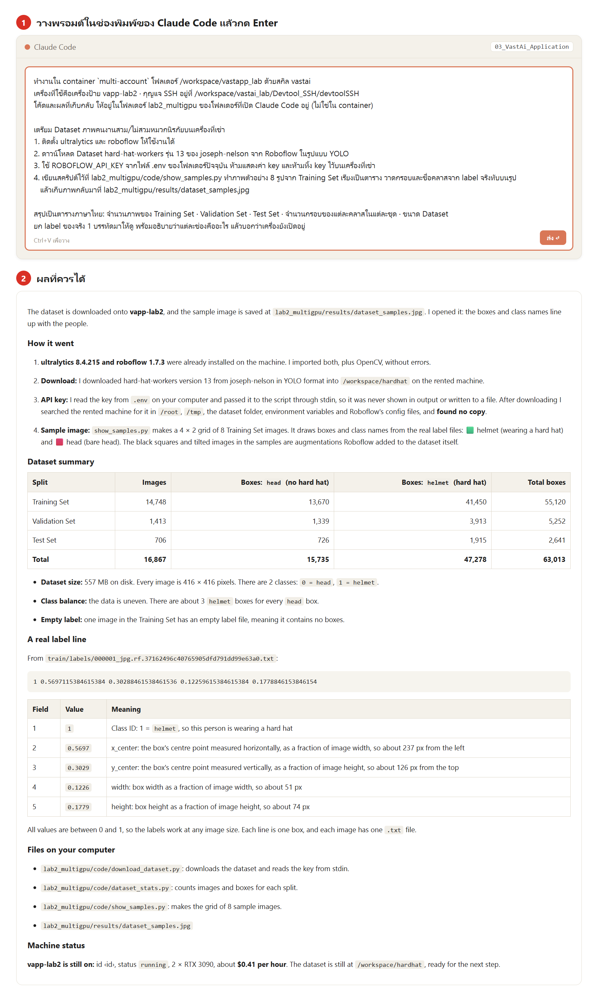
*ใช้เวลา 3 นาที · รอบนี้ AI ตอบเป็นภาษาอังกฤษ เนื้อหาเหมือนกัน*

ตัวอย่างโค้ดที่ AI เขียนให้ในรอบจริง (ของคุณอาจต่างกัน): [code_reference/show_samples.py](code_reference/show_samples.py) · [download_dataset.py](code_reference/download_dataset.py) · [dataset_stats.py](code_reference/dataset_stats.py)

**อ่านผลอย่างไร**

- ต้องได้ **14,748 / 1,413 / 706 ภาพ และ 2 คลาส** แล้วเปิด `results/dataset_samples.jpg` ดูว่ากรอบตรงกับศีรษะคน (ภาพอยู่ในหัวข้อ [รู้จัก Dataset](#รู้จัก-dataset))
- กรอบ `helmet` มีมากกว่า `head` ราว 3 เท่า = ข้อมูลไม่สมดุล
- AI ส่ง key ให้เครื่องเช่าโดยไม่เขียนลงไฟล์ แล้วตรวจซ้ำว่าไม่มี key ค้าง

## ขั้นที่ 3 · เขียนสคริปต์วัดความเร็ว แล้วเทรนด้วย GPU 1 ใบ

AI เขียน `code/bench.py` (สคริปต์เดียวใช้ทั้ง 1 และ 2 GPU) ลองรันสั้น ๆ ทั้งสองแบบ แล้วเทรนจริงด้วย GPU 1 ใบเป็นเส้นฐาน

```text
ทำงานใน container `multi-account` โฟลเดอร์ /workspace/vastapp_lab ด้วยสกิล vastai
เครื่องที่ใช้คือเครื่องป้าย vapp-lab2 · กุญแจ SSH อยู่ที่ /workspace/vastai_lab/Devtool_SSH/devtoolSSH
โค้ดและผลที่เก็บกลับ ให้อยู่ในโฟลเดอร์ lab2_multigpu ของโฟลเดอร์ที่เปิด Claude Code อยู่ (ไม่ใช่ใน container)

เขียนสคริปต์วัดความเร็วการเทรน แล้ววัดรอบแรกด้วย GPU 1 ใบเป็นเส้นฐานไว้เทียบ
1. เขียนสคริปต์ไว้ที่ lab2_multigpu/code/bench.py รับจำนวน GPU (1 หรือ 2) แล้วเทรน yolo11m ที่เทรนบน COCO มาแล้ว ด้วย Dataset ที่เตรียมไว้
   ค่าเดียวกันทุกรอบ: 5 Epoch · ภาพ 640 · batch 32 ภาพต่อ GPU (2 ใบ = batch รวม 64) · seed 0 · ไม่วัด Validation ระหว่างเทรน วัดครั้งเดียวตอนจบ
2. สคริปต์บันทึกผลรอบละ 1 ไฟล์ JSON: วินาทีต่อ Epoch (เฉลี่ยโดยไม่นับ Epoch แรกและ Epoch สุดท้าย) · วินาทีต่อ step · mAP50 ตอนจบ
   · GPU util เฉลี่ยของแต่ละใบ · CPU ที่งานใช้จริงกี่ core (คิดจากเวลา CPU ที่ใช้ ไม่ใช่จำนวน core ที่เครื่องมี)
3. ถ้าใช้ 2 GPU ให้วัดเพิ่มว่าการรวม gradient ขนาด 80 MB ระหว่าง GPU (all-reduce) ใช้เวลากี่มิลลิวินาที · ก่อนเริ่มให้ตรวจว่า GPU ว่าง
4. ลองรันสั้นๆ ก่อน (ภาพ 5% 2 Epoch) ทั้ง 1 และ 2 GPU ให้แน่ใจว่าใช้ได้ แล้วรันจริงด้วย GPU 1 ใบ
5. ให้เทรนต่อได้แม้การเชื่อมต่อหลุด รายงานทุก 2–3 นาทีว่าถึง Epoch ไหน และรอจนเสร็จ

สรุปเป็นตารางภาษาไทย: วินาทีต่อ Epoch · วินาทีต่อ step · GPU util · CPU ที่ใช้กี่ core · mAP50 แล้วบอกว่าเครื่องยังเปิดอยู่
```

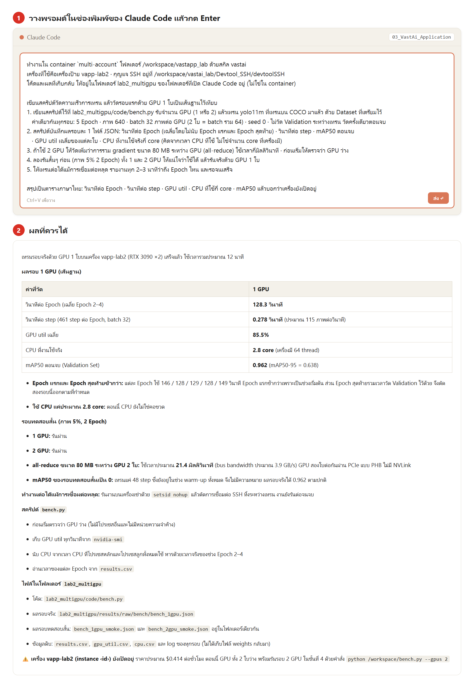
*ใช้เวลา 36 นาที · เทรนจริง 12 นาที ที่เหลือคือ AI เขียนสคริปต์และลองรันสั้น*

ตัวอย่างโค้ดที่ AI เขียนให้ในรอบจริง (ของคุณอาจต่างกัน): [code_reference/bench.py](code_reference/bench.py)

| Epoch | 1 | 2 | 3 | 4 | 5 |
|---|---|---|---|---|---|
| วินาที (1 GPU) | 146.1 | 128.1 | 128.5 | 128.3 | 148.8 |

**อ่านผลอย่างไร**

- Epoch 1 ช้าเพราะเป็นช่วงเริ่มต้น Epoch 5 ช้าเพราะรวมการวัด Validation · จึงเฉลี่ยเฉพาะ Epoch 2–4 ได้ **128.3 วินาที**
- Epoch 2–4 ต่างกันไม่ถึง 0.5 วินาที = การวัดนิ่ง เชื่อถือได้
- ใช้ CPU 2.8 core และ GPU util 85.5% = GPU คือส่วนที่ทำงานหนัก ไม่ได้รอ CPU
- รอบลองสั้นได้ mAP50 เป็น 0 เพราะเทรนแค่ 48 step ถือว่าปกติ · มีไว้ตรวจว่าสคริปต์รันได้ ก่อนเสียเวลารอบจริง

## ขั้นที่ 4 · เทรนงานเดิมด้วย GPU 2 ใบ

รันสคริปต์เดิมจากขั้นที่ 3 โดยไม่แก้ เปลี่ยนแค่จำนวน GPU เป็น 2 · ขั้นนี้ไม่มีโค้ดใหม่

```text
ทำงานใน container `multi-account` โฟลเดอร์ /workspace/vastapp_lab ด้วยสกิล vastai
เครื่องที่ใช้คือเครื่องป้าย vapp-lab2 · กุญแจ SSH อยู่ที่ /workspace/vastai_lab/Devtool_SSH/devtoolSSH
โค้ดและผลที่เก็บกลับ ให้อยู่ในโฟลเดอร์ lab2_multigpu ของโฟลเดอร์ที่เปิด Claude Code อยู่ (ไม่ใช่ใน container)

เทรนงานเดิมซ้ำบนเครื่องเดิม แต่แบ่งให้ GPU หลายใบช่วยกัน
1. รันสคริปต์ที่เขียนไว้ในขั้นที่ 3 (lab2_multigpu/code/bench.py) ค่าเดิมทุกอย่าง เปลี่ยนแค่จำนวน GPU เป็น 2 ใบ
2. ให้เทรนต่อได้แม้การเชื่อมต่อหลุด รายงานทุก 2–3 นาที และรอจนเสร็จ
3. ถ้าต้องแก้สคริปต์ ให้รันรอบ 1 GPU ใหม่ด้วย เพื่อให้ทั้ง 2 รอบเทียบกันได้

สรุปเป็นตารางภาษาไทยเทียบ 1 กับ 2 GPU: วินาทีต่อ Epoch · เร็วขึ้นกี่เท่า · วินาทีต่อ step · GPU util · CPU ที่ใช้กี่ core · เวลา all-reduce · mAP50 แล้วบอกว่าเครื่องยังเปิดอยู่
```

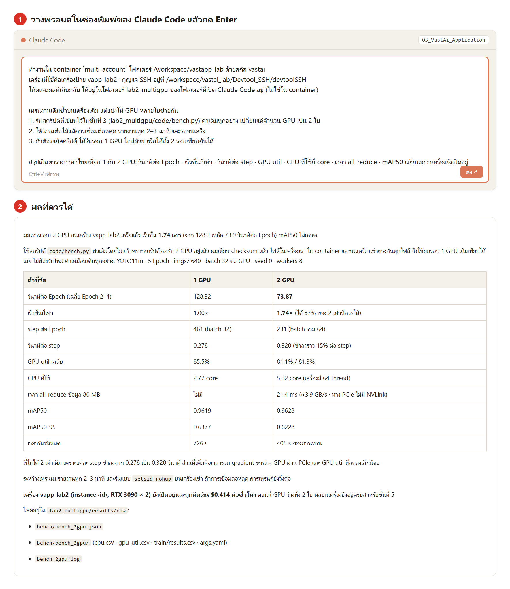
*ใช้เวลา 11 นาที · เทรนจริงราว 8 นาที*

| ค่าที่วัด | 1 GPU | 2 GPU |
|---|---|---|
| วินาทีต่อ Epoch (เฉลี่ย Epoch 2–4) | 128.3 | **73.9** |
| เร็วขึ้น | 1.00× | **1.74×** |
| step ต่อ Epoch | 461 | 231 |
| วินาทีต่อ step | 0.278 | 0.320 |
| mAP50 / mAP50-95 | 0.962 / 0.638 | 0.963 / 0.623 |

**อ่านผลอย่างไร**

- step ลดเหลือครึ่ง (461 → 231) แต่แต่ละ step **ช้าลงราว 15%** (0.278 → 0.320 วินาที) ผลจึงเป็น 1.74 เท่า ไม่ใช่ 2 เท่า
- mAP50 เท่าเดิม (0.962 กับ 0.963) = DDP ทำให้เร็วขึ้นโดยคุณภาพโมเดลไม่ลด
- ข้อ 3 ของพรอมต์สำคัญ: ถ้าสคริปต์ถูกแก้ ต้องวัด 1 GPU ใหม่ด้วย ไม่เช่นนั้นสองรอบเทียบกันไม่ได้

## ขั้นที่ 5 · สรุปตาราง กราฟ และเงินต่อ Epoch

AI ค้นราคาตลาด นำผลดิบกลับมา แล้วเขียน `code/report.py` คำนวณทุกตัวเลขลง `results/metrics.json` และวาดกราฟ 4 รูป

```text
ทำงานใน container `multi-account` โฟลเดอร์ /workspace/vastapp_lab ด้วยสกิล vastai
เครื่องที่ใช้คือเครื่องป้าย vapp-lab2 · กุญแจ SSH อยู่ที่ /workspace/vastai_lab/Devtool_SSH/devtoolSSH
โค้ดและผลที่เก็บกลับ ให้อยู่ในโฟลเดอร์ lab2_multigpu ของโฟลเดอร์ที่เปิด Claude Code อยู่ (ไม่ใช่ใน container)

สรุปผลทั้ง 2 รอบเป็นตารางและกราฟ แล้วคิดเงินต่อ 1 Epoch
1. ค้นราคาตลาดตอนนี้ของเครื่อง RTX 3090 แบบ 1 ใบ และ 2 ใบ ที่ถูกที่สุด (verified ต่อ SSH ได้ตรง ไม่อยู่ในจีน disk 60 GB)
2. นำผลของทั้ง 2 รอบ (ไฟล์ JSON และข้อมูลดิบ) กลับมาไว้ที่ lab2_multigpu/results/raw
3. เขียนสคริปต์ไว้ที่ lab2_multigpu/code/report.py อ่านผลทั้ง 2 รอบกับราคา แล้วคำนวณ ideal (เวลา 1 GPU ÷ จำนวน GPU) · speedup · efficiency
   · เงินต่อ Epoch (ราคาตลาด และราคาเครื่องที่เช่าจริง) แล้วเขียนทุกตัวเลขลง lab2_multigpu/results/metrics.json
4. ให้สคริปต์วาดกราฟ 4 รูปไว้ที่ lab2_multigpu/results/images (ข้อความในกราฟเป็นภาษาอังกฤษ): เวลาต่อ Epoch เทียบเส้น ideal · speedup เทียบเส้น ideal
   · เงินต่อ Epoch · คอขวด (เวลาต่อ step แยกส่วนคำนวณกับส่วนที่เพิ่มขึ้น และ GPU util เทียบ CPU ที่ใช้)

สรุปเป็นตารางภาษาไทย 1 กับ 2 GPU: วินาทีต่อ Epoch · ideal · speedup · efficiency · ราคาต่อชั่วโมง · เงินต่อ Epoch แล้วตอบ 3 ข้อ:
เร็วขึ้นกี่เท่า · แบบไหนคุ้มเงินที่สุดต่อ 1 Epoch · ทำไมไม่เร็วขึ้นตามจำนวน GPU (อ้างตัวเลขที่วัดได้) แล้วบอกว่าเครื่องยังเปิดอยู่
```

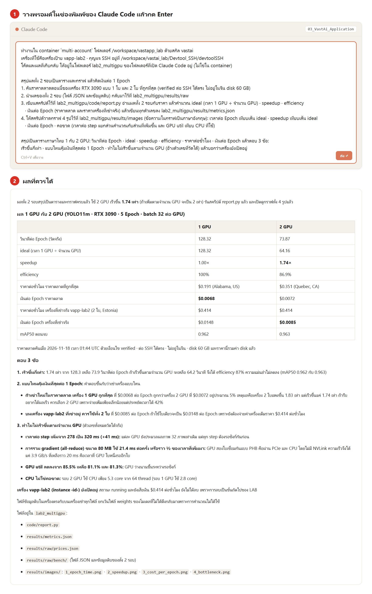
*ใช้เวลา 4 นาที*

ตัวอย่างโค้ดที่ AI เขียนให้ในรอบจริง (ของคุณอาจต่างกัน): [code_reference/report.py](code_reference/report.py) · ตัวเลขทั้งหมด: [results/metrics.json](results/metrics.json)

| เวลาต่อ Epoch เทียบ Ideal | Speedup เทียบ Ideal |
|---|---|
| 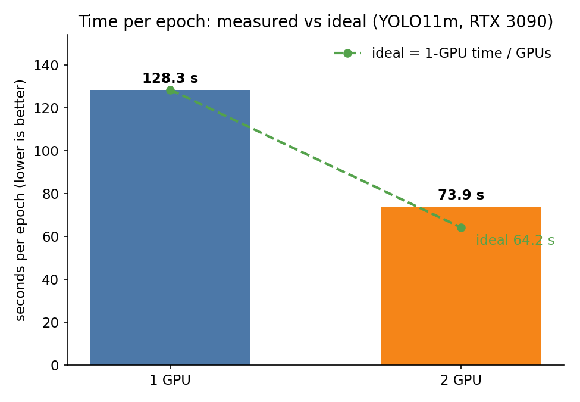 | 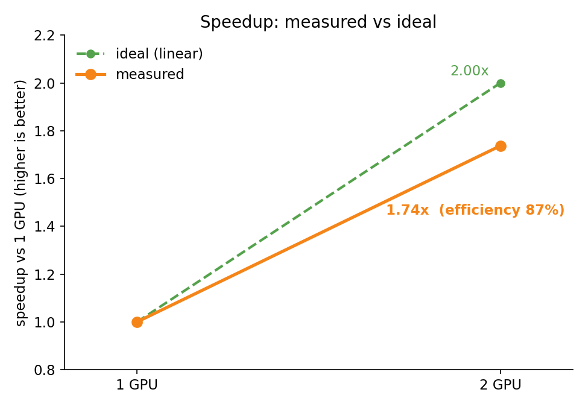 |

| เงินต่อ Epoch | คอขวด |
|---|---|
| 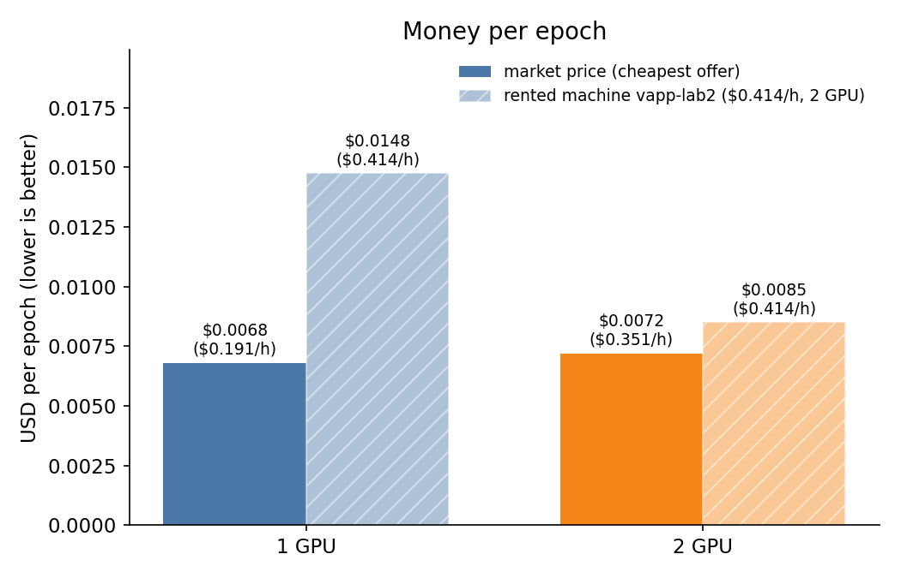 | 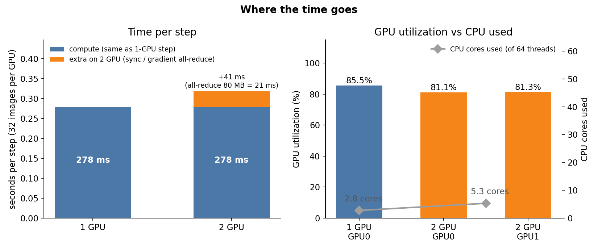 |

| เงินต่อ Epoch | 1 GPU | 2 GPU |
|---|---|---|
| เช่าใหม่ในราคาตลาด ($0.191 กับ $0.351 ต่อชม.) | **$0.0068** | $0.0072 |
| บนเครื่อง 2 ใบที่เช่าอยู่ ($0.414 ต่อชม.) | $0.0148 | **$0.0085** |

**อ่านผลอย่างไร**

- **เร็วขึ้น 1.74 เท่า** (Efficiency 87%) · ช่องว่างจาก Ideal คือเวลา Sync 41 ms ต่อ step
- **ราคาตลาด: 1 GPU ถูกกว่าราว 5% ต่อ Epoch** เพราะเครื่อง 2 ใบแพงขึ้น 1.83 เท่า แต่เร็วขึ้น 1.74 เท่า · แลกกับ 2 GPU ที่เสร็จเร็วกว่า 42%
- **เช่าเครื่อง 2 ใบแล้วใช้ใบเดียว แพงที่สุด** ($0.0148) เพราะจ่ายค่าเครื่องเต็มแต่ได้งานครึ่งเดียว
- ราคาตลาดเปลี่ยนตลอด คำตอบเรื่อง "คุ้มไหม" จึงต้องคิดจากราคา ณ วันที่เช่า · ข้อเสนอที่ถูกที่สุดอาจมีค่า reliability ต่ำ ควรดูประกอบ

## ขั้นที่ 6 · ลบเครื่องและสรุปค่าใช้จ่าย (ห้ามข้าม)

AI ลบเครื่อง ตรวจว่าไม่มีเครื่องค้าง แล้วอ่านยอดที่ถูกคิดเงินจริง

```text
ทำงานใน container `multi-account` โฟลเดอร์ /workspace/vastapp_lab ด้วยสกิล vastai

ปิดทุกอย่างของ LAB 2
1. ลบเครื่องป้าย vapp-lab2 แล้วตรวจว่าไม่มีเครื่องป้ายนี้ค้างในบัญชี (ห้ามแตะเครื่องป้ายอื่น)

สรุปเป็นภาษาไทย ค่าใช้จ่ายจริงของเครื่อง vapp-lab2: อายุเครื่อง · ราคาต่อชั่วโมง · ยอดที่ถูกคิด (GPU · disk · รับส่งข้อมูล)
```

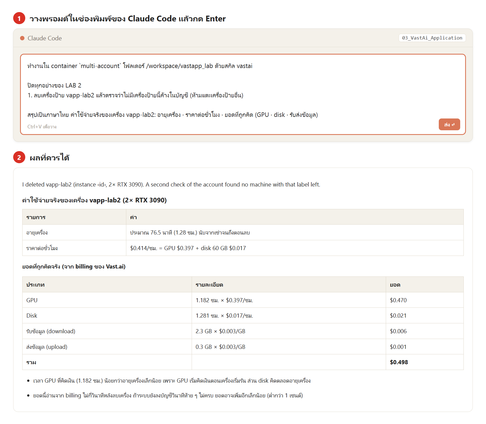
*ใช้เวลา 2 นาที · ยอดสุดท้ายในใบแจ้งหนี้ของ Vast.ai คือ **$0.507** (สูงกว่าที่ AI อ่านได้ทันทีหลังลบเล็กน้อย)*

**อ่านผลอย่างไร**

- ต้องเห็นว่า **ไม่มีเครื่องป้ายนี้เหลือ** แล้วเปิดหน้า [Instances](https://cloud.vast.ai/instances/) ดูอีกครั้ง
- เทรนจริงรวมราว 20 นาที แต่เครื่องเปิด 76.5 นาที · **เงินเดินตลอดเวลาที่เครื่องเปิด** รวมช่วงที่ AI เขียนโค้ดและช่วงที่เรายังไม่วางพรอมต์ถัดไป
- ผลทั้งหมดถูกเก็บกลับมาที่ `lab2_multigpu/results` ตั้งแต่ขั้นที่ 5 · ลบเครื่องแล้วทุกอย่างบนเครื่องหายหมด

---

## ปิดท้าย · เก็บงานทั้ง LAB เป็นสกิลเวอร์ชัน 0

เราเพิ่งสั่งงาน 6 ขั้นจนสำเร็จ ถ้าต้องทำซ้ำ (เช่น เปลี่ยนรุ่น GPU หรือจำนวน Epoch) ไม่ควรต้องวาง 6 พรอมต์ใหม่ · **สกิล** คือไฟล์ที่เก็บวิธีทำงานที่สำเร็จแล้ว พร้อมโค้ดที่ใช้ได้แล้ว ให้ AI ทำซ้ำได้ในคำสั่งเดียว


### ขั้นที่ 7 · ให้ AI สร้างสกิล v0

AI อ่านพรอมต์ โค้ด และผลของ LAB นี้ แล้วเขียน `skill_v0/SKILL.md` พร้อมคัดลอกโค้ดเข้า `skill_v0/scripts`

```text
สร้างสกิลเวอร์ชัน 0 จากงานของ LAB 2 ที่เพิ่งทำเสร็จ เพื่อให้ครั้งหน้าสั่งทดสอบความเร็วหลาย GPU ได้ในคำสั่งเดียว
1. ดูงานทั้งหมดจากพรอมต์ทุกขั้นใน lab2_multigpu/PROMPTS.md โค้ดใน lab2_multigpu/code และผลใน lab2_multigpu/results
2. เขียนเป็นสกิลชื่อ multigpu-speedup เก็บที่ lab2_multigpu/skill_v0/SKILL.md ให้มี name กับ description (บอกว่าใช้เมื่อไร)
   · ค่าที่ปรับได้พร้อมค่าเริ่มต้น (รุ่น GPU · จำนวน GPU ไม่เกิน 2 ใบ · เพดานราคา · Epoch · ป้ายเครื่อง) · ขั้นตอน · เกณฑ์ตรวจผ่าน · กติกาเรื่องเงิน (ลบเครื่องเสมอ)
3. คัดลอกโค้ดที่ใช้ได้แล้วจาก lab2_multigpu/code ไปไว้ใน lab2_multigpu/skill_v0/scripts ให้สกิลใช้โค้ดชุดนี้ ไม่ต้องเขียนใหม่
4. ให้สกิลนี้เรียกใช้สกิล vastai ต่อ ไม่เขียนวิธีใช้ Vast.ai ซ้ำ แล้วติดตั้งเป็นสกิลของโปรเจกต์ที่ .claude/skills/multigpu-speedup ของโฟลเดอร์ปัจจุบัน

สรุปเป็นภาษาไทย: สกิลทำอะไรได้ · ค่าที่ปรับได้ · ไฟล์ที่สร้าง
ไม่ต้อง commit
```

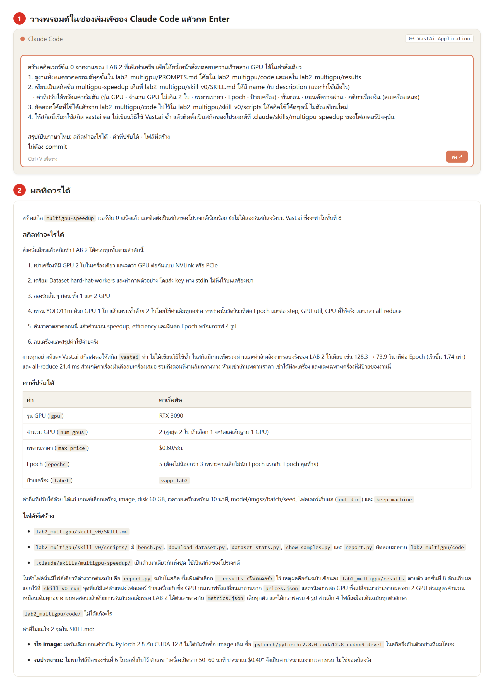
*ใช้เวลา 3 นาที · ไม่ต้องเช่าเครื่อง · สกิลที่ได้: [skill_v0/SKILL.md](skill_v0/SKILL.md)*

> ⚠️ หลังขั้นนี้ให้ปิดแล้วเปิด Claude Code ใหม่ 1 ครั้ง สกิลที่เพิ่งติดตั้งจึงจะถูกมองเห็น · ถ้า AI ตอบว่าไม่รู้จักสกิล ให้เปิดใหม่อีกครั้ง

### ขั้นที่ 8 · ลองใช้สกิลทำซ้ำในคำสั่งเดียว

AI ตัวใหม่ทำทั้ง LAB เองด้วยสกิล: เช่า เตรียม Dataset เทรน 1 และ 2 GPU ทำรายงาน และลบเครื่อง

```text
ใช้สกิล multigpu-speedup เทียบความเร็ว 1 กับ 2 GPU บนเครื่อง RTX 3090 2 ใบ ราคาไม่เกิน $0.60 ต่อชั่วโมง ป้าย vapp-lab2-skill เทรนรอบละ 3 Epoch เสร็จแล้วลบเครื่อง
เก็บผลไว้ที่ lab2_multigpu/results/skill_v0_run ห้ามเขียนทับผลเดิมใน lab2_multigpu/results
สรุปเป็นภาษาไทย: วินาทีต่อ Epoch · speedup · เงินต่อ Epoch · เวลาแต่ละขั้น · ค่าใช้จ่ายจริง
ไม่ต้อง commit
```


*ใช้เวลา 25 นาที · เช่าเครื่องจริงและลบเครื่องจริง · ยอดสุดท้ายในใบแจ้งหนี้คือ **$0.151***

| | สั่งทีละขั้น (ขั้นที่ 1–6) | สกิล v0 |
|---|---|---|
| จำนวนพรอมต์ | 6 | **1** |
| Epoch ต่อรอบ | 5 | 3 |
| เครื่อง (RTX 3090 2 ใบ) | Estonia · $0.414/ชม. | Missouri, US · $0.369/ชม. |
| วินาทีต่อ Epoch (1 → 2 GPU) | 128.3 → 73.9 | 110.3 → 61.4 |
| Speedup / Efficiency | 1.74× / 87% | 1.79× / 89.8% |
| วินาทีต่อ step (1 → 2 GPU) | 0.278 → 0.320 | 0.239 → 0.266 |
| All-reduce 80 MB | 21.4 ms | 22.5 ms |
| เงินต่อ Epoch ราคาตลาด (1 กับ 2 GPU) | $0.0068 กับ $0.0072 | $0.0063 กับ $0.0060 |
| เครื่องเปิด | 76.5 นาที | 23.2 นาที |
| ค่าเช่า | $0.51 | $0.15 |

ผลของรอบสกิลอยู่ที่ [results/skill_v0_run/](results/skill_v0_run/metrics.json)

**อ่านผลอย่างไร**

- สกิล v0 **ผ่านในรอบแรก** · ไม่ต้องเขียนโค้ดใหม่ และไม่มีช่วงรอคนวางพรอมต์ถัดไป เครื่องจึงเปิดสั้นกว่ามาก
- เครื่องคนละเครื่อง แต่ทางเชื่อมแบบเดียวกัน (`PHB`) ได้ผลใกล้กัน: **1.74 กับ 1.79 เท่า** และ All-reduce 21–23 ms · ข้อสรุปของ LAB จึงทำซ้ำได้
- รอบนี้ 2 GPU **ถูกกว่า** ต่อ Epoch เล็กน้อย เพราะราคาตลาดของเครื่อง 1 ใบขึ้นเป็น $0.206/ชม. · คำตอบเรื่องเงินพลิกได้ตามราคาของวันนั้น
- เทรน 3 Epoch เหลือ Epoch กลางให้เฉลี่ยเพียง 1 ค่า ตัวเลข Speedup จึงแกว่งได้มากกว่ารอบ 5 Epoch

**v0 ยังไม่สมบูรณ์** · จุดที่ AI ต้องแก้หรือเดาเองในรอบทดสอบ และควรแก้ในเวอร์ชันถัดไป

| จุดที่พลาด | ควรแก้อย่างไรใน v1 |
|---|---|
| ติดตั้ง `ultralytics` กับ `roboflow` แล้วได้ OpenCV แบบมีหน้าต่าง (GUI) ซึ่ง import ไม่ได้บนเครื่องเช่า AI ต้องเปลี่ยนเป็น `opencv-python-headless` เอง | ใส่ขั้นติดตั้ง `opencv-python-headless` ไว้ในสกิล |
| สกิลไม่กำหนด reliability ขั้นต่ำ AI ตัดสินใจเองว่าข้ามเครื่องที่ถูกที่สุด (reliability 0.60) · ราคาตลาดที่ใช้คิดเงินก็ไม่ได้กรอง reliability | กำหนด reliability ขั้นต่ำ ทั้งตอนเช่าและตอนค้นราคาตลาด |
| เกณฑ์ "mAP50 ≥ 0.90" เขียนไว้สำหรับ 5 Epoch ไม่บอกว่าใช้กับ Epoch น้อยกว่าได้ไหม | ระบุเกณฑ์ตามจำนวน Epoch |
| 3 Epoch เหลือค่าให้เฉลี่ยค่าเดียว Speedup แกว่งได้ | ตั้งขั้นต่ำ 4–5 Epoch หรือวัดเป็นจำนวน step |
| ชื่อ image เต็มและงบประมาณในสกิลเป็นค่าที่ AI ใส่เอง เพราะผลรอบแรกไม่ได้บันทึกไว้ | ให้บันทึกชื่อ image และยอดบิลลง `results` ทุกครั้ง |

วิธีปรับคือสั่ง AI ด้วยพรอมต์อีก 1 อันให้แก้สกิลตามตารางนี้ แล้วลองใช้ซ้ำ · สกิลจึงดีขึ้นทีละเวอร์ชันจากหลักฐานของการรันจริง

---

## ไฟล์ในโฟลเดอร์นี้

| ไฟล์ / โฟลเดอร์ | คืออะไร |
|---|---|
| `PROMPTS.md` | พรอมต์ทั้ง 8 ขั้นสำหรับคัดลอก |
| `code/` | โค้ดที่ AI เขียนให้ **ของคุณ** · เริ่มจากโฟลเดอร์ว่าง (ไม่ถูกเก็บขึ้น git) |
| `code_reference/` | ตัวอย่างโค้ดที่ AI เขียนให้ในรอบจริง ไว้เทียบ: `bench.py` (ขั้นที่ 3) · `report.py` (ขั้นที่ 5) · `show_samples.py` `download_dataset.py` `dataset_stats.py` (ขั้นที่ 2) |
| `skill_v0/` | สกิลที่ AI สร้างในขั้นที่ 7 (`SKILL.md` + `scripts/`) |
| `results/` | ผลจากการรันจริง: `metrics.json` · กราฟ 4 รูปใน `images/` · `dataset_samples.jpg` · ข้อมูลดิบใน `raw/` · คำตอบของทุกขั้นใน `answers/` · ผลรอบสกิลใน `skill_v0_run/` |
| `image/` | ภาพประกอบของ LAB นี้ |
