# LAB 2 · Fine-tune VLM อ่านใบเสร็จ แล้วต่อเข้าเว็บ

[← กลับหน้ารวมของบท](../README.md) · เปิด Claude Code ที่โฟลเดอร์ของบท `02_VastAi_Application` ("โฟลเดอร์ปัจจุบัน" ในพรอมต์หมายถึงโฟลเดอร์นั้น) · ทำ [LAB 0](../README.md#lab-0--เตรียม-key-3-ตัว) ก่อน

สไลด์ประกอบการสอน: [LAB2_VLM_Slides.html](LAB2_VLM_Slides.html)

## ทำไปเพื่ออะไร

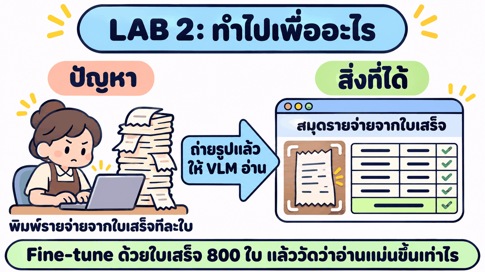

ร้านค้ามีใบเสร็จกองโต ถ้าโมเดลอ่านรูปใบเสร็จแล้วส่ง **รายการ + ยอดรวม** ออกมาเป็นข้อมูลได้ ก็ไม่ต้องพิมพ์เอง

คำถามของการทดลอง: **โมเดลเล็กสำเร็จรูปอ่านใบเสร็จได้แม่นแค่ไหน และถ้า Fine-tune ด้วย LoRA จากใบเสร็จ 800 ใบ จะแม่นขึ้นเท่าไร โดยเทรนเพียงส่วนเล็ก ๆ ของโมเดล**

LAB นี้มี **9 ขั้น** (7 ขั้นของการทดลอง + 2 ขั้นเก็บงานเป็นสกิล) · ทุกขั้นคือ 1 พรอมต์ · โค้ดทุกไฟล์ AI เขียนให้จากพรอมต์ เริ่มจากโฟลเดอร์ว่าง


## รู้จัก Dataset

| หัวข้อ | CORD-v2 |
|---|---|
| เกี่ยวกับอะไร | รูปถ่ายใบเสร็จจริงจากร้านอาหาร คาเฟ่ และร้านค้าในอินโดนีเซีย (เงินรูเปียห์ Rp) พร้อมเฉลยว่าบนใบมีเมนู จำนวน ราคา ภาษี และยอดรวมเท่าไร · ข้อมูลส่วนตัวบนใบถูกเบลอไว้แล้ว |
| ใครทำ | NAVER CLOVA · Park et al., *CORD: A Consolidated Receipt Dataset for Post-OCR Parsing* (NeurIPS 2019 Document Intelligence Workshop) |
| ต้นทาง | [Hugging Face: naver-clova-ix/cord-v2](https://huggingface.co/datasets/naver-clova-ix/cord-v2) · [GitHub: clovaai/cord](https://github.com/clovaai/cord) |
| สัญญาอนุญาต | CC BY 4.0 |

ใช้การแบ่งชุดตามที่ Dataset ให้มา

| ชุด | ใบเสร็จ | รายการสินค้า | ใช้ทำอะไร |
|---|---|---|---|
| Training Set | 800 | 2,416 | ปรับน้ำหนักของ LoRA |
| Validation Set | 100 | 270 | ดู validation loss ก่อนเทรนและหลังทุก Epoch |
| Test Set | 100 | 287 | ตัดสินผล Base เทียบ Fine-tuned ครั้งเดียวตอนจบ |

ภาพนี้ AI สร้างให้ในขั้นที่ 2 จากข้อมูลจริง: ใบเสร็จ 6 ใบจาก Training Set แต่ละใบคู่กับ JSON เฉลย

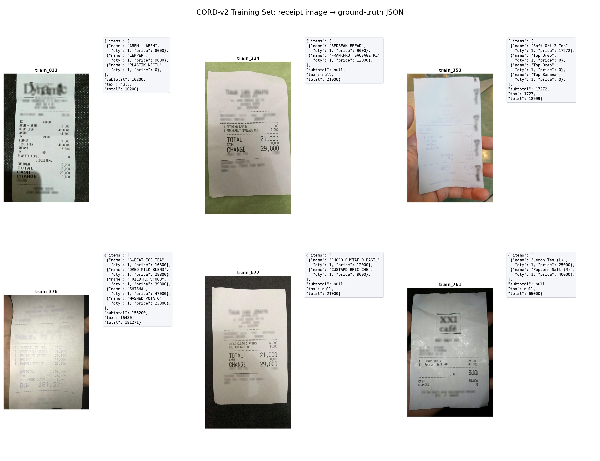

**label 1 รายการ** (ใบ `train_234` ในภาพ) · นี่คือคำตอบที่เราต้องการให้โมเดลเขียนออกมาเองเมื่อเห็นรูป

```json
{"items":[{"name":"REDBEAN BREAD","qty":1,"price":9000},
          {"name":"FRANKFRUT SAUSAGE ROLL","qty":1,"price":12000}],
 "subtotal":null,"tax":null,"total":21000}
```

| ช่อง | ความหมาย | กติกา |
|---|---|---|
| `items` | รายการสินค้าทุกบรรทัด เรียงตามที่พิมพ์ | รายการย่อย เช่น topping นับเป็นอีกบรรทัด |
| `name` | ชื่อสินค้าตามที่พิมพ์บนใบ | คัดลอกตามตัวอักษร |
| `qty` | จำนวน | ใบไม่พิมพ์จำนวน = 1 |
| `price` | **ยอดของบรรทัดนั้น** ไม่ใช่ราคาต่อชิ้น | จำนวนเต็ม ("12,000" → 12000) |
| `subtotal` · `tax` | ยอดก่อนภาษี · ภาษี | ใบไม่พิมพ์ = `null` (ใบนี้ไม่มีทั้งสองบรรทัด) |
| `total` | ยอดที่ต้องจ่าย | ใบนี้คือ 21,000 **ไม่ใช่** CASH 50,000 หรือ CHANGE 29,000 ที่พิมพ์อยู่ถัดลงมา |

กติกาในคอลัมน์ขวาคือสิ่งที่โมเดลสำเร็จรูปยังไม่รู้ และเป็นสิ่งที่ LAB นี้จะสอนเพิ่ม

## รู้จักโมเดลที่ใช้

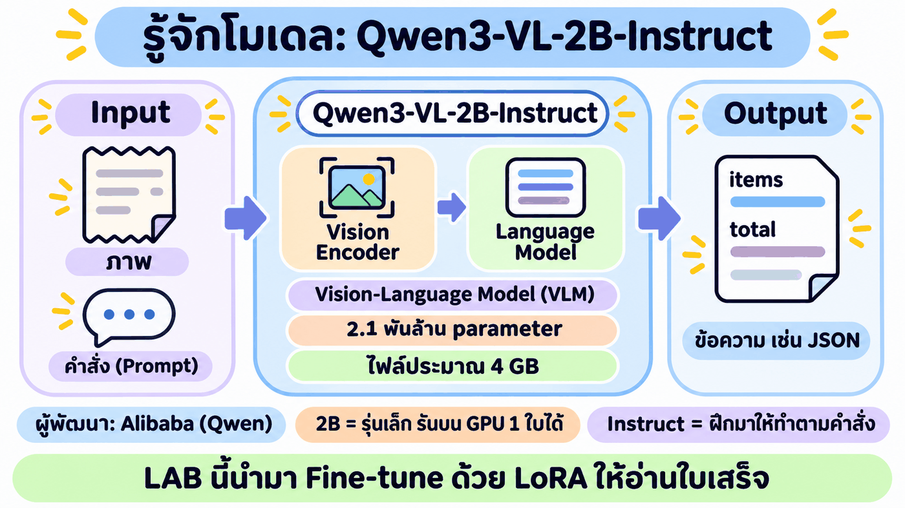

| หัวข้อ | Qwen3-VL-2B-Instruct |
|---|---|
| ประเภท | Vision-Language Model (VLM) |
| Input | ภาพ + คำสั่ง (Prompt) · LAB นี้ย่อภาพให้ด้านยาวไม่เกิน 1280 px |
| Output | ข้อความ · LAB นี้สั่งให้ตอบเป็น JSON |
| ขนาด | 2,127,532,032 parameter (ราว 2.1 พันล้าน) · ไฟล์ประมาณ 4 GB · รันบน GPU 1 ใบได้ |
| ที่มา | [Qwen (Alibaba)](https://huggingface.co/Qwen/Qwen3-VL-2B-Instruct) · `Instruct` คือรุ่นที่ฝึกมาให้ทำตามคำสั่ง |
| ใน LAB นี้ | **Base** = โมเดลนี้ตามที่โหลดมา · **Fine-tuned** = โมเดลนี้ + LoRA Adapter ที่เราเทรน |

## ทฤษฎีที่ต้องรู้

### 1 · VLM (Vision-Language Model)

- **คืออะไร** โมเดลที่รับภาพและข้อความพร้อมกัน แล้วตอบเป็นข้อความ
- **ทำไมต้องใช้** ใบเสร็จแต่ละร้านจัดหน้าไม่เหมือนกัน การเขียนกฎแยกทุกร้านทำไม่ไหว VLM อ่านและเข้าใจโครงสร้างของใบได้เอง
- **ทำงานอย่างไร** Vision Encoder แปลงภาพเป็น token แบบเดียวกับคำ → ต่อกับ token ของคำสั่ง → Language Model เขียนคำตอบทีละ token
- **ใน LAB นี้** Base อ่านตัวอักษรบนใบได้อยู่แล้ว ตอบเป็น JSON ที่อ่านได้ 100% ตั้งแต่ยังไม่เทรน

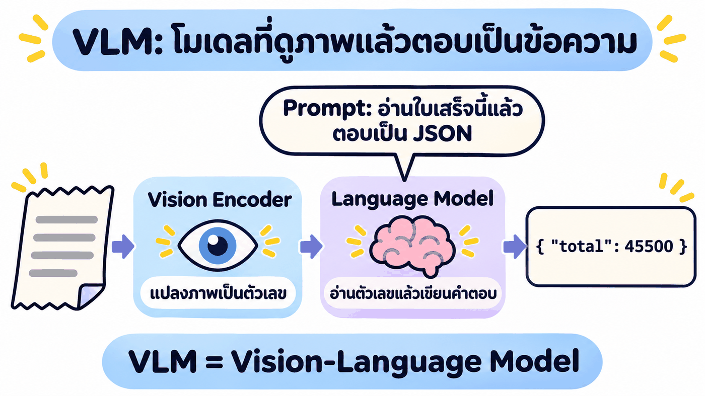

### 2 · Structured Output

- **คืออะไร** การกำหนดให้โมเดลตอบเป็นโครงสร้างตายตัว (JSON ตาม schema) แทนประโยค
- **ทำไมต้องใช้** เว็บและฐานข้อมูลต้องการช่องที่แน่นอน และเมื่อคำตอบเป็นช่อง เราก็ **ให้คะแนนด้วยโปรแกรมได้**
- **ทำงานอย่างไร** Prompt บอก schema และกติกา (ตัวเลขเป็นจำนวนเต็ม · ไม่มีบนใบ = `null` · ไม่พิมพ์จำนวน = 1) · ใช้ Prompt ชุดเดียวกันทั้งตอนเทรน ตอนวัดผล และในเว็บ
- **ใน LAB นี้** Base ครอบคำตอบด้วยเครื่องหมาย code block ทุกใบ · Fine-tuned ตอบ JSON ล้วนทุกใบ คำตอบจึงสั้นกว่าและเร็วขึ้น 26%

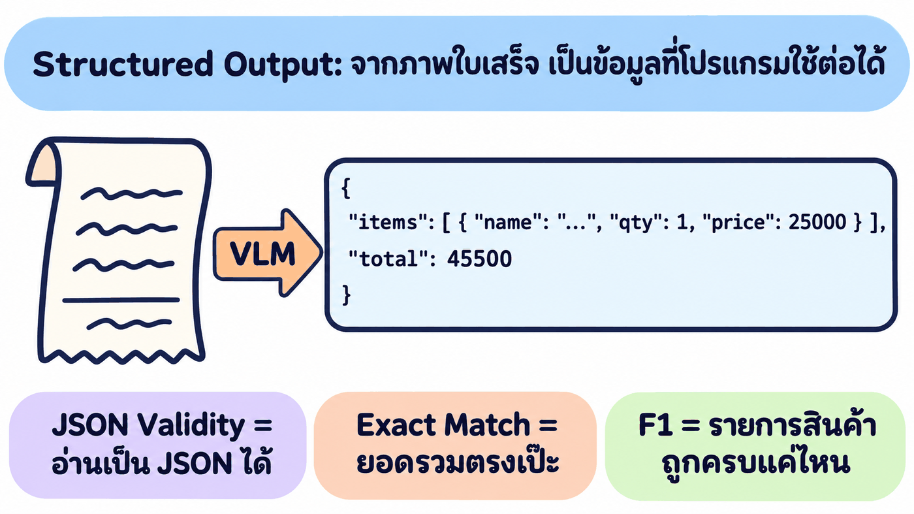

| ตัวชี้วัด | ความหมาย | ตัวอย่างจาก LAB นี้ |
|---|---|---|
| JSON Validity (JSON อ่านได้) | คำตอบอ่านเป็น JSON ได้กี่ % | 100% ทั้งสองโมเดล |
| Exact Match ของยอดรวม | `total` ตรงเฉลยทุกหลักกี่ % · ผิดหลักเดียว = ผิด | เฉลย 334,000 ตอบ 334,011 = ผิด |
| Item F1 | รายการถูกเมื่อ **ชื่อและราคา** ตรงเฉลยทั้งคู่ · Precision = ถูก ÷ ที่ตอบ · Recall = ถูก ÷ เฉลย · F1 รวมสองค่า | Fine-tuned ตอบ 290 รายการ ถูก 255 เฉลยมี 287 → Precision 87.9 · Recall 88.9 · F1 88.4 |

### 3 · LoRA (Low-Rank Adaptation) — แนวคิดหลักของ LAB นี้

**คืออะไร** วิธี Fine-tune ที่ **แช่แข็ง (Freeze) น้ำหนักเดิมทั้งหมด** แล้วเพิ่มเมทริกซ์ขนาดเล็กไว้ข้างชั้นเดิม เทรนเฉพาะส่วนที่เพิ่ม · ผลที่ได้คือไฟล์เล็กที่เรียกว่า **LoRA Adapter** ใช้คู่กับโมเดลเดิม

**ทำไมใช้แทน Full Fine-tuning**

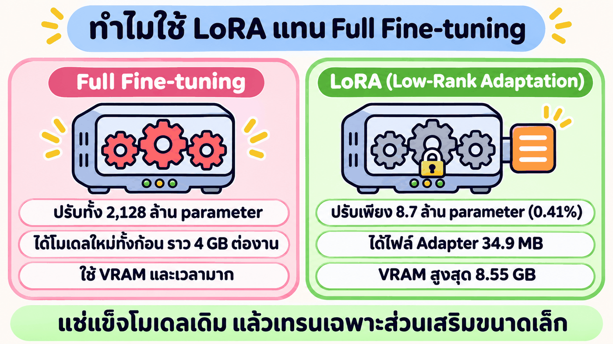

| | Full Fine-tuning | LoRA (LAB นี้) |
|---|---|---|
| parameter ที่ถูกปรับ | ทั้ง 2,127,532,032 | **8,716,288 (0.41%)** |
| ไฟล์ที่ได้ต่อ 1 งาน | โมเดลใหม่ทั้งก้อน ราว 4 GB | **Adapter 34.9 MB** |
| หน่วยความจำตอนเทรน | ต้องเก็บ gradient ของทุก parameter | เก็บ gradient เฉพาะส่วนที่เพิ่ม · VRAM สูงสุด **8.55 GB** จาก 24 GB |
| โมเดลเดิม | ถูกเขียนทับ | **ไม่เปลี่ยน** · ถอด Adapter ออกก็ได้โมเดลเดิมคืน |
| หลายงานบน server เดียว | ต้องโหลดโมเดลเต็มงานละก้อน | โหลดโมเดลเดิมครั้งเดียว แล้วสลับ Adapter |

**ทำงานอย่างไร** ชั้น Linear เดิมมีเมทริกซ์น้ำหนัก `W` · LoRA เพิ่มเมทริกซ์ 2 ตัวคือ `A` และ `B` ที่มี Rank `r` ต่ำ แล้วใช้ `W' = W + (α/r)·B·A` · ตอนเทรน `W` ไม่ขยับ มีแต่ `A` กับ `B` ที่ถูกปรับ · เริ่มต้น `B = 0` โมเดลจึงตอบเหมือนเดิมก่อนเทรน


ตัวอย่างจริง 1 ชั้นจากไฟล์ Adapter ของ LAB นี้ (`q_proj` ของ Language Model)

| | ขนาด | จำนวน parameter |
|---|---|---|
| `W` เดิม (Frozen) | 2,048 × 2,048 | 4,194,304 |
| `A` (เทรน) | 8 × 2,048 | 16,384 |
| `B` (เทรน) | 2,048 × 8 | 16,384 |
| **ส่วนที่เทรนของชั้นนี้** | | **32,768 = 0.78% ของ `W`** |

| ค่าที่ตั้งในขั้นที่ 3 | ค่า | ความหมาย |
|---|---|---|
| Rank `r` | 8 | ขนาดของ `A` และ `B` · มากขึ้น = ปรับได้ละเอียดขึ้นแต่ Adapter ใหญ่ขึ้น |
| Alpha `α` | 16 | ตัวคูณน้ำหนักของส่วนที่เพิ่ม (α/r = 2) |
| ชั้นที่ใส่ | ชั้น Linear ของ Language Model: `q/k/v/o_proj` และ `gate/up/down_proj` ครบ 28 ชั้น = 196 เมทริกซ์ | ส่วนที่ตัดสินใจว่าจะเขียนคำตอบอย่างไร |
| ชั้นที่ไม่แตะ | Vision Encoder | โมเดลมองเห็นตัวอักษรได้ดีอยู่แล้ว |

**ตัวเลขจาก LAB นี้**

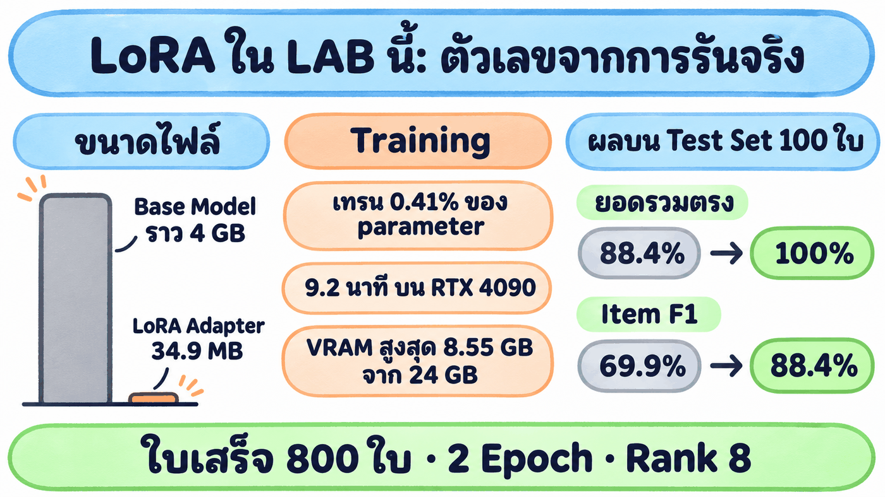

- 8,716,288 parameter × 4 byte = **34.9 MB** คือขนาดไฟล์ Adapter พอดี · เล็กกว่าโมเดลเดิมราว 115 เท่า
- LoRA ไม่ได้สอนให้โมเดล "อ่านออก" (อ่านออกอยู่แล้ว) แต่สอน **กติกาของงาน**: ยอดรวมไม่ใช่ยอดเงินสด · ราคาคือยอดของบรรทัด · ชื่อต้องคัดลอกครบ · บรรทัดเงินทอนไม่ใช่สินค้า
- เว็บในขั้นที่ 6 เรียกได้ทั้ง Base และ Fine-tuned จาก server เดียว เพราะโมเดลเดิมไม่ถูกแก้

### 4 · Training / Validation / Test Set และ loss

- **คืออะไร** ข้อมูล 3 ชุดที่ทำหน้าที่ต่างกัน (ดูตารางใน [รู้จัก Dataset](#รู้จัก-dataset))
- **ทำไมต้องใช้** ถ้าวัดผลด้วยใบที่โมเดลเคยเห็น คะแนนจะสูงเกินจริง · validation loss ที่ **กลับขึ้น** คือสัญญาณ Overfitting
- **ทำงานอย่างไร** loss คิดเฉพาะ token ของคำตอบ JSON ไม่คิดส่วนภาพและคำสั่ง เพราะเราไม่ได้ต้องการสอนให้ท่องคำสั่ง · ใบเสร็จ 1 ใบยาวราว 1,000–1,700 token จึงป้อนทีละ 1 ใบ แล้วสะสม gradient 4 ใบก่อนปรับน้ำหนัก 1 ครั้ง (Gradient Accumulation) = 800 ใบ × 2 Epoch ÷ 4 = 400 step
- **ใน LAB นี้** validation loss 0.2992 → 0.0253 → 0.0218 · Epoch ที่ 2 ยังลดลง = ยังไม่ Overfitting

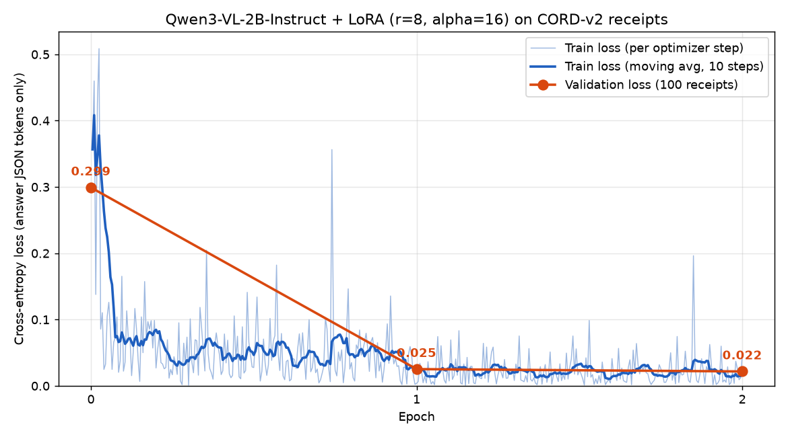

### 5 · ระบบที่จะได้: Base และ LoRA บน AI server เดียว

- **คืออะไร** เว็บอยู่บนเครื่องเรา โมเดลอยู่บนเครื่องเช่า คุยกันผ่าน API แบบ OpenAI-compatible
- **ทำไมต้องใช้** GPU อยู่ที่เครื่องเช่า แต่ข้อมูลรายจ่ายควรอยู่กับเรา · และต้องเทียบสองโมเดลบนเครื่องเดียวกันจึงยุติธรรม
- **ทำงานอย่างไร** vLLM โหลดโมเดลเดิมครั้งเดียว แล้วใส่ LoRA Adapter เฉพาะคำขอที่เรียกชื่อ `receipt-ft` · คำขอที่เรียก `receipt-base` ไม่ใส่ · พอร์ตของ server เปิดสู่อินเทอร์เน็ตจึงต้องมี API key ซึ่งเก็บอยู่ฝั่ง server ของเว็บเท่านั้น เบราว์เซอร์ไม่เห็น
- **ใน LAB นี้** สองโมเดลใช้ VRAM รวมราว 19 GB จาก 24 GB · server พร้อมใน 167 วินาที · คำขอไม่มี key ถูกปฏิเสธด้วยรหัส 401

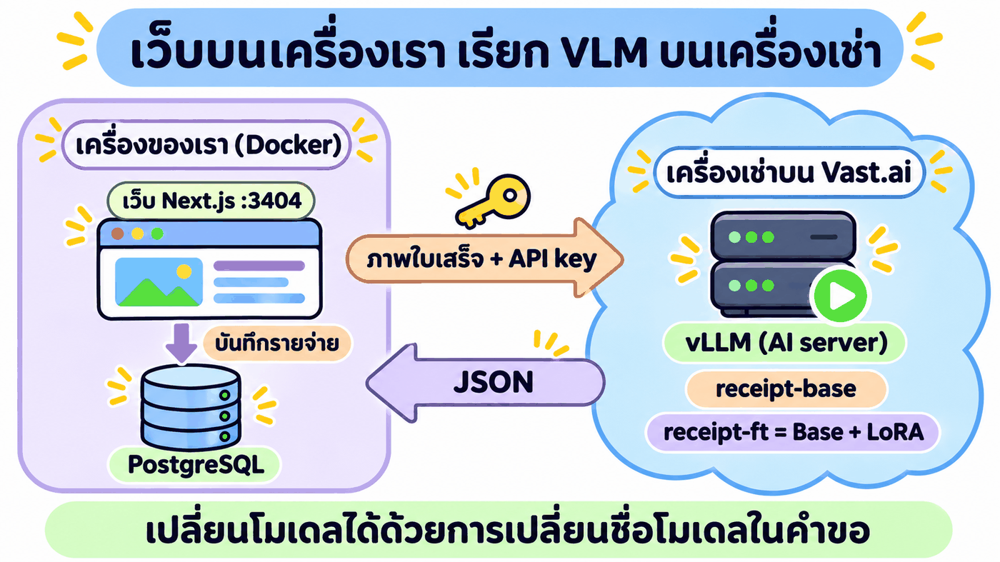

## การทดลอง

| หัวข้อ | รายละเอียด |
|---|---|
| Dataset | [CORD-v2](https://huggingface.co/datasets/naver-clova-ix/cord-v2) · Training 800 · Validation 100 · Test 100 ใบ |
| โมเดล | [Qwen3-VL-2B-Instruct](https://huggingface.co/Qwen/Qwen3-VL-2B-Instruct) (2.1 พันล้าน parameter) |
| เทียบ A กับ B | **Base** = โมเดลเดิม · **Fine-tuned** = โมเดลเดิม + LoRA (Rank 8, Alpha 16, 2 Epoch, learning rate 0.0002, seed 0) · Prompt เดียวกัน ภาพเดียวกัน server เดียวกัน |
| วิธีวัด | Test Set 100 ใบ ส่งทีละใบ temperature 0 · JSON อ่านได้ · ยอดรวมตรงทุกหลัก · Item F1 · วินาทีต่อใบ |
| เครื่อง | RTX 4090 1 ใบ (24 GB) · เพดาน $0.80/ชม. · ได้จริง $0.398/ชม. |
| เวลาและค่าเช่าจริง | ขั้นที่ 1–7 รวม 56 นาที · เครื่องเปิดอยู่ 1.25 ชม. · **$0.58** (เครื่องที่ใช้ $0.537 + เครื่องแรกที่ลบทิ้ง $0.047) |

ทำตามลำดับขั้นที่ 1 → 7 ให้ครบในรอบเดียว · คัดลอกพรอมต์ไปวางในช่องพิมพ์ของ Claude Code ทีละขั้น · โค้ดที่ AI เขียนจะอยู่ในโฟลเดอร์ `lab2_vlm/code` ซึ่งเริ่มจากว่าง

## ขั้นที่ 1 · เช่าเครื่อง GPU

AI ค้นหาเครื่อง เช่า แล้วทดสอบความเร็วโหลดจาก Hugging Face ก่อนใช้จริง · ขั้นนี้ยังไม่มีโค้ด

```text
ทำงานใน container `multi-account` โฟลเดอร์ /workspace/vastapp_lab ด้วยสกิล vastai

เช่าเครื่อง GPU สำหรับ Fine-tune โมเดลอ่านใบเสร็จ
1. เช่า RTX 4090 1 ใบ ราคารวมไม่เกิน $0.80 ต่อชั่วโมง ตั้งป้ายเครื่องว่า vapp-lab2
2. เลือกเครื่อง verified ที่เน็ตเร็ว ค่าดาวน์โหลดต่อ GB ถูก (LAB นี้โหลดราว 11 GB) และ driver รองรับ CUDA 13 แล้วเอาเครื่องที่ถูกที่สุด
3. ใช้ image PyTorch ที่มี CUDA 12.8 disk 60 GB และเปิดพอร์ต 8000 ไว้ให้ AI server
4. เมื่อเข้าเครื่องได้ ให้ลองโหลดไฟล์จาก Hugging Face ถ้าช้ากว่า 20 MB/s หรือรอเกิน 10 นาทียังไม่พร้อม ให้ลบแล้วเช่าเครื่องอื่น
กุญแจ SSH อยู่ที่ /workspace/vastai_lab/Devtool_SSH/devtoolSSH

สรุปเป็นตารางภาษาไทย: GPU · ราคาต่อชั่วโมง · ประเทศ · ความเร็วโหลดจาก Hugging Face · เวลาที่รอจนเครื่องพร้อม แล้วบอกว่าเครื่องยังเปิดอยู่
```

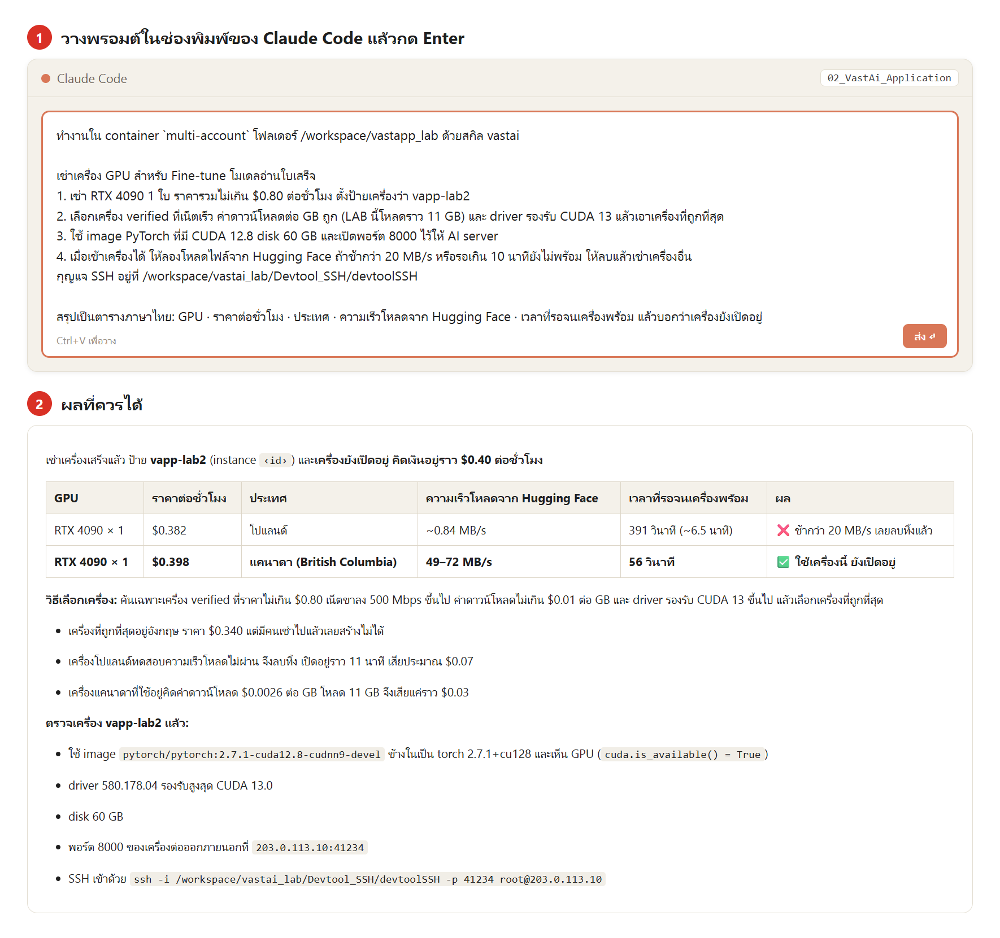
*ใช้เวลา 15 นาที · ที่อยู่เครื่องในภาพเป็นค่าตัวอย่าง*

**อ่านผลอย่างไร**

- ความเร็วเน็ตที่เครื่องโฆษณา **ไม่รับประกันความเร็วไป Hugging Face** เครื่องแรกได้เพียง 0.84 MB/s (โมเดล 4 GB จะใช้เวลาเกิน 1 ชั่วโมง) เราจึงสั่งให้ทดสอบจริงในข้อ 4
- เครื่องที่ลบทิ้งก็ถูกคิดเงินตามเวลาที่เปิด · คำตอบประมาณไว้ $0.07 ยอดจริงในใบแจ้งหนี้คือ **$0.047**
- ราคาต่อชั่วโมงไม่ใช่ต้นทุนทั้งหมด: LAB นี้โหลดข้อมูลกว่า 10 GB จึงให้ดูค่าดาวน์โหลดต่อ GB ตอนเลือกเครื่องด้วย
- **ตั้งแต่ขั้นนี้เงินเริ่มเดิน** ชั่วโมงละ $0.40 จนกว่าจะลบเครื่องในขั้นที่ 7

## ขั้นที่ 2 · เตรียมเครื่องและ Dataset ใบเสร็จ

AI ติดตั้งเครื่องมือบนเครื่องเช่า แล้วเขียน `code/receipt_data.py` ที่โหลด CORD-v2 แปลงเฉลยเป็น JSON และเก็บ Prompt ชุดเดียวที่ทุกขั้นใช้ร่วมกัน

```text
ทำงานใน container `multi-account` โฟลเดอร์ /workspace/vastapp_lab ด้วยสกิล vastai
เครื่องที่ใช้คือเครื่องป้าย vapp-lab2 · กุญแจ SSH อยู่ที่ /workspace/vastai_lab/Devtool_SSH/devtoolSSH
โค้ดและผลทั้งหมดเก็บในโฟลเดอร์ lab2_vlm บนเครื่องเรา (โฟลเดอร์ที่เปิด Claude Code อยู่) ไม่ใช่ใน container

เตรียมเครื่องที่เช่าและ Dataset ใบเสร็จ CORD-v2
1. ติดตั้ง vllm peft datasets matplotlib บนเครื่องที่เช่า แยกเป็นสภาพแวดล้อม Python ของ LAB นี้ แล้วโหลดโมเดล Qwen/Qwen3-VL-2B-Instruct
2. เขียนสคริปต์ lab2_vlm/code/receipt_data.py: โหลด Dataset naver-clova-ix/cord-v2 จาก Hugging Face ใช้การแบ่ง Training/Validation/Test ตามที่ Dataset ให้มา
   ตั้งชื่อใบตามชุดและลำดับ (เช่น test_020) และย่อภาพให้ด้านยาวไม่เกิน 1280 px
3. แปลงเฉลยแต่ละใบเป็น JSON แบบที่จะให้โมเดลตอบ: {"items":[{"name","qty","price"}],"subtotal","tax","total"}
   ตัวเลขเป็นจำนวนเต็ม ("25,000" → 25000) · ไม่มีค่าบนใบ = null · ไม่พิมพ์จำนวน = qty 1 · รายการย่อย (เช่น topping) นับเป็นอีกบรรทัด
4. ในไฟล์เดียวกันเก็บข้อความสั่งโมเดล (ภาษาอังกฤษ) ให้อ่านใบเสร็จแล้วตอบเป็น JSON รูปแบบนี้เท่านั้น ข้อความนี้ต้องใช้ชุดเดียวกันทั้งตอนเทรน ตอนวัดผล และในเว็บ
5. รันสคริปต์บนเครื่องที่เช่า แล้วทำภาพตัวอย่าง Dataset: ใบเสร็จจริงจาก Training Set 6 ใบเรียงเป็นตาราง แต่ละใบคู่กับ JSON เฉลยของใบนั้น เก็บกลับมาที่ lab2_vlm/results/dataset_samples.jpg
ใช้ HF_TOKEN จากไฟล์ .env ของโฟลเดอร์ปัจจุบัน ห้ามแสดงค่า และห้ามทิ้ง token ไว้บนเครื่องที่เช่า

สรุปเป็นภาษาไทย: ตารางจำนวนใบเสร็จและรายการสินค้าของ Training Set · Validation Set · Test Set
ยกเฉลย JSON ของใบเสร็จ 1 ใบ แล้วอธิบายทีละช่องว่าหมายถึงอะไร แล้วบอกว่าเครื่องยังเปิดอยู่
```


*ใช้เวลา 5 นาที · โมเดลถูกโหลดไว้แล้วตั้งแต่ตอนทดสอบความเร็วในขั้นที่ 1*

ตัวอย่างโค้ดที่ AI เขียนให้ในรอบจริง (ของคุณอาจต่างกัน): [code_reference/receipt_data.py](code_reference/receipt_data.py)

**อ่านผลอย่างไร**

- ต้องได้ **800 / 100 / 100 ใบ** และภาพ [results/dataset_samples.jpg](results/dataset_samples.jpg) (ดูหัวข้อ [รู้จัก Dataset](#รู้จัก-dataset))
- ใบ `test_020`: ข้าวสวย 4 ที่ `price` คือ 47,600 (4 × 11,900) = **ยอดของบรรทัด** ไม่ใช่ราคาต่อชิ้น · `total` 377,859 มากกว่า `subtotal` + `tax` เพราะมีค่าบริการที่ schema นี้ไม่ได้เก็บ
- AI ลองให้ Base อ่าน `test_020` แล้ว ได้ JSON ถูกรูปแบบแต่ `total` ผิด 1 หลัก (377059) = อ่านออก แต่ยังไม่แม่น
- `HF_TOKEN` ถูกใช้เฉพาะในคำสั่งที่โหลด ไม่ถูกทิ้งไว้บนเครื่องเช่า

## ขั้นที่ 3 · Training: Fine-tune ด้วย LoRA

AI เขียน `code/train.py` และ `code/run_train.sh` แล้วเทรนบนเครื่องเช่า · นี่คือขั้นที่ใช้ทฤษฎีข้อ 3 ทั้งหมด

```text
ทำงานใน container `multi-account` โฟลเดอร์ /workspace/vastapp_lab ด้วยสกิล vastai
เครื่องที่ใช้คือเครื่องป้าย vapp-lab2 · กุญแจ SSH อยู่ที่ /workspace/vastai_lab/Devtool_SSH/devtoolSSH
โค้ดและผลทั้งหมดเก็บในโฟลเดอร์ lab2_vlm บนเครื่องเรา (โฟลเดอร์ที่เปิด Claude Code อยู่) ไม่ใช่ใน container

เขียนโค้ดสอนโมเดลให้อ่านใบเสร็จแล้วตอบเป็น JSON แล้วเทรนบนเครื่องที่เช่า
1. เขียนสคริปต์เทรนไว้ที่ lab2_vlm/code/train.py: เริ่มจาก Qwen/Qwen3-VL-2B-Instruct ใส่ LoRA rank 8 (alpha 16) เฉพาะชั้น Linear ของส่วนภาษา ไม่แตะส่วนมองภาพ
2. เทรนด้วย Training Set ทั้ง 800 ใบ 2 Epoch learning rate 0.0002 seed 0 · ป้อนทีละ 1 ใบ แล้วสะสม gradient 4 ใบก่อนปรับน้ำหนัก (GPU 24 GB ป้อนทีละหลายใบไม่พอ)
3. ใช้ข้อความสั่งโมเดลจาก receipt_data.py · คิด loss เฉพาะส่วนคำตอบ JSON · วัด validation loss ก่อนเทรนและหลังทุก Epoch
4. จบแล้วเก็บ LoRA adapter กราฟ loss (ป้ายภาษาอังกฤษ) และตัวเลขการเทรน (เวลา VRAM สูงสุด จำนวนพารามิเตอร์ที่เทรน)
5. นำไปรันบนเครื่องที่เช่า ให้เทรนต่อได้แม้การเชื่อมต่อหลุด และรายงานความคืบหน้าเป็นระยะจนเทรนเสร็จ

สรุปเป็นภาษาไทย: จำนวนพารามิเตอร์ที่เทรน (เทียบทั้งโมเดล) · validation loss ก่อนเทรนและหลังแต่ละ Epoch · เวลาเทรน · VRAM สูงสุด · ขนาดไฟล์ adapter แล้วบอกว่าเครื่องยังเปิดอยู่
```

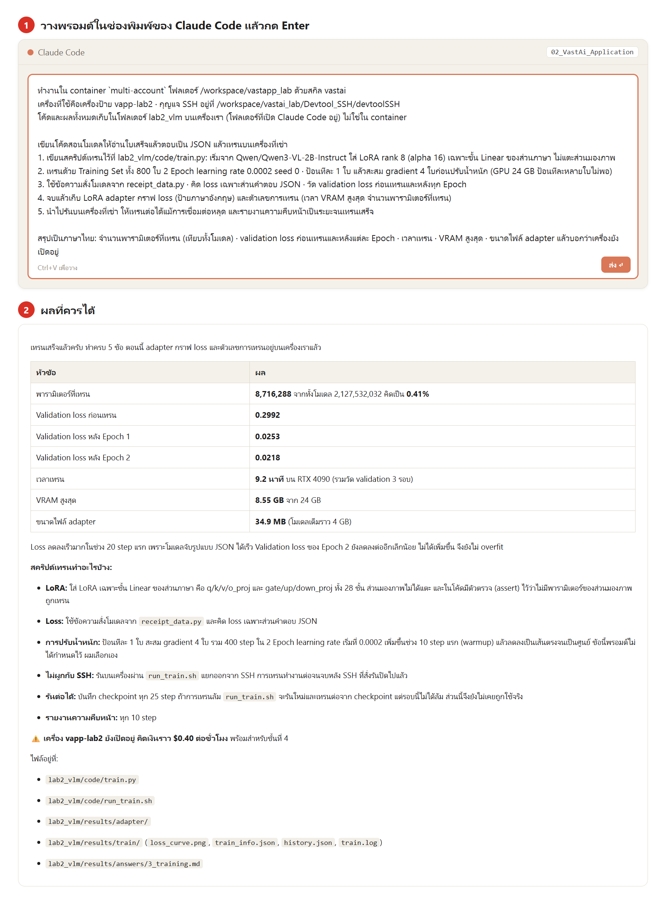
*ใช้เวลา 14 นาที · เทรนจริง 9.2 นาที*

| หัวข้อ | ผล |
|---|---|
| parameter ที่เทรน | 8,716,288 จาก 2,127,532,032 = **0.41%** |
| validation loss | 0.2992 (ก่อนเทรน) → 0.0253 (Epoch 1) → 0.0218 (Epoch 2) |
| เวลาเทรน | 9.2 นาที · 400 step |
| VRAM สูงสุด | 8.55 GB จาก 24 GB |
| ไฟล์ Adapter | 34.9 MB → [results/adapter/](results/adapter/) |

กราฟ loss อยู่ในทฤษฎีข้อ 4 ([results/train/loss_curve.png](results/train/loss_curve.png))

ตัวอย่างโค้ดที่ AI เขียนให้ในรอบจริง (ของคุณอาจต่างกัน): [code_reference/train.py](code_reference/train.py) · [code_reference/run_train.sh](code_reference/run_train.sh)

**อ่านผลอย่างไร**

- **0.41%** คือหัวใจของ LoRA: น้ำหนักเดิม 2.1 พันล้านตัวไม่ขยับ เทรนเฉพาะ `A` และ `B` ของ 196 เมทริกซ์
- loss ร่วงเร็วใน 20 step แรก เพราะโมเดลจับรูปแบบ JSON ได้เร็ว · Epoch ที่ 2 ยังลดลง = ยังไม่ Overfitting
- VRAM ใช้เพียง 8.55 GB เพราะป้อนทีละ 1 ใบและเก็บ gradient เฉพาะส่วนของ LoRA
- สิ่งที่พรอมต์ไม่ได้กำหนด AI เลือกเองและบอกไว้ในคำตอบ เช่น warmup 10 step, บันทึก checkpoint ทุก 25 step, ตัวตรวจว่า Vision Encoder ไม่ถูกเทรน

## ขั้นที่ 4 · เปิด AI server สองโมเดล

AI เขียน `code/serve.sh` เปิด vLLM ที่ให้บริการ `receipt-base` และ `receipt-ft` บน GPU ใบเดียว แล้วเขียน `code/receipt.env` ให้เว็บใช้

```text
ทำงานใน container `multi-account` โฟลเดอร์ /workspace/vastapp_lab ด้วยสกิล vastai
เครื่องที่ใช้คือเครื่องป้าย vapp-lab2 · กุญแจ SSH อยู่ที่ /workspace/vastai_lab/Devtool_SSH/devtoolSSH
โค้ดและผลทั้งหมดเก็บในโฟลเดอร์ lab2_vlm บนเครื่องเรา (โฟลเดอร์ที่เปิด Claude Code อยู่) ไม่ใช่ใน container

เขียนโค้ดเปิด AI server ให้เว็บส่งใบเสร็จมาอ่าน
1. เขียนสคริปต์ lab2_vlm/code/serve.sh: เปิด AI server แบบ OpenAI-compatible ด้วย vLLM ที่พอร์ต 8000
   มี 2 โมเดลบน GPU ใบเดียว: receipt-base (โมเดลเดิม) และ receipt-ft (โมเดลเดิม + LoRA adapter จากขั้นที่ 3)
2. server ต้องใช้ API key ที่สุ่มขึ้นและเก็บไว้บนเครื่องที่เช่าเท่านั้น และทำงานต่อได้แม้การเชื่อมต่อหลุด
3. รันบนเครื่องที่เช่า แล้วทดสอบจากนอกเครื่อง 3 ข้อ: เห็นทั้งสองโมเดล · ส่งใบเสร็จจาก Test Set 1 ใบให้ receipt-ft พร้อม key แล้วได้ JSON กลับมา · ส่งแบบไม่มี key ต้องถูกปฏิเสธ
4. เขียนไฟล์ lab2_vlm/code/receipt.env ให้มี RECEIPT_BASE_URL (ที่อยู่ที่เข้าจากนอกเครื่องได้) RECEIPT_API_KEY RECEIPT_MODEL_BASE=receipt-base และ RECEIPT_MODEL_FT=receipt-ft

ห้ามแสดงค่า key · สรุปเป็นภาษาไทย: ผลทดสอบ 3 ข้อ และเวลาที่ server ใช้เปิด แล้วบอกว่าเครื่องยังเปิดอยู่
```

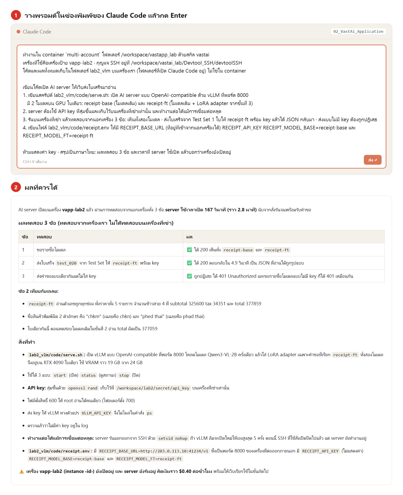
*ใช้เวลา 6 นาที · ที่อยู่ server ในภาพเป็นค่าตัวอย่าง*

ตัวอย่างโค้ดที่ AI เขียนให้ในรอบจริง (ของคุณอาจต่างกัน): [code_reference/serve.sh](code_reference/serve.sh)

**อ่านผลอย่างไร**

- โมเดลเดิมถูกโหลด **ครั้งเดียว** · `receipt-ft` คือโมเดลเดิม + Adapter 34.9 MB ที่ถูกใส่เฉพาะคำขอที่เรียกชื่อนี้ (ทฤษฎีข้อ 5)
- ข้อทดสอบที่ 3 ยืนยันว่าคนไม่มี key ใช้ server ไม่ได้
- `receipt-ft` อ่าน `test_020` ได้ตัวเลขถูกทุกช่อง รวม `total` 377859 ที่ Base อ่านผิดในขั้นที่ 2 · แต่สะกดชื่อผิด 2 จุด ("chkm", "phed thai")
- ไฟล์ `code/receipt.env` มี key อยู่ จึงไม่ถูกเก็บขึ้น git

## ขั้นที่ 5 · Evaluation: Base เทียบ Fine-tuned บน Test Set

AI เขียน `code/eval.py` ส่ง Test Set 100 ใบให้ทั้งสองโมเดล ให้คะแนน แล้วเก็บผลทั้งหมดกลับมาที่เครื่องเรา

```text
ทำงานใน container `multi-account` โฟลเดอร์ /workspace/vastapp_lab ด้วยสกิล vastai
เครื่องที่ใช้คือเครื่องป้าย vapp-lab2 · กุญแจ SSH อยู่ที่ /workspace/vastai_lab/Devtool_SSH/devtoolSSH
โค้ดและผลทั้งหมดเก็บในโฟลเดอร์ lab2_vlm บนเครื่องเรา (โฟลเดอร์ที่เปิด Claude Code อยู่) ไม่ใช่ใน container

เขียนโค้ดวัดว่า Fine-tune แล้วอ่านใบเสร็จแม่นขึ้นเท่าไร แล้ววัดจริง
1. เขียนสคริปต์ lab2_vlm/code/eval.py: ส่ง Test Set ทั้ง 100 ใบให้ receipt-base และ receipt-ft ผ่าน AI server ทีละใบ ด้วยข้อความสั่งเดียวกับตอนเทรน temperature 0
2. ให้คะแนน: JSON อ่านได้ (%) · ยอดรวมตรงเฉลยทุกหลัก (%) · Item F1 (%) โดยรายการถูกเมื่อชื่อและราคาตรงเฉลย (เทียบชื่อแบบไม่สนตัวพิมพ์ ช่องว่าง สัญลักษณ์) · วินาทีต่อใบ
3. เก็บ metrics.json (รวมตัวเลขการเทรนจากขั้นที่ 3) คำตอบรายใบ กราฟแท่ง Base vs Fine-tuned และภาพตัวอย่าง 4 ใบ (ใบเสร็จ เฉลย คำตอบสองโมเดล สีแดง = ผิด) ข้อความในภาพเป็นภาษาอังกฤษ
4. รันบนเครื่องที่เช่า แล้วเก็บผลทั้งหมดพร้อม LoRA adapter และกราฟ loss กลับมาไว้ที่ lab2_vlm/results

สรุปเป็นตารางภาษาไทย Base vs Fine-tuned: JSON อ่านได้ (%) · ยอดรวมตรง (%) · Item F1 (%) · วินาทีต่อใบ
ยกตัวอย่าง 2 ใบที่ Fine-tuned อ่านถูกแต่ Base อ่านผิด แล้วบอกว่าเครื่องยังเปิดอยู่
```

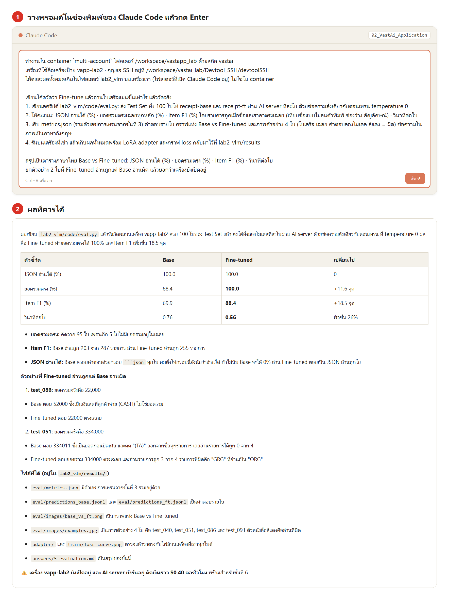
*ใช้เวลา 8 นาที*

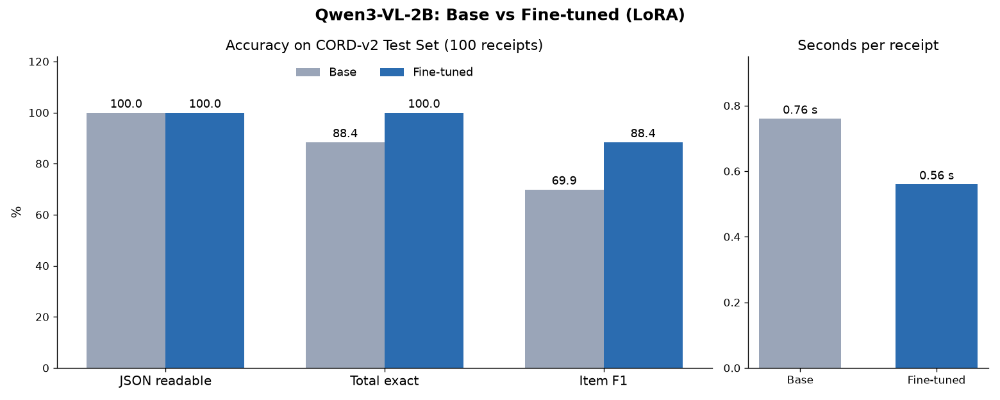

| ตัวชี้วัด (Test Set 100 ใบ) | Base | Fine-tuned | ต่าง |
|---|---|---|---|
| JSON อ่านได้ | 100.0% | 100.0% | 0 |
| ยอดรวมตรงทุกหลัก (95 ใบที่เฉลยมียอดรวม) | 88.4% (84 ใบ) | **100.0%** (95 ใบ) | +11.6 |
| Item F1 | 69.9% | **88.4%** | +18.5 |
| รายการที่ถูก (จาก 287) | 203 | **255** | +52 |
| วินาทีต่อใบ | 0.76 | 0.56 | เร็วขึ้น 26% |

ตัวอย่างจริง 4 ใบ · สีแดง = ไม่ตรงเฉลย


ตัวอย่างโค้ดที่ AI เขียนให้ในรอบจริง (ของคุณอาจต่างกัน): [code_reference/eval.py](code_reference/eval.py) · ตัวเลขทั้งหมด: [results/metrics.json](results/metrics.json) · คำตอบรายใบ: [results/eval/](results/eval/)

**อ่านผลอย่างไร**

- Base **อ่านตัวอักษรออกอยู่แล้ว** (JSON อ่านได้ 100%) ที่ผิดคือ **กติกาของงาน**: เอายอด CASH เป็นยอดรวม · หยิบราคาต่อหน่วย · ตัดคำออกจากชื่อ · นับบรรทัดเงินทอนเป็นสินค้า
- Adapter 34.9 MB ที่เทรน 9.2 นาที แก้กติกาเหล่านี้ได้: ยอดรวมถูกครบ 95 ใบ และรายการถูกเพิ่ม 52 รายการ
- Fine-tuned **เร็วขึ้น** ทั้งที่โมเดลใหญ่เท่าเดิม เพราะตอบ JSON ล้วน ส่วน Base ครอบคำตอบด้วยเครื่องหมาย code block ทุกใบ
- Item F1 ยังไม่ถึง 100 เพราะเกณฑ์เข้ม: ชื่อผิด 1 ตัวอักษร (เช่น GRG อ่านเป็น ORG) นับว่าผิดทั้งรายการ

## ขั้นที่ 6 · สร้างเว็บสมุดรายจ่ายแล้วทดสอบ

AI เขียนเว็บ Next.js + PostgreSQL ทั้งหมดไว้ที่ `code/web` เปิดบน Docker ของเครื่องเรา แล้วทดสอบอ่านใบเสร็จ 3 ใบผ่านหน้าเว็บ

```text
ทำงานใน container `multi-account` โฟลเดอร์ /workspace/vastapp_lab ด้วยสกิล vastai · เครื่องที่ใช้คือเครื่องป้าย vapp-lab2
โค้ดและผลทั้งหมดเก็บในโฟลเดอร์ lab2_vlm บนเครื่องเรา (โฟลเดอร์ที่เปิด Claude Code อยู่) ไม่ใช่ใน container

สร้างเว็บ "สมุดรายจ่ายจากใบเสร็จ" บนเครื่องนี้ (Docker Desktop) ที่ต่อกับ AI server บน Vast.ai
1. เขียนเว็บ Next.js + PostgreSQL ไว้ที่ lab2_vlm/code/web เปิดด้วย docker compose ชื่อ project vapp-lab2 ที่ http://localhost:3404 หน้าตาเป็นแอปจริง ภาษาไทย
2. หน้า "อ่านใบเสร็จ": อัปโหลดรูปหรือกดใบเสร็จตัวอย่าง → เลือก Base / Fine-tuned / เทียบสองโมเดล → แสดงรูปคู่กับตารางรายการและยอดรวม (หน่วย Rp) → กดบันทึกเป็นรายจ่าย
3. ใบเสร็จตัวอย่าง: นำ 6 ใบจาก Test Set พร้อมเฉลยมาจากเครื่องที่เช่า (ต้องมี test_020 test_051 test_092) เลือกตัวอย่างแล้วให้ขึ้น ✓/✗ เทียบเฉลยทีละบรรทัด
4. หน้า "รายจ่าย": จำนวนใบ รายจ่ายรวม และตารางรายใบที่กดดูรายการหรือลบได้
5. เว็บเรียก AI server ด้วยค่าใน lab2_vlm/code/receipt.env (key อยู่ฝั่ง server ของเว็บเท่านั้น) ย่อรูปด้านยาวไม่เกิน 1280 px และใช้ข้อความสั่งโมเดลชุดเดียวกับใน receipt_data.py
6. เปิดเว็บแล้วทดสอบอ่าน test_092 test_051 test_020 ผ่านเว็บด้วยทั้งสองโมเดล

สรุปเป็นตารางภาษาไทย: ใบเสร็จ · โมเดล · รายการที่อ่านถูก · ยอดรวมถูกหรือผิด · เวลา (วินาที) ห้ามแสดงค่า key แล้วบอกว่าเครื่องบน Vast.ai ยังเปิดอยู่
```


*ใช้เวลา 6 นาที*

จากนั้นเปิด **http://localhost:3404** → เลือกใบเสร็จตัวอย่าง → **เทียบสองโมเดล** → **อ่านใบเสร็จ**


*ใบเสร็จตัวอย่างมาจาก Test Set จึงมีเฉลยให้เว็บขึ้น ✓ ✗ ทีละบรรทัด*

| อ่านด้วย Base | อ่านด้วย Fine-tuned |
|---|---|
| 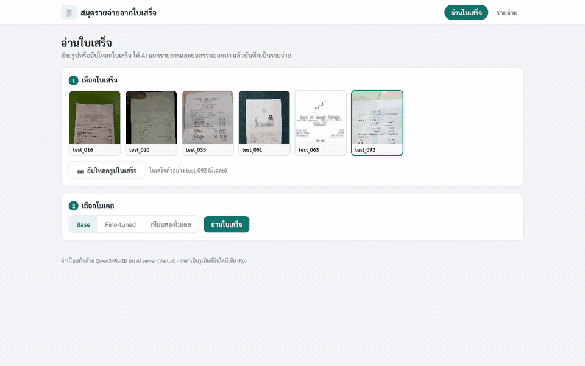 | 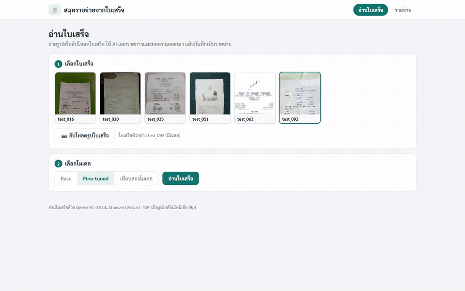 |

| เทียบสองโมเดล (test_092) | เทียบสองโมเดล (test_020) |
|---|---|
| 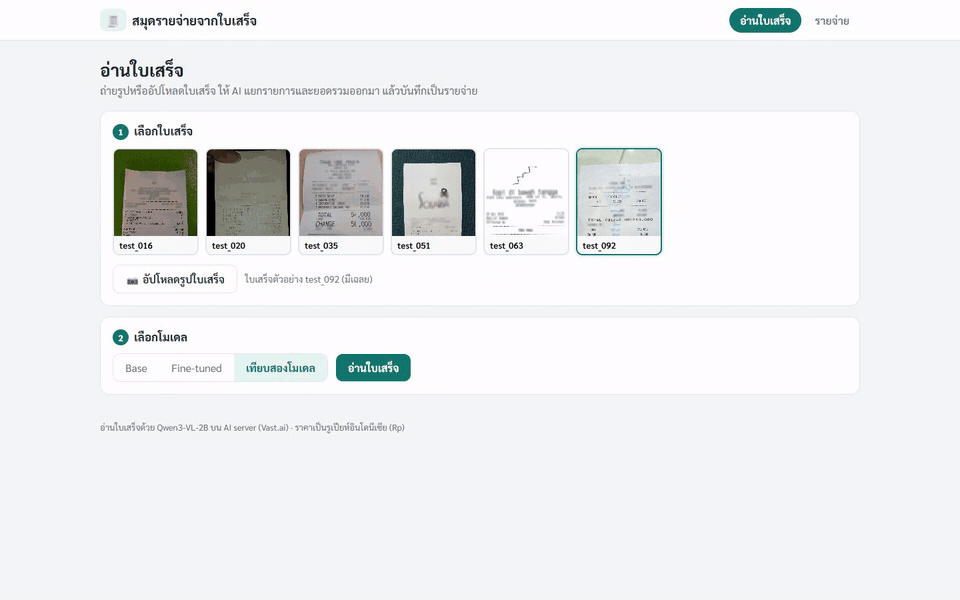 | 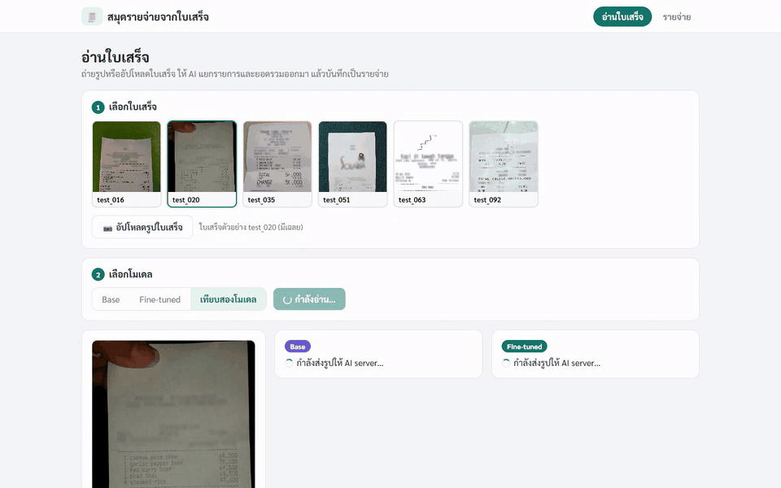 |

กด **บันทึกเป็นรายจ่าย** แล้วเปิดหน้า **รายจ่าย** · ข้อมูลถูกเก็บใน PostgreSQL

| บันทึกลงสมุดรายจ่าย | หน้ารายจ่าย |
|---|---|
| 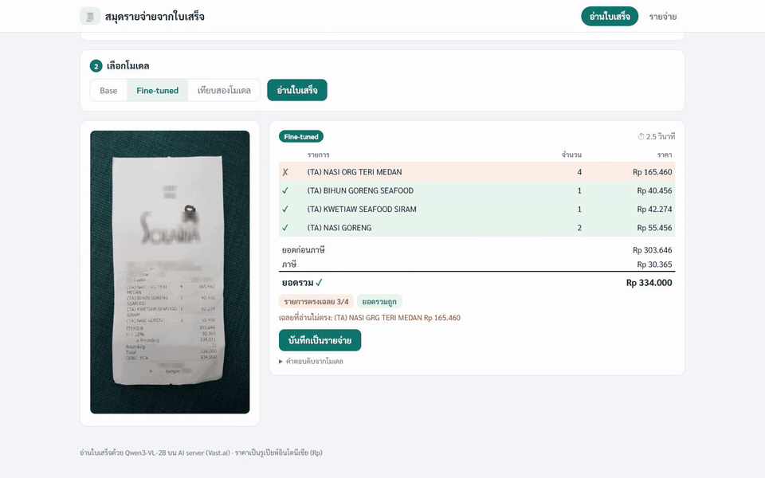 | 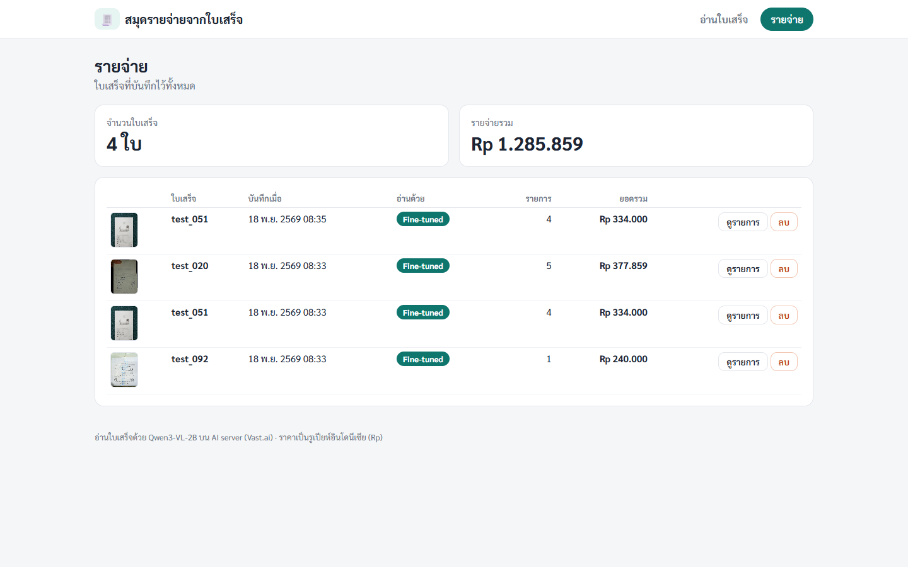 |

ตัวอย่างโค้ดที่ AI เขียนให้ในรอบจริง (ของคุณอาจต่างกัน): [code_reference/web/](code_reference/web/) · จุดที่เว็บเรียก AI server คือ [app/api/read/route.ts](code_reference/web/app/api/read/route.ts)

**อ่านผลอย่างไร**

- ผ่านเว็บ Fine-tuned ได้ยอดรวมถูก 3 จาก 3 ใบ · Base ผิดทั้ง 3 ใบ ตรงกับผลของขั้นที่ 5
- `test_020` ทั้งสองโมเดลสะกด "chkm" และ "phed thai" ผิดเหมือนกัน = จุดนี้เป็นข้อจำกัดของ **การมองภาพ** ซึ่งเราไม่ได้เทรน (Vision Encoder ถูก Freeze)
- การสลับโมเดลในเว็บคือการเปลี่ยนชื่อโมเดลในคำขอเท่านั้น เพราะ Base กับ LoRA อยู่บน server เดียว
- ใบเสร็จใน Dataset เป็นเงินรูเปียห์ (Rp) · ถ้าจะใช้กับใบเสร็จไทย ต้องเทรน Adapter อีกตัวด้วยใบเสร็จไทย

## ขั้นที่ 7 · ลบเครื่องและสรุปค่าใช้จ่าย (ห้ามข้าม)

AI ตรวจว่าผลกลับมาครบ ลบเครื่อง ปิดเว็บ แล้วอ่านค่าใช้จ่ายจริงจากใบแจ้งหนี้

```text
ทำงานใน container `multi-account` โฟลเดอร์ /workspace/vastapp_lab ด้วยสกิล vastai
โค้ดและผลทั้งหมดเก็บในโฟลเดอร์ lab2_vlm บนเครื่องเรา (โฟลเดอร์ที่เปิด Claude Code อยู่) ไม่ใช่ใน container

ปิดทุกอย่างของ LAB 2
1. ตรวจว่าผลใน lab2_vlm/resultsครบ (metrics.json กราฟ ภาพตัวอย่าง และ LoRA adapter)
2. ลบเครื่องป้าย vapp-lab2 แล้วตรวจว่าไม่มีเครื่องป้ายนี้ค้างในบัญชี (ห้ามแตะเครื่องป้ายอื่น)
3. ปิดเว็บในโฟลเดอร์ lab2_vlm/code/web โดยเก็บรายจ่ายที่บันทึกไว้

สรุปเป็นภาษาไทย ค่าใช้จ่ายจริงของเครื่อง vapp-lab2: อายุเครื่อง · ราคาต่อชั่วโมง · ยอดที่ถูกคิด (GPU · disk · รับส่งข้อมูล)
```

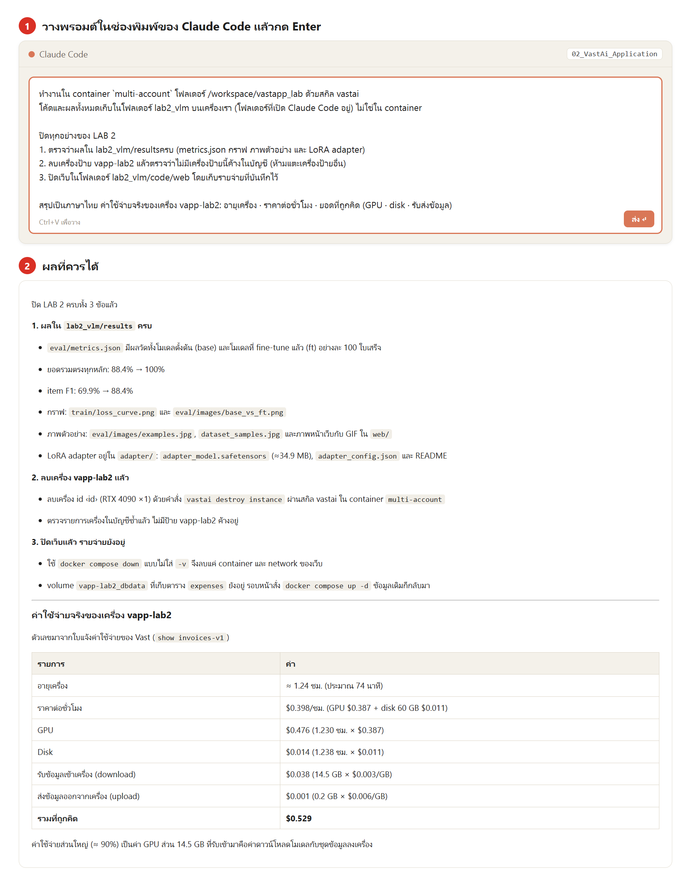
*ใช้เวลา 2 นาที · ยอดสุดท้ายในใบแจ้งหนี้ของ Vast.ai คือ $0.537 และเมื่อรวมเครื่องแรกที่ลบทิ้งในขั้นที่ 1 เป็น **$0.58***

**อ่านผลอย่างไร**

- ต้องเห็นว่า **ไม่มีเครื่องป้ายนี้เหลือ** แล้วเปิดหน้า [Instances](https://cloud.vast.ai/instances/) ดูอีกครั้ง
- เทรนจริง 9.2 นาที แต่เครื่องเปิดอยู่ 1.25 ชม. · **เงินเดินตลอดเวลาที่เครื่องเปิด** ค่า GPU คือราว 90% ของบิล
- สิ่งที่เหลือจากเงิน $0.58 คือไฟล์ Adapter 34.9 MB ใน `lab2_vlm/results/adapter/` · ลบเครื่องแล้วทุกอย่างบนเครื่องหายหมด

---

## ปิดท้าย · เก็บงานทั้ง LAB เป็นสกิลเวอร์ชัน 0

เราเพิ่งสั่งงาน 7 ขั้นจนสำเร็จ ถ้าต้องทำซ้ำ (เช่น เปลี่ยนจำนวน Epoch หรือ Rank) ไม่ควรต้องวาง 7 พรอมต์ใหม่ · **สกิล** คือไฟล์ที่เก็บวิธีทำงานที่สำเร็จแล้ว พร้อมโค้ดที่ใช้ได้จริง ไว้ให้ AI ทำซ้ำได้ในคำสั่งเดียว

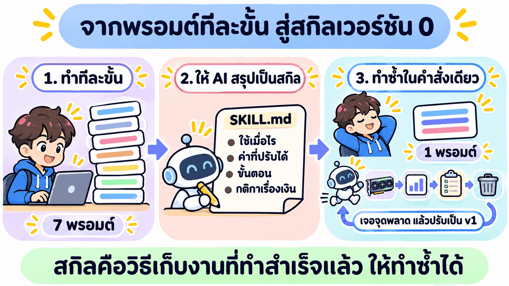

### ขั้นที่ 8 · สร้างสกิลเวอร์ชัน 0 จากงานของ LAB นี้

AI อ่านพรอมต์ โค้ด และผลของ LAB แล้วเขียน `SKILL.md` พร้อมคัดลอกโค้ด 5 ไฟล์เข้าไปในสกิล

```text
สร้างสกิลเวอร์ชัน 0 จากงานของ LAB 2 ที่เพิ่งทำเสร็จ เพื่อให้ครั้งหน้าสั่งทำซ้ำได้ในคำสั่งเดียว
1. ดูงานทั้งหมดจากพรอมต์ทุกขั้นใน lab2_vlm/PROMPTS.md โค้ดใน lab2_vlm/code และผลใน lab2_vlm/results
2. เขียนเป็นสกิลชื่อ receipt-vlm-finetune เก็บที่ lab2_vlm/skill_v0/SKILL.md ให้มี name กับ description (บอกว่าใช้เมื่อไร) · ค่าที่ปรับได้พร้อมค่าเริ่มต้น · ขั้นตอน · เกณฑ์ตรวจผ่าน · กติกาเรื่องเงิน (ลบเครื่องเสมอ)
3. คัดลอกโค้ดที่ใช้ได้แล้ว (เตรียม Dataset เทรน เปิด server วัดผล) ไปไว้ที่ lab2_vlm/skill_v0/scripts ให้สกิลใช้โค้ดชุดนี้ ไม่ต้องเขียนใหม่
4. ให้สกิลนี้เรียกใช้สกิล vastai ต่อ ไม่เขียนวิธีใช้ Vast.ai ซ้ำ
5. ติดตั้งเป็นสกิลของโปรเจกต์ที่ .claude/skills/receipt-vlm-finetune ของโฟลเดอร์ปัจจุบัน

สรุปเป็นภาษาไทย: สกิลทำอะไรได้ · ค่าที่ปรับได้ · ไฟล์ที่สร้าง
ไม่ต้อง commit
```

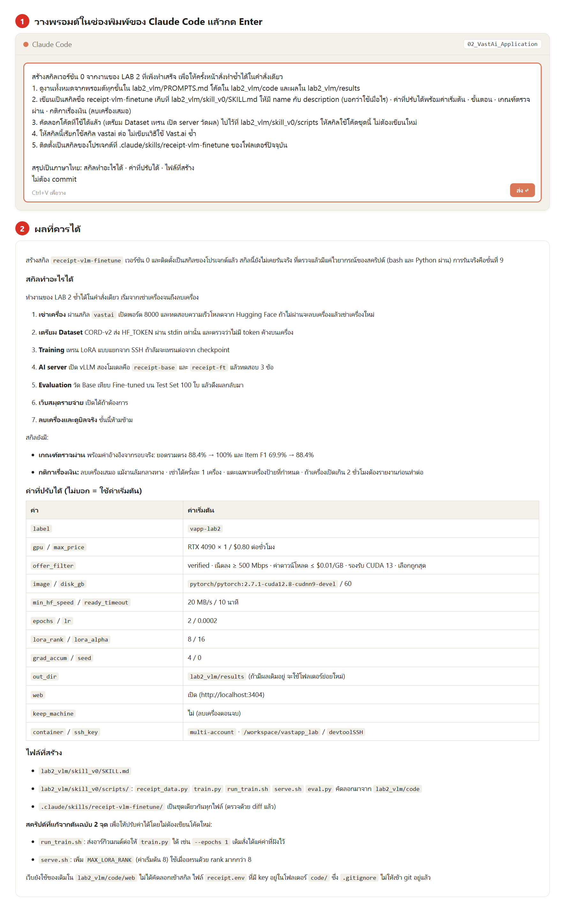
*ใช้เวลา 2 นาที · ไม่ต้องเช่าเครื่อง · สกิลที่ได้: [skill_v0/SKILL.md](skill_v0/SKILL.md) และโค้ดใน [skill_v0/scripts/](skill_v0/scripts/)*

> ⚠️ หลังขั้นนี้ให้ปิดแล้วเปิด Claude Code ใหม่ 1 ครั้ง สกิลที่เพิ่งติดตั้งจึงถูกมองเห็น · ถ้า AI ตอบว่าไม่รู้จักสกิล ให้เปิดใหม่อีกครั้ง

### ขั้นที่ 9 · ลองใช้สกิลทำซ้ำในคำสั่งเดียว

AI ตัวใหม่ได้คำสั่ง 4 บรรทัด แล้วเช่าเครื่อง เตรียม Dataset เทรน 1 Epoch เปิด server วัดผล และลบเครื่องเองทั้งหมด โดยใช้โค้ดในสกิล ไม่เขียนใหม่

```text
ใช้สกิล receipt-vlm-finetune Fine-tune โมเดลอ่านใบเสร็จ 1 Epoch บนเครื่องป้าย vapp-lab2-skill ไม่ต้องเปิดเว็บ เสร็จแล้วลบเครื่อง
เก็บผลไว้ที่ lab2_vlm/results/skill_v0_run ห้ามเขียนทับผลเดิมใน lab2_vlm/results
สรุปเป็นภาษาไทย: ยอดรวมตรงและ Item F1 ก่อน vs หลังบน Test Set · เวลาแต่ละขั้น · ค่าใช้จ่ายจริง
ไม่ต้อง commit
```

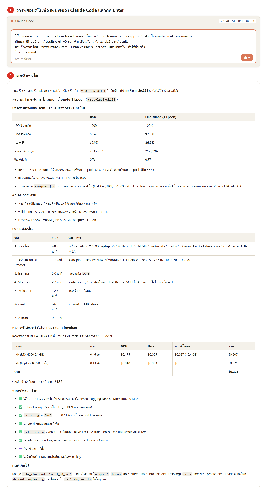
*ใช้เวลา 34 นาที · เช่าเครื่องจริงและลบเครื่องจริง · ผลอยู่ที่ [results/skill_v0_run/](results/skill_v0_run/)*

| | สั่งทีละขั้น (ขั้นที่ 1–7) | สกิล v0 |
|---|---|---|
| จำนวนพรอมต์ | 7 | **1** |
| จำนวน Epoch | 2 | 1 |
| เวลาเทรน | 9.2 นาที | 4.8 นาที |
| ยอดรวมตรงบน Test Set | 100.0% | 97.9% |
| Item F1 บน Test Set | 88.4% | 86.9% |
| เวลาทั้งหมด | 56 นาที | 34 นาที |
| ค่าเช่า | $0.58 (รวมเว็บ) | $0.23 (ไม่เปิดเว็บ) |

**อ่านผลอย่างไร**

- สกิล v0 **ผ่านในรอบแรก** และไม่ต้องเขียนโค้ดใหม่ เพราะโค้ดที่พิสูจน์แล้วอยู่ในสกิล
- LoRA 1 Epoch (4.8 นาที) ได้ Item F1 86.9% ใกล้ผล 2 Epoch ที่ 88.4% · ส่วนที่ Epoch ที่ 2 เพิ่มให้ชัดคือยอดรวม (97.9 → 100%)
- parameter ที่เทรนและขนาด Adapter เท่าเดิม (0.41% · 34.9 MB) เพราะสองค่านี้ขึ้นกับ Rank ไม่ขึ้นกับจำนวน Epoch

**v0 ยังไม่สมบูรณ์** · จุดที่พลาดในรอบทดสอบ และควรแก้ในเวอร์ชันถัดไป

| จุดที่ v0 ยังพลาด | ควรแก้อย่างไรใน v1 |
|---|---|
| เพดานราคา `$0.80` และค่าดาวน์โหลด `$0.01` ถูกอ่านเป็น 1.80 และ 1.01 ตอนโหลดสกิล เพราะ `$0` ในไฟล์สกิลถูกแทนค่า (รอบนี้ไม่เสียหาย เพราะเครื่องที่ถูกที่สุดราคา $0.398) | เขียนเป็น "0.80 USD/ชม." ไม่ใช้ `$` ตามด้วยตัวเลข |
| เกณฑ์ค้นหาไม่ได้กรอง VRAM จึงได้ "RTX 4090 Laptop" 16 GB มาก่อน ต้องลบทิ้ง (เสีย $0.021 และ 5 นาที) | เพิ่มเงื่อนไข VRAM 24 GB ขึ้นไปในเกณฑ์เลือกเครื่อง |
| ดึงผลกลับช้า ราว 6.5 นาที ทั้งที่มีเพียง 35 MB | บีบอัดเป็นไฟล์เดียวก่อนส่งกลับ |
| สคริปต์ 2 ไฟล์ในสกิลถูกแก้ตอนสร้างสกิลให้ปรับค่าได้ และยังไม่เคยรันก่อนรอบทดสอบ | ให้ขั้นสร้างสกิลทดสอบสคริปต์ที่แก้ก่อนบันทึก |

วิธีปรับคือสั่ง AI ด้วยพรอมต์อีก 1 อันให้แก้สกิลตามตารางนี้ แล้วลองใช้ซ้ำ · สกิลจึงดีขึ้นทีละเวอร์ชันจากหลักฐานของการรันจริง

---

## ไฟล์ในโฟลเดอร์นี้

| ไฟล์ / โฟลเดอร์ | คืออะไร |
|---|---|
| `PROMPTS.md` | พรอมต์ทั้ง 9 ขั้นสำหรับคัดลอก |
| `code/` | **ของคุณเริ่มจากโฟลเดอร์ว่าง** · AI เขียนโค้ดทุกไฟล์ลงที่นี่ระหว่างทำขั้นที่ 2–6 (ไม่ถูกเก็บขึ้น git) |
| `code_reference/` | ตัวอย่างโค้ดที่ AI เขียนให้ในรอบจริง: `receipt_data.py` (ขั้นที่ 2) · `train.py` `run_train.sh` (ขั้นที่ 3) · `serve.sh` (ขั้นที่ 4) · `eval.py` (ขั้นที่ 5) · `web/` (ขั้นที่ 6) · มีไว้เทียบ ไม่ต้องคัดลอก |
| `skill_v0/` | สกิล `receipt-vlm-finetune` ที่ AI สร้างในขั้นที่ 8 (`SKILL.md` + `scripts/`) |
| `results/` | ผลจากการรันจริง: `metrics.json` · `dataset_samples.jpg` · `train/` (กราฟ loss) · `eval/` (กราฟ ภาพตัวอย่าง คำตอบรายใบ) · `adapter/` (LoRA Adapter 34.9 MB) · `web/` (ภาพหน้าจอและ GIF) · `answers/` (คำตอบของทุกขั้น) · `skill_v0_run/` (ผลของขั้นที่ 9) |
| `image/` | ภาพประกอบของ LAB นี้ |
