# LAB 3 · QLoRA โมเดลเล็กให้แชทบอทร้านนวด

[← กลับหน้ารวมของบท](../README.md) · เปิด Claude Code ที่โฟลเดอร์ของบท `03_VastAi_Application` ("โฟลเดอร์ปัจจุบัน" ในพรอมต์หมายถึงโฟลเดอร์นั้น) · ทำ [LAB 0](../README.md#lab-0--เตรียม-key-3-ตัว) ก่อน

## ทำไปเพื่ออะไร

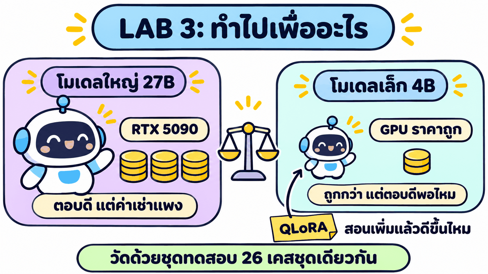

แชทบอทร้านนวดของบทที่แล้วใช้โมเดลใหญ่ 27B ซึ่งต้องเช่า RTX 5090 · คำถามของ LAB นี้คือ **ถ้าเปลี่ยนเป็นโมเดลเล็ก 4B บน RTX 3090 ที่ถูกกว่าราว 3 เท่า จะตอบได้ดีแค่ไหน และการเทรนเพิ่มด้วย QLoRA จากคำตอบของโมเดลใหญ่ช่วยให้ดีขึ้นไหม**

คำตอบที่ได้จากการรันจริงไม่ใช่ "ดีขึ้นทุกอย่าง": บนชุดทดสอบ 26 เคส โมเดลเล็กก่อนและหลังเทรน **ผ่าน 25/26 เท่ากัน** (ตกคนละเคส) ส่วนบน Validation Set โมเดลที่เทรนแล้วตอบถูก **94.1% เทียบกับ 87.1%** · LAB นี้จึงสอนทั้งวิธี Fine-tune และวิธีอ่านผลที่ไม่ได้ออกมาตามที่หวัง

LAB นี้มี **10 ขั้น** · ทุกขั้นคือ 1 พรอมต์ · โค้ดทุกไฟล์ AI เขียนให้จากพรอมต์ เริ่มจากโฟลเดอร์ว่าง · ขั้นที่ 1–8 คืองานหลัก ขั้นที่ 9–10 เก็บงานทั้งหมดเป็น **สกิลเวอร์ชัน 0** · ตัวเว็บแชทบอทและชุดทดสอบ 26 เคสเป็นระบบเดิมจาก[บทที่แล้ว](../../01_VastAi_Skill/) ขั้นที่ 1 คัดลอกมาใช้ต่อ


## รู้จัก Dataset

LAB นี้ **ไม่ได้ดาวน์โหลด Dataset สาธารณะ** · ข้อมูลฝึกถูกสร้างขึ้นใน LAB เอง (Synthetic Dataset) ด้วย 2 ชั้น: AI เขียนสคริปต์สร้างคำถามของลูกค้า แล้วให้โมเดลครูเป็นผู้ตอบ

| หัวข้อ | รายละเอียด |
|---|---|
| เกี่ยวกับอะไร | บทสนทนาระหว่างลูกค้ากับแชทบอทของร้านสมมติ "สบายใจ นวดแผนไทย" เชียงใหม่ (8 บริการ) · ถามข้อมูลร้าน ราคา ส่วนลด และจองคิว |
| ใครทำ | **คำถาม**: สคริปต์ `make_questions.py` ที่ AI เขียนในขั้นที่ 1 (แม่แบบประโยค + สุ่มชื่อ เบอร์ บริการ วันเวลา · seed 2026) · **คำตอบ**: โมเดลครู Qwen3.8 27B ในขั้นที่ 3 |
| ต้นทาง | ข้อมูลร้านและกติกาการตอบมาจากโค้ดแชทบอทของบทที่แล้ว · ไฟล์ที่ได้จากรอบจริงอยู่ที่ [data/](data/) |
| สัญญาอนุญาต | ข้อมูลของหลักสูตรเอง · ชื่อและเบอร์โทรทุกรายการสุ่มขึ้น ไม่มีข้อมูลส่วนบุคคลจริง |
| รูปแบบ | JSONL บรรทัดละ 1 บทสนทนา ในรูปแบบ `messages` (system, user, assistant) |
| จำนวน | คำถาม 570 บท (ข้อความลูกค้า 998 ข้อความ · 12 ชนิด) → ผ่านการคัด **485 บท** → ทิ้ง 85 บท |
| การแบ่งชุด | Training Set **437 บท** (747 คำตอบ) · Validation Set **48 บท** (85 คำตอบ) · seed 7 · Test = ชุดทดสอบ 26 เคสของบทที่แล้ว (ไม่อยู่ใน Dataset) |

**ข้อมูลเกิดขึ้นอย่างไร**: คำถามลูกค้า 570 บท → ครูตอบทุกข้อความด้วย system prompt ชุดเดียวกับที่เว็บใช้จริง → ตรวจคำตอบด้วยเงื่อนไขที่กำกับไว้ ถ้าผิดให้ตอบใหม่ 1 ครั้ง ยังผิดอีกทิ้งทั้งบท → แบ่ง 90/10 · รายละเอียดอยู่ในทฤษฎีข้อ 3

ภาพตัวอย่างจริงที่ AI ทำให้ในขั้นที่ 3 · 6 แถวจาก Training Set พร้อมเงื่อนไขของคำตอบ และ 3 เคสจากชุดทดสอบ


**ข้อมูล 1 รายการหน้าตาเป็นอย่างไร** · บรรทัดจริงจาก `data/train.jsonl` (ย่อ system prompt)

```json
{"id":"q0416","kind":"english","kind_th":"ภาษาอังกฤษ","now":"2027-02-06 14:22",
 "messages":[{"role":"system","content":"คุณคือ \"น้องสบายใจ\" … (2,855 ตัวอักษร)"},
             {"role":"user","content":"What's the price of a foot reflexology massage?"},
             {"role":"assistant","content":"The price for a foot reflexology massage (45 minutes) is 300 baht."}],
 "expects":[{"has":["300"],"not":[],"lang":"en","booking":"none","no_markdown":true,
             "must":"ต้องมี 300 · ต้องยังไม่มีแท็กจอง · ตอบภาษาอังกฤษ"}],
 "retried":false}
```

| ช่อง | คืออะไร |
|---|---|
| `messages[0]` system | คำสั่งและข้อมูลร้านชุดเดียวกับที่เว็บส่งให้โมเดล · โมเดลเล็กจึงเรียนกับ prompt เดียวกับที่ใช้งานจริง |
| `messages[1]` user | ข้อความของลูกค้า |
| `messages[2]` assistant | คำตอบของครูที่ผ่านการตรวจแล้ว · สิ่งที่โมเดลเล็กต้องเรียนให้ตอบได้ |
| `expects[i]` | **label** ของคำตอบข้อที่ i: `has` ต้องมี · `not` ห้ามมี · `lang` ภาษา · `booking` ต้องมีหรือห้ามมีแท็กจอง · ใช้ทั้งคัดคำตอบของครูและวัดผลโมเดลเล็ก |
| `now` | วันเวลาปัจจุบันของบทนั้น (ไม่ซ้ำกันทั้ง 570 บท) · โมเดลต้องคิดคำว่า "พรุ่งนี้" จาก prompt ไม่ใช่จำวันเดียว |

| ชนิดคำถาม | ทั้งหมด → ผ่าน | ชนิดคำถาม | ทั้งหมด → ผ่าน |
|---|---|---|---|
| ข้อมูลร้าน | 70 → 68 | ถามต่อเนื่องหลายข้อความ | 70 → 61 |
| ราคาและบริการ | 70 → 69 | จองคิว · ให้ข้อมูลทีละอย่าง | 40 → 31 |
| ส่วนลดและโปรโมชัน | 55 → 55 | จองคิว · ครบในข้อความเดียว | 40 → **17** |
| บริการที่ร้านไม่มี | 40 → 38 | จองคิว · เปลี่ยนใจกลางทาง | 35 → 27 |
| เรื่องนอกร้าน | 40 → 40 | จองคิว · ขอเวลานอกเวลาเปิดร้าน | 30 → 26 |
| ภาษาอังกฤษ | 50 → **25** | จองคิว · ให้ข้อมูลไม่ครบ | 30 → 28 |

**ชุดทดสอบ 26 เคส (Test)** · ไฟล์ `cases.json` ของบทที่แล้ว ไม่ถูกแก้ · 18 เคสถามข้อเดียว (เวลา ราคา โปรโมชัน นโยบาย บริการที่ไม่มี เรื่องนอกร้าน ภาษาอังกฤษ จองคิว) และ 8 เคสถามต่อเนื่อง (จำชื่อ จำเงื่อนไข สลับภาษา เปลี่ยนใจตอนจอง) · Playwright พิมพ์ในหน้าแชทจริง แล้วตรวจว่าคำตอบ **มีคำหรือตัวเลขที่กำหนด** และการ์ดจองกับแถวใน PostgreSQL ตรงกัน

**ข้อสังเกต**

- **ครูก็ผิดได้**: ทิ้ง 85 จาก 570 บท (15%) · เหตุผลมากที่สุดคือลูกค้าถามภาษาอังกฤษแต่ครูตอบภาษาไทย (39 บท)
- **Dataset มีอคติ**: ชนิด "ภาษาอังกฤษ" ผ่านเพียง 25/50 และ "จองคิวครบในข้อความเดียว" 17/40 · สองชนิดนี้จึงมีตัวอย่างน้อย โมเดลเล็กได้เรียนน้อยตามไปด้วย
- Validation Set มีเพียง 48 บท · บางชนิดเหลือ 1–2 บท ตัวเลขรายชนิดจึงแกว่งง่าย

## รู้จักโมเดลที่ใช้

**โมเดลนักเรียน (Student)** · โมเดลเล็กที่นำมาเทรนเพิ่ม

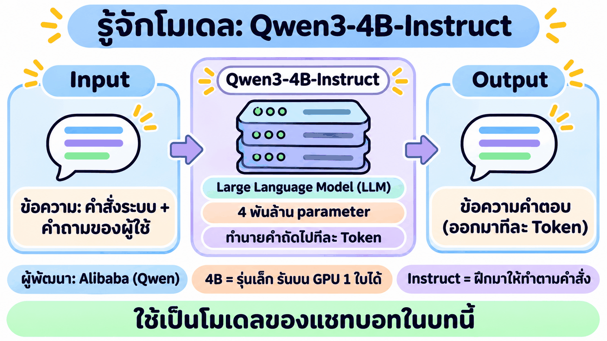

| หัวข้อ | Qwen3-4B-Instruct-2507 |
|---|---|
| ประเภท | Large Language Model (LLM) |
| Input | ข้อความ: system prompt (กติกา + ข้อมูลร้าน ราว 1,000 token) + ประวัติแชท + ข้อความล่าสุดของลูกค้า |
| Output | ข้อความคำตอบ ออกมาทีละ Token · เมื่อข้อมูลจองครบจะมีแท็ก `[BOOKING]{…}` ต่อท้าย |
| ขนาด | ราว 4 พันล้าน parameter · weight แบบ bfloat16 ใช้ VRAM ราว 7.9 GB · ไฟล์ที่ดาวน์โหลด 7.6 GB |
| ที่มา | [Qwen/Qwen3-4B-Instruct-2507](https://huggingface.co/Qwen/Qwen3-4B-Instruct-2507) โดย Alibaba (ทีม Qwen) · `Instruct` คือรุ่นที่ฝึกมาให้ทำตามคำสั่ง |
| ใน LAB นี้ | **Base** = โมเดลนี้ตามที่โหลดมา (`qwen3-4b-base`) · **Fine-tuned** = โมเดลนี้ + LoRA Adapter ที่เราเทรน (`qwen3-4b-sabaijai`) · รันบน RTX 3090 |

**โมเดลครู (Teacher)** · โมเดลใหญ่ที่ใช้ตอบคำถามเพื่อทำ Dataset


| หัวข้อ | Qwen3.8 27B |
|---|---|
| ประเภท | Large Language Model (LLM) |
| Input | ข้อความชุดเดียวกับโมเดลนักเรียน (system prompt + ประวัติแชท + ข้อความลูกค้า) |
| Output | ข้อความคำตอบ · ตั้งให้ตอบแบบไม่แสดงขั้นคิด |
| ขนาด | 27 พันล้าน parameter · ไฟล์โมเดล `qwen3_8_27b_nvfp4.ninfer` 23.7 GB · ใช้ VRAM 31.5 จาก 32.6 GB ของ RTX 5090 |
| ที่มา | ไฟล์จาก [neroued/Qwen3.8-27B-nvfp4-NInfer](https://huggingface.co/neroued/Qwen3.8-27B-nvfp4-NInfer) · รันด้วยโปรแกรม [NInfer](https://github.com/Neroued/ninfer) แบบเดียวกับบทที่แล้ว |
| ใน LAB นี้ | เปิดเพียง 21 นาทีเพื่อตอบคำถาม 570 บท แล้วลบเครื่องทันที · ความเร็วที่วัดได้ราว 53 token ต่อวินาที |

> ผล **26/26** ของโมเดลครูบนชุดทดสอบเป็นผลที่ **อ้างจากบทที่แล้ว ไม่ได้รันซ้ำใน LAB นี้** · ทุกตารางที่มีแถวของโมเดลครูใช้ตัวเลขอ้างอิงนี้

## ทฤษฎีที่ต้องรู้

### 1 · LoRA (Low-Rank Adaptation) — แนวคิดหลักของ LAB นี้

- **คืออะไร**: วิธี Fine-tune ที่ **ตรึง weight เดิมไว้ทั้งหมด** แล้วเพิ่มเมทริกซ์เล็ก 2 ตัว (A และ B) ข้างชั้น Linear แต่ละชั้น เทรนเฉพาะ A และ B · สิ่งที่ได้คือไฟล์ **Adapter** ขนาดเล็กที่ใช้คู่กับ Base Model
- **ทำไมต้องใช้**: Full Fine-tuning ต้องปรับ weight ราว 4,000 ล้านตัว ต้องเก็บ gradient ของทุกตัว และได้โมเดลใหม่ทั้งก้อนราว 8 GB · LoRA ใช้หน่วยความจำน้อยกว่า ได้ไฟล์เล็ก และข้อมูลเพียงไม่กี่ร้อยบทก็เทรนได้โดยเสี่ยง Overfitting น้อยกว่า

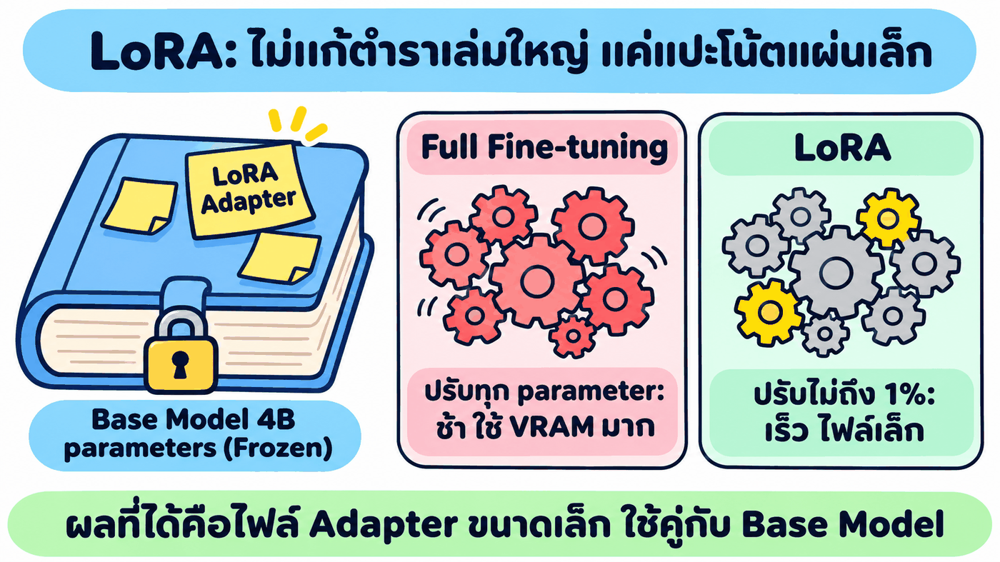

- **ทำงานอย่างไร**: ผลของชั้น = `W·x` (ของเดิม) + `(α / r)·B·A·x` (ส่วนเสริม) · งานเฉพาะทางต้องการการขยับ weight ที่ไม่ซับซ้อน (low rank) จึงแทนการขยับด้วยผลคูณของเมทริกซ์ผอม 2 ตัว · **Rank r** คือความจุของส่วนเสริม · **Alpha α** คือตัวคูณความแรง · เริ่มต้น B = 0 โมเดลจึงตอบเหมือนเดิมทุกประการก่อนเริ่มเทรน


- **ตัวเลขจาก LAB นี้**: Rank 8 · Alpha 16 · dropout 0.05 · ใส่ที่ชั้น Linear 7 ชนิด (q, k, v, o ของ Attention และ gate, up, down ของ MLP) ทั้ง 36 block

| รายการ | ค่า |
|---|---|
| ตัวอย่าง 1 ชั้น (`q_proj` ขนาด 2560 → 4096) | W เดิม 10.5 ล้านตัว · A + B = 8 × (2560 + 4096) = **53,248 ตัว (0.5%)** |
| ทั้งโมเดล | เทรน **16.5 ล้านตัว** จากราว 4,000 ล้านตัว (ราว 0.4%) |
| ไฟล์ที่ได้ | Adapter **63 MB** เทียบกับ Base Model ราว 8 GB |


### 2 · Quantization 4-bit และ QLoRA

- **คืออะไร**: **Quantization** คือการเก็บ weight แต่ละตัวด้วยจำนวนบิตที่น้อยลง (16 บิต → 4 บิต) · **QLoRA** = โหลด Base Model แบบ 4-bit แล้วตรึงไว้ + เทรน LoRA Adapter ทับลงไป

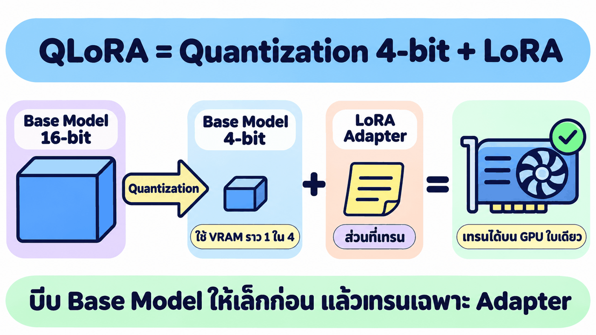

- **ทำไมต้องใช้**: ตอนเทรน GPU ต้องเก็บทั้ง Base Model และค่ากลางของทุกชั้นสำหรับคำนวณ gradient · บทสนทนาของ LAB นี้ยาว (เฉลี่ยราว 1,900 token ต่อบท เพราะ system prompt กับข้อมูลร้านยาวราว 1,000 token) · ยิ่ง Base Model กินที่น้อย ก็ยิ่งเหลือที่ให้บทสนทนายาว ๆ บนการ์ด 24 GB ที่เช่าได้ถูก
- **ทำงานอย่างไร**:
  1. **NF4**: แบ่งค่าของ weight เป็น 16 ระดับ โดยวางระดับถี่ใกล้ 0 เพราะ weight ส่วนใหญ่อยู่ใกล้ 0
  2. **Double Quantization**: บีบค่าสเกลของแต่ละกลุ่มอีกชั้น
  3. ตอนคำนวณ แปลง weight กลับเป็น bfloat16 ชั่วคราว · gradient ไหลผ่าน Base Model ที่ตรึงไว้ ไปปรับเฉพาะ A และ B
  4. ส่งทีละ 1 บท แล้วสะสม gradient 8 บทต่อการปรับ weight 1 ครั้ง เพื่อไม่ให้ VRAM ล้น

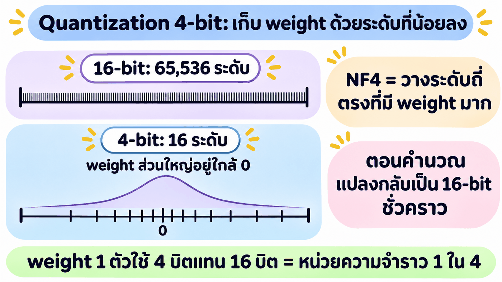

- **ตัวเลขจาก LAB นี้**: โหลดแบบ 4-bit NF4 (double quant, คำนวณแบบ bfloat16) · เทรน 3 Epoch = 165 step ใน **35.6 นาที** บน RTX 3090 (ราว 13 วินาทีต่อ step) · VRAM สูงสุด **22.9 GB** เป็นค่าที่ PyTorch **จองไว้** ซึ่งสูงกว่าที่ใช้จริง · ค่าเช่า $0.241 ต่อชั่วโมง

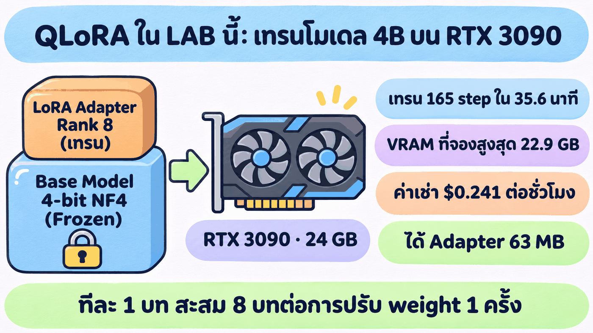

- **ข้อควรรู้**: เทรนบน Base Model 4-bit แต่ตอนให้บริการ vLLM โหลด Base Model ความละเอียดเต็ม (bfloat16) แล้วเสียบ Adapter ตัวเดิม · เป็นวิธีที่นิยมและใช้งานได้ แต่เป็นเหตุผลหนึ่งที่ผลตอนใช้งานอาจต่างจาก loss ตอนเทรนเล็กน้อย

### 3 · Knowledge Distillation: โมเดลใหญ่เป็นครู

- **คืออะไร**: การถ่ายความสามารถของโมเดลใหญ่ (Teacher) ให้โมเดลเล็ก (Student) · ให้ครูตอบคำถามจริงก่อน แล้วเก็บ "คำถาม + คำตอบของครู" เป็น Training Data · LAB นี้ใช้แบบที่เรียนจาก **ข้อความคำตอบ** ของครู (response-based) ไม่ได้ใช้ค่าความน่าจะเป็นภายในของครู


- **ทำไมต้องใช้**: ไม่มีใครเขียนคำตอบตัวอย่างหลายร้อยบทของร้านนี้ไว้ และการจ้างคนเขียนทั้งแพงและช้า · ครูตอบคำถามของร้านนี้ได้ดีอยู่แล้ว · ครูต้องใช้ RTX 5090 ตลอดเวลาที่ให้บริการ จึงยอมจ่ายค่าครูครั้งเดียวสั้น ๆ เพื่อได้โมเดลเล็กที่ใช้ได้ทุกวัน
- **ทำงานอย่างไร**:
  1. **คำถาม**: บทพูดของลูกค้า 570 บท 12 ชนิด · ทุกข้อความมี "เงื่อนไขของคำตอบที่ถูก" กำกับไว้
  2. **ครูตอบ**: ส่งแบบเดียวกับที่เว็บเรียกโมเดลจริงทุกอย่าง (system prompt + ข้อมูลร้าน + ประวัติแชท · temperature 0.3)
  3. **กรอง**: ตรวจตัวเลข ภาษา markdown และแท็กจอง · ผิดให้ตอบใหม่ 1 ครั้ง · ยังผิดทิ้งทั้งบท
  4. **แบ่งชุด**: Training Set 90% · Validation Set 10%
  5. **ตรวจ Data Leakage**: ข้อความลูกค้าต้องไม่ซ้ำหรือคล้ายข้อความของชุดทดสอบ (ดูข้อ 4)


- **ตัวเลขจาก LAB นี้**: ครูถูกเรียก 1,200 ครั้งใน 6 นาที 47 วินาที (ส่งพร้อมกันทีละ 8 บท) · ผ่าน **485 บท (85.1%)** โดยผ่านตั้งแต่ครั้งแรก 466 และผ่านหลังตอบใหม่ 19 · ค่าเช่าเครื่องครู **$0.33**

| เหตุผลที่ถูกทิ้ง (85 บท) | บท |
|---|---:|
| ตอบผิดภาษา (ลูกค้าถามอังกฤษ ครูตอบไทย) | 39 |
| ไม่ใส่แท็กจองทั้งที่ข้อมูลครบ | 29 |
| ไม่มีตัวเลขหรือคำที่ต้องมี | 9 |
| ข้อมูลในแท็กจองผิด | 4 |
| ใส่แท็กจองทั้งที่ข้อมูลไม่ครบ | 3 |
| มีคำที่ห้ามมี | 1 |

### 4 · Training / Validation / Test และ Data Leakage

- **คืออะไร**: ข้อมูล 3 ชุดที่ต้องไม่ซ้ำกัน · **Data Leakage** คือข้อสอบหลุดเข้าไปในข้อมูลเทรน
- **ทำไมต้องใช้**: ถ้าโมเดลเคยเห็นข้อสอบตอนเทรน คะแนนจะสูงเกินจริง และแยกไม่ได้ว่าโมเดล "เข้าใจ" หรือ "จำข้อสอบ" · LAB นี้เสี่ยงเป็นพิเศษ เพราะคำถามเทรนและข้อสอบพูดเรื่องร้านเดียวกัน
- **ทำงานอย่างไร**: สคริปต์สร้างคำถามเทียบทุกข้อความกับ 49 ข้อความของชุดทดสอบ (26 เคส + ปุ่มลัดบนหน้าแชท) · ห้ามซ้ำตรงตัว และความคล้ายต้องต่ำกว่า 0.75 · ข้อความที่คล้ายเกินถูกทิ้งแล้วสุ่มใหม่

| ชุด | จำนวน | ใช้ทำอะไร |
|---|---|---|
| Training Set | 437 บท (747 คำตอบ) | ปรับ weight ของ Adapter |
| Validation Set | 48 บท (85 คำตอบ) | ดู loss ระหว่างเทรน เลือก Adapter ที่ดีที่สุด และเทียบ Base กับ Fine-tuned |
| Test (ชุดทดสอบ) | 26 เคส | สอบผ่านเว็บจริงตอนท้าย · ไม่เคยใช้เทรน |


- **ตัวเลขจาก LAB นี้**: ข้อความที่ซ้ำกับชุดทดสอบ **0 ข้อความ** · ความคล้ายสูงสุดที่เหลือ **0.72** ("ขอเป็นนวดแผนโบราณ 1 ชม.ค่ะ" กับ "ขอนวดไทยแผนโบราณค่ะ") · ตอนสร้างมีข้อความถูกทิ้งเพราะคล้ายชุดทดสอบ 10 ข้อความ
- **ข้อควรระวัง**: Validation Set ถูกใช้เลือก Adapter (step ที่ loss ต่ำสุด) และมาจากแม่แบบประโยคชุดเดียวกับ Training Set · ตัวเลขบน Validation Set จึงบอกว่าโมเดล "ตอบคำถามแบบที่ครูสอนได้ดีแค่ไหน" ไม่ใช่คำถามทุกแบบของลูกค้าจริง

### 5 · อ่าน Validation loss

- **คืออะไร**: **loss** คือค่าที่บอกว่าโมเดลทาย Token ถัดไปของคำตอบครูพลาดแค่ไหน ยิ่งต่ำยิ่งเลียนแบบครูได้ใกล้ · **Training loss** วัดบนข้อมูลที่ใช้เทรน · **Validation loss** วัดบน 48 บทที่ไม่ได้ใช้เทรน
- **ทำไมต้องใช้**: ใช้ดูว่าโมเดล "เข้าใจ" หรือ "ท่องจำ" · ถ้า Training loss ลงต่อ แต่ Validation loss หยุดหรือกลับขึ้น แปลว่าเริ่ม **Overfitting**
- **ทำงานอย่างไร**: 1 บทสนทนามีราว 1,900 token แต่ส่วนใหญ่คือ system prompt และข้อความลูกค้า ซึ่งไม่ต้องการให้โมเดลท่อง · `train.py` จึง **คิด loss เฉพาะ Token ในคำตอบของผู้ช่วย** · วัด Validation loss ก่อนเทรน แล้วทุก 20 step · เก็บ Adapter เฉพาะ step ที่ Validation loss ต่ำสุด


- **ตัวเลขจาก LAB นี้**: Validation loss 1.004 → 0.443 → 0.376 → 0.340 → 0.334 → 0.313 → **0.307** (step 120) → 0.309 → 0.307

| ช่วงของกราฟ | สิ่งที่เห็น | แปลว่า |
|---|---|---|
| step 0–20 | 1.004 → 0.443 | โมเดลจับรูปแบบการตอบของครูได้เร็วมาก |
| step 20–100 | 0.443 → 0.313 | ยังเรียนต่อ แต่ได้เพิ่มทีละน้อย |
| step 100–165 | ราบที่ราว 0.31 ขณะที่ Training loss ลงต่อถึงราว 0.12 | เริ่ม Overfitting · 3 Epoch กำลังพอดี เทรนต่อไม่ได้อะไรเพิ่ม |

- **ข้อควรระวัง**: loss ต่ำ = เลียนแบบคำตอบครูได้ใกล้ **ไม่ได้แปลว่าตอบถูกทุกข้อ** จึงต้องวัดด้วยเงื่อนไขของคำตอบในข้อ 6 ด้วย

### 6 · วัดผล 2 ชั้น: ชุดทดสอบ 26 เคส กับ Validation Set

- **คืออะไร**: (1) **ชุดทดสอบ 26 เคส** Playwright พิมพ์ในเว็บจริงเหมือนลูกค้า (2) **Validation Set 85 คำตอบ** ตรวจด้วยเงื่อนไขชุดเดียวกับที่ใช้กรองคำตอบของครู พร้อมตัววัดลีลาการตอบ
- **ทำไมต้องใช้**: ชุดทดสอบ 26 เคสออกแบบมาตรวจโมเดลใหญ่ เกณฑ์เป็นแบบ "ต้องมีคำหรือตัวเลขนี้" · โมเดลเล็กที่ยังไม่เทรนก็ผ่าน 25/26 แล้ว จึง **เหลือที่ให้ดีขึ้นได้เพียง 1 เคส** · ต้องมีตัววัดที่ละเอียดกว่า
- **ทำงานอย่างไร**: เทียบ A/B บน server เดียวกัน เว็บเดียวกัน prompt เดียวกัน ต่างกันเพียงชื่อโมเดล · ชุดทดสอบรันผ่านเบราว์เซอร์ 1 รอบ แล้วรันซ้ำผ่าน API อีก 5 รอบต่อโมเดลเพื่อดูว่าผลแกว่งไหม (เว็บใช้ temperature 0.3) · Validation Set วัดที่ temperature 0


- **ตัวเลขจาก LAB นี้**:

| ตัววัด | Base | Fine-tuned |
|---|---|---|
| ชุดทดสอบ 26 เคส | 25/26 (ตกเคส 21) | 25/26 (ตกเคส 19) |
| คำตอบที่ถูกบน Validation Set (85 ข้อ) | 87.1% (74 ข้อ) | **94.1%** (80 ข้อ) |
| ใส่แท็กจองทั้งที่ข้อมูลไม่ครบ (77 ข้อ) ↓ | 6.5% | **1.3%** |
| ลงท้ายว่า "ครับ" (83 ข้อภาษาไทย) ↓ | 3.6% | **0%** |


### 7 · ต้นทุน: โมเดลใหญ่เทียบโมเดลเล็ก

- **คืออะไร**: ค่าเช่า GPU คิดตามเวลาที่เครื่องเปิด · โมเดลที่ต้องการ VRAM มากต้องใช้การ์ดที่แพงกว่า
- **ทำไมต้องรู้**: แชทบอทต้องเปิดตลอดเวลา ค่าเช่าต่อชั่วโมงจึงคูณด้วยทั้งเดือน · เหตุผลหลักของการใช้โมเดลเล็กคือเรื่องนี้
- **ทำงานอย่างไร**: โมเดลครู 27B ใช้ VRAM 31.5 GB จึงต้องใช้ RTX 5090 (32 GB) · โมเดลเล็ก 4B มี weight ราว 7.9 GB รันบน RTX 3090 (24 GB) ได้ · vLLM โหลด Base Model ครั้งเดียว แล้วลงทะเบียน Adapter เป็น **ชื่อโมเดลอีกชื่อ** บน server เดียวกัน จึงเทียบ Base กับ Fine-tuned ได้โดยไม่ต้องมี GPU 2 ใบ


- **ตัวเลขจาก LAB นี้**:

| | โมเดลครู 27B · RTX 5090 | โมเดลเล็ก 4B · RTX 3090 |
|---|---|---|
| ราคาที่เช่าจริง | $0.745 ต่อชั่วโมง | **$0.241 ต่อชั่วโมง** (ถูกกว่าราว 3.1 เท่า) |
| ถ้าเปิดทั้งเดือน | ราว $536 | ราว $174 |
| ความเร็ว (ทีละคำขอ) | ราว 53 token ต่อวินาที | Base 55.0 · Fine-tuned 50.6 token ต่อวินาที |
| VRAM | 31.5 จาก 32.6 GB | server จอง 21.9 จาก 24 GB (vLLM จอง 85% ของการ์ด · weight จริงราว 7.9 GB) |

- Adapter ทำให้ช้าลงราว 8% (55.0 → 50.6 token ต่อวินาที) เพราะ server ต้องคำนวณส่วนเสริมเพิ่ม
- ราคาถูกลง 3.1 เท่าเป็นข้อเท็จจริง แต่ **คุณภาพเท่ากันหรือไม่ ต้องดูผลในขั้นที่ 5 และ 7** ไม่ใช่ดูราคาอย่างเดียว

## การทดลอง

| หัวข้อ | รายละเอียด |
|---|---|
| Dataset | สร้างเองใน LAB: คำถาม 570 บท → ครูตอบและคัดเหลือ 485 บท · Training 437 · Validation 48 |
| โมเดล | นักเรียน [Qwen3-4B-Instruct-2507](https://huggingface.co/Qwen/Qwen3-4B-Instruct-2507) · ครู Qwen3.8 27B |
| เทียบ A กับ B | **A** = โมเดลครู 27B (ผล 26/26 อ้างจากบทที่แล้ว ไม่ได้รันซ้ำ) · **B** = โมเดลเล็ก Base · **C** = โมเดลเล็ก + LoRA (Rank 8, Alpha 16, 3 Epoch, learning rate 0.0002, seed 0) · B กับ C อยู่บน server เดียวกัน เว็บเดียวกัน prompt เดียวกัน |
| วิธีวัด | (1) Validation Set 85 คำตอบ temperature 0 ตรวจด้วยเงื่อนไขของคำตอบ (2) ชุดทดสอบ 26 เคสผ่านเว็บจริง + รันซ้ำ 5 รอบผ่าน API |
| เครื่อง | ครู: RTX 5090 1 ใบ เพดาน $1.20/ชม. ได้จริง $0.745/ชม. · นักเรียน: RTX 3090 1 ใบ เพดาน $0.40/ชม. ได้จริง $0.241/ชม. |
| เวลาและค่าเช่าจริง | ขั้นที่ 1–8 รวม 118 นาที · เครื่องครูเปิด 21 นาที $0.33 · เครื่องนักเรียนเปิด 84 นาที $0.36 · รวม **$0.69** |

ทำตามลำดับขั้นที่ 1 → 8 ให้ครบในรอบเดียว · คัดลอกพรอมต์ไปวางในช่องพิมพ์ของ Claude Code ทีละขั้น · โค้ดที่ AI เขียนจะอยู่ในโฟลเดอร์ `lab3_qlora/code` ซึ่งเริ่มจากว่าง

## ขั้นที่ 1 · เตรียมแชทบอทเดิม และเขียนโค้ดสร้างคำถามลูกค้า

AI คัดลอกเว็บแชทบอทและชุดทดสอบ 26 เคสจากบทที่แล้ว (ระบบเดิม) แล้วเขียน `make_questions.py` สร้างคำถามลูกค้า · ขั้นนี้ยังไม่เช่าเครื่อง

```text
ทำงานในโฟลเดอร์ปัจจุบัน ขั้นนี้ยังไม่ต้องเช่าเครื่อง

เตรียมของตั้งต้นของ LAB: แชทบอทร้านนวดจากบทที่แล้ว และคำถามลูกค้าชุดใหม่ที่จะใช้ทำ Dataset
1. คัดลอกแชทบอทร้านนวดเดิมจากบทที่แล้ว (../01_VastAi_Skill/chatbot) มาใช้ต่อโดยไม่แก้ต้นฉบับ: โฟลเดอร์ frontend มาเป็น lab3_qlora/code/web และชุดทดสอบ 26 เคส (โฟลเดอร์ e2e) มาเป็น lab3_qlora/code/e2e
2. เขียนสคริปต์ lab3_qlora/code/make_questions.py สร้างบทสนทนาฝั่งลูกค้าอย่างน้อย 500 บท (ยังไม่มีคำตอบ) เก็บที่ lab3_qlora/data/questions.jsonl
3. ให้คำถามหลากหลาย: ข้อมูลร้าน ราคา ส่วนลด บริการที่ร้านไม่มี เรื่องนอกร้าน ภาษาอังกฤษ ถามต่อเนื่องหลายข้อความ
4. ให้มีการจองคิวหลายแบบ: ให้ข้อมูลทีละอย่าง ให้ครบในข้อความเดียว เปลี่ยนใจกลางทาง ขอเวลานอกเวลาเปิดร้าน และให้ข้อมูลไม่ครบ
5. ข้อมูลร้านและกติกาการตอบดูจากโค้ดของแชทบอทที่คัดลอกมา ทุกข้อความของลูกค้าต้องมีเงื่อนไขของคำตอบที่ถูกกำกับไว้ เช่น ต้องมีราคา 350 ต้องมีแท็กจองที่ชื่อ เบอร์ บริการ วันเวลาตรง หรือต้องยังไม่มีแท็กจอง
6. แต่ละบทสุ่มวันเวลาปัจจุบันให้ต่างกัน ใช้ seed 2026 และห้ามมีข้อความซ้ำหรือคล้ายข้อความในชุดทดสอบ 26 เคส (รวมข้อความของปุ่มลัดบนหน้าแชท)
7. รันสคริปต์ แล้วอธิบายโค้ดสั้น ๆ 3–5 บรรทัดว่าแต่ละส่วนทำอะไร

สรุปเป็นตารางภาษาไทย: จำนวนบทแยกตามชนิด · ตัวอย่างบทสนทนา 2 บทพร้อมเงื่อนไขของคำตอบ · ผลตรวจว่าไม่ซ้ำกับชุดทดสอบ
```

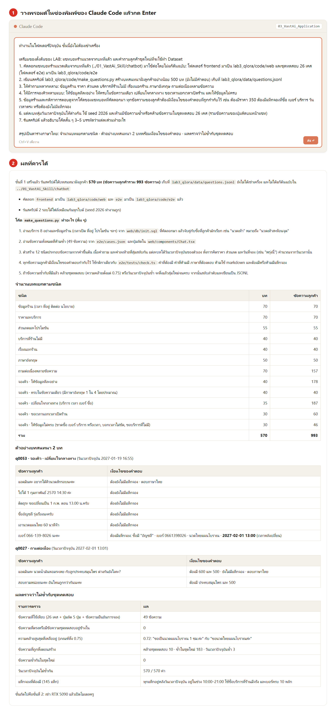
*ใช้เวลา 7.7 นาที · ไม่ต้องเช่าเครื่อง*

ตัวอย่างโค้ดที่ AI เขียนให้ในรอบจริง (ของคุณอาจต่างกัน): [code_reference/make_questions.py](code_reference/make_questions.py) (738 บรรทัด)

**อ่านผลอย่างไร**

- ต้องได้อย่างน้อย 500 บท ครบทั้งคำถามทั่วไปและการจองคิว 5 แบบ · รอบจริงได้ **570 บท 12 ชนิด**
- ดูแถว **ผลตรวจว่าไม่ซ้ำกับชุดทดสอบ**: ข้อความที่ตรงกันต้องเป็น 0 · ความคล้ายสูงสุด 0.72 ต่ำกว่าเกณฑ์ 0.75 (ทฤษฎีข้อ 4)
- ทุกข้อความของลูกค้ามี **เงื่อนไขของคำตอบ** ติดมา เช่น "ต้องมีแท็กจองที่เวลาเป็น 13:00 (เวลาหลังเปลี่ยน)" · เงื่อนไขนี้คือ label ที่ใช้ทั้งกรองคำตอบของครูและวัดผลโมเดลเล็ก
- คำตอบของรอบนี้รวมข้อความลูกค้าได้ 993 แต่ไฟล์ `data/questions.jsonl` นับได้จริง **998 ข้อความ** · ตัวเลขในคำตอบของ AI ควรตรวจกับไฟล์เสมอ

## ขั้นที่ 2 · เช่า RTX 5090 แล้วเปิดโมเดลครู

AI เช่าเครื่องแรง ติดตั้ง NInfer เปิดโมเดลครู 27B แล้วลองถามจากนอกเครื่อง

```text
ทำงานใน container `multi-account` โฟลเดอร์ /workspace/vastapp_lab ด้วยสกิล vastai
กุญแจ SSH อยู่ที่ /workspace/vastai_lab/Devtool_SSH/devtoolSSH

เช่าเครื่องแรงเพื่อเปิดโมเดลครู คือโมเดลใหญ่ที่ตอบคำถามของร้านนวดได้ถูกอยู่แล้ว
1. เช่า RTX 5090 1 ใบ ราคารวมไม่เกิน $1.20 ต่อชั่วโมง ตั้งป้ายเครื่องว่า vapp-lab3-teacher
2. เลือกเครื่อง verified ที่ดาวน์โหลดเร็วกว่า 2500 Mbps รองรับ CUDA 13.1 ขึ้นไป disk 90 GB ใช้ image nvidia/cuda รุ่น 13.1.2 แบบ devel บน Ubuntu 24.04 และเปิดพอร์ต 8080
3. เปิดโมเดลครู Qwen3.8 27B ด้วยโปรแกรม NInfer (github.com/Neroued/ninfer) แบบเดียวกับบทที่แล้ว ใช้ไฟล์โมเดล qwen3_8_27b_nvfp4.ninfer จาก Hugging Face ชื่อ neroued/Qwen3.8-27B-nvfp4-NInfer
4. ให้โมเดลครูตอบแบบไม่แสดงขั้นคิด และต้องใช้ API key ที่สุ่มขึ้นใหม่
5. ลองถามโมเดลครูจากนอกเครื่อง 1 คำถามเป็นภาษาไทย แล้วเขียนค่าเชื่อมต่อ (ที่อยู่ ชื่อโมเดล key) ไว้ที่ lab3_qlora/teacher.env ของโฟลเดอร์ปัจจุบัน
6. ห้ามแสดงค่า key บนจอ และห้ามแตะเครื่องที่ป้ายไม่ได้ขึ้นต้นด้วย vapp-lab3

สรุปเป็นตารางภาษาไทย: GPU · ราคาต่อชั่วโมง · ที่ตั้ง · เวลาที่ใช้เปิดโมเดล · คำตอบของโมเดลครู · VRAM ที่ใช้ แล้วบอกว่าเครื่องยังเปิดอยู่
```


*ใช้เวลา 10.1 นาที · ที่อยู่เครื่องในภาพเป็นค่าตัวอย่าง*

**อ่านผลอย่างไร**

- โมเดลครูใช้ VRAM **31.5 จาก 32.6 GB** · นี่คือเหตุผลที่ต้องใช้ RTX 5090 และใช้การ์ด 24 GB ไม่ได้
- **ตั้งแต่ขั้นนี้เงินเริ่มเดิน** ชั่วโมงละ $0.745 · ทำขั้นที่ 3 ต่อทันที เพราะขั้นที่ 3 จะลบเครื่องนี้
- ในรอบจริง AI เปิดไฟล์วิธีติดตั้ง NInfer ของบทที่แล้วมาดูเอง เพราะพรอมต์เขียนว่า "แบบเดียวกับบทที่แล้ว" · ถ้าเครื่องของคุณไม่มีไฟล์นั้น AI จะอ่านวิธีจากหน้าโครงการ NInfer แทน และอาจใช้เวลานานขึ้น
- ไฟล์ `teacher.env` มี API key · ไฟล์ `.gitignore` ของ LAB กันไฟล์ `*.env` ไว้แล้ว

## ขั้นที่ 3 · ให้ครูตอบ แล้วคัดเป็น Dataset

AI เขียน `make_dataset.py` ส่งคำถามให้ครูตอบ กรองคำตอบ แบ่งชุด ทำภาพตัวอย่าง Dataset แล้วลบเครื่องครู

```text
ทำงานใน container `multi-account` โฟลเดอร์ /workspace/vastapp_lab ด้วยสกิล vastai
โมเดลครูอยู่บนเครื่องป้าย vapp-lab3-teacher ค่าเชื่อมต่ออยู่ที่ lab3_qlora/teacher.env ของโฟลเดอร์ปัจจุบัน

ให้โมเดลครูตอบคำถามลูกค้าทั้งหมด แล้วคัดเฉพาะคำตอบที่ถูกเป็น Dataset สำหรับสอนโมเดลเล็ก
1. เขียนสคริปต์ lab3_qlora/code/make_dataset.py ส่งบทสนทนาใน lab3_qlora/data/questions.jsonl ให้ครูตอบทีละข้อความ
2. ใช้ system prompt ข้อมูลร้าน และค่าการตอบ (temperature 0.3) แบบเดียวกับที่เว็บแชทบอทใน lab3_qlora/code/web ส่งให้โมเดลจริง
3. ตรวจคำตอบของครูด้วยเงื่อนไขที่กำกับไว้ ถ้าผิด (ตัวเลขผิด แท็กจองผิดรูปแบบ ใส่แท็กทั้งที่ข้อมูลไม่ครบ ตอบผิดภาษา ใช้ markdown) ให้ตอบบทนั้นใหม่ได้ 1 ครั้ง ถ้ายังผิดให้ทิ้งทั้งบท
4. แบ่งบทที่ผ่านเป็น Training Set 90% กับ Validation Set 10% ด้วย seed 7 เก็บที่ lab3_qlora/data/train.jsonl และ val.jsonl ในรูปแบบ messages (system, user, assistant) พร้อมเงื่อนไขของคำตอบแต่ละข้อ
5. รันสคริปต์ แล้วสรุปตัวเลขไว้ที่ lab3_qlora/results/dataset_report.json
6. โชว์ตัวอย่าง Dataset จริง: ทำภาพตารางคู่คำถาม-คำตอบ 6 แถวจาก Training Set คู่กับตัวอย่างเคสทดสอบ 3 เคสจากชุด 26 เคส เก็บที่ lab3_qlora/results/dataset_samples.jpg
7. อธิบายโค้ดสั้น ๆ 3–5 บรรทัด แล้วลบเครื่อง vapp-lab3-teacher และตรวจว่าไม่เหลือ เพราะขั้นถัดไปใช้เครื่องที่ถูกกว่า
8. ห้ามแสดงค่า key บนจอ และห้ามแตะเครื่องป้ายอื่น

สรุปเป็นตารางภาษาไทย: จำนวนบททั้งหมด · ที่ผ่านการคัด · Training · Validation · จำนวนต่อชนิดคำถาม · เหตุผลที่ถูกทิ้ง · ค่าเช่าเครื่องครูโดยประมาณ
และยกข้อมูลจริง 1 รายการจาก Training Set มาอธิบายทีละช่องว่าคืออะไร พร้อมตารางตัวอย่างคำถามกับคำตอบของครู 6 แถว
```


*ใช้เวลา 14.2 นาที · ครูตอบจริง 6 นาที 47 วินาที · ภาพตัดส่วนท้ายของคำตอบออก คำตอบเต็มอยู่ที่ [results/answers/3_dataset.md](results/answers/3_dataset.md)*

ตัวอย่างโค้ดที่ AI เขียนให้ในรอบจริง (ของคุณอาจต่างกัน): [code_reference/make_dataset.py](code_reference/make_dataset.py) (391 บรรทัด)

**อ่านผลอย่างไร**

- เปิดดู `results/dataset_samples.jpg` ว่าคำตอบของครูตรงกับเงื่อนไขในคอลัมน์ขวา (ดูหัวข้อ [รู้จัก Dataset](#รู้จัก-dataset))
- **ผ่าน 485 จาก 570 บท**: ครูที่ผ่านชุดทดสอบของบทที่แล้วครบทุกเคสก็ยังตอบผิดเงื่อนไข 15% ของบท · ถ้าไม่กรอง โมเดลเล็กจะเรียนคำตอบผิดไปด้วย
- ดูตาราง **จำนวนต่อชนิด**: ภาษาอังกฤษผ่าน 25/50 และจองคิวครบในข้อความเดียว 17/40 · Dataset จึงมีตัวอย่าง 2 ชนิดนี้น้อย
- **เครื่องครูถูกลบในขั้นนี้** · เปิดรวม 21 นาที ค่าเช่า $0.33 (เวลา $0.26 + ดาวน์โหลด 25.3 GB $0.07)
- AI รายงานเองว่าตอนตรวจนับ "1,147.50" เป็นเลขเดียวกับ 1147.50 · การตัดสินใจเล็ก ๆ แบบนี้เปลี่ยนจำนวนบทที่ผ่านได้ จึงควรอ่านส่วน "ทำต่างจากที่สั่ง" ทุกครั้ง

## ขั้นที่ 4 · เช่า RTX 3090 เขียนโค้ดเทรน QLoRA แล้ว Training

AI เช่าเครื่องราคาถูก เขียน `train.py` (และ `run.sh` สำหรับเทรนต่อเมื่อหลุด) แล้วเทรน 3 Epoch

```text
ทำงานใน container `multi-account` โฟลเดอร์ /workspace/vastapp_lab ด้วยสกิล vastai
กุญแจ SSH อยู่ที่ /workspace/vastai_lab/Devtool_SSH/devtoolSSH

เช่าเครื่องราคาถูก แล้วสอนโมเดลเล็กด้วย Dataset ที่ครูทำไว้
1. เช่า RTX 3090 1 ใบ ราคารวมไม่เกิน $0.40 ต่อชั่วโมง ตั้งป้ายเครื่องว่า vapp-lab3
2. เลือกเครื่อง verified RAM 24 GB ขึ้นไป รองรับ CUDA 13 ขึ้นไป disk 60 GB ใช้ image PyTorch 2.8 ที่มี CUDA 12.8 และเปิดพอร์ต 8000 ไว้ให้ AI server
3. เขียนสคริปต์เทรนไว้ที่ lab3_qlora/code/train.py: เริ่มจากโมเดล Qwen/Qwen3-4B-Instruct-2507 โหลดแบบ 4-bit แล้วเทรนเฉพาะ LoRA adapter (rank 8 ใส่ทุกชั้น Linear ของ attention และ MLP)
4. เทรนด้วย Training Set ใน lab3_qlora/data 3 Epoch learning rate 0.0002 ทีละ 1 บท สะสม 8 บทต่อการปรับน้ำหนัก 1 ครั้ง seed 0 และคิด loss เฉพาะส่วนที่เป็นคำตอบของผู้ช่วย
5. วัด Validation loss ก่อนเทรนและทุก 20 step เก็บ adapter รอบที่ Validation loss ต่ำสุด บันทึกตัวเลข (loss ทุกช่วง เวลาเทรน VRAM สูงสุด ขนาด adapter) และกราฟ loss
6. นำไปรันบนเครื่องที่เช่า ให้เทรนต่อได้แม้การเชื่อมต่อหลุด และรายงานทุก 5 นาทีว่าถึง step ไหน loss เท่าไร
7. เทรนจบแล้วเก็บผลกลับมาไว้ที่ lab3_qlora/results ของโฟลเดอร์ปัจจุบัน (โฟลเดอร์ adapter ไฟล์ train_log.json และกราฟ loss_curve.png) แล้วอธิบายโค้ดสั้น ๆ 3–5 บรรทัด
8. ห้ามแสดงค่า key บนจอ และห้ามแตะเครื่องที่ป้ายไม่ได้ขึ้นต้นด้วย vapp-lab3

สรุปเป็นตารางภาษาไทย: GPU · ราคาต่อชั่วโมง · เวลาเทรน · Validation loss ก่อนและหลังเทรน · VRAM สูงสุด · ขนาด adapter แล้วบอกว่าเครื่องยังเปิดอยู่
```


*ใช้เวลา 41.8 นาที · เทรนจริง 35.6 นาที*

ตัวอย่างโค้ดที่ AI เขียนให้ในรอบจริง (ของคุณอาจต่างกัน): [code_reference/train.py](code_reference/train.py) (194 บรรทัด) · [code_reference/run.sh](code_reference/run.sh)

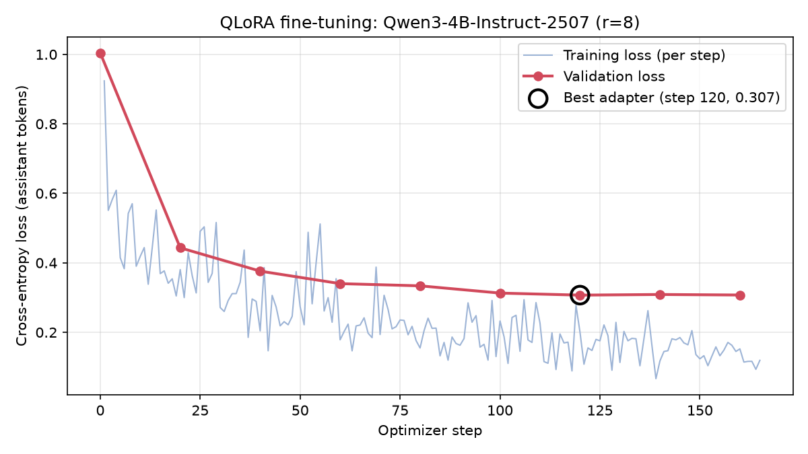

**อ่านผลอย่างไร**

- Validation loss **1.004 → 0.307** · ลงเร็วใน 20 step แรก แล้วราบตั้งแต่ราว step 100 (อ่านกราฟตามทฤษฎีข้อ 5)
- Adapter ที่เก็บคือของ **step 120** ไม่ใช่ step สุดท้าย · มาจากข้อ 5 ของพรอมต์ ("เก็บ adapter รอบที่ Validation loss ต่ำสุด")
- Training loss ลงถึงราว 0.12 ขณะที่ Validation loss หยุดที่ 0.31 = เริ่ม Overfitting · เทรนเกิน 3 Epoch ไม่น่าได้อะไรเพิ่ม
- **VRAM 22.9 GB เป็นค่าที่ PyTorch จองไว้** ไม่ใช่ค่าที่ใช้จริง · พรอมต์ไม่ได้ระบุว่าให้วัดแบบไหน AI จึงเลือกเอง ถ้าต้องการค่าที่ใช้จริงให้ระบุในพรอมต์
- **เรื่อง key**: ในรอบจริง คำสั่งสร้างเครื่องพิมพ์ key ของเครื่องเช่าออกจอ 1 ครั้ง แล้ว AI รายงานเอง · key นี้ใช้ไม่ได้อีกเมื่อลบเครื่อง แต่เป็นตัวอย่างว่าคำสั่ง "ห้ามแสดง key" ยังพลาดได้
- โฟลเดอร์ Adapter (63 MB) อยู่ที่ `lab3_qlora/results/adapter` บนเครื่องของคุณ · ไม่ได้เก็บไว้ในรีโปนี้เพราะไฟล์ใหญ่

## ขั้นที่ 5 · เปิด AI server 2 โมเดล แล้ววัดผลบน Validation Set

AI เขียน `serve.sh` เปิด vLLM ที่มี 2 ชื่อโมเดลบน server เดียว และเขียน `eval_val.py` วัดทั้งสองโมเดลด้วยคำถามเดียวกัน

```text
ทำงานใน container `multi-account` โฟลเดอร์ /workspace/vastapp_lab ด้วยสกิล vastai
เครื่องที่ใช้คือเครื่องป้าย vapp-lab3 · กุญแจ SSH อยู่ที่ /workspace/vastai_lab/Devtool_SSH/devtoolSSH

เปิด AI server ที่มีทั้งโมเดลเดิมและโมเดลที่เพิ่งเทรน แล้ววัดว่าใครตอบคำถามที่ไม่เคยเห็นได้ดีกว่า
1. เขียนสคริปต์เปิด server ไว้ที่ lab3_qlora/code/serve.sh: ใช้ vLLM เปิดโมเดล Qwen/Qwen3-4B-Instruct-2507 พร้อม adapter ที่เทรนไว้ บน server เดียวที่พอร์ต 8000 รับคำขอแบบ OpenAI
2. server ต้องมี 2 ชื่อโมเดล คือ qwen3-4b-base (โมเดลเดิม) และ qwen3-4b-sabaijai (โมเดลเดิม + adapter) และต้องใช้ API key ที่สุ่มขึ้นใหม่ แล้วนำไปเปิดบนเครื่องที่เช่า
3. ลองถามทั้ง 2 โมเดลจากนอกเครื่อง แล้วเขียนค่าเชื่อมต่อ (ที่อยู่ key ชื่อโมเดลทั้ง 2) ไว้ที่ lab3_qlora/chatbot.env ของโฟลเดอร์ปัจจุบัน
4. เขียนสคริปต์วัดผลไว้ที่ lab3_qlora/code/eval_val.py: ให้ทั้ง 2 โมเดลตอบทุกข้อความใน Validation Set ด้วยประวัติแชทเดียวกัน (temperature 0) แล้วตรวจด้วยเงื่อนไขของคำตอบที่กำกับไว้ใน Dataset
5. ตัวเลขของแต่ละโมเดลที่ต้องมี: คำตอบที่ถูก (%) · แท็กจองถูกรูปแบบ (%) · ข้อมูลในแท็กจองถูกครบ (%) · ใส่แท็กจองทั้งที่ข้อมูลไม่ครบ (%) · ลงท้ายว่า "ครับ" (%) · มีคำไทยปนในคำตอบภาษาอังกฤษ (%)
6. วัดความเร็ว token ต่อวินาที และ VRAM ที่ server ใช้ด้วย เก็บผลทั้งหมดที่ lab3_qlora/results/val_eval.json แล้วอธิบายโค้ดสั้น ๆ 3–5 บรรทัด
7. ห้ามแสดงค่า key บนจอ และห้ามแตะเครื่องที่ป้ายไม่ได้ขึ้นต้นด้วย vapp-lab3

สรุปเป็นตารางภาษาไทย Base เทียบ Fine-tuned ตามตัวเลขในข้อ 5 และ 6 พร้อมตัวอย่างคำถาม 2 ข้อที่สองโมเดลตอบต่างกัน แล้วบอกว่าเครื่องยังเปิดอยู่
```


*ใช้เวลา 11.2 นาที*

ตัวอย่างโค้ดที่ AI เขียนให้ในรอบจริง (ของคุณอาจต่างกัน): [code_reference/serve.sh](code_reference/serve.sh) (50 บรรทัด) · [code_reference/eval_val.py](code_reference/eval_val.py) (198 บรรทัด)

| ตัววัด (Validation Set 48 บท · 85 คำตอบ · temperature 0) | Base | Fine-tuned |
|---|---|---|
| คำตอบที่ถูกตามเงื่อนไข (85 ข้อ) | 87.1% | **94.1%** |
| แท็กจองถูกรูปแบบ (8 ข้อที่ข้อมูลครบ) | 100% | 100% |
| ข้อมูลในแท็กจองถูกครบ (8 ข้อ) | 100% | 100% |
| ใส่แท็กจองทั้งที่ข้อมูลไม่ครบ (77 ข้อ) ↓ | 6.5% | **1.3%** |
| ลงท้ายว่า "ครับ" (83 ข้อภาษาไทย) ↓ | 3.6% | **0%** |
| มีคำไทยปนในคำตอบภาษาอังกฤษ (2 ข้อ) ↓ | 100% | **0%** |
| ความเร็ว (token ต่อวินาที ทีละคำขอ) | 55.0 | 50.6 |

**อ่านผลอย่างไร**

- **ตรงนี้คือจุดที่ Fine-tune ช่วยชัด**: คำตอบที่ถูกเพิ่มจาก 74 เป็น 80 ข้อจาก 85 ข้อ (+7 จุด) · Fine-tuned แก้ข้อที่ Base ผิดได้ 8 ข้อ แต่ **ทำผิดเพิ่ม 2 ข้อที่ Base เคยถูก** (ถามเงื่อนไขโปร 10% แล้วตอบสั้นเกินจนไม่บอกวัน)
- แถวที่สำคัญต่อระบบจริงคือ **ใส่แท็กจองทั้งที่ข้อมูลไม่ครบ** 6.5% → 1.3% เพราะแท็กที่ออกผิดจังหวะคือการจองปลอมในฐานข้อมูล · ตัวอย่างจริง: ลูกค้าขอจอง 08:00 ก่อนร้านเปิด Base รับจองและออกแท็ก ส่วน Fine-tuned ปฏิเสธแล้วขอเวลาใหม่
- ตัวอย่างการคิดเลข: ราคานักศึกษาของนวดไทย 2 ชั่วโมง (600 บาท ลด 15%) Base ตอบ 460 (ผิด) Fine-tuned ตอบ 510 (ถูก)
- **ตัวหารเล็ก**: แถวแท็กจองมี 8 ข้อ แถวภาษาอังกฤษมี 2 ข้อ · 100% → 0% จาก 2 ข้อยังสรุปอะไรไม่ได้
- คำถามใน Validation Set มาจากแม่แบบเดียวกับ Training Set · ผลนี้จึงบอกว่าโมเดล **ตอบเหมือนครูมากขึ้นในคำถามแบบที่ครูสอน** ยังไม่ได้บอกว่าเก่งขึ้นกับคำถามทุกแบบ (ดูขั้นที่ 7)

## ขั้นที่ 6 · ต่อเว็บแชทบอทเข้ากับ 2 โมเดล

AI แก้เว็บแชทบอทเดิมจากบทที่แล้ว: เพิ่มตัวเลือกโมเดลในหน้าแชท เพิ่มหน้า `/compare` และ API สำหรับสลับโมเดลเริ่มต้น · เว็บรันด้วย Docker บนเครื่องของเรา

```text
ทำงานในโฟลเดอร์ปัจจุบัน เว็บรันด้วย Docker บนเครื่องนี้ ไม่ใช่ใน container multi-account

แก้เว็บแชทบอทเดิมใน lab3_qlora/code/web ให้เลือกคุยกับโมเดลเดิมหรือโมเดลที่เทรนแล้วได้
1. ให้เว็บเรียก AI server ตามค่าใน lab3_qlora/chatbot.env ตั้งชื่อ project ของ Docker Compose ว่า vapp-lab3 ใช้พอร์ต 3403 และเปิดทั้งชุด (เว็บ + PostgreSQL) ได้ด้วยคำสั่งเดียว
2. หน้าแชทเดิม: เพิ่มตัวเลือกโมเดล Base / Fine-tuned ถ้าผู้ใช้ไม่เลือกให้ใช้โมเดลเริ่มต้นของเว็บ
3. โมเดลเริ่มต้นของเว็บต้องสลับได้ขณะเว็บเปิดอยู่ (ชุดทดสอบจะใช้สลับโมเดล) และห้ามเปลี่ยนส่วนที่ชุดทดสอบ 26 เคสใช้อยู่
4. เพิ่มหน้า "เทียบคำตอบ" ที่ /compare: พิมพ์คำถาม 1 ข้อ แล้วเห็นคำตอบของทั้ง 2 โมเดลคู่กัน พร้อมเวลาที่ใช้ ความเร็ว token ต่อวินาที และบอกว่าแท็กจองถูกรูปแบบหรือไม่
5. หน้าเทียบคำตอบเก็บคำถามล่าสุดลง PostgreSQL หน้าตาเข้าชุดกับเว็บเดิม และเป็นภาษาไทย
6. เปิดเว็บ แล้วลองจริง: ถามในหน้าแชทด้วยโมเดลละ 1 คำถาม ลองหน้าเทียบคำตอบ 1 คำถาม และจองคิว 1 รายการให้ขึ้นในหน้ารายการจอง
7. อธิบายสิ่งที่แก้สั้น ๆ 3–5 บรรทัด ห้ามแสดงค่า key บนจอ

สรุปเป็นตารางภาษาไทย: หน้าที่มีในเว็บ · ผลการลองแต่ละอย่าง (คำถาม และคำตอบของแต่ละโมเดล) แล้วบอกว่าเว็บและเครื่องยังเปิดอยู่
```

เปิดดูเองได้ที่ <http://localhost:3403> (หน้าแชท) · <http://localhost:3403/compare> (เทียบคำตอบ 2 โมเดล) · <http://localhost:3403/bookings> (รายการจอง)


*ใช้เวลา 15.8 นาที*

ตัวอย่างโค้ดที่ AI เขียนให้ในรอบจริง (ของคุณอาจต่างกัน): [code_reference/web/](code_reference/web/) · ส่วนที่เพิ่มคือ `app/compare/` · `app/api/compare/` · `app/api/model/` · `lib/models.ts` · `components/Compare.tsx`


| GIF จากเว็บจริง | แสดงอะไร |
|---|---|
| [demo_chat_base.gif](results/web/demo_chat_base.gif) | หน้าแชท เลือก Base · ลูกค้าให้ข้อมูลจองไม่ครบ |
| [demo_chat_tuned.gif](results/web/demo_chat_tuned.gif) | บทสนทนาเดียวกันกับ Fine-tuned |
| [demo_compare_english.gif](results/web/demo_compare_english.gif) | หน้า `/compare` คำถามภาษาอังกฤษ · Base ลงท้าย "ค่ะ" ปนในคำตอบอังกฤษ |
| [demo_compare_discount.gif](results/web/demo_compare_discount.gif) | หน้า `/compare` ส่วนลดนักศึกษา · Base 460 (ผิด) Fine-tuned 510 (ถูก) |
| [demo_booking_tuned.gif](results/web/demo_booking_tuned.gif) | จองคิวสำเร็จ → การ์ดจอง → หน้ารายการจอง (PostgreSQL) |

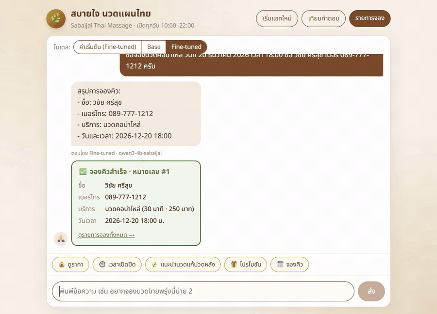

**อ่านผลอย่างไร**

- เว็บเปลี่ยนโมเดลด้วยการเปลี่ยนค่า `model` ในคำขอเท่านั้น · prompt และโค้ดส่วนอื่นเหมือนกัน จึงเทียบ A/B ได้ตรง
- **โมเดลที่เทรนแล้วก็ยังผิดได้**: ตอน AI ลองจองคิว Fine-tuned ปฏิเสธในข้อความแรก โดยอ้างว่า "ตอนนี้ร้านปิด" ทั้งที่ลูกค้าขอจองพรุ่งนี้ 14:00 ต้องพิมพ์ยืนยันอีกรอบจึงจองได้ · เป็นผลข้างเคียงของการเรียนให้ระวังเรื่องเวลา
- หน้า `/compare` ถามทีละโมเดล ไม่ยิงพร้อมกัน ตัวเลข token ต่อวินาทีจึงเทียบกันได้
- ข้อ 3 ของพรอมต์ ("ห้ามเปลี่ยนส่วนที่ชุดทดสอบ 26 เคสใช้อยู่") ทำให้ชุดทดสอบเดิมยังรันได้ในขั้นที่ 7 โดยไม่ต้องแก้เคส

## ขั้นที่ 7 · รันชุดทดสอบ 26 เคสกับทั้ง 2 โมเดล

AI เขียน `run-both.sh` · `compare.mjs` · `repeat.mjs` รันชุดทดสอบเดิมของบทที่แล้วกับทั้ง 2 โมเดล แล้วรันซ้ำอีก 5 รอบต่อโมเดล

```text
ทำงานใน container `multi-account` โฟลเดอร์ /workspace/vastapp_lab เว็บเปิดอยู่บนเครื่องนี้ที่พอร์ต 3403

ทดสอบโมเดลเล็กทั้ง 2 ตัวด้วยชุดทดสอบ 26 เคสเดิมของบทที่แล้ว (lab3_qlora/code/e2e) โดยไม่แก้เคสทดสอบ
1. เขียนสคริปต์ lab3_qlora/code/e2e/run-both.sh รันชุดทดสอบ 26 เคสกับโมเดล Base แล้วกับ Fine-tuned เก็บรายงานของแต่ละโมเดลแยกกัน
2. ก่อนแต่ละรอบ ให้สคริปต์สลับโมเดลเริ่มต้นของเว็บ และล้างตารางจองกับประวัติแชท
3. เขียนสคริปต์เทียบผล lab3_qlora/code/e2e/compare.mjs ทำตารางรายเคสว่าแต่ละโมเดลผ่านหรือไม่ พร้อมคำตอบจริงของเคสที่ผลต่างกัน
4. ให้รันโจทย์ 26 เคสเดิมซ้ำอีก 5 รอบต่อโมเดล ผ่าน API ของเว็บโดยไม่เปิดเบราว์เซอร์ เพื่อดูว่าผลแกว่งแค่ไหน
5. รันทั้งหมดใน container multi-account แล้วเก็บผลไว้ที่ lab3_qlora/results/e2e ของโฟลเดอร์ปัจจุบัน: ตารางเทียบ ไฟล์ compare.json และ repeat.json รายงานของแต่ละโมเดล และ GIF ของเคสที่ผลต่างกันไม่เกิน 4 เคส
6. อธิบายโค้ดสั้น ๆ 3–5 บรรทัด

สรุปเป็นตารางภาษาไทย 3 แถว: โมเดลใหญ่ 27B บน RTX 5090 (ผ่าน 26/26 จากบทที่แล้ว) · โมเดลเล็ก Base · โมเดลเล็ก Fine-tuned
แต่ละแถวบอก: ผ่านกี่เคสจาก 26 · ค่าเฉลี่ยจากรันซ้ำ 5 รอบ · เคสที่ไม่ผ่าน รายงานตามจริงแม้ Fine-tuned ไม่ดีขึ้น แล้วบอกว่าเครื่องและเว็บยังเปิดอยู่
```


*ใช้เวลา 13.3 นาที*

ตัวอย่างโค้ดที่ AI เขียนให้ในรอบจริง (ของคุณอาจต่างกัน): [code_reference/e2e/run-both.sh](code_reference/e2e/run-both.sh) · [code_reference/e2e/compare.mjs](code_reference/e2e/compare.mjs) · [code_reference/e2e/repeat.mjs](code_reference/e2e/repeat.mjs)

| แขน | โมเดล | GPU (ราคาที่เช่าจริง) | ผ่าน | รันซ้ำ 5 รอบผ่าน API | เคสที่ไม่ผ่าน |
|---|---|---|---|---|---|
| A | Qwen3.8 27B (ครู) | RTX 5090 ($0.745/ชม.) | 26/26 · **อ้างจากบทที่แล้ว ไม่ได้รันซ้ำ** | – | – |
| B | Qwen3-4B Base | RTX 3090 ($0.241/ชม.) | **25/26** | 25, 25, 25, 25, 25 | 21 (late-time) |
| C | Qwen3-4B + LoRA | RTX 3090 ($0.241/ชม.) | **25/26** | 25, 25, 25, 25, 25 | 19 (followup-2h) |

| เคส | ลูกค้าพิมพ์ | Base | Fine-tuned |
|---|---|---|---|
| 19 | "นวดไทยกับนวดน้ำมันอโรมาต่างกันยังไงคะ" → "แล้วอันที่ถูกกว่าใช้เวลากี่นาทีคะ" → "ถ้าเอาอันนั้นแบบ 2 ชั่วโมงล่ะคะ" | ✅ ตอบนวดไทย 60 นาที 350 บาท แล้วตอบนวดไทย 2 ชั่วโมง 600 บาท | ❌ ไปตอบนวดเท้า 300 บาท (ถูกที่สุดในร้าน ไม่ใช่ถูกกว่าใน 2 อย่างที่คุยอยู่) แล้วตอบว่าไม่มีนวดเท้าแบบ 2 ชั่วโมง |
| 21 | "พรุ่งนี้ 5 ทุ่มยังว่างไหมคะ" → "งั้น 3 ทุ่มล่ะคะ ทันไหม" | ❌ "ทันค่ะ ร้านเปิดถึง 22:00 น. สามารถนัด 3 ทุ่มได้ค่ะ" · ไม่มีเลข 21 ตามเกณฑ์ | ✅ "ได้ค่ะ … รับลูกค้ารอบสุดท้ายเวลา 21:00 น." |

| เคส 19 · Base | เคส 19 · Fine-tuned |
|---|---|
| 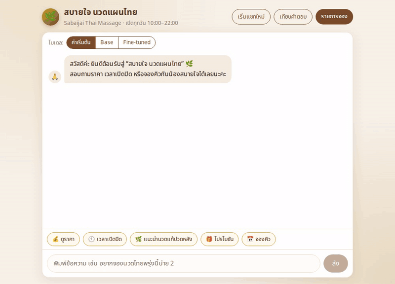 | 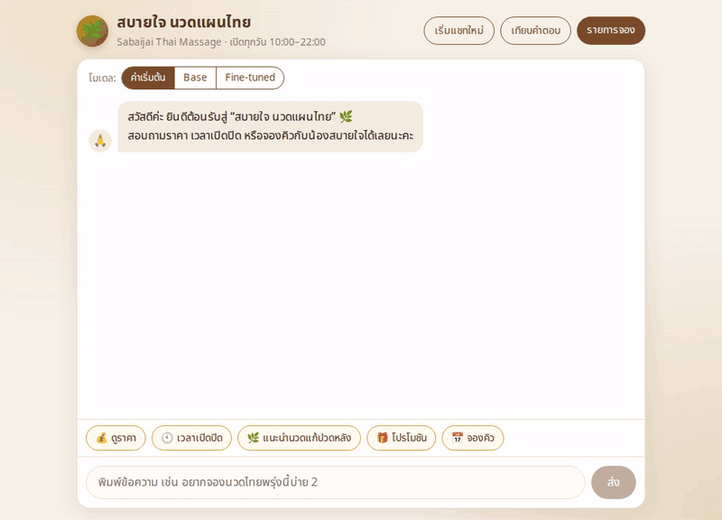 |

ตารางรายเคสทั้ง 26 เคส: [results/e2e/COMPARE.md](results/e2e/COMPARE.md)

**อ่านผลอย่างไร**

- **Fine-tune ไม่ได้ทำให้ผ่านเพิ่มบนชุดทดสอบนี้**: ได้เคส 21 มา แต่เสียเคส 19 ที่ Base ทำได้ · ผลรวมเท่าเดิมที่ 25/26
- **ไม่ใช่ความบังเอิญของ temperature**: รันซ้ำ 5 รอบ แต่ละโมเดลตกเคสเดิมทุกรอบ ไม่มีเคสที่ผ่านบ้างตกบ้าง
- **ชุด 26 เคสแยกความต่าง 1 เคสไม่ออก**: 1 เคสมีน้ำหนัก 3.8% และโมเดลเล็กที่ยังไม่เทรนก็ผ่าน 25 เคสแล้ว จึงเหลือที่ให้ดีขึ้นเพียง 1 เคส · การรันซ้ำบอกได้ว่าโมเดลตอบคงที่ แต่ไม่ได้ทำให้ชุดทดสอบใหญ่ขึ้น เพราะยังเป็นคำถาม 26 ชุดเดิม · ถ้าเปลี่ยนคำถามไปไม่กี่ข้อ ผล 25 กับ 25 อาจกลายเป็น 26 กับ 24 หรือกลับกันได้ ผลนี้จึงสรุปได้เพียงว่า **สองโมเดลใกล้กันเกินกว่าที่ชุดนี้จะตัดสิน**
- **ผ่านเทสต์แบบจับคำ ≠ ตอบถูก และตก ≠ ตอบผิด**: เคส 21 Base ตอบว่า 3 ทุ่มนัดได้ ซึ่งเนื้อหาไม่ผิด แต่ตกเพราะไม่มีเลข "21" ตามเกณฑ์ · ส่วนเคส 19 ที่ Fine-tuned ตกเป็นความผิดจริง คือจับไม่ได้ว่า "อันที่ถูกกว่า" หมายถึงบริการใน 2 อย่างที่เพิ่งคุย
- **Validation Set บอกอะไรที่ชุดนี้บอกไม่ได้**: วัด 85 คำตอบ (1 คำตอบ = 1.2%) และเห็นว่า Fine-tuned ถูกมากกว่า 6 ข้อ กับออกแท็กจองผิดจังหวะน้อยลง (ขั้นที่ 5) · แต่เป็นคำถามแบบเดียวกับที่ครูสอน
- **ข้อสรุปที่ตรงกับหลักฐาน**: Fine-tune ทำให้โมเดลเล็กตอบเหมือนครูมากขึ้นในเรื่องที่ Dataset สอน (ลีลา รูปแบบ ความระวังเรื่องจอง) · ไม่ได้ทำให้เก่งขึ้นในเรื่องที่ Dataset ไม่ได้เน้น เช่น การตีความคำอ้างอิงข้ามข้อความ และอาจเสียความสามารถเดิมบางจุด
- **คำตอบของคำถามตั้งต้น**: โมเดลเล็ก 4B ตอบชุดทดสอบได้ 25/26 ตั้งแต่ยังไม่เทรน บนเครื่องที่ถูกกว่าราว 3.1 เท่า · ยังไม่เท่าผล 26/26 ของโมเดลใหญ่ที่อ้างจากบทที่แล้ว และ LAB นี้ไม่ได้รันโมเดลใหญ่ซ้ำ จึง **ยังสรุปไม่ได้ว่าแทนกันได้เต็มตัว**
- ในรอบจริง AI เพิ่ม `POST /api/reset` ให้เว็บเพื่อล้างตารางก่อนแต่ละรอบ · เว็บที่ใช้งานจริงไม่ควรมีช่องทางลบข้อมูลที่ไม่มีการป้องกันแบบนี้

## ขั้นที่ 8 · ลบเครื่อง ปิดเว็บ สรุปค่าใช้จ่าย

AI จดข้อมูลเครื่อง ลบเครื่อง ปิดเว็บ และตรวจว่าไฟล์ของทุกขั้นกลับมาอยู่บนเครื่องของเราครบ · **ห้ามข้ามขั้นนี้**

```text
ทำงานใน container `multi-account` โฟลเดอร์ /workspace/vastapp_lab ด้วยสกิล vastai

ปิดงานของ LAB: ลบเครื่องที่เช่า ปิดเว็บ และสรุปว่าใช้เงินไปเท่าไร
1. จดข้อมูลของเครื่องที่ป้ายขึ้นต้นด้วย vapp-lab3 ก่อนลบ: GPU ราคาต่อชั่วโมง เวลาที่เปิดมา ปริมาณดาวน์โหลด
2. ลบเครื่องที่ป้ายขึ้นต้นด้วย vapp-lab3 ทุกเครื่อง แล้วตรวจว่าไม่เหลือ ห้ามแตะเครื่องป้ายอื่น
3. ปิดเว็บใน lab3_qlora/code/web บนเครื่องนี้
4. ตรวจว่าโค้ดใน lab3_qlora/code และผลใน lab3_qlora/results ของโฟลเดอร์ปัจจุบันบนเครื่องนี้มีครบทุกขั้น ถ้าไฟล์ไหนยังอยู่แค่ใน container ให้คัดลอกกลับมา

สรุปเป็นตารางภาษาไทย: เครื่องที่ลบ · เวลาที่เปิด · ค่าเช่าโดยประมาณ (ราคาต่อชั่วโมง × ชั่วโมง + ค่าดาวน์โหลด) · ผลตรวจว่าไม่มีเครื่องค้าง
และเทียบราคาต่อชั่วโมงของ RTX 3090 เครื่องนี้กับ RTX 5090 ที่โมเดลใหญ่ต้องใช้
```


*ใช้เวลา 4.2 นาที*

| เครื่อง | GPU | ราคาต่อชั่วโมง | เปิดนาน | ค่าเช่า (เวลา + ดาวน์โหลด) |
|---|---|---|---|---|
| `vapp-lab3-teacher` | RTX 5090 (Texas) | $0.745 | 21 นาที | 0.262 + 0.066 = **$0.33** |
| `vapp-lab3` | RTX 3090 (เกาหลีใต้) | $0.241 | 84 นาที | 0.339 + 0.023 = **$0.36** |
| รวมขั้นที่ 1–8 | | | | **$0.69** |

**อ่านผลอย่างไร**

- ต้องเห็นว่า **ไม่มีเครื่องป้าย `vapp-lab3*` เหลือ** และเว็บที่พอร์ต 3403 ปิดแล้ว
- เครื่องแพงเปิดสั้นที่สุด: RTX 5090 เปิด 21 นาทีเฉพาะตอนที่ครูต้องตอบ ส่วนงาน 84 นาทีที่เหลือทำบน RTX 3090
- เทรนจริง 35.6 นาที แต่เครื่องนักเรียนเปิด 84 นาที · เวลาที่เหลือคือติดตั้ง โหลดโมเดล เปิด server วัดผล และรันชุดทดสอบ
- ข้อ 4 ของพรอมต์มีไว้เพราะ AI ทำงานใน container · ในรอบจริงไฟล์ของขั้นที่ 4–5 บางส่วนยังอยู่แค่ใน container และขั้นนี้คัดลอกกลับมาให้

---

## ปิดท้าย · เก็บงานทั้ง LAB เป็นสกิลเวอร์ชัน 0

เราเพิ่งสั่งงาน 8 ขั้นจนสำเร็จ ถ้าต้องทำซ้ำ (เช่น เปลี่ยนจำนวน Epoch) ไม่ควรต้องวาง 8 พรอมต์ใหม่ · **สกิล** คือไฟล์ที่เก็บวิธีทำงานที่สำเร็จแล้ว พร้อมโค้ดที่ใช้ได้จริง ไว้ให้ AI ทำซ้ำได้ในคำสั่งเดียว

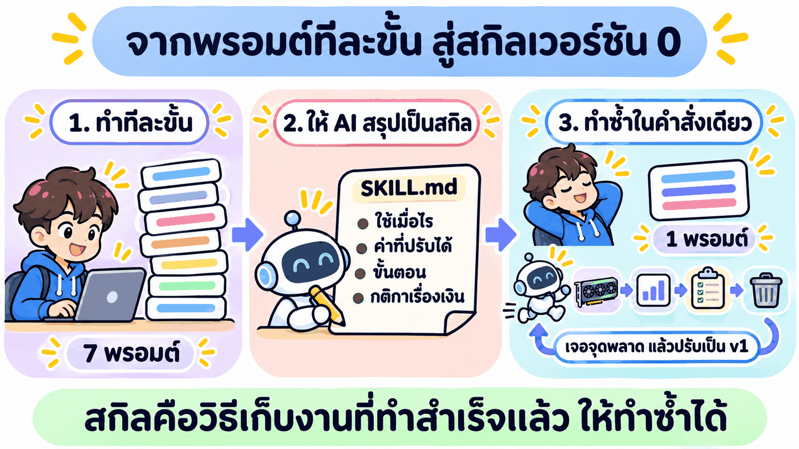
*ภาพแสดงตัวอย่าง 7 พรอมต์ · LAB นี้มีงานหลัก 8 พรอมต์*

### ขั้นที่ 9 · สรุป LAB เป็นสกิลเวอร์ชัน 0

AI อ่านพรอมต์ โค้ด และผลของ LAB แล้วเขียน `SKILL.md` พร้อมคัดลอกโค้ดที่ใช้ได้แล้วเข้าไปในสกิล

```text
ทำงานในโฟลเดอร์ปัจจุบัน

สร้างสกิลเวอร์ชัน 0 ชื่อ qlora-chatbot-tune จากงานทั้ง LAB นี้ เพื่อให้ครั้งหน้าสั่งทำซ้ำได้ในคำสั่งเดียว
1. ดูว่า LAB ทำอะไรไปบ้าง จากพรอมต์ทุกขั้นใน lab3_qlora/PROMPTS.md โค้ดใน lab3_qlora/code และผลใน lab3_qlora/results
2. เขียนสกิลไว้ที่ lab3_qlora/skill_v0/SKILL.md ให้มี name และ description (บอกว่าใช้เมื่อไร) ขั้นตอน เกณฑ์ตรวจผ่าน และกติกาเรื่องเงิน (จบงานต้องลบเครื่องเสมอ)
3. ในสกิลบอกค่าที่ผู้ใช้ปรับได้พร้อมค่าเริ่มต้น: GPU เพดานราคา ป้ายเครื่อง โมเดลตั้งต้น จำนวน Epoch จะสร้าง Dataset ใหม่หรือใช้ของเดิม และจะเปิดเว็บหรือไม่
4. เก็บโค้ดที่ใช้ได้แล้วจาก lab3_qlora/code เข้าไปไว้ที่ lab3_qlora/skill_v0/scripts เพื่อให้รอบหน้าไม่ต้องเขียนโค้ดใหม่ สกิลนี้เรียกใช้สกิล vastai ต่อ ไม่เขียนทับ
5. ติดตั้งสกิลให้ Claude Code ใช้ได้ที่ .claude/skills/qlora-chatbot-tune ของโฟลเดอร์ปัจจุบัน

สรุปเป็นภาษาไทย: สกิลทำอะไรได้ · ปรับค่าอะไรได้บ้าง · ไฟล์ที่อยู่ในสกิล · ตัวอย่างประโยคเรียกใช้ 2 แบบ
```


*ใช้เวลา 3.5 นาที · ไม่ต้องเช่าเครื่อง · สกิลที่ได้: [skill_v0/SKILL.md](skill_v0/SKILL.md) (94 บรรทัด) และโค้ดใน [skill_v0/scripts/](skill_v0/scripts/)*

> ⚠️ หลังขั้นนี้ให้ปิดแล้วเปิด Claude Code ใหม่ 1 ครั้ง สกิลที่เพิ่งติดตั้งจึงถูกมองเห็น · ถ้า AI ตอบว่าไม่รู้จักสกิล ให้เปิดใหม่อีกครั้ง

### ขั้นที่ 10 · ลองใช้สกิลเวอร์ชัน 0

AI ตัวใหม่ได้คำสั่ง 3 บรรทัด แล้วเช่าเครื่อง เทรน 1 Epoch เปิด server วัดผล และลบเครื่องเอง โดยใช้โค้ดในสกิล ไม่เขียนใหม่

```text
ใช้สกิล qlora-chatbot-tune เทรนโมเดลเล็กให้แชทบอทร้านนวด 1 Epoch ด้วย Dataset เดิมที่มีอยู่แล้ว ไม่ต้องเปิดโมเดลครู ไม่ต้องเปิดเว็บ
ตั้งป้ายเครื่องว่า vapp-lab3-skill ราคาไม่เกิน $0.40 ต่อชั่วโมง วัดผล Base เทียบ Fine-tuned บน Validation Set เก็บผลไว้ที่ lab3_qlora/results/skill_test แล้วลบเครื่อง
สรุปเป็นตารางภาษาไทย: ผลก่อนและหลัง · เวลาที่ใช้ · ค่าใช้จ่าย แล้วยืนยันว่าเครื่องถูกลบแล้ว
```


*ใช้เวลา 75.7 นาที · เครื่องเปิด 73.6 นาที · ผลอยู่ที่ [results/skill_test/](results/skill_test/)*

| | สั่งทีละขั้น (ขั้นที่ 4, 5 และ 8) | สกิล v0 คำสั่งเดียว |
|---|---|---|
| จำนวนพรอมต์ | 3 | **1** |
| ต้องเขียนโค้ดใหม่ | ใช่ | ไม่ (ใช้ `scripts/`) |
| จำนวน Epoch | 3 | 1 |
| Validation loss | 1.004 → 0.307 | 1.004 → 0.382 |
| คำตอบที่ถูก Base → Fine-tuned | 87.1% → 94.1% | 84.7% → 85.9% |
| ใส่แท็กจองทั้งที่ข้อมูลไม่ครบ | 6.5% → 1.3% | 7.8% → 5.2% |
| เวลารวม | 57 นาที | 76 นาที |
| ค่าเช่า | $0.36 | $0.29 |

**อ่านผลอย่างไร**

- สกิล v0 **ผ่านในรอบแรก**: คำสั่งเดียวแทน 3 พรอมต์ และไม่ต้องเขียนโค้ดใหม่ · แต่ **ไม่ได้เร็วกว่า** เพราะเจอปัญหาใหม่ 3 จุด (ตารางด้านล่าง)
- **1 Epoch ยังไม่พอ**: คำตอบที่ถูกเพิ่มเพียง 1.2 จุด เทียบกับ 7 จุดของ 3 Epoch และ Validation loss ยังลงอยู่ตอนจบ
- Base ของสองรอบได้ไม่เท่ากัน (87.1% กับ 84.7%) ทั้งที่เป็นโมเดลเดียวกัน · จึงควรเทียบ Base กับ Fine-tuned **ในรอบเดียวกัน** เสมอ ไม่เทียบข้ามรอบ
- เวลา 23 จาก 74 นาทีหมดไปกับการดึงไฟล์กลับจากเครื่องที่อัปโหลดช้า · ค่าเช่าเดินตลอดเวลานั้น

**v0 ยังไม่สมบูรณ์** · จุดที่ AI ต้องแก้เองระหว่างรอบทดสอบ และควรแก้ในเวอร์ชันถัดไป

| จุดที่ v0 ยังพลาด | ควรแก้อย่างไรใน v1 |
|---|---|
| ไม่ได้ตรึงเวอร์ชันไลบรารี · ติดตั้งแล้วได้ transformers 5.x ซึ่งใช้กับ vLLM 0.11.0 ไม่ได้ AI ต้องถอยเป็น 4.57.1 หลังเทรน | ระบุ `transformers<5` ตั้งแต่ขั้นติดตั้ง |
| ดาวน์โหลดโมเดลล่วงหน้าแล้วล้มที่ไฟล์ LICENSE ทำให้ vLLM โหมด offline ไม่ยอมเปิด | ตัดโหมด offline ออก หรือระบุวิธีดาวน์โหลดที่ใช้ได้ |
| เลือกเครื่องจากราคาอย่างเดียว ได้เครื่องที่อัปโหลดช้า (ราว 60 KB/s) ดึง Adapter 63 MB กลับใช้ 23 นาที | เพิ่มเกณฑ์ความเร็วอัปโหลดขั้นต่ำ และดึงเฉพาะไฟล์ที่จำเป็น |
| ค่าอ้างอิงในเกณฑ์ตรวจผ่านมาจากรอบเดียว เช่น "1 Epoch ควรได้ Validation loss ไม่เกินราว 0.45" เป็นการประมาณจากกราฟของรอบ 3 Epoch | แก้ค่าอ้างอิงตามผลจริงของรอบ 1 Epoch (0.382) และบอกว่าเป็นค่าจากกี่รอบ |
| สกิลผูกกับร้านนี้และโฟลเดอร์นี้ (ชื่อโมเดล `qwen3-4b-sabaijai` · path · กุญแจ SSH) | แยกค่าเหล่านี้เป็นค่าที่ปรับได้ |

วิธีปรับคือสั่ง AI ด้วยพรอมต์อีก 1 อันให้แก้สกิลตามตารางนี้ แล้วลองใช้ซ้ำ · สกิลจึงดีขึ้นทีละเวอร์ชันจากหลักฐานของการรันจริง

---

## ไฟล์ในโฟลเดอร์นี้

| ไฟล์ / โฟลเดอร์ | คืออะไร |
|---|---|
| `PROMPTS.md` | พรอมต์ทั้ง 10 ขั้นสำหรับคัดลอก |
| `code/` | โค้ดของคุณเอง · **ตอนเริ่มยังไม่มีโฟลเดอร์นี้** AI จะสร้างและเขียนทุกไฟล์จากพรอมต์ขั้นที่ 1–7 (ไม่ถูกเก็บขึ้น git) |
| `code_reference/` | ตัวอย่างโค้ดที่ AI เขียนให้ในรอบจริง: `make_questions.py` (ขั้นที่ 1) · `make_dataset.py` (ขั้นที่ 3) · `train.py` · `run.sh` (ขั้นที่ 4) · `serve.sh` · `eval_val.py` (ขั้นที่ 5) · `web/` (ขั้นที่ 6 · เว็บเดิมจากบทที่แล้วที่ AI แก้) · `e2e/` (ขั้นที่ 7 · ชุดทดสอบเดิมและสคริปต์ที่ AI เพิ่ม) · มีไว้เทียบ ไม่ต้องคัดลอกไปใช้ |
| `data/` | Dataset ที่ได้จากรอบจริง: `questions.jsonl` · `teacher_raw.jsonl` · `train.jsonl` · `val.jsonl` · เป็นผลของ LAB ไม่ใช่ของตั้งต้น |
| `skill_v0/` | สกิลที่ AI สร้างในขั้นที่ 9: `SKILL.md` · `scripts/` · `references/` |
| `results/` | ผลจากการรันจริง: `metrics.json` · `dataset_report.json` · `dataset_samples.jpg` · `train_log.json` · `loss_curve.png` · `val_eval.json` · `val_compare.png` · ผลชุดทดสอบใน `e2e/` · ภาพหน้าจอและ GIF ของเว็บใน `web/` · คำตอบของทุกขั้นใน `answers/` · ผลของรอบสกิลใน `skill_test/` · ไม่มีไฟล์ Adapter เพราะไฟล์ใหญ่ |
| `image/` | ภาพประกอบของ LAB นี้ |
