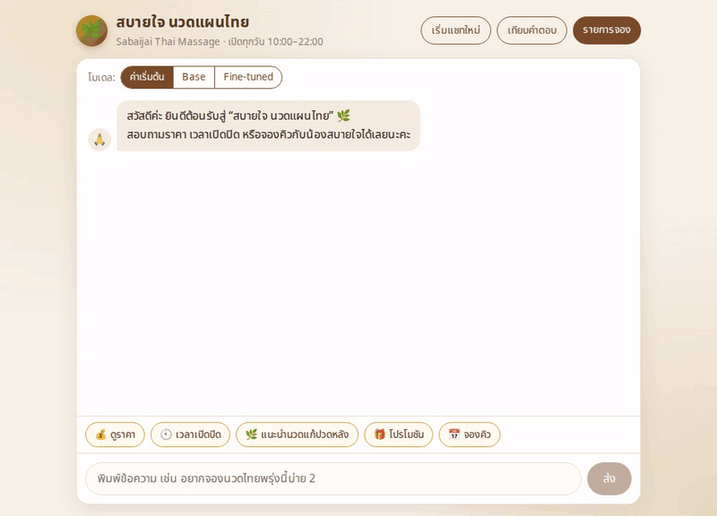
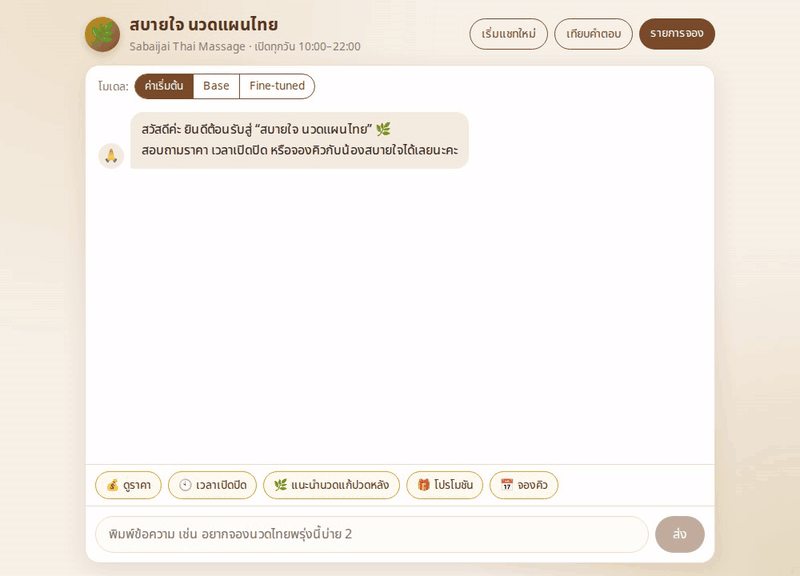
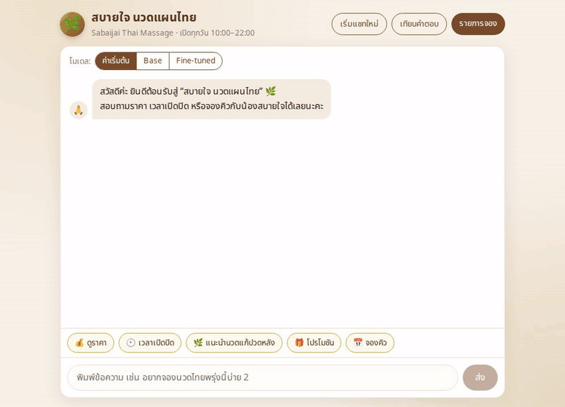

# เทียบผล 26 เคส: Base vs Fine-tuned

| โมเดล | ผ่าน (รอบเบราว์เซอร์) | รันซ้ำ 5 รอบผ่าน API (แต่ละรอบ) | เฉลี่ย ± SD | เคสที่ไม่ผ่าน |
|---|---|---|---|---|
| โมเดลใหญ่ Qwen3.8 27B บน RTX 5090 (บทที่แล้ว) | 26/26 | – | – | – |
| Base (`qwen3-4b-base`) | 25/26 | 25, 25, 25, 25, 25 | 25 ± 0 | 21 |
| Fine-tuned (`qwen3-4b-sabaijai`) | 25/26 | 25, 25, 25, 25, 25 | 25 ± 0 | 19 |

## รายเคส

| เคส | กลุ่ม | ต้องมี | Base | Fine-tuned | Base ผ่าน/5 | FT ผ่าน/5 |
|---|---|---|---|---|---|---|
| case1-hours | เวลา · ที่ตั้ง · ติดต่อ | ต้องมี 10 และ 22 | ✅ | ✅ | 5 | 5 |
| case2-lastcall | เวลา · ที่ตั้ง · ติดต่อ | ต้องมี 21 | ✅ | ✅ | 5 | 5 |
| case3-prices | ราคาและบริการ | ต้องมี บาท และ 350 | ✅ | ✅ | 5 | 5 |
| case4-aroma-price | ราคาและบริการ | ต้องมี 600 | ✅ | ✅ | 5 | 5 |
| case5-cheapest | ราคาและบริการ | ต้องมี นวดคอบ่าไหล่ และ 250 | ✅ | ✅ | 5 | 5 |
| case6-office-pain | ราคาและบริการ | ต้องมี นวดแก้ปวดหลัง หรือ นวดคอบ่าไหล่ | ✅ | ✅ | 5 | 5 |
| case7-promo | โปรโมชันและนโยบายร้าน | ต้องมี 10% | ✅ | ✅ | 5 | 5 |
| case8-student | โปรโมชันและนโยบายร้าน | ต้องมี 15% | ✅ | ✅ | 5 | 5 |
| case9-address | เวลา · ที่ตั้ง · ติดต่อ | ต้องมี นิมมาน และ เชียงใหม่ | ✅ | ✅ | 5 | 5 |
| case10-phone | เวลา · ที่ตั้ง · ติดต่อ | ต้องมี 053-123-456 | ✅ | ✅ | 5 | 5 |
| case11-parking | เวลา · ที่ตั้ง · ติดต่อ | ต้องมี 4 | ✅ | ✅ | 5 | 5 |
| case12-credit | โปรโมชันและนโยบายร้าน | ต้องมี บัตรเครดิต และไม่มีคำว่า ไม่ได้ | ✅ | ✅ | 5 | 5 |
| case13-cancel | โปรโมชันและนโยบายร้าน | ต้องมี 3 | ✅ | ✅ | 5 | 5 |
| case14-pregnant | โปรโมชันและนโยบายร้าน | ต้องมี ไม่แนะนำ หรือ แพทย์ | ✅ | ✅ | 5 | 5 |
| case15-nails | ราคาและบริการ | ต้องมี ไม่มี และห้ามมีราคาบริการทำเล็บ | ✅ | ✅ | 5 | 5 |
| case16-booking | จองคิว | เห็นการ์ดจองสำเร็จ และหน้ารายการจองมีแถวของ มานี | ✅ | ✅ | 5 | 5 |
| case17-offtopic | ขอบเขตของบอท | ต้องมี ขออภัย หรือ ค่ะ และ นวด หรือ ร้าน และห้ามมีสูตรอาหาร | ✅ | ✅ | 5 | 5 |
| case18-english | ขอบเขตของบอท | ต้องเป็นภาษาอังกฤษ และมี 350 | ✅ | ✅ | 5 | 5 |
| **case19-followup-2h** | ถามต่อเนื่อง | คำตอบสุดท้ายต้องมี 600 | ✅ | ❌ | 5 | 0 |
| case20-student-discount | ถามต่อเนื่อง | คำตอบสุดท้ายต้องมี 382 หรือ 383 | ✅ | ✅ | 5 | 5 |
| **case21-late-time** | ถามต่อเนื่อง | คำตอบแรกต้องบอกว่าไม่ได้หรือปิดแล้ว และคำตอบสุดท้ายต้องมี 21 | ❌ | ✅ | 0 | 5 |
| case22-parking-memory | ถามต่อเนื่อง | คำตอบสุดท้ายต้องมี 4 | ✅ | ✅ | 5 | 5 |
| case23-name-memory | ถามต่อเนื่อง | คำตอบที่ 2 ต้องมี นวดคอบ่าไหล่ และคำตอบสุดท้ายต้องมี สมศรี | ✅ | ✅ | 5 | 5 |
| case24-budget-no-oil | ถามต่อเนื่อง | คำตอบสุดท้ายต้องมี นวดคอบ่าไหล่ หรือ นวดเท้า หรือ นวดหน้า และห้ามมี อโรมา | ✅ | ✅ | 5 | 5 |
| case25-lang-switch | ถามต่อเนื่อง | คำตอบแรกเป็นภาษาอังกฤษมี 600 และคำตอบสุดท้ายเป็นภาษาไทยมี 10 และ 22 | ✅ | ✅ | 5 | 5 |
| case26-booking-change | ถามต่อเนื่อง | การ์ดจองสำเร็จต้องเป็น นวดเท้าสะท้อนจุด และหน้ารายการจองมีแถวของ ปิติ เป็นนวดเท้า | ✅ | ✅ | 5 | 5 |

## เคสที่ผลต่างกัน (2 เคส) พร้อมคำตอบจริง

### case19-followup-2h · พิมพ์ "นวดไทยกับนวดน้ำมันอโรมาต่างกันยังไงคะ" → พิมพ์ "แล้วอันที่ถูกกว่าใช้เวลากี่นาทีคะ" → พิมพ์ "ถ้าเอาอันนั้นแบบ 2 ชั่วโมงล่ะคะ"

ต้องมี: คำตอบสุดท้ายต้องมี 600

| | ผล | คำตอบจริง | เหตุผลที่ไม่ผ่าน |
|---|---|---|---|
| Base | ✅ | 1) นวดไทยแผนโบราณ ใช้แรงกดและยืดเส้นเพื่อคลายกล้ามเนื้อ ขณะที่นวดน้ำมันอโรมาใช้น้ำมันหอมระเหย เช่น ลาเวนเดอร์ ตะไคร้ มะลิ ช่วยผ่อนคลาย ลดความเครียด และช่วยให้หลับสบายมากขึ้นค่ะ 2) นวดไทยแผนโบราณ 60 นาที ราคา 350 บาท ถูกกว่าและใช้เวลา 60 นาทีค่ะ 3) นวดไทยแผนโบราณ 2 ชั่วโมง ใช้เวลา 120 นาที ราคา 600 บาทค่ะ | – |
| Fine-tuned | ❌ | 1) นวดไทยแผนโบราณเน้นกดจุดและยืดเส้นแบบแผนไทยดั้งเดิม คลายกล้ามเนื้อโดยทั่วไปค่ะ ส่วนนวดน้ำมันอโรมาใช้น้ำมันหอมระเหย เช่น ลาเวนเดอร์ ตะไคร้ มะลิ ช่วยผ่อนคลายและทำให้หลับสบายมากขึ้นค่ะ 2) นวดเท้าสะท้อนจุด ราคา 300 บาท ใช้เวลา 45 นาทีค่ะ 3) ร้านไม่มีบริการนวดเท้าสะท้อนจุดแบบ 2 ชั่วโมงนะคะ | คำตอบสุดท้าย: ไม่มี 600 |

### case21-late-time · พิมพ์ "พรุ่งนี้ 5 ทุ่มยังว่างไหมคะ" → พิมพ์ "งั้น 3 ทุ่มล่ะคะ ทันไหม"

ต้องมี: คำตอบแรกต้องบอกว่าไม่ได้หรือปิดแล้ว และคำตอบสุดท้ายต้องมี 21

| | ผล | คำตอบจริง | เหตุผลที่ไม่ผ่าน |
|---|---|---|---|
| Base | ❌ | 1) ไม่ว่างค่ะ ร้านปิดที่ 22:00 น. รอบสุดท้ายคือ 21:00 น. ค่ะ 2) ทันค่ะ ร้านเปิดถึง 22:00 น. สามารถนัด 3 ทุ่มได้ค่ะ | คำตอบสุดท้าย: ไม่มี 21 |
| Fine-tuned | ✅ | 1) ไม่ได้ค่ะ ร้านปิดเวลา 22:00 น. และรับลูกค้ารอบสุดท้ายเวลา 21:00 น. ค่ะ 2) ได้ค่ะ ร้านเปิดถึง 22:00 น. และรับลูกค้ารอบสุดท้ายเวลา 21:00 น. ค่ะ คุณลูกค้าสามารถจองได้เลยนะคะ | – |

