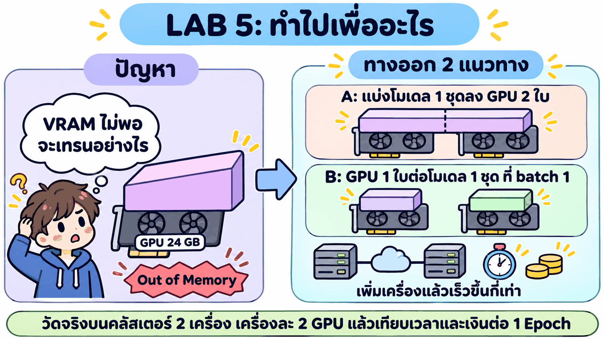
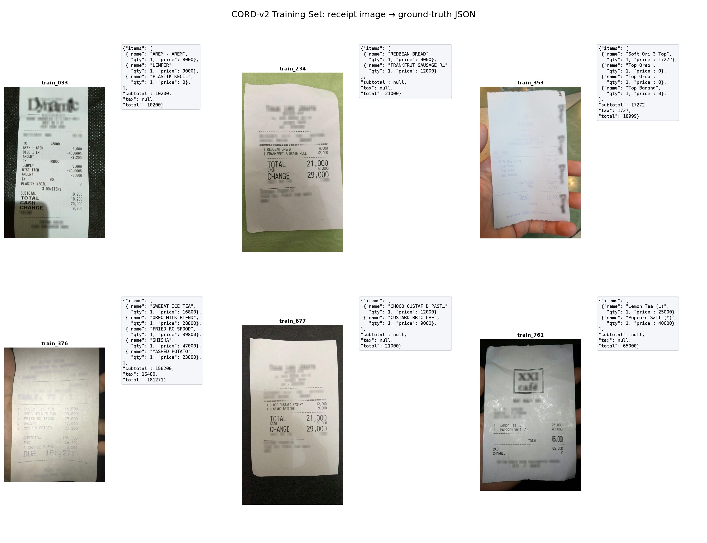
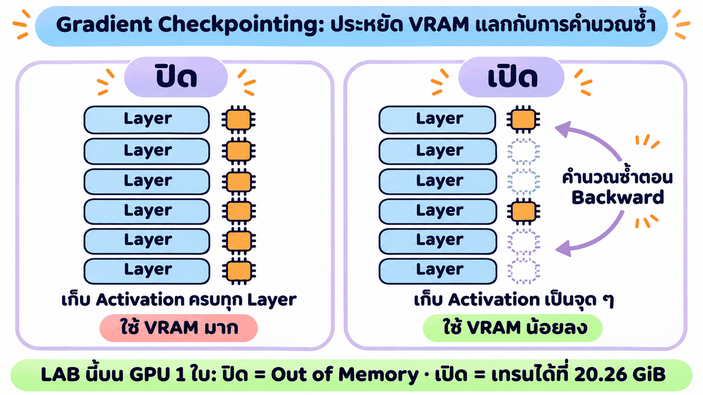
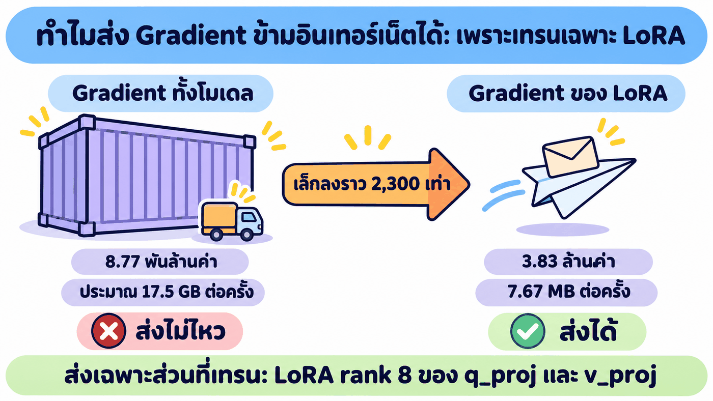
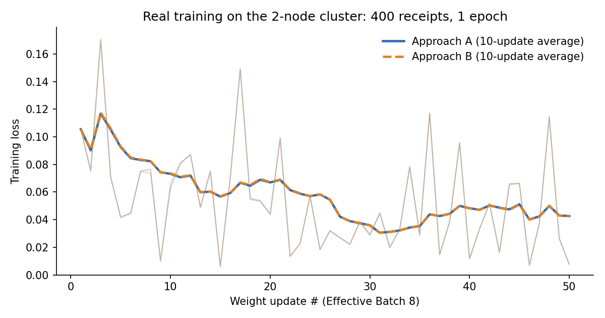
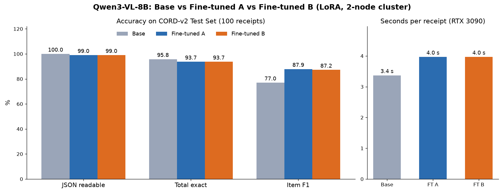
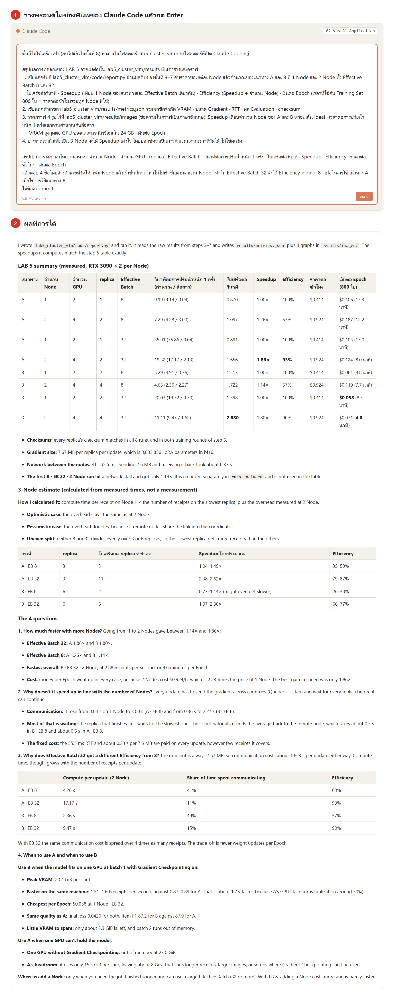

# LAB 5 · เทรน VLM บนคลัสเตอร์ 2 เครื่อง (เครื่องละ 2 GPU): VRAM ไม่พอจะเทรนอย่างไร เพิ่มเครื่องแล้วเร็วขึ้นกี่เท่า

[← กลับหน้ารวมของบท](../README.md) · เปิด Claude Code ที่โฟลเดอร์ของบท `02_VastAi_Application` ("โฟลเดอร์ปัจจุบัน" ในพรอมต์หมายถึงโฟลเดอร์นั้น) · ทำ [LAB 0](../README.md#lab-0--เตรียม-key-3-ตัว) ก่อน

สไลด์ประกอบการสอน: [LAB5_Cluster_VLM_Slides.html](LAB5_Cluster_VLM_Slides.html)

## ทำไปเพื่ออะไร



LAB 2 เทรนโมเดลอ่านใบเสร็จรุ่นเล็ก (2B) บน GPU 1 ใบได้สบาย · LAB นี้เปลี่ยนเป็นรุ่น **8B** ซึ่งใหญ่กว่าราว 4 เท่า บน GPU 24 GB ใบเดิม VRAM จึงตึงมาก

คำถามของการทดลอง: **เมื่อ VRAM จำกัด จะเทรนอย่างไร และเพิ่มเครื่อง (Node) แล้วเร็วขึ้นกี่เท่า คุ้มเงินไหม**

เราไม่เดา แต่ **วัดจริง** 2 แนวทาง แล้วขยายแต่ละแนวทางจาก 1 เครื่องเป็น 2 เครื่อง

| | แนวทาง A · แบ่งโมเดล 1 ชุดลง GPU 2 ใบ | แนวทาง B · GPU 1 ใบต่อโมเดล 1 ชุด |
|---|---|---|
| ชื่อทางวิชาการ | Model Parallelism | Data Parallelism + Gradient Accumulation |
| ใช้เมื่อ | โมเดล 1 ชุดเทรนบน GPU 1 ใบไม่ได้ | โมเดลพอดี GPU 1 ใบ แต่ได้แค่ batch 1 |
| Gradient Checkpointing | ปิด | เปิด |
| replica ต่อ Node | 1 | 2 |
| คลัสเตอร์ 2 Node | 2 replica | 4 replica |

LAB นี้มี **9 ขั้น ทุกขั้นคือ 1 พรอมต์ · โค้ดทุกไฟล์ AI เขียนให้จากพรอมต์ เริ่มจากโฟลเดอร์ว่าง** · ปิดท้ายด้วยอีก 2 ขั้นที่เก็บงานทั้งหมดเป็น **สกิลเวอร์ชัน 0**


## รู้จัก Dataset

Dataset เดียวกับ LAB 2 เพื่อให้เทียบผลของโมเดล 2 ขนาดได้

| หัวข้อ | CORD-v2 |
|---|---|
| เกี่ยวกับอะไร | รูปถ่ายใบเสร็จจริงจากร้านอาหาร คาเฟ่ และร้านค้าในอินโดนีเซีย (เงินรูเปียห์) พร้อมเฉลยว่าบนใบมีสินค้า จำนวน ราคา ภาษี และยอดรวมเท่าไร · ข้อมูลส่วนตัวบนใบถูกเบลอไว้แล้ว |
| ใครทำ | NAVER CLOVA · Park et al., *CORD: A Consolidated Receipt Dataset for Post-OCR Parsing* (2019) |
| ต้นทาง | [Hugging Face: naver-clova-ix/cord-v2](https://huggingface.co/datasets/naver-clova-ix/cord-v2) |
| สัญญาอนุญาต | CC BY 4.0 |
| ภาพ | ย่อให้ด้านยาวไม่เกิน 1280 px |

| ชุด | ใบเสร็จ | รายการสินค้า | LAB นี้ใช้ทำอะไร |
|---|---:|---:|---|
| Training Set | 800 | 2,416 | วัดความเร็ว และเทรนจริง 400 ใบแรก (สุ่มลำดับด้วย seed 0) |
| Validation Set | 100 | 270 | ไม่ได้ใช้ |
| Test Set | 100 | 287 | ตัดสินผล Base เทียบ Fine-tuned ครั้งเดียวตอนจบ |

ภาพนี้ AI สร้างให้ในขั้นที่ 2 จากข้อมูลจริง: ใบเสร็จ 6 ใบจาก Training Set แต่ละใบคู่กับ JSON เฉลย



**label 1 รายการ** (ใบ `train_353` ใบขวาบนในภาพ) · นี่คือคำตอบที่ต้องการให้โมเดลเขียนออกมาเองเมื่อเห็นรูป

```json
{"items":[{"name":"Soft Ori 3 Top","qty":1,"price":17272},
          {"name":"Top Oreo","qty":1,"price":0},
          {"name":"Top Oreo","qty":1,"price":0},
          {"name":"Top Banana","qty":1,"price":0}],
 "subtotal":17272,"tax":1727,"total":18999}
```

| ช่อง | ความหมาย | กติกา |
|---|---|---|
| `items` | รายการสินค้าทุกบรรทัด เรียงตามที่พิมพ์ | รายการย่อย เช่น topping นับเป็นอีกบรรทัด (ใบนี้มี 3 บรรทัด ราคา 0) |
| `name` | ชื่อสินค้าตามที่พิมพ์บนใบ | คัดลอกตามตัวอักษร ไม่แก้คำสะกด |
| `qty` | จำนวน | ใบไม่พิมพ์จำนวน = 1 |
| `price` | ยอดของบรรทัดนั้น | จำนวนเต็ม ("17,272" → 17272) |
| `subtotal` · `tax` | ยอดก่อนภาษี · ภาษี | ใบไม่พิมพ์ = `null` |
| `total` | ยอดที่ต้องจ่าย | 18999 = 17272 + 1727 |

## รู้จักโมเดลที่ใช้


| หัวข้อ | Qwen3-VL-8B-Instruct |
|---|---|
| ประเภท | Vision-Language Model (VLM) · ส่วนมองภาพ (Vision Encoder) + ส่วนภาษา 36 Layer |
| Input | ภาพ + คำสั่ง (Prompt) · ใบเสร็จ 853 × 1280 px กลายเป็นราว 1,080 token |
| Output | ข้อความ · LAB นี้สั่งให้ตอบเป็น JSON ของใบเสร็จ |
| ขนาด | 8.77 พันล้าน parameter · 17 GB บน disk (4 ไฟล์) · **16.34 GiB ใน VRAM** เมื่อโหลดแบบ 16-bit (bfloat16) |
| ที่มา | [Qwen (Alibaba Cloud)](https://huggingface.co/Qwen/Qwen3-VL-8B-Instruct) · Apache-2.0 |
| ใน LAB นี้ | **Base** = โมเดลนี้ตามที่โหลดมา · **Fine-tuned A / B** = โมเดลนี้ + LoRA Adapter ที่เทรนด้วยแนวทาง A / B |
| ส่วนที่เทรน | LoRA rank 8 (alpha 16) เฉพาะ `q_proj` และ `v_proj` ของส่วนภาษา = 3,833,856 parameter (0.044% ของโมเดล) |
| เทียบ LAB 2 | Qwen3-VL-2B มี 2.13 พันล้าน parameter ใช้ VRAM ตอนเทรน 8.55 GB เทรนบน GPU 1 ใบได้สบาย |

LoRA คืออะไร อ่านได้ที่ [ทฤษฎีของ LAB 2](../lab2_vlm/README.md#ทฤษฎีที่ต้องรู้) · LAB นี้เลือกเทรนเฉพาะ `q_proj` กับ `v_proj` เพื่อให้ Gradient ที่ต้องส่งข้ามเครื่องมีขนาดเล็ก (ดูทฤษฎีข้อ 4)

## ทฤษฎีที่ต้องรู้

### 1 · VRAM ตอนเทรนไปอยู่ที่ไหน และ Gradient Checkpointing

**คืออะไร** ตอนเทรน GPU ต้องเก็บ 3 อย่างพร้อมกัน

| สิ่งที่เก็บ | คืออะไร | ใน LAB นี้ |
|---|---|---|
| น้ำหนักโมเดล | ตัวโมเดลทั้งชุด | 16.34 GiB (69% ของ GPU 24 GB) |
| Activation | ผลลัพธ์ระหว่างทางของทุก Layer เก็บไว้ใช้ตอนคำนวณย้อนกลับ (Backward) | โตตามจำนวน token × จำนวน Layer × batch |
| logits + Gradient + optimizer | คะแนนของทุกคำในคลังศัพท์ และส่วนที่ใช้ปรับน้ำหนัก | logits ราว 1 GiB ต่อใบเสร็จ · LoRA + Gradient + optimizer แค่ราว 0.06 GiB |

**ทำไมต้องรู้** **โหลดโมเดลได้ ไม่ได้แปลว่าเทรนได้** · ตอนใช้งาน (Inference) โมเดล 8B ใช้ราว 17 GiB พอดี GPU 1 ใบ แต่ตอนเทรนต้องมีที่ให้ Activation ด้วย


**ทำงานอย่างไร** **Gradient Checkpointing** ไม่เก็บ Activation ของทุก Layer แต่เก็บเป็นจุด ๆ แล้ว **คำนวณซ้ำ** ตอน Backward · ได้ VRAM คืน แลกกับเวลาคำนวณที่เพิ่มขึ้น



**ตัวเลขจาก LAB นี้** (ขั้นที่ 3 · ใบเสร็จที่เฉลยยาวที่สุด `train_000` · 1,685 token)

| กรณี | GPU | batch | Gradient Checkpointing | ผล | VRAM สูงสุดต่อใบ (GiB) | วินาทีต่อ step |
|---|---|---|---|---|---|---|
| A · 1 ใบ | 1 | 1 | ปิด | **Out of Memory** ตั้งแต่ step 1 | 23.00 | – |
| A · 2 ใบ แบ่ง Layer 18/18 | 2 | 1 | ปิด | เทรนได้ | 14.50 / 15.73 | 1.58 |
| A · 2 ใบ แบ่ง Layer 19/17 | 2 | 1 | ปิด | เทรนได้ | 15.14 / 15.08 | 1.55 |
| B · batch 1 | 1 | 1 | เปิด | เทรนได้ | 20.26 | 1.60 |
| B · batch 2 | 1 | 2 | เปิด | **Out of Memory** ตั้งแต่ step 1 | 22.20 | – |


> **อ่านให้ตรง: อะไรทำให้ต้องใช้แนวทาง A**
> น้ำหนักของโมเดล 8B (16.34 GiB) **ใส่ GPU 24 GB 1 ใบได้** · สิ่งที่เกิน 1 ใบคือ **น้ำหนัก + หน่วยความจำตอนเทรนแบบไม่ใช้ Gradient Checkpointing** · ถ้ายอมเปิด Gradient Checkpointing โมเดลนี้เทรนบน 1 ใบได้ที่ batch 1 (นั่นคือแนวทาง B)
> แนวทาง A ใน LAB นี้จึงเป็นตัวแทนของสถานการณ์ "โมเดล 1 ชุดเทรนบน 1 ใบไม่ได้" ซึ่งจะเจอจริงกับโมเดลที่ใหญ่กว่านี้ หรือเมื่อใช้ Gradient Checkpointing ไม่ได้

### 2 · Model Parallelism เทียบ Data Parallelism

**คืออะไร**

| | Model Parallelism (แนวทาง A) | Data Parallelism (แนวทาง B) |
|---|---|---|
| วิธี | โมเดล **1 ชุด** แบ่ง Layer ไปอยู่หลาย GPU ข้อมูลไหลผ่านทีละใบ | โมเดล **ครบชุดหลายชุด** (เรียกว่า replica) แต่ละชุดได้ข้อมูลคนละส่วน แล้วรวม Gradient |
| แก้ปัญหา | โมเดลใส่ 1 ใบไม่ลง | อยากเร็วขึ้น |

**ทำไมต้องใช้** สองวิธีแก้ปัญหาคนละเรื่อง · A แก้ "ใส่ไม่ลง" · B แก้ "ช้า"


**ทำงานอย่างไร**

- **A** GPU 0 คำนวณส่วนมองภาพและ Layer 0–18 แล้วส่ง Activation ให้ GPU 1 ทำ Layer 19–35 · ขา Backward ไหลกลับทางเดิม · GPU 2 ใบจึง **ผลัดกันทำงาน**
- **B** GPU ทั้ง 2 ใบทำงาน **พร้อมกัน** กับใบเสร็จคนละใบ

**ตัวเลขจาก LAB นี้** (1 Node · Effective Batch 8)

| | แนวทาง A | แนวทาง B |
|---|---|---|
| replica | 1 | 2 |
| ใบเสร็จต่อวินาที | 0.87 | **1.51** (เร็วกว่า 1.74 เท่า) |
| GPU util (GPU 0 / GPU 1) | 46% / 50% | 95% / 85% |
| VRAM สูงสุดต่อใบ | 15.3 GiB (เหลือราว 8 GiB) | 20.4 GiB (เหลือราว 3 GiB) |

### 3 · Gradient Accumulation และ Effective Batch

**คืออะไร** ป้อนใบเสร็จทีละ 1 ใบ **สะสม Gradient** ไว้หลายใบ แล้วค่อยปรับน้ำหนัก 1 ครั้ง

**Effective Batch = จำนวน replica × จำนวนใบที่แต่ละ replica สะสม**

**ทำไมต้องใช้**

- VRAM พอแค่ batch 1 (batch 2 ขึ้น Out of Memory) แต่อยากได้ Gradient ที่นิ่งเหมือน batch ใหญ่
- ใช้เทียบ 1 Node กับ 2 Node อย่างยุติธรรม: Effective Batch เท่ากัน replica ที่มากกว่าก็สะสมน้อยลง


**ตัวเลขจาก LAB นี้** (replica × ใบที่สะสม)

| Effective Batch | A · 1 Node | A · 2 Node | B · 1 Node | B · 2 Node |
|---|---|---|---|---|
| 8 | 1 × 8 | 2 × 4 | 2 × 4 | 4 × 2 |
| 32 | 1 × 32 | 2 × 16 | 2 × 16 | 4 × 8 |

เทรนจริง 400 ใบที่ Effective Batch 8 = ปรับน้ำหนัก 50 ครั้ง

### 4 · ข้ามเครื่อง: Coordinator เฉลี่ย Gradient แบบ Synchronous

**คืออะไร** มีโปรแกรมกลาง 1 ตัว (Coordinator) รับ Gradient จากทุก replica เฉลี่ย แล้วส่งค่าเฉลี่ยกลับ · ทุก replica ปรับน้ำหนักด้วยค่าเดียวกัน · **Synchronous** = รอให้ครบทุกตัวก่อนจึงเฉลี่ย


**ทำไมต้องใช้แบบนี้**

- เครื่องเช่า 2 เครื่องอยู่คนละที่ ต่างเจ้าของ ไม่มีวงเครือข่ายภายในร่วมกัน และเปิดพอร์ตได้จำกัด
- แบบดาว (star) ใช้ **พอร์ตเดียว** บน Node 1 · replica ทุกตัวรวมทั้งบน Node 2 เป็นฝ่าย **ต่อออกมาหา** Node 1 และต้องแสดงรหัสลับก่อนเข้าร่วม
- วิธีนี้ **ไม่ใช่** DDP ของ LAB 4 · ใน LAB 4 GPU ในเครื่องเดียวกันคุยกันตรงผ่าน PCIe ด้วย All-reduce (ไม่มีศูนย์กลาง) · ใน LAB นี้ทุกตัวคุยผ่านโปรแกรมกลางข้ามอินเทอร์เน็ต

**ทำงานอย่างไร** 1 ครั้งของการปรับน้ำหนัก = คำนวณ → ส่ง → รอ → รับ → ปรับน้ำหนัก

- ต้องรอ replica ที่ **ช้าที่สุด** ทุกครั้ง
- ตอนจบน้ำหนัก LoRA ของทุก replica ต้องเหมือนกัน · ตรวจด้วย checksum (sha256)

**ทำไมส่งข้ามอินเทอร์เน็ตได้** เพราะเทรนเฉพาะ LoRA · ของที่ต้องส่งมีขนาดเท่ากับจำนวน parameter ที่เทรน



**ตัวเลขจาก LAB นี้**

| ค่าที่วัด | ผล |
|---|---|
| ขนาด Gradient ที่ส่ง | 7.67 MB ต่อ replica ต่อครั้ง (3,833,856 ค่า × 2 byte) |
| เครือข่าย Quebec (แคนาดา) ↔ Utah (สหรัฐฯ) | RTT 55.5 ms · ส่ง 7.6 MB ไปแล้วรับกลับราว 0.33 วินาที |
| เวลาสื่อสารต่อครั้ง · 1 Node | 0.04 วินาที (A) · 0.36 วินาที (B) |
| เวลาสื่อสารต่อครั้ง · 2 Node (A · Effective Batch 8) | ส่ง 0.72 + **รอ 1.72** + รับ 0.55 = 3.00 วินาที |
| checksum | ตรงกันทุก replica ทั้ง 8 รอบวัด และ 2 รอบเทรน |

เวลาสื่อสารส่วนใหญ่คือ **เวลารอ** replica ที่ช้ากว่า ไม่ใช่เวลาส่งข้อมูล

### 5 · ต้นทุนสื่อสารต่อครั้ง กับ Speedup · Efficiency · เงินต่อ Epoch

**คืออะไร**

| ค่า | สูตร | ความหมาย |
|---|---|---|
| Speedup | ใบเสร็จต่อวินาทีของ N Node ÷ ของ 1 Node | เร็วขึ้นกี่เท่า |
| Efficiency | Speedup ÷ N | ได้กี่ % ของ Ideal |
| เงินต่อ Epoch | เวลาที่ใช้กับ 800 ใบ × ราคาต่อชั่วโมงรวมทุก Node | จ่ายเท่าไรต่อการเทรน 1 รอบ |

**ทำไมต้องรู้** ทุกครั้งที่ปรับน้ำหนัก ต้องจ่าย "ค่าส่งและค่ารอ" 1 ครั้ง ราว 1.6–3 วินาที **ไม่ว่าครั้งนั้นจะสะสมกี่ใบ** · ถ้าแต่ละครั้งคำนวณน้อย ค่านี้จะกลบเวลาที่ประหยัดได้จากการเพิ่มเครื่อง


**ตัวเลขจาก LAB นี้** (คลัสเตอร์ 2 Node)

| กรณี | คำนวณต่อครั้ง | สัดส่วนเวลาที่ใช้สื่อสาร | Speedup | Efficiency |
|---|---|---|---|---|
| A · Effective Batch 8 | 4.28 วินาที | 41% | 1.26× | 63% |
| A · Effective Batch 32 | 17.17 วินาที | 11% | **1.86×** | 93% |
| B · Effective Batch 8 | 2.36 วินาที | 49% | 1.14× | 57% |
| B · Effective Batch 32 | 9.47 วินาที | 15% | **1.80×** | 90% |


- สะสมหลายใบก่อนส่ง 1 ครั้ง = ค่าสื่อสารก้อนเดิมถูกหารด้วยจำนวนใบที่มากขึ้น · แลกกับจำนวนครั้งที่ปรับน้ำหนักต่อ Epoch ที่น้อยลง
- 2 Node ราคา $0.924 ต่อชั่วโมง = **2.23 เท่า** ของ 1 Node ($0.414) แต่เร็วขึ้นมากสุด 1.86 เท่า · **เงินต่อ Epoch จึงแพงขึ้นทุกกรณี**

### 6 · เลือกแนวทางอย่างไร


| สถานการณ์ | เลือก | เหตุผลจากตัวเลขที่วัด |
|---|---|---|
| โมเดลเทรนบน 1 ใบได้ที่ batch 1 (ยอมเปิด Gradient Checkpointing) | **B** | เร็วกว่า A ราว 1.7 เท่าบนเครื่องเดียวกัน · ถูกกว่าต่อ Epoch · คุณภาพเท่ากัน (Item F1 87.2 กับ 87.9) |
| โมเดล 1 ชุดเทรนบน 1 ใบไม่ได้ หรือเหลือ VRAM ไม่พอสำหรับภาพใหญ่และคำตอบยาว | **A** | ใช้ 15.3 GiB ต่อใบ เหลือราว 8 GiB · แลกกับ GPU ที่ว่างครึ่งหนึ่ง |
| อยากเสร็จเร็วขึ้น และใช้ Effective Batch ใหญ่ได้ (32 ขึ้นไป) | เพิ่ม Node | ได้ 1.80–1.86 เท่า |
| Effective Batch เล็ก (8) | ไม่เพิ่ม Node | เร็วขึ้นแค่ 1.14–1.26 เท่า แต่จ่ายแพงขึ้น 2.23 เท่าต่อชั่วโมง |

## การทดลอง

| หัวข้อ | รายละเอียด |
|---|---|
| Dataset | CORD-v2 · Training Set 800 ใบ · Test Set 100 ใบ · ภาพด้านยาว 1280 px |
| โมเดล | Qwen3-VL-8B-Instruct + LoRA rank 8 เฉพาะ `q_proj` `v_proj` |
| เทียบ A กับ B | **A** = โมเดล 1 ชุดแบ่งลง GPU 2 ใบ ปิด Gradient Checkpointing · **B** = GPU 1 ใบต่อโมเดล 1 ชุด เปิด Gradient Checkpointing ที่ batch 1 |
| เทียบ 1 กับ 2 Node | แต่ละแนวทางวัดที่ Effective Batch 8 และ 32 รวม 8 รอบ |
| ค่าที่ตรึงไว้ | learning rate 0.0002 · seed 0 · คิด loss เฉพาะส่วนคำตอบ JSON · ป้อนทีละ 1 ใบ |
| วิธีวัดความเร็ว | Effective Batch 8: ปรับน้ำหนัก 20 ครั้ง เฉลี่ยครั้งที่ 4–20 · Effective Batch 32: 8 ครั้ง เฉลี่ยครั้งที่ 3–8 · วัดเวลาคำนวณ เวลาสื่อสาร VRAM GPU util และ checksum |
| วิธีวัดคุณภาพ | เทรนจริง 400 ใบ 1 Epoch ด้วยคลัสเตอร์ 2 Node แล้ววัดบน Test Set 100 ใบ: JSON อ่านได้ · ยอดรวมตรง · Item F1 |
| เครื่อง | RTX 3090 2 ใบต่อเครื่อง เพดาน $0.60/ชม. ต่อเครื่อง · Node 1 Quebec (แคนาดา) $0.414/ชม. 12 cores · Node 2 Utah (สหรัฐฯ) $0.510/ชม. 32 cores |
| เวลาและค่าเช่าจริง | 9 ขั้นรวมราว 3 ชั่วโมง · Node 1 เปิด 3 ชม. 00 นาที · Node 2 เปิด 1 ชม. 56 นาที · **$2.44** |

**ข้อจำกัดของผลชุดนี้** (อ่านก่อนนำตัวเลขไปใช้)

| ข้อจำกัด | ผลต่อการอ่านตัวเลข |
|---|---|
| วัดจริงแค่ 2 Node | ตัวเลข 3 Node ในขั้นที่ 9 เป็น **ประมาณการ** จากเวลาที่วัดได้ ไม่ใช่ผลวัด |
| แต่ละกรณีวัดรอบเดียว (17 หรือ 6 ครั้งของการปรับน้ำหนัก) | ไม่รู้ความแปรปรวน · เครือข่ายอินเทอร์เน็ตไม่นิ่ง มี 1 กรณีที่ต้องวัดใหม่ (ดูขั้นที่ 5) |
| Node 2 คำนวณเร็วกว่า Node 1 ราว 20% (CPU 32 กับ 12 cores) | Speedup รวมผลของเครื่องที่ไม่เท่ากัน |
| เทรนแค่ 400 ใบ 1 Epoch และไม่ได้วัด validation loss | คุณภาพยังไม่ใช่ค่าที่ดีที่สุดของโมเดลนี้ |
| เงินต่อ Epoch คิดจากเวลาปรับน้ำหนักอย่างเดียว | ไม่รวมเวลาโหลดโมเดล เวลาเช่าเครื่อง และค่ารับส่งข้อมูล |

ทำตามลำดับขั้นที่ 1 → 9 ให้ครบในรอบเดียว · คัดลอกพรอมต์ไปวางในช่องพิมพ์ของ Claude Code ทีละขั้น · โค้ดที่ AI เขียนจะอยู่ในโฟลเดอร์ `lab5_cluster_vlm/code` ซึ่งเริ่มจากว่าง

> ⚠️ Node 1 คิดเงินตั้งแต่ขั้นที่ 1 และ Node 2 ตั้งแต่ขั้นที่ 5 จนกว่าจะลบในขั้นที่ 8 · **ต้องทำขั้นที่ 8 ทุกครั้ง** แม้งานระหว่างทางจะล้ม

## ขั้นที่ 1 · เช่า Node 1

AI ค้นหาเครื่อง RTX 3090 2 ใบ เช่า เปิดพอร์ต 9000 ให้เครื่องอื่นต่อเข้ามาได้ แล้วรอจนเห็น GPU ครบ

```text
ทำงานใน container `multi-account` โฟลเดอร์ /workspace/vastapp_lab ด้วยสกิล vastai

เช่าเครื่องแรกของคลัสเตอร์ (Node 1) สำหรับเทรนโมเดลอ่านใบเสร็จด้วย GPU หลายใบ
1. เช่าเครื่อง RTX 3090 2 ใบในเครื่องเดียว (ห้ามเกิน 2 ใบ) ราคารวมไม่เกิน $0.60 ต่อชั่วโมง ตั้งป้ายเครื่องว่า vapp-lab5-n1
2. เลือกเครื่อง verified ที่ต่อ SSH ได้ตรง เน็ตเร็วทั้งขาเข้าและขาออก (500 Mbps ขึ้นไป) ค่ารับส่งข้อมูลไม่เกิน $0.02 ต่อ GB มี CPU 12 cores ขึ้นไป ไม่อยู่ในจีน
3. ขั้นที่ 5 จะเช่าเครื่องที่สองไว้ใกล้กัน จึงให้เลือกจากประเทศหรือภูมิภาคที่ตอนนี้มีเครื่องผ่านเงื่อนไขอย่างน้อย 2 เครื่องที่ public IP คนละตัว แล้วเอาเครื่องที่ถูกที่สุดในกลุ่มนั้น
4. ใช้ image PyTorch 2.8 ที่มี CUDA 12.8 disk 80 GB และเปิดพอร์ต 9000 ไว้ 1 พอร์ต ให้เครื่องอื่นในคลัสเตอร์ต่อเข้ามาหาเครื่องนี้ได้
5. รอจนเข้าเครื่องได้และเห็น GPU ครบ 2 ใบ ถ้าเกิน 8 นาทียังไม่พร้อม ให้ลบแล้วเช่าเครื่องอื่น
กุญแจ SSH อยู่ที่ /workspace/vastai_lab/Devtool_SSH/devtoolSSH

สรุปเป็นตารางภาษาไทย: GPU · VRAM ต่อใบ · ราคาต่อชั่วโมง · ที่ตั้ง · CPU cores · ความเร็วเน็ตขาเข้า/ขาออก · ค่ารับส่งข้อมูลต่อ GB
· ที่อยู่และพอร์ตที่เครื่องอื่นจะใช้ต่อเข้ามา แล้วบอกว่าเครื่องยังเปิดอยู่
```


*ใช้เวลา 13.5 นาที (เครื่องแรกเปิดไม่ขึ้น AI ลบแล้วเช่าเครื่องใหม่เอง) · ที่อยู่เครื่องในภาพเป็นค่าตัวอย่าง · รอบนี้ AI ตอบปนภาษาอังกฤษ เนื้อหาเหมือนกัน*

**อ่านผลอย่างไร**

- ดูแถว **ที่อยู่และพอร์ตที่เครื่องอื่นใช้ต่อเข้ามา**: Vast.ai จับคู่พอร์ต 9000 ในเครื่องกับพอร์ตภายนอกอีกเลขหนึ่ง · replica ทุกตัวจะต่อเข้ามาที่ที่อยู่นี้
- เครื่องเช่าเปิดไม่ขึ้นเป็นเรื่องปกติ · ข้อ 5 ของพรอมต์ (เกิน 8 นาทีให้ลบแล้วเช่าใหม่) ทำให้ AI ไม่รอเปล่า
- AI เลือกแคนาดาเพราะตอนนั้นเป็นประเทศเดียวที่มีเครื่องผ่านเงื่อนไข 2 เครื่องที่ public IP คนละตัว (ข้อ 3 ของพรอมต์)
- **ตั้งแต่ขั้นนี้เงินเริ่มเดิน** ชั่วโมงละ $0.414

## ขั้นที่ 2 · เตรียม Node 1 โมเดล และ Dataset ใบเสร็จ

AI ติดตั้งแพ็กเกจ โหลดโมเดล 17 GB และเขียน `code/receipt_data.py` (โหลด Dataset แปลงเฉลยเป็น JSON เก็บข้อความสั่งโมเดล และทำภาพตัวอย่าง)

```text
ทำงานใน container `multi-account` โฟลเดอร์ /workspace/vastapp_lab ด้วยสกิล vastai
เครื่องที่ใช้คือเครื่องป้าย vapp-lab5-n1 · กุญแจ SSH อยู่ที่ /workspace/vastai_lab/Devtool_SSH/devtoolSSH
โค้ดและผลทั้งหมดเก็บในโฟลเดอร์ lab5_cluster_vlm บนเครื่องเรา (โฟลเดอร์ที่เปิด Claude Code อยู่) ไม่ใช่ใน container

เตรียมเครื่องที่เช่า โมเดล และ Dataset ใบเสร็จ CORD-v2
1. ติดตั้ง transformers peft datasets accelerate matplotlib บนเครื่องที่เช่า แล้วโหลดโมเดล Qwen/Qwen3-VL-8B-Instruct (ราว 17 GB) ถ้าโหลดแล้ว error ตอนคลายข้อมูล ให้อัปเดตแพ็กเกจ brotli
2. เขียนสคริปต์ lab5_cluster_vlm/code/receipt_data.py: โหลด Dataset naver-clova-ix/cord-v2 จาก Hugging Face ใช้การแบ่ง Training/Validation/Test ตามที่ Dataset ให้มา
   ตั้งชื่อใบตามชุดและลำดับ (เช่น test_020) และย่อภาพให้ด้านยาวไม่เกิน 1280 px
3. แปลงเฉลยแต่ละใบเป็น JSON แบบที่จะให้โมเดลตอบ: {"items":[{"name","qty","price"}],"subtotal","tax","total"}
   ตัวเลขเป็นจำนวนเต็ม ("25,000" → 25000) · ไม่มีค่าบนใบ = null · ไม่พิมพ์จำนวน = qty 1 · รายการย่อย (เช่น topping) นับเป็นอีกบรรทัด
4. ในไฟล์เดียวกันเก็บข้อความสั่งโมเดล (ภาษาอังกฤษ) ให้อ่านใบเสร็จแล้วตอบเป็น JSON รูปแบบนี้เท่านั้น ข้อความนี้ต้องใช้ชุดเดียวกันทั้งตอนเทรนและตอนวัดผล
5. รันสคริปต์บนเครื่องที่เช่า แล้วทำภาพตัวอย่าง Dataset: ใบเสร็จจริงจาก Training Set 6 ใบเรียงเป็นตาราง แต่ละใบคู่กับ JSON เฉลยของใบนั้น เก็บกลับมาที่ lab5_cluster_vlm/results/dataset_samples.jpg
ใช้ HF_TOKEN จากไฟล์ .env ของโฟลเดอร์ปัจจุบัน ห้ามแสดงค่า และห้ามทิ้ง token ไว้บนเครื่องที่เช่า

สรุปเป็นภาษาไทย: ตารางจำนวนใบเสร็จและรายการสินค้าของ Training Set · Validation Set · Test Set · ขนาดโมเดลบน disk และเวลาที่ใช้โหลด
ยกเฉลย JSON ของใบเสร็จ 1 ใบ แล้วอธิบายทีละช่องว่าหมายถึงอะไร แล้วบอกว่าเครื่องยังเปิดอยู่
```


*ใช้เวลา 9.3 นาที · โหลดโมเดล 136 วินาที · แปลงใบเสร็จ 1,000 ใบ 79 วินาที*

ตัวอย่างโค้ดที่ AI เขียนให้ในรอบจริง (ของคุณอาจต่างกัน): [code_reference/receipt_data.py](code_reference/receipt_data.py)

**อ่านผลอย่างไร**

- ต้องได้ **800 / 100 / 100 ใบ** แล้วเปิด `results/dataset_samples.jpg` ดูว่า JSON เฉลยตรงกับรูป (ภาพอยู่ในหัวข้อ [รู้จัก Dataset](#รู้จัก-dataset))
- ข้อความสั่งโมเดลถูกเก็บไว้ที่เดียวใน `receipt_data.py` · ตอนเทรนและตอนวัดผลใช้ชุดเดียวกัน ผลจึงเทียบกันได้
- AI ส่ง `HF_TOKEN` ให้เครื่องเช่าเฉพาะตอนรันงาน แล้วตรวจซ้ำว่าไม่มี token ค้างบนเครื่อง

## ขั้นที่ 3 · หาขีดจำกัด VRAM ของ GPU 24 GB

AI เขียน `code/vram_probe.py` แล้วลองเทรน 10 step ด้วยใบเสร็จที่หนักที่สุด 5 กรณี เพื่อดูว่ากรณีไหนเทรนได้ กรณีไหน Out of Memory

```text
ทำงานใน container `multi-account` โฟลเดอร์ /workspace/vastapp_lab ด้วยสกิล vastai
เครื่องที่ใช้คือเครื่องป้าย vapp-lab5-n1 · กุญแจ SSH อยู่ที่ /workspace/vastai_lab/Devtool_SSH/devtoolSSH
โค้ดและผลทั้งหมดเก็บในโฟลเดอร์ lab5_cluster_vlm บนเครื่องเรา (โฟลเดอร์ที่เปิด Claude Code อยู่) ไม่ใช่ใน container

เขียนโค้ดทดสอบว่า GPU 24 GB เทรนโมเดล Qwen/Qwen3-VL-8B-Instruct ได้แค่ไหน แล้วทดสอบจริงบนเครื่องที่เช่า
1. เขียนสคริปต์ lab5_cluster_vlm/code/vram_probe.py: โหลดโมเดลแบบ 16-bit (bfloat16) ใส่ LoRA rank 8 (alpha 16) เฉพาะ q_proj และ v_proj ของส่วนภาษา ไม่แตะส่วนมองภาพ
   แล้วลองเทรน 10 step ด้วยใบเสร็จที่เฉลยยาวที่สุดของ Training Set (กรณีที่ใช้ VRAM มากที่สุด) ภาพด้านยาว 1280 px ใช้ข้อความสั่งโมเดลจาก receipt_data.py
2. สคริปต์รับค่าได้: ใช้ GPU กี่ใบ (1 หรือ 2) · batch · เปิดหรือปิด Gradient Checkpointing แล้วบันทึก VRAM ของน้ำหนักโมเดล · VRAM สูงสุดของแต่ละใบ · วินาทีต่อ step · ข้อความ error ถ้า Out of Memory
3. ทดสอบการตั้งค่าของแนวทาง A (ปิด Gradient Checkpointing · batch 1): ด้วย GPU 1 ใบ แล้วด้วย GPU 2 ใบโดยแบ่ง Layer ของโมเดลไปอยู่ใบละราวครึ่ง ให้ VRAM สูงสุดของสองใบใกล้กัน
4. ทดสอบการตั้งค่าของแนวทาง B (เปิด Gradient Checkpointing · GPU 1 ใบ): batch 1 แล้ว batch 2
5. เก็บผลทุกกรณีกลับมาที่ lab5_cluster_vlm/results/raw/vram_probe.json (ทดสอบตามจริง ห้ามปรับค่าเพื่อให้ผลออกมาตามที่คาด)

สรุปเป็นตารางภาษาไทย: กรณี · จำนวน GPU · batch · Gradient Checkpointing · ผล (เทรนได้ หรือ Out of Memory) · VRAM สูงสุดต่อใบ · วินาทีต่อ step
แล้วตอบ: น้ำหนักโมเดลใช้ VRAM เท่าไร ที่เหลือใช้ไปกับอะไร · แนวทาง A ต้องใช้ GPU กี่ใบ · แนวทาง B ป้อนได้ batch ละกี่ใบ แล้วบอกว่าเครื่องยังเปิดอยู่
```


*ใช้เวลา 6.3 นาที · รอบนี้ AI ตอบปนภาษาอังกฤษ*

ตัวอย่างโค้ดที่ AI เขียนให้ในรอบจริง (ของคุณอาจต่างกัน): [code_reference/vram_probe.py](code_reference/vram_probe.py) · ผลดิบ: [results/raw/vram_probe.json](results/raw/vram_probe.json)

**อ่านผลอย่างไร**

- ตารางนี้คือที่มาของ 2 แนวทาง: **ปิด Gradient Checkpointing ต้องใช้ 2 ใบ (A)** · **เปิดแล้วพอ 1 ใบ แต่ได้แค่ batch 1 (B)** · ตารางและคำอธิบายเต็มอยู่ในทฤษฎีข้อ 1
- น้ำหนักโมเดลใช้ไป 16.34 GiB ก่อนเริ่มเทรน เหลือที่ให้ Activation ราว 7 GiB เท่านั้น
- 1.91 GiB ที่ batch 2 ขอเพิ่มไม่ได้ คือ logits ของใบเสร็จ 2 ใบ (1,685 token × คลังศัพท์ 151,936 คำ)
- AI ลองแบ่ง Layer 18/18 ก่อน พบว่า GPU 1 สูงกว่า 1.2 GiB จึงย้าย 1 Layer เป็น 19/17 ให้สองใบใกล้กัน · พรอมต์สั่งว่า "ห้ามปรับค่าเพื่อให้ผลออกมาตามที่คาด" ผลทั้งสองแบบจึงถูกเก็บไว้
- บนเครื่องนี้ PyTorch มองไม่เห็น GPU ในตอนแรก (driver ของเครื่องกับ image ไม่เข้ากัน) AI หาทางแก้เอง · เครื่องเช่าแต่ละเครื่องไม่เหมือนกัน เรื่องแบบนี้เจอได้

## ขั้นที่ 4 · เขียนตัวเทรนแบบคลัสเตอร์ แล้ววัดความเร็วบน 1 Node

AI เขียน `code/coordinator.py` (โปรแกรมกลางเฉลี่ย Gradient) และ `code/worker.py` (replica 1 ตัว ใช้ได้ทั้งแนวทาง A และ B) พร้อม `code/run_node1.sh` แล้ววัด 4 รอบบน Node 1 เป็นเส้นฐาน

```text
ทำงานใน container `multi-account` โฟลเดอร์ /workspace/vastapp_lab ด้วยสกิล vastai
เครื่องที่ใช้คือเครื่องป้าย vapp-lab5-n1 · กุญแจ SSH อยู่ที่ /workspace/vastai_lab/Devtool_SSH/devtoolSSH
โค้ดและผลทั้งหมดเก็บในโฟลเดอร์ lab5_cluster_vlm บนเครื่องเรา (โฟลเดอร์ที่เปิด Claude Code อยู่) ไม่ใช่ใน container

เขียนตัวเทรนที่ให้โมเดลหลายชุด (replica) ช่วยกันเทรนข้ามเครื่องได้ แล้ววัดความเร็วบน Node 1 เครื่องเดียวเป็นเส้นฐาน
1. เขียน lab5_cluster_vlm/code/coordinator.py: โปรแกรมกลาง (ใช้แค่ CPU) เปิดพอร์ต 9000 รอ replica เข้ามาครบตามจำนวน โดย replica ต้องแสดงรหัสลับที่สุ่มไว้บนเครื่องที่เช่า
   ทุกครั้งที่ปรับน้ำหนัก: รับ Gradient ของ LoRA จากทุก replica → เฉลี่ย → ส่งค่าเฉลี่ยกลับให้ทุก replica พร้อมกัน (Synchronous)
2. เขียน lab5_cluster_vlm/code/worker.py: replica 1 ตัว = โมเดล 1 ชุด · แนวทาง A แบ่งโมเดลบน GPU 2 ใบ ปิด Gradient Checkpointing · แนวทาง B โมเดลอยู่บน GPU 1 ใบ เปิด Gradient Checkpointing
3. แต่ละ replica ได้ใบเสร็จคนละส่วนไม่ซ้ำกัน ป้อนทีละ 1 ใบ สะสม Gradient ตามจำนวนใบที่กำหนด ส่ง Gradient ของ LoRA แบบ 16-bit ให้โปรแกรมกลาง แล้วปรับน้ำหนักด้วยค่าเฉลี่ยที่ได้กลับมา
4. ค่าที่ตรึง: โมเดล ภาพ และ LoRA แบบเดียวกับขั้นที่ 3 · learning rate 0.0002 · seed 0 · คิด loss เฉพาะส่วนคำตอบ JSON · Effective Batch = จำนวน replica × จำนวนใบที่แต่ละ replica สะสม
5. บันทึกทุกครั้งที่ปรับน้ำหนัก: เวลาคำนวณ · เวลาสื่อสาร (ส่ง รอ รับ) · ขนาด Gradient ที่ส่ง (MB) · VRAM สูงสุด · GPU util ของทุกใบ และตอนจบคำนวณ checksum ของน้ำหนัก LoRA ของแต่ละ replica
6. วัดบน Node 1 รวม 4 รอบ: แนวทาง A (1 replica) และ B (2 replica) ที่ Effective Batch 8 ใบ (วัด 20 ครั้งของการปรับน้ำหนัก ไม่นับ 3 ครั้งแรก) และ 32 ใบ (วัด 8 ครั้ง ไม่นับ 2 ครั้งแรก)
7. รอจนวัดครบทั้ง 4 รอบ (ราว 15 นาที) แล้วเก็บผลดิบของทุกรอบกลับมาที่ lab5_cluster_vlm/results/raw และอธิบายโค้ดที่เขียนสั้น ๆ 4–6 บรรทัด

สรุปเป็นตารางภาษาไทย 4 รอบบน 1 Node: แนวทาง · replica · Effective Batch · วินาทีต่อการปรับน้ำหนัก 1 ครั้ง (แยกคำนวณกับสื่อสาร) · ใบเสร็จต่อวินาที
· VRAM สูงสุดต่อใบ · GPU util ของแต่ละใบ · ขนาด Gradient ที่ส่ง · checksum ของ replica ในรอบเดียวกันตรงกันหรือไม่ แล้วบอกว่าเครื่องยังเปิดอยู่ · ไม่ต้อง commit
```


*ใช้เวลาราว 31 นาที · AI เขียนโค้ดราว 16 นาที ที่เหลือคือรอวัด 4 รอบ*

ตัวอย่างโค้ดที่ AI เขียนให้ในรอบจริง (ของคุณอาจต่างกัน): [code_reference/coordinator.py](code_reference/coordinator.py) · [worker.py](code_reference/worker.py) · [run_node1.sh](code_reference/run_node1.sh)

| แนวทาง | replica | Effective Batch | วินาทีต่อการปรับน้ำหนัก 1 ครั้ง (คำนวณ / สื่อสาร) | ใบเสร็จต่อวินาที | VRAM สูงสุดต่อใบ | GPU util |
|---|---|---|---|---|---|---|
| A | 1 | 8 | 9.19 (9.14 / 0.04) | 0.87 | 15.3 GiB | 46% / 50% |
| B | 2 | 8 | 5.29 (4.91 / 0.36) | **1.51** | 20.4 GiB | 95% / 85% |
| A | 1 | 32 | 35.91 (35.86 / 0.04) | 0.89 | 15.3 GiB | 46% / 50% |
| B | 2 | 32 | 20.03 (19.32 / 0.70) | **1.60** | 20.4 GiB | 96% / 90% |

**อ่านผลอย่างไร**

- **B เร็วกว่า A ราว 1.7–1.8 เท่าบนเครื่องเดียวกัน** · A ใช้ GPU ทีละใบ (util ราว 50%) ส่วน B ใช้เกือบเต็ม แม้ต้องคำนวณซ้ำจาก Gradient Checkpointing
- บนเครื่องเดียว เวลาสื่อสารแทบเป็นศูนย์ (0.04 วินาที) · เวลา 0.36–0.70 วินาทีของ B คือเวลาที่ replica ซึ่งเสร็จก่อนรออีกตัว เพราะใบเสร็จยาวไม่เท่ากัน
- ใบเสร็จต่อวินาทีที่ Effective Batch 8 กับ 32 เกือบเท่ากัน = บน 1 Node การสะสมมากขึ้นไม่ได้ทำให้เร็วขึ้น · ตัวเลขนี้จะเปลี่ยนเมื่อข้ามเครื่อง
- AI ตีความ "วัด 20 ครั้ง ไม่นับ 3 ครั้งแรก" ว่าปรับน้ำหนักรวม 20 ครั้งแล้วเฉลี่ยครั้งที่ 4–20 และบอกไว้ในคำตอบ · ถ้าต้องการอีกแบบให้เขียนในพรอมต์ให้ชัด

## ขั้นที่ 5 · เช่า Node 2 แล้ววัดความเร็วของคลัสเตอร์ 2 Node

AI เช่าเครื่องที่สอง เตรียมให้เหมือน Node 1 ทดสอบการต่อเข้าพอร์ตของโปรแกรมกลาง แล้ววัด 4 รอบเดิมด้วยโค้ดเดิม · เขียนเพิ่ม `setup_node2.sh` `net_probe.py` `run_2node.sh` `compare_nodes.py`

```text
ทำงานใน container `multi-account` โฟลเดอร์ /workspace/vastapp_lab ด้วยสกิล vastai
Node 1 คือเครื่องป้าย vapp-lab5-n1 (เปิดอยู่แล้ว) · กุญแจ SSH อยู่ที่ /workspace/vastai_lab/Devtool_SSH/devtoolSSH
โค้ดและผลทั้งหมดเก็บในโฟลเดอร์ lab5_cluster_vlm บนเครื่องเรา (โฟลเดอร์ที่เปิด Claude Code อยู่) ไม่ใช่ใน container

เพิ่มเครื่องที่สองเข้าคลัสเตอร์ แล้ววัดว่า 2 Node เร็วกว่า 1 Node กี่เท่า
1. เช่าเครื่อง RTX 3090 2 ใบอีก 1 เครื่อง ราคารวมไม่เกิน $0.60 ต่อชั่วโมง ตั้งป้ายว่า vapp-lab5-n2 เงื่อนไขและ image เดียวกับ Node 1
   เลือกเครื่องที่อยู่ใกล้ Node 1 ที่สุด (ประเทศเดียวกันหรือประเทศติดกัน) แต่ public IP ต้องคนละตัวกับ Node 1 เพราะเครื่องที่อยู่หลัง IP เดียวกันมักต่อหากันผ่าน IP นั้นไม่ได้
2. เตรียม Node 2 ให้เหมือน Node 1: แพ็กเกจ โมเดล Dataset และโค้ดใน lab5_cluster_vlm/code ชุดเดียวกัน (ใช้ HF_TOKEN จากไฟล์ .env ห้ามแสดงค่า ห้ามทิ้งไว้บนเครื่อง)
3. ทดสอบว่า Node 2 ต่อเข้าพอร์ตของโปรแกรมกลางบน Node 1 ได้ และวัด RTT ระหว่างสองเครื่อง ถ้าต่อไม่ได้ให้ลบ Node 2 แล้วเช่าเครื่องอื่น
4. วัดคลัสเตอร์ 2 Node ด้วยโค้ดและค่าเดิมจากขั้นที่ 4 ครบ 4 รอบเหมือนกัน (Effective Batch 8 และ 32 จำนวนครั้งที่วัดเท่าเดิม) โปรแกรมกลางอยู่บน Node 1
   แนวทาง A = 2 replica (Node ละ 1 ตัว) · แนวทาง B = 4 replica (GPU ละ 1 ตัว) · Effective Batch เท่าเดิม แต่ละ replica จึงสะสมน้อยลงครึ่งหนึ่งและส่ง Gradient ข้ามเครื่องทุกครั้งที่ปรับน้ำหนัก
5. รอจนวัดครบทั้ง 4 รอบ ตรวจว่า checksum ของน้ำหนัก LoRA ของทุก replica ทั้งสอง Node ตรงกัน แล้วเก็บผลดิบกลับมาที่ lab5_cluster_vlm/results/raw พร้อมราคาต่อชั่วโมงของแต่ละ Node
ถ้าต้องแก้โค้ด ให้วัดรอบ 1 Node ของขั้นที่ 4 ใหม่ด้วย เพื่อให้เทียบกันได้

สรุปเป็นตารางภาษาไทย แนวทาง A และ B ที่ Effective Batch 8 และ 32 เทียบ 1 Node กับ 2 Node: replica · วินาทีต่อการปรับน้ำหนัก 1 ครั้ง (คำนวณ / สื่อสาร) · ใบเสร็จต่อวินาที · Speedup · Efficiency
บอก RTT · ขนาด Gradient ที่ส่งต่อครั้ง · ที่ตั้งและราคาของ Node 2 แล้วบอกว่าเครื่องยังเปิดอยู่ทั้ง 2 เครื่อง · ไม่ต้อง commit
```


*ใช้เวลา 42.9 นาที · รอบนี้ AI ตอบปนภาษาอังกฤษ · ที่อยู่เครื่องในภาพเป็นค่าตัวอย่าง*

ตัวอย่างโค้ดที่ AI เขียนให้ในรอบจริง (ของคุณอาจต่างกัน): [code_reference/setup_node2.sh](code_reference/setup_node2.sh) · [net_probe.py](code_reference/net_probe.py) · [run_2node.sh](code_reference/run_2node.sh) · [compare_nodes.py](code_reference/compare_nodes.py)

| แนวทาง | Effective Batch | 1 Node: วินาทีต่อครั้ง (คำนวณ / สื่อสาร) | 2 Node: วินาทีต่อครั้ง (คำนวณ / สื่อสาร) | ใบเสร็จต่อวินาที 1 → 2 Node | Speedup | Efficiency |
|---|---|---|---|---|---|---|
| A | 8 | 9.19 (9.14 / 0.04) | 7.29 (4.28 / 3.00) | 0.870 → 1.097 | 1.26× | 63% |
| A | 32 | 35.91 (35.86 / 0.04) | 19.32 (17.17 / 2.13) | 0.891 → 1.656 | **1.86×** | 93% |
| B | 8 | 5.29 (4.91 / 0.36) | 4.65 (2.36 / 2.27) | 1.513 → 1.722 | 1.14× | 57% |
| B | 32 | 20.03 (19.32 / 0.70) | 11.11 (9.47 / 1.62) | 1.598 → 2.880 | **1.80×** | 90% |

**บทเรียนเรื่องเครือข่าย** รอบ B · Effective Batch 32 ถูกวัด 2 ครั้งด้วยโค้ดและค่าเดิม · ครั้งแรกเน็ตระหว่างสองเครื่องสะดุดในครั้งที่ 3–4 ได้ 17.52 วินาทีต่อครั้ง (1.14×) · AI วัดใหม่ได้ 11.11 วินาที (1.80×) ตารางใช้ครั้งที่สอง · ผลครั้งแรกเก็บไว้ที่ `results/raw/runs_2node/B_eb32_try1_network_stall`


**อ่านผลอย่างไร**

- **เวลาคำนวณลดลงครึ่งหนึ่ง** ตามที่ควรเป็น (เช่น A: 9.14 → 4.28 วินาที) แต่ **เวลาสื่อสารเพิ่มจาก 0.04 เป็น 2–3 วินาทีต่อครั้ง**
- Effective Batch 8 ได้แค่ **1.14–1.26 เท่า** เพราะเวลาสื่อสารพอ ๆ กับเวลาคำนวณ · Effective Batch 32 ได้ **1.80–1.86 เท่า** (ทฤษฎีข้อ 5)
- Node 2 คำนวณเร็วกว่า Node 1 ราว 20% · replica บน Node 2 จึงเสร็จก่อนแล้วต้องรอ เวลารอนี้ถูกนับเป็น "สื่อสาร"
- **เครือข่ายอินเทอร์เน็ตระหว่างเครื่องเช่าไม่นิ่ง** ผลรอบเดียวเชื่อไม่ได้ทั้งหมด · ถ้าตัวเลขแปลกให้ดูเวลารายครั้งแล้ววัดซ้ำ และเก็บผลครั้งที่เสียไว้ด้วย
- เครื่อง 2 เครื่องที่อยู่หลัง public IP เดียวกันมักต่อหากันผ่าน IP นั้นไม่ได้ พรอมต์จึงกำหนดให้ IP คนละตัว · รอบนี้เครื่องที่สองในแคนาดาใช้ IP เดียวกับ Node 1 AI จึงไปเช่าที่ Utah แทน
- ตั้งแต่ขั้นนี้จ่าย **$0.924 ต่อชั่วโมง** (2 เครื่อง)

## ขั้นที่ 6 · เทรนจริงด้วยคลัสเตอร์ 2 Node ทั้งสองแนวทาง

AI เทรน 400 ใบ 1 Epoch ที่ Effective Batch 8 ทีละแนวทาง แล้วเก็บ LoRA Adapter กลับมา · เขียนเพิ่ม `run_train.sh` และ `summarize_train.py`

```text
ทำงานใน container `multi-account` โฟลเดอร์ /workspace/vastapp_lab ด้วยสกิล vastai
เครื่องที่ใช้คือเครื่องป้าย vapp-lab5-n1 (Node 1) และ vapp-lab5-n2 (Node 2) · กุญแจ SSH อยู่ที่ /workspace/vastai_lab/Devtool_SSH/devtoolSSH
โค้ดและผลทั้งหมดเก็บในโฟลเดอร์ lab5_cluster_vlm บนเครื่องเรา (โฟลเดอร์ที่เปิด Claude Code อยู่) ไม่ใช่ใน container

เทรนโมเดลอ่านใบเสร็จจริงด้วยคลัสเตอร์ 2 Node ทีละแนวทาง ด้วยตัวเทรนที่เขียนไว้ในขั้นที่ 4
1. ใช้ใบเสร็จ 400 ใบแรกของ Training Set (สุ่มลำดับด้วย seed 0) เทรน 1 Epoch · Effective Batch 8 · ค่าอื่นเหมือนขั้นที่ 4 ทุกอย่าง (ได้ 50 ครั้งของการปรับน้ำหนัก)
2. รอบแรกแนวทาง A: 2 replica (Node ละ 1 ตัว โมเดลแบ่งบน GPU 2 ใบ) สะสมตัวละ 4 ใบ
3. รอบสองแนวทาง B: 4 replica (GPU ละ 1 ตัว) สะสมตัวละ 2 ใบ เริ่มจากโมเดลตั้งต้นใหม่ ไม่ต่อจากรอบแรก
4. ให้เทรนต่อได้แม้การเชื่อมต่อ SSH หลุด รายงานความคืบหน้าเป็นระยะ และรอจนเทรนเสร็จทั้ง 2 รอบก่อนสรุป
5. แต่ละรอบ: ตรวจว่า checksum ของน้ำหนัก LoRA ของทุก replica ตรงกัน แล้วเก็บ LoRA adapter 1 ชุด
6. เก็บ adapter ของทั้ง 2 แนวทาง ค่า loss ทุกครั้งที่ปรับน้ำหนัก และเวลาที่ใช้ กลับมาที่ lab5_cluster_vlm/results (adapter ไว้ที่ results/adapter_A และ results/adapter_B)

สรุปเป็นตารางภาษาไทย แนวทาง A กับ B: replica · เวลาเทรน 400 ใบ · loss ช่วงต้นและช่วงท้าย · VRAM สูงสุดต่อใบ · checksum ตรงกันทุก replica หรือไม่ · ขนาดไฟล์ adapter
แล้วบอกว่าเครื่องยังเปิดอยู่ทั้ง 2 เครื่อง · ไม่ต้อง commit
```


*ใช้เวลา 49.3 นาที · เทรนจริงรวมราว 13 นาที ที่เหลือส่วนใหญ่คือดึงไฟล์กลับจาก Node 1 ที่การเชื่อมต่อ SSH หลุดซ้ำ ๆ · รอบนี้ AI ตอบเป็นภาษาอังกฤษ*

ตัวอย่างโค้ดที่ AI เขียนให้ในรอบจริง (ของคุณอาจต่างกัน): [code_reference/run_train.sh](code_reference/run_train.sh) · [summarize_train.py](code_reference/summarize_train.py)

| | แนวทาง A | แนวทาง B |
|---|---|---|
| replica | 2 (สะสมตัวละ 4 ใบ) | 4 (สะสมตัวละ 2 ใบ) |
| เวลาเทรน 400 ใบ (50 ครั้ง) | 334 วินาที | **261 วินาที** |
| loss เฉลี่ย 10 ครั้งแรก → 10 ครั้งสุดท้าย | 0.0732 → 0.0426 | 0.0735 → 0.0426 |
| VRAM สูงสุดต่อใบ | 15.73 GiB | 20.60 GiB |
| checksum ตรงกันทุก replica | ใช่ (2 ตัว) | ใช่ (4 ตัว) |
| ขนาด adapter | 15.36 MB | 15.36 MB |



**อ่านผลอย่างไร**

- เส้น loss ของ A กับ B **ทับกัน** เพราะแต่ละครั้งใช้ใบเสร็จ 8 ใบชุดเดียวกัน ต่างกันแค่วิธีแบ่งงาน · วิธีแบ่งงานไม่เปลี่ยนสิ่งที่โมเดลเรียน
- **checksum ตรงกันทุก replica** = ทุกตัวปรับน้ำหนักด้วยค่าเดียวกันจริง จึงเก็บ adapter จากตัวไหนก็ได้ 1 ชุด
- B เสร็จเร็วกว่า A 22% · ระหว่างรอบ B เน็ตสะดุด 1 ครั้ง (ครั้งที่ 21 ใช้ 16.6 วินาที) การเทรนเดินต่อจนจบ
- ข้อ 4 ของพรอมต์ (เทรนต่อได้แม้ SSH หลุด) จำเป็นจริง · การดึงไฟล์ 30 MB กลับจาก Node 1 หลุดซ้ำ ๆ AI แก้ด้วยการส่งจาก Node 1 ไป Node 2 แล้วดึงจาก Node 2

## ขั้นที่ 7 · Evaluation: Base เทียบ Fine-tuned บน Test Set

AI เขียน `code/eval.py` (ให้โมเดลอ่าน Test Set 100 ใบ แล้วให้คะแนน) และ `run_eval.sh` (แบ่งงานไป GPU ทั้ง 4 ใบ) แล้ววัด 3 โมเดล

```text
ทำงานใน container `multi-account` โฟลเดอร์ /workspace/vastapp_lab ด้วยสกิล vastai
เครื่องที่ใช้คือเครื่องป้าย vapp-lab5-n1 (Node 1) และ vapp-lab5-n2 (Node 2) · กุญแจ SSH อยู่ที่ /workspace/vastai_lab/Devtool_SSH/devtoolSSH
โค้ดและผลทั้งหมดเก็บในโฟลเดอร์ lab5_cluster_vlm บนเครื่องเรา (โฟลเดอร์ที่เปิด Claude Code อยู่) ไม่ใช่ใน container

เขียนโค้ดวัดว่าโมเดลที่เทรนด้วยคลัสเตอร์อ่านใบเสร็จแม่นขึ้นเท่าไร แล้ววัดจริง
1. เขียนสคริปต์ lab5_cluster_vlm/code/eval.py: ให้โมเดลอ่าน Test Set ทั้ง 100 ใบ ทีละใบ ด้วยข้อความสั่งเดียวกับตอนเทรน ภาพด้านยาว 1280 px ตอบแบบไม่สุ่ม (temperature 0)
   วัด 3 โมเดล: Base (Qwen/Qwen3-VL-8B-Instruct เดิม) · Fine-tuned A (Base + adapter ของแนวทาง A) · Fine-tuned B (Base + adapter ของแนวทาง B)
2. ให้คะแนน: JSON อ่านได้ (%) · ยอดรวมตรงเฉลยทุกหลัก (%) · Item F1 (%) โดยรายการถูกเมื่อชื่อและราคาตรงเฉลย (เทียบชื่อแบบไม่สนตัวพิมพ์ ช่องว่าง สัญลักษณ์) · วินาทีต่อใบ
3. ตอนวัดผลโมเดล 1 ชุดพอดี GPU 1 ใบ ให้แบ่งงานไปทำพร้อมกันบน GPU ทั้ง 4 ใบของสอง Node เพื่อให้เสร็จเร็ว และรอจนวัดครบทั้ง 3 โมเดลก่อนสรุป
4. เก็บคำตอบรายใบ ตัวเลขสรุป กราฟแท่งเทียบ 3 โมเดล และภาพตัวอย่าง 4 ใบ (ใบเสร็จ เฉลย คำตอบของ Base และ Fine-tuned สีแดง = ผิด) ข้อความในภาพเป็นภาษาอังกฤษ กลับมาที่ lab5_cluster_vlm/results/eval
5. เทียบกับโมเดลเล็ก Qwen3-VL-2B ที่วัดด้วยเกณฑ์และ Test Set เดียวกัน: Base ยอดรวมตรง 88.4% Item F1 69.9% · Fine-tuned (800 ใบ 2 Epoch) ยอดรวมตรง 100% Item F1 88.4%

สรุปเป็นตารางภาษาไทย Base · Fine-tuned A · Fine-tuned B · (2B Base · 2B Fine-tuned): JSON อ่านได้ (%) · ยอดรวมตรง (%) · Item F1 (%) · วินาทีต่อใบ
ยกตัวอย่าง 2 ใบที่ Fine-tuned อ่านถูกแต่ Base อ่านผิด แล้วบอกว่าเครื่องยังเปิดอยู่ทั้ง 2 เครื่อง · ไม่ต้อง commit
```


*ใช้เวลา 24.5 นาที*

ตัวอย่างโค้ดที่ AI เขียนให้ในรอบจริง (ของคุณอาจต่างกัน): [code_reference/eval.py](code_reference/eval.py) · [run_eval.sh](code_reference/run_eval.sh) · ตัวเลข: [results/eval/metrics.json](results/eval/metrics.json)

| | 8B Base | 8B Fine-tuned A | 8B Fine-tuned B | 2B Base (LAB 2) | 2B Fine-tuned (LAB 2) |
|---|---|---|---|---|---|
| JSON อ่านได้ (%) | 100.0 | 99.0 | 99.0 | 100.0 | 100.0 |
| ยอดรวมตรง (%) | **95.8** | 93.7 | 93.7 | 88.4 | 100.0 |
| Item F1 (%) | 77.0 | **87.9** | **87.2** | 69.9 | 88.4 |
| วินาทีต่อใบ | 3.37 | 3.97 | 3.97 | (วัดคนละวิธี) | (วัดคนละวิธี) |




**อ่านผลอย่างไร**

- **Item F1 ขึ้นราว 10 จุด** (77.0 → 87.9 และ 87.2) · Base มักใส่จำนวนไว้หน้าชื่อสินค้า เช่น "2 TWIST DONUT" โมเดลที่ Fine-tune แล้วเขียนชื่อตามแบบของเฉลย
- **ยอดรวมตรงลดลง 2.1 จุด** (95.8 → 93.7) · 2 ใบตอบ total เป็น `null` ทั้งที่ใบพิมพ์ไว้ และ 1 ใบตอบ `"price":0000` ทำให้ JSON อ่านไม่ได้ · Fine-tuning ไม่ได้ทำให้ดีขึ้นทุกตัววัดเสมอ ต้องดูทีละค่า
- **A กับ B ได้คุณภาพแทบเท่ากัน** ตรงกับ loss ที่ทับกันในขั้นที่ 6
- **เทียบกับ LAB 2 ไม่ได้ตรง ๆ** เงื่อนไขต่างกันหลายจุด:

| | LAB 5 (8B) | LAB 2 (2B) |
|---|---|---|
| ข้อมูลที่เทรน | 400 ใบ 1 Epoch (ปรับน้ำหนัก 50 ครั้ง) | 800 ใบ 2 Epoch (ปรับน้ำหนัก 400 ครั้ง) |
| LoRA | เฉพาะ `q_proj` `v_proj` | ทุก Linear ของส่วนภาษา |
| วิธีวัดเวลาต่อใบ | transformers | vLLM |

สิ่งที่พูดได้: 8B แบบ Base ดีกว่า 2B แบบ Base ทั้งสองค่า · 8B ที่เทรนเพียง 50 ครั้งได้ Item F1 เกือบเท่า 2B ที่เทรน 400 ครั้ง แต่ยอดรวมตรงยังไม่ถึง 100%

## ขั้นที่ 8 · ลบทุกเครื่องและสรุปค่าใช้จ่าย (ห้ามข้าม)

AI ตรวจว่าผลกลับมาครบ บันทึกข้อมูลของแต่ละ Node ลบทั้ง 2 เครื่อง แล้วอ่านยอดที่ถูกคิดเงินจริง

```text
ทำงานใน container `multi-account` โฟลเดอร์ /workspace/vastapp_lab ด้วยสกิล vastai
โค้ดและผลทั้งหมดเก็บในโฟลเดอร์ lab5_cluster_vlm บนเครื่องเรา (โฟลเดอร์ที่เปิด Claude Code อยู่) ไม่ใช่ใน container

ปิดทุกเครื่องของ LAB 5
1. ตรวจว่าผลกลับมาครบใน lab5_cluster_vlm/results: ผลดิบของขั้นที่ 3–5 ใน results/raw · adapter ของแนวทาง A และ B · ผล Evaluation ใน results/eval ถ้าขาดให้เก็บจากเครื่องก่อน
2. บันทึกข้อมูลของแต่ละ Node (GPU ที่ตั้ง ราคาต่อชั่วโมง อายุเครื่อง ยอดที่ถูกคิด) ลง lab5_cluster_vlm/results/raw/nodes.json โดยไม่ใส่ IP และเลขเครื่อง
3. ลบเครื่องทุกเครื่องที่ป้ายขึ้นต้นด้วย vapp-lab5-n (ทั้ง Node 1 และ Node 2) แล้วตรวจว่าไม่มีเครื่องป้ายนี้ค้างในบัญชี (ห้ามแตะเครื่องป้ายอื่น)

สรุปเป็นตารางภาษาไทย ค่าใช้จ่ายจริงแยกเครื่อง: อายุเครื่อง · ราคาต่อชั่วโมง · ยอดที่ถูกคิด (GPU · disk · รับส่งข้อมูล) และยอดรวมทั้ง LAB · ไม่ต้อง commit
```


*ใช้เวลา 4.2 นาที*

| เครื่อง | ที่ตั้ง | อายุเครื่อง | ราคา/ชม. | GPU | disk | รับส่งข้อมูล | รวม |
|---|---|---|---|---|---|---|---|
| Node 1 | Quebec, แคนาดา | 3 ชม. 00 นาที | $0.414 | $1.110 | $0.122 | $0.000 | **$1.232** |
| Node 2 | Utah, สหรัฐฯ | 1 ชม. 56 นาที | $0.510 | $0.903 | $0.057 | $0.237 | **$1.197** |
| Node 1 เครื่องแรกที่เปิดไม่ขึ้น | Quebec, แคนาดา | ไม่ถึง 12 นาที | – | $0 | $0.008 | $0 | $0.008 |
| **รวม** | | | | | | | **$2.437** |

**อ่านผลอย่างไร**

- ต้องเห็นว่า **ไม่มีเครื่องป้าย `vapp-lab5-n` เหลือ** แล้วเปิดหน้า [Instances](https://cloud.vast.ai/instances/) ดูอีกครั้ง
- เครื่องที่เปิดไม่ขึ้นก็ถูกคิดค่า disk ($0.008)
- ค่ารับส่งข้อมูลต่างกันตามเครื่อง: Node 2 จ่าย $0.237 ส่วนใหญ่คือโหลดโมเดล 17 GB · Node 1 ไม่ถูกคิด
- เทรนจริงรวมราว 13 นาที แต่ Node 1 เปิด 3 ชั่วโมง · **เงินเดินตลอดเวลาที่เครื่องเปิด** รวมช่วงที่ AI เขียนโค้ดและช่วงที่เครือข่ายมีปัญหา

## ขั้นที่ 9 · สรุปตาราง กราฟ และเงินต่อ Epoch

ขั้นนี้ไม่ใช้เครื่องเช่า · AI เขียน `code/report.py` อ่านผลดิบทั้งหมด คำนวณทุกตัวเลขลง `results/metrics.json` และวาดกราฟ 4 รูป

```text
ขั้นนี้ไม่ใช้เครื่องเช่า (ลบไปแล้วในขั้นที่ 8) ทำงานในโฟลเดอร์ lab5_cluster_vlm ของโฟลเดอร์ที่เปิด Claude Code อยู่

สรุปผลการทดลองของ LAB 5 จากผลดิบใน lab5_cluster_vlm/results เป็นตารางและกราฟ
1. เขียนสคริปต์ lab5_cluster_vlm/code/report.py อ่านผลดิบของขั้นที่ 3–7 กับราคาของแต่ละ Node แล้วคำนวณของแนวทาง A และ B ที่ 1 Node และ 2 Node ทั้ง Effective Batch 8 และ 32:
   ใบเสร็จต่อวินาที · Speedup (เทียบ 1 Node ของแนวทางและ Effective Batch เดียวกัน) · Efficiency (Speedup ÷ จำนวน Node) · เงินต่อ Epoch (เวลาที่ใช้กับ Training Set 800 ใบ × ราคาต่อชั่วโมงรวมทุก Node ที่ใช้)
2. เขียนทุกตัวเลขลง lab5_cluster_vlm/results/metrics.json รวมผลขีดจำกัด VRAM · ขนาด Gradient · RTT · ผล Evaluation · checksum
3. วาดกราฟ 4 รูปไว้ที่ lab5_cluster_vlm/results/images (ข้อความในกราฟเป็นภาษาอังกฤษ): Speedup เทียบจำนวน Node ของ A และ B พร้อมเส้น Ideal · เวลาต่อการปรับน้ำหนัก 1 ครั้งแยกส่วนคำนวณกับสื่อสาร
   · VRAM สูงสุดต่อ GPU ของแต่ละกรณีพร้อมเส้น 24 GB · เงินต่อ Epoch
4. ประมาณว่าถ้าเพิ่มเป็น 3 Node จะได้ Speedup เท่าไร โดยบอกชัดว่าเป็นการคำนวณจากเวลาที่วัดได้ ไม่ใช่ผลวัด

สรุปเป็นตารางภาษาไทย: แนวทาง · จำนวน Node · จำนวน GPU · replica · Effective Batch · วินาทีต่อการปรับน้ำหนัก 1 ครั้ง · ใบเสร็จต่อวินาที · Speedup · Efficiency · ราคาต่อชั่วโมง · เงินต่อ Epoch
แล้วตอบ 4 ข้อโดยอ้างตัวเลขที่วัดได้: เพิ่ม Node แล้วเร็วขึ้นกี่เท่า · ทำไมไม่เร็วขึ้นตามจำนวน Node · ทำไม Effective Batch 32 จึงได้ Efficiency ต่างจาก 8 · เมื่อไรควรใช้แนวทาง A เมื่อไรควรใช้แนวทาง B
ไม่ต้อง commit
```


*ใช้เวลา 3.4 นาที · รอบนี้ AI ตอบเป็นภาษาอังกฤษ · ภาพตัดรายการไฟล์ท้ายคำตอบออก*

ตัวอย่างโค้ดที่ AI เขียนให้ในรอบจริง (ของคุณอาจต่างกัน): [code_reference/report.py](code_reference/report.py) · ตัวเลขทั้งหมด: [results/metrics.json](results/metrics.json)

| แนวทาง | Node | GPU | replica | Effective Batch | วินาทีต่อการปรับน้ำหนัก 1 ครั้ง (คำนวณ / สื่อสาร) | ใบเสร็จต่อวินาที | Speedup | Efficiency | ราคาต่อชั่วโมง | เงินต่อ Epoch (800 ใบ) |
|---|---|---|---|---|---|---|---|---|---|---|
| A | 1 | 2 | 1 | 8 | 9.19 (9.14 / 0.04) | 0.870 | 1.00× | 100% | $0.414 | $0.106 (15.3 นาที) |
| A | 2 | 4 | 2 | 8 | 7.29 (4.28 / 3.00) | 1.097 | 1.26× | 63% | $0.924 | $0.187 (12.2 นาที) |
| A | 1 | 2 | 1 | 32 | 35.91 (35.86 / 0.04) | 0.891 | 1.00× | 100% | $0.414 | $0.103 (15.0 นาที) |
| A | 2 | 4 | 2 | 32 | 19.32 (17.17 / 2.13) | 1.656 | **1.86×** | 93% | $0.924 | $0.124 (8.0 นาที) |
| B | 1 | 2 | 2 | 8 | 5.29 (4.91 / 0.36) | 1.513 | 1.00× | 100% | $0.414 | $0.061 (8.8 นาที) |
| B | 2 | 4 | 4 | 8 | 4.65 (2.36 / 2.27) | 1.722 | 1.14× | 57% | $0.924 | $0.119 (7.7 นาที) |
| B | 1 | 2 | 2 | 32 | 20.03 (19.32 / 0.70) | 1.598 | 1.00× | 100% | $0.414 | **$0.058** (8.3 นาที) |
| B | 2 | 4 | 4 | 32 | 11.11 (9.47 / 1.62) | **2.880** | **1.80×** | 90% | $0.924 | $0.071 (**4.6 นาที**) |

| Speedup เทียบจำนวน Node | เงินต่อ Epoch |
|---|---|
|  |  |

กราฟอีก 2 รูป (เวลาต่อการปรับน้ำหนัก และ VRAM สูงสุด) อยู่ในทฤษฎีข้อ 5 และข้อ 1

**ประมาณการ 3 Node** (คำนวณจากเวลาที่วัดได้ **ไม่ใช่ผลวัด**) · ช่วงล่าง = สมมติว่าต้นทุนสื่อสารเพิ่มเป็น 2 เท่า · ช่วงบน = เท่ากับที่วัดได้ตอน 2 Node

| กรณี | replica | Speedup โดยประมาณ | Efficiency โดยประมาณ |
|---|---|---|---|
| A · Effective Batch 8 | 3 | 1.04–1.49× | 35–50% |
| A · Effective Batch 32 | 3 | 2.38–2.62× | 79–87% |
| B · Effective Batch 8 | 6 | 0.77–1.14× (อาจช้าลง) | 26–38% |
| B · Effective Batch 32 | 6 | 1.97–2.30× | 66–77% |

**อ่านผลอย่างไร**

- **เพิ่ม Node แล้วเร็วขึ้น 1.14–1.86 เท่า** ขึ้นกับ Effective Batch มากกว่าขึ้นกับแนวทาง
- **เงินต่อ Epoch แพงขึ้นทุกกรณีเมื่อเพิ่ม Node** · ถูกที่สุดคือ B · 1 Node · Effective Batch 32 ($0.058) · เร็วที่สุดคือ B · 2 Node · Effective Batch 32 (4.6 นาทีต่อ Epoch ที่ $0.071)
- เพิ่ม Node จึงเป็นการ **ซื้อเวลา** ไม่ใช่ประหยัดเงิน: กรณีที่ดีที่สุดจ่ายเพิ่ม 22% ($0.058 → $0.071) เพื่อให้เสร็จเร็วขึ้น 1.80 เท่า
- A แพงกว่า B ต่อ Epoch ราว 1.7–1.8 เท่าบน 1 Node ($0.103–0.106 เทียบ $0.058–0.061) เพราะ GPU ว่างครึ่งหนึ่งแต่จ่ายค่าเครื่องเท่าเดิม

---

## ปิดท้าย · เก็บงานทั้ง LAB เป็นสกิลเวอร์ชัน 0

เราเพิ่งสั่งงาน 9 ขั้นจนสำเร็จ ถ้าต้องทำซ้ำ (เช่น เปลี่ยนจำนวน Node แนวทาง หรือ Effective Batch) ไม่ควรต้องวาง 9 พรอมต์ใหม่ · **สกิล** คือไฟล์ที่เก็บวิธีทำงานที่สำเร็จแล้ว พร้อมโค้ดที่ใช้ได้แล้ว ให้ AI ทำซ้ำได้ในคำสั่งเดียว


### ขั้นที่ 10 · ให้ AI สร้างสกิล v0

AI อ่านพรอมต์ โค้ด และผลของ LAB นี้ แล้วเขียน `skill_v0/SKILL.md` พร้อมคัดลอกโค้ด 14 ไฟล์เข้า `skill_v0/scripts`

```text
สร้างสกิลเวอร์ชัน 0 จากงานของ LAB 5 ที่เพิ่งทำเสร็จ เพื่อให้ครั้งหน้าสั่งเทรน VLM บนคลัสเตอร์หลายเครื่องได้ในคำสั่งเดียว
1. ดูงานทั้งหมดจากพรอมต์ทุกขั้นใน lab5_cluster_vlm/PROMPTS.md โค้ดใน lab5_cluster_vlm/code และผลใน lab5_cluster_vlm/results
2. เขียนเป็นสกิลชื่อ cluster-vlm-train เก็บที่ lab5_cluster_vlm/skill_v0/SKILL.md ให้มี name กับ description (บอกว่าใช้เมื่อไร)
   ค่าที่ปรับได้พร้อมค่าเริ่มต้น: รุ่น GPU · จำนวน Node · เพดานราคา · แนวทาง A หรือ B หรือทั้งคู่ · Effective Batch · จำนวนใบที่เทรน · ป้ายเครื่อง · โฟลเดอร์ผล
   และมีขั้นตอน · เกณฑ์ตรวจผ่าน · กติกาเรื่องเงิน (ลบทุกเครื่องเสมอ)
3. คัดลอกโค้ดที่ใช้ได้แล้วจาก lab5_cluster_vlm/code ไปไว้ใน lab5_cluster_vlm/skill_v0/scripts ให้สกิลใช้โค้ดชุดนี้ ไม่ต้องเขียนใหม่
4. ให้สกิลนี้เรียกใช้สกิล vastai ต่อ ไม่เขียนวิธีใช้ Vast.ai ซ้ำ แล้วติดตั้งเป็นสกิลของโปรเจกต์ที่ .claude/skills/cluster-vlm-train ของโฟลเดอร์ปัจจุบัน

สรุปเป็นภาษาไทย: สกิลทำอะไรได้ · ค่าที่ปรับได้ · ไฟล์ที่สร้าง
ไม่ต้อง commit
```


*ใช้เวลา 11.2 นาที · ไม่ต้องเช่าเครื่อง · สกิลที่ได้: [skill_v0/SKILL.md](skill_v0/SKILL.md)*

> ⚠️ หลังขั้นนี้ให้ปิดแล้วเปิด Claude Code ใหม่ 1 ครั้ง สกิลที่เพิ่งติดตั้งจึงจะถูกมองเห็น · ถ้า AI ตอบว่าไม่รู้จักสกิล ให้เปิดใหม่อีกครั้ง

**อ่านผลอย่างไร**

- AI แก้สคริปต์ 8 จาก 14 ไฟล์ให้รับค่าที่ปรับได้ และบอกตรง ๆ ว่าส่วนไหน **ยังไม่ได้ทดสอบกับเครื่องจริง** · ส่วนนั้นคือจุดที่ควรระวังในขั้นถัดไป

### ขั้นที่ 11 · ลองใช้สกิลทำซ้ำในคำสั่งเดียว

AI ตัวใหม่ทำงานแบบย่อด้วยสกิล: เช่า 2 เครื่อง วัดความเร็วแนวทาง B เทรน 200 ใบ วัดผล และลบเครื่อง

```text
ใช้สกิล cluster-vlm-train เทรนโมเดลอ่านใบเสร็จด้วยแนวทาง B บนคลัสเตอร์ 2 Node แบบย่อ
1. เช่าเครื่อง RTX 3090 2 ใบ 2 เครื่อง ราคาไม่เกิน $0.60 ต่อชั่วโมงต่อเครื่อง ป้าย vapp-lab5-skill-n1 และ vapp-lab5-skill-n2
2. วัดความเร็ว 1 Node เทียบ 2 Node ที่ Effective Batch 32 รอบละ 6 ครั้งของการปรับน้ำหนัก
3. เทรนจริง 200 ใบ 1 Epoch ที่ Effective Batch 8 แล้ววัดผลบน Test Set เทียบ Base เสร็จแล้วลบทุกเครื่อง
4. เก็บผลไว้ที่ lab5_cluster_vlm/results/skill_v0_run ห้ามเขียนทับผลเดิมใน lab5_cluster_vlm/results
สรุปเป็นภาษาไทย: Speedup ของ 2 Node · ยอดรวมตรงและ Item F1 ก่อน vs หลัง · เวลาแต่ละขั้น · ค่าใช้จ่ายจริง
ไม่ต้อง commit ห้ามแสดงค่า key
```


*ใช้เวลา 73 นาที · เช่าเครื่องจริงและลบเครื่องจริง · AI อ่านยอดหลังลบได้ $0.82 · ยอดสุดท้ายในใบแจ้งหนี้ของ Vast.ai คือ **$0.87***

| | สั่งทีละขั้น (ขั้นที่ 1–9) | สกิล v0 (แบบย่อ · แนวทาง B) |
|---|---|---|
| จำนวนพรอมต์ | 9 | **1** |
| เครื่อง (RTX 3090 2 ใบ × 2) | Quebec $0.414 + Utah $0.510 · RTT 55.5 ms | Estonia $0.473 + Czechia $0.544 · RTT 34.5 ms |
| B · Effective Batch 32 · 1 Node | 20.03 วินาทีต่อครั้ง · 1.60 ใบต่อวินาที | 20.65 วินาทีต่อครั้ง · 1.55 ใบต่อวินาที |
| B · Effective Batch 32 · 2 Node | 11.11 วินาที (9.47 / 1.62) · 2.88 ใบต่อวินาที | 14.35 วินาที (9.95 / 4.35) · 2.23 ใบต่อวินาที |
| Speedup / Efficiency | 1.80× / 90% | 1.44× / 72% |
| เทรนจริง | 400 ใบ · 50 ครั้ง · 261 วินาที · loss 0.0735 → 0.0426 | 200 ใบ · 25 ครั้ง · 125 วินาที · loss 0.073 → 0.058 |
| Test Set: ยอดรวมตรง (Base → Fine-tuned B) | 95.8 → 93.7 | 95.8 → 93.7 |
| Test Set: Item F1 (Base → Fine-tuned B) | 77.0 → 87.2 | 77.0 → 85.4 |
| เวลา | ราว 3 ชม. | 73 นาที |
| ค่าเช่า | $2.44 | $0.87 |

ผลของรอบสกิลอยู่ที่ [results/skill_v0_run/](results/skill_v0_run/metrics.json)

**อ่านผลอย่างไร**

- สกิล v0 **ทำงานจบครบและลบเครื่องเอง** แต่ระหว่างทาง AI ต้องแก้บั๊กในสคริปต์ของสกิล 1 จุด (ดูตารางด้านล่าง)
- เวลาคำนวณลดลงครึ่งหนึ่งเหมือนรอบหลัก (19.87 → 9.95 วินาที) แต่เวลาสื่อสารของเครื่องคู่นี้สูงกว่า (4.35 เทียบ 1.62 วินาที) จึงได้ **1.44 เท่า ไม่ใช่ 1.80 เท่า** · RTT ต่ำกว่าไม่ได้แปลว่าสื่อสารเร็วกว่า เพราะเวลาส่วนใหญ่คือการรอ replica ที่ช้าที่สุด
- **Speedup ของคลัสเตอร์ขึ้นกับคู่เครื่องที่ได้** ข้อสรุปที่ทำซ้ำได้คือทิศทาง (ไม่ถึง 2 เท่า · Effective Batch ใหญ่ดีกว่า) ไม่ใช่ตัวเลขตัวเดียว
- คุณภาพไปทางเดียวกับรอบหลัก: Item F1 ขึ้น ยอดรวมตรงลดลง 2.1 จุดเท่ากัน · เทรนน้อยกว่า (200 ใบ) Item F1 จึงขึ้นน้อยกว่า

**v0 ยังไม่สมบูรณ์** · จุดที่ AI ต้องแก้หรือเสียเวลาในรอบทดสอบ และควรแก้ในเวอร์ชันถัดไป

| จุดที่ v0 ยังพลาด | ควรแก้อย่างไรใน v1 |
|---|---|
| บั๊กใน `run_train.sh` และ `run_eval.sh`: ฟังก์ชัน `ssh_n` ใช้ตัวแปร `i` โดยไม่ประกาศ `local` จึงไปทับตัวนับ Node ของลูปที่เรียกมัน · worker ได้ที่อยู่ของโปรแกรมกลางผิด เข้าร่วมได้ 2 จาก 4 replica การเทรนค้างราว 14 นาที · AI แก้เฉพาะสำเนาที่ใช้รัน (เพิ่ม `local rc i`) ไฟล์ใน `skill_v0/` ยังเป็นฉบับเดิม | ใช้สคริปต์ที่แก้แล้วจาก [results/skill_v0_run/raw/scripts_patched/](results/skill_v0_run/raw/scripts_patched/run_train.sh) แทน · สคริปต์ที่ถูกแก้ตอนสร้างสกิลต้องผ่านการรันกับคลัสเตอร์จริงก่อนถือว่าใช้ได้ |
| เสียเวลา 19 นาทีกับเครื่อง Quebec 2 เครื่องที่เปิดไม่ขึ้น | เพิ่มข้อควรรู้: เครื่องที่ค้างสถานะ `created` ให้จำไว้และไม่เช่าเครื่องจากเจ้าเดิมซ้ำ |
| เกณฑ์ตรวจผ่านอ้าง Speedup 1.80× เป็นค่าตายตัว แต่รอบนี้ได้ 1.44× เพราะคู่เครื่องต่างกันและวัดเพียง 4 ครั้งหลังตัดช่วงแรก | เขียนเกณฑ์เป็นช่วง บอกว่าขึ้นกับคู่เครื่อง และตั้งจำนวนครั้งขั้นต่ำที่ใช้เฉลี่ย |
| เกณฑ์ "Effective Batch 32 ได้ Efficiency สูงกว่า 8" ตรวจไม่ได้เมื่อสั่งวัดค่าเดียว | ให้เกณฑ์นี้ใช้เฉพาะเมื่อวัดทั้งสองค่า |
| ยอดที่ AI อ่านทันทีหลังลบเครื่อง ($0.82) ต่ำกว่ายอดสุดท้าย ($0.87) | ให้อ่านรายการคิดเงินซ้ำอีกครั้งหลังลบเครื่องสักครู่ แล้วรายงานยอดหลัง |

วิธีปรับคือสั่ง AI ด้วยพรอมต์อีก 1 อันให้แก้สกิลตามตารางนี้ แล้วลองใช้ซ้ำ · สกิลจึงดีขึ้นทีละเวอร์ชันจากหลักฐานของการรันจริง

---

## ไฟล์ในโฟลเดอร์นี้

| ไฟล์ / โฟลเดอร์ | คืออะไร |
|---|---|
| `PROMPTS.md` | พรอมต์ทั้ง 11 ขั้นสำหรับคัดลอก |
| `code/` | โค้ดที่ AI เขียนให้ **ของคุณ** · เริ่มจากโฟลเดอร์ว่าง (ไม่ถูกเก็บขึ้น git) |
| `code_reference/` | ตัวอย่างโค้ดที่ AI เขียนให้ในรอบจริง ไว้เทียบ 14 ไฟล์: `receipt_data.py` (ขั้นที่ 2) · `vram_probe.py` (ขั้นที่ 3) · `coordinator.py` `worker.py` `run_node1.sh` (ขั้นที่ 4) · `setup_node2.sh` `net_probe.py` `run_2node.sh` `compare_nodes.py` (ขั้นที่ 5) · `run_train.sh` `summarize_train.py` (ขั้นที่ 6) · `eval.py` `run_eval.sh` (ขั้นที่ 7) · `report.py` (ขั้นที่ 9) |
| `skill_v0/` | สกิลที่ AI สร้างในขั้นที่ 10 (`SKILL.md` + `scripts/`) |
| `results/` | ผลจากการรันจริง: `metrics.json` · กราฟใน `images/` · `dataset_samples.jpg` · ผล Evaluation ใน `eval/` · LoRA Adapter ใน `adapter_A/` `adapter_B/` · ข้อมูลดิบใน `raw/` · คำตอบของทุกขั้นใน `answers/` · ผลรอบสกิลใน `skill_v0_run/` |
| `image/` | ภาพประกอบของ LAB นี้ |
