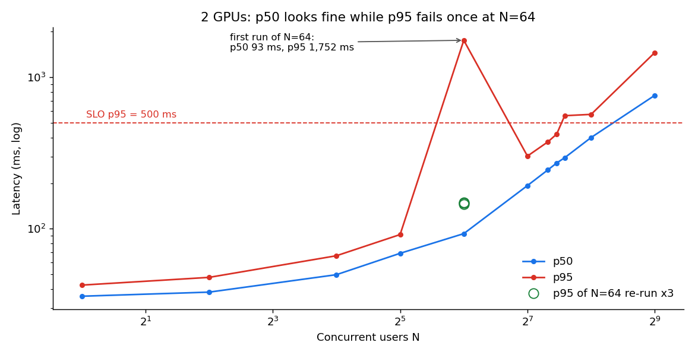
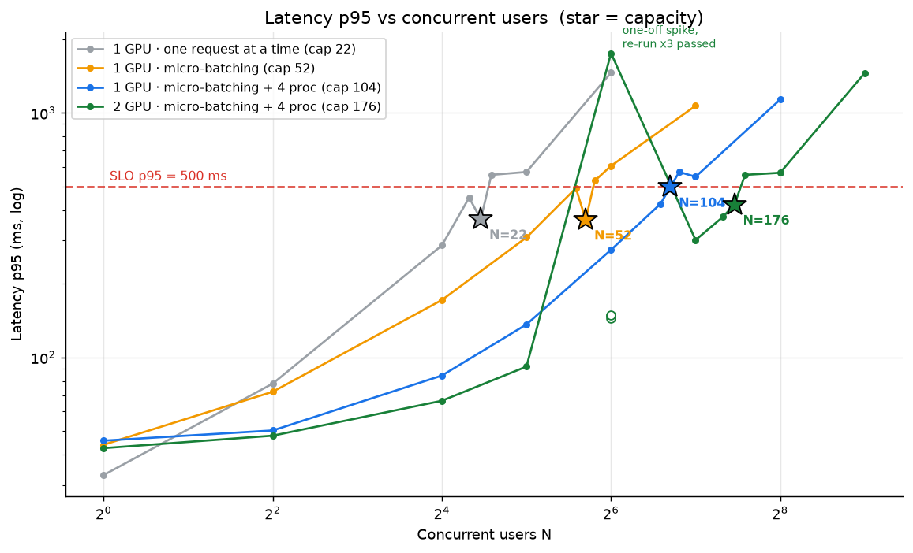
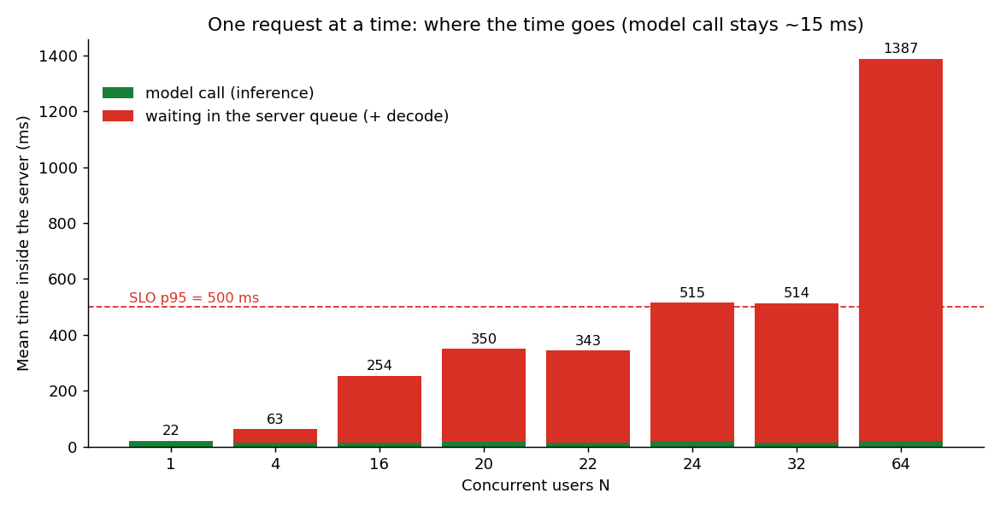
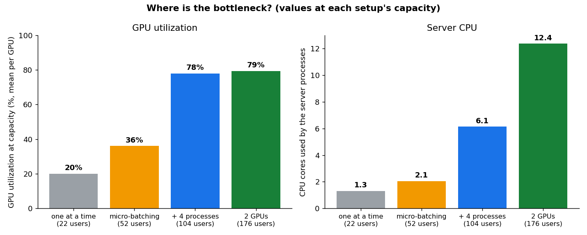
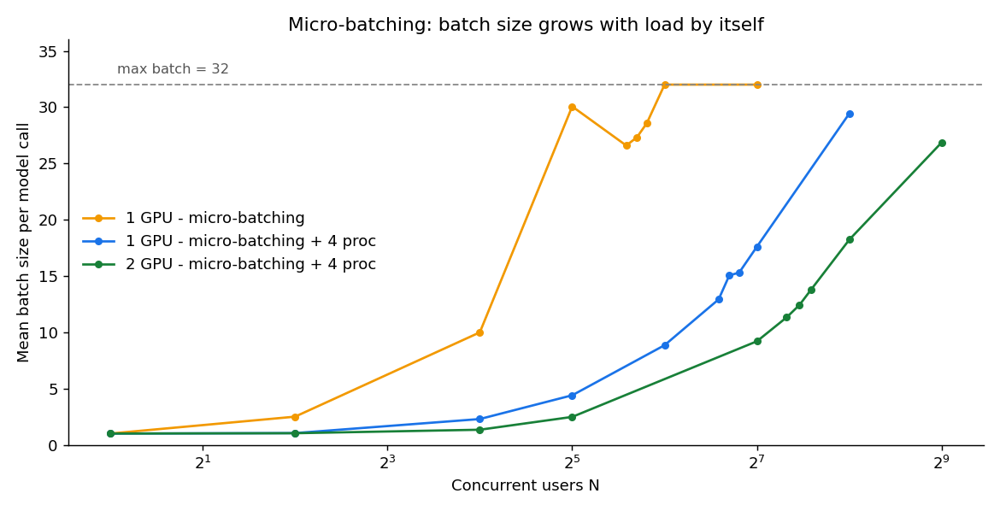
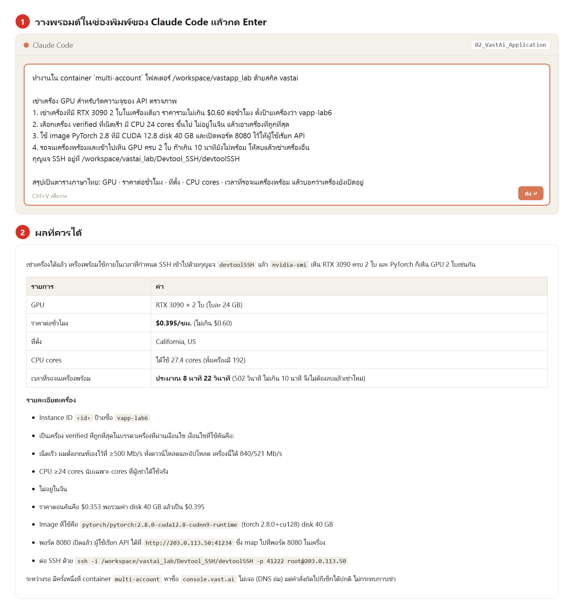

# LAB 6 · API ตรวจภาพ YOLO: GPU 1 ใบรับผู้ใช้พร้อมกันได้กี่คน แล้วเพิ่มด้วย Micro-batching, หลาย process และ Load Balancer เป็น 2 ใบ

[← กลับหน้ารวมของบท](../README.md) · เปิด Claude Code ที่โฟลเดอร์ของบท `02_VastAi_Application` ("โฟลเดอร์ปัจจุบัน" ในพรอมต์หมายถึงโฟลเดอร์นั้น) · ทำ [LAB 0](../README.md#lab-0--เตรียม-key-3-ตัว) ก่อน

## ทำไปเพื่ออะไร


LAB 1 ได้โมเดลตรวจอุปกรณ์ความปลอดภัยมาแล้ว ตอนนี้จะเปิดเป็น API ให้คนหลายคนส่งรูปเข้ามาพร้อมกัน · คำถามของเจ้าของระบบคือ

> **GPU 1 ใบ รองรับผู้ใช้พร้อมกันได้กี่คน แล้วออกแบบระบบอย่างไรให้รับได้มากขึ้น**

เราไม่เดา แต่ **วัดจริง** 4 แบบบนเครื่องเดียวกัน ด้วยเกณฑ์เดียวกัน

1. **Baseline**: GPU 1 ใบ ประมวลผลทีละคำขอ
2. **Micro-batching**: GPU ใบเดิม แต่รวมคำขอที่มาใกล้กันเข้าโมเดลพร้อมกัน
3. **Micro-batching + หลาย process**: GPU ใบเดิม เปิด server 4 process
4. **Load Balancer**: GPU 2 ใบ อยู่หลัง NGINX ที่คอยแจกงาน

LAB นี้มี **11 ขั้น** · ทุกขั้นคือ 1 พรอมต์ · โค้ดทุกไฟล์ AI เขียนให้จากพรอมต์ เริ่มจากโฟลเดอร์ว่าง · ขั้นที่ 1–9 คืองานหลัก ขั้นที่ 10–11 เก็บงานทั้งหมดเป็น **สกิลเวอร์ชัน 0**


## รู้จักข้อมูลที่ใช้ทดสอบ

LAB นี้ไม่ได้เทรนโมเดล จึงไม่มี Dataset สำหรับเทรน · "ข้อมูล" คือ **ชุดคำขอ (workload)** ที่ใช้ยิงใส่ API เพื่อวัดความจุ

| หัวข้อ | รายละเอียด |
|---|---|
| เกี่ยวกับอะไร | รูปหน้างานก่อสร้าง 6 รูป อยู่ในโฟลเดอร์ [samples/](samples/) (`sample-1.jpg` ถึง `sample-6.jpg`) |
| มาจากไหน | Test Set ของ Dataset [Construction Site Safety](https://universe.roboflow.com/roboflow-universe-projects/construction-site-safety) รุ่น 28 ชุดเดียวกับที่ LAB 1 ใช้เทรน |
| ใครทำ | Roboflow Universe Projects บน Roboflow Universe |
| สัญญาอนุญาต | CC BY 4.0 (ใช้และดัดแปลงได้ ต้องให้เครดิต) |
| Dataset ต้นทาง | Training Set 2,605 ภาพ · Validation Set 114 ภาพ · Test Set 82 ภาพ · 10 คลาส (Hardhat, Mask, NO-Hardhat, NO-Mask, NO-Safety Vest, Person, Safety Cone, Safety Vest, machinery, vehicle) |
| ขนาดต่อ 1 คำขอ | รูป JPEG 640 × 640 px ขนาดไฟล์ 40.7–78.1 KB |
| วิธีใช้ | ผู้ใช้จำลองทุกคนส่ง 6 รูปนี้วนไปเรื่อย ๆ |

ภาพจริงที่ AI ทำให้ในขั้นที่ 2 · รูปทั้ง 6 รูป พร้อมกรอบและชื่อคลาสที่ **โมเดลตรวจได้** (ไม่ใช่ label เฉลย)


| รูป | ขนาดไฟล์ | วัตถุที่โมเดลตรวจได้ |
|---|---|---|
| sample-1 | 47.6 KB | 18: Person 6 · NO-Safety Vest 5 · Hardhat 5 · Safety Vest 1 · NO-Hardhat 1 |
| sample-2 | 49.9 KB | 9: Person 3 · NO-Safety Vest 2 · Hardhat 2 · NO-Hardhat 1 · Mask 1 |
| sample-3 | 53.1 KB | 7: Person 2 · NO-Safety Vest 2 · Hardhat 1 · NO-Hardhat 1 · NO-Mask 1 |
| sample-4 | 78.1 KB | 79: Hardhat 21 · Safety Vest 20 · Person 19 · NO-Mask 19 |
| sample-5 | 60.4 KB | 8: vehicle 2 · Safety Vest 2 · Person 2 · Hardhat 2 |
| sample-6 | 40.7 KB | 9: Person 3 · Hardhat 2 · Safety Vest 2 · NO-Mask 2 |

**คำขอ 1 รายการหน้าตาเป็นอย่างไร** · ผู้ใช้ส่ง `POST /v1/detect` ไปที่ NGINX พอร์ต 8080

| ส่งไป | ค่า | หมายถึง |
|---|---|---|
| header `Authorization` | `Bearer <API key>` | API key ที่สุ่มไว้บนเครื่องเช่า · ไม่มีหรือผิดถูกปฏิเสธ (401) |
| ช่อง `file` (multipart) | รูป JPEG 1 รูป | รูปที่ต้องการตรวจ |

คำตอบเป็น JSON (ตัวอย่างจริงของ `sample-3.jpg` ตัดรายการวัตถุให้สั้น)

```json
{"detections": [
   {"class": "Person", "confidence": 0.8999, "box": [311.5, 2.2, 581.0, 315.2]},
   {"class": "NO-Hardhat", "confidence": 0.8208, "box": [351.0, 30.0, 411.0, 57.1]}, ...],
 "count": 7, "replica": "gpu0-single",
 "timing_ms": {"decode": 6.72, "queue": 0.07, "inference": 23.35},
 "batch_size": 1, "image": {"width": 640, "height": 640}}
```

| ได้กลับ | หมายถึง |
|---|---|
| `detections` | วัตถุที่เจอ: `class` ชื่อคลาส · `confidence` ความมั่นใจ (ขั้นต่ำ 0.35) · `box` กรอบ [x1, y1, x2, y2] เป็นพิกเซล |
| `replica` | ชื่อ server ที่ตอบคำขอนี้ ใช้ตรวจการแจกงานของ Load Balancer |
| `timing_ms` | เวลาภายใน server: `decode` แปลงรูป · `queue` รอคิว · `inference` เรียกโมเดล |
| `batch_size` | จำนวนรูปที่เข้าโมเดลพร้อมกันในรอบนั้น |

**ข้อสังเกต**

- รูปมีแค่ 6 รูปและขนาดเท่ากันหมด งานจริงที่รูปใหญ่กว่าหรือหลากหลายกว่าจะได้ความจุต่างจากนี้
- `sample-4` มีวัตถุ 79 ชิ้น หนักกว่ารูปอื่นมาก (รูปอื่น 7–18 ชิ้น) เวลาต่อคำขอจึงไม่เท่ากันทุกรูป
- ช่อง `timing_ms` และ `batch_size` ไม่จำเป็นต่อผู้ใช้ แต่จำเป็นต่อการหาคอขวด เราสั่งให้ AI ใส่ไว้ตั้งแต่ขั้นที่ 2

## รู้จักโมเดลที่ใช้


| หัวข้อ | YOLO11s (ไฟล์ `best.pt`) |
|---|---|
| ประเภท | Object Detection |
| Input | ภาพ 1 รูป (ย่อเป็น 640 × 640) |
| Output | รายการกรอบ แต่ละกรอบมีพิกัด คลาส และ Confidence |
| ขนาด | 9.4 ล้าน parameter · ไฟล์ประมาณ 19 MB |
| ที่มา | [Ultralytics YOLO11](https://docs.ultralytics.com/models/yolo11/) รุ่น small · Fine-tune 50 Epoch ใน [LAB 1](../lab1_yolo/README.md) ให้รู้จัก 10 คลาสของงานก่อสร้าง |
| LAB นี้ใช้ทำอะไร | เป็นโมเดลของ API ตรวจภาพ · ไม่เทรนเพิ่ม ใช้ตอบอย่างเดียว (Inference) · ไฟล์ `best.pt` ถือเป็นข้อมูล ไม่ใช่โค้ด |

โมเดลเล็กแบบนี้ใช้ GPU เพียงราว 15 ms ต่อรูป · งานส่วนใหญ่ของ 1 คำขอจึงอยู่ที่ CPU (อ่านรูป ถอด JPEG เตรียมรูป แปลงผล) ซึ่งเป็นกุญแจของทั้ง LAB

## ทฤษฎีที่ต้องรู้

### 1 · Concurrent Users, Throughput และ Latency

- **คืออะไร**: **Concurrent Users (N)** = จำนวนผู้ใช้ที่กำลังส่งหรือรอคำตอบพร้อมกัน · **Throughput** = คำขอที่ระบบตอบสำเร็จต่อวินาที (req/s) · **Latency** = เวลาที่ผู้ใช้ 1 คนรอ 1 คำขอ
- **ทำไมต้องใช้**: เจ้าของระบบถามว่า "รับได้กี่คน" (N) แต่เครื่องมีขีดจำกัดเป็น "กี่คำขอต่อวินาที" ต้องแปลงระหว่างสองค่านี้ให้ได้
- **ทำงานอย่างไร**: ช่วงแรก N เพิ่ม Throughput เพิ่มตาม · เมื่อถึงขีดของระบบ Throughput จะแบน คนที่เพิ่มเข้ามาไปต่อคิว Latency จึงโตแทน · ความสัมพันธ์คือ `Latency เฉลี่ย ≈ N ÷ Throughput` (กฎของ Little)
- **ตัวเลขจาก LAB นี้**: แบบทีละคำขอ N = 1 → 4 → 16 → 32 ได้ 38 → 58 → 61.5 → 61.5 req/s (แบนตั้งแต่ N ราว 4) · ที่ N=32 คำนวณได้ 32 ÷ 61.5 ≈ 520 ms วัดจริง p50 = 515 ms · Throughput สูงสุดของ 4 แบบคือ 63 → 157 → 325 → 651 req/s


### 2 · Latency Percentile: p50 / p95 / p99

- **คืออะไร**: เรียงเวลาของทุกคำขอจากเร็วไปช้า · **p50** = ค่าที่ครึ่งหนึ่งของคำขอเร็วกว่า · **p95** = ค่าที่ 95% ของคำขอเร็วกว่า · **p99** = หางของคำขอที่ช้าที่สุด
- **ทำไมต้องใช้**: ค่าเฉลี่ยซ่อนคนที่โชคร้าย · ระบบที่ p50 ดีแต่ p95 แย่ คือระบบที่ "บางครั้งค้าง" ผู้ใช้ 1 ใน 20 เจอ · เกณฑ์คุณภาพจึงตั้งที่ p95 หรือ p99
- **ทำงานอย่างไร**: ตัวยิงโหลดเก็บเวลาของทุกคำขอในช่วงวัด แล้วอ่านตำแหน่งที่ 50%, 95% และ 99%
- **ตัวเลขจาก LAB นี้**: ระบบ 2 GPU ที่ N=64 รอบแรก p50 = 93 ms (ปกติ) แต่ p95 = 1,752 ms และ p99 = 3,491 ms จึงไม่ผ่านเกณฑ์ ทั้งที่คนส่วนใหญ่ได้คำตอบเร็ว · วัดระดับเดียวกันซ้ำ 3 ครั้ง p95 ได้ 147 / 145 / 149 ms




### 3 · SLO และจุดอิ่มตัว (Saturation Knee)

- **คืออะไร**: **SLO (Service Level Objective)** = เกณฑ์คุณภาพที่ตกลงไว้ล่วงหน้า LAB นี้ใช้ **p95 ≤ 500 ms และ error < 1%** · **Knee** = จุดที่เส้น Latency หักศอกจากเกือบแบนเป็นพุ่งขึ้นตาม N
- **ทำไมต้องใช้**: ไม่มี SLO คำว่า "รับได้" ไม่มีความหมาย ระบบที่รับ 1,000 คนแต่รอคนละ 10 วินาทีไม่นับว่ารับได้ · ระบบที่ทำงานใกล้ knee ดูปกติดี แต่เพิ่มผู้ใช้อีกนิดก็เกินเกณฑ์
- **ทำงานอย่างไร**: ก่อนอิ่มตัว Latency เท่ากับเวลาทำงานจริง · หลังอิ่มตัว คำขอใช้เวลาเกือบทั้งหมดไปกับการรอคิว · **"รองรับได้ N คน" = N สูงสุดที่ผ่าน SLO และทุกระดับที่ต่ำกว่าก็ผ่านด้วย**
- **ตัวเลขจาก LAB นี้**: แบบทีละคำขอ p95 = 287 ms (N=16) → 368 ms (N=22 ผ่าน) → 557 ms (N=24 ไม่ผ่าน) ความจุจึงเป็น **22 คน** · เวลารอใน server โตจาก 254 ms (N=16) เป็น 514 ms (N=32) และ 1,387 ms (N=64) ขณะที่เวลาเรียกโมเดลคงที่ราว 15 ms






> เกณฑ์ SLO เป็นการตัดสินใจทางธุรกิจ · ถ้าผ่อนเกณฑ์เป็น p95 ≤ 1 วินาที ทุกแบบจะ "รับได้" มากขึ้นทันทีโดยระบบไม่ได้เร็วขึ้นเลย

### 4 · Closed-loop Load Test และการวัดให้เชื่อได้

- **คืออะไร**: **Closed-loop** = ผู้ใช้จำลองจำนวนคงที่ N คน แต่ละคนส่งรูป รอคำตอบ แล้วส่งรูปถัดไปทันที (ไม่มี think time) · ตรงข้ามกับ Open-loop ที่คำขอเข้ามาตามอัตราคงที่โดยไม่สนว่าระบบตอบทันไหม
- **ทำไมต้องใช้**: ต้องบอกให้ชัดว่า "กี่คน" วัดแบบไหน ไม่งั้นตัวเลขเทียบกันไม่ได้ · ไม่มี think time คือภาระหนักสุดต่อคน ผู้ใช้จริงที่หยุดคิดระหว่างรูปจะรับได้มากกว่านี้
- **ทำงานอย่างไร**: ไล่ N = 1, 4, 16, 32, 64, 128, 256, 512, 1024 ระดับละ 20 วินาที (5 วินาทีแรกเป็น warm-up ไม่นับ) · หยุดเมื่อไม่ผ่าน 2 ระดับติดกัน แล้วซอยครึ่งหา N ที่พอดีเกณฑ์อีก 3 รอบ · รอเกิน 10 วินาทีนับเป็น error · ตัวยิงโหลดรันบนเครื่องเดียวกับ server และเก็บ GPU utilization กับ CPU ของทุกส่วนคู่กับ Latency ทุกระดับ
- **ตัวเลขจาก LAB นี้**: เรียก API จากนอกเครื่องใช้ราว 1.1 วินาทีต่อคำขอ (เกือบทั้งหมดคือเครือข่าย) แต่ยิงในเครื่องใช้ 26–38 ms ถ้ายิงจากไกลจะวัดเน็ต ไม่ใช่ GPU · ตัวยิงโหลดใช้ CPU ไม่เกิน 0.5 core · ความละเอียดของคำตอบเท่ากับช่วงซอยครึ่ง เช่น ความจุ 2 GPU อยู่ระหว่าง 176 กับ 192 คน


**บทเรียนจากรอบนี้: วัดครั้งเดียวเชื่อไม่ได้**

| เหตุการณ์ | ผลครั้งแรก | ผลหลังวัดซ้ำ | บทเรียน |
|---|---|---|---|
| ระบบ 2 GPU สะดุดครั้งเดียวที่ N=64 | ความจุตามกติกาเข้ม **32 คน** | N=64 วัดซ้ำ 3 ครั้งผ่านหมด และ N=128, 160, 176 ผ่าน จึงได้ **176 คน** | ระดับที่ไม่ผ่านเพียงครั้งเดียวขณะที่ระดับสูงกว่าผ่าน ให้วัดซ้ำก่อนสรุป และรายงานทั้งสองค่า |
| Baseline วัดก่อน AI แก้บั๊กของ server (ขั้นที่ 5) | 18 คน · 39.5 req/s | วัดซ้ำด้วยพรอมต์เดิมบน server ฉบับแก้แล้ว ได้ **22 คน · 63 req/s** | ทุกแบบที่นำมาเทียบกันต้องวัดบนโค้ดฉบับเดียวกัน |

### 5 · หาคอขวด (Bottleneck) ก่อนเพิ่ม GPU

- **คืออะไร**: คอขวด = ส่วนที่ทำงานเต็มก่อนส่วนอื่น และเป็นตัวกำหนด Throughput ของทั้งระบบ
- **ทำไมต้องใช้**: ถ้าคอขวดไม่ใช่ GPU การเช่า GPU เพิ่มคือจ่ายเงินโดยไม่ได้อะไร · ต้องรู้ก่อนว่าอะไรตัน แล้วแก้ที่จุดนั้น
- **ทำงานอย่างไร**: ที่ระดับ N ที่ Throughput แบนแล้ว ให้ดู 4 จุดพร้อมกัน: **GPU utilization** (ต่ำ = GPU ยังว่าง) · **CPU ของ server ต่อ process** (ราว 1 core ต่อ process = Python ตัน) · **CPU ของ NGINX** · **CPU ของตัวยิงโหลด** (ถ้าตัวยิงตัน ตัวเลขที่วัดคือความจุของตัวยิง ไม่ใช่ของระบบ)
- **ตัวเลขจาก LAB นี้**: ดูตาราง · ข้อสรุปสำคัญคือ **แบบทีละคำขอ GPU ทำงานแค่ 20% ที่จุดความจุ คอขวดคือ Python process เดียว ไม่ใช่ GPU** ความจุจึงเพิ่มได้ 4.7 เท่าบน GPU ใบเดิมก่อนจะต้องเพิ่มใบ


| แบบ (ที่จุดความจุ) | GPU utilization | CPU ของ server | CPU ของ NGINX | CPU ของตัวยิงโหลด | batch เฉลี่ย | คอขวด |
|---|---|---|---|---|---|---|
| ทีละคำขอ · 1 process | 20% | 1.3 core | 0.05 | 0.05 | 1 | **Python process เดียว** ทำทีละรูป · GPU ว่าง 80% |
| Micro-batching · 1 process | 36% | 2.1 core | 0.10 | 0.11 | 27 | **CPU ของ process เดียว** (อ่านคำขอ ถอด JPEG เตรียมรูป แปลงผล) · GPU ว่างกว่า 60% |
| Micro-batching · 4 process | 78% | 6.1 core | 0.22 | 0.21 | 15 | **GPU** เริ่มเต็ม · Throughput แบนที่ 310–325 req/s |
| 2 GPU · ใบละ 4 process | 81% / 78% | 12.4 core | 0.48 | 0.46 | 12 | **GPU ทั้ง 2 ใบ** |



> เครื่องที่เช่าแสดง CPU 192 core แต่เครื่องเช่าของเราได้ใช้จริงราว 27 core · 2 GPU ใช้ไป 12.4 core · เครื่องที่ได้ CPU น้อยกว่านี้มากจะตันที่ CPU ก่อน GPU จึงควรดูจำนวน core ที่ได้ใช้จริงตอนเลือกเครื่อง

### 6 · Micro-batching

**ปัญหาที่มันแก้** · server ที่เรียกโมเดลทีละรูป ทำให้ทุกคำขอต้องต่อคิวหลังคำขอก่อนหน้า ทั้งที่ GPU ยังว่าง


- **คืออะไร**: server รวมคำขอที่เข้ามาใกล้กันเป็นชุดเดียว (batch) แล้วเรียกโมเดลครั้งเดียวทั้งชุด
- **ทำไมต้องใช้**: GPU คำนวณหลายรูปพร้อมกันได้ในเวลาใกล้เคียงกับรูปเดียว · งานคงที่ต่อการเรียกโมเดล 1 ครั้ง (งานฝั่ง Python และการสั่งงาน GPU) ถูกหารด้วยขนาด batch
- **ทำงานอย่างไร**: คำขอเข้าคิว → เมื่อโมเดลว่าง server หยิบทุกคำขอที่รออยู่ (สูงสุด 32 รูป) ถ้ายังไม่เต็มรอเพิ่มได้ไม่เกิน 5 ms → เรียกโมเดล 1 ครั้ง → แจกผลกลับแต่ละคำขอ · ขนาด batch ปรับตามโหลดเอง


- **ตัวเลขจาก LAB นี้**: GPU ใบเดิม รองรับ 22 → **52 คน (2.4 เท่า)** · Throughput สูงสุด 63 → **157 req/s (2.5 เท่า)** · GPU utilization 20% → 36% · batch เฉลี่ยโตตามโหลด: 1 (N=1) → 2.5 (N=4) → 10 (N=16) → 27–32 (N ตั้งแต่ 32) · **ราคาที่จ่าย**: ตอนมีผู้ใช้คนเดียว p50 ช้าลงจาก 26 เป็น 37 ms




> batch สูงสุดใหญ่ขึ้นไม่ได้ดีขึ้นเสมอ: batch ใหญ่ใช้เวลาเรียกโมเดลนานขึ้น (ที่ N=32 แบบ 1 process เรียกโมเดลครั้งละราว 148 ms) และใช้ VRAM เพิ่ม (0.9 GB → 5.9 GB ต่อ process)

### 7 · หลาย process ต่อ GPU 1 ใบ

- **คืออะไร**: เปิด server หลาย process ที่ใช้ GPU ใบเดียวกัน แต่ละ process มีคิวและ batch ของตัวเอง NGINX แจกคำขอให้ทุก process
- **ทำไมต้องใช้**: โค้ด Python ใน 1 process รันได้ทีละ 1 core ในเวลาเดียวกัน (Global Interpreter Lock: GIL) งานอ่านคำขอ ถอด JPEG เตรียมรูป และแปลงผลจึงตันก่อน GPU
- **ทำงานอย่างไร**: แต่ละ process โหลดโมเดลของตัวเองลง GPU ใบเดียวกัน (ใช้ VRAM เพิ่มต่อ process) · GPU สลับทำงานให้ทีละ process · งาน CPU ถูกแบ่งไป 4 core พร้อมกัน
- **ตัวเลขจาก LAB นี้**: 1 → 4 process: Throughput 157 → **325 req/s** · ความจุ 52 → **104 คน** · GPU utilization 36% → 78% · CPU ของ server 2.1 → 6.1 core · VRAM ที่ใช้ 5.9 → 22.4 GB จาก 24 GB ของ RTX 3090 (4 process คือเกือบเต็มใบสำหรับ server ฉบับนี้)


> ข้อ 6 และ 7 คือการ **ใช้ GPU ใบเดิมให้เต็ม** ก่อนเพิ่มใบ: 22 → 104 คน (4.7 เท่า) โดยค่าเช่าเท่าเดิม

### 8 · Load Balancer

- **คืออะไร**: ตัวรับคำขอของผู้ใช้ทุกคนที่ที่อยู่เดียว แล้วส่งต่อไปยัง server หลายตัวด้านหลังที่ทำงานเหมือนกัน (เรียกแต่ละตัวว่า **replica**) · LAB นี้ใช้ NGINX ที่พอร์ต 8080 · replica 1 ตัว = GPU 1 ใบ
- **ทำไมต้องใช้**: GPU 1 ใบมีเพดาน จะรับเพิ่มต้องเพิ่ม GPU และต้องมีตัวแจกงาน (Horizontal Scaling) · ผู้ใช้ไม่ต้องเปลี่ยนที่อยู่ · ซ่อน replica ที่ล่มได้
- **ทำงานอย่างไร**: NGINX รับคำขอ → เลือก server ปลายทางตามวิธีแจกงาน → ส่งต่อ → ส่งคำตอบกลับ · ทำได้เพราะ server เป็น stateless (ไม่มีข้อมูลของผู้ใช้ค้างใน process) ส่งให้ตัวไหนก็ได้ผลเหมือนกัน
- **ตัวเลขจาก LAB นี้**: คำขอกระจายไป 2 replica 49.6% / 50.4% · NGINX ใช้ CPU 0.05 core ที่ 63 req/s และ 0.48 core ที่ 650 req/s จึงไม่ใช่คอขวด · เพิ่มใบที่ 2 แล้ว Throughput สูงสุด 325 → 651 req/s


**วิธีแจกงาน: round-robin กับ least connections**

- **round-robin** แจกวนทีละตัวเท่า ๆ กัน ไม่ดูว่าใครยังมีงานค้าง · **least_conn** ส่งให้ตัวที่มีคำขอค้างน้อยที่สุดในขณะนั้น ตัวที่ช้าจะมีงานค้างมาก จึงได้งานใหม่น้อยลงเอง
- **ใช้เมื่อไร**: เมื่อ replica เร็วไม่เท่ากัน (GPU คนละรุ่น มีงานอื่นแย่ง หรือกำลังติด batch ใหญ่) การแจกเท่ากันทำให้ตัวช้าลากทั้งระบบ
- **ตัวเลขจาก LAB นี้** (ให้ replica ตัวที่ 2 ช้าลงรูปละ 40 ms): round-robin แบ่งงาน 50% / 50% รองรับ **32 คน** 169 req/s · least_conn แบ่งงาน 79% / 21% รองรับ **72 คน** 403 req/s (2.25 เท่า)


> เมื่อ replica เร็วเท่ากัน LAB นี้ **ยังสรุปไม่ได้** ว่า least_conn ดีกว่า ดูเหตุผลในขั้นที่ 7

**Health check, Retry และ Failover**

- **คืออะไร**: เมื่อ replica ล่ม Load Balancer ควร (ก) เลิกส่งงานให้ตัวนั้น (**health check**) และ (ข) ส่งคำขอที่ล้มต่อให้ตัวอื่น (**retry**) ผู้ใช้จึงไม่เห็น error (**failover**)
- **ทำไมต้องใช้**: เครื่อง GPU ล่มได้เสมอ · ถ้าไม่มี retry ผู้ใช้เห็น error ทุกครั้งที่คำขอถูกแจกไปตัวที่ล่ม
- **ทำงานอย่างไร**: NGINX รุ่น open source ใช้ passive health check คือนับความล้มเหลวจากคำขอจริง · คำสั่ง `proxy_next_upstream` กำหนดว่า error แบบไหนให้ลองตัวถัดไป · คำขอแบบ POST ต้องอนุญาตให้ส่งซ้ำอย่างชัดเจน ซึ่งทำได้เพราะการตรวจภาพเดิมซ้ำได้ผลเหมือนเดิม (idempotent) · replica ที่เปิดคืนต้องพร้อมจริงก่อนรับงาน
- **ตัวเลขจาก LAB นี้** (ผู้ใช้ 11 คน ปิด replica ตัวที่ 2 กลางทาง): ไม่ส่งซ้ำ error **5,474 จาก 14,822 คำขอ (36.9%)** · ส่งซ้ำ error **0 จาก 9,601 คำขอ** · Throughput ที่สำเร็จลดจากราว 260 เหลือ 190 req/s เมื่อเหลือ 1 replica


> ใน LAB ทุกส่วน (NGINX, server ทุก process, ตัวยิงโหลด) อยู่บนเครื่องเช่าเครื่องเดียว เพื่อให้ตัวแปรเดียวที่ต่างคือจำนวน GPU · ระบบจริงแยก Load Balancer กับ replica ไว้คนละเครื่อง ต้องบวกเวลาเครือข่ายระหว่างเครื่อง และ Load Balancer เองต้องมีตัวสำรอง

### 9 · Scaling Efficiency

- **คืออะไร**: `Speedup = ความจุ k ใบ ÷ ความจุ 1 ใบ` · `Efficiency = Speedup ÷ k` · 100% คือเพิ่ม GPU 2 เท่าแล้วรับได้ 2 เท่าพอดี (เส้น Ideal)
- **ทำไมต้องใช้**: GPU ใบที่ 2 ต้องจ่ายเงินเต็ม แต่อาจไม่ได้ความจุเต็ม · ค่านี้ยังชี้ว่ามีคอขวดร่วมหรือไม่ (CPU, Load Balancer, หางของ Latency)
- **ทำงานอย่างไร**: วัดด้วยวิธีและ SLO เดิม เปลี่ยนแค่จำนวน GPU · ต้องเทียบกับ 1 ใบที่ใช้สถาปัตยกรรมเดียวกัน (Micro-batching + 4 process) ไม่ใช่ Baseline ที่ยังไม่ปรับ
- **ตัวเลขจาก LAB นี้**: **Throughput 325 → 651 req/s (2.00 เท่า, Efficiency 100%)** · **ความจุ 104 → 176 คน (1.69 เท่า, Efficiency 85%)** · สองค่านี้ไม่เท่ากันเพราะความจุตัดสินด้วย p95 ซึ่งไวต่อหางของ Latency: ที่โหลด 96 คนต่อ GPU ระบบ 2 ใบได้ p95 557 ms เทียบกับ 424 ms ของ 1 ใบ ทั้งที่ Throughput ต่อใบเท่ากัน


> **ความเชื่อมั่นของสองตัวเลขไม่เท่ากัน**: Throughput 2.00 เท่าเป็นค่าที่นิ่ง · ความจุ 176 คนมาจากการวัดระดับที่สะดุดซ้ำ (ตามกติกาเข้มคือ 32 คน) และมีความละเอียดเพียงช่วงซอยครึ่ง 16 คน · **3 ใบเป็นค่าคำนวณ ไม่ใช่ผลวัด** (LAB นี้เช่าแค่ 2 ใบ): 104 × 3 × 0.85 ≈ 264 คน ราว 976 req/s และ server จะใช้ CPU ราว 18.5 core

## การทดลอง


| หัวข้อ | รายละเอียด |
|---|---|
| โหลด | ผู้ใช้จำลอง N คนแบบ closed-loop (ส่งรูป → รอคำตอบ → ส่งรูปถัดไปทันที ไม่มี think time) · รูปหน้างาน 6 รูป 640 × 640 px ส่งวนไป |
| โมเดล | YOLO11s ที่ Fine-tune ใน LAB 1 (`best.pt`) เสิร์ฟด้วย FastAPI หลัง NGINX · ตรวจที่ขนาด 640 ความมั่นใจขั้นต่ำ 0.35 |
| เทียบ A → B → C → D | **A** GPU 1 ใบ ทีละคำขอ 1 process · **B** GPU 1 ใบ Micro-batching (สูงสุด 32 รูป รอไม่เกิน 5 ms) · **C** GPU 1 ใบ Micro-batching + 4 process · **D** GPU 2 ใบ แบบ C ใบละชุด หลัง NGINX round-robin · เสริม: round-robin เทียบ least_conn และ replica ล่มกลางทาง |
| วิธีวัด / SLO | ไล่ N = 1, 4, 16, 32, 64, 128, 256, 512, 1024 ระดับละ 20 วินาที ไม่นับ 5 วินาทีแรก · หยุดเมื่อไม่ผ่าน 2 ระดับติดกัน แล้วซอยครึ่ง 3 รอบ · ผ่านเมื่อ **p95 ≤ 500 ms และ error < 1%** · ตัวยิงโหลดรันบนเครื่องเดียวกับ server |
| เครื่อง | RTX 3090 2 ใบในเครื่องเดียว · เพดาน $0.60 ต่อชั่วโมง (ได้จริง $0.395) · California · ได้ใช้ CPU ราว 27 core |
| เวลาและค่าเช่าจริง | ขั้นที่ 1–9 เครื่องเปิด 2 ชั่วโมง 40 นาที · ค่าเช่าตามบิล **$1.02** · ขั้นที่ 11 (ลองสกิล) อีก 17 นาที **$0.10** |

**ผลสรุปของทั้ง LAB** (รายละเอียดอยู่ในแต่ละขั้น)

| จำนวน GPU | สถาปัตยกรรม | รองรับผู้ใช้พร้อมกัน (N) | Throughput สูงสุด | p95 ที่ N นั้น | เท่าของ 1 ใบ | Efficiency |
|---|---|---|---|---|---|---|
| 1 | Baseline: ทีละคำขอ · 1 process | **22** | 63 req/s | 368 ms | 0.21× | – |
| 1 | Micro-batching · 1 process | **52** | 157 req/s | 365 ms | 0.50× | – |
| 1 | Micro-batching + 4 process | **104** | 325 req/s | 497 ms | 1.00× | 100% |
| 2 | Micro-batching + 4 process ใบละชุด หลัง NGINX round-robin | **176** ¹ | 651 req/s | 421 ms | **1.69×** (Throughput 2.00×) | **85%** (Throughput 100%) |
| 3 | *คำนวณ ไม่ใช่ผลวัด* | *≈ 264* | *≈ 976 req/s* | – | – | – |

**1 ใบ 104 คน → 2 ใบ 176 คน** (1.69 เท่า, Efficiency 85%) · ถ้าเพิ่มเป็น 3 ใบ คำนวณได้ราว 264 คน (เป็นการคำนวณ ไม่ใช่ผลวัด)

"เท่าของ 1 ใบ" และ Efficiency เทียบกับแถวที่ 3 ซึ่งใช้สถาปัตยกรรมเดียวกับระบบ 2 ใบ · เทียบกับ Baseline ระบบ 2 ใบรับได้ 8 เท่า (176 ÷ 22) ด้วย GPU เพียง 2 เท่า ส่วนใหญ่ของกำไรมาจากการใช้ GPU ใบเดิมให้เต็ม

**ข้อที่ต้องอ่านคู่กับตัวเลข**

1. ¹ **ความจุ 2 ใบมี 2 ค่า**: ตามกติกาเข้ม ("ทุกระดับที่ต่ำกว่าต้องผ่าน") ได้ **32 คน** เพราะระดับ N=64 ไม่ผ่านในรอบแรก (p95 1,752 ms ขณะที่ p50 93 ms) · AI วัด N=64 ซ้ำ 3 ครั้ง ผ่านทั้งหมด (p95 147 / 145 / 149 ms) และระดับ 128, 160, 176 ผ่าน จึงรายงาน **176 คน** · ตารางนี้ใช้ 176 เพราะหลักฐานชี้ว่าเป็นการสะดุดครั้งเดียว ไม่ใช่ระบบเต็ม · `results/metrics.json` เก็บทั้งสองค่า (`capacity_users` = 176, `capacity_users_strict` = 32)
2. **Throughput 2.00 เท่าเป็นค่าที่นิ่งกว่าความจุ 1.69 เท่า**: ความจุขึ้นกับ p95 ที่ระดับใกล้เส้นเกณฑ์ และมีความละเอียดเท่าช่วงซอยครึ่ง (ความจุจริงของ 2 ใบอยู่ระหว่าง 176 กับ 192 คน)
3. **Baseline 22 คนเป็นค่าที่วัดซ้ำ**: การวัดครั้งแรกในขั้นที่ 4 ได้ 18 คน บน server ที่ยังมีบั๊กซึ่ง AI มาเจอและแก้ในขั้นที่ 5 จึงวัด Baseline ซ้ำด้วยพรอมต์เดิมบน server ฉบับแก้แล้ว ให้ทุกแถวมาจาก server ฉบับเดียวกัน
4. **ตัวเลขเป็นของโค้ดที่ AI เขียนในรอบนี้**: ของคุณจะได้ตัวเลขไม่เท่านี้ แต่ลำดับ (Baseline < Micro-batching < + หลาย process < 2 ใบ) ควรเหมือนกัน

ทำตามลำดับขั้นที่ 1 → 11 ให้ครบในรอบเดียว · คัดลอกพรอมต์ไปวางในช่องพิมพ์ของ Claude Code ทีละขั้น · โค้ดที่ AI เขียนจะอยู่ในโฟลเดอร์ `lab6_image_api/code/` ซึ่งตอนเริ่มยังไม่มี · เครื่องเปิดค้างและคิดเงินตั้งแต่ขั้นที่ 1 ถึงขั้นที่ 9 · **เผื่อเวลาราว 2.5 ชั่วโมง (ราว $1)** เพราะบางขั้น AI ต้องหาและแก้บั๊กในโค้ดที่ตัวเองเขียน

> คำตอบของ AI บางขั้น (ขั้นที่ 6, 9, 11 และบางส่วนของขั้นที่ 5) ออกมาเป็นภาษาอังกฤษ แม้พรอมต์สั่งให้สรุปเป็นภาษาไทย · ภาพคำตอบในบทเรียนคงไว้ตามจริง ตารางภาษาไทยใต้ภาพคือเนื้อหาเดียวกัน · ถ้าของคุณได้ภาษาอังกฤษ ให้พิมพ์ต่อว่า "ตอบเป็นภาษาไทย"

## ขั้นที่ 1 · เช่าเครื่อง 2 GPU

AI ค้นหาเครื่องตามเกณฑ์ เช่า รอจนพร้อม แล้วเข้าไปตรวจว่าเห็น GPU ครบ 2 ใบ

```text
ทำงานใน container `multi-account` โฟลเดอร์ /workspace/vastapp_lab ด้วยสกิล vastai

เช่าเครื่อง GPU สำหรับวัดความจุของ API ตรวจภาพ
1. เช่าเครื่องที่มี RTX 3090 2 ใบในเครื่องเดียว ราคารวมไม่เกิน $0.60 ต่อชั่วโมง ตั้งป้ายเครื่องว่า vapp-lab6
2. เลือกเครื่อง verified ที่เน็ตเร็ว มี CPU 24 cores ขึ้นไป ไม่อยู่ในจีน แล้วเอาเครื่องที่ถูกที่สุด
3. ใช้ image PyTorch 2.8 ที่มี CUDA 12.8 disk 40 GB และเปิดพอร์ต 8080 ไว้ให้ผู้ใช้เรียก API
4. รอจนเครื่องพร้อมและเข้าไปเห็น GPU ครบ 2 ใบ ถ้าเกิน 10 นาทียังไม่พร้อม ให้ลบแล้วเช่าเครื่องอื่น
กุญแจ SSH อยู่ที่ /workspace/vastai_lab/Devtool_SSH/devtoolSSH

สรุปเป็นตารางภาษาไทย: GPU · ราคาต่อชั่วโมง · ที่ตั้ง · CPU cores · เวลาที่รอจนเครื่องพร้อม แล้วบอกว่าเครื่องยังเปิดอยู่
```


*ใช้เวลา 10 นาที (เครื่องนี้โหลด image นานราว 8 นาที) · ที่อยู่เครื่องในภาพเป็นค่าตัวอย่าง*

**อ่านผลอย่างไร**

- เช่า **2 ใบตั้งแต่แรก** แม้ขั้นที่ 2–5 ใช้ใบเดียว เพื่อให้ทุกแบบวัดบนเครื่องเดียวกัน ต่างกันแค่วิธีประมวลผลและจำนวน GPU
- เครื่องแสดง CPU 192 core แต่เราได้ใช้ **27.4 core** · AI นับเฉพาะ core ที่ได้ใช้จริงตอนคัดเครื่อง ซึ่งตรงกับข้อ "CPU 24 cores ขึ้นไป" และสำคัญมากใน LAB ที่งานส่วนใหญ่อยู่ที่ CPU
- ราคาตอนค้นคือ $0.353 รวมค่า disk 40 GB แล้วเป็น $0.395 ต่อชั่วโมง · **ตั้งแต่ขั้นนี้เงินเริ่มเดิน** จนกว่าจะลบเครื่องในขั้นที่ 9

## ขั้นที่ 2 · เขียน AI server ตรวจภาพ

AI เขียน `server.py` (FastAPI) พร้อมตัวช่วย `run_single.sh` `test_api.py` `make_grid.py` นำขึ้นเครื่อง เปิดบน GPU ใบแรก ทดสอบจากนอกเครื่อง และทำภาพชุดรูปที่จะใช้ยิงโหลด

```text
ทำงานใน container `multi-account` โฟลเดอร์ /workspace/vastapp_lab ด้วยสกิล vastai
เครื่องที่ใช้คือเครื่องป้าย vapp-lab6 · กุญแจ SSH อยู่ที่ /workspace/vastai_lab/Devtool_SSH/devtoolSSH

เขียน AI server ตรวจภาพ แล้วลองเปิดบน GPU 1 ใบของเครื่องที่เช่า
1. เขียน server ด้วย FastAPI ไว้ที่ lab6_image_api/code/server.py ใช้โมเดล lab6_image_api/best.pt (โมเดล YOLO ตรวจอุปกรณ์ความปลอดภัยที่เทรนใน LAB 1) ตรวจภาพที่ขนาด 640 ความมั่นใจขั้นต่ำ 0.35
2. รับรูปที่ POST /v1/detect (ช่องชื่อ file) ต้องมี API key แบบ Bearer ถ้าไม่มีหรือผิดให้ตอบ 401 และมี GET /health ไว้เช็กว่าพร้อม
3. ตอบเป็น JSON: รายการวัตถุที่เจอ (class, confidence, box) · ชื่อ replica ที่ตอบ · เวลาภายในเป็น ms (แปลงรูป, รอคิว, เรียกโมเดล) และขนาด batch ของรอบนั้น
4. server 1 process เรียกโมเดลได้ทีละครั้ง คำขอที่มาระหว่างนั้นเข้าคิวรอ และตั้งค่าได้ 2 โหมด: ทีละคำขอ (batch = 1) กับ Micro-batching ที่รวมคำขอในคิวได้สูงสุด 32 รูปต่อการเรียกโมเดล 1 ครั้ง โดยรอคำขอเพิ่มไม่เกิน 5 ms
5. คำขอจริงต้องไม่สะดุดเพราะโมเดลเจอขนาด batch ที่ยังไม่เคยเจอ: ตอนเปิด server ให้อุ่นโมเดลครบทุกขนาด batch ตั้งแต่ 1 ถึงค่าสูงสุดของโหมดนั้น แล้ว /health จึงตอบว่าพร้อม
6. ติดตั้งสิ่งที่ต้องใช้ นำโค้ด โมเดล และรูปใน lab6_image_api/samples ขึ้นเครื่อง เปิด server 1 process บน GPU ใบแรกที่พอร์ต 8080 โหมดทีละคำขอ
7. ทดสอบจากนอกเครื่อง: เรียก /health · ส่งรูปทั้ง 6 รูปพร้อม key · ส่งแบบไม่มี key ต้องได้ 401
8. โชว์ชุดรูปที่จะใช้ยิงโหลด: ทำภาพตาราง 6 รูป วาดกรอบและชื่อคลาสที่โมเดลตรวจได้ทับ กำกับขนาดไฟล์และขนาดภาพใต้แต่ละรูป เก็บที่ lab6_image_api/results/dataset_samples.jpg

ห้ามแสดงค่า key · ตอบเป็นภาษาไทย: อธิบายโค้ด 3–5 บรรทัด · คำขอ 1 ครั้งส่งอะไรไปและได้อะไรกลับ (ยก JSON จริง 1 ตัวอย่าง อธิบายแต่ละช่อง) · ตารางรูป: ขนาด · จำนวนวัตถุต่อคลาส
สรุปผลทดสอบและเวลาที่โมเดลใช้ต่อรูป แล้วบอกว่าเครื่องยังเปิดอยู่
```


*ใช้เวลา 12 นาที 42 วินาที*

ตัวอย่างโค้ดที่ AI เขียนให้ในรอบจริง (ของคุณอาจต่างกัน): [code_reference/server.py](code_reference/server.py) · [code_reference/run_single.sh](code_reference/run_single.sh) · [code_reference/test_api.py](code_reference/test_api.py) · [code_reference/make_grid.py](code_reference/make_grid.py) · ผลทดสอบ [results/test_single.json](results/test_single.json)

**อ่านผลอย่างไร**

- เวลาภายใน server รวมราว 30 ms แต่วัดจากนอกเครื่องได้ราว **1.1 วินาที** ส่วนต่างคือเครือข่าย · นี่คือเหตุผลที่ขั้นที่ 4 ให้ตัวยิงโหลดรันบนเครื่องเดียวกับ server
- ข้อ 5 (อุ่นโมเดลทุกขนาด batch ก่อนตอบว่าพร้อม) กันคำขอจริงสะดุดเมื่อโมเดลเจอขนาด batch ใหม่ครั้งแรก · แลกกับเวลาเปิด server ที่นานขึ้น ซึ่งจะเห็นผลในขั้นที่ 8
- key ไม่ถูกแสดงในคำตอบ และ server ตอบ 401 ทั้งกรณีไม่มี key และ key ผิด
- โหมด Micro-batching เขียนไว้แล้วตั้งแต่ขั้นนี้ แต่ยังไม่ได้เปิดใช้จนถึงขั้นที่ 5

## ขั้นที่ 3 · เขียนตัวเปิดระบบ: replica + NGINX Load Balancer

AI เขียน `cluster.sh` ที่เปิด/ปิด/ดูสถานะระบบ ติดตั้ง NGINX แล้วเปิดระบบแบบพื้นฐาน (replica 1 ตัว 1 process batch = 1)

```text
ทำงานใน container `multi-account` โฟลเดอร์ /workspace/vastapp_lab ด้วยสกิล vastai
เครื่องที่ใช้คือเครื่องป้าย vapp-lab6 · กุญแจ SSH อยู่ที่ /workspace/vastai_lab/Devtool_SSH/devtoolSSH

เขียนตัวเปิดระบบที่ให้ผู้ใช้เข้าทาง Load Balancer จุดเดียว แล้วเปิดระบบแบบพื้นฐาน
1. เขียนไว้ที่ lab6_image_api/code/cluster.sh ให้สั่งเปิดระบบใหม่ได้ด้วยค่า 3 ตัว: จำนวน replica (1–2 ตัว ตัวละ 1 GPU) · จำนวน process ของ server ต่อ replica · ขนาด batch สูงสุด
2. ตั้ง NGINX เป็น Load Balancer ที่พอร์ต 8080 แจกคำขอให้ server ทุก process แบบ round-robin (แจกวนทีละตัว) ส่วน server ฟังพอร์ตภายในเครื่องเท่านั้น
3. API key สุ่มครั้งแรกแล้วใช้ค่าเดิมทุกครั้งที่เปิดใหม่ · มีคำสั่งดูสถานะ (replica ไหนเปิดอยู่ ตั้งค่าอะไร) และคำสั่งปิดทั้งระบบ
4. ติดตั้ง NGINX บนเครื่อง ปิด server ที่เปิดไว้จากขั้นก่อน แล้วเปิดระบบแบบพื้นฐาน: replica 1 ตัว 1 process batch = 1 (คำสั่งเปิดต้องรอจน server ทุก process ตอบว่าพร้อมก่อนจึงบอกว่าเปิดเสร็จ)
5. ทดสอบจากนอกเครื่องผ่านพอร์ต 8080: /health · ส่งรูป 1 รูปพร้อม key · ส่งแบบไม่มี key ต้องได้ 401

ห้ามแสดงค่า key · ตอบเป็นภาษาไทย: อธิบายโค้ด 3–5 บรรทัด วาดแผนภาพข้อความว่าคำขอเดินทางผ่านอะไรบ้าง สรุปผลทดสอบ แล้วบอกว่าเครื่องยังเปิดอยู่
```


*ใช้เวลา 11 นาที 10 วินาที · ที่อยู่เครื่องในภาพเป็นค่าตัวอย่าง*

ตัวอย่างโค้ดที่ AI เขียนให้ในรอบจริง (ของคุณอาจต่างกัน): [code_reference/cluster.sh](code_reference/cluster.sh) (ฉบับสุดท้าย รวมความสามารถที่เพิ่มในขั้นที่ 7 และ 8 แล้ว)

**อ่านผลอย่างไร**

- ตั้งแต่ขั้นนี้ผู้ใช้เข้าได้ทางเดียวคือ **NGINX พอร์ต 8080** · server ฟังเฉพาะภายในเครื่อง (`127.0.0.1`) ยิงตรงจากนอกเครื่องไม่ได้
- ทุก process ของ server เป็นปลายทาง 1 ตัวของ NGINX · การเพิ่ม process (ขั้นที่ 5) และเพิ่ม replica (ขั้นที่ 6) จึงใช้คำสั่งเปิดระบบตัวเดียวกัน เปลี่ยนแค่ตัวเลข 3 ตัว
- AI ลดจำนวน worker ของ NGINX เหลือ 8 ตัว เพราะค่าปกติจะเปิดเท่าจำนวน core ที่เครื่องแสดง (192) ซึ่งเกินจำเป็น
- คำตอบของ API มี header `X-Upstream` บอกว่า process ไหนตอบ ใช้ตรวจการแจกงานในขั้นถัดไป

## ขั้นที่ 4 · เขียนตัวยิงโหลด แล้ววัด Baseline: GPU 1 ใบรับได้กี่คน

AI เขียนตัวยิงโหลด `loadgen.py` แล้ววัดระบบแบบพื้นฐาน (ทีละคำขอ) ตั้งชื่อผลว่า `base1`

```text
ทำงานใน container `multi-account` โฟลเดอร์ /workspace/vastapp_lab ด้วยสกิล vastai
เครื่องที่ใช้คือเครื่องป้าย vapp-lab6 · กุญแจ SSH อยู่ที่ /workspace/vastai_lab/Devtool_SSH/devtoolSSH

เขียนตัวยิงโหลด แล้ววัดว่า API แบบพื้นฐานบน GPU 1 ใบ รับผู้ใช้พร้อมกันได้กี่คน
1. เขียนไว้ที่ lab6_image_api/code/loadgen.py รันบนเครื่องเดียวกับ server ยิงเข้าทาง Load Balancer: จำลองผู้ใช้ N คน แต่ละคนส่งรูปตัวอย่างวนไป ได้คำตอบแล้วส่งรูปถัดไปทันที (ไม่มี think time) รอเกิน 10 วินาทีนับเป็น error
2. ไล่ N = 1, 4, 16, 32, 64, 128, 256, 512, 1024 ระดับละ 20 วินาที โดย 5 วินาทีแรกเป็น warm-up ไม่นับ · หยุดเมื่อไม่ผ่านเกณฑ์ 2 ระดับติดกัน แล้วซอยครึ่งหา N ที่พอดีเกณฑ์อีก 3 รอบ
3. เกณฑ์ SLO: p95 ≤ 500 ms และ error < 1% · "รองรับได้ N คน" = N สูงสุดที่ผ่านเกณฑ์ โดยทุกระดับที่ต่ำกว่าก็ผ่าน
4. วัดต่อระดับ: Throughput · p50 p95 p99 · error · GPU utilization ทุกใบ · CPU (กี่ core) ที่ server, NGINX และตัวยิงโหลดใช้ · คำขอที่แต่ละ replica ตอบ · เวลาภายใน server และขนาด batch เฉลี่ย · ตัวยิงโหลดใช้หลาย process
5. ก่อนเริ่มวัดให้ยิงอุ่นระบบสั้น ๆ โดยไม่นับผล · ตั้งชื่อผลได้ บันทึกเป็น JSON ชื่อละไฟล์ในโฟลเดอร์ results บนเครื่อง และพิมพ์ผลทีละระดับ จบแล้วพิมพ์ความจุกับคำว่า DONE
6. ตรวจว่าระบบเปิดแบบพื้นฐานอยู่ (replica 1 ตัว 1 process batch = 1) แล้ววัด ตั้งชื่อผลว่า base1 รันเป็นงานเบื้องหลังราว 4 นาที เช็กจนเห็น DONE

ตอบเป็นภาษาไทย: อธิบายโค้ด 3–5 บรรทัด · สรุปตารางทุกระดับ N และประโยค "GPU 1 ใบ รองรับผู้ใช้พร้อมกันได้ N คน ที่ p95 ≤ 500 ms" บอกว่าตอนเต็มความจุ GPU ทำงานกี่ % คอขวดอยู่ที่ไหน แล้วบอกว่าเครื่องยังเปิดอยู่
```


*ใช้เวลา 10 นาที 38 วินาที · ภาพนี้คือคำตอบของการวัดซ้ำด้วยพรอมต์เดิม (5 นาที 45 วินาที) ดูหมายเหตุด้านล่าง*

| N | Throughput (req/s) | p50 / p95 / p99 (ms) | GPU 0 | CPU ของ server | เวลาใน server (เรียกโมเดล) | SLO |
|---|---|---|---|---|---|---|
| 1 | 38.3 | 26 / 33 / 36 | 12% | 0.96 core | 21.5 ms (16.4) | ✅ ผ่าน |
| 4 | 58.4 | 68 / 78 / 82 | 18% | 1.30 core | 62.6 ms (15.5) | ✅ ผ่าน |
| 16 | 61.5 | 257 / 287 / 336 | 20% | 1.35 core | 254.1 ms (14.8) | ✅ ผ่าน |
| 20 (ซอยครึ่ง) | 56.3 | 331 / 450 / 457 | 17% | 1.30 core | 350.5 ms (16.2) | ✅ ผ่าน |
| **22** (ซอยครึ่ง) | 63.0 | 348 / **368** / 376 | 20% | 1.32 core | 343.3 ms (14.4) | ✅ ผ่าน |
| 24 (ซอยครึ่ง) | 46.3 | 526 / 557 / 563 | 14% | 1.25 core | 514.7 ms (20.1) | ❌ ไม่ผ่าน |
| 32 | 61.5 | 515 / 573 / 620 | 19% | 1.38 core | 513.9 ms (14.9) | ❌ ไม่ผ่าน |
| 64 | 45.9 | 1,392 / 1,459 / 1,483 | 15% | 1.27 core | 1,387.4 ms (20.5) | ❌ ไม่ผ่าน |

**GPU 1 ใบ แบบทีละคำขอ รองรับผู้ใช้พร้อมกันได้ 22 คน ที่ p95 ≤ 500 ms** · error 0% ทุกระดับ ระดับที่ไม่ผ่านล้วนตกเพราะ p95

> **หมายเหตุเรื่องตัวเลข Baseline** · การวัดครั้งแรกของขั้นนี้ได้ **18 คน / 39.5 req/s** (คำตอบ: [results/answers/04_loadgen_baseline.md](results/answers/04_loadgen_baseline.md)) · ในขั้นที่ 5 AI พบบั๊กใน `server.py` ที่ตัวเองเขียนและแก้ · จึงวางพรอมต์ขั้นนี้ซ้ำอีกครั้งท้ายรอบ บน server ฉบับแก้แล้ว ได้ **22 คน / 63 req/s** (คำตอบ: [results/answers/04b_baseline_rerun.md](results/answers/04b_baseline_rerun.md)) · บทเรียนใช้ค่า 22 เพราะทุกแบบที่นำมาเทียบต้องมาจาก server ฉบับเดียวกัน · ภาพคำตอบของขั้นที่ 5 และ 6 ยังแสดงค่า 18 ตามเวลาที่ตอบจริง

ตัวอย่างโค้ดที่ AI เขียนให้ในรอบจริง (ของคุณอาจต่างกัน): [code_reference/loadgen.py](code_reference/loadgen.py) (ฉบับสุดท้าย รวมโหมดยิงระดับเดียวที่เพิ่มในขั้นที่ 8) · ผลดิบ [results/base1.json](results/base1.json)

**อ่านผลอย่างไร**

- Throughput แบนที่ราว 61–63 req/s ตั้งแต่ N=16 ซึ่งเท่ากับ 1 ÷ เวลาเรียกโมเดลราว 15–16 ms พอดี · เพิ่มคนแล้วได้แค่คิวยาวขึ้น
- **ตอนเต็มความจุ GPU ทำงานแค่ราว 20%** และ server ใช้ CPU เพียง 1.3 core · คอขวดคือ Python process เดียวที่ทำทีละรูป ไม่ใช่ GPU
- NGINX และตัวยิงโหลดใช้ CPU ราว 0.05 core จึงไม่ใช่คอขวด และไม่ได้กวนผลวัด
- Throughput ของแต่ละระดับแกว่งได้ (46–63 req/s) จากการวัดเพียง 15 วินาที ความจุจึงมีความละเอียดราว ±2 คน

## ขั้นที่ 5 · ใช้ GPU ใบเดิมให้คุ้มขึ้น: Micro-batching และหลาย process

ขั้นนี้ไม่เขียนโค้ดใหม่ · AI เปิดระบบใหม่ 2 แบบด้วยตัวเปิดระบบเดิม แล้ววัดซ้ำด้วยตัวยิงโหลดเดิม ตั้งชื่อผลว่า `batch1` และ `gpu1`

```text
ทำงานใน container `multi-account` โฟลเดอร์ /workspace/vastapp_lab ด้วยสกิล vastai
เครื่องที่ใช้คือเครื่องป้าย vapp-lab6 · กุญแจ SSH อยู่ที่ /workspace/vastai_lab/Devtool_SSH/devtoolSSH

ทำให้ GPU ใบเดิมรับผู้ใช้ได้มากขึ้น 2 แบบ แล้ววัดความจุซ้ำด้วยตัวยิงโหลดและเกณฑ์ SLO เดิม (p95 ≤ 500 ms และ error < 1%)
ใช้ตัวเปิดระบบและตัวยิงโหลดที่เขียนไว้แล้วใน lab6_image_api/code (อยู่บนเครื่องแล้ว)
1. Micro-batching: เปิดระบบใหม่แบบ replica 1 ตัว 1 process batch = 32 แล้ววัด ตั้งชื่อผลว่า batch1
2. Micro-batching + หลาย process: เปิดระบบใหม่แบบ replica 1 ตัว 4 process batch = 32 (ทั้ง 4 ใช้ GPU ใบเดียวกัน NGINX แจกคำขอให้) แล้ววัด ตั้งชื่อผลว่า gpu1
3. แต่ละรอบนานราว 4 นาที รันเป็นงานเบื้องหลังแล้วเช็กจนเห็น DONE · เทียบกับผล base1 ที่อยู่บนเครื่อง

สรุปเป็นตารางภาษาไทยเทียบ 3 แบบ (ทีละคำขอ · Micro-batching · Micro-batching + 4 process): รองรับผู้ใช้พร้อมกัน · Throughput สูงสุด · p95 ที่ N นั้น · batch เฉลี่ย · GPU utilization · CPU ของ server · กี่เท่าของ Baseline
บอกด้วยว่าคอขวดของแต่ละแบบอยู่ที่ไหน แล้วบอกว่าเครื่องยังเปิดอยู่
```


*ใช้เวลา 31 นาที (รวมเวลาที่ AI หาและแก้บั๊กใน server ที่ตัวเองเขียน แล้ววัดใหม่) · คอลัมน์ "ทีละคำขอ" ในภาพเป็นค่าก่อนวัดซ้ำ*

| | ทีละคำขอ (`base1`) | Micro-batching (`batch1`) | Micro-batching + 4 process (`gpu1`) |
|---|---|---|---|
| รองรับผู้ใช้พร้อมกัน | **22 คน** | **52 คน** | **104 คน** |
| Throughput สูงสุด | 63 req/s | 157 req/s | 325 req/s |
| p95 ที่ N นั้น | 368 ms | 365 ms | 497 ms |
| batch เฉลี่ยที่ N นั้น | 1 | 27.3 | 15.1 |
| GPU utilization ที่ N นั้น | 20% | 36% | 78% (สูงสุด 89%) |
| CPU ของ server | 1.3 core | 2.1 core | 6.1 core |
| เท่าของ Baseline (ผู้ใช้ / Throughput) | 1× / 1× | **2.4× / 2.5×** | **4.7× / 5.2×** |

ตัวอย่างโค้ดที่ AI แก้ในรอบจริง: [code_reference/server.py](code_reference/server.py) (ฉบับแก้แล้ว) เทียบกับ [code_reference/server.py.orig](code_reference/server.py.orig) (ฉบับก่อนแก้ จากขั้นที่ 2) · ผลดิบ [results/batch1.json](results/batch1.json) · [results/gpu1.json](results/gpu1.json)

**อ่านผลอย่างไร**

- **GPU ใบเดิม ค่าเช่าเท่าเดิม รับได้เพิ่ม 4.7 เท่า** (22 → 104 คน) · คอขวดย้ายที่ไปเรื่อย ๆ: process เดียวทำทีละรูป → CPU ของ process เดียว → GPU
- Micro-batching อย่างเดียวดัน GPU ขึ้นได้แค่ 36% เพราะงานอ่านคำขอ ถอด JPEG และแปลงผลยังทำบน Python process เดียว · พอแบ่งเป็น 4 process GPU จึงขึ้นถึง 78%
- **AI เจอบั๊กของตัวเอง**: รอบแรกของ `batch1` ได้เพียง 4 คน (แย่กว่า Baseline) เพราะ server เรียกโมเดลคนละ thread ทุกครั้ง ทำให้ GPU ต้องเตรียมแผนคำนวณใหม่ครั้งละราว 2.65 วินาทีเมื่อเจอ thread และขนาด batch ที่ยังไม่เคยเจอ · AI แก้ 4 บรรทัดให้เรียกโมเดลบน thread เดียวเสมอ · ผลที่ **แย่ลงอย่างไม่มีเหตุผล** คือสัญญาณให้หาบั๊ก ไม่ใช่ให้สรุปว่าเทคนิคไม่ได้ผล
- Throughput ที่ระดับ N=1 และ N=4 ของ `batch1`, `gpu1` และ `gpu2` ต่ำกว่าจริงราว 1 ใน 3 จากบั๊กของตัวยิงโหลดที่ AI มาเจอในขั้นที่ 8 · ไม่กระทบค่าความจุ เพราะความจุไม่ได้ตัดสินที่ระดับนั้น

## ขั้นที่ 6 · Load Balancer + GPU 2 ใบ

AI เปิดระบบแบบ 2 replica (ตัวละ 1 GPU ตัวละ 4 process) หลัง NGINX แล้ววัดซ้ำ ตั้งชื่อผลว่า `gpu2`

```text
ทำงานใน container `multi-account` โฟลเดอร์ /workspace/vastapp_lab ด้วยสกิล vastai
เครื่องที่ใช้คือเครื่องป้าย vapp-lab6 · กุญแจ SSH อยู่ที่ /workspace/vastai_lab/Devtool_SSH/devtoolSSH

เพิ่ม GPU เป็น 2 ใบ โดยเปิด replica ตัวละ 1 GPU หลัง Load Balancer แล้ววัดความจุซ้ำด้วยวิธีและเกณฑ์ SLO เดิม
ใช้ตัวเปิดระบบและตัวยิงโหลดที่เขียนไว้แล้วใน lab6_image_api/code (อยู่บนเครื่องแล้ว)
1. เปิดระบบแบบ replica 2 ตัว ตัวละ 4 process batch = 32 (แบบเดียวกับ gpu1) แล้ววัด ตั้งชื่อผลว่า gpu2
2. รอบนี้นานราว 4 นาที รันเป็นงานเบื้องหลังแล้วเช็กจนเห็น DONE · เทียบกับผล base1 batch1 gpu1 ที่อยู่บนเครื่อง

สรุปเป็นตารางภาษาไทย: จำนวน GPU | สถาปัตยกรรม | รองรับผู้ใช้พร้อมกัน (N) | Throughput สูงสุด | p95 ที่ N นั้น | เท่าของ 1 ใบ | Efficiency (เท่าของ 1 ใบ ÷ จำนวน GPU)
ใส่ 4 แถว: 1 ใบทีละคำขอ · 1 ใบ Micro-batching · 1 ใบ Micro-batching + 4 process · 2 ใบ (เท่าของ 1 ใบ และ Efficiency เทียบกับแถว gpu1 ซึ่งใช้สถาปัตยกรรมเดียวกัน)
สรุปประโยค "1 ใบ N₁ คน → 2 ใบ N₂ คน (x เท่า, efficiency y%)" และประมาณว่าถ้าเพิ่มเป็น 3 ใบน่าจะได้เท่าไร โดยบอกชัดว่าเป็นการคำนวณ ไม่ใช่ผลวัด
บอกว่าคำขอกระจายไป 2 replica เท่ากันไหม และถ้าไม่เพิ่มเป็น 2 เท่า คอขวดอยู่ที่ไหน (GPU · CPU ของ server · NGINX · ตัวยิงโหลด) แล้วบอกว่าเครื่องยังเปิดอยู่
```


*ใช้เวลา 9 นาที 18 วินาที · คำตอบขั้นนี้ AI ตอบเป็นภาษาอังกฤษ · แถว "ทีละคำขอ" ในภาพเป็นค่าก่อนวัดซ้ำ (ค่าที่ใช้คือ 22 คน 63 req/s)*

| N | Throughput (req/s) | p50 / p95 / p99 (ms) | GPU 0 / GPU 1 | CPU ของ server | batch เฉลี่ย | SLO |
|---|---|---|---|---|---|---|
| 1 | 18.5 | 36 / 43 / 46 | 3% / 3% | 0.6 core | 1 | ✅ ผ่าน |
| 4 | 68.0 | 38 / 48 / 60 | 22% / 22% | 2.3 core | 1.0 | ✅ ผ่าน |
| 16 | 318.4 | 50 / 66 / 75 | 78% / 80% | 8.7 core | 1.3 | ✅ ผ่าน |
| 32 | 463.0 | 69 / 92 / 104 | 82% / 83% | 10.1 core | 2.5 | ✅ ผ่าน |
| 64 (รอบแรก) | 220.4 | 93 / **1,752** / 3,491 | 31% / 29% | 5.6 core | 5.9 | ❌ ไม่ผ่าน |
| 64 (วัดซ้ำ 3 ครั้ง) | 581 / 583 / 573 | p95 147 / 145 / 149 | ราว 80% / 80% | 11.2 core | 4.6 | ✅ ผ่านทั้ง 3 ครั้ง |
| 128 | 631.3 | 193 / 302 / 542 | 84% / 82% | 11.9 core | 9.2 | ✅ ผ่าน |
| 160 (ซอยครึ่ง) | 627.9 | 245 / 375 / 572 | 81% / 84% | 12.2 core | 11.3 | ✅ ผ่าน |
| **176** (ซอยครึ่ง) | 626.5 | 272 / **421** / 580 | 81% / 78% | 12.4 core | 12.4 | ✅ ผ่าน |
| 192 (ซอยครึ่ง) | 613.3 | 294 / 557 / 714 | 80% / 80% | 12.2 core | 13.8 | ❌ ไม่ผ่าน |
| 256 | 635.4 | 400 / 569 / 771 | 76% / 76% | 12.5 core | 18.2 | ❌ ไม่ผ่าน |
| 512 | 651.1 | 759 / 1,454 / 1,692 | 77% / 83% | 13.2 core | 26.9 | ❌ ไม่ผ่าน |

**1 ใบ 104 คน → 2 ใบ 176 คน (1.69 เท่า, Efficiency 85%)** · Throughput สูงสุด 325 → 651 req/s (2.00 เท่า, Efficiency 100%) · **ประมาณการ 3 ใบ (คำนวณ ไม่ใช่ผลวัด): 104 × 3 × 0.85 ≈ 264 คน**

ผลดิบ [results/gpu2.json](results/gpu2.json) · ผลวัดซ้ำระดับ N=64 [results/gpu2_recheck64.json](results/gpu2_recheck64.json)

**อ่านผลอย่างไร**

- **ความจุ 2 ใบมี 2 ค่า และต้องบอกทั้งคู่**: ตามกติกาเข้มได้ **32 คน** (ระดับ N=64 รอบแรกไม่ผ่าน) · เมื่อวัด N=64 ซ้ำ 3 ครั้งแล้วผ่านทั้งหมดจึงได้ **176 คน** · บทเรียนใช้ 176 เพราะในรอบที่สะดุด GPU ทั้ง 2 ใบตกเหลือราว 30% และ p50 ยังปกติ (93 ms) ซึ่งเป็นอาการของระบบค้างชั่วขณะ ไม่ใช่ระบบเต็ม · AI ไม่ได้หาสาเหตุของการสะดุด และไม่ได้แก้ไฟล์ผลเดิม
- **Throughput เพิ่ม 2.00 เท่าพอดี** GPU ทั้ง 2 ใบทำงานราว 80% เท่ากับตอน 1 ใบ และคำขอกระจาย 49.6% / 50.4% · การเพิ่ม GPU จึงได้กำลังประมวลผลเต็ม
- **ความจุนับเป็นคนเพิ่ม 1.69 เท่า** เพราะตัดสินด้วย p95: ที่ 96 คนต่อ GPU ระบบ 2 ใบได้ p95 557 ms เทียบกับ 424 ms ของ 1 ใบ · AI คาดว่าเกิดจาก 8 process ใช้เครื่องร่วมกัน แต่ไม่ได้วัดยืนยัน · ค่านี้ยังมีความละเอียดเพียง 16 คน (ความจุจริงอยู่ระหว่าง 176 กับ 192)
- คอขวดคือ GPU · server ใช้ 12.4 core จากที่ได้ราว 27 core · NGINX 0.48 core · ตัวยิงโหลด 0.46 core
- **3 ใบเป็นการคำนวณ** เครื่องนี้มี 2 GPU จึงวัดไม่ได้ · ใช้สมมติฐานว่า Efficiency ยังอยู่ที่ 85% และ CPU ยังพอ (ต้องใช้ราว 18.5 core)

## ขั้นที่ 7 · ทดลองเสริม 1: วิธีแจกงานของ Load Balancer

AI เพิ่มตัวเลือกให้ `cluster.sh` (เลือกวิธีแจกงาน และสั่งให้ replica ที่เลือกช้าลงได้) และให้ `server.py` หน่วงเวลาได้ แล้ววัด 3 รอบ: `lc2`, `rr_slow`, `lc_slow`

```text
ทำงานใน container `multi-account` โฟลเดอร์ /workspace/vastapp_lab ด้วยสกิล vastai
เครื่องที่ใช้คือเครื่องป้าย vapp-lab6 · กุญแจ SSH อยู่ที่ /workspace/vastai_lab/Devtool_SSH/devtoolSSH

เทียบวิธีแจกงานของ Load Balancer กับระบบ 2 replica (ตัวละ 4 process batch = 32) ด้วยตัวยิงโหลดและเกณฑ์ SLO เดิม
1. เพิ่มความสามารถให้ตัวเปิดระบบใน lab6_image_api/code แล้วนำขึ้นเครื่อง: เลือกวิธีแจกงานได้ 2 แบบ คือ round-robin กับ least_conn (ส่งให้ตัวที่งานค้างน้อยที่สุด) และสั่งให้ replica ตัวที่เลือกช้าลงรูปละกี่ ms ได้
2. replica เท่ากัน: เปิดระบบแบบ least_conn แล้ววัดความจุ ตั้งชื่อผลว่า lc2 เพื่อเทียบกับ gpu2 ที่เป็น round-robin
3. replica ไม่เท่ากัน: ให้ replica ตัวที่ 2 ช้าลงรูปละ 40 ms แล้ววัดความจุ 2 รอบ — round-robin ตั้งชื่อผลว่า rr_slow · least_conn ตั้งชื่อผลว่า lc_slow
4. แต่ละรอบนานราว 4 นาที รันเป็นงานเบื้องหลังแล้วเช็กจนเห็น DONE

สรุปเป็นภาษาไทย 2 ตาราง round-robin vs least_conn: (ก) เมื่อ replica เท่ากัน (ข) เมื่อมี replica ช้า 1 ตัว — รองรับผู้ใช้พร้อมกัน · Throughput สูงสุด · p95 ที่ N นั้น · สัดส่วนคำขอที่แต่ละ replica ได้
อธิบายสั้น ๆ ว่าทำไมผลต่างกัน แล้วบอกว่าเครื่องยังเปิดอยู่
```


*ใช้เวลา 23 นาที 42 วินาที*

**(ข) replica ตัวที่ 2 ช้าลงรูปละ 40 ms · การเทียบที่ใช้สรุปได้** (ทั้งสองรอบใช้ค่า NGINX ชุดเดียวกัน ต่างกันแค่วิธีแจกงาน)

| | round-robin (`rr_slow`) | least_conn (`lc_slow`) |
|---|---|---|
| รองรับผู้ใช้พร้อมกัน | **32 คน** | **72 คน** (2.25 เท่า) |
| Throughput สูงสุด | 169 req/s | 403 req/s (2.4 เท่า) |
| p95 ที่ N นั้น | 477 ms | 473 ms |
| สัดส่วนคำขอ GPU 0 (เร็ว) : GPU 1 (ช้า) | 50.0 : 50.0 | 79.4 : 20.6 |
| GPU utilization ที่ N นั้น (GPU 0 / GPU 1) | 48% / 20% | 82% / 21% |

**(ก) replica เท่ากัน · การเทียบนี้ยังสรุปไม่ได้**

| | round-robin (`gpu2`) | least_conn (`lc2`) |
|---|---|---|
| รองรับผู้ใช้พร้อมกัน | 176 คน (ตามกติกาเข้ม 32) | 256 คน |
| Throughput สูงสุด | 651 req/s | 661 req/s |
| p95 ที่ N=128 / N=256 | 302 / 569 ms | 244 / 482 ms |
| สัดส่วนคำขอ GPU 0 : GPU 1 | 49.6 : 50.4 | 49.7 : 50.3 |
| ค่า `zone` ของ NGINX (ตัวนับงานค้างร่วมกันทุก worker) | **ไม่มี** | **มี** |


ตัวอย่างโค้ดที่ AI เขียนให้ในรอบจริง (ของคุณอาจต่างกัน): [code_reference/cluster.sh](code_reference/cluster.sh) · [code_reference/run_lb_compare.sh](code_reference/run_lb_compare.sh) · [code_reference/summ_lb.py](code_reference/summ_lb.py)

**อ่านผลอย่างไร**

- **เมื่อมี replica ช้า least_conn ชนะชัดเจน** (72 เทียบกับ 32 คน): round-robin ยังส่งงานครึ่งหนึ่งให้ตัวช้า งานจึงไปกองที่ตัวนั้น และ GPU 0 ทำงานแค่ 48% ทั้งที่ยังว่าง · least_conn เห็นว่าตัวช้ามีงานค้างมาก จึงย้ายงานราว 80% ไปตัวเร็วเอง
- **เมื่อ replica เท่ากัน ห้ามสรุปจากคู่ 176 กับ 256 ว่า least_conn ดีกว่า** เพราะมีตัวแปรที่ต่างกัน 2 ตัว ไม่ใช่ตัวเดียว: (1) วิธีแจกงาน (2) AI เพิ่มค่า `zone` ให้ NGINX ในขั้นนี้ ซึ่งรอบ `gpu2` ยังไม่มี · นอกจากนี้ค่า 176 ยังขึ้นกับการวัดซ้ำระดับที่สะดุด
- สิ่งที่พูดได้จากคู่ (ก) คือ: Throughput สูงสุดแทบเท่ากัน (651 กับ 661 req/s) และการแบ่งงานเป็น 50 : 50 ทั้งคู่ · ความต่างอยู่ที่หางของ Latency (p95) เท่านั้น
- ถ้าต้องการคำตอบของคู่ (ก) ให้วัด round-robin ซ้ำด้วยค่า NGINX ชุดเดียวกับ least_conn แล้วเทียบใหม่ · หลักคือ **เปลี่ยนทีละตัวแปร**

## ขั้นที่ 8 · ทดลองเสริม 2: replica ล่มกลางการยิงโหลด

AI เพิ่มคำสั่งปิดกะทันหันและเปิดคืน replica กับตัวเลือกส่งซ้ำของ NGINX ให้ `cluster.sh` เพิ่มโหมดยิงระดับเดียวที่เก็บผลรายวินาทีให้ `loadgen.py` และเขียน `run_failover.sh` รันทั้ง 2 รอบ

```text
ทำงานใน container `multi-account` โฟลเดอร์ /workspace/vastapp_lab ด้วยสกิล vastai
เครื่องที่ใช้คือเครื่องป้าย vapp-lab6 · กุญแจ SSH อยู่ที่ /workspace/vastai_lab/Devtool_SSH/devtoolSSH

ดูว่าเมื่อ replica 1 ตัวล่มกลางทาง ระบบ 2 replica (ตัวละ 4 process batch = 32 แจกงานแบบ round-robin) ยังตอบผู้ใช้ได้ไหม
1. เพิ่มความสามารถให้โค้ดใน lab6_image_api/code แล้วนำขึ้นเครื่อง: ตัวเปิดระบบสั่งปิดกะทันหันและเปิดคืน replica ทีละตัวได้ และเลือกได้ว่า NGINX จะส่งคำขอที่ล้มไปให้ replica อื่นหรือไม่
2. ตัวยิงโหลดมีโหมดยิงระดับเดียว เก็บผลรายวินาที (คำขอที่สำเร็จแยกตาม replica, error, p95) และสั่งคำสั่งตามวินาทีที่กำหนดระหว่างยิงได้
3. ยิงด้วยผู้ใช้พร้อมกันเท่ากับหนึ่งในสามของความจุ 2 ใบ (จากผล gpu2) นาน 45 วินาที ปิด replica ตัวที่ 2 ที่วินาทีที่ 15 แล้วเปิดคืนที่วินาทีที่ 30
4. ทำ 2 รอบ: รอบที่ NGINX ไม่ส่งซ้ำ ตั้งชื่อผลว่า fo_noretry · รอบที่ NGINX ส่งซ้ำ ตั้งชื่อผลว่า fo_retry

สรุปเป็นตารางภาษาไทยเทียบ 2 รอบ: จำนวน error จากคำขอทั้งหมด · Throughput ก่อนล่ม / ระหว่างล่ม / หลังเปิดคืน · p95 ช่วงที่แย่ที่สุด · ใช้กี่วินาทีจน replica ที่เปิดคืนกลับมารับงาน
แล้วบอกว่าเครื่องยังเปิดอยู่
```


*ใช้เวลา 42 นาที 46 วินาที (AI เจอบั๊กในตัวยิงโหลดและปัญหาโควตา CPU ตอนเปิด replica คืน จึงต้องรันใหม่)*

| ผู้ใช้ 11 คน · ยิง 45 วินาที · ปิด replica ตัวที่ 2 วินาทีที่ 15 · สั่งเปิดคืนวินาทีที่ 30 | NGINX ไม่ส่งซ้ำ (`fo_noretry`) | NGINX ส่งซ้ำ (`fo_retry`) |
|---|---|---|
| error / คำขอทั้งหมด | **5,474 / 14,822 (36.9%)** = 502 จำนวน 3,255 + 503 จำนวน 2,219 | **0 / 9,601** |
| Throughput ที่สำเร็จ ก่อนล่ม / ระหว่างล่ม / หลังสั่งเปิดคืน | 258 / 187 / 178 req/s | 263 / 190 / 186 req/s |
| p95 ของวินาทีที่แย่ที่สุด | 78 ms | 161 ms |
| เวลาจน replica ที่เปิดคืนกลับมารับงาน | 91.5 วินาที (ไม่ทันในช่วงที่ยิง) | 93.0 วินาที (ไม่ทันในช่วงที่ยิง) |


ตัวอย่างโค้ดที่ AI เขียนให้ในรอบจริง (ของคุณอาจต่างกัน): [code_reference/run_failover.sh](code_reference/run_failover.sh) · [code_reference/cluster.sh](code_reference/cluster.sh) · [code_reference/loadgen.py](code_reference/loadgen.py)

**อ่านผลอย่างไร**

- **ส่งซ้ำ = ผู้ใช้ไม่เห็น error เลย** · ไม่ส่งซ้ำ = คำขอราวครึ่งหนึ่งหลังวินาทีที่ 15 ล้ม (502 ตอน replica ล่ม และ 503 ตอน replica ที่เปิดคืนกำลังอุ่นโมเดล) · ส่งซ้ำได้อย่างปลอดภัยเพราะการตรวจภาพเดิมซ้ำได้ผลเหมือนเดิม
- error ในรอบไม่ส่งซ้ำไม่ลดลงตามเวลา เพราะโค้ดรอบนี้ตั้ง NGINX ไม่ให้ตัด server ที่ล้มออกจากกลุ่ม (`max_fails=0`) NGINX จึงยังแจกงานให้ตัวที่ล่มต่อไป · ระบบจริงควรมีทั้ง health check ที่ตัดตัวล่มออก และ retry
- รอบไม่ส่งซ้ำมีคำขอรวมมากกว่า (14,822 เทียบกับ 9,601) เพราะ error ตอบกลับทันที ผู้ใช้แบบ closed-loop จึงยิงถี่ขึ้น · **อย่าใช้จำนวนคำขอรวมวัดว่าระบบดี ให้นับเฉพาะคำขอที่สำเร็จ**
- **ข้อจำกัดของการทดลองนี้: โหลดเบามาก** · AI ใช้ผู้ใช้ 11 คน เพราะคิดจากความจุตามกติกาเข้ม (32 ÷ 3) ไม่ใช่ 176 ÷ 3 ≈ 59 คน · replica ที่เหลือ 1 ตัวจึงรับได้สบาย (Throughput 190 req/s จากเพดาน 325) ผลนี้บอกได้ว่า retry กัน error ได้ แต่ **ยังไม่ได้ทดสอบว่าเมื่อโหลดใกล้ความจุแล้วเหลือ GPU ใบเดียวจะยังผ่าน SLO หรือไม่**
- เปิด replica คืนใช้ราว 92 วินาที เพราะข้อกำหนดในขั้นที่ 2 ให้อุ่นโมเดลครบทุกขนาด batch 1–32 ก่อนรับงาน · ระบบจริงควรมี replica สำรองเปิดรอไว้ (N+1) ไม่ใช่รอเปิดใหม่ตอนล่ม
- บั๊ก 2 จุดที่ AI เจอในขั้นนี้: ตัวยิงโหลดหยุดยิงก่อนเวลาใน process ที่มีผู้ใช้คนเดียว (กระทบ Throughput ที่ N=1 และ N=4 ของรอบก่อนหน้า ไม่กระทบความจุ) และการเปิด replica คืนใช้ CPU จนชนโควตาของเครื่องเช่า ทำให้ replica ที่เหลือช้าลงไปด้วย

## ขั้นที่ 9 · ทำกราฟ เก็บผล ลบเครื่อง และสรุปค่าใช้จ่าย

**ห้ามข้าม** · AI เขียน `report.py` รวมผลทุกชุดเป็น `metrics.json` กับกราฟ 5 ภาพ คัดลอกผลและโค้ดกลับมา แล้วลบเครื่อง

```text
ทำงานใน container `multi-account` โฟลเดอร์ /workspace/vastapp_lab ด้วยสกิล vastai
เครื่องที่ใช้คือเครื่องป้าย vapp-lab6 · กุญแจ SSH อยู่ที่ /workspace/vastai_lab/Devtool_SSH/devtoolSSH

ปิดงาน LAB 6: ทำกราฟจากผลจริง เก็บผลกลับ แล้วลบเครื่อง
1. เขียนตัวทำรายงานไว้ที่ lab6_image_api/code/report.py อ่านไฟล์ผลทุกชื่อ (base1 batch1 gpu1 gpu2 lc2 rr_slow lc_slow fo_noretry fo_retry) แล้วรวมตัวเลขสำคัญเป็น metrics.json
2. วาดกราฟ PNG ป้ายภาษาอังกฤษสั้น ๆ ชุดหลัก: Latency p95 เทียบ N ของ 4 แบบ พร้อมเส้น SLO และจุดความจุ · Throughput เทียบ N · ความจุและ Throughput สูงสุดเทียบจำนวน GPU พร้อมเส้น ideal และ Efficiency
3. กราฟชุดเสริม: round-robin เทียบ least_conn (replica เท่ากัน และมีตัวช้า) · Throughput รายวินาทีตอน replica ล่ม แยกสีตาม replica และ error
4. รันบนเครื่อง แล้วเก็บกลับมาไว้ในโฟลเดอร์ของบทบนเครื่องนี้ให้ครบ: ผลทั้งหมดที่ lab6_image_api/results และโค้ดทุกไฟล์ที่ lab6_image_api/code ตรวจว่ามาครบและเปิดดูกราฟว่าอ่านออก
5. ลบเครื่องป้าย vapp-lab6 แล้วตรวจว่าไม่มีเครื่องป้ายนี้ค้างในบัญชี (ห้ามแตะเครื่องป้ายอื่น)

สรุปเป็นภาษาไทย: ตาราง จำนวน GPU | สถาปัตยกรรม | รองรับผู้ใช้พร้อมกัน | Throughput สูงสุด | p95 ที่ N นั้น | เท่าของ 1 ใบ | Efficiency
ประโยค "1 ใบ N₁ คน → 2 ใบ N₂ คน (x เท่า, efficiency y%)" · ประมาณการ 3 ใบ (บอกว่าเป็นการคำนวณ) · รายชื่อกราฟ
และค่าใช้จ่ายจริงของเครื่อง vapp-lab6: อายุเครื่อง · ราคาต่อชั่วโมง · ยอดที่ถูกคิด
```


*ใช้เวลา 5 นาที · ส่วนต้นของคำตอบเป็นภาษาอังกฤษ ตารางและสรุปเป็นภาษาไทย*

| รายการ | ค่า |
|---|---|
| อายุเครื่อง | 2 ชั่วโมง 40 นาที |
| ราคาต่อชั่วโมง | $0.395 (GPU $0.347 + disk $0.048) |
| ยอดที่ถูกคิด | **$1.02** (AI อ่านได้ $1.011 ทันทีหลังลบเครื่อง · บิลสุดท้ายของ Vast.ai คือ $1.019) |

ตัวอย่างโค้ดที่ AI เขียนให้ในรอบจริง (ของคุณอาจต่างกัน): [code_reference/report.py](code_reference/report.py) · ตัวเลขรวม [results/metrics.json](results/metrics.json) · กราฟ: [latency_p95_vs_users.png](results/latency_p95_vs_users.png) · [throughput_vs_users.png](results/throughput_vs_users.png) · [scaling_vs_gpus.png](results/scaling_vs_gpus.png) · [lb_rr_vs_least_conn.png](results/lb_rr_vs_least_conn.png) · [failover_timeline.png](results/failover_timeline.png)

**อ่านผลอย่างไร**

- ตารางสุดท้ายใช้ Baseline 22 คน (ค่าที่วัดซ้ำ) และ AI รายงานความจุ 2 ใบ **ทั้งสองค่า** (176 และ 32 ตามกติกาเข้ม) พร้อมเหตุผล · รายงานที่ดีต้องบอกค่าที่ไม่สวยด้วย
- ทั้ง LAB ราว $1 ได้คำตอบที่ใช้ตัดสินใจซื้อ GPU ได้: **ปรับระบบบนใบเดิมก่อน (4.7 เท่า ฟรี) แล้วค่อยเพิ่มใบ (1.69 เท่า จ่ายเพิ่ม 2 เท่า)**
- ตรวจทุกครั้งว่าไม่มีเครื่องป้าย `vapp-lab6` ค้างในบัญชี · เครื่องที่ลืมลบคิดเงินต่อชั่วโมงละ $0.395

## ปิดท้าย · เก็บงานทั้ง LAB เป็นสกิลเวอร์ชัน 0

เราเพิ่งสั่งงาน 9 ขั้นจนสำเร็จ ถ้าต้องวัดซ้ำ (เช่น เปลี่ยนรุ่น GPU หรือโมเดล) ไม่ควรต้องวาง 9 พรอมต์และให้ AI เขียนโค้ดกับแก้บั๊กใหม่ทุกครั้ง · **สกิล** คือโฟลเดอร์ที่เก็บวิธีทำงานที่สำเร็จแล้ว (`SKILL.md`) พร้อมโค้ดที่ใช้ได้แล้ว (`scripts/`) ให้ AI ทำซ้ำได้ในคำสั่งเดียว


### ขั้นที่ 10 · สร้างสกิลเวอร์ชัน 0 จากงานที่เพิ่งทำ

AI อ่านพรอมต์ โค้ด และผลของ LAB แล้วเขียนเป็นสกิล `gpu-api-capacity` พร้อมเก็บโค้ด 11 ไฟล์เข้า `scripts/`

```text
สรุปงาน LAB 6 ที่เพิ่งทำ เป็นสกิลเวอร์ชัน 0 ไว้สั่งทำซ้ำได้ในคำสั่งเดียว
1. ดูพรอมต์ทุกขั้นใน lab6_image_api/PROMPTS.md โค้ดที่ใช้ได้แล้วใน lab6_image_api/code และผลใน lab6_image_api/results
2. สร้างสกิลชื่อ gpu-api-capacity ไว้ที่ lab6_image_api/skill_v0/SKILL.md มี name และ description ที่บอกว่าใช้เมื่อไร
3. ในสกิลต้องมี: ค่าที่ผู้ใช้ปรับได้พร้อมค่าเริ่มต้น (รุ่นและจำนวน GPU · เพดานราคา · ป้ายเครื่อง · เกณฑ์ SLO · ระดับ N · แบบที่จะวัด) · ขั้นตอน · เกณฑ์ตรวจผ่าน · กติกาเรื่องเงิน (ลบเครื่องเสมอ และสรุปค่าใช้จ่าย)
4. เก็บโค้ดที่พิสูจน์แล้วเข้าไปในสกิลที่ lab6_image_api/skill_v0/scripts รอบหน้าจะได้ไม่ต้องเขียนใหม่ · สกิลนี้เรียกใช้สกิล vastai ต่อ ไม่เขียนทับ
5. ติดตั้งสกิลให้ Claude Code ใช้ได้ที่ .claude/skills/gpu-api-capacity ของโฟลเดอร์ปัจจุบัน

สรุป: โครงของสกิล · ค่าที่ปรับได้และค่าเริ่มต้น · รายชื่อไฟล์ที่เก็บเข้าไป
```


*ใช้เวลา 6 นาที 12 วินาที · ไม่ต้องเช่าเครื่อง · สกิลที่ได้: [skill_v0/SKILL.md](skill_v0/SKILL.md) และ [skill_v0/scripts/](skill_v0/scripts/) 11 ไฟล์*

> ⚠️ หลังขั้นนี้ให้ปิดแล้วเปิด Claude Code ใหม่ 1 ครั้ง สกิลที่เพิ่งติดตั้งจึงถูกมองเห็น · ถ้า AI ตอบว่าไม่รู้จักสกิล ให้เปิดใหม่อีกครั้ง

### ขั้นที่ 11 · ลองใช้สกิลเวอร์ชัน 0 ทำซ้ำแบบย่อ

AI ตัวใหม่ทำตามสกิล: เช่าเครื่อง ติดตั้ง ทดสอบ API วัด 2 แบบ ทำกราฟ ลบเครื่อง และอ่านบิล โดยใช้โค้ดใน `scripts/` ไม่ต้องเขียนใหม่

```text
ใช้สกิล gpu-api-capacity วัดความจุของ API ตรวจภาพแบบย่อบนเครื่อง RTX 3090 2 ใบ ราคารวมไม่เกิน $0.60 ต่อชั่วโมง ตั้งป้ายเครื่องว่า vapp-lab6-skill
วัดแค่ 2 แบบ: GPU 1 ใบแบบพื้นฐาน (ทีละคำขอ) กับ GPU 2 ใบแบบ Micro-batching + 4 process · ไล่ N แค่ 16, 64, 128, 256, 512 ไม่ต้องทำการทดลองเสริม
เก็บผลไว้ที่ lab6_image_api/results_skill แล้วลบเครื่อง สรุปตารางความจุของ 2 แบบ เทียบกับผลรอบหลักใน lab6_image_api/results และค่าใช้จ่ายจริง
```


*ใช้เวลา 16 นาที 49 วินาที · เช่าเครื่องจริงและลบเครื่องจริง · ยอดในบิล $0.102 (AI อ่านได้ $0.097) · คำตอบเป็นภาษาอังกฤษ · ผลอยู่ที่ [results_skill/](results_skill/)*

| | สั่งทีละขั้น (ขั้นที่ 1–9) | สกิล v0 คำสั่งเดียว (แบบย่อ 2 ชุด) |
|---|---|---|
| จำนวนพรอมต์ | 9 | **1** |
| ต้องเขียนหรือแก้โค้ด | ทุกขั้น (และเจอบั๊ก 3 จุด) | ไม่ต้อง ใช้โค้ดใน `scripts/` |
| เวลาติดตั้งจนพร้อมวัด | ราว 35 นาที (ขั้นที่ 1–3) | 5.3 นาที |
| เวลารวม | ราว 2 ชั่วโมง 40 นาที | 17 นาที (เครื่องเปิด 14 นาที) |
| ความจุ: 1 GPU ทีละคำขอ | 22 คน · 63 req/s | 28 คน · 61 req/s · p95 484 ms |
| ความจุ: 2 GPU Micro-batching + 4 process | 176 คน · 651 req/s (ตามกติกาเข้ม 32) | 192 คน · 660 req/s · p95 452 ms (ไม่มีการสะดุดที่ N=64) |
| ค่าเช่า | $1.02 | $0.10 |

**อ่านผลอย่างไร**

- สกิล v0 **ผ่านในรอบแรก**: AI ตัวใหม่ได้คำสั่ง 3 บรรทัด แล้วเช่า ติดตั้ง วัด 2 แบบ ลบเครื่อง และสรุปบิลเองทั้งหมด โดยไม่ต้องแก้บั๊กซ้ำ
- **ระบบ 2 GPU ได้ 192 คนโดยไม่สะดุดที่ N=64** ซึ่งสนับสนุนว่าการสะดุดในรอบหลักเป็นเหตุการณ์ครั้งเดียว และค่า 176 กับ 192 อยู่ในช่วงความละเอียดเดียวกัน
- **Baseline ได้ 28 คน ไม่ตรงกับ 22 คน ทั้งที่ Throughput เท่ากัน** (61 กับ 63 req/s): รอบนี้ขอระดับ N หยาบกว่า (16, 64, …) การซอยครึ่งจึงไปลงที่ 28, 34, 40 แทน 20, 22, 24 · ตัวเลขความจุมีความละเอียดเท่าขั้นบันไดที่ใช้เสมอ
- ตัวเลข 6.9 เท่า (28 → 192 คน) ในคำตอบ **ปนผลของ 2 อย่าง** คือเทคนิคบนใบเดิมกับ GPU ใบที่ 2 เพราะรอบย่อไม่ได้วัดแบบ 1 ใบ Micro-batching + 4 process · สกิลบอกข้อจำกัดนี้เองในคำตอบ

**v0 ยังไม่สมบูรณ์** · จุดที่ AI ต้องเดาเองหรือยังทำได้ไม่ดี และควรแก้ในเวอร์ชันถัดไป

| จุดที่ v0 ยังพลาด | ควรแก้อย่างไรใน v1 |
|---|---|
| ระดับ N ที่หยาบทำให้ความจุ Baseline ออกมาเป็น 28 แทน 22 ทั้งที่ Throughput เท่ากัน | กำหนดความละเอียดขั้นต่ำของช่วงซอยครึ่ง หรือให้รายงานความจุเป็นช่วง |
| ถ้าผู้ใช้ไม่ขอชุด 1 ใบ Micro-batching + 4 process สกิลจะเทียบ 2 ใบกับ Baseline ตรง ๆ และไม่มี Efficiency กับประมาณการ 3 ใบ | บังคับวัดชุดนี้เสมอเมื่อจะรายงาน Efficiency |
| กราฟของ `report.py` วางป้ายเส้น SLO ชิดซ้ายเกินไปเมื่อมีแค่ 2 ชุด | ปรับตำแหน่งป้ายตามจำนวนชุดที่มี |
| สรุปของรอบสกิลออกมาเป็นภาษาอังกฤษ | ระบุในสกิลว่า "สรุปเป็นภาษาไทย" |
| เกณฑ์ตรวจผ่านผูกกับตัวเลขของ RTX 3090 รอบเดียว (22 → 52 → 104 → 176) | เขียนเป็นช่วงหรืออัตราส่วนแทนค่าตายตัว |
| เปิด replica คืนใช้ราว 92 วินาที (อุ่นทุกขนาด batch) ติดมากับโค้ด | อุ่นเฉพาะขนาด batch ที่ใช้บ่อย หรือเปิด replica สำรองรอไว้ |

วิธีปรับคือสั่ง AI ด้วยพรอมต์อีก 1 อันให้แก้สกิลตามตารางนี้ แล้วลองใช้ซ้ำ · สกิลจึงดีขึ้นทีละเวอร์ชันจากหลักฐานของการรันจริง

---

## ไฟล์ในโฟลเดอร์นี้

| ไฟล์ / โฟลเดอร์ | คืออะไร |
|---|---|
| `PROMPTS.md` | พรอมต์ทั้ง 11 ขั้นสำหรับคัดลอก |
| `best.pt` · `samples/` | ข้อมูลตั้งต้น 2 อย่าง: โมเดลจาก LAB 1 และรูปหน้างาน 6 รูปที่ใช้ยิงโหลด (ไม่ใช่โค้ด) |
| `code/` | โค้ดของคุณเอง · **ตอนเริ่มยังไม่มีโฟลเดอร์นี้** AI จะสร้างและเขียนทุกไฟล์จากพรอมต์ขั้นที่ 2–4 และ 7–9 (ไม่ถูกเก็บขึ้น git) |
| `code_reference/` | ตัวอย่างโค้ดที่ AI เขียนให้ในรอบจริง: `server.py` (ขั้นที่ 2 แก้ในขั้นที่ 5 และ 7 · ฉบับก่อนแก้คือ `server.py.orig`) · `run_single.sh` · `test_api.py` · `make_grid.py` (ขั้นที่ 2) · `cluster.sh` (ขั้นที่ 3 เพิ่มในขั้นที่ 7 และ 8) · `loadgen.py` (ขั้นที่ 4 เพิ่มในขั้นที่ 8) · `run_lb_compare.sh` · `summ_lb.py` (ขั้นที่ 7) · `run_failover.sh` (ขั้นที่ 8) · `report.py` (ขั้นที่ 9) · มีไว้เทียบ ไม่ต้องคัดลอกไปใช้ |
| `skill_v0/` | สกิลที่ AI สร้างในขั้นที่ 10: `SKILL.md` และ `scripts/` 11 ไฟล์ |
| `results/` | ผลจากการรันจริง: `metrics.json` · `dataset_samples.jpg` · `test_single.json` · กราฟจากขั้นที่ 9 (`latency_p95_vs_users.png` `throughput_vs_users.png` `scaling_vs_gpus.png` `lb_rr_vs_least_conn.png` `failover_timeline.png`) · กราฟประกอบทฤษฎีที่วาดจากข้อมูลชุดเดียวกัน (`time_breakdown_base1.png` `bottleneck_gpu_cpu.png` `batch_size_vs_users.png` `p50_p95_gpu2.png`) · ผลดิบของแต่ละชุด `*.json` และ `*.log` (รวมรอบที่ AI วัดแล้วทิ้ง `*_try1`, `*_try2`, `_prev/`) · คำตอบของทุกขั้นใน `answers/` |
| `results_skill/` | ผลของรอบลองสกิลในขั้นที่ 11 |
| `image/` | ภาพประกอบของ LAB นี้ |
