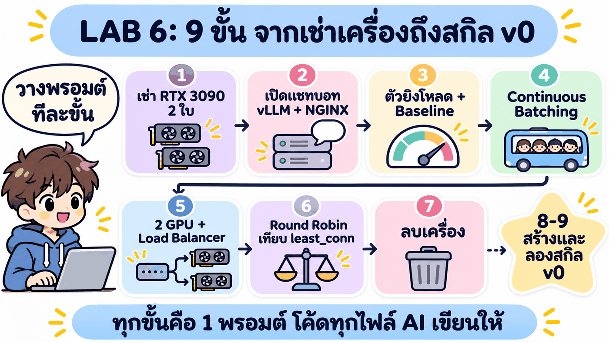
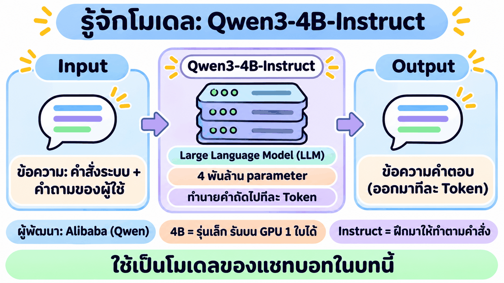
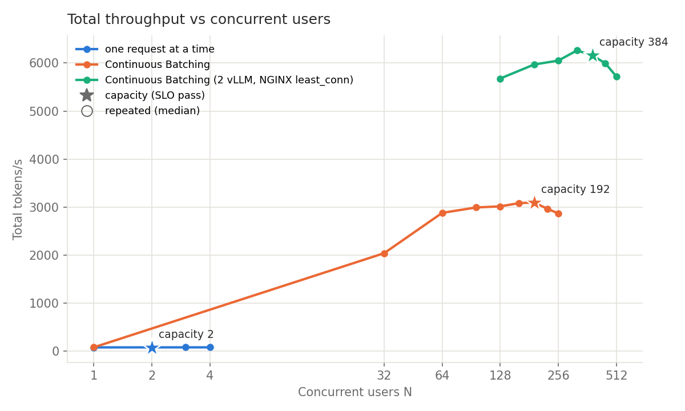
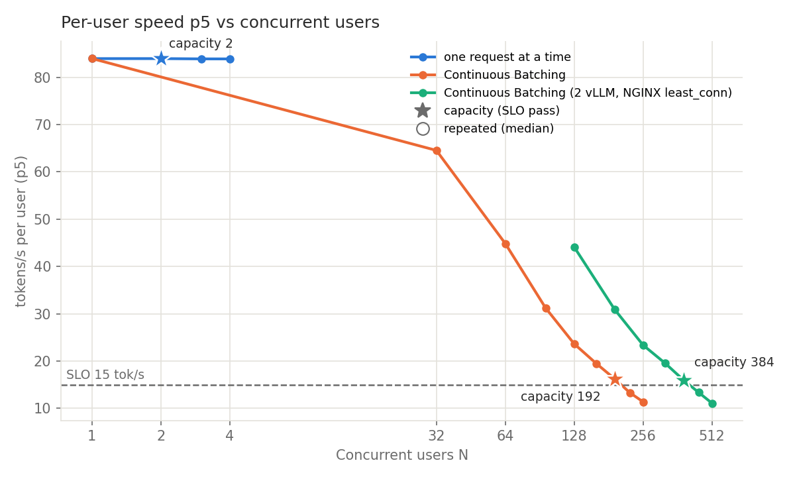
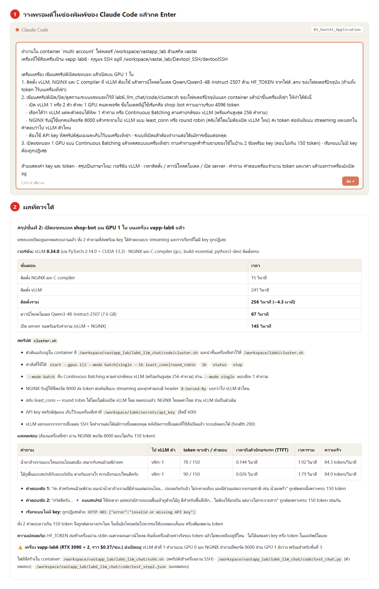
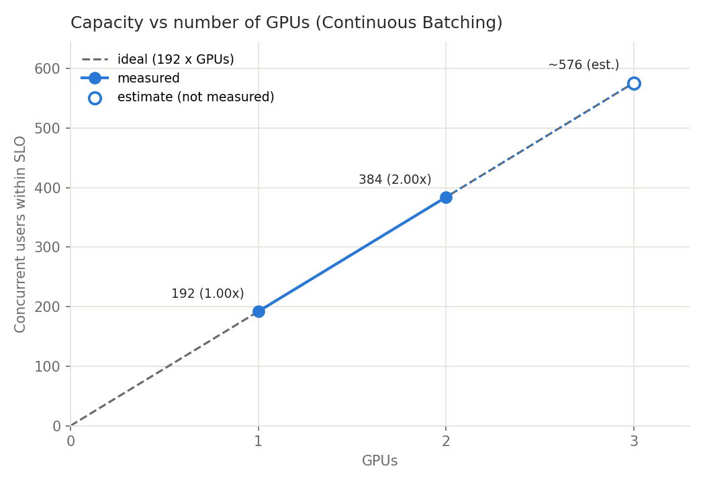
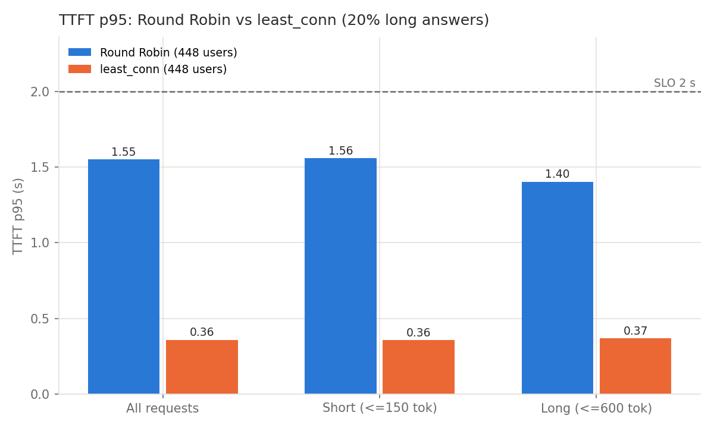
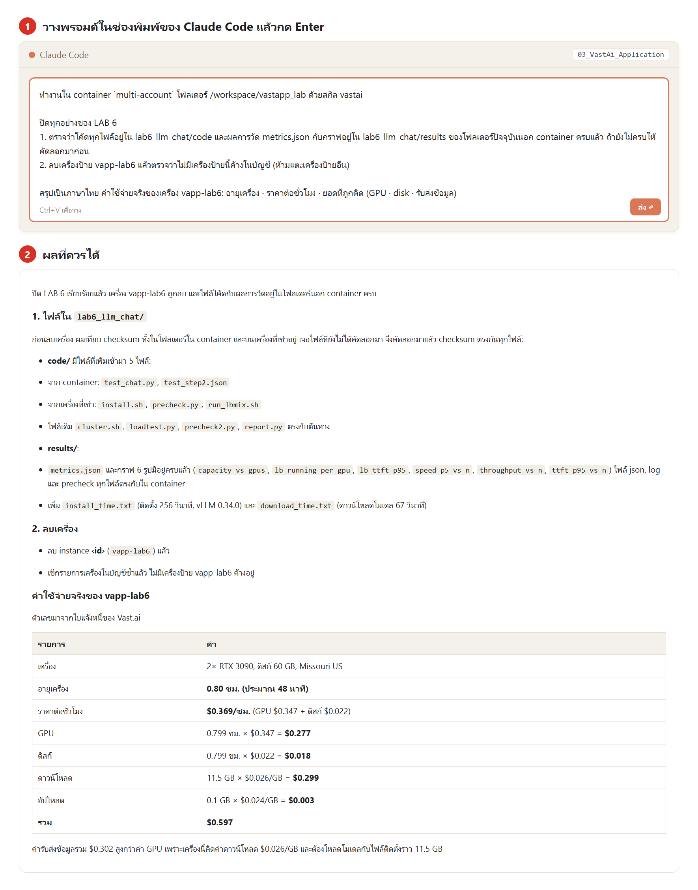

# LAB 6 · แชทบอท LLM: GPU 1 ใบคุยพร้อมกันได้กี่คน แล้วเพิ่มด้วย Continuous Batching + Load Balancer เป็น 2 ใบ

[← กลับหน้ารวมของบท](../README.md) · เปิด Claude Code ที่โฟลเดอร์ของบท `03_VastAi_Application` ("โฟลเดอร์ปัจจุบัน" ในพรอมต์หมายถึงโฟลเดอร์นั้น) · ทำ [LAB 0](../README.md#lab-0--เตรียม-key-3-ตัว) ก่อน

## ทำไปเพื่ออะไร


ร้านขายของใช้ในบ้านอยากเปิดแชทบอทตอบลูกค้า และมีงบเช่า GPU จำกัด · คำถามของเจ้าของระบบคือ

> **GPU 1 ใบ รองรับผู้ใช้พร้อมกันได้กี่คน แล้วออกแบบระบบอย่างไรให้รับได้มากขึ้น**

เราไม่เดา แต่ **วัดจริง** 3 แบบบนเครื่องเดียวกัน ด้วยเกณฑ์เดียวกัน

1. **Baseline**: GPU 1 ใบ ตอบทีละคำถาม
2. **Continuous Batching**: GPU ใบเดิม แต่รวมคำถามของหลายคนเข้า GPU พร้อมกัน
3. **Load Balancer**: GPU 2 ใบ อยู่หลัง NGINX ที่คอยแจกงาน

LAB นี้มี **9 ขั้น** · ทุกขั้นคือ 1 พรอมต์ · โค้ดทุกไฟล์ AI เขียนให้จากพรอมต์ เริ่มจากโฟลเดอร์ว่าง · ขั้นที่ 1–7 คืองานหลัก ขั้นที่ 8–9 เก็บงานทั้งหมดเป็น **สกิลเวอร์ชัน 0**



## รู้จักข้อมูลที่ใช้ทดสอบ

LAB นี้ไม่ได้เทรนโมเดล จึงไม่มี Dataset สาธารณะ · "ข้อมูล" คือ **ชุดคำขอ (workload)** ที่ใช้ยิงใส่แชทบอทเพื่อวัดความจุ

| หัวข้อ | รายละเอียด |
|---|---|
| เกี่ยวกับอะไร | คำถามของลูกค้าร้านขายของใช้ในบ้าน ภาษาไทย สั้น ๆ เช่น ถามวิธีใช้สินค้า เทียบสินค้า 2 แบบ |
| ใครทำ | AI เขียนขึ้นเองตามพรอมต์ขั้นที่ 3 และฝังไว้ในตัวยิงโหลด (ดู [code_reference/loadtest.py](code_reference/loadtest.py)) |
| ลิงก์ต้นทาง / สัญญาอนุญาต | ไม่มี เพราะไม่ใช่ Dataset สาธารณะ · ของคุณจะได้คำถามชุดใหม่ที่ไม่เหมือนกันทุกข้อ |
| จำนวน | 40 คำถาม · ผู้ใช้จำลองแต่ละคนสุ่มถามทีละข้อ |
| ขนาดต่อ 1 คำขอ | ขาเข้า 71–91 token (system prompt + คำถาม) · คำตอบจริงเฉลี่ยราว 84 token (57–121) เพดาน 150 token |
| ชุดพิเศษของขั้นที่ 6 | 20% ของคำถามขอคำตอบละเอียด ยาวได้ถึง 600 token (ตอบยาว 600 จริงทุกข้อ) |

ภาพจริงที่ AI ทำให้ในขั้นที่ 3 · 8 คำถามจาก 40 ข้อ คู่กับคำตอบจริงของแชทบอท (ข้อมูลดิบ: [results/dataset_samples.json](results/dataset_samples.json))


**คำขอ 1 รายการหน้าตาเป็นอย่างไร** · ผู้ใช้จำลองส่ง `POST /v1/chat/completions` ไปที่ NGINX พอร์ต 8000

| ช่อง | ค่า | หมายถึง |
|---|---|---|
| header `Authorization` | `Bearer <API key>` | API key ที่สคริปต์สุ่มไว้บนเครื่องเช่า · ไม่มี key ถูกปฏิเสธ (401) |
| header `Content-Type` | `application/json` | เนื้อหาคำขอเป็น JSON |
| `model` | `"shop-bot"` | ชื่อโมเดลที่ผู้ใช้เรียก |
| `messages` | `system` + `user` | `system` = บทบาทพนักงานร้าน ตอบภาษาไทย สุภาพ กระชับ ไม่เกิน 3 ประโยค · `user` = คำถาม 1 ข้อ |
| `max_tokens` | `150` | ความยาวคำตอบสูงสุด |
| `stream` | `true` | ส่งคำตอบกลับทีละ token จึงจับเวลา token แรกได้ |
| `stream_options.include_usage` | `true` | ส่งจำนวน token มาตอนจบ ใช้คำนวณความเร็ว |

**ข้อสังเกต**

- **ความจุขึ้นกับความยาวคำตอบ**: system prompt สั่ง "ไม่เกิน 3 ประโยค" คำตอบจึงยาวราว 84 token และใช้เวลาราว 1 วินาทีต่อข้อ · ถ้าปล่อยให้ตอบยาวจนชนเพดาน 150 token ทุกข้อ ตัวเลขความจุจะต่ำลง
- system prompt และคำถาม AI เป็นคนเขียน รอบของคุณจึงอาจได้ความยาวคำตอบต่างจากนี้ และตัวเลขความจุจะต่างตาม
- คำถามเป็นข้อความสั้น ถ้างานจริงมีเอกสารยาวแนบมา ความจุจะต่ำกว่านี้

## รู้จักโมเดลที่ใช้



| หัวข้อ | Qwen3-4B-Instruct-2507 |
|---|---|
| ประเภท | Large Language Model (LLM) สำหรับแชท |
| Input | ข้อความแชท: คำสั่งระบบ (system) + คำถามของผู้ใช้ (user) |
| Output | ข้อความคำตอบ สร้างออกมาทีละ token |
| ขนาด | 4 พันล้าน parameter · ไฟล์โมเดล 7.6 GB · LAB ตั้งความยาวบริบท 4,096 token |
| ที่มา | [Qwen/Qwen3-4B-Instruct-2507](https://huggingface.co/Qwen/Qwen3-4B-Instruct-2507) โดย Alibaba (ทีม Qwen) · สัญญาอนุญาต Apache-2.0 |
| LAB นี้ใช้ทำอะไร | เป็นสมองของแชทบอท `shop-bot` · ไม่เทรนเพิ่ม ใช้ตอบอย่างเดียว (Inference) |

โมเดลอย่างเดียวยังให้บริการหลายคนไม่ได้ ต้องมี **โปรแกรมเสิร์ฟ** ครอบอีกชั้น LAB นี้ใช้ vLLM


| หัวข้อ | vLLM 0.34.0 |
|---|---|
| ประเภท | Inference Server (โปรแกรมเสิร์ฟ LLM) แบบ open source |
| Input | คำขอ HTTP แบบ **OpenAI-compatible API** (`POST /v1/chat/completions`) |
| Output | คำตอบ JSON หรือ streaming ทีละ token ในรูปแบบเดียวกับ OpenAI API |
| จุดเด่น | Continuous Batching เป็นค่าปกติ (LAB ตั้งสูงสุด 256 คำถามพร้อมกันต่อ 1 ตัว) |
| ที่มา | [โครงการ vLLM](https://docs.vllm.ai/) |
| LAB นี้ใช้ทำอะไร | เปิด 1 ตัวต่อ 1 GPU · สลับได้ 2 โหมด: ตอบทีละ 1 คำถาม หรือ Continuous Batching |

## ทฤษฎีที่ต้องรู้

### 1 · Concurrent Users, Throughput และ Latency

- **คืออะไร**: **Concurrent Users (N)** = จำนวนผู้ใช้ที่กำลังรอคำตอบพร้อมกัน · **Throughput** = งานที่ระบบทำเสร็จต่อวินาที (LAB นี้นับเป็น token/วินาทีรวม) · **Latency** = เวลาที่ผู้ใช้แต่ละคนต้องรอ
- **ทำไมต้องใช้**: เจ้าของระบบถามว่า "รับได้กี่คน" (N) แต่ GPU วัดกันที่ Throughput ต้องแปลงระหว่างสองค่านี้ให้ได้
- **ทำงานอย่างไร**: LAB นี้จำลองผู้ใช้แบบ closed-loop คือแต่ละคนถาม รอจนจบ แล้วถามข้อใหม่ทันที N จึงคงที่ และ `Throughput = N ÷ เวลาต่อคำถาม`
- **ตัวเลขจาก LAB นี้**: แบบทีละคำถาม Throughput คงที่ 81–82 token/วินาที ไม่ว่า N เท่าไร · แบบ Continuous Batching โตตาม N จาก 82 แล้วอิ่มตัวที่ราว 3,000 token/วินาที ตั้งแต่ N=96 (สูงสุด 3,097 ที่ N=192) · 2 ใบอิ่มตัวที่ราว 6,000 (สูงสุด 6,261)




### 2 · ตัวชี้วัดของ Streaming: TTFT และ token ต่อวินาที

- **คืออะไร**: **TTFT (Time To First Token)** = เวลาตั้งแต่กดส่งจนเห็นตัวอักษรแรก · **ความเร็วต่อผู้ใช้** = token/วินาทีที่คน 1 คนได้รับหลัง token แรก · **token/วินาทีรวม** = ผลรวมของทุกคน (Throughput ของระบบ) · **p95** = ค่าที่ 95% ของคำถามได้เท่านี้หรือดีกว่า (กับความเร็วใช้ p5 คือ 95% ของคำถามเร็วกว่าค่านี้)
- **ทำไมต้องใช้**: ผู้ใช้แชทรู้สึก "ช้า" จาก 2 อย่าง คือรอนานกว่าจะเริ่มพิมพ์ (TTFT) และพิมพ์ช้ากว่าที่อ่าน (ความเร็วต่อผู้ใช้) · ค่าเฉลี่ยซ่อนผู้ใช้ที่โชคร้าย จึงใช้ p95
- **ทำงานอย่างไร**: TTFT = เวลารอคิว + เวลาที่โมเดลอ่านคำถาม · ความเร็วต่อผู้ใช้ขึ้นกับว่า GPU ทำกี่คำถามพร้อมกันในรอบคำนวณเดียว ยิ่งมาก แต่ละคนยิ่งช้าลง แต่ผลรวมสูงขึ้น
- **ตัวเลขจาก LAB นี้**: Continuous Batching ที่ N=192 ผู้ใช้ได้คนละ 16.3 token/วินาที (p5) ขณะที่ทั้งระบบได้ 3,097 token/วินาที · ที่ N=1 ได้ 84.0 และ 82 ตามลำดับ


### 3 · SLO และนิยาม "รองรับได้ N คน"

- **คืออะไร**: **SLO (Service Level Objective)** = เกณฑ์คุณภาพที่ตกลงไว้ล่วงหน้า · LAB นี้ใช้ 3 ข้อ: TTFT p95 ≤ 2 วินาที · 95% ของคำถามได้ ≥ 15 token/วินาที · error < 1%
- **ทำไมต้องใช้**: ถ้าไม่มี SLO คำว่า "รับได้" ไม่มีความหมาย ระบบที่รับ 1,000 คนแต่ต้องรอคนละ 30 วินาทีไม่ถือว่ารับได้
- **ทำงานอย่างไร**: ไล่เพิ่ม N ทีละระดับ วัดระดับละ 30 วินาที (ไม่นับ 5 วินาทีแรก) · **"รองรับได้ N คน" = ระดับ N สูงสุดที่ผ่านทั้ง 3 ข้อ และทุกระดับที่ต่ำกว่าก็ผ่านด้วย** · ตัวยิงหยุดเองเมื่อไม่ผ่าน 2 ระดับติดกัน
- **ตัวเลขจาก LAB นี้**: Continuous Batching 1 ใบ ผ่านถึง N=192 (ได้ 16.3 token/วินาที) ไม่ผ่านที่ N=224 (13.3) ความจุจึงเป็น **192 คน**




> เกณฑ์ SLO เป็นการตัดสินใจทางธุรกิจ · ถ้าลดเกณฑ์ความเร็วเป็น 10 token/วินาที GPU 1 ใบจะรับได้ถึง N=256 (ได้ 11.4)

### 4 · วัดความจุอย่างไรให้เชื่อได้

- **คืออะไร**: กติกา 3 ข้อที่ทำให้ตัวเลขความจุไม่ได้มาจากความบังเอิญ: **ตรวจ GPU ก่อนวัด** · **ไล่ระดับ N ให้ละเอียดช่วงใกล้ความจุ** · **ระดับที่ผลก้ำกึ่งให้วัดซ้ำแล้วใช้ค่ากลาง (median)**
- **ทำไมต้องใช้**: GPU ที่ร้อนเกินจะลดความเร็วตัวเอง ทำให้ GPU รุ่นเดียวกันเร็วไม่เท่ากัน และผล "2 ใบ" จะต่ำกว่าความจริง · ถ้าไล่ N ห่างเกินไป (เช่น 128 แล้วข้ามไป 256) ความจุจริงที่อยู่ระหว่างขั้นจะถูกปัดลง · การวัด 30 วินาทีแกว่งได้ ผลครั้งเดียวที่ห่างเส้นเกณฑ์ไม่ถึง 5% จึงตัดสินไม่ได้
- **ทำงานอย่างไร**: ขั้นที่ 1 ดูอุณหภูมิตอนเครื่องว่าง (เกิน 60°C ให้เปลี่ยนเครื่อง) · ขั้นที่ 4–5 ก่อนวัดให้ผู้ใช้ 1 คนถาม vLLM แต่ละตัวโดยตรง แล้วเทียบ token/วินาที (ต่างกันเกิน 10% ต้องบอกไว้) · ไล่ N ทีละ 32 คน (1 ใบ) และทีละ 64 คน (2 ใบ) · ระดับที่ TTFT p95 หรือความเร็วห่างเส้นเกณฑ์ไม่เกิน 5% ให้วัดซ้ำอีก 2 ครั้ง แล้วตัดสินด้วยค่ากลางของ 3 ครั้ง
- **ตัวเลขจาก LAB นี้**: GPU 2 ใบได้ 84.0 และ 84.4 token/วินาที ต่างกัน 0.5% · รอบหลักไม่มีระดับก้ำกึ่ง (ใกล้เส้นที่สุดคือ 8.7% และ 6.7%) · รอบลองสกิลในขั้นที่ 9 ได้ใช้กติกาวัดซ้ำจริง 2 ระดับ: ที่ N=160 ความเร็ว p5 ได้ 15.744 / 15.647 / 15.694 ค่ากลาง 15.694 จึงผ่าน · ที่ N=2 แบบทีละคำถาม TTFT p95 ได้ 1.952 / 1.882 / 1.965 ค่ากลาง 1.952 จึงผ่าน


| จุดตรวจ GPU | GPU 0 | GPU 1 |
|---|---|---|
| ขั้นที่ 1 ตอนเครื่องว่าง | 48°C | 54°C |
| ขั้นที่ 5 ก่อนวัด: ความเร็วผู้ใช้ 1 คน | 84.0 token/วินาที | 84.4 token/วินาที |
| ขั้นที่ 5 ระหว่างวัด (โหลดเต็ม) | 64–67°C · clock ราว 1,840 MHz | 73–80°C · clock ราว 1,800 MHz |

> ความละเอียดของคำตอบเท่ากับขนาดขั้นบันได: ความจุจริงของ 1 ใบอยู่ระหว่าง 192–223 คน และของ 2 ใบอยู่ระหว่าง 384–447 คน

### 5 · จุดอิ่มตัว (Saturation Knee)

- **คืออะไร**: เมื่อ N ยังน้อย Latency แทบคงที่ · เมื่อ N เกินจำนวนที่ระบบทำพร้อมกันได้ คำถามส่วนเกินต้องรอคิว Latency จะหักศอกพุ่งขึ้นเป็นเส้นตรงตาม N · จุดหักศอกนี้เรียกว่า knee
- **ทำไมต้องรู้**: ระบบที่ทำงานใกล้ knee ดูปกติดี แต่เพิ่มผู้ใช้อีกนิดเดียวก็พัง จึงต้องรู้ว่า knee อยู่ตรงไหนและเผื่อระยะไว้
- **ทำงานอย่างไร**: โหมดทีละคำถามมี "ช่อง" เดียว คิวจึงเริ่มทันทีที่มีคนที่ 2 · โหมด Continuous Batching มี 256 ช่องต่อ GPU คิวจึงยังไม่เกิดจนกว่าจะเกิน 256 · กฎของ Little บอกว่า เวลาต่อคำถาม = N ÷ จำนวนคำถามที่เสร็จต่อวินาที
- **ตัวเลขจาก LAB นี้**: ทีละคำถาม TTFT p95 = 0.05 → 1.60 → 2.92 → 4.17 วินาที เมื่อ N = 1 → 2 → 3 → 4 (เพิ่มคนละราว 1.3 วินาที ใกล้กับเวลาตอบ 1 ข้อ) · Continuous Batching ไม่มีคิวเลยถึง N=256 TTFT p95 สูงสุดเพียง 0.30 วินาที · ที่ N=192 เสร็จ 936 ข้อใน 25 วินาที (ราว 37 ข้อ/วินาที) เวลาต่อคำถามจึงเป็น 192 ÷ 37 ≈ 5.1 วินาที ช้ากว่าตอนคนเดียว 5 เท่า แต่ทำพร้อมกัน 192 ข้อ


> ใน Continuous Batching มี 2 เพดานซ้อนกัน: ความเร็วต่อผู้ใช้ตกเกณฑ์ก่อน (หลัง N=192) ส่วนคิวจะเกิดเมื่อเกิน 256 ช่อง · ตัวอย่างของการชนเพดาน 256 มีในขั้นที่ 6: GPU ใบหนึ่งชน 256 ช่อง คำถามใหม่ต้องรอคิว TTFT p95 จึงกระโดดเป็น 1.55 วินาที

### 6 · Continuous Batching

**ปัญหาที่มันแก้** · ถ้าโปรแกรมเสิร์ฟตอบทีละคำถาม คนที่มาทีหลังต้องรอให้คนก่อนหน้าได้คำตอบครบก่อน


- **คืออะไร**: วิธีที่โปรแกรมเสิร์ฟรวมคำถามของหลายคนเข้า GPU ในรอบคำนวณเดียวกัน และ **รับคำถามใหม่เข้าแทรกได้ทุกรอบ** ไม่ต้องรอให้ทั้งชุดจบ
- **ทำไมต้องใช้**: การสร้าง token 1 ตัว GPU ต้องอ่านน้ำหนักโมเดลทั้งก้อน 1 รอบ ซึ่งเป็นงานส่วนใหญ่ · อ่าน 1 รอบแล้วคำนวณให้หลายคนพร้อมกันจึงเกือบได้ฟรี
- **ทำงานอย่างไร**: ทุกรอบ GPU คำนวณ token ถัดไปของทุกคำถามที่กำลังทำอยู่ (สูงสุด 256 ช่อง) · คำถามที่จบแล้วออกจากช่องทันที คำถามใหม่เข้าแทนในรอบถัดไป · ต่างจาก Static Batching ที่ต้องรอคำตอบที่ยาวที่สุดในชุดก่อนจึงรับชุดใหม่


- **ตัวเลขจาก LAB นี้**: GPU ใบเดิม รองรับ 2 → **192 คน (96 เท่า)** · token/วินาทีรวมสูงสุด 82 → **3,097 (37.6 เท่า)** · แลกกับความเร็วต่อผู้ใช้ที่ลดลงจาก 84.0 เหลือ 16.3 token/วินาที ซึ่งยังเร็วกว่าเกณฑ์


> GPU utilization อยู่ที่ 97–100% ทั้งสองโหมด · "GPU เต็ม" จึงไม่ได้แปลว่าใช้คุ้ม ต้องดู Throughput ประกอบ

### 7 · Load Balancer

- **คืออะไร**: ตัวรับคำขอของผู้ใช้ทุกคนที่ที่อยู่เดียว แล้วส่งต่อไปยัง server หลายตัวด้านหลัง (เรียกแต่ละตัวว่า replica) · LAB นี้ใช้ NGINX ที่พอร์ต 8000 แจกงานให้ vLLM 2 ตัว ตัวละ 1 GPU
- **ทำไมต้องใช้**: GPU 1 ใบมีเพดาน (ข้อ 5) จะรับผู้ใช้เพิ่มต้องเพิ่ม GPU และต้องมีตัวแจกงาน · การเพิ่มเครื่องด้านหลังแบบนี้เรียกว่า Horizontal Scaling ผู้ใช้ไม่ต้องเปลี่ยนที่อยู่


- **ทำงานอย่างไร (เลือกตัวไหน)**: **Round Robin** ส่งวนตามลำดับ 1, 2, 1, 2 · **least_conn** ส่งให้ตัวที่มีการเชื่อมต่อค้างน้อยที่สุด · แชทแบบ streaming เปิดการเชื่อมต่อค้างไว้จนคำตอบจบ จำนวนการเชื่อมต่อจึงเท่ากับ "งานที่ยังค้าง" พอดี
- **ตัวเลขจาก LAB นี้**: ผู้ใช้ 448 คน โดย 20% ขอคำตอบยาว · Round Robin ได้ TTFT p95 **1.55 วินาที** (GPU 1 สะสมงานจนชนเพดาน 256 ช่อง เฉลี่ย 243 ขณะที่ GPU 0 ทำเฉลี่ย 197) · least_conn ได้ **0.36 วินาที** (งานค้าง 220 และ 222 ไม่มีใบไหนชนเพดาน) ดีกว่าราว 4 เท่า


- **ทำงานอย่างไร (ส่งต่ออย่างไร)**: ปกติ NGINX จะเก็บคำตอบของ server ไว้ในบัฟเฟอร์ก่อนส่งให้ผู้ใช้ (proxy buffering) ซึ่งดีกับหน้าเว็บทั่วไป · แต่กับ streaming ผู้ใช้จะเห็นคำตอบมาเป็นก้อนตอนท้าย TTFT จะสูงทั้งที่ GPU ตอบเร็ว · จึงต้อง **ปิด proxy buffering** ให้ token ไหลผ่านทันที


> ใน LAB ทุกส่วน (NGINX, vLLM 2 ตัว, ตัวยิงโหลด) อยู่บนเครื่องเช่าเครื่องเดียวเพื่อประหยัด · ระบบจริงแยก Load Balancer กับ replica ไว้คนละเครื่อง และ Load Balancer เองต้องมีตัวสำรอง

### 8 · Scaling Efficiency

- **คืออะไร**: `Efficiency = ความจุ k ใบ ÷ (k × ความจุ 1 ใบ)` · 100% คือเพิ่ม GPU 2 เท่าแล้วรับผู้ใช้ได้ 2 เท่าพอดี
- **ทำไมต้องใช้**: GPU ใบที่ 2 ต้องจ่ายเงินเต็ม แต่อาจไม่ได้ความจุเต็ม ต้องวัดว่าได้คืนกี่เปอร์เซ็นต์
- **ทำงานอย่างไร (อะไรทำให้ไม่ถึง 100%)**: Load Balancer แจกงานไม่เท่ากัน · CPU หรือเครือข่ายที่ใช้ร่วมกันเป็นคอขวด · GPU แต่ละใบเร็วไม่เท่ากัน ซึ่งใบที่ช้าจะเป็นตัวกำหนดค่า p5 · ขั้นบันได N ที่หยาบเกินไป
- **ตัวเลขจาก LAB นี้**: **1 ใบ 192 คน → 2 ใบ 384 คน (2.00 เท่า, Efficiency 100%)** · Throughput ที่ความจุเพิ่มจาก 3,097 เป็น 6,157 token/วินาที (1.99 เท่า) · least_conn แบ่งงานให้ 2 ใบต่างกันไม่เกิน 3% · GPU 1 ร้อนกว่าแต่ช้ากว่าเพียงราว 2% จึงไม่กระทบผล


> **3 ใบเป็นค่าประมาณจากการคำนวณ ไม่ใช่ผลวัด** (LAB นี้เช่าแค่ 2 ใบ): 192 × 3 × 100% ≈ 576 คน โดยสมมติว่า NGINX และ CPU ยังไม่เป็นคอขวด และ GPU ใบที่ 3 เร็วเท่ากับ 2 ใบแรก

## การทดลอง


| หัวข้อ | รายละเอียด |
|---|---|
| โหลด | ผู้ใช้จำลอง N คนแบบ closed-loop (ถาม → รอจนจบ → ถามใหม่ทันที ไม่มีเวลาพักคิด) · คำถาม 40 ข้อ สุ่มถาม · คำตอบไม่เกิน 150 token |
| โมเดล | Qwen3-4B-Instruct-2507 เสิร์ฟด้วย vLLM 0.34.0 หลัง NGINX |
| เทียบ A → B → C | **A** GPU 1 ใบ ตอบทีละคำถาม · **B** GPU 1 ใบ Continuous Batching (สูงสุด 256 คำถาม) · **C** GPU 2 ใบ Continuous Batching หลัง NGINX แบบ least_conn · เสริม: Round Robin เทียบ least_conn |
| วิธีวัด / SLO | ไล่ N ทีละระดับ (1 ใบทีละ 32 คน · 2 ใบทีละ 64 คน) ระดับละ 30 วินาที ไม่นับ 5 วินาทีแรก · ผ่านเมื่อ TTFT p95 ≤ 2 วินาที, 95% ของคำถาม ≥ 15 token/วินาที, error < 1% · ระดับก้ำกึ่ง (ห่างเส้นเกณฑ์ไม่เกิน 5%) วัดซ้ำแล้วใช้ค่ากลาง · ตัวยิงโหลดรันบนเครื่องเช่าเดียวกับแชทบอท จึงไม่มีเวลาเดินทางของเน็ตปนใน TTFT |
| เครื่อง | RTX 3090 2 ใบในเครื่องเดียว · เพดาน $0.60 ต่อชั่วโมง (ได้จริง $0.369) |
| เวลาและค่าเช่าจริง | ขั้นที่ 1–7 รวมราว 49 นาที · เครื่องเปิด 0.80 ชั่วโมง · ค่าเช่า **$0.597** · ขั้นที่ 9 (ลองสกิล) อีก 24 นาที **$0.093** |

**ผลสรุปของทั้ง LAB** (รายละเอียดอยู่ในแต่ละขั้น)

| จำนวน GPU | สถาปัตยกรรม | รองรับผู้ใช้พร้อมกัน (N) | Throughput ที่ N นั้น (token/วินาที) | TTFT p95 ที่ N นั้น | เท่าของ 1 ใบ | Efficiency |
|---|---|---|---|---|---|---|
| 1 | Baseline: ตอบทีละคำถาม | **2** | 82 | 1.60 วินาที | – | – |
| 1 | Continuous Batching | **192** | 3,097 | 0.23 วินาที | 1.00× | 100% |
| 2 | Continuous Batching × 2 หลัง NGINX least_conn | **384** | 6,157 (สูงสุด 6,261 ที่ N=320) | 0.23 วินาที | **2.00×** | **100%** |
| 3 | *คำนวณ ไม่ใช่ผลวัด* | *≈ 576* | – | – | – | – |

**1 ใบ 192 คน → 2 ใบ 384 คน** (2.00 เท่า, Efficiency 100%) · ถ้าเพิ่มเป็น 3 ใบ คำนวณได้ราว 576 คน (เป็นการคำนวณ ไม่ใช่ผลวัด)

ทำตามลำดับขั้นที่ 1 → 9 ให้ครบในรอบเดียว · คัดลอกพรอมต์ไปวางในช่องพิมพ์ของ Claude Code ทีละขั้น · โค้ดที่ AI เขียนจะอยู่ในโฟลเดอร์ `lab6_llm_chat/code/` ซึ่งตอนเริ่มยังไม่มี · เครื่องเปิดค้างและคิดเงินตั้งแต่ขั้นที่ 1 ถึงขั้นที่ 7

## ขั้นที่ 1 · เช่าเครื่อง RTX 3090 2 ใบ

AI ค้นหาเครื่องตามเกณฑ์ เช่า รอจนพร้อม แล้วเข้าไปตรวจว่าเห็น GPU ครบ 2 ใบและ GPU ไม่ร้อน

```text
ทำงานใน container `multi-account` โฟลเดอร์ /workspace/vastapp_lab ด้วยสกิล vastai

เช่าเครื่อง 1 เครื่องที่มี RTX 3090 2 ใบ สำหรับทดลองแชทบอทรับผู้ใช้พร้อมกัน
1. ราคารวมไม่เกิน $0.60 ต่อชั่วโมง ตั้งป้ายเครื่องว่า vapp-lab6
2. เลือกเครื่อง verified ที่เชื่อม SSH ตรงได้ ความน่าเชื่อถือ (reliability) 0.95 ขึ้นไป เน็ตขาเข้า 500 Mbps ขึ้นไป CPU 16 cores ขึ้นไป แล้วเอาเครื่องที่ถูกที่สุด
3. ไดรเวอร์ต้องรองรับ CUDA 13 ขึ้นไป (vLLM รุ่นล่าสุดต้องใช้) และไม่เอาเครื่องในจีน (ดาวน์โหลดจาก Hugging Face ช้า)
4. ใช้ image PyTorch 2.8 ที่มี CUDA 12.8 disk 60 GB ไม่ต้องเปิดพอร์ตเพิ่ม เพราะตัวยิงโหลดจะรันบนเครื่องเดียวกับแชทบอท
5. รอจนเครื่องพร้อมและเข้าไปเห็น GPU ครบ 2 ใบ ถ้าเกิน 10 นาทียังไม่พร้อม ให้ลบแล้วเช่าเครื่องอื่น
6. ดูอุณหภูมิของ GPU แต่ละใบ ถ้าใบไหนร้อนเกิน 60°C ทั้งที่ยังไม่ได้ทำงาน ให้ลบแล้วเช่าเครื่องอื่น (GPU ที่ร้อนจะลดความเร็วตัวเองระหว่างวัด)
กุญแจ SSH อยู่ที่ /workspace/vastai_lab/Devtool_SSH/devtoolSSH

สรุปเป็นตารางภาษาไทย: GPU · ราคาต่อชั่วโมง · ที่ตั้ง · CPU cores · RAM · อุณหภูมิ GPU แต่ละใบ · เวลาที่รอจนเครื่องพร้อม แล้วบอกว่าเครื่องยังเปิดอยู่
```


*ใช้เวลา 2 นาที · ที่อยู่เครื่องในภาพเป็นค่าตัวอย่าง*

**อ่านผลอย่างไร**

- เช่า **2 ใบตั้งแต่แรก** แม้ขั้นที่ 2–4 ใช้ใบเดียว เพื่อให้ทุกแบบวัดบนเครื่องเดียวกัน ต่างกันแค่วิธีเสิร์ฟและจำนวน GPU
- ข้อ 6 (อุณหภูมิตอนว่างไม่เกิน 60°C) กัน GPU ที่ร้อนจนลดความเร็วตัวเองระหว่างวัด · เครื่องนี้ได้ 48°C และ 54°C จึงผ่าน
- เครื่องที่ถูกกว่า ($0.326) มีอยู่ แต่อยู่ในจีนจึงถูกตัดออกตามข้อ 3 · เงื่อนไขในพรอมต์มีผลกับราคาจริง
- **ตั้งแต่ขั้นนี้เงินเริ่มเดิน** ชั่วโมงละ $0.37 จนกว่าจะลบเครื่องในขั้นที่ 7

## ขั้นที่ 2 · เขียนสคริปต์เปิดแชทบอท แล้วเปิดบน GPU 1 ใบ

AI ติดตั้ง vLLM กับ NGINX ดาวน์โหลดโมเดล แล้วเขียน `cluster.sh` (เปิด/ปิด/ดูสถานะระบบ) และ `test_chat.py` (ทดสอบถาม 2 ข้อ)

```text
ทำงานใน container `multi-account` โฟลเดอร์ /workspace/vastapp_lab ด้วยสกิล vastai
เครื่องที่ใช้คือเครื่องป้าย vapp-lab6 · กุญแจ SSH อยู่ที่ /workspace/vastai_lab/Devtool_SSH/devtoolSSH

เตรียมเครื่อง เขียนสคริปต์เปิดแชทบอท แล้วเปิดบน GPU 1 ใบ
1. ติดตั้ง vLLM, NGINX และ C compiler ที่ vLLM ต้องใช้ แล้วดาวน์โหลดโมเดล Qwen/Qwen3-4B-Instruct-2507 ด้วย HF_TOKEN จากไฟล์ .env ของโฟลเดอร์ปัจจุบัน (ห้ามทิ้ง token ไว้บนเครื่องที่เช่า)
2. เขียนสคริปต์เปิด/ปิด/ดูสถานะระบบแชทบอทไว้ที่ lab6_llm_chat/code/cluster.sh ของโฟลเดอร์ปัจจุบันนอก container แล้วนำขึ้นเครื่องที่เช่า ให้ทำได้ดังนี้
   - เปิด vLLM 1 หรือ 2 ตัว ตัวละ 1 GPU คนละพอร์ต ชื่อโมเดลที่ผู้ใช้เรียกคือ shop-bot ความยาวบริบท 4096 token
   - เลือกได้ว่า vLLM แต่ละตัวตอบได้ทีละ 1 คำถาม หรือ Continuous Batching ตามค่าปกติของ vLLM (พร้อมกันสูงสุด 256 คำถาม)
   - NGINX รับผู้ใช้ทุกคนที่พอร์ต 8000 แล้วกระจายไป vLLM แบบ least_conn หรือ round robin (สลับได้โดยไม่ต้องเปิด vLLM ใหม่) ส่ง token ต่อทันทีแบบ streaming และบอกในคำตอบว่าไป vLLM ตัวไหน
   - ต้องใช้ API key ที่สคริปต์สุ่มเองและเก็บไว้บนเครื่องที่เช่า · ระบบที่เปิดแล้วต้องทำงานต่อได้แม้การเชื่อมต่อหลุด
3. เปิดแชทบอท 1 GPU แบบ Continuous Batching แล้วทดสอบบนเครื่องที่เช่า: ถามคำถามลูกค้าร้านขายของใช้ในบ้าน 2 ข้อพร้อม key (ตอบไม่เกิน 150 token) · เรียกแบบไม่มี key ต้องถูกปฏิเสธ

ห้ามแสดงค่า key และ token · สรุปเป็นภาษาไทย: เวอร์ชัน vLLM · เวลาติดตั้ง / ดาวน์โหลดโมเดล / เปิด server · คำถาม-คำตอบพร้อมจำนวน token และเวลา แล้วบอกว่าเครื่องยังเปิดอยู่
```


*ใช้เวลา 10 นาที*

| คำถามทดสอบ | token (ขาเข้า/คำตอบ) | TTFT | เวลารวม | ความเร็ว |
|---|---|---|---|---|
| น้ำยาล้างจานแบบไหนอ่อนโยนต่อมือ เหมาะกับคนผิวแพ้ง่ายคะ | 78 / 150 | 0.144 วินาที | 1.92 วินาที | 84.3 token/วินาที |
| ไม้ถูพื้นแบบสเปรย์กับแบบถังปั่น ต่างกันอย่างไร ควรเลือกแบบไหนดีครับ | 90 / 150 | 0.026 วินาที | 1.79 วินาที | 84.9 token/วินาที |

ตัวอย่างโค้ดที่ AI เขียนให้ในรอบจริง (ของคุณอาจต่างกัน): [code_reference/cluster.sh](code_reference/cluster.sh) · [code_reference/install.sh](code_reference/install.sh) · [code_reference/test_chat.py](code_reference/test_chat.py) · ผลทดสอบ [code_reference/test_step2.json](code_reference/test_step2.json)

**อ่านผลอย่างไร**

- ความเร็วราว 84 token/วินาทีคือความเร็วของ RTX 3090 ใบนี้เมื่อมีผู้ใช้คนเดียว เป็นค่าตั้งต้นที่จะเห็นซ้ำในทุกขั้น
- คำตอบทดสอบทั้ง 2 ข้อยาวจนชนเพดาน 150 token และถูกตัดกลางประโยค AI จึงเสนอให้ขอคำตอบสั้นลงในขั้นยิงโหลด (ขั้นที่ 3 ใช้ "ไม่เกิน 3 ประโยค")
- NGINX ใส่ header `X-Served-By` ในทุกคำตอบ บอกว่าคำถามไป vLLM ตัวไหน ใช้ตรวจการแจกงานในขั้นที่ 5–6
- `HF_TOKEN` ใช้แค่ตอนดาวน์โหลดและไม่ถูกทิ้งไว้บนเครื่องเช่า · API key ของแชทบอทอยู่บนเครื่องเช่าเท่านั้นและไม่ถูกแสดง

## ขั้นที่ 3 · เขียนตัวยิงโหลด แล้ววัด Baseline: GPU 1 ใบ ตอบทีละคำถาม

AI เขียนตัวยิงโหลด `loadtest.py` แล้วเปิดแชทบอทแบบตอบทีละคำถาม ยิงโหลดไล่ N และทำภาพตัวอย่างชุดคำขอ

```text
ทำงานใน container `multi-account` โฟลเดอร์ /workspace/vastapp_lab ด้วยสกิล vastai
เครื่องที่ใช้คือเครื่องป้าย vapp-lab6 · กุญแจ SSH อยู่ที่ /workspace/vastai_lab/Devtool_SSH/devtoolSSH

เขียนตัวยิงโหลด แล้ววัดว่าแชทบอทบน GPU 1 ใบที่ตอบทีละคำถาม (ไม่มี batching) รองรับผู้ใช้พร้อมกันได้กี่คน
1. เขียนตัวยิงโหลดไว้ที่ lab6_llm_chat/code/loadtest.py ของโฟลเดอร์ปัจจุบันนอก container จำลองผู้ใช้ N คน แต่ละคนถาม รอคำตอบแบบ streaming จนจบ แล้วถามข้อใหม่ทันที
   - ใช้คำถามลูกค้าร้านขายของใช้ในบ้านภาษาไทยสั้นๆ 40 ข้อ สุ่มถาม ตอบไม่เกิน 150 token ยิงผ่าน NGINX พร้อม key
   - ไล่ N ตามรายการที่ให้ ระดับละ 30 วินาที ไม่นับ 5 วินาทีแรก (warm-up) หยุดเองเมื่อไม่ผ่าน SLO 2 ระดับติดกัน · ระดับที่ผลก้ำกึ่ง (ห่างเส้นเกณฑ์ไม่เกิน 5%) วัดซ้ำเองอีก 2 ครั้งแล้วใช้ค่ากลาง
   - ต่อระดับวัด TTFT p50/p95/p99 · ความเร็วต่อผู้ใช้ p50 และ p5 · token/วินาทีรวม · error · GPU utilization · อุณหภูมิและ clock ของ GPU แต่ละใบ · คำถามที่กำลังทำและที่รอคิว · คำถามที่ vLLM แต่ละตัวได้ · CPU% ของตัวยิง
   - แบ่งผู้ใช้จำลองไปหลาย process ให้ตัวยิงไม่เป็นคอขวด · เก็บผลชุดละ 1 ไฟล์ JSON และพิมพ์ตารางเมื่อจบ
2. เกณฑ์ SLO ที่ใช้ตัดสินแต่ละระดับ: TTFT p95 ≤ 2 วินาที · 95% ของคำถามได้ ≥ 15 token/วินาที · error < 1% · "รองรับได้ N คน" = ระดับสูงสุดที่ผ่าน และทุกระดับที่ต่ำกว่าก็ผ่าน
3. เปิดแชทบอท 1 GPU แบบตอบทีละคำถาม แล้วยิงโหลดบนเครื่องที่เช่าด้วย N = 1, 2, 3, 4, 6, 8 ให้รันต่อได้แม้การเชื่อมต่อหลุด แล้วคัดลอกผลกลับมาไว้ที่ lab6_llm_chat/results ของโฟลเดอร์ปัจจุบันนอก container
4. ให้ผู้เรียนเห็นชุดคำขอที่ใช้ยิง: ทำภาพตารางคำถาม 8 ข้อจากชุด 40 ข้อ คู่กับคำตอบจริงของแชทบอท จำนวน token และเวลา
   เก็บที่ lab6_llm_chat/results/dataset_samples.png ของโฟลเดอร์ปัจจุบันนอก container และอธิบายคำขอ 1 รายการว่ามีช่องอะไรบ้าง

ห้ามแสดงค่า key · สรุปเป็นตารางภาษาไทย: ตัวอย่างคำถาม-คำตอบ 3 ข้อ · ทุกระดับ N: TTFT p50 / p95 · token/วินาทีต่อผู้ใช้ · token/วินาทีรวม · จำนวนคำถามที่รอคิว · ผ่าน SLO ไหม
เขียนประโยค "GPU 1 ใบ แบบทีละคำถาม รองรับผู้ใช้พร้อมกันได้ N คน" แล้วบอกว่าเครื่องยังเปิดอยู่
```


*ใช้เวลา 9 นาที*

| N | TTFT p50 / p95 (วินาที) | ความเร็วต่อผู้ใช้ p50 / p5 | token/วินาทีรวม | รอคิว | SLO |
|---|---|---|---|---|---|
| 1 | 0.05 / 0.05 | 84.2 / 83.9 | 81 | 0 | ✅ ผ่าน |
| **2** | 0.86 / 1.60 | 84.0 / 83.9 | 82 | 1 | ✅ ผ่าน |
| 3 | 2.06 / 2.92 | 83.9 / 83.9 | 82 | 2 | ❌ TTFT เกิน 2 วินาที |
| 4 | 3.32 / 4.17 | 83.9 / 83.9 | 82 | 3 | ❌ TTFT เกิน 2 วินาที |

ตัวอย่างโค้ดที่ AI เขียนให้ในรอบจริง (ของคุณอาจต่างกัน): [code_reference/loadtest.py](code_reference/loadtest.py)

**อ่านผลอย่างไร**

- **GPU 1 ใบ แบบทีละคำถาม รองรับผู้ใช้พร้อมกันได้ 2 คน**
- ความเร็วต่อผู้ใช้คงที่ราว 84 และ token/วินาทีรวมคงที่ราว 82 ทุกระดับ · สิ่งเดียวที่เพิ่มคือ **เวลารอคิว** จำนวนที่รอคิวเท่ากับ N − 1 พอดี
- เกณฑ์ที่ทำให้ไม่ผ่านคือ TTFT อย่างเดียว · ที่ N=2 ได้ 1.60 วินาที ห่างเส้น 2 วินาทีอยู่ 20% จึงไม่ก้ำกึ่งและไม่ต้องวัดซ้ำ
- GPU utilization 97–100% ทั้งที่รับได้ 2 คน และตัวยิงใช้ CPU รวมราว 1.4% จึงไม่ใช่คอขวด

## ขั้นที่ 4 · Continuous Batching บน GPU 1 ใบ

AI เปิดแชทบอทใหม่ในโหมด Continuous Batching ด้วยสคริปต์เดิม เขียนตัวตรวจ GPU ก่อนวัด `precheck.py` แล้วยิงโหลดด้วยตัวยิงเดิม

```text
ทำงานใน container `multi-account` โฟลเดอร์ /workspace/vastapp_lab ด้วยสกิล vastai
เครื่องที่ใช้คือเครื่องป้าย vapp-lab6 · กุญแจ SSH อยู่ที่ /workspace/vastai_lab/Devtool_SSH/devtoolSSH

วัดซ้ำบน GPU 1 ใบ แต่ให้ vLLM ใช้ Continuous Batching (รวมคำถามของหลายคนเข้า GPU พร้อมกัน สูงสุด 256 คำถาม)
1. เปิดแชทบอท 1 GPU แบบ Continuous Batching ด้วยสคริปต์ lab6_llm_chat/code/cluster.sh ที่เขียนไว้ในขั้นก่อน
2. ก่อนวัด ดูอุณหภูมิและ clock ของ GPU ที่ใช้ และความเร็วตอบผู้ใช้ 1 คน (token/วินาที)
3. ยิงโหลดด้วยตัวยิงโหลด lab6_llm_chat/code/loadtest.py ตัวเดิม N = 1, 32, 64, 96, 128, 160, 192, 224, 256 (ละเอียดทีละ 32 คน) ให้รันต่อได้แม้การเชื่อมต่อหลุด
   แล้วคัดลอกผลกลับมาไว้ที่ lab6_llm_chat/results ของโฟลเดอร์ปัจจุบันนอก container
4. ใช้เกณฑ์ SLO เดิม: TTFT p95 ≤ 2 วินาที · 95% ของคำถามได้ ≥ 15 token/วินาที · error < 1% · ระดับที่ผลก้ำกึ่งให้วัดซ้ำ 2 ครั้งแล้วใช้ค่ากลาง

ห้ามแสดงค่า key · สรุปเป็นตารางภาษาไทยทุกระดับ N เหมือนขั้นที่ 3 พร้อม GPU utilization · อุณหภูมิ/clock ของ GPU · CPU% ของตัวยิงโหลด (ต้องไม่เต็ม) · ระดับไหนวัดซ้ำ (ค่าทั้ง 3 ครั้งและค่ากลาง)
เทียบกับแบบทีละคำถาม: รองรับผู้ใช้ได้กี่เท่า · token/วินาทีรวมสูงสุดเพิ่มกี่เท่า
เขียนประโยค "GPU 1 ใบ ด้วย Continuous Batching รองรับผู้ใช้พร้อมกันได้ N คน" แล้วบอกว่าเครื่องยังเปิดอยู่
```


*ใช้เวลา 9 นาที*

| N | TTFT p50 / p95 (วินาที) | ความเร็วต่อผู้ใช้ p50 / p5 | token/วินาทีรวม | อุณหภูมิสูงสุด / clock เฉลี่ย | รอคิว | SLO |
|---|---|---|---|---|---|---|
| 1 | 0.03 / 0.03 | 84.1 / 84.0 | 82 | 64°C / 1,887 MHz | 0 | ✅ |
| 32 | 0.05 / 0.06 | 65.6 / 64.5 | 2,041 | 66°C / 1,864 MHz | 0 | ✅ |
| 64 | 0.07 / 0.09 | 46.4 / 44.9 | 2,881 | 67°C / 1,826 MHz | 0 | ✅ |
| 96 | 0.11 / 0.13 | 32.1 / 31.2 | 2,994 | 68°C / 1,831 MHz | 0 | ✅ |
| 128 | 0.14 / 0.15 | 24.3 / 23.6 | 3,016 | 68°C / 1,822 MHz | 0 | ✅ |
| 160 | 0.17 / 0.18 | 19.8 / 19.5 | 3,083 | 68°C / 1,816 MHz | 0 | ✅ |
| **192** | 0.20 / 0.23 | 16.7 / **16.3** | **3,097** | 68°C / 1,831 MHz | 0 | ✅ |
| 224 | 0.25 / 0.27 | 13.7 / 13.3 | 2,968 | 68°C / 1,832 MHz | 0 | ❌ ช้ากว่า 15 |
| 256 | 0.29 / 0.30 | 11.6 / 11.4 | 2,869 | 67°C / 1,848 MHz | 0 | ❌ ช้ากว่า 15 |

| | ทีละคำถาม | Continuous Batching | เพิ่มขึ้น |
|---|---|---|---|
| รองรับผู้ใช้พร้อมกัน (ผ่าน SLO) | 2 คน | 192 คน | **96 เท่า** |
| token/วินาทีรวมสูงสุด | 82 | 3,097 | **37.6 เท่า** |
| TTFT p95 ที่ระดับความจุ | 1.60 วินาที | 0.23 วินาที | – |

ตัวอย่างโค้ดที่ AI เขียนให้ในรอบจริง (ของคุณอาจต่างกัน): [code_reference/precheck.py](code_reference/precheck.py) · ผลตรวจก่อนวัด [results/precheck_batch_1gpu.txt](results/precheck_batch_1gpu.txt)

**อ่านผลอย่างไร**

- **GPU 1 ใบ ด้วย Continuous Batching รองรับผู้ใช้พร้อมกันได้ 192 คน** · GPU ใบเดิม ราคาเดิม เปลี่ยนแค่วิธีเสิร์ฟ
- **สองโหมดตกเกณฑ์คนละข้อ**: ทีละคำถามตกเพราะ TTFT (รอคิว) · Continuous Batching ไม่มีคิวเลยแม้ที่ N=256 แต่ตกเพราะความเร็วต่อผู้ใช้ เนื่องจาก GPU ต้องแบ่งกำลังให้ทุกคน
- Throughput อิ่มตัวที่ราว 3,000 token/วินาทีตั้งแต่ N=96 · เกินจุดนี้การเพิ่มผู้ใช้แค่ทำให้ทุกคนช้าลง
- **ไม่มีระดับไหนต้องวัดซ้ำ**: N=192 สูงกว่าเส้น 8.7% และ N=224 ต่ำกว่าเส้น 11% ทั้งคู่ห่างเกิน 5% · บันไดทีละ 32 คนทำให้รู้ว่าความจุอยู่ระหว่าง 192–223 คน
- GPU ไม่ร้อนจนลดความเร็ว: สูงสุด 68°C และ clock อยู่ที่ราว 1,790–1,890 MHz ตลอดการวัด

## ขั้นที่ 5 · เพิ่มเป็น 2 GPU หลัง Load Balancer แล้วสรุปเป็นกราฟ

AI เปิด vLLM 2 ตัวหลัง NGINX แบบ least_conn เขียนตัวตรวจ GPU 2 ใบ `precheck2.py` ยิงโหลด แล้วเขียนตัวสรุปผล `report.py` ที่สร้าง `metrics.json` และกราฟ

```text
ทำงานใน container `multi-account` โฟลเดอร์ /workspace/vastapp_lab ด้วยสกิล vastai
เครื่องที่ใช้คือเครื่องป้าย vapp-lab6 · กุญแจ SSH อยู่ที่ /workspace/vastai_lab/Devtool_SSH/devtoolSSH

เพิ่ม GPU: vLLM 2 ตัว ตัวละ 1 GPU แบบ Continuous Batching หลัง NGINX แบบ least_conn (ส่งคำถามใหม่ไปตัวที่มีงานค้างน้อยที่สุด) วัดด้วยเกณฑ์ SLO เดิม
1. เปิด vLLM 2 ตัว ก่อนวัดตรวจ GPU ทั้ง 2 ใบ: อุณหภูมิ · clock · ความเร็วตอบผู้ใช้ 1 คนของ vLLM แต่ละตัว ถ้า 2 ใบเร็วต่างกันเกิน 10% ให้บอกไว้ในสรุป (ใช้เครื่องเดิมต่อ ไม่ต้องเปลี่ยน)
2. ยิงโหลด N = 128, 192, 256, 320, 384, 448, 512 (ละเอียดทีละ 64 คน) ระดับที่ผลก้ำกึ่งให้วัดซ้ำ 2 ครั้งแล้วใช้ค่ากลาง ให้รันต่อได้แม้การเชื่อมต่อหลุด
   แล้วคัดลอกผลกลับมาไว้ที่ lab6_llm_chat/results ของโฟลเดอร์ปัจจุบันนอก container
3. เขียนตัวสรุปผลไว้ที่ lab6_llm_chat/code/report.py อ่านผลทุกชุดในโฟลเดอร์ lab6_llm_chat/results แล้วสร้างในโฟลเดอร์เดียวกัน
   - metrics.json: ความจุของทุกชุดตามกติกา (ระดับสูงสุดที่ผ่านและทุกระดับที่ต่ำกว่าผ่าน ระดับที่วัดซ้ำใช้ค่ากลาง) · ค่าทุกครั้งที่วัดซ้ำ · ผลตรวจ GPU ก่อนวัด
   - ใน metrics.json มีตารางตามจำนวน GPU: สถาปัตยกรรม · N · token/วินาทีรวม · TTFT p95 ที่ N นั้น · เท่าของ 1 ใบ · Efficiency
   - กราฟ matplotlib ป้ายภาษาอังกฤษสั้นๆ: TTFT p95 เทียบ N พร้อมเส้น SLO และจุดความจุ · token/วินาทีรวมเทียบ N · ความจุเทียบจำนวน GPU พร้อมเส้น ideal
4. รันตัวสรุปผลบนเครื่องเรานอก container (ไม่ใช่เครื่องที่เช่า)

ห้ามแสดงค่า key · สรุปเป็นตารางภาษาไทย: ผลตรวจ GPU 2 ใบก่อนวัด · ทุกระดับ N ของ 2 GPU (ระดับไหนวัดซ้ำ)
และตาราง: จำนวน GPU · สถาปัตยกรรม · รองรับผู้ใช้พร้อมกัน (N) · token/วินาทีรวม · TTFT p95 ที่ N นั้น · เท่าของ 1 ใบ · Efficiency
เขียนประโยค "1 ใบ N₁ คน → 2 ใบ N₂ คน (x เท่า, efficiency y%)" บอกว่า GPU 2 ใบได้งานเท่ากันไหม และประมาณว่าถ้าเพิ่มเป็น 3 ใบน่าจะได้กี่คน (บอกว่าเป็นการคำนวณ ไม่ใช่ผลวัด) แล้วบอกว่าเครื่องยังเปิดอยู่
```


*ใช้เวลา 8 นาที*

| vLLM | GPU | ตอนว่าง | ตอนตอบผู้ใช้ 1 คน | ความเร็วผู้ใช้ 1 คน |
|---|---|---|---|---|
| vllm-1 | GPU 0 | 51°C | สูงสุด 61°C · clock เฉลี่ย 1,872 MHz | 84.0 token/วินาที |
| vllm-2 | GPU 1 | 58°C | สูงสุด 66°C · clock เฉลี่ย 1,848 MHz | 84.4 token/วินาที |

| N | TTFT p50 / p95 (วินาที) | ความเร็วต่อผู้ใช้ p50 / p5 | token/วินาทีรวม | คำถามที่ vllm-1 / vllm-2 ได้ | °C GPU 0 / 1 | SLO |
|---|---|---|---|---|---|---|
| 128 | 0.07 / 0.09 | 45.7 / 44.1 | 5,677 | 854 / 836 | 64 / 73 | ✅ |
| 192 | 0.10 / 0.12 | 32.0 / 31.0 | 5,969 | 898 / 892 | 66 / 76 | ✅ |
| 256 | 0.14 / 0.16 | 24.4 / 23.4 | 6,050 | 910 / 893 | 66 / 78 | ✅ |
| 320 | 0.17 / 0.19 | 20.2 / 19.5 | **6,261** | 925 / 892 | 67 / 79 | ✅ |
| **384** | 0.20 / 0.23 | 16.6 / **16.0** | 6,157 | 927 / 905 | 67 / 80 | ✅ |
| 448 | 0.24 / 0.28 | 13.9 / 13.4 | 5,996 | 894 / 860 | 67 / 80 | ❌ ช้ากว่า 15 |
| 512 | 0.29 / 0.31 | 11.6 / 11.1 | 5,718 | 850 / 850 | 67 / 80 | ❌ ช้ากว่า 15 |



ตัวอย่างโค้ดที่ AI เขียนให้ในรอบจริง (ของคุณอาจต่างกัน): [code_reference/precheck2.py](code_reference/precheck2.py) · [code_reference/report.py](code_reference/report.py) · ผลตรวจก่อนวัด [results/precheck_batch_2gpu.txt](results/precheck_batch_2gpu.txt) · กราฟอื่น: [ttft_p95_vs_n.png](results/ttft_p95_vs_n.png) · [speed_p5_vs_n.png](results/speed_p5_vs_n.png) · [throughput_vs_n.png](results/throughput_vs_n.png)

**อ่านผลอย่างไร**

- **1 ใบ 192 คน → 2 ใบ 384 คน (2.00 เท่า, Efficiency 100%)** · Throughput ที่ความจุเพิ่ม 1.99 เท่า (3,097 → 6,157)
- **GPU 2 ใบได้งานเกือบเท่ากัน**: least_conn แบ่งคำถามต่างกันไม่เกิน 3% · GPU 1 ร้อนกว่าราว 13°C แต่ช้ากว่าเพียงราว 2% และตรวจก่อนวัดแล้วว่าเร็วต่างกัน 0.5%
- ตัวเลข 2.00 เท่าถูกต้องตามความละเอียดที่วัด: ความจุจริงของ 1 ใบอยู่ระหว่าง 192–223 คน และของ 2 ใบอยู่ระหว่าง 384–447 คน
- AI เพิ่มกราฟ `speed_p5_vs_n.png` ให้เอง เพราะเกณฑ์ที่ทำให้ไม่ผ่านคือความเร็ว กราฟ TTFT อย่างเดียวดูไม่ออกว่าความจุจบที่ระดับไหน
- **ถ้าเพิ่มเป็น 3 ใบ (เป็นการคำนวณ ไม่ใช่ผลวัด)**: 192 × 3 × 100% ≈ 576 คน โดยสมมติว่า NGINX และ CPU ไม่เป็นคอขวด และ GPU ใบที่ 3 เร็วเท่ากัน

## ขั้นที่ 6 · ทดลองเสริม: Round Robin เทียบ least_conn เมื่อคำตอบยาวไม่เท่ากัน

AI เพิ่มตัวเลือก "คำตอบยาว" ใน `loadtest.py` ยิง 2 รอบโดยสลับวิธีแจกงานของ NGINX แล้วเพิ่มตารางและกราฟเทียบใน `report.py`

```text
ทำงานใน container `multi-account` โฟลเดอร์ /workspace/vastapp_lab ด้วยสกิล vastai
เครื่องที่ใช้คือเครื่องป้าย vapp-lab6 · กุญแจ SSH อยู่ที่ /workspace/vastai_lab/Devtool_SSH/devtoolSSH

ทดลองวิธีกระจายโหลดของ NGINX บน 2 GPU เมื่อคำตอบบางข้อยาวกว่าข้ออื่นมาก
1. เพิ่มตัวเลือกในตัวยิงโหลด lab6_llm_chat/code/loadtest.py: ให้ 20% ของคำถามขอคำตอบละเอียดยาวได้ถึง 600 token ที่เหลือไม่เกิน 150 token เหมือนเดิม
2. ใช้ผู้ใช้ระดับเดียว 448 คน (ราว 90% ของ 512 คำถามที่ vLLM 2 ตัวทำพร้อมกันได้) วัด 90 วินาที ไม่นับ 30 วินาทีแรก
3. ยิงครั้งแรกตอน NGINX เป็น round robin (ส่งวนตามลำดับ) แล้วยิงอีกครั้งตอนเป็น least_conn
4. คัดลอกผลกลับมาไว้ที่ lab6_llm_chat/results ของโฟลเดอร์ปัจจุบันนอก container แล้วเพิ่มในตัวสรุปผล lab6_llm_chat/code/report.py: ตารางและกราฟเทียบ 2 วิธี (TTFT p95 และจำนวนคำถามที่ GPU แต่ละใบกำลังทำ) แล้วรันใหม่

ห้ามแสดงค่า key · สรุปเป็นตารางภาษาไทย Round Robin เทียบ least_conn: จำนวนผู้ใช้ · TTFT p95 · ความเร็ว p5 ต่อผู้ใช้ · token/วินาทีรวม · จำนวนคำถามที่ GPU แต่ละใบกำลังทำ
อธิบายสั้นๆ ว่าทำไมผลต่างกัน (หรือทำไมไม่ต่าง) แล้วบอกว่าเครื่องยังเปิดอยู่
```


*ใช้เวลา 10 นาที*

| วิธีแจกงาน | TTFT p95 | ความเร็วต่อผู้ใช้ p5 | token/วินาทีรวม | กำลังทำ GPU 0 (เฉลี่ย / สูงสุด) | กำลังทำ GPU 1 (เฉลี่ย / สูงสุด) | รอคิวสูงสุด GPU 0 / GPU 1 |
|---|---|---|---|---|---|---|
| Round Robin | **1.55 วินาที** | 9.3 | 5,017 | 197 / 221 | **243 / 256 (เต็ม)** | 27 / 66 |
| least_conn | **0.36 วินาที** | 11.2 | 5,247 | 220 / 225 | 222 / 225 | 55 / 0 |




ตัวอย่างโค้ดที่ AI เขียนให้ในรอบจริง (ของคุณอาจต่างกัน): [code_reference/run_lbmix.sh](code_reference/run_lbmix.sh) · ส่วนที่แก้เพิ่มอยู่ใน [loadtest.py](code_reference/loadtest.py) และ [report.py](code_reference/report.py)

**อ่านผลอย่างไร**

- **Round Robin แจก "จำนวนคำขอ" เท่ากันเป๊ะ** (1,201 / 1,201 ข้อ) แต่ไม่ดูว่าแต่ละใบยังค้างอยู่กี่ข้อ · **least_conn แจก "งานค้าง" เท่ากัน** ทั้ง 2 ใบจึงอยู่ที่ราว 220 ข้อตลอด
- ทำไม Round Robin เสียสมดุลทั้งที่ GPU เร็วเท่ากัน: ใบที่บังเอิญได้งานค้างมากกว่าจะตอบแต่ละข้อช้าลง คำถามจึงค้างนานขึ้นและสะสมเพิ่มอีก จนชนเพดาน 256 ช่อง คำถามใหม่ต้องรอคิว · อีกใบเหลือที่ว่างแต่ไม่ได้ใช้
- least_conn ได้ TTFT p95 ดีกว่าราว 4 เท่า และ token/วินาทีรวมสูงกว่า 5%
- ทั้งสองวิธี **ไม่ผ่าน SLO** ข้อความเร็ว (9.3 และ 11.2) เพราะคำตอบยาวใช้ GPU นานกว่าคำตอบสั้นราว 7 เท่า 448 คนจึงเกินความจุ · ขั้นนี้ตั้งใจดูพฤติกรรมตอนโหลดหนัก ไม่ได้หาความจุ
- แต่ละวิธีวัดรอบเดียว ตัวเลขจึงแกว่งได้บ้าง (มีคิวพุ่งสั้น ๆ ช่วงวินาทีที่ 12–17 ทั้ง 2 รอบ) แต่เส้นของ Round Robin ที่แยกห่างกันเรื่อย ๆ เห็นชัดในกราฟ

## ขั้นที่ 7 · ลบเครื่องและสรุปค่าใช้จ่าย (ห้ามข้าม)

AI ตรวจว่าโค้ดและผลกลับมาครบ ลบเครื่อง แล้วอ่านยอดจากใบแจ้งหนี้

```text
ทำงานใน container `multi-account` โฟลเดอร์ /workspace/vastapp_lab ด้วยสกิล vastai

ปิดทุกอย่างของ LAB 6
1. ตรวจว่าโค้ดทุกไฟล์อยู่ใน lab6_llm_chat/code และผลการวัด metrics.json กับกราฟอยู่ใน lab6_llm_chat/results ของโฟลเดอร์ปัจจุบันนอก container ครบแล้ว ถ้ายังไม่ครบให้คัดลอกมาก่อน
2. ลบเครื่องป้าย vapp-lab6 แล้วตรวจว่าไม่มีเครื่องป้ายนี้ค้างในบัญชี (ห้ามแตะเครื่องป้ายอื่น)

สรุปเป็นภาษาไทย ค่าใช้จ่ายจริงของเครื่อง vapp-lab6: อายุเครื่อง · ราคาต่อชั่วโมง · ยอดที่ถูกคิด (GPU · disk · รับส่งข้อมูล)
```


*ใช้เวลา 2 นาที*

| รายการ | ยอด |
|---|---|
| GPU (0.799 ชั่วโมง × $0.347) | $0.277 |
| Disk (0.799 ชั่วโมง × $0.022) | $0.018 |
| ดาวน์โหลด (11.5 GB × $0.026) | $0.299 |
| อัปโหลด (0.1 GB × $0.024) | $0.003 |
| **รวม** | **$0.597** |

**อ่านผลอย่างไร**

- **ค่ารับส่งข้อมูล ($0.302) สูงกว่าค่า GPU ($0.277)** เพราะต้องดาวน์โหลด vLLM และโมเดลราว 11.5 GB · ตอนเลือกเครื่องควรดูราคาต่อ GB ของ host ด้วย ไม่ใช่แค่ราคาต่อชั่วโมง
- ข้อ 1 ของพรอมต์มีไว้กันไฟล์หาย: ในรอบจริงโค้ดบางไฟล์ยังอยู่ใน container หรือบนเครื่องเช่าจนถึงขั้นนี้ AI จึงคัดลอกกลับมาที่ `lab6_llm_chat/code` ก่อนลบเครื่อง
- ทั้ง LAB ตอบคำถามเรื่องความจุได้ด้วยเงินราว $0.60

## ปิดท้าย · เก็บงานทั้ง LAB เป็นสกิลเวอร์ชัน 0

เราเพิ่งสั่งงาน 7 ขั้นจนสำเร็จ ถ้าต้องวัดซ้ำ (เช่น เปลี่ยนรุ่น GPU หรือโมเดล) ไม่ควรต้องวาง 7 พรอมต์และให้ AI เขียนโค้ดใหม่ทุกครั้ง · **สกิล** คือโฟลเดอร์ที่เก็บวิธีทำงานที่สำเร็จแล้ว (`SKILL.md`) พร้อมโค้ดที่ใช้ได้แล้ว (`scripts/`) ให้ AI ทำซ้ำได้ในคำสั่งเดียว


### ขั้นที่ 8 · สร้างสกิลเวอร์ชัน 0 จากงานของ LAB นี้

AI อ่านพรอมต์ โค้ด และผลของ LAB แล้วเขียนเป็นสกิล `llm-chat-capacity` พร้อมคัดลอกโค้ด 8 ไฟล์เข้า `scripts/`

```text
สร้างสกิลเวอร์ชัน 0 จากงานของ LAB 6 ที่เพิ่งทำเสร็จ เพื่อให้ครั้งหน้าสั่งวัดความจุแชทบอทซ้ำได้ในคำสั่งเดียว
1. ดูงานทั้งหมดจากพรอมต์ทุกขั้นใน lab6_llm_chat/PROMPTS.md โค้ดใน lab6_llm_chat/code และผลใน lab6_llm_chat/results
2. เขียนเป็นสกิลชื่อ llm-chat-capacity เก็บที่ lab6_llm_chat/skill_v0/SKILL.md ให้มี name กับ description (บอกว่าใช้เมื่อไร) · ค่าที่ปรับได้พร้อมค่าเริ่มต้น · ขั้นตอน · เกณฑ์ตรวจผ่าน · กติกาเรื่องเงิน (ลบเครื่องเสมอ)
3. คัดลอกโค้ดที่ใช้ได้แล้วจาก lab6_llm_chat/code เข้าไปไว้ใน lab6_llm_chat/skill_v0/scripts ให้สกิลใช้โค้ดชุดนี้ ไม่ต้องเขียนใหม่
4. ให้สกิลนี้เรียกใช้สกิล vastai ต่อ ไม่เขียนวิธีใช้ Vast.ai ซ้ำ แล้วติดตั้งเป็นสกิลของโปรเจกต์ที่ .claude/skills/llm-chat-capacity ของโฟลเดอร์ปัจจุบัน

สรุปเป็นภาษาไทย: สกิลทำอะไรได้ · ค่าที่ปรับได้ · ไฟล์ที่สร้าง
ไม่ต้อง commit
```


*ใช้เวลา 3 นาที · ไม่ต้องเช่าเครื่อง · สกิลที่ได้: [skill_v0/SKILL.md](skill_v0/SKILL.md) และ [skill_v0/scripts/](skill_v0/scripts/) 8 ไฟล์*

> ⚠️ หลังขั้นนี้ให้ปิดแล้วเปิด Claude Code ใหม่ 1 ครั้ง สกิลที่เพิ่งติดตั้งจึงถูกมองเห็น · ถ้า AI ตอบว่าไม่รู้จักสกิล ให้เปิดใหม่อีกครั้ง

### ขั้นที่ 9 · ลองใช้สกิลทำซ้ำในคำสั่งเดียว

AI ตัวใหม่ทำตามสกิล: เช่าเครื่อง RTX 3090 1 ใบ ติดตั้ง เปิดแชทบอท ตรวจ GPU ยิงโหลด 2 แบบ สรุปผล ลบเครื่อง และอ่านบิล โดยใช้โค้ดใน `scripts/` ไม่ต้องเขียนใหม่

```text
ใช้สกิล llm-chat-capacity วัดว่าแชทบอทบน GPU 1 ใบ แบบทีละคำถาม กับแบบ Continuous Batching รองรับผู้ใช้พร้อมกันได้กี่คน
ใช้เครื่อง RTX 3090 1 ใบ ราคาไม่เกิน $0.30 ต่อชั่วโมง ป้าย vapp-lab6-skill (ไม่ต้องวัด 2 GPU) เสร็จแล้วลบเครื่อง
เก็บผลไว้ที่ lab6_llm_chat/results/skill_v0_run ห้ามเขียนทับผลเดิมใน lab6_llm_chat/results
สรุปเป็นภาษาไทย: ตารางความจุ 2 แบบ · เวลาแต่ละขั้น · ค่าใช้จ่ายจริง
ไม่ต้อง commit
```


*ใช้เวลา 24 นาที · เช่าเครื่องจริงและลบเครื่องจริง · ยอดในบิล $0.093 · ผลอยู่ที่ [results/skill_v0_run/](results/skill_v0_run/)*

| | สั่งทีละขั้น (ขั้นที่ 1–4 และ 7) | สกิล v0 คำสั่งเดียว |
|---|---|---|
| จำนวนพรอมต์ | 5 | **1** |
| ต้องเขียนโค้ดใหม่ | ใช่ (3 ขั้น) | ไม่ (ใช้ `scripts/`) |
| เครื่อง | RTX 3090 2 ใบ $0.369 ต่อชั่วโมง (Missouri) | RTX 3090 1 ใบ $0.196 ต่อชั่วโมง (Moldova) |
| เวลารวม | ราว 31 นาที | 24 นาที |
| ความเร็วผู้ใช้ 1 คน | 84 token/วินาที | 71 token/วินาที |
| ความจุ: ทีละคำถาม | 2 คน | 2 คน (วัดซ้ำ 3 ครั้ง) |
| ความจุ: Continuous Batching | 192 คน (96 เท่า) | 160 คน (80 เท่า · วัดซ้ำ 3 ครั้ง) |
| token/วินาทีรวมสูงสุด (Batching) | 3,097 | 2,512 |
| ค่าเช่า | $0.597 (ทั้งเครื่อง รวมขั้นที่ 5–6) | $0.093 |

| ระดับที่ก้ำกึ่งในรอบสกิล | ค่าที่วัด 3 ครั้ง | ค่ากลาง | ผล |
|---|---|---|---|
| ทีละคำถาม N=2 · TTFT p95 (เกณฑ์ ≤ 2 วินาที) | 1.952 / 1.882 / 1.965 | 1.952 วินาที | ✅ ผ่าน |
| Continuous Batching N=160 · ความเร็ว p5 (เกณฑ์ ≥ 15) | 15.744 / 15.647 / 15.694 | 15.694 token/วินาที | ✅ ผ่าน |

**อ่านผลอย่างไร**

- สกิล v0 **ผ่านในรอบแรก**: AI ตัวใหม่ได้คำสั่ง 5 บรรทัด แล้วเช่า ติดตั้ง วัด 2 แบบ ลบเครื่อง และสรุปบิลเองทั้งหมด
- **กติกาวัดซ้ำได้ใช้จริง**: 2 ระดับห่างเส้นเกณฑ์ไม่ถึง 5% ตัวยิงจึงวัดซ้ำเองอีก 2 ครั้งแล้วตัดสินด้วยค่ากลาง ทั้งคู่ผ่าน
- **ความจุต่างจากรอบหลักทั้งที่เป็น RTX 3090 เหมือนกัน** (160 เทียบกับ 192 คน): เครื่องนี้ถูกจำกัดกำลังไฟ GPU ไว้ที่ 213 W (ปกติ 350 W) clock จึงอยู่ที่ราว 1,300–1,450 MHz และผู้ใช้ 1 คนได้ 71 แทน 84 token/วินาที · ความจุต้องวัดบนเครื่องที่จะใช้จริง
- GPU ไม่ร้อน (ว่าง 29°C สูงสุด 62°C) จึงผ่านการตรวจก่อนวัด แต่ยังช้ากว่าค่าอ้างอิง · อุณหภูมิอย่างเดียวจึงยังไม่พอ

**v0 ยังไม่สมบูรณ์** · จุดที่ AI ต้องแก้เองหรือยังทำไม่ได้ และควรแก้ในเวอร์ชันถัดไป

| จุดที่ v0 ยังพลาด | ควรแก้อย่างไรใน v1 |
|---|---|
| สกิลไม่บอกว่าคำสั่ง `vastai` อยู่ที่ไหนใน container คำสั่งแรกจึงล้มด้วย "command not found" AI ต้องหาที่อยู่เอง | ระบุที่อยู่เต็มของคำสั่งไว้ในสกิล |
| บน Windows โปรแกรม Git Bash แปลง path ที่ขึ้นต้นด้วย `/root/...` ผิด ทำให้ล้ม 1 ครั้ง | เตือนเรื่องนี้และวิธีปิดการแปลง path ไว้ในสกิล |
| ชื่อ image ไม่ได้เขียนแบบเต็ม AI ต้องค้นเอง | ใส่ชื่อ image เต็มในตารางค่าเริ่มต้น |
| ไม่มีสคริปต์ "รอจนยิงโหลดเสร็จ" AI เขียนลูปรอเองแล้วผิด 1 ครั้ง | เพิ่มสคริปต์รอผลใน `scripts/` |
| ตัวตรวจก่อนวัดดูแค่อุณหภูมิ ไม่ดูเพดานกำลังไฟ เครื่องที่ถูกจำกัดไฟจึงผ่านเกณฑ์ทั้งที่ช้ากว่า 15% | ให้รายงานเพดานกำลังไฟ และเทียบความเร็วผู้ใช้ 1 คนกับค่าอ้างอิง |
| ค่าอ้างอิงในสกิลเป็นตัวเลขเดียว (192 คนต่อใบ) แต่เครื่องอื่นได้ 160 คน | บอกเป็นช่วงที่ขึ้นกับเครื่อง |
| ยังไม่มีสคริปต์ดาวน์โหลดโมเดล และสคริปต์สร้างภาพ `dataset_samples.png` | เพิ่มสคริปต์ทั้งสองใน `scripts/` |

วิธีปรับคือสั่ง AI ด้วยพรอมต์อีก 1 อันให้แก้สกิลตามตารางนี้ แล้วลองใช้ซ้ำ · สกิลจึงดีขึ้นทีละเวอร์ชันจากหลักฐานของการรันจริง

---

## ไฟล์ในโฟลเดอร์นี้

| ไฟล์ / โฟลเดอร์ | คืออะไร |
|---|---|
| `PROMPTS.md` | พรอมต์ทั้ง 9 ขั้นสำหรับคัดลอก |
| `code/` | โค้ดของคุณเอง · **ตอนเริ่มยังไม่มีโฟลเดอร์นี้** AI จะสร้างและเขียนทุกไฟล์จากพรอมต์ขั้นที่ 2–6 (ไม่ถูกเก็บขึ้น git) |
| `code_reference/` | ตัวอย่างโค้ดที่ AI เขียนให้ในรอบจริง: `cluster.sh` · `install.sh` · `test_chat.py` · `test_step2.json` (ขั้นที่ 2) · `loadtest.py` (ขั้นที่ 3 แก้เพิ่มในขั้นที่ 6) · `precheck.py` (ขั้นที่ 4) · `precheck2.py` · `report.py` (ขั้นที่ 5 แก้เพิ่มในขั้นที่ 6) · `run_lbmix.sh` (ขั้นที่ 6) · มีไว้เทียบ ไม่ต้องคัดลอกไปใช้ |
| `skill_v0/` | สกิลที่ AI สร้างในขั้นที่ 8: `SKILL.md` และ `scripts/` 8 ไฟล์ |
| `results/` | ผลจากการรันจริง: `metrics.json` · `dataset_samples.png` และ `.json` · กราฟ `ttft_p95_vs_n.png` `speed_p5_vs_n.png` `throughput_vs_n.png` `capacity_vs_gpus.png` `lb_ttft_p95.png` `lb_running_per_gpu.png` `knee_ttft.png` · ผลดิบของแต่ละชุด `loadtest_*.json` และ `.log` · ผลตรวจ GPU ก่อนวัด `precheck_*` · คำตอบของทุกขั้นใน `answers/` · ผลของรอบสกิลใน `skill_v0_run/` |
| `image/` | ภาพประกอบของ LAB นี้ |
