# LAB 8 · อ่านใบเสร็จด้วย VLM เป็นงานคิว: วัดฐาน GPU 1 ใบ แล้วเพิ่มด้วย RabbitMQ + GPU Worker เป็น 2 ใบ

[← กลับหน้ารวมของบท](../README.md) · เปิด Claude Code ที่โฟลเดอร์ของบท `02_VastAi_Application` ("โฟลเดอร์ปัจจุบัน" ในพรอมต์หมายถึงโฟลเดอร์นั้น) · ทำ [LAB 0](../README.md#lab-0--เตรียม-key-3-ตัว) ก่อน

สไลด์ประกอบการสอน: [LAB8_Job_Queue_Slides.html](LAB8_Job_Queue_Slides.html)

## ทำไปเพื่ออะไร


บริการอ่านใบเสร็จด้วย VLM เป็น **งานหนัก**: ผู้ใช้ส่งใบเสร็จ 4 ใบเป็น 1 งาน GPU ใช้ราว 11 วินาทีต่องาน · เจ้าของระบบถามคำถามเดียว:

> **GPU 1 ใบ รองรับผู้ใช้พร้อมกันได้กี่คน แล้วออกแบบระบบอย่างไรให้รับได้มากขึ้น**

เราไม่เดา แต่ **วัดจริง** 3 แบบด้วยตัวยิงโหลดและเกณฑ์เดียวกัน (เวลารอผล p95 ≤ 20 วินาที และงานล้ม < 1%)

| จำนวน GPU | สถาปัตยกรรม | รองรับผู้ใช้พร้อมกัน (N) | งาน/นาทีสูงสุด | p95 ที่ N นั้น | ระบายงานถล่ม 60 งาน | เท่าของ 1 ใบ | Efficiency |
|---|---|---|---|---|---|---|---|
| 1 | API แบบ Synchronous (Baseline) | **2** | 6.0 | 11.8 s | ได้ผลแค่ 2/60 งาน | – | – |
| 1 | gateway + RabbitMQ + Worker 1 ตัว | **2** | 6.0 (ตอนงานถล่ม 5.44) | 15.8 s | 60/60 งาน ใน 651 s | 1.0× | 100% (ฐาน) |
| 2 | gateway + RabbitMQ + Worker 2 ตัว | **4** | 11.0 (ตอนงานถล่ม 10.88) | 13.9 s | 60/60 งาน ใน 319 s | 2.0× | 100% |
| 3 | Worker 3 ตัว (**ประมาณการ ไม่ใช่ผลวัด**) | ~6 | ~16.5 | – | ~221 s | ~3× | สมมติเท่ากับที่วัดได้ที่ 2 ใบ |

**1 ใบ 2 คน → 2 ใบ 4 คน (2.0 เท่า, Efficiency 100%)**

ตัวเลขเป็นจำนวนเต็มเล็ก ๆ เพราะ 1 งานกิน GPU ราว 11 วินาที (ดู [ทฤษฎีข้อ 1](#1--ผู้ใช้-1-คน-งาน-1-งาน-และ-slo-ของ-lab-นี้)) · ตัวเลขที่ละเอียดกว่าคือ **งาน/นาที** และ **เวลาระบายคิว**: 5.44 → 10.88 งาน/นาที และ 651 → 319 วินาที

LAB นี้มี **7 ขั้น ทุกขั้นคือ 1 พรอมต์ · โค้ดทุกไฟล์ AI เขียนให้จากพรอมต์ เริ่มจากโฟลเดอร์ว่าง** · ปิดท้ายด้วยอีก 2 ขั้นที่เก็บงานทั้งหมดเป็น **สกิลเวอร์ชัน 0**

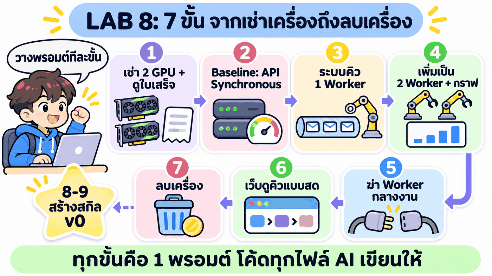

## รู้จักข้อมูลที่ใช้ทดสอบ

LAB นี้ **ไม่เทรนโมเดล** จึงใช้ Dataset เป็น **ชุดคำขอ** สำหรับยิงโหลดเท่านั้น

| หัวข้อ | CORD-v2 |
|---|---|
| เกี่ยวกับอะไร | Consolidated Receipt Dataset: ภาพถ่ายใบเสร็จร้านอาหารและร้านค้าในอินโดนีเซีย ถ่ายด้วยมือถือ พร้อมเฉลยเป็น JSON |
| ใครทำ | NAVER Clova (Park et al., 2019) |
| ต้นทาง | [naver-clova-ix/cord-v2 บน Hugging Face](https://huggingface.co/datasets/naver-clova-ix/cord-v2) |
| สัญญาอนุญาต | CC BY 4.0 |
| การแบ่งชุด | Training Set 800 · Validation Set 100 · Test Set 100 ใบ |
| LAB นี้ใช้ | Test Set 6 ใบ (ลำดับที่ 0, 2, 7, 20, 51, 92) อยู่ใน [samples/](samples/) · จำนวนรายการในแต่ละใบ: 1, 1, 1, 5, 4, 1 |


**เฉลย (label) ของใบเสร็จ 1 ใบ** · ตัวอย่าง `test_020` (เฉลยดิบทั้ง 6 ใบอยู่ที่ [results/gt_samples.json](results/gt_samples.json))

| ช่อง | ความหมาย | ค่าใน test_020 |
|---|---|---|
| `menu` | รายการในใบเสร็จ แต่ละรายการมี `nm` (ชื่อ) `cnt` (จำนวน) `price` (ราคารวมของบรรทัด) | 5 รายการ เช่น `steamed rice` จำนวน 4 ราคา 47,600 |
| `sub_total.subtotal_price` | ยอดก่อนค่าบริการและภาษี | 325,600 |
| `sub_total.service_price` / `tax_price` | ค่าบริการ / ภาษี | 17,908 / 34,351 |
| `total.total_price` | ยอดที่ต้องจ่าย | 377,859 |

ตัวเลขเก็บเป็นข้อความตามที่พิมพ์บนใบเสร็จ (หน่วยรูเปียห์ ใช้ทั้ง `,` และ `.` คั่นหลักพัน) และบางช่องไม่มีในบางใบ

**งาน 1 งานมีอะไรบ้าง**

| | ตัวยิงโหลด (ขั้นที่ 2–5) | เว็บ (ขั้นที่ 6) |
|---|---|---|
| ส่งเข้า | ใบเสร็จ 4 ใบ สุ่มจาก 6 ใบตัวอย่าง | ใบเสร็จ 1 ใบ |
| ได้กลับ | JSON ต่อใบ: `{items: [name, qty, price], subtotal, tax, total}` | แบบเดียวกัน |
| เวลาที่ GPU ใช้ | ราว 10–12 วินาที (ใบละ 2–5 วินาที ตามจำนวนรายการ) | 2–5 วินาที |

## รู้จักโมเดลที่ใช้


| หัวข้อ | Qwen3-VL-2B-Instruct (`Qwen/Qwen3-VL-2B-Instruct`) |
|---|---|
| ประเภท | Vision-Language Model (VLM): Vision Encoder แปลงภาพเป็นตัวเลข แล้ว Language Model เขียนคำตอบทีละ Token |
| Input | ภาพใบเสร็จ 1 ใบ + คำสั่งข้อความ (Prompt) |
| Output | ข้อความ JSON: รายการ (ชื่อ จำนวน ราคา) ยอดก่อนภาษี ภาษี ยอดรวม |
| ขนาด | ประมาณ 2 พันล้าน parameter · ไฟล์ 4.0 GB · ใช้ VRAM ราว 5 GB ต่อ Worker (RTX 3090 มี 24 GB) |
| ความเร็วที่วัดได้ | ใบละ 2–5 วินาที · 1 งาน (4 ใบ) ราว 11 วินาที บน RTX 3090 |
| ที่มา | [Alibaba Qwen บน Hugging Face](https://huggingface.co/Qwen/Qwen3-VL-2B-Instruct) |
| LAB นี้ใช้ทำอะไร | เป็น "งานของ GPU" ที่ใช้วัดความจุของระบบ · ใช้ Base Model ไม่ Fine-tune และอ่านแบบไม่สุ่ม (greedy) |

> LAB นี้วัด **ความจุของระบบ** ไม่ได้วัดความแม่นของโมเดล · Base Model อ่านผิดได้บ้าง เช่น ในขั้นที่ 6 อ่านยอดรวมของ `test_020` ได้ 377,059 (เฉลย 377,859) · การ Fine-tune ให้แม่นขึ้นอยู่ใน LAB 2

## ทฤษฎีที่ต้องรู้

### 1 · ผู้ใช้ 1 คน งาน 1 งาน และ SLO ของ LAB นี้

- **คืออะไร** *งาน 1 งาน* = ใบเสร็จ 4 ใบที่ส่งมาพร้อมกัน · *ผู้ใช้ 1 คน* = คนที่วนทำ 3 อย่าง: ส่งงาน → รอผล → คิด 10 วินาที (Think time) → ส่งงานใหม่ · *Concurrent Users (N)* = จำนวนคนที่วนอยู่ในระบบพร้อมกัน ไม่ใช่จำนวนคำขอต่อวินาที
- **ทำไมต้องนิยามแบบนี้** คำถามของธุรกิจคือ "รับคนได้กี่คน" · ผู้ใช้จริงไม่กดส่งรัว ๆ เขาดูผลและถ่ายรูปชุดถัดไปก่อน · การวนแบบนี้เรียกว่า **Closed loop**: เมื่อระบบช้า คนที่รอผลอยู่ยังไม่ส่งงานใหม่ โหลดจึงไม่โตเอง
- **ทำงานอย่างไร** ไล่ N = 1, 2, 4, 6, 8 … ระดับละ 75 วินาที ไม่นับ 15 วินาทีแรก · **SLO** (Service Level Objective) = เวลารอผล p95 ≤ 20 วินาที และงานล้ม < 1% · **"รองรับได้ N คน" = N มากที่สุดที่ยังผ่าน SLO**
- **ตัวเลขจาก LAB นี้** 1 งานใช้ GPU ราว 11 วินาที ผู้ใช้ 1 คนจึงส่งงานใหม่ทุกราว 21 วินาที (รอ 11 + คิด 10) หรือราว 2.9 งาน/นาที · GPU 1 ใบทำได้สูงสุด 5.44 งาน/นาที → รับได้ราว 5.44 ÷ 2.9 ≈ 1.9 คน · วัดจริงได้ **2 คน**

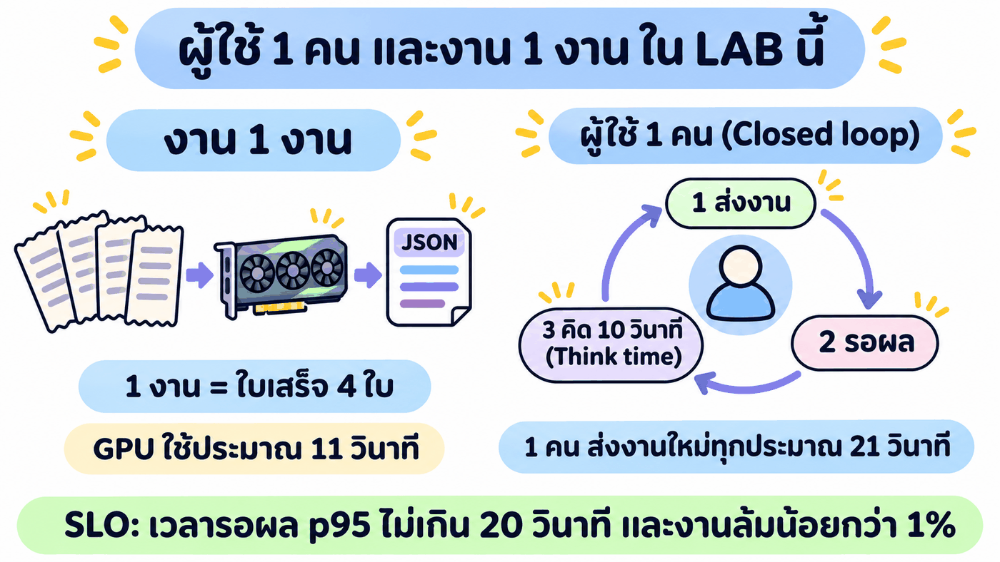

> ตัวเลข "2 คน" ไม่ได้แปลว่าระบบอ่อน แต่แปลว่า **งานหนัก** · ถ้างานเบาลง (เช่น ส่งใบละ 1 งาน) หรือ Think time ยาวขึ้น GPU ใบเดิมจะรับคนได้มากขึ้น · จึงต้องบอกนิยามของ "ผู้ใช้" และ "งาน" ทุกครั้งที่รายงานความจุ

การไล่ N เพิ่มทีละ 2 ทำให้ความจุที่ได้หยาบ (2 Worker อาจรับได้ 5 คน) จึงดู **งาน/นาที** และ **เวลาระบายคิวของงานถล่ม** ประกอบเสมอ · *งานถล่ม* = ส่ง 60 งานภายใน 10 วินาทีโดยไม่รอผล (Open loop) โหลดไม่ลดเองแม้ระบบช้า

### 2 · Throughput, Latency และ p50 / p95 / p99

- **คืออะไร** Throughput (X) = งานที่เสร็จต่อนาที · Latency (R) = เวลาตั้งแต่ส่งจนได้ผล · p95 = งาน 95% ได้ผลเร็วกว่าค่านี้ (p50 = ครึ่งหนึ่ง, p99 = 99%)
- **ทำไมต้องใช้** ค่าเฉลี่ยซ่อนคนที่รอนาน · SLO ของระบบจริงจึงเขียนด้วย percentile
- **ทำงานอย่างไร** ก่อน GPU อิ่มตัว เวลารอผล ≈ เวลาอ่าน 1 งาน · หลังอิ่มตัว Throughput ไม่เพิ่มแล้ว คนที่เพิ่มเข้ามาคือคิวที่ยาวขึ้น เส้น Latency จึง **หักศอก** แล้วชันขึ้นเป็นเส้นตรง


**ตัวเลขจาก LAB นี้**

| แบบ | N | p50 | p95 | p99 | อ่านว่า |
|---|---|---|---|---|---|
| คิว 2 Worker | 4 | 12.1 s | 13.9 s | 14.1 s | ยังไม่อิ่มตัว เวลารอ ≈ เวลาอ่าน 1 งาน |
| คิว 2 Worker | 6 | 22.1 s | 25.2 s | 25.2 s | อิ่มตัวแล้ว ทุกคนรอคิว p95 เกิน SLO |
| คิว 1 Worker งานถล่ม | 60 งาน | 336 s | 624 s | – | งานท้ายคิวรอนานกว่างานกลางคิวเกือบ 2 เท่า |

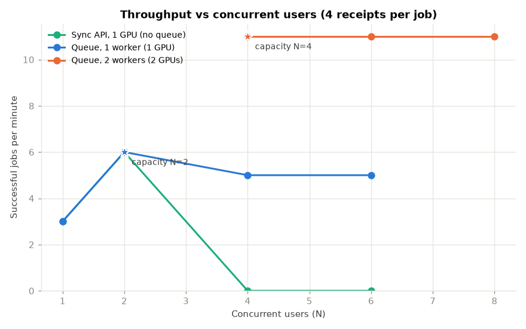

### 3 · กฎของ Little (Little's Law) และจุดอิ่มตัว

- **คืออะไร** สำหรับ Closed loop: **N = X × (R + Z)** · N = ผู้ใช้พร้อมกัน, X = Throughput, R = เวลารอผล, Z = Think time
- **ทำไมต้องใช้** ทำนายได้โดยไม่ต้องวัดทุกระดับ: เมื่อ GPU ทำได้สูงสุด X_max แล้วเพิ่ม N ต่อ เวลารอผลจะโตเป็นเส้นตรง **R ≈ N ÷ X_max − Z** · จุดอิ่มตัว **N\* ≈ X_max × (S + Z)** เมื่อ S คือเวลาอ่าน 1 งาน
- **ทำงานอย่างไร** ใช้ X_max จากงานถล่ม (ช่วงที่ GPU ทำงานเต็มตลอด): 1 Worker = 5.44 งาน/นาที = 0.0907 งาน/วินาที · S ≈ 11 วินาที · Z = 10 วินาที → N\* ≈ 0.0907 × 21 ≈ 1.9 คน


**ตัวเลขจาก LAB นี้** (ทำนายเทียบวัดจริง)

| แบบ | N | ทำนาย R = N ÷ X − 10 | วัดได้ (p50) |
|---|---|---|---|
| คิว 1 Worker (X = 0.0907/s) | 4 | 34 s | 34.3 s |
| คิว 1 Worker | 6 | 56 s | 55.3 s |
| คิว 2 Worker (X = 0.181/s) | 6 | 23 s | 22.1 s |
| คิว 2 Worker | 8 | 34 s | 32.7 s |

ใช้ออกแบบได้: อยากรับ 10 คนที่ R ≤ 20 วินาที ต้องมี X ≥ 10 ÷ (20 + 10) = 0.33 งาน/วินาที ≈ **4 Worker** (ค่าคำนวณ)

### 4 · API แบบ Synchronous กับ Job Queue

- **คืออะไร** *Synchronous* = ผู้ใช้เปิดการเชื่อมต่อค้างไว้จนได้ผล งานที่มาพร้อมกันต่อแถวอยู่ในหน่วยความจำของ server · *Job Queue* = `POST /jobs` ได้ `job_id` กลับทันที งานไปรอในคิว Worker หยิบไปทำ แล้วผู้ใช้ถามผลที่ `GET /jobs/{id}` เป็นระยะ
- **ทำไมต้องใช้คิว** แบบ Synchronous มีปัญหา 3 ข้อเมื่อโหลดเกิน: (1) ผู้ใช้รอจน timeout แล้วเลิก (2) server ไม่รู้ว่าผู้ใช้ไปแล้ว ยัง **อ่านงานที่ไม่มีใครรอ** งานใหม่ต้องต่อหลังงานพวกนี้จึงล้มเป็นลูกโซ่ (3) server ดับ = งานที่รออยู่หายหมด
- **ทำงานอย่างไร** คิวแยก "คนรับงาน" (gateway) ออกจาก "คนทำงาน" (Worker) · การเชื่อมต่อของผู้ใช้ปิดทันทีที่ได้ `job_id` จึงไม่มี timeout ฝั่งผู้ใช้ และเพิ่ม Worker ได้โดยไม่แก้ฝั่งผู้ใช้


**ตัวเลขจาก LAB นี้** (GPU 1 ใบเท่ากัน)

| สถานการณ์ | API Synchronous | คิว 1 Worker |
|---|---|---|
| N = 2 | p95 11.8 s · ล้ม 0% | p95 15.8 s · ล้ม 0% |
| N = 4 | **ล้ม 100%** | ล้ม 0% · p95 36.7 s (ช้า แต่ได้ผลครบ) |
| งานถล่ม 60 งาน | ได้ผล **2/60** | ได้ผล **60/60** · รอ p95 624 s |
| เวลาตอบรับงาน | – | `POST /jobs` 0.03–0.11 s |

> **คิวไม่ทำให้ GPU เร็วขึ้น** · ความจุของ GPU 1 ใบยังเป็น 2 คนทั้งสองแบบ (คิวช้ากว่าเล็กน้อยเพราะมีขั้นส่งต่อและการถามผลเป็นระยะ) · สิ่งที่คิวให้คือ เปลี่ยน "ล้มเพราะ timeout" เป็น "รอนานขึ้นแต่ได้ผลครบ" และเปิดทางให้เพิ่ม Worker


### 5 · RabbitMQ: ทำงานอย่างไร และทำไมงานไม่หาย

RabbitMQ คือ **Message Broker**: โปรแกรมกลางที่รับข้อความจากฝั่งส่ง เก็บไว้ แล้วส่งต่อให้ฝั่งรับ · ใน LAB นี้ "ข้อความ" 1 ข้อความ = งานอ่านใบเสร็จ 1 งาน

#### 5.1 · Producer → Exchange → Queue → Consumer


| ส่วน | คืออะไร | ทำไมต้องมี | ใน LAB นี้ |
|---|---|---|---|
| Producer | โปรแกรมที่ส่งข้อความเข้า RabbitMQ | แยกคนรับงานออกจากคนทำงาน | gateway: `POST /jobs` → ส่ง 1 ข้อความต่อ 1 งาน แล้วตอบ `job_id` ใน 0.03–0.11 วินาที |
| Exchange | ตัวรับข้อความ แล้วตัดสินว่าไปคิวไหน | Producer ไม่ต้องรู้ว่ามีคิวอะไรบ้าง | Default Exchange (ไม่ต้องประกาศเอง) |
| Queue | ที่พักข้อความ (บัฟเฟอร์) | สองฝั่งไม่ต้องเร็วเท่ากัน ไม่ต้องออนไลน์พร้อมกัน | `receipts.jobs` (งาน) · `receipts.events` (Worker แจ้งสถานะกลับ gateway) · `receipts.jobs.dlq` (งานพัง) |
| Consumer | โปรแกรมที่หยิบข้อความไปทำ | เพิ่มหรือลดจำนวนได้อิสระ | Worker 1 ตัวต่อ GPU 1 ใบ |

**หลักฐานจาก LAB นี้** ตอนงานถล่ม gateway รับ 60 งานเสร็จใน 10 วินาที ทั้งที่ Worker ต้องใช้ 651 วินาทีจึงอ่านหมด · สองฝั่งทำงานคนละความเร็วได้เพราะมีคิวคั่นกลาง

#### 5.2 · Routing key และชนิดของ Exchange

- **คืออะไร** Routing key = ป้ายที่ติดมากับข้อความ Exchange ใช้ป้ายนี้เลือกคิว · ชนิดของ Exchange: **Direct** (ป้ายตรงกันเป๊ะ) · **Topic** (ตรงตามรูปแบบ เช่น `receipt.*`) · **Fanout** (ส่งสำเนาไปทุกคิว)
- **ทำไมต้องใช้** เมื่อมีงานหลายชนิด (ใบเสร็จ ใบกำกับภาษี งานด่วน) แยกเข้าคนละคิวได้ โดย Producer แค่ติดป้ายให้ถูก
- **ทำงานอย่างไร / ใน LAB นี้** งานมีชนิดเดียว จึงใช้ Default Exchange ซึ่งเป็น Direct แบบง่ายที่สุด: **routing key = ชื่อคิว** (`receipts.jobs`) · ทิศทางกลับก็ใช้คิว: Worker ส่งสถานะ running/done เข้า `receipts.events` ให้ gateway อ่าน

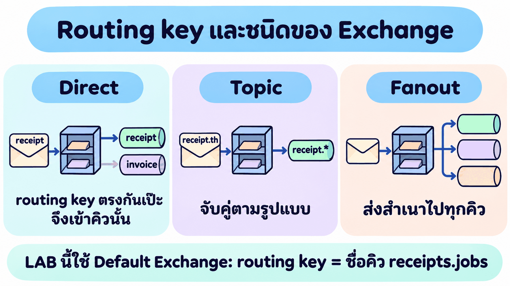

#### 5.3 · Competing Consumers: Worker หลายตัวแย่งงานจากคิวเดียว

- **คืออะไร** Consumer หลายตัวต่อคิวเดียวกัน · ข้อความ 1 ชิ้นไปถึง Consumer **ตัวเดียว** เท่านั้น
- **ทำไมต้องใช้** เพิ่มความจุด้วยการเพิ่ม Worker (Scale out) โดยไม่แก้ gateway หรือฝั่งผู้ใช้ · Worker ที่ช้ากว่าได้งานน้อยลงเอง
- **ทำงานอย่างไร** RabbitMQ แจกงานให้ Worker ที่ว่าง (เมื่อใช้ Prefetch = 1) · ใน LAB เปิด Worker ตัวที่ 2 บน GPU ใบที่ 2 ต่อเข้าคิว `receipts.jobs` เดิม


**หลักฐานจาก LAB นี้** งานถล่ม 60 งาน Worker 2 ตัวแบ่งกันได้ **30 / 30** งานพอดี · เวลาระบายคิว 651 → 319 วินาที · 5.44 → 10.88 งาน/นาที (2.0 เท่า)

#### 5.4 · Acknowledgement (ack) และการส่งซ้ำเมื่อ Worker ตาย

- **คืออะไร** ack = Worker แจ้ง RabbitMQ ว่า "ทำเสร็จแล้ว ลบข้อความได้" · ถ้าการเชื่อมต่อของ Worker ขาดก่อน ack ข้อความจะกลับเข้าคิว แล้วถูกส่งให้ Worker ตัวอื่นพร้อมธง `redelivered`
- **ทำไมต้องใช้** ถ้า ack ตั้งแต่ตอนรับงาน (auto-ack) แล้ว Worker ดับกลางงาน งานนั้นหายถาวร · ack หลังทำเสร็จ = **At-least-once delivery**: งานไม่หาย แต่อาจถูกทำ 2 ครั้ง ผลจึงต้องเขียนทับได้ (Idempotent: ผลของ `job_id` เดิมเขียนทับของเดิม)
- **ทำงานอย่างไร / ใน LAB นี้** Worker ส่ง ack หลังอ่านครบและบันทึกผลแล้วเท่านั้น · ขั้นที่ 5 ส่งงานถล่ม 60 งาน แล้วฆ่า Worker ของ GPU ใบที่ 2 ด้วย SIGKILL ที่วินาทีที่ 20


**หลักฐานจาก LAB นี้** ส่ง 60 · เสร็จ 60 · หาย 0 · งาน `d8a6166ead19` อยู่ในมือ GPU1 ตอนถูกฆ่า → ถูกส่งซ้ำให้ GPU0 (ส่ง 2 ครั้ง) เสร็จที่วินาทีที่ 33.2 · GPU0 ทำ 58 งาน GPU1 ทำ 2 งานก่อนตาย

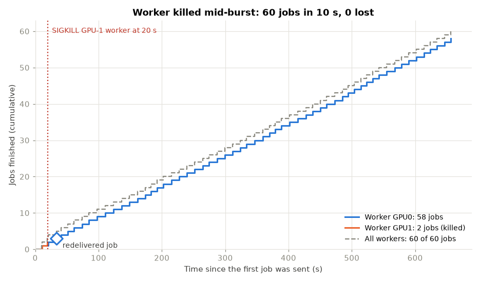

#### 5.5 · Prefetch (QoS): ทำไมงาน GPU ใช้ Prefetch = 1

- **คืออะไร** Prefetch = จำนวนข้อความที่ยังไม่ ack ที่ Consumer ถือไว้ได้พร้อมกัน
- **ทำไมต้องตั้ง** ถ้าไม่จำกัด Worker ตัวแรกที่ต่อคิวจะกวาดงานไปถือไว้ทั้งหมด Worker อื่นว่าง และถ้าตัวนั้นดับ งานทั้งกองต้องส่งซ้ำ
- **ทำงานอย่างไร** งานที่นานหลายวินาทีใช้ **Prefetch = 1**: ถือทีละงาน ที่เหลืออยู่ในคิวกลาง ใครว่างก่อนได้ก่อน · งานสั้นระดับมิลลิวินาทีจึงค่อยใช้ค่าสูงขึ้นเพื่อลดเวลาไป-กลับ


**หลักฐานจาก LAB นี้** ตอนฆ่า Worker คิวเหลือ 55 งาน แต่มีงานส่งซ้ำ **แค่ 1 งาน** (งานที่อยู่ในมือ) · และงานถล่มแบ่งได้ 30/30 เท่ากัน ทั้งสองอย่างเป็นผลของ Prefetch = 1

#### 5.6 · Durable Queue + Persistent Message

- **คืออะไร** Durable = นิยามของคิวรอดเมื่อ RabbitMQ รีสตาร์ต · Persistent = ตัวข้อความถูกเขียนลงดิสก์
- **ทำไมต้องใช้** ต้องมี **ทั้งสองอย่าง** งานในคิวจึงไม่หายเมื่อ Broker ดับ (คิว Durable แต่ข้อความไม่ Persistent = คิวกลับมาแต่ว่างเปล่า)
- **ทำงานอย่างไร / ใน LAB นี้** คิวทั้ง 3 ประกาศแบบ Durable และ gateway ส่งทุกงานแบบ Persistent · ค่าเหล่านี้อยู่ในไฟล์เดียว ([code_reference/common.py](code_reference/common.py)) ให้ gateway กับ Worker ใช้ตรงกัน
- **ข้อจำกัด** LAB นี้ทดลองเฉพาะ Worker ดับ ไม่ได้ทดลองรีสตาร์ต RabbitMQ

#### 5.7 · Dead-letter Queue (DLQ)

- **คืออะไร** คิวสำรองสำหรับข้อความที่ถูกปฏิเสธ (nack แบบไม่ส่งกลับคิว)
- **ทำไมต้องใช้** งานพิษ (Poison message เช่น ไฟล์รูปเสีย) ไม่ควรวนกลับคิวหลักไม่รู้จบ และไม่ควรหายเงียบ ๆ · ทีมเปิด DLQ มาดูแล้วแก้หรือส่งใหม่ได้
- **ทำงานอย่างไร / ใน LAB นี้** คิว `receipts.jobs` ตั้งปลายทาง Dead-letter เป็น `receipts.jobs.dlq` · Worker ที่อ่านงานแล้วโค้ดพังจะ nack → งานไป DLQ และสถานะเป็น `failed`
- **ตัวเลขจาก LAB นี้** ตลอดการทดลอง DLQ = 0 (ไม่มีงานพัง) · LAB นี้ไม่ได้ส่งรูปเสียเพื่อทดสอบ DLQ

#### 5.8 · Backpressure: จำกัดความยาวคิว

- **คืออะไร** เมื่อระบบรับไม่ไหว ให้ "ดันกลับ" ไปที่ผู้ส่ง แทนการรับไว้ทั้งหมด
- **ทำไมต้องใช้** คิวยาวไม่จำกัด = เวลารอยาวไม่จำกัด · งานที่ 1000 ในคิวของ 1 Worker ต้องรอราว 1000 × 11 วินาที ≈ 3 ชั่วโมง · ปฏิเสธเร็ว ๆ ให้ผู้ใช้ลองใหม่ภายหลังดีกว่า
- **ทำงานอย่างไร / ใน LAB นี้** คิวยาวได้ไม่เกิน 1000 งาน เกินแล้ว gateway ตอบ `503`
- **ตัวเลขจาก LAB นี้** งานถล่ม 60 งาน คิวยาวสุด 58 งาน ยังไม่ถึงเพดาน · แต่แค่ 60 งานก็รอ p95 = 624 วินาทีแล้ว (1 Worker)


#### 5.9 · Queue กับ Load Balancer เหมาะกับงานแบบไหน


| | Load Balancer (LAB 6–7) | Message Queue (LAB 8) |
|---|---|---|
| งานที่เหมาะ | สั้น (มิลลิวินาที–1 วินาที) ผู้ใช้รอคำตอบทันที | นาน (หลายวินาที–นาที) ส่งแล้วกลับมาดูผลได้ |
| การเชื่อมต่อ | ค้างไว้จนได้คำตอบ | ปิดทันทีหลังได้ `job_id` |
| เมื่อโหลดเกิน | คำขอ timeout / ล้ม | งานรอในคิว ไม่หาย (จนถึงเพดาน Backpressure) |
| Worker ดับกลางงาน | คำขอนั้นล้ม | งานถูกส่งซ้ำให้ Worker อื่น |
| การแจกงาน | Load Balancer **ผลัก** งานไปหา server (Push) | Worker **ดึง** งานเมื่อว่าง (Pull) |
| ต้นทุน | ง่าย Latency ต่ำ | มีส่วนประกอบเพิ่ม (Broker, ที่เก็บผล, การถามผลเป็นระยะ) |

**ตัวเลขจาก LAB นี้** งาน 1 งานใช้ราว 11 วินาที และตอนงานถล่มต้องรอได้ถึง 624 วินาที เกินเพดาน 30 วินาทีของการถือสายรอไปมาก จึงเป็นงานของ Queue · ต้นทุนที่จ่ายคือ p95 ที่ N = 2 ช้าลงจาก 11.8 เป็น 15.8 วินาที

### 6 · Scaling Efficiency

- **คืออะไร** Efficiency = ความจุของ k ใบ ÷ (k × ความจุของ 1 ใบ) · 100% = เพิ่ม GPU เท่าไรได้ความจุเพิ่มเท่านั้น (เส้น Ideal)
- **ทำไมต้องวัด** GPU ใบที่ 2 มีค่าเช่าเท่าใบแรก ต้องรู้ว่าได้ความจุกลับมาเท่าไร
- **ทำงานอย่างไร** เทียบระบบคิว 2 Worker กับระบบคิว 1 Worker ด้วยวิธีวัดเดียวกัน


**ตัวเลขจาก LAB นี้**

| ตัววัด | 1 ใบ | 2 ใบ | เท่า | Efficiency |
|---|---|---|---|---|
| ผู้ใช้พร้อมกัน (N) | 2 | 4 | 2.0× | 100% |
| งาน/นาที ตอนงานถล่ม (GPU ทำงานเต็มตลอด) | 5.44 | 10.88 | 2.0× | 100% |
| งาน/นาที ช่วงวัด 60 วินาที | 6.0 | 11.0 | 1.83× | 92% |
| เวลาระบายงานถล่ม 60 งาน | 651 s | 319 s | 2.04× | – |
| **3 ใบ (ประมาณการ ไม่ใช่ผลวัด)** | | ~6 คน · ~16.5 งาน/นาที · ระบาย ~221 s | ~3× | สมมติเท่าที่วัดได้ที่ 2 ใบ |

- ค่า 92% มาจากความหยาบของการนับ: งานละ ~11 วินาที ใน 60 วินาทีนับได้ไม่กี่งาน · ตัวเลขตอนงานถล่มแม่นกว่า
- ได้ใกล้ Ideal เพราะ Worker 2 ตัวทำงานอิสระต่อกัน และ gateway, RabbitMQ, CPU ยังไม่เป็นคอขวด · จะต่ำกว่า 100% เมื่อมีคอขวดร่วม เช่น CPU ของเครื่อง ที่เก็บผล หรือเน็ตที่ใช้อัปโหลดรูป

### 7 · ในระบบจริง ส่วนประกอบอยู่คนละเครื่อง

- **คืออะไร** ใน LAB ทุกส่วน (gateway, RabbitMQ, SQLite, Worker 2 ตัว, ตัวยิงโหลด) อยู่บนเครื่องเช่าเครื่องเดียว
- **ทำไม LAB ทำแบบนี้** ประหยัดค่าเช่า และตัดเวลาของเครือข่ายออกจากผลวัด
- **ระบบจริงทำอย่างไร** gateway หลายตัวหลัง Load Balancer · RabbitMQ เป็น Cluster · สถานะและผลอยู่ใน PostgreSQL หรือ Redis · รูปอยู่ใน Object Storage (ข้อความในคิวเก็บแค่ที่อยู่ของรูป) · Worker อยู่บนเครื่อง GPU หลายเครื่อง เพิ่มหรือลดอัตโนมัติตามความยาวคิว (Autoscale)
- **ตัวเลขจาก LAB นี้** CPU ของตัวยิงโหลดสูงสุด 1.7% จึงไม่รบกวนผลวัด แม้อยู่เครื่องเดียวกับ server


## การทดลอง

| หัวข้อ | รายละเอียด |
|---|---|
| โหลด | Closed loop: ผู้ใช้จำลอง N คน ส่งงาน (สุ่มใบเสร็จ 4 ใบจาก 6 ใบ) → รอผล → คิด 10 วินาที → ส่งใหม่ · ระดับละ 75 วินาที ไม่นับ 15 วินาทีแรก · N = 1, 2, 4, 6, 8 … หยุดเมื่อไม่ผ่าน 2 ระดับติดกัน |
| งานถล่ม | Open loop: 60 งานภายใน 10 วินาที · บันทึกความยาวคิวทุก 1 วินาที |
| โมเดล | `Qwen/Qwen3-VL-2B-Instruct` (Base Model) อ่านแบบไม่สุ่ม |
| เทียบ A กับ B | A = API Synchronous บน GPU 1 ใบ · B1 = ระบบคิว 1 Worker (GPU 1 ใบ) · B2 = ระบบคิว 2 Worker (GPU 2 ใบ) |
| SLO | เวลารอผล p95 ≤ 20 วินาที และงานล้ม < 1% · แบบ Synchronous ผู้ใช้รอได้ไม่เกิน 30 วินาที (เกิน = ล้ม) |
| ทดลองเสริม | ฆ่า Worker ของ GPU ใบที่ 2 (SIGKILL) ที่วินาทีที่ 20 ของงานถล่ม |
| เครื่อง | เครื่องเดียว 2× RTX 3090 (24 GB/ใบ) CPU 12 cores ที่ Quebec แคนาดา · $0.394/ชม. รวม disk 40 GB |
| เวลาและค่าเช่าจริง | เครื่องเปิด 1.985 ชั่วโมง (ขั้นที่ 1–7) · **$0.781** |

## ขั้นที่ 1 · เช่าเครื่อง 2 GPU และดูตัวอย่างใบเสร็จ

AI เช่าเครื่อง โหลดโมเดลกับ Test Set แล้วทำภาพตัวอย่างใบเสร็จ 6 ใบคู่กับเฉลย

```text
ทำงานใน container `multi-account` โฟลเดอร์ /workspace/vastapp_lab ด้วยสกิล vastai

เช่าเครื่อง GPU สำหรับทดลองระบบคิวอ่านใบเสร็จ แล้วดูว่าใบเสร็จที่จะใช้หน้าตาเป็นอย่างไร
1. เช่าเครื่องเดียวที่มี RTX 3090 2 ใบ ราคารวมไม่เกิน $0.60 ต่อชั่วโมง ตั้งป้ายเครื่องว่า vapp-lab8
2. เลือกเครื่อง verified ที่ SSH ตรงได้ เน็ตขาเข้า 500 Mbps ขึ้นไป CPU 12 cores ขึ้นไป ใช้ image PyTorch disk 40 GB และเปิดพอร์ต 8000 ไว้ให้เว็บเรียกจากภายนอก
3. รอจนเครื่องพร้อมและเข้าไปเห็น GPU ครบ 2 ใบ ถ้าเกิน 10 นาทียังไม่พร้อม ให้ลบแล้วเช่าเครื่องอื่น
4. ดาวน์โหลดโมเดล Qwen/Qwen3-VL-2B-Instruct และ Test Set ของ Dataset naver-clova-ix/cord-v2 จาก Hugging Face ไว้บนเครื่องที่เช่า
5. ทำภาพตัวอย่าง 1 ภาพจากใบเสร็จ 6 ใบใน lab8_job_queue/samples ของโฟลเดอร์ปัจจุบัน (ชื่อไฟล์บอกลำดับใน Test Set): เรียงเป็นตาราง แต่ละใบคู่กับ JSON เฉลย (รายการ จำนวน ราคา ยอดรวม)
   เก็บกลับมาที่ lab8_job_queue/results/dataset_samples.jpg ของโฟลเดอร์ปัจจุบัน
6. ยกเฉลยของใบเสร็จ 1 ใบมาให้ดู แล้วอธิบายว่าแต่ละช่องหมายถึงอะไร
กุญแจ SSH อยู่ที่ /workspace/vastai_lab/Devtool_SSH/devtoolSSH

สรุปเป็นตารางภาษาไทย: GPU · ราคาต่อชั่วโมง · ที่ตั้ง · CPU cores · เวลาที่รอจนเครื่องพร้อม · จำนวนใบเสร็จใน Test Set · จำนวนรายการในใบเสร็จตัวอย่างแต่ละใบ แล้วบอกว่าเครื่องยังเปิดอยู่
```


*ใช้เวลาราว 5 นาที · เครื่องพร้อมใน 34 วินาที · ภาพที่ได้คือ [results/dataset_samples.jpg](results/dataset_samples.jpg) (ดูหัวข้อ [รู้จักข้อมูลที่ใช้ทดสอบ](#รู้จักข้อมูลที่ใช้ทดสอบ))*

ตัวอย่างโค้ดที่ AI เขียนให้ในรอบจริง (ของคุณอาจต่างกัน): [code_reference/make_samples_grid.py](code_reference/make_samples_grid.py)

**อ่านผลอย่างไร**

- ตรวจ 3 อย่าง: เห็น GPU ครบ 2 ใบ · ราคารวมไม่เกิน $0.60/ชม. · มีไฟล์ `results/dataset_samples.jpg`
- AI ข้ามเครื่องที่ถูกกว่าในบางประเทศ เพราะมักดาวน์โหลดจาก Hugging Face ไม่ได้ · ราคาถูกสุดไม่ใช่เครื่องที่ดีสุดเสมอ
- ถ้าเครื่องไม่พร้อมใน 10 นาที AI จะลบแล้วเช่าเครื่องอื่นเอง เป็นเรื่องปกติของเครื่องเช่า
- **เครื่องเริ่มคิดเงินแล้ว** ทำต่อให้ถึงขั้นที่ 7

## ขั้นที่ 2 · Baseline: API ตรงบน GPU 1 ใบ รับผู้ใช้พร้อมกันได้กี่คน

AI เขียน `sync_api.py` (API แบบ Synchronous) และ `loadtest.py` (ตัวยิงโหลด) แล้วไล่ N และยิงงานถล่ม

```text
ทำงานใน container `multi-account` โฟลเดอร์ /workspace/vastapp_lab ด้วยสกิล vastai
เครื่องที่ใช้คือเครื่องป้าย vapp-lab8 · กุญแจ SSH อยู่ที่ /workspace/vastai_lab/Devtool_SSH/devtoolSSH

เขียนโค้ด 2 ชิ้นไว้ใน lab8_job_queue/code ของโฟลเดอร์ปัจจุบัน แล้ววัด Baseline: GPU 1 ใบ แบบไม่มีคิว รับผู้ใช้พร้อมกันได้กี่คน
1. lab8_job_queue/code/sync_api.py = API แบบ synchronous บน GPU ใบแรกใบเดียว มี API key: รับงาน 1 งาน (รูปใบเสร็จหลายใบ) แล้วตอบผลในการเชื่อมต่อเดิม
   ให้ Qwen/Qwen3-VL-2B-Instruct อ่านทีละใบแบบไม่สุ่ม ได้ JSON {items: [name, qty, price], subtotal, tax, total}
   GPU อ่านได้ทีละงาน งานอื่นต่อแถวรอใน server · บอกได้ว่าอ่านเสร็จไปแล้วกี่งาน
2. lab8_job_queue/code/loadtest.py = ตัวยิงโหลดที่รันบนเครื่องเดียวกับ server: ผู้ใช้จำลอง N คน แต่ละคนส่งงาน (สุ่มใบเสร็จ 4 ใบจาก lab8_job_queue/samples ของโฟลเดอร์ปัจจุบัน) → รอผล → คิด 10 วินาที → ส่งใหม่
   ระดับละ 75 วินาที ไม่นับ 15 วินาทีแรก · วัดงาน/นาที เวลารอผล p50/p95/p99 % ล้ม GPU util และ CPU ของตัวยิง
   มีโหมดงานถล่ม 60 งานภายใน 10 วินาที · บันทึกผลทุกการทดลองเป็น JSON
3. ผู้ใช้รอได้ไม่เกิน 30 วินาที เกินนับเป็นล้ม · SLO = p95 ≤ 20 วินาที และล้มน้อยกว่า 1% · ไล่ N = 1, 2, 4, 6, 8, … (เพิ่มทีละ 2) หยุดเมื่อไม่ผ่าน SLO 2 ระดับติดกัน แล้วตามด้วยงานถล่ม
ให้ server ทำงานต่อได้แม้การเชื่อมต่อหลุด การยิงโหลดใช้เวลาหลายนาที ให้รันเบื้องหลังแล้วรอจนจบ

ห้ามแสดงค่า key · สรุปเป็นตารางภาษาไทย: N · งาน/นาที · p50 · p95 · % ล้ม · GPU util · CPU ตัวยิง และประโยค "GPU 1 ใบ รองรับผู้ใช้พร้อมกันได้ N คน ที่ p95 ≤ 20 วินาที"
ผลงานถล่ม: สำเร็จกี่งาน · ล้มกี่งาน · server อ่านงานที่ผู้ใช้เลิกรอไปแล้วกี่งาน แล้วบอกว่าเครื่องยังเปิดอยู่
```


*ใช้เวลาราว 33 นาที (งานถล่มบน GPU 1 ใบกินราว 10 นาที)*

| N | งาน/นาที | p50 | p95 | % ล้ม | GPU util | SLO |
|---|---|---|---|---|---|---|
| 1 | 3.0 | 12.1 s | 12.2 s | 0 | 24.9% | ผ่าน |
| **2** | 6.0 | 9.6 s | 11.8 s | 0 | 45.5% | **ผ่าน** |
| 4 | 0.0 | 30.0 s | 30.0 s | 100 | 47.0% | ไม่ผ่าน |
| 6 | 0.0 | 30.0 s | 30.0 s | 100 | 47.0% | ไม่ผ่าน |

ตัวอย่างโค้ดที่ AI เขียนให้ในรอบจริง (ของคุณอาจต่างกัน): [code_reference/sync_api.py](code_reference/sync_api.py) · [code_reference/loadtest_sync.py](code_reference/loadtest_sync.py) · ผลดิบ: [results/baseline/](results/baseline/sweep_summary.json)

**อ่านผลอย่างไร**

- **GPU 1 ใบ รองรับผู้ใช้พร้อมกันได้ 2 คน ที่ p95 ≤ 20 วินาที**
- ที่ N = 4 ไม่ได้ล้มบางส่วน แต่ **ล้ม 100%**: ผู้ใช้เลิกรอที่ 30 วินาที แต่ server ยังอ่านงานนั้นต่อ งานใหม่ต้องรอหลังงานที่ไม่มีใครต้องการ จึงล้มเป็นลูกโซ่
- งานถล่ม 60 งาน: ได้ผล 2 งาน · GPU ทำงานต่อจนถึงวินาทีที่ 621 เพื่ออ่านอีก 58 งานที่ไม่มีใครรอแล้ว
- GPU util ราว 45% **ไม่ได้แปลว่า GPU ว่าง**: โมเดลสร้างคำตอบทีละ Token และเสียเวลาฝั่ง CPU ระหว่าง Token · GPU ทำได้ทีละงานอยู่ดี

## ขั้นที่ 3 · ระบบคิว: API gateway + RabbitMQ + GPU Worker 1 ตัว

AI เขียน `gateway.py` และ `worker.py` ติดตั้ง RabbitMQ ปรับ `loadtest.py` ให้ส่งผ่านคิว แล้ววัดซ้ำบน GPU ใบเดิม

```text
ทำงานใน container `multi-account` โฟลเดอร์ /workspace/vastapp_lab ด้วยสกิล vastai
เครื่องที่ใช้คือเครื่องป้าย vapp-lab8 · กุญแจ SSH อยู่ที่ /workspace/vastai_lab/Devtool_SSH/devtoolSSH

เขียนระบบคิวไว้ใน lab8_job_queue/code ของโฟลเดอร์ปัจจุบัน แล้ววัดซ้ำบน GPU 1 ใบด้วยวิธีและ SLO เดียวกับขั้นที่ 2
1. lab8_job_queue/code/gateway.py = API gateway พอร์ต 8000 มี API key เก็บสถานะและผลทุกงานใน SQLite
   POST /jobs รับงานแล้วคืน job_id ทันที · GET /jobs/{id} สถานะ (queued/running/done/failed) Worker ที่ทำ เวลารอคิว เวลารวม และผลอ่าน · GET /jobs งานล่าสุด
   GET /stats ความยาวคิว · Worker ที่ต่ออยู่ (กำลังทำงานไหน ทำเสร็จกี่งาน) · จำนวนงานแต่ละสถานะ · งานที่ถูกส่งซ้ำ
2. lab8_job_queue/code/worker.py = GPU Worker 1 ตัวต่อ GPU 1 ใบ อ่านใบเสร็จแบบเดียวกับ sync_api.py
   คิวใน RabbitMQ เป็น durable และข้อความ persistent · prefetch = 1 · ack หลังอ่านเสร็จเท่านั้น · งานที่พังไป dead-letter queue · คิวยาวได้ไม่เกิน 1000 งาน (เกินแล้ว gateway ตอบ 503)
3. ติดตั้ง RabbitMQ พร้อมหน้า management ปิด API แบบ synchronous แล้วเปิด gateway กับ Worker 1 ตัวบน GPU ใบแรก (ทำงานต่อได้แม้การเชื่อมต่อหลุด) ทดสอบส่ง 1 งาน
4. ปรับ loadtest.py ให้ส่งผ่านคิว (ส่งงาน → ถามผลจนเสร็จ ไม่มีเพดาน 30 วินาที) บันทึกความยาวคิวทุก 1 วินาทีตอนงานถล่ม แล้วยิงโหลดแบบเดียวกับขั้นที่ 2 ทุกอย่าง (ไล่ N + งานถล่ม 60 งาน) รันเบื้องหลังแล้วรอจนจบ

ห้ามแสดงค่า key · สรุปเป็นตารางภาษาไทย เทียบ Baseline กับคิว 1 Worker ที่ N เดียวกัน: p95 · % ล้ม · งาน/นาที
และงานถล่ม 60 งาน: สำเร็จกี่งาน · เวลารอผล p95 · คิวยาวสุด · ระบายคิวหมดในกี่วินาที แล้วบอกว่าเครื่องยังเปิดอยู่
```


*ใช้เวลาราว 34 นาที (งานถล่มระบายราว 11 นาที)*

| N | p95 Baseline | p95 คิว 1 Worker | % ล้ม Baseline | % ล้ม คิว | งาน/นาที Baseline | งาน/นาที คิว | รอคิว p95 | คิวยาวสุด |
|---|---|---|---|---|---|---|---|---|
| 1 | 12.2 s | 13.0 s | 0 | 0 | 3.0 | 3.0 | 0.1 s | 0 |
| **2** | 11.8 s | 15.8 s | 0 | 0 | 6.0 | 6.0 | 4.0 s | 1 |
| 4 | 30.0 s | 36.7 s | **100** | **0** | 0.0 | 5.0 | 24.8 s | 3 |
| 6 | 30.0 s | 57.7 s | **100** | **0** | 0.0 | 5.0 | 45.0 s | 5 |

| งานถล่ม 60 งาน | Baseline | คิว 1 Worker |
|---|---|---|
| สำเร็จ | 2 / 60 | **60 / 60** |
| เวลารอผล p50 / p95 | 30.0 / 30.0 s (เลิกรอ) | 336 / 624 s |
| คิวยาวสุด | – | 58 งาน |
| ระบายคิวหมดใน | GPU อ่านจบที่ 621 s แต่ผู้ใช้ได้ผล 2 งาน | 651 s |
| งาน/นาที ที่ผู้ใช้ได้รับ | 0.19 | 5.44 |

ตัวอย่างโค้ดที่ AI เขียนให้ในรอบจริง (ของคุณอาจต่างกัน): [code_reference/gateway.py](code_reference/gateway.py) · [code_reference/worker.py](code_reference/worker.py) · [code_reference/common.py](code_reference/common.py) · [code_reference/loadtest.py](code_reference/loadtest.py) · ผลดิบ: [results/queue_1worker/](results/queue_1worker/sweep_summary.json)

**อ่านผลอย่างไร**

- ความจุยังเป็น **2 คน** เท่า Baseline · คิวไม่ทำให้ GPU เร็วขึ้น และ p95 ที่ N = 2 ช้าลงเล็กน้อย (15.8 เทียบ 11.8 วินาที)
- สิ่งที่เปลี่ยนคือ **ไม่มีงานล้ม**: N = 4 และ 6 ได้ผลครบที่ 5 งาน/นาที แต่รอนานขึ้น · งานถล่มได้ผล 60/60
- GPU ใช้เวลาเท่าเดิม (621 เทียบ 651 วินาที) แต่ Baseline ทิ้งผลไป 58 งาน ส่วนคิวส่งถึงผู้ใช้ทุกงาน
- การรอเกือบ 10 นาทีตอนงานถล่ม แก้ได้ด้วยการเพิ่ม Worker เท่านั้น (ขั้นถัดไป)
- AI เจอและแก้ปัญหาของเครื่องเช่าเอง 2 เรื่อง (RabbitMQ เปิดไม่ขึ้น และ GPU เปิดไม่ได้หลังติดตั้งแพ็กเกจ) · อ่านส่วนนี้ในคำตอบของคุณด้วย เพราะแต่ละเครื่องเจอไม่เหมือนกัน

## ขั้นที่ 4 · เพิ่มเป็น 2 Worker (2 GPU) แล้วสรุปเป็นกราฟ

AI เปิด Worker ตัวที่ 2 บน GPU ใบที่ 2 วัดซ้ำ แล้วเขียน `report.py` สร้าง `metrics.json` และกราฟ

```text
ทำงานใน container `multi-account` โฟลเดอร์ /workspace/vastapp_lab ด้วยสกิล vastai
เครื่องที่ใช้คือเครื่องป้าย vapp-lab8 · กุญแจ SSH อยู่ที่ /workspace/vastai_lab/Devtool_SSH/devtoolSSH

เพิ่ม GPU เป็น 2 ใบ แล้ววัดความจุซ้ำด้วยวิธีและ SLO เดิม (Worker 1 ตัวต่อ GPU 1 ใบ ทั้งสองตัวแย่งกันหยิบงานจากคิวเดียวกัน)
1. เปิด Worker ตัวที่ 2 บน GPU ใบที่ 2 แล้วยิงโหลดแบบเดียวกับขั้นที่ 3 (ไล่ N เริ่มที่ 4 จนเลยจุดอิ่มตัว + งานถล่ม 60 งาน)
2. เขียน lab8_job_queue/code/report.py ของโฟลเดอร์ปัจจุบัน อ่านผลทุกการทดลองแล้วสร้าง metrics.json และกราฟป้ายภาษาอังกฤษ:
   p50/p95 เทียบ N พร้อมเส้น SLO และจุดความจุ · งาน/นาที เทียบ N · ความจุและ Throughput เทียบจำนวน GPU พร้อมเส้น ideal · ความยาวคิวตามเวลาตอนงานถล่ม 2 เส้น (1 และ 2 Worker)
3. ประมาณการว่าถ้ามี 3 GPU น่าจะรองรับได้กี่คน โดยคำนวณจากผลที่วัดได้ และบอกชัดว่าเป็นการคำนวณ ไม่ใช่ผลวัด
การยิงโหลดใช้เวลาหลายนาที ให้รันเบื้องหลังแล้วรอจนจบ

ห้ามแสดงค่า key · สรุปเป็นตารางภาษาไทย: จำนวน GPU · สถาปัตยกรรม · รองรับผู้ใช้พร้อมกัน (N) · Throughput สูงสุด · p95 ที่ N นั้น · เท่าของ 1 ใบ · Efficiency
พร้อมประโยค "1 ใบ N₁ คน → 2 ใบ N₂ คน (x เท่า, efficiency y%)" ค่าประมาณของ 3 ใบ และเวลาระบายคิวงานถล่มของ 1 และ 2 Worker แล้วบอกว่าเครื่องยังเปิดอยู่
```


*ใช้เวลาราว 19 นาที*

| N | งาน/นาที | p50 | p95 | % ล้ม | รอคิว p95 | GPU util (GPU0 / GPU1) | SLO |
|---|---|---|---|---|---|---|---|
| **4** | 11.0 | 12.1 s | 13.9 s | 0 | 3.0 s | 44.1% / 45.4% | **ผ่าน** |
| 6 | 11.0 | 22.1 s | 25.2 s | 0 | 13.9 s | 48.0% / 43.9% | ไม่ผ่าน |
| 8 | 11.0 | 32.7 s | 39.8 s | 0 | 26.5 s | 42.4% / 49.6% | ไม่ผ่าน |

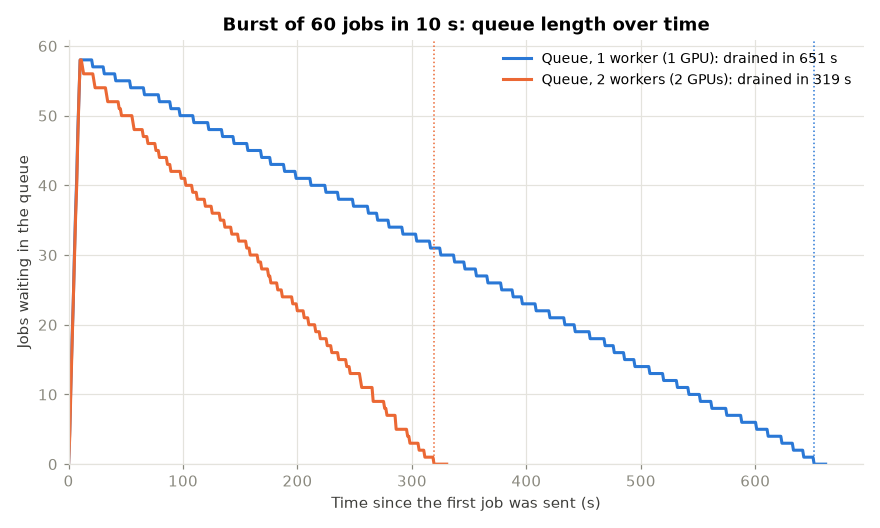

กราฟอื่นจากขั้นนี้: [latency_vs_users.png](results/charts/latency_vs_users.png) · [throughput_vs_users.png](results/charts/throughput_vs_users.png) · [scaling_vs_gpus.png](results/charts/scaling_vs_gpus.png) (อยู่ในหัวข้อทฤษฎีข้อ 2 และ 6) · ตัวเลขทั้งหมด: [results/metrics.json](results/metrics.json)

ตัวอย่างโค้ดที่ AI เขียนให้ในรอบจริง (ของคุณอาจต่างกัน): [code_reference/report.py](code_reference/report.py) · ผลดิบ: [results/queue_2worker/](results/queue_2worker/sweep_summary.json)

**อ่านผลอย่างไร**

- **1 ใบ 2 คน → 2 ใบ 4 คน (2.0 เท่า, Efficiency 100%)** · ไม่ได้แก้ gateway หรือตัวยิงโหลดเลย แค่เปิด Worker เพิ่ม 1 ตัว
- งานถล่ม: Worker 2 ตัวแบ่งงานกัน 30/30 เวลาระบายคิว 651 → 319 วินาที · 5.44 → 10.88 งาน/นาที
- ระบบอิ่มตัวที่ราว 11 งาน/นาทีตั้งแต่ N = 4 · N = 6 จึงไม่ผ่าน (p95 25.2 วินาที)
- ตัวเลข 3 ใบ (~6 คน, ~16.5 งาน/นาที, ระบาย ~221 วินาที) เป็น **การคำนวณ ไม่ใช่ผลวัด**: 1 ใบ × 3 × Efficiency ที่วัดได้ตอน 2 ใบ โดยสมมติว่า gateway, RabbitMQ และ CPU ยังไม่เป็นคอขวด

## ขั้นที่ 5 · ทดลองเสริม: ฆ่า Worker กลางงาน งานต้องไม่หาย แล้วเก็บผลกลับ

AI ส่งงานถล่ม ฆ่า Worker ของ GPU ใบที่ 2 กลางงาน นับงาน แล้วเก็บผลทั้งหมดกลับมา

```text
ทำงานใน container `multi-account` โฟลเดอร์ /workspace/vastapp_lab ด้วยสกิล vastai
เครื่องที่ใช้คือเครื่องป้าย vapp-lab8 · กุญแจ SSH อยู่ที่ /workspace/vastai_lab/Devtool_SSH/devtoolSSH

ทดสอบว่างานไม่หายเมื่อ Worker ตายกะทันหัน แล้วเก็บผลทั้งหมดกลับมา
1. ตอนนี้ Worker เปิดอยู่ 2 ตัว ส่งงานถล่ม 60 งานภายใน 10 วินาที แล้วฆ่า Worker ของ GPU ใบที่ 2 แบบกะทันหัน (จำลองเครื่องดับ ไม่ทันปิดตัวเอง) ที่วินาทีที่ 20
2. รอจนงานหมดคิว นับว่าเสร็จกี่งาน งานไหนถูก RabbitMQ ส่งซ้ำให้ Worker อีกตัว และให้ report.py วาดกราฟการทดลองนี้เพิ่ม (งานเสร็จสะสมตามเวลา แยกตาม Worker)
3. รัน report.py ใหม่ แล้วเก็บผลทั้งหมด (JSON ของทุกการทดลอง metrics.json และกราฟ) กลับมาไว้ใน lab8_job_queue/results ของโฟลเดอร์ปัจจุบัน
4. เปิด Worker ให้ครบ 2 ตัวอีกครั้ง ไว้ให้เว็บในขั้นถัดไปใช้

ห้ามแสดงค่า key · สรุปเป็นภาษาไทย: ส่งกี่งาน · เสร็จกี่งาน · ส่งซ้ำกี่งาน · แต่ละ Worker ทำกี่งาน
อธิบายสั้นๆ ว่าทำไมงานไม่หาย แล้วบอกว่าเครื่องยังเปิดอยู่
```


*ใช้เวลาราว 18 นาที · กราฟของขั้นนี้คือ [worker_kill_cumulative.png](results/charts/worker_kill_cumulative.png) (อยู่ในทฤษฎีข้อ 5.4)*

| ส่ง | รับเข้าคิว | เสร็จ | หาย | ส่งซ้ำ | เข้า DLQ | GPU0 ทำ | GPU1 ทำ (ก่อนตาย) | คิวว่างที่ |
|---|---|---|---|---|---|---|---|---|
| 60 | 60 | **60** | **0** | 1 | 0 | 58 | 2 | 656 s |

ผลดิบ: [results/worker_kill/killtest.json](results/worker_kill/killtest.json)

**อ่านผลอย่างไร**

- **งานไม่หายแม้ Worker ถูกฆ่าแบบไม่ทันปิดตัวเอง** เพราะ 3 อย่างทำงานร่วมกัน: งานอยู่ใน RabbitMQ (Durable + Persistent) · Worker ถือทีละงาน (Prefetch = 1) · ack หลังเสร็จเท่านั้น
- งานที่กระทบมีงานเดียว (งานในมือ) และถูกทำใหม่จนเสร็จที่วินาทีที่ 33.2 · ผู้ใช้ของงานนั้นแค่รอนานขึ้น
- คิวว่างที่ 656 วินาที ใกล้กับของ 1 Worker (651 วินาที) เพราะเหลือ Worker ตัวเดียว · ระบบ **ช้าลง แต่ไม่พัง**

## ขั้นที่ 6 · สร้างเว็บดูคิวแบบสด แล้วทดสอบ

AI เขียนเว็บ Next.js เปิดบนเครื่องเราด้วย Docker ต่อกับ gateway บนเครื่องเช่า แล้วทดสอบส่งใบเสร็จ 6 ใบ

```text
ทำงานใน container `multi-account` โฟลเดอร์ /workspace/vastapp_lab ด้วยสกิล vastai
เครื่องที่ใช้คือเครื่องป้าย vapp-lab8 · กุญแจ SSH อยู่ที่ /workspace/vastai_lab/Devtool_SSH/devtoolSSH

สร้างเว็บดูคิวแบบสดบนเครื่องนี้ (Docker Desktop) ที่ต่อกับ API gateway บนเครื่องที่เช่า
1. เขียนเว็บ Next.js ภาษาไทยไว้ที่ lab8_job_queue/code/web ของโฟลเดอร์ปัจจุบัน เปิดด้วย docker compose ชื่อโปรเจกต์ vapp-lab8 ที่ http://localhost:3407 หน้าตาเป็นแอปจริง
2. ในหน้าเว็บ: เลือกใบเสร็จตัวอย่างจาก lab8_job_queue/samples ของโฟลเดอร์ปัจจุบัน หรืออัปโหลดเอง แล้วส่งเป็นชุด (เช่น ×20) ใบละ 1 งาน
   เห็นความยาวคิว การ์ด Worker แต่ละตัว (ว่าง/กำลังอ่านงานไหน/ทำเสร็จกี่งาน) และตารางงานล่าสุดพร้อมสถานะและเวลา อัปเดตทุก 1 วินาที · กดงานที่เสร็จแล้วเห็นรายการที่อ่านได้
3. เว็บเรียก gateway จากฝั่ง server ของ Next.js โดยอ่านที่อยู่ภายนอกของพอร์ต 8000 และ API key จากไฟล์ lab8_job_queue/code/web/.env (key ไม่ไปถึงเบราว์เซอร์)
4. ทดสอบผ่านเว็บ: ส่งใบเสร็จตัวอย่างทั้ง 6 ใบเป็น 6 งาน แล้วรอจนเสร็จทุกงาน

ห้ามแสดงค่า key · สรุปเป็นตารางภาษาไทย: ใบเสร็จ · Worker ที่ทำ · รอคิว (วินาที) · อ่าน (วินาที) · จำนวนรายการ · ยอดรวมที่อ่านได้ แล้วบอกว่าเครื่องยังเปิดอยู่
```

จากนั้นเปิด <http://localhost:3407> เลือกใบเสร็จหลายใบแล้วส่งเป็นชุดใหญ่ (เช่น 60 งาน) ดูคิวยาวขึ้นแล้วหดลงขณะที่ Worker ทั้ง 2 ตัวช่วยกันอ่าน · กดแถวงานที่เสร็จเพื่อดูรายการที่อ่านได้


*ใช้เวลาราว 7 นาที*

| ใบเสร็จ | Worker ที่ทำ | รอคิว | อ่าน | จำนวนรายการ | ยอดรวมที่อ่านได้ |
|---|---|---|---|---|---|
| test_000.jpg | GPU0 | 0.0 s | 2.0 s | 1 | 65,455 |
| test_002.jpg | GPU1 | 0.0 s | 3.0 s | 2 | 28,000 |
| test_020.jpg | GPU0 | 1.2 s | 5.0 s | 5 | 377,059 |
| test_007.jpg | GPU1 | 2.7 s | 2.0 s | 1 | 111,000 |
| test_092.jpg | GPU1 | 4.7 s | 2.0 s | 1 | 250,000 |
| test_051.jpg | GPU0 | 5.9 s | 4.0 s | 4 | 334,011 |


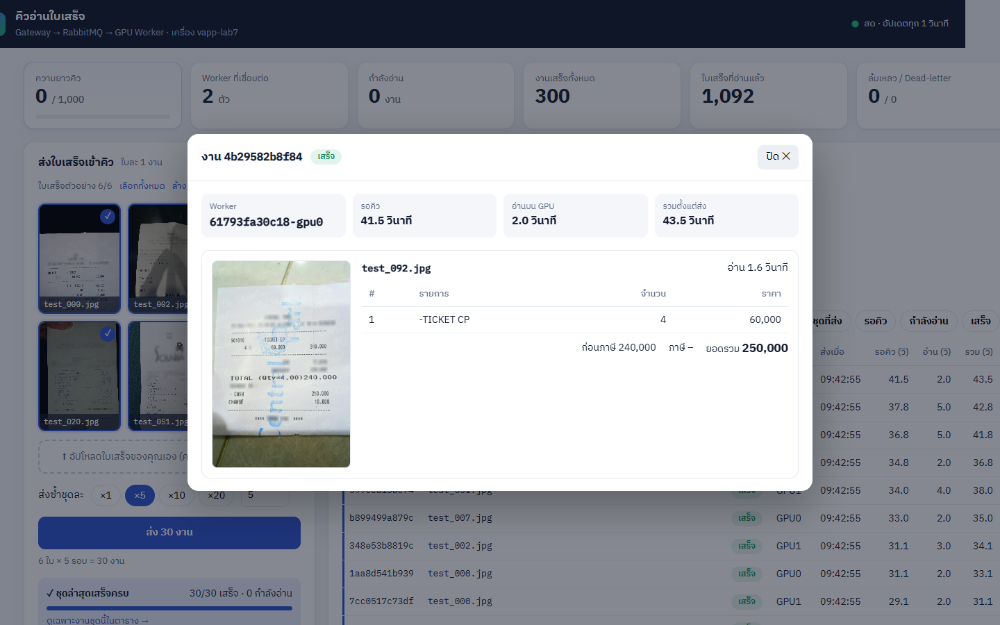

| เลือกใบเสร็จตัวอย่าง | ส่งเป็นชุด คิวยาวขึ้น |
|---|---|
| 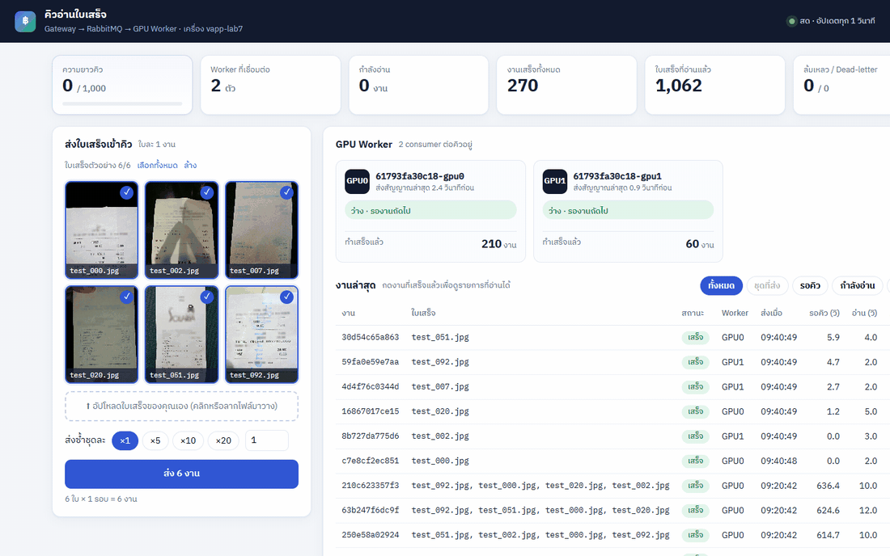 | 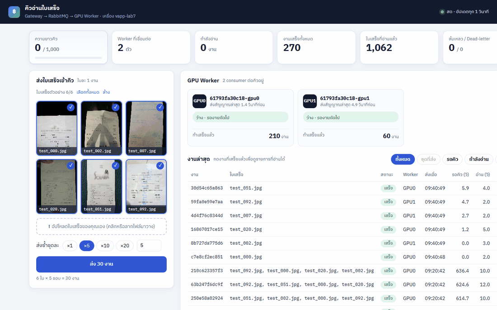 |
| **Worker 2 ตัวช่วยกันระบายคิว** | **กดงานที่เสร็จ ดูรายการที่อ่านได้** |
| 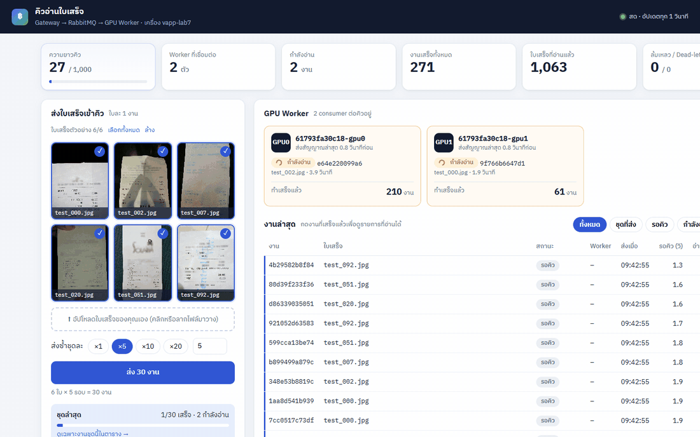 | 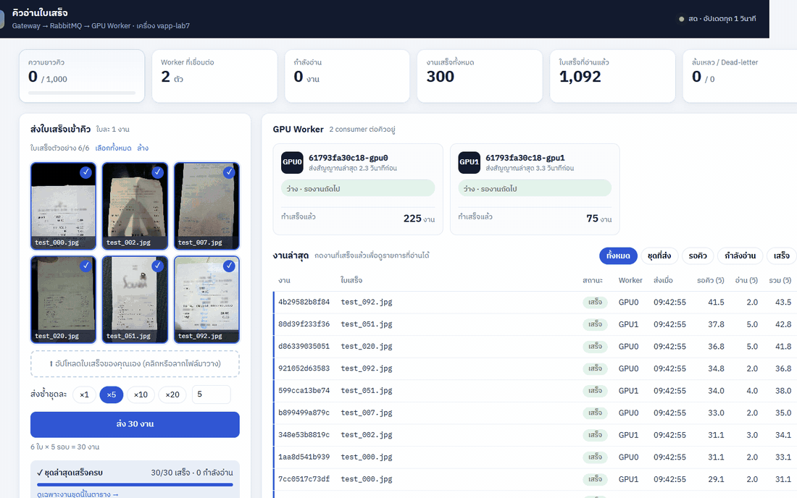 |

ภาพหน้าจออื่น: [web-idle.png](results/web/web-idle.png) · [web-drained.png](results/web/web-drained.png) · ตัวอย่างโค้ดที่ AI เขียนให้ในรอบจริง (ของคุณอาจต่างกัน): [code_reference/web/](code_reference/web/app/page.jsx)

**อ่านผลอย่างไร**

- เว็บส่ง **ใบละ 1 งาน** จึงอ่านแค่ 2–5 วินาทีต่องาน (ตัวยิงโหลดส่ง 4 ใบต่องาน) · Worker 2 ตัวรับงานสลับกัน 3 / 3
- งานที่ส่งทีหลังรอคิวนานขึ้น (0.0 → 5.9 วินาที) เพราะมี 6 งานแต่มี Worker 2 ตัว · นี่คือคิวที่มองเห็นได้
- API key อยู่ฝั่ง server ของ Next.js เบราว์เซอร์ไม่เคยเห็น
- ยอดรวมที่อ่านได้ไม่ตรงเฉลยทุกใบ (เช่น `test_092` เฉลย 240.000 อ่านได้ 250,000) เพราะเป็น Base Model · LAB นี้สนใจความจุ ไม่ใช่ความแม่น
- ถ้า Claude Code ของคุณทำงานใน container คำสั่ง Docker ในนั้นอาจแยกจาก Docker Desktop ของเครื่อง · AI จะบอกในคำตอบว่าเว็บรันจากโฟลเดอร์ไหน

## ขั้นที่ 7 · ลบเครื่องและสรุปค่าใช้จ่าย (ห้ามข้าม)

AI ตรวจว่าผลครบ ลบเครื่อง ปิดเว็บ แล้วสรุปค่าใช้จ่ายจากบิลจริง

```text
ทำงานใน container `multi-account` โฟลเดอร์ /workspace/vastapp_lab ด้วยสกิล vastai

ปิดทุกอย่างของ LAB 8
1. ตรวจว่า lab8_job_queue/results ของโฟลเดอร์ปัจจุบันมีผลครบ (JSON ของทุกการทดลอง metrics.json และกราฟ) ถ้าขาดให้เก็บจากเครื่องก่อนลบ
2. ลบเครื่องป้าย vapp-lab8 แล้วตรวจว่าไม่มีเครื่องป้ายนี้ค้างในบัญชี (ห้ามแตะเครื่องป้ายอื่น)
3. ปิดเว็บใน lab8_job_queue/code/web

สรุปเป็นภาษาไทย ค่าใช้จ่ายจริงของเครื่อง vapp-lab8: อายุเครื่อง · ราคาต่อชั่วโมง · ยอดที่ถูกคิด (GPU · disk · รับส่งข้อมูล) · รวม
```


*ใช้เวลาราว 2 นาที*

| รายการ | รายละเอียด | ยอด |
|---|---|---|
| GPU | 1.985 ชม. × $0.373 | $0.741 |
| ดิสก์ | 1.985 ชม. × $0.020 | $0.040 |
| รับส่งข้อมูล | ดาวน์โหลด 4.3 GB อัปโหลด 0.1 GB | $0.000 |
| **รวม** | | **$0.781** |

**อ่านผลอย่างไร**

- ทั้ง LAB (ขั้นที่ 1–7) ใช้เครื่อง 2 GPU ราว 2 ชั่วโมง จ่าย **$0.781**
- เวลาส่วนใหญ่ไปกับงานถล่ม: รอบที่มี GPU ทำงานใบเดียวใช้ราว 10–11 นาทีต่อครั้ง (ขั้นที่ 2, 3 และ 5) · อยากประหยัดให้ลดจำนวนงานในงานถล่ม
- ตรวจให้แน่ใจว่าคำตอบมีประโยค "ไม่มีเครื่องป้าย vapp-lab8 ค้างอยู่" · เครื่องที่ลืมลบคิดเงินต่อทุกชั่วโมง

## ปิดท้าย · เก็บงานทั้ง LAB เป็นสกิลเวอร์ชัน 0

เราเพิ่งสั่งงาน 7 ขั้นจนสำเร็จ ถ้าต้องวัดซ้ำ (เช่น เปลี่ยนรุ่น GPU หรือระดับ N) ไม่ควรต้องวาง 7 พรอมต์ใหม่ · **สกิล** คือไฟล์ที่เก็บวิธีทำงานที่สำเร็จแล้ว พร้อมโค้ดที่ใช้ได้แล้ว ให้ AI ทำซ้ำได้ในคำสั่งเดียว


### ขั้นที่ 8 · สร้างสกิลเวอร์ชัน 0 จากงานของ LAB นี้

AI อ่านพรอมต์ โค้ด และผลของ LAB นี้ แล้วเขียน `skill_v0/SKILL.md` พร้อมคัดลอกโค้ดเข้า `skill_v0/scripts`

```text
สร้างสกิลเวอร์ชัน 0 จากงานของ LAB 8 ที่เพิ่งทำเสร็จ เพื่อให้ครั้งหน้าสั่งวัดความจุระบบคิวซ้ำได้ในคำสั่งเดียว
1. ดูงานทั้งหมดจากพรอมต์ทุกขั้นใน lab8_job_queue/PROMPTS.md โค้ดใน lab8_job_queue/code และผลใน lab8_job_queue/results
2. เขียนเป็นสกิลชื่อ vlm-queue-capacity เก็บที่ lab8_job_queue/skill_v0/SKILL.md ให้มี name กับ description (บอกว่าใช้เมื่อไร)
   ค่าที่ปรับได้พร้อมค่าเริ่มต้น · ขั้นตอน · เกณฑ์ตรวจผ่าน · กติกาเรื่องเงิน (ลบเครื่องเสมอ)
3. คัดลอกโค้ดที่ใช้ได้แล้วใน lab8_job_queue/code (ยกเว้นเว็บ) ไปไว้ที่ lab8_job_queue/skill_v0/scripts ให้สกิลใช้โค้ดชุดนี้ ไม่ต้องเขียนใหม่
4. ให้สกิลนี้เรียกใช้สกิล vastai ต่อ ไม่เขียนวิธีใช้ Vast.ai ซ้ำ แล้วติดตั้งเป็นสกิลของโปรเจกต์ที่ .claude/skills/vlm-queue-capacity ของโฟลเดอร์ปัจจุบัน

สรุปเป็นภาษาไทย: สกิลทำอะไรได้ · ค่าที่ปรับได้ · ไฟล์ที่สร้าง
ไม่ต้อง commit
```


*ใช้เวลาราว 3 นาที · ไม่ต้องเช่าเครื่อง · สกิลที่ได้: [skill_v0/SKILL.md](skill_v0/SKILL.md)*

> ⚠️ หลังขั้นนี้ให้ปิดแล้วเปิด Claude Code ใหม่ 1 ครั้ง สกิลที่เพิ่งติดตั้งจึงจะถูกมองเห็น · ถ้า AI ตอบว่าไม่รู้จักสกิล ให้เปิดใหม่อีกครั้ง

### ขั้นที่ 9 · ลองใช้สกิลทำซ้ำในคำสั่งเดียว

AI ตัวใหม่ทำเองด้วยสกิล: เช่าเครื่องใหม่ ติดตั้ง วัดทั้ง 3 แบบ ทำรายงาน และลบเครื่อง

```text
ใช้สกิล vlm-queue-capacity วัดความจุระบบคิวอ่านใบเสร็จซ้ำในคำสั่งเดียว
1. เช่าเครื่อง 2× RTX 3090 ป้าย vapp-lab8-skill เทียบ Baseline 1 GPU กับคิวที่มี Worker 1 และ 2 ตัว
2. ไล่ผู้ใช้พร้อมกัน 2, 4, 6, 8, 12, 16 คน ไม่ต้องเปิดเว็บและไม่ต้องทดลองฆ่า Worker เสร็จแล้วลบเครื่อง
3. เก็บผลไว้ที่ lab8_job_queue/results/skill_v0_run ห้ามเขียนทับผลเดิมใน lab8_job_queue/results
สรุปเป็นภาษาไทย: ตารางความจุ 1 / 2 GPU · เวลาแต่ละขั้น · ค่าใช้จ่ายจริง
ไม่ต้อง commit
```


*ใช้เวลาราว 86 นาที (เครื่องเปิด 1 ชั่วโมง 23 นาที) · เช่าเครื่องจริงและลบเครื่องจริง · ภาพตัดส่วนเกณฑ์ตรวจผ่านท้ายคำตอบออก คำตอบเต็มอยู่ที่ [results/answers/9_skill_v0_run.md](results/answers/9_skill_v0_run.md)*

| | สั่งทีละขั้น (ขั้นที่ 1–7) | สกิล v0 |
|---|---|---|
| จำนวนพรอมต์ | 7 | **1** |
| สิ่งที่วัด | Baseline · คิว 1 และ 2 Worker · งานถล่ม · ฆ่า Worker · เว็บ | Baseline · คิว 1 และ 2 Worker · งานถล่ม |
| เครื่อง (2× RTX 3090) | $0.394/ชม. | $0.340/ชม. |
| Baseline 1 ใบ | 2 คน | 2 คน |
| คิว 1 Worker | 2 คน · ระบายงานถล่ม 651 s | 2 คน · ระบายงานถล่ม 708 s |
| คิว 2 Worker | 4 คน · ระบายงานถล่ม 319 s | 4 คน · ระบายงานถล่ม 355 s |
| 1 ใบ → 2 ใบ | 2.0 เท่า · 100% | 2.0 เท่า · 100% |
| เวลาของ AI | ราว 111 นาที (ไม่รวมเว็บ) | 86 นาที |
| เครื่องเปิด / ค่าใช้จ่ายจริง | 1.99 ชม. / $0.781 | 1.40 ชม. / $0.478 |

ผลของรอบสกิลอยู่ที่ [results/skill_v0_run/](results/skill_v0_run/metrics.json) · กราฟ: [latency_vs_users.png](results/skill_v0_run/charts/latency_vs_users.png) · [scaling_vs_gpus.png](results/skill_v0_run/charts/scaling_vs_gpus.png)

**อ่านผลอย่างไร**

- สกิล v0 **ผ่านในรอบแรก** และได้ข้อสรุปเดิม: 1 ใบ 2 คน → 2 ใบ 4 คน · ข้อสรุปของ LAB จึงทำซ้ำได้
- เวลาระบายคิวช้ากว่ารอบหลักราว 9–11% (708 เทียบ 651 วินาที) เพราะเป็นเครื่องคนละเครื่อง (~12 วินาทีต่องาน) · **ตัวเลขเปลี่ยนตามเครื่อง แต่อัตราส่วน 2 เท่ายังอยู่**
- ไม่ต้องเขียนโค้ดใหม่ (ใช้ `scripts/` ในสกิล) แต่เสียเวลาราว 30 นาทีกับปัญหาที่ v0 พาไปเจอ (ตารางถัดไป)
- ข้อค้นพบพลอยได้: รอบที่เปิด Worker ซ้ำ 2 โปรเซสบน **GPU ใบเดียว** รับได้ 4 คน และระบายงานถล่มใน 388 วินาที เพราะ Worker 1 ตัวใช้ GPU แค่ราว 40% · ก่อนเช่า GPU เพิ่ม ควรใช้ใบที่มีให้เต็มก่อน (ผลนี้ไม่อยู่ในแผนการวัด เก็บไว้ที่ [diag_queue1_2proc_same_gpu/](results/skill_v0_run/diag_queue1_2proc_same_gpu/burst.json))

**v0 ยังไม่สมบูรณ์** · จุดที่ AI ต้องเดาหรือพลาดในรอบทดสอบ และควรแก้ในเวอร์ชันถัดไป

| จุดที่ v0 ยังพลาด | ควรแก้อย่างไรใน v1 |
|---|---|
| สกิลจดวิธีแก้ GPU เปิดไม่ได้เป็นค่าตายตัวของเครื่องแรก (`LD_LIBRARY_PATH`) บนเครื่องใหม่ค่านี้ทำให้ cuDNN โหลดไม่ขึ้น | จด "อาการ + วิธีตรวจ" แทนค่าตายตัวของเครื่องเดียว |
| สคริปต์เปิดระบบคิวถูกรันซ้ำ จึงมี Worker 2 โปรเซสบน GPU ใบเดียว ผลคิว 1 Worker รอบแรกใช้ไม่ได้ (เสียราว 22 นาที) | เพิ่มข้อตรวจ "จำนวน Consumer = จำนวน Worker" ก่อนยิงโหลด และตั้งชื่อ Worker ไม่ให้ซ้ำ |
| คำสั่งปิด API เดิมไปฆ่า shell ของ SSH ตัวเองด้วย | เขียนวิธีปิดโปรเซสที่ไม่โดน shell ตัวเองไว้ในสกิล |
| RabbitMQ เขียน log ลงโฟลเดอร์งานไม่ได้ (สิทธิ์ของผู้ใช้ rabbitmq) | กำหนดที่เก็บ log ที่ RabbitMQ เขียนได้ไว้ในสกิล |
| ผู้ใช้ให้รายการ N เอง (2, 4, 6, 8, 12, 16) แต่ตัวยิงโหลดไล่ได้ทีละ 2 AI ต้องรันทีละระดับเอง | เพิ่มสคริปต์ที่รับรายการ N ได้ตรง ๆ |

วิธีปรับคือสั่ง AI ด้วยพรอมต์อีก 1 อันให้แก้สกิลตามตารางนี้ แล้วลองใช้ซ้ำ · สกิลจึงดีขึ้นทีละเวอร์ชันจากหลักฐานของการรันจริง

---

## ไฟล์ในโฟลเดอร์นี้

| ไฟล์ / โฟลเดอร์ | คืออะไร |
|---|---|
| `PROMPTS.md` | พรอมต์ทั้ง 9 ขั้นสำหรับคัดลอก |
| `samples/` | ใบเสร็จตัวอย่าง 6 ใบจาก Test Set ของ CORD-v2 (ข้อมูล ไม่ใช่โค้ด) |
| `code/` | โค้ดที่ AI เขียนให้ **ของคุณ** · เริ่มจากโฟลเดอร์ว่าง (ไม่ถูกเก็บขึ้น git) |
| `code_reference/` | ตัวอย่างโค้ดที่ AI เขียนให้ในรอบจริง ไว้เทียบ: `make_samples_grid.py` (ขั้นที่ 1) · `sync_api.py` `loadtest_sync.py` (ขั้นที่ 2) · `gateway.py` `worker.py` `common.py` `loadtest.py` (ขั้นที่ 3–5) · `report.py` (ขั้นที่ 4–5) · `web/` (ขั้นที่ 6) |
| `skill_v0/` | สกิลที่ AI สร้างในขั้นที่ 8 (`SKILL.md` + `scripts/`) |
| `results/` | ผลจากการรันจริง: `metrics.json` · กราฟใน `charts/` (5 รูปจากพรอมต์ และ `little_law.png` ที่วาดเพิ่มจากข้อมูลเดียวกัน) · ผลดิบ JSON และ log ใน `baseline/` `queue_1worker/` `queue_2worker/` `worker_kill/` · `dataset_samples.jpg` `gt_samples.json` · คำตอบของทุกขั้นใน `answers/` · ภาพหน้าจอและ GIF ของเว็บใน `web/` · ผลของรอบลองใช้สกิลใน `skill_v0_run/` |
| `image/` | ภาพประกอบของ LAB นี้ |
