# LAB 9 · ระบบผสมสำหรับบริการสร้างภาพ: API gateway + RabbitMQ + GPU Worker

[← กลับหน้ารวมของบท](../README.md) · เปิด Claude Code ที่โฟลเดอร์ของบท `02_VastAi_Application` ("โฟลเดอร์ปัจจุบัน" ในพรอมต์หมายถึงโฟลเดอร์นั้น) · ทำ [LAB 0](../README.md#lab-0--เตรียม-key-3-ตัว) ก่อน

สไลด์ประกอบการสอน: [LAB9_Hybrid_Slides.html](LAB9_Hybrid_Slides.html)

## ทำไปเพื่ออะไร

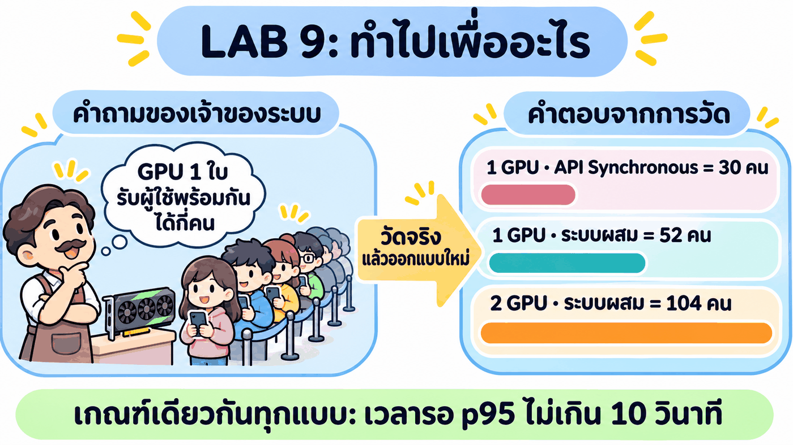

บริการสร้างภาพจากข้อความ (Text-to-Image) ใช้ GPU งานละราวครึ่งวินาที และผู้ใช้เข้ามาเป็นช่วง ๆ · เจ้าของระบบถามคำถามเดียว:

> **GPU 1 ใบ รองรับผู้ใช้พร้อมกันได้กี่คน แล้วออกแบบระบบอย่างไรให้รับได้มากขึ้น**

เราไม่เดา แต่ **วัดจริง** 3 แบบด้วยตัวยิงโหลดและเกณฑ์เดียวกัน (เวลารอจนได้ภาพ p95 ≤ 10 วินาที และงานล้ม < 1%)

| จำนวน GPU | สถาปัตยกรรม | รองรับผู้ใช้พร้อมกัน (N) | ภาพ/วินาทีสูงสุด | p95 ที่ N นั้น | เท่าของ Baseline | Efficiency (เทียบระบบผสม 1 ใบ) |
|---|---|---|---|---|---|---|
| 1 | API แบบ Synchronous (Baseline) | **30** | 2.15 | 9.19 s | 1.00 | – |
| 1 | gateway + RabbitMQ + Worker 1 ตัว | **52** | 3.80 | 9.57 s | 1.73 | 100% (ฐาน) |
| 2 | gateway + RabbitMQ + Worker 2 ตัว | **104** | 7.4 | 9.63 s | 3.47 | 100% (ภาพ/วินาที 97%) |
| 3 | Worker 3 ตัว (**ประมาณการ ไม่ใช่ผลวัด**) | ~156 | ~11.1 | – | ~5.2 | สมมติเท่ากับที่วัดได้ที่ 2 ใบ |

LAB นี้มี **11 ขั้น ทุกขั้นคือ 1 พรอมต์ · โค้ดทุกไฟล์ AI เขียนให้จากพรอมต์ เริ่มจากโฟลเดอร์ว่าง** · ปิดท้ายด้วยอีก 2 ขั้นที่เก็บงานทั้งหมดเป็น **สกิลเวอร์ชัน 0**

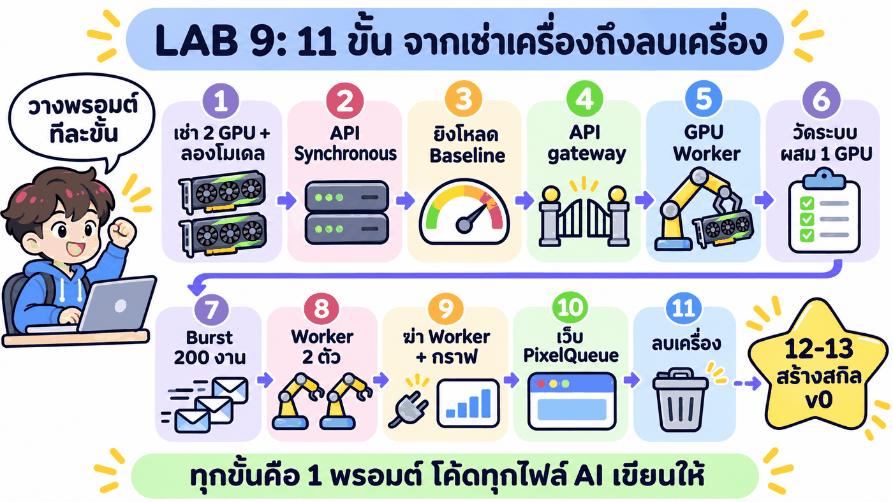

## รู้จักข้อมูลที่ใช้ทดสอบ

LAB นี้ **ไม่มี Dataset** เพราะไม่ได้เทรนโมเดล · สิ่งที่ใช้ทดสอบคือ **ชุดคำขอ**: คำบรรยายภาพภาษาอังกฤษ 12 ข้อที่ AI แต่งให้ในขั้นที่ 1 (ภาพถ่ายทั่วไป เช่น ประภาคาร จักรยาน ชามราเม็ง) ตัวยิงโหลดวนใช้ทั้ง 12 ข้อ · ดูทั้งชุดได้ที่ [code_reference/prompts.txt](code_reference/prompts.txt)

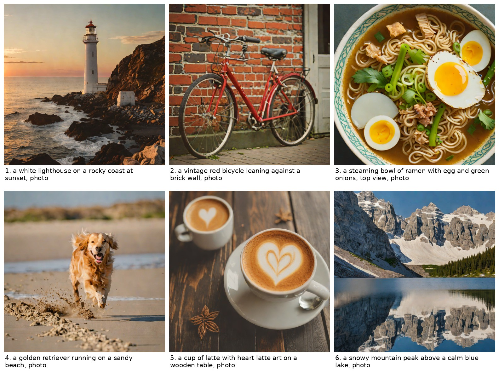

**งาน 1 ชิ้น = ข้อความ 1 ประโยคเข้า ภาพ 1 ภาพออก**

| | ตัวอย่างจริง 1 งาน ([results/example_job.json](results/example_job.json)) |
|---|---|
| ส่งเข้า | `{"prompt": "a steaming bowl of ramen with egg and green onions, top view, photo", "width": 512, "height": 512, "steps": 4, "seed": 7}` |
| ได้กลับ | ภาพ 512 × 512 ใช้เวลาสร้าง 0.49 วินาที ([results/example_job.png](results/example_job.png)) · ผ่าน API ได้เป็น JPEG ราว 40 KB |

สิ่งที่ส่งเข้าเป็นข้อความไม่กี่ร้อยไบต์ งานหนักทั้งหมดอยู่ที่ GPU · ใช้ `seed` เดิมจะได้ภาพเดิม

## รู้จักโมเดลที่ใช้

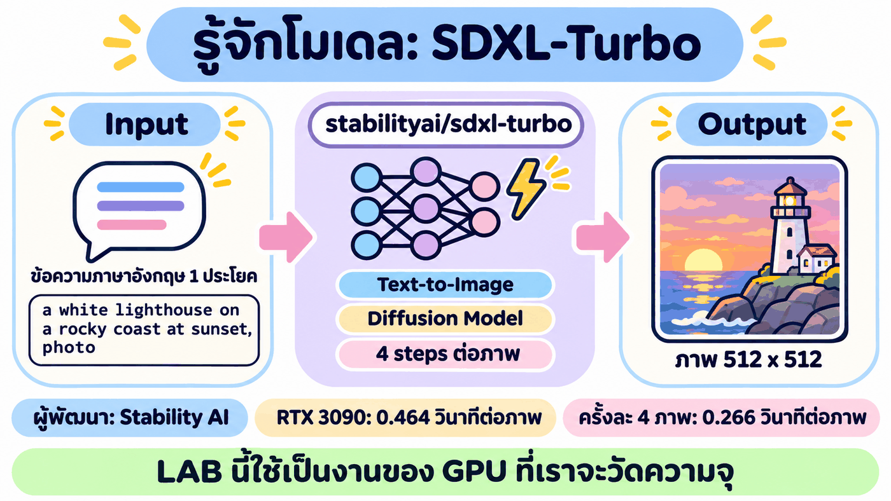

| หัวข้อ | SDXL-Turbo (`stabilityai/sdxl-turbo`) |
|---|---|
| ประเภท | Text-to-Image (Diffusion Model ที่กลั่นจาก SDXL ให้สร้างภาพได้ในไม่กี่ steps) |
| Input | ข้อความภาษาอังกฤษ 1 ประโยค · LAB นี้ตรึงค่า 512 × 512, 4 steps, guidance 0 |
| Output | ภาพ 512 × 512 จำนวน 1 ภาพ |
| ขนาด | ใช้ VRAM สูงสุดราว 15.3 GB จาก 24 GB ของ RTX 3090 (วัดในขั้นที่ 1) |
| ความเร็วที่วัดได้ | ทีละ 1 ภาพ 0.464 วินาที/ภาพ · ครั้งละ 4 ภาพ 0.266 วินาที/ภาพ |
| ที่มา | [Stability AI บน Hugging Face](https://huggingface.co/stabilityai/sdxl-turbo) · สัญญาอนุญาตแบบ non-commercial research (ใช้เพื่อการเรียนการสอน) |
| LAB นี้ใช้ทำอะไร | เป็น "งานของ GPU" ที่ใช้วัดความจุของระบบ · ไม่ได้เทรนหรือแก้โมเดล |

## ทฤษฎีที่ต้องรู้

### 1 · Concurrent Users, Throughput และ Latency

- **คืออะไร** Concurrent Users (N) = จำนวนคนที่ "กำลังใช้อยู่" พร้อมกัน · Throughput (X) = งานที่ระบบทำเสร็จต่อวินาที (ภาพ/วินาที) · Latency (R) = เวลาที่ผู้ใช้รอจนได้ภาพ
- **ทำไมต้องแยก** ผู้ใช้ 1 คนไม่ได้ส่งงานตลอดเวลา เขาดูภาพก่อนส่งใหม่ (think time, Z เฉลี่ย 5 วินาที) · GPU ที่ทำได้ 2.15 ภาพ/วินาทีจึงรับได้ 30 คน ไม่ใช่ 2 คน
- **ทำงานอย่างไร** ผู้ใช้จำลองวนเป็นวง: ส่งข้อความ → รอจนได้ภาพ → ดูภาพ → ส่งใหม่ จึงได้ความสัมพันธ์ **N = X × (R + Z)**


| แบบ | X (ภาพ/วินาที) | R ≈ p50 ที่ความจุ | X × (R + 5) | ความจุที่วัดได้ |
|---|---|---|---|---|
| API Synchronous 1 ใบ | 2.15 | 8.4 s | ≈ 29 | 30 คน |
| ระบบผสม 1 ใบ | 3.80 | 8.9 s | ≈ 53 | 52 คน |
| ระบบผสม 2 ใบ | 7.2 | 8.9 s | ≈ 100 | 104 คน |

**ตัวเลขจาก LAB นี้** Throughput ขึ้นตาม N แล้ว **แบน** ที่เพดานของแต่ละแบบ: 2.15 / 3.8 / 7.2–7.4 ภาพ/วินาที

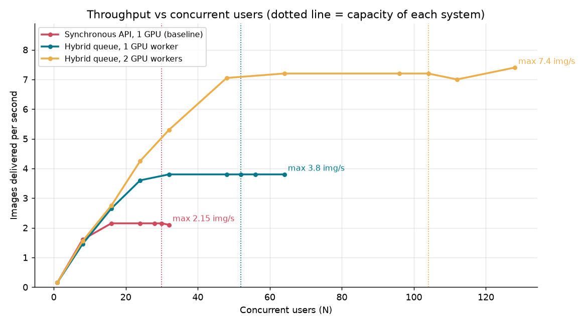

### 2 · p50 / p95 / p99 และ SLO

- **คืออะไร** p50 = งานครึ่งหนึ่งเร็วกว่าค่านี้ · p95 = งาน 95% เร็วกว่าค่านี้ · p99 = งาน 99% เร็วกว่าค่านี้
- **ทำไมต้องใช้** ค่าเฉลี่ยซ่อนคนที่รอนาน · ผู้ใช้ที่บ่นคือคนท้ายแถว จึงตั้งเกณฑ์ที่ p95
- **ทำงานอย่างไร** SLO (Service Level Objective) คือเกณฑ์ที่เราสัญญากับตัวเอง · LAB นี้ใช้ **p95 ≤ 10 วินาที และงานล้ม < 1%** (เลิกรอที่ 30 วินาที = งานล้ม) · **"รองรับได้ N คน" = N สูงสุดที่ยังผ่าน SLO**

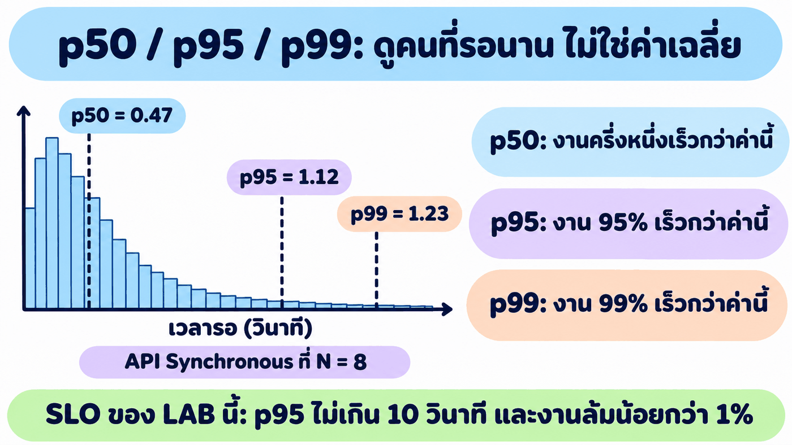

**ตัวเลขจาก LAB นี้** (API Synchronous)

| N | p50 | p95 | p99 | อ่านว่า |
|---|---|---|---|---|
| 8 | 0.47 s | 1.12 s | 1.23 s | คนส่วนใหญ่ไม่ต้องรอ แต่บางคนมาชนกัน p95 จึงสูงกว่า p50 เกิน 2 เท่า |
| 30 | 8.42 s | 9.19 s | 9.25 s | อิ่มตัวแล้ว ทุกคนรอนานพอ ๆ กัน p50 กับ p95 วิ่งชิดกัน |

### 3 · Saturation: เส้น Latency ที่หักศอก (Knee)

- **คืออะไร** ก่อนอิ่มตัว เวลารอ ≈ เวลาทำงาน (0.47 วินาที) · หลังอิ่มตัว เวลารอโตเป็นเส้นตรงตาม N จุดที่เส้นหักเรียกว่า Knee
- **ทำไมต้องรู้** หลัง Knee Throughput ไม่เพิ่มแล้ว ผู้ใช้ที่เพิ่มมาทุกคนคือ **คิวที่ยาวขึ้น** · ความจุจึงอยู่ที่จุดที่เส้น p95 ตัดเส้น SLO ไม่ใช่จุดที่ระบบ "ล่ม"
- **ทำงานอย่างไร** จุดอิ่มตัวโดยประมาณ N* = X × (S + Z) เมื่อ S คือเวลาทำงาน 1 งาน → 2.15 × (0.47 + 5) ≈ 12 คน


**ตัวเลขจาก LAB นี้** Baseline: N = 8 → p95 1.1 s · N = 16 → 3.4 s · N = 24 → 7.3 s · N = 32 → 10.8 s (Throughput ค้างที่ 2.15 ตั้งแต่ N = 16) Knee อยู่ระหว่าง 8 กับ 16 ตรงกับที่คำนวณได้ 12

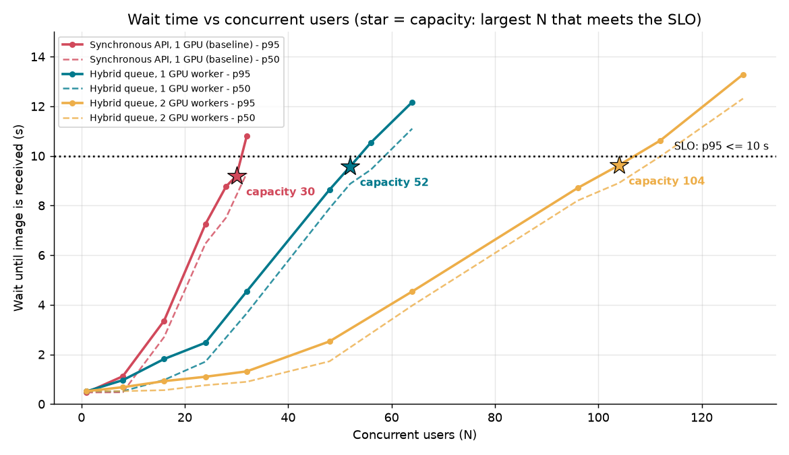

### 4 · ทำไม API แบบ Synchronous พังเมื่องานเข้าเป็นก้อน (Burst)

- **คืออะไร** API แบบ Synchronous = ผู้ใช้ส่งคำขอแล้ว **ถือสายรอ** จนได้ภาพ · คำขอที่มาพร้อมกันยืนรอกันในหน่วยความจำของ server เป็น "คิวที่มองไม่เห็น"
- **ทำไมพัง** (1) ไม่มีใครบอกผู้ใช้ว่าต้องรอนานแค่ไหน เขารอจน timeout แล้วเลิก (2) server ไม่รู้ว่าผู้ใช้ไปแล้ว ยัง **สร้างภาพให้คนที่เลิกรอ** (3) ไม่มีเพดาน คิวโตได้ไม่จำกัด (4) server ดับ = งานที่รออยู่หายหมด
- **ทำงานอย่างไร** ตอนไล่ระดับ N ผู้ใช้ส่งงานใหม่เมื่อได้ภาพแล้ว (Closed loop) คิวจึงไม่เกิน N · แต่ Burst คืองานที่เข้ามาตามเวลาของมันเอง ไม่สนว่าระบบทันไหม (Open loop): 200 งานใน 10 วินาที = 20 งาน/วินาที เทียบกับความจุ 2.15 ภาพ/วินาที


**ตัวเลขจาก LAB นี้** (ขั้นที่ 7 · GPU 1 ใบเท่ากัน) Synchronous ได้ภาพ 71/200 (35.5%) และสร้างภาพเสียเปล่า 129 ภาพ · ระบบผสมได้ภาพ 200/200 เสียเปล่า 0 ภาพ และระบายงานหมดใน 54 วินาที เทียบกับ 94 วินาที

### 5 · ระบบผสม: แยก "คนรับงาน" ออกจาก "คนทำงาน"

- **คืออะไร** ระบบ 3 ส่วน: **API gateway** รับงานแล้วตอบเลขงานทันที · **RabbitMQ** เก็บงานเป็นคิว · **GPU Worker** ดึงงานจากคิวไปสร้างภาพ ตัวละ 1 GPU
- **ทำไมต้องใช้** ผู้ใช้ไม่ต้องถือสายรอ · งานถูกเก็บอย่างปลอดภัยจน Worker ว่าง · เพิ่ม Worker ได้โดยไม่แตะส่วนอื่น · คิวเต็มก็ปฏิเสธได้อย่างสุภาพ
- **ทำงานอย่างไร** `POST /jobs` → gateway ส่งงานเข้าคิว → ตอบ `202` + เลขงาน → Worker ทำเสร็จแล้วเก็บภาพ → ผู้ใช้ถามสถานะที่ `GET /jobs/{เลขงาน}` แล้วโหลดภาพ


| | Load Balancer (LAB 6–7) | Queue (LAB 8–9) |
|---|---|---|
| เหมาะกับ | คำขอสั้น ผู้ใช้ถือสายรอได้ | งานยาว หรืองานที่มาเป็นก้อน |
| งานอยู่ที่ไหนตอนรอ | ใน connection ของผู้ใช้ | ในคิว (เขียนลงดิสก์ได้) |
| ใครเลือกเครื่องทำงาน | Load Balancer **ส่ง** งานให้เครื่องปลายทาง | Worker **ดึง** งานเองตามกำลังของตัวเอง |
| ปลายทางเต็ม | รอใน connection หรือถูกปฏิเสธ | รอในคิว จนถึงเพดานแล้วตอบ 429 |
| เครื่องทำงานตาย | คำขอที่ค้างอยู่ล้ม | งานกลับเข้าคิว ตัวอื่นทำแทน |

**ตัวเลขจาก LAB นี้** ในการทดลอง gateway, RabbitMQ, Worker และตัวยิงโหลดอยู่บนเครื่องเช่าเครื่องเดียวกัน · ในระบบจริงแต่ละกล่องอยู่คนละเครื่องได้ (gateway หลายตัว, RabbitMQ เป็น cluster, ภาพอยู่ใน object storage)

### 6 · RabbitMQ: ทำงานอย่างไร และทำไมงานไม่หาย

RabbitMQ คือ **Message Broker**: โปรแกรมกลางที่รับข้อความจากฝั่งส่ง เก็บไว้ แล้วส่งต่อให้ฝั่งรับ · ใน LAB นี้ "ข้อความ" 1 ข้อความ = งานสร้างภาพ 1 งาน

#### 6.1 · Producer → Exchange → Queue → Consumer


| ส่วน | คืออะไร | ทำไมต้องมี | ใน LAB นี้ |
|---|---|---|---|
| Producer | โปรแกรมที่ส่งข้อความเข้า RabbitMQ | แยกคนรับงานออกจากคนทำงาน | gateway: `POST /jobs` → ส่ง 1 ข้อความต่อ 1 งาน แล้วตอบ 202 ทันที (p50 0.007 วินาที แม้คิวยาว 100 งาน) |
| Exchange | ตู้คัดแยก รับข้อความจาก Producer แล้วส่งเข้าคิวตามกฎ | Producer ไม่ต้องรู้ว่ามีคิวอะไรบ้าง เพิ่มปลายทางได้โดยไม่แก้ Producer | งานเข้าคิว `jobs` · เหตุการณ์จาก Worker (เริ่ม / เสร็จ / ล้ม / heartbeat) ส่งผ่าน exchange `jobs.events` ให้ gateway และตัวยิงโหลดฟังพร้อมกัน |
| Routing key | ป้ายบนข้อความที่ Exchange ใช้ตัดสินว่าเข้าคิวไหน | แยกชนิดงานไปคนละคิวได้ เช่น ภาพ กับ วิดีโอ | งานมีชนิดเดียว จึงใช้ key เดียวชี้เข้าคิว `jobs` · ความด่วนใช้ priority ไม่ใช้ routing key |
| Queue | ที่เก็บข้อความเรียงรอ Consumer | เป็นกันชนเมื่องานเข้าเร็วกว่าทำ | `jobs` สำหรับงานสร้างภาพ และ `jobs.dead` สำหรับงานเสีย |
| Consumer | โปรแกรมที่รับข้อความจากคิวไปทำ | เพิ่มหรือลดคนทำงานได้อิสระ | Worker 1 ตัว = Consumer 1 ตัว = GPU 1 ใบ |

#### 6.2 · Competing Consumers และ Prefetch

- **Competing Consumers** = Consumer หลายตัวฟังคิวเดียวกัน ข้อความหนึ่งไปถึง **ตัวเดียว** · ใครว่างก่อนได้งานก่อน จึงกระจายงานได้เองโดยไม่ต้องมี Load Balancer
- **Prefetch** = จำนวนข้อความที่ยังไม่ ack ที่ Consumer ถือได้พร้อมกัน · กัน Worker ตัวหนึ่งกวาดงานไปกองไว้ขณะที่ตัวอื่นว่าง และเป็นตัวกำหนดขนาด batch สูงสุด


**ตัวเลขจาก LAB นี้** `prefetch = 4` · Worker 2 ตัวที่ N = 104: GPU utilization 92.6% / 94.2% และ 4.00 ภาพต่อ batch ทั้งคู่ · ความจุ 52 → 104 คนโดยไม่แตะ gateway หรือ RabbitMQ

#### 6.3 · Acknowledgement (ack) และการส่งซ้ำเมื่อ Worker ตาย

- **คืออะไร** Consumer ส่ง ack เพื่อยืนยันว่าทำเสร็จ RabbitMQ จึงลบข้อความ · ถ้า Consumer หลุดก่อน ack ข้อความ **กลับเข้าคิว** แล้วถูกส่งให้ตัวอื่น (Redelivery)
- **ทำไมต้องใช้** Worker ตาย เครื่องดับ หรือเน็ตหลุด งานต้องไม่หาย
- **ทำงานอย่างไร** Worker ของเรา ack **หลังเก็บภาพแล้วเท่านั้น** · การรับประกันแบบนี้เรียกว่า at-least-once: งานอาจถูกทำ 2 ครั้งได้ จึงต้องออกแบบให้ทำซ้ำแล้วไม่เสียหาย (Idempotent) เช่น ตั้งชื่อไฟล์ภาพตามเลขงาน เขียนทับได้


**ตัวเลขจาก LAB นี้** (ขั้นที่ 9) บังคับปิด Worker gpu1 ตอนถืองานอยู่ 4 งาน → ส่งซ้ำ 4 งาน gpu0 ทำแทน · งานดี 89 เสร็จ 89 **หาย 0**

#### 6.4 · Durable queue, Persistent message และ Dead-letter queue

- **Durable queue + Persistent message** = คิวและข้อความถูกเขียนลงดิสก์ อยู่รอดเมื่อ RabbitMQ รีสตาร์ต · งานที่ตอบ 202 ไปแล้วต้องไม่หายแม้ broker ล่ม
- **Dead-letter queue (DLQ)** = คิวพักงานที่ทำไม่ได้ · งานเสีย 1 งานต้องไม่วนกลับมาให้ Worker พังซ้ำไม่รู้จบ และยังเก็บไว้ให้คนมาตรวจได้


**ตัวเลขจาก LAB นี้** คิว `jobs` เป็น durable ข้อความเป็น persistent · งานที่ข้อความว่างถูก Worker ปฏิเสธแบบไม่ใส่คืนคิว → เข้า `jobs.dead` · ขั้นที่ 9: งานเสีย 1 งาน เข้า DLQ 1 งาน งานอื่นไม่ถูกกระทบ · LAB นี้ **ไม่ได้ทดลองรีสตาร์ต RabbitMQ** (ลองเองเป็นการทดลองเสริมได้)

#### 6.5 · Backpressure (HTTP 429) และ Priority queue

- **Backpressure** = เมื่อคิวยาวถึงเพดาน ระบบ **ปฏิเสธงานใหม่ทันที** ด้วย `429` พร้อม `Retry-After` · คิวที่ยาวไม่จำกัดทำให้ทุกคนรอนานจนไม่มีประโยชน์ ปฏิเสธเร็วดีกว่ารับไว้แล้วทำไม่ทัน
- **Priority queue** = ข้อความ priority สูงถูกส่งให้ Consumer ก่อน · ลูกค้าด่วนไม่ต้องต่อท้ายคิวยาว


**ตัวเลขจาก LAB นี้**

| กลไก | ตั้งค่า | ผลจริง |
|---|---|---|
| Backpressure | งาน normal ที่รอ ≥ 100 × จำนวน Worker ที่ยังอยู่ → 429 (express รับเสมอ) | Burst: ตอบ 429 รวม 621 ครั้ง งานค้างไม่เกิน 106 · เว็บ: ส่ง 500 งาน รับ 250 ปฏิเสธ 250 · Worker ตาย 1 ตัว เพดานลดจาก 200 เป็น 100 เอง |
| Priority queue | express = 9 · normal = 1 | Burst: express p95 2.1 วินาที เทียบ normal 43.4 วินาที (เร็วกว่าราว 20 เท่าขณะคิวเต็ม) |

เพดาน 100 งานต่อ Worker แปลว่าอะไร: 100 งาน ÷ 3.8 ภาพ/วินาที ≈ งานท้ายคิวรอราว 26 วินาที

### 7 · Batching ใน Worker

- **คืออะไร** GPU สร้างหลายภาพพร้อมกันใน 1 รอบ (batch) ได้คุ้มกว่าทำทีละภาพ
- **ทำไมต้องใช้** 1 ภาพใช้ 0.464 วินาที แต่ 4 ภาพใช้ 1.065 วินาที (0.266 วินาที/ภาพ) · Baseline ที่ทำทีละภาพใช้ GPU ได้เพียงราว 60% ทั้งที่คิวเต็ม
- **ทำงานอย่างไร** Worker ได้งานแรกแล้วรอสั้น ๆ (30 ms) เพื่อรวมงานที่ค้างในคิว ไม่เกิน 4 ภาพ · งานน้อย batch = 1 (ไม่เสียเวลารอ) งานมาก batch = 4 เอง

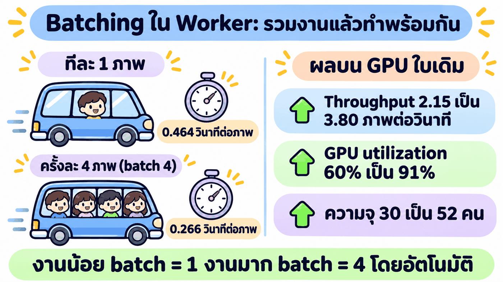

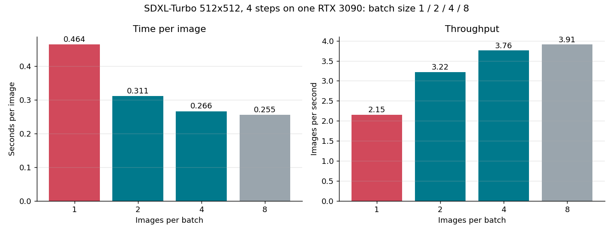

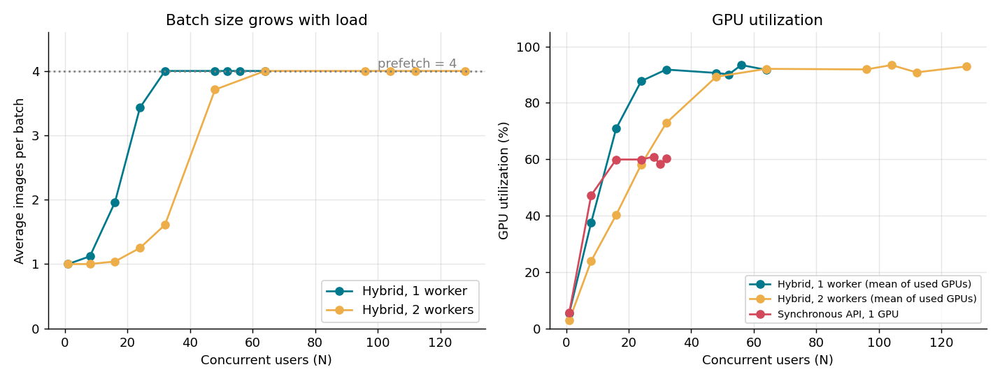

**ตัวเลขจาก LAB นี้**

| | Baseline (ทีละภาพ) | ระบบผสม (batch ≤ 4) |
|---|---|---|
| Throughput สูงสุด | 2.15 ภาพ/วินาที | 3.80 ภาพ/วินาที (×1.77) |
| GPU utilization ตอนเต็ม | ~60% | ~91% |
| ความจุ | 30 คน | 52 คน (×1.73) |
| เวลารอที่ N = 1 | 0.47 s | 0.51 s (ช้าลงเล็กน้อยเพราะผ่านคิว) |

ทำไมไม่ใช้ batch 8: จาก 4 เป็น 8 ได้เพิ่มแค่ 3.76 → 3.91 ภาพ/วินาที แต่ทุกงานใน batch ต้องรอรอบละ 2 วินาที

### 8 · Scaling Efficiency

- **คืออะไร** Efficiency = (ความจุที่ k ใบ ÷ ความจุ 1 ใบ) ÷ k · 100% คือเพิ่ม GPU 2 เท่าแล้วรับได้ 2 เท่าพอดี
- **ทำไมต้องวัด** เพื่อรู้ว่าเงินที่จ่ายเพิ่มได้ความจุกลับมาเต็มไหม และใช้ประมาณการก่อนเช่าเพิ่ม
- **ทำงานอย่างไร** Worker แต่ละตัวอิสระต่อกัน (1 GPU ต่อตัว) ส่วนกลาง (gateway, RabbitMQ) ทำงานเบามากเมื่อเทียบกับ 0.25 วินาที/ภาพ จึงได้เกือบ 100% · Efficiency จะลดลงเมื่อส่วนกลาง CPU หรือดิสก์เริ่มเป็นคอขวด


**ตัวเลขจาก LAB นี้** 52 → 104 คน = 2.0 เท่า, Efficiency 100% (ภาพ/วินาที 97%) · แถว 3 ใบ (~156 คน, ~11.1 ภาพ/วินาที) คือ **การคำนวณ** จาก Efficiency ที่วัดได้ที่ 2 ใบ ไม่ใช่ผลวัด

## การทดลอง

| หัวข้อ | รายละเอียด |
|---|---|
| โหลด | ผู้ใช้จำลอง N คน วน: ส่งข้อความ → รอจนได้ภาพ → ดูภาพ 2.5–7.5 วินาที (เฉลี่ย 5) → ส่งใหม่ · เลิกรอที่ 30 วินาที = งานล้ม |
| ระดับ N | 1, 8, 16, 24, 32, 48, 64, 96, 128, … ระดับละ 30 วินาที (ไม่นับ 10 วินาทีแรก) · หยุดที่ระดับแรกที่ไม่ผ่าน แล้วลองกึ่งกลางอีก 2 ครั้ง |
| โมเดล | `stabilityai/sdxl-turbo` ภาพ 512 × 512 แบบ 4 steps |
| เทียบ A / B / C | **A** API Synchronous บน GPU 1 ใบ (Baseline) · **B** ระบบผสม Worker 1 ตัว บน GPU ใบเดิม · **C** ระบบผสม Worker 2 ตัว บน GPU 2 ใบ |
| วิธีวัด / SLO | เวลารอจนได้ภาพ p95 ≤ 10 วินาที และงานล้ม < 1% · ความจุ = N สูงสุดที่ผ่าน |
| การทดลองเสริม | Burst 200 งานใน 10 วินาที (Synchronous เทียบระบบผสม) · บังคับปิด Worker กลางงาน |
| เครื่อง | เครื่องเดียว RTX 3090 2 ใบ · 16 cores · $0.345/ชม. (เพดาน $0.60) · ตัวยิงโหลดรันบนเครื่องเดียวกับ server |
| เวลาและค่าเช่าจริง | 11 ขั้นรวมราว 96 นาที · เครื่องเปิด 1 ชม. 37 นาที · **$0.572** |

ทำตามลำดับขั้นที่ 1 → 11 ให้ครบในรอบเดียว (ขั้นที่ 12–13 ทำหลังลบเครื่องแล้ว) · คัดลอกพรอมต์ไปวางในช่องพิมพ์ของ Claude Code ทีละขั้น

## ขั้นที่ 1 · เช่าเครื่อง 2 GPU และลองโมเดล

AI เช่าเครื่อง ติดตั้งโมเดลกับ RabbitMQ แล้วเขียนสคริปต์จับเวลา (`bench_gen.py`) และสคริปต์ทำภาพตัวอย่าง (`make_samples.py`) พร้อมชุดคำขอ `prompts.txt`

```text
ทำงานใน container `multi-account` โฟลเดอร์ /workspace/vastapp_lab ด้วยสกิล vastai

เตรียมเครื่องสำหรับบริการสร้างภาพจากข้อความ (Text-to-Image)
1. เช่าเครื่องเดียวที่มี RTX 3090 2 ใบ ตั้งป้ายเครื่องว่า vapp-lab9 ราคารวมไม่เกิน $0.60 ต่อชั่วโมง (ถ้าหาไม่ได้จริง ใช้ RTX 4090 2 ใบ ไม่เกิน $1.00 แล้วบอกเหตุผล)
   เลือกเครื่อง verified ที่เชื่อมต่อตรงได้ ความน่าเชื่อถือ 95% ขึ้นไป CPU 12 cores ขึ้นไป เน็ตเร็ว อยู่นอกประเทศจีน (จะได้โหลดโมเดลจาก Hugging Face ได้) disk 50 GB และเปิดพอร์ตให้ API จากภายนอกเข้าได้ 1 พอร์ต
2. ติดตั้งสิ่งที่ต้องใช้สร้างภาพด้วยโมเดล stabilityai/sdxl-turbo และติดตั้ง RabbitMQ ไว้ล่วงหน้า (เครื่องเช่าไม่มี Docker)
   ถ้าโหลดโมเดลแล้วเจอข้อผิดพลาดเรื่อง brotli ให้อัปเดตแพ็กเกจ brotli
3. ลองสร้างภาพขนาด 512x512 แบบ 4 steps บน GPU ใบแรก โดยส่งข้อความครั้งละ 1, 2, 4, 8 ข้อความ แล้วจับเวลา
   HF_TOKEN อยู่ในไฟล์ .env ของโฟลเดอร์ปัจจุบัน ห้ามแสดงค่า
4. แต่งคำบรรยายภาพภาษาอังกฤษ 12 ข้อ (ภาพถ่ายทั่วไป เช่น ประภาคาร จักรยาน ชามราเม็ง) เก็บไว้ที่ lab9_hybrid/code/prompts.txt สำหรับใช้ยิงโหลดทุกขั้น
   แล้วสร้างภาพจาก 6 ข้อแรก เรียงเป็นตารางภาพเดียวพร้อมข้อความใต้ภาพ เก็บที่ lab9_hybrid/results/dataset_samples.jpg

สรุปเป็นตาราง: GPU · ราคาต่อชั่วโมง · ที่ตั้ง · CPU cores และตารางเวลาสร้างภาพ (วินาทีต่อภาพ ภาพต่อวินาที) เมื่อส่งครั้งละ 1, 2, 4, 8 ภาพ
อธิบายด้วยว่างาน 1 ชิ้นของบริการนี้ส่งอะไรเข้าไป ได้อะไรกลับมา (ยกตัวอย่างจริง 1 งาน) แล้วบอกว่าเครื่องยังเปิดอยู่
```


*ใช้เวลา 20 นาที (รวมรอเครื่องและดาวน์โหลดโมเดล) · ที่อยู่เครื่องในภาพเป็นค่าตัวอย่าง*

| ส่งครั้งละ | วินาทีต่อภาพ | ภาพต่อวินาที |
|---|---|---|
| 1 | 0.464 | 2.15 |
| 2 | 0.311 | 3.22 |
| 4 | 0.266 | 3.76 |
| 8 | 0.255 | 3.91 |

ตัวอย่างโค้ดที่ AI เขียนให้ในรอบจริง (ของคุณอาจต่างกัน): [code_reference/bench_gen.py](code_reference/bench_gen.py) · [code_reference/make_samples.py](code_reference/make_samples.py) · [code_reference/prompts.txt](code_reference/prompts.txt)

**อ่านผลอย่างไร**

- ตารางนี้บอกเพดานของ GPU 1 ใบล่วงหน้า: ทำทีละภาพได้ **2.15 ภาพ/วินาที** ทำครั้งละ 4 ภาพได้ **3.76** · สองตัวเลขนี้จะกลับมาเป็น Throughput สูงสุดของ Baseline และของระบบผสม
- จาก 4 เป็น 8 ภาพแทบไม่เร็วขึ้น เราจึงตั้งขนาด batch ของ Worker ไว้ที่ 4
- AI รายงานปัญหาที่เจอเอง: `rabbitmqctl` บนเครื่องเช่าอ่าน cookie ไม่ได้ และ SSH หลุดระหว่างดาวน์โหลดโมเดล · งานยาวต้องรันเป็นงานเบื้องหลัง
- **ตั้งแต่ขั้นนี้เงินเริ่มเดิน** ชั่วโมงละ $0.345 จนกว่าจะลบเครื่องในขั้นที่ 11

## ขั้นที่ 2 · เขียน API แบบ Synchronous (Baseline)

AI เขียน `sync_server.py`: รับข้อความที่ `POST /generate` แล้วตอบเป็นภาพ JPEG สร้างทีละ 1 ภาพบน GPU ใบแรก

```text
ทำงานใน container `multi-account` โฟลเดอร์ /workspace/vastapp_lab ด้วยสกิล vastai
เครื่องที่ใช้คือเครื่องป้าย vapp-lab9

เขียน API สร้างภาพแบบตรงไปตรงมา (ผู้ใช้ถือสายรอจนได้ภาพ) แล้วเปิดบน GPU 1 ใบ
1. เขียนไว้ที่ lab9_hybrid/code/sync_server.py
   - รับข้อความที่ POST /generate แล้วตอบกลับเป็นภาพ JPEG
   - ใช้โมเดล stabilityai/sdxl-turbo ภาพ 512x512 แบบ 4 steps บน GPU ใบแรก สร้างทีละ 1 ภาพ
   - คำขอที่มาพร้อมกันให้ยืนรอกันเอง และรับคำขอค้างพร้อมกันได้อย่างน้อย 500 คำขอ
   - ต้องใช้ API key ที่สุ่มขึ้นแล้วเก็บเป็นไฟล์บนเครื่องเช่า
   - มี GET /health และ GET /stats ที่บอกจำนวนคำขอที่รับมา กับจำนวนภาพที่สร้างเสร็จแล้ว
2. นำไปเปิดบนเครื่องเช่าเป็นงานเบื้องหลัง ที่พอร์ตที่เปิดไว้
3. ทดสอบจากนอกเครื่อง: ส่งข้อความ 1 ข้อพร้อม key แล้วได้ภาพ · ส่งแบบไม่มี key ต้องได้ 401
4. อธิบายโค้ดที่เขียนสั้นๆ 3–5 บรรทัดว่าแต่ละส่วนทำอะไร

ห้ามแสดงค่า key · สรุป: ผลทดสอบ 2 ข้อ และเวลาที่ใช้ต่อภาพ แล้วบอกว่าเครื่องยังเปิดอยู่
```


*ใช้เวลา 7 นาที*

ตัวอย่างโค้ดที่ AI เขียนให้ในรอบจริง (ของคุณอาจต่างกัน): [code_reference/sync_server.py](code_reference/sync_server.py) · ภาพจากการทดสอบ: [results/sync_test.jpg](results/sync_test.jpg)

**อ่านผลอย่างไร**

- นี่คือแบบที่เขียนง่ายที่สุด (78 บรรทัด) และใช้เป็น **Baseline** ของทั้ง LAB
- คำขอที่มาพร้อมกัน "ยืนรอกันเอง" ใน server · ยิง 500 คำขอพร้อมกันได้ภาพครบ แต่ใช้ 234 วินาที คนท้ายแถวรอเกือบ 4 นาที
- API นี้เปิดสู่อินเทอร์เน็ต จึงต้องมี **API key** · ข้อทดสอบที่ 2 ยืนยันว่าคนไม่มี key ใช้ไม่ได้

## ขั้นที่ 3 · เขียนตัวยิงโหลด แล้ววัด Baseline: GPU 1 ใบรับได้กี่คน

AI เขียน `loadtest.py` ที่จำลองผู้ใช้ N คนแล้วไล่ระดับ N จนไม่ผ่าน SLO

```text
ทำงานใน container `multi-account` โฟลเดอร์ /workspace/vastapp_lab ด้วยสกิล vastai
เครื่องที่ใช้คือเครื่องป้าย vapp-lab9

เขียนตัวยิงโหลด แล้ววัดว่า API แบบ Synchronous บน GPU 1 ใบ รับผู้ใช้พร้อมกันได้กี่คน
1. เขียนไว้ที่ lab9_hybrid/code/loadtest.py ให้รันบนเครื่องเช่าเครื่องเดียวกับ API
   - ผู้ใช้จำลอง 1 คน: ส่งข้อความ (วนใช้ 12 ข้อใน lab9_hybrid/code/prompts.txt) → รอจนได้ภาพ → พักดูภาพ 2.5–7.5 วินาที (เฉลี่ย 5) → ส่งใหม่ · เลิกรอเมื่อเกิน 30 วินาที นับเป็นงานล้ม
   - ไล่ระดับผู้ใช้พร้อมกัน N = 1, 8, 16, 24, 32, 48, 64, 96, 128, 160, 192, 256, 320 ระดับละ 30 วินาที ไม่นับ 10 วินาทีแรก
   - รอให้งานค้างหมดก่อนขึ้นระดับถัดไป · เจอระดับแรกที่ไม่ผ่าน SLO ให้หยุด แล้วลองระดับกึ่งกลางอีก 2 ครั้งให้ได้ค่าที่ละเอียดขึ้น
   - ทุกระดับเก็บ: ภาพต่อวินาที เวลารอ p50 p95 p99 งานล้ม (%) GPU utilization ของแต่ละใบ และ CPU ของตัวยิงเอง แล้วบันทึกเป็นไฟล์ JSON
2. วัด API ที่เปิดไว้ · SLO คือเวลารอจนได้ภาพ p95 ไม่เกิน 10 วินาที และงานล้มน้อยกว่า 1%
   ใช้เวลาราว 6 นาที ให้รันเป็นงานเบื้องหลังแล้วรอ
3. อธิบายโค้ดที่เขียนสั้นๆ 3–5 บรรทัด

สรุปเป็นภาษาไทย: ตารางทุกระดับ N (ภาพต่อวินาที · p50 · p95 · งานล้ม · GPU utilization · ผ่าน SLO ไหม) และประโยค "GPU 1 ใบ รองรับผู้ใช้พร้อมกันได้ N คน ที่ p95 ≤ 10 วินาที" แล้วบอกว่าเครื่องยังเปิดอยู่
```


*ใช้เวลา 8 นาที*

| N | ภาพ/วินาที | p50 (s) | p95 (s) | p99 (s) | งานล้ม % | GPU util % | SLO |
|---|---|---|---|---|---|---|---|
| 1 | 0.15 | 0.47 | 0.47 | 0.47 | 0 | 5.5 | ผ่าน |
| 8 | 1.60 | 0.47 | 1.12 | 1.23 | 0 | 47.2 | ผ่าน |
| 16 | 2.15 | 2.70 | 3.36 | 3.44 | 0 | 59.9 | ผ่าน |
| 24 | 2.15 | 6.47 | 7.25 | 7.35 | 0 | 59.9 | ผ่าน |
| 28 | 2.15 | 7.52 | 8.77 | 9.07 | 0 | 60.9 | ผ่าน |
| **30** | 2.15 | 8.42 | **9.19** | 9.25 | 0 | 58.3 | ผ่าน |
| 32 | 2.10 | 9.31 | 10.81 | 11.45 | 0 | 60.2 | ไม่ผ่าน |

ตัวอย่างโค้ดที่ AI เขียนให้ในรอบจริง (ของคุณอาจต่างกัน): [code_reference/loadtest.py](code_reference/loadtest.py) · ผลดิบ: [results/loadtest.json](results/loadtest.json)

**อ่านผลอย่างไร**

- **GPU 1 ใบ รองรับผู้ใช้พร้อมกันได้ 30 คน ที่ p95 ≤ 10 วินาที** · นี่คือคำตอบแรกของคำถามเจ้าของระบบ
- งานล้ม 0% ทุกระดับ ระดับ 32 คนตกเพราะ **รอนานเกิน** ไม่ใช่เพราะระบบล่ม
- GPU utilization ค้างที่ราว 60% ทั้งที่คิวเต็ม: คอขวดไม่ใช่ GPU แต่คือการทำทีละภาพ (ช่วงรับ HTTP และแปลง JPEG GPU ว่าง) · นี่คือช่องว่างที่ขั้นที่ 5–6 จะเก็บ
- ตัวยิงโหลดใช้ CPU ไม่เกิน 0.5% ของ 1 core จึงไม่ได้ถ่วงผลวัด

## ขั้นที่ 4 · เขียน API gateway ที่ส่งงานเข้าคิว RabbitMQ

AI เขียน `gateway.py`: ด่านหน้าที่รับงาน ส่งเข้าคิว แล้วตอบเลขงานทันที

```text
ทำงานใน container `multi-account` โฟลเดอร์ /workspace/vastapp_lab ด้วยสกิล vastai
เครื่องที่ใช้คือเครื่องป้าย vapp-lab9

เขียนด่านหน้าของระบบผสม: รับงานแล้วส่งเข้าคิว ตอบผู้ใช้ทันทีโดยไม่ต้องถือสายรอ
1. เขียนไว้ที่ lab9_hybrid/code/gateway.py ใช้ API key ตัวเดิมทุกทาง
   - POST /jobs รับข้อความกับระดับความสำคัญ (normal หรือ express) ส่งงานเข้าคิวของ RabbitMQ แล้วตอบเลขงานทันทีพร้อมเวลารอโดยประมาณ
   - คิวงานเป็น durable ข้อความเป็น persistent และเป็น Priority queue ที่งาน express ได้ทำก่อนงาน normal · งานที่ Worker ปฏิเสธให้ไปอยู่ Dead-letter queue
   - Backpressure: ถ้างาน normal ที่รอในคิวมีถึง 100 งานต่อ Worker 1 ตัว ให้ตอบ 429 พร้อมบอกว่าควรกลับมาใหม่ในอีกกี่วินาที ส่วนงาน express รับเสมอ
   - GET /jobs/{เลขงาน} บอกสถานะ รอจนงานเสร็จได้สูงสุด 10 วินาทีต่อครั้ง · GET /jobs/{เลขงาน}/image ส่งภาพ
   - GET /stats บอกจำนวนงานที่รอ กำลังทำ เสร็จ ถูกปฏิเสธ ถูกส่งซ้ำ งานเสีย เพดานคิวตอนนี้ สถานะของ Worker แต่ละตัว และงานที่เสร็จล่าสุด 12 งาน
2. ย้าย API แบบ Synchronous ไปพอร์ตภายในอื่น (เปิดไว้ใช้เทียบภายหลัง) แล้วเปิด RabbitMQ และเปิด gateway ที่พอร์ตที่ภายนอกเข้าได้
3. ทดสอบจากนอกเครื่อง: ส่งงาน 1 งานพร้อม key ต้องได้เลขงานและสถานะรอ (ยังไม่มี Worker) · ส่งแบบไม่มี key ต้องได้ 401
4. อธิบายโค้ดที่เขียนสั้นๆ 3–5 บรรทัด

ห้ามแสดงค่า key · สรุปเป็นภาษาไทย: ผลทดสอบ 2 ข้อ และจำนวนงานที่รออยู่ในคิว แล้วบอกว่าเครื่องยังเปิดอยู่
```


*ใช้เวลา 8 นาที*

ตัวอย่างโค้ดที่ AI เขียนให้ในรอบจริง (ของคุณอาจต่างกัน): [code_reference/gateway.py](code_reference/gateway.py)

**อ่านผลอย่างไร**

- ยังไม่มี Worker เลย แต่ gateway **รับงานได้แล้ว** และตอบ 202 · งานนอนรออยู่ในคิวอย่างปลอดภัย นี่คือความหมายของการแยกคนรับงานออกจากคนทำงาน
- คำที่เราตรึงไว้ในพรอมต์ (durable, persistent, Priority queue, Dead-letter queue, เพดาน 100 ต่อ Worker) คือทฤษฎีข้อ 6 ทั้งหมด
- AI ตัดสินใจเองว่าตอนยังไม่มี Worker ให้คิดเพดานเหมือนมี 1 ตัว ไม่เช่นนั้น 100 × 0 = 0 จะปฏิเสธทุกงาน · อ่าน "เรื่องที่ควรรู้" ในคำตอบทุกครั้ง

## ขั้นที่ 5 · เขียน GPU Worker ที่หยิบงานจากคิว

AI เขียน `worker.py`: Consumer ที่ใช้ GPU 1 ใบ รวมงานครั้งละไม่เกิน 4 ภาพ และ ack หลังเก็บภาพแล้ว

```text
ทำงานใน container `multi-account` โฟลเดอร์ /workspace/vastapp_lab ด้วยสกิล vastai
เครื่องที่ใช้คือเครื่องป้าย vapp-lab9

เขียน Worker ที่หยิบงานจากคิวไปสร้างภาพ แล้วเปิด 1 ตัวบน GPU ใบแรก
1. เขียนไว้ที่ lab9_hybrid/code/worker.py ตัวหนึ่งใช้ GPU 1 ใบตามหมายเลขที่ระบุตอนเปิด ทำงานคู่กับ lab9_hybrid/code/gateway.py
   - หยิบงานจากคิว รวมงานที่รออยู่ได้ครั้งละไม่เกิน 4 ภาพ (prefetch 4) สร้างภาพด้วยโมเดลและค่าเดียวกับ Baseline แล้วเก็บภาพไว้ให้ gateway
   - ยืนยันว่างานเสร็จ (ack) หลังเก็บภาพแล้วเท่านั้น งานจึงไม่หายถ้า Worker ตายกลางคัน
   - บอก gateway ทุกวินาทีว่ายังอยู่และกำลังทำกี่ภาพ · งานที่ข้อความว่างถือเป็นงานเสีย ให้ปฏิเสธเพื่อส่งไป Dead-letter queue
2. เปิด Worker 1 ตัวบน GPU ใบแรกเป็นงานเบื้องหลัง
3. ทดสอบจากนอกเครื่อง: งานที่ค้างจากขั้นก่อนต้องเสร็จและโหลดภาพได้ · ส่งงานใหม่ 8 งานพร้อมกัน ดูว่า Worker รวมทำครั้งละกี่ภาพ
4. อธิบายโค้ดที่เขียนสั้นๆ 3–5 บรรทัด

ห้ามแสดงค่า key · สรุปเป็นภาษาไทย: ผลทดสอบ 2 ข้อ และเวลาตั้งแต่ส่งงานจนได้ภาพ แล้วบอกว่าเครื่องยังเปิดอยู่
```


*ใช้เวลา 5 นาที*

ตัวอย่างโค้ดที่ AI เขียนให้ในรอบจริง (ของคุณอาจต่างกัน): [code_reference/worker.py](code_reference/worker.py) · [code_reference/test_worker.py](code_reference/test_worker.py) · ภาพจากการทดสอบอยู่ใน `results/worker_test/`

**อ่านผลอย่างไร**

- งานที่ค้างมาตั้งแต่ขั้นที่ 4 **เสร็จทันทีที่ Worker เปิด** · คิวเก็บงานไว้ให้จริง
- 8 งานพร้อมกันถูกทำเป็น **4 + 4** ตรงกับ `prefetch 4` · ชุดละราว 1.0 วินาที = 0.25 วินาที/ภาพ เร็วกว่าทำทีละภาพ (0.47) ราว 1.9 เท่า
- ลำดับ "เก็บภาพ → แจ้งว่าเสร็จ → ack" คือสิ่งที่ทำให้งานไม่หายในขั้นที่ 9

## ขั้นที่ 6 · วัดระบบผสมบน GPU 1 ใบ เทียบกับ Baseline

AI เพิ่มโหมดยิงระบบผสมให้ `loadtest.py` แล้ววัดด้วยระดับ N และ SLO เดิม

```text
ทำงานใน container `multi-account` โฟลเดอร์ /workspace/vastapp_lab ด้วยสกิล vastai
เครื่องที่ใช้คือเครื่องป้าย vapp-lab9

วัดระบบผสมบน GPU ใบเดิม 1 ใบ ด้วยวิธี ระดับ N และ SLO เดียวกับ Baseline
1. เพิ่มความสามารถให้ lab9_hybrid/code/loadtest.py ยิงระบบผสมได้
   - ผู้ใช้ส่งงานที่ gateway รอจนงานเสร็จ แล้วโหลดภาพ จึงนับว่าได้ภาพ · ถ้าถูกตอบ 429 นับเป็นงานล้ม
   - เก็บจำนวนภาพเฉลี่ยที่ Worker รวมทำต่อครั้งในแต่ละระดับด้วย
2. วัดแบบไล่ระดับกับระบบผสมที่มี Worker 1 ตัว · SLO เดิม: p95 ไม่เกิน 10 วินาที และงานล้มน้อยกว่า 1%
   ใช้เวลาราว 7 นาที ให้รันเป็นงานเบื้องหลังแล้วรอ

สรุปเป็นภาษาไทย: ตารางทุกระดับ N และประโยค "ระบบผสมบน GPU 1 ใบ รองรับผู้ใช้พร้อมกันได้ N คน ที่ p95 ≤ 10 วินาที"
เทียบกับ Baseline (ความจุ ภาพต่อวินาทีสูงสุด GPU utilization) พร้อมอธิบายว่าต่างกันเพราะอะไร แล้วบอกว่าเครื่องยังเปิดอยู่
```


*ใช้เวลา 9 นาที*

| N | ภาพ/วินาที | p50 (s) | p95 (s) | p99 (s) | งานล้ม % | GPU util % | ภาพต่อ batch | SLO |
|---|---|---|---|---|---|---|---|---|
| 1 | 0.15 | 0.51 | 0.51 | 0.51 | 0 | 5.4 | 1.00 | ผ่าน |
| 8 | 1.45 | 0.51 | 0.96 | 1.00 | 0 | 37.5 | 1.12 | ผ่าน |
| 16 | 2.65 | 0.97 | 1.81 | 2.02 | 0 | 70.9 | 1.96 | ผ่าน |
| 24 | 3.60 | 1.71 | 2.47 | 2.69 | 0 | 87.7 | 3.43 | ผ่าน |
| 32 | 3.80 | 3.66 | 4.54 | 4.97 | 0 | 91.8 | 4.00 | ผ่าน |
| 48 | 3.80 | 7.89 | 8.64 | 8.92 | 0 | 90.6 | 4.00 | ผ่าน |
| **52** | 3.80 | 8.88 | **9.57** | 10.25 | 0 | 90.1 | 4.00 | ผ่าน |
| 56 | 3.80 | 9.45 | 10.54 | 10.63 | 0 | 93.4 | 4.00 | ไม่ผ่าน |
| 64 | 3.80 | 11.10 | 12.17 | 12.29 | 0 | 91.7 | 4.00 | ไม่ผ่าน |

ผลดิบ: [results/loadtest_hybrid.json](results/loadtest_hybrid.json)

**อ่านผลอย่างไร**

- **GPU ใบเดิม รับได้ 52 คน จากเดิม 30 คน (1.73 เท่า) โดยไม่เพิ่ม GPU** · ที่มาคือ Batching ไม่ใช่คิว: Throughput 2.15 → 3.80 และ GPU utilization 60% → 91%
- คอลัมน์ "ภาพต่อ batch" โตเองตามโหลด: 1.00 → 1.96 → 3.43 → 4.00 · ไม่ต้องตั้งค่าอะไรเพิ่ม
- ข้อแลก: ที่ N = 1 ช้าลงเล็กน้อย (0.47 → 0.51 วินาที) เพราะผ่านคิวและโหลดภาพอีกรอบ
- ไม่มี 429 เลย เพราะผู้ใช้สูงสุด 64 คน ยังไม่ถึงเพดานคิว 100 งาน

## ขั้นที่ 7 · งานเข้าเป็นก้อน (Burst): Synchronous เทียบระบบผสม

AI เพิ่มโหมด Burst ให้ `loadtest.py` แล้วยิง 200 งานใน 10 วินาทีใส่ทั้ง 2 แบบ บน GPU 1 ใบเท่ากัน

```text
ทำงานใน container `multi-account` โฟลเดอร์ /workspace/vastapp_lab ด้วยสกิล vastai
เครื่องที่ใช้คือเครื่องป้าย vapp-lab9

ทดลองงานเข้าเกินความจุในช่วงสั้นๆ บน GPU 1 ใบ เทียบ API แบบ Synchronous กับระบบผสม (Worker 1 ตัว)
1. เพิ่มแบบ burst ให้ lab9_hybrid/code/loadtest.py: งาน 200 งานทยอยเข้ามาภายใน 10 วินาที แล้วรอจนระบบทำงานค้างหมด
   - กับ API แบบ Synchronous: ผู้ใช้เลิกรอเมื่อเกิน 30 วินาที และนับว่า API สร้างภาพให้คนที่เลิกรอไปแล้วกี่ภาพ
   - กับระบบผสม: 10% ของงานเป็น express · ถ้าถูกตอบ 429 ให้รอตามเวลาที่ gateway บอกแล้วส่งใหม่ · ผู้ใช้ยอมรอรวมได้ 300 วินาที
   - เก็บ: จำนวนงานสำเร็จ เวลารอ p50 p95 สูงสุด (แยก express กับ normal) จำนวนครั้งที่ตอบ 429 จำนวนงานค้างทุกครึ่งวินาที แล้วบันทึกเป็นไฟล์ JSON
2. ยิง burst ใส่ API แบบ Synchronous ก่อน เสร็จแล้วปิด API ตัวนั้น
3. ยิง burst ใส่ระบบผสม

สรุปเป็นภาษาไทย เป็นตารางเทียบ 2 แบบ: งานสำเร็จ (%) · เวลารอ p50 p95 · เวลาที่ได้คำตอบแรก · ภาพที่สร้างเสียเปล่า · จำนวนครั้งที่ตอบ 429 · เวลารอของงาน express เทียบ normal แล้วบอกว่าเครื่องยังเปิดอยู่
```


*ใช้เวลา 7 นาที*

| | API Synchronous | ระบบผสม (Worker 1 ตัว) |
|---|---|---|
| งานที่ได้ภาพ | 71/200 (35.5%) อีก 129 คนเลิกรอที่ 30 วินาที | **200/200 (100%)** |
| เวลารอ p50 / p95 / สูงสุด (เฉพาะงานที่ได้ภาพ) | 15.2 / 28.6 / 29.9 s | 23.1 / 43.3 / 46.3 s |
| เวลาที่ได้คำตอบแรก (p50) | 15.2 s (ต้องรอจนได้ภาพ) | **0.007 s** (202 หรือ 429 ทันที) |
| ภาพที่สร้างเสียเปล่า | 129 ภาพ | 0 |
| ตอบ 429 | – | 621 ครั้ง จาก 66 งาน |
| งานค้างสูงสุด | 179 | 106 (normal ชนเพดาน 100 + ที่กำลังทำ) |
| เวลาจนงานค้างหมด | 94 s | 54 s |
| GPU util / ภาพต่อ batch | 58.9% / 1 | 91.2% / 3.92 |
| งาน express (20 งาน) p50 / p95 / สูงสุด | – | 1.5 / 2.1 / 2.4 s |
| งาน normal (180 งาน) p50 / p95 / สูงสุด | – | 25.5 / 43.4 / 46.3 s |

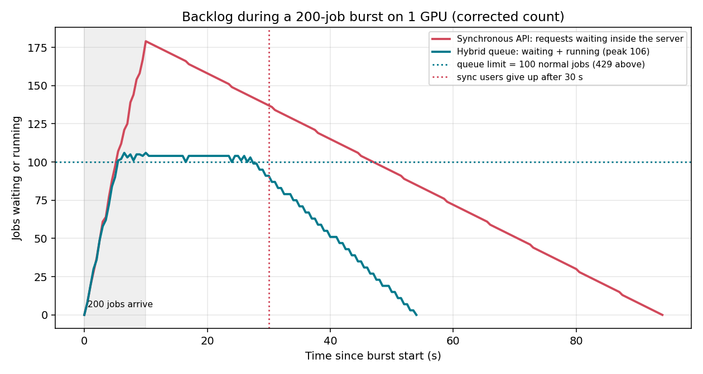

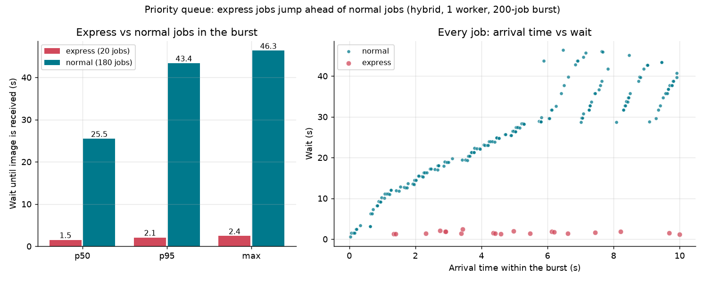

> **ตรวจกราฟที่ AI เขียนกับข้อมูลดิบเสมอ** กราฟงานค้างที่ AI เขียนในขั้นที่ 9 ([results/4_burst_sync_vs_hybrid.png](results/4_burst_sync_vs_hybrid.png)) นับงานค้างของระบบผสม **ซ้ำ 2 ที่** (ในฐานข้อมูลของ gateway และใน RabbitMQ) เส้นจึงสูงเกินจริงราว 2 เท่า · กราฟด้านบนวาดใหม่จากไฟล์ดิบ [results/burst_hybrid.json](results/burst_hybrid.json) (งานที่รอ + งานที่กำลังทำ) ค่าสูงสุดจริงคือ **106 งาน** · ช่อง `peak_backlog` ของระบบผสมใน `metrics.json` ก็มาจากการนับซ้ำเดียวกัน อย่าใช้อ้างอิง

**อ่านผลอย่างไร**

- Synchronous: GPU ทำงานครบ 200 ภาพ แต่ถึงมือผู้ใช้แค่ 71 ภาพ · GPU ทำงานให้คนที่ไปแล้วต่ออีกราว 60 วินาที
- ระบบผสม: ทุกคนได้ภาพ และ **รู้ผลทันที** ว่างานถูกรับหรือให้กลับมาใหม่ · เวลารอ p95 (43 วินาที) สูงกว่าฝั่ง Synchronous (28.6) เพราะนับ **ทุกคน** ที่ได้ภาพ ส่วนฝั่ง Synchronous นับเฉพาะ 35.5% ที่รอด ต้องอ่านคู่กับอัตราสำเร็จเสมอ
- เพดานคิวทำงานจริง: งานค้างไม่เกิน 106 และงาน express แซงคิวได้ (p95 2.1 วินาที ขณะคิวเต็ม)
- จุดที่ยังไม่ดี: gateway ที่ AI เขียนตอบ `Retry-After` = 1 วินาทีทุกครั้ง ผู้ใช้ 66 คนจึงยิงซ้ำรวม 621 ครั้ง (สูงสุด 19 ครั้งต่องาน) · ควรคำนวณจากความยาวคิว ÷ ความเร็วจริง ลองแก้พรอมต์ขั้นที่ 4 เป็นการบ้าน

## ขั้นที่ 8 · เพิ่ม Worker เป็น 2 ตัว (GPU 2 ใบ)

ขั้นนี้ไม่มีโค้ดใหม่: เปิด `worker.py` ตัวที่สองบน GPU ใบที่สอง แล้ววัดซ้ำด้วยตัวยิงโหลดเดิม

```text
ทำงานใน container `multi-account` โฟลเดอร์ /workspace/vastapp_lab ด้วยสกิล vastai
เครื่องที่ใช้คือเครื่องป้าย vapp-lab9

เพิ่ม GPU ให้ระบบผสมอีก 1 ใบ แล้ววัดความจุซ้ำด้วยตัวยิงโหลด ระดับ N และ SLO เดิม
1. เปิด Worker เพิ่มบน GPU ใบที่สอง (รวม 2 ตัว) โดยไม่แตะส่วนอื่นของระบบ
2. วัดแบบไล่ระดับ ใช้เวลาราว 8 นาที ให้รันเป็นงานเบื้องหลังแล้วรอ

สรุปเป็นภาษาไทย เป็นตาราง: จำนวน GPU | สถาปัตยกรรม | รองรับผู้ใช้พร้อมกัน (N) | ภาพต่อวินาทีสูงสุด | p95 ที่ N นั้น | เท่าของ Baseline 1 ใบ | Efficiency เทียบระบบผสม 1 ใบ
ให้มีแถว Baseline และระบบผสม 1 ใบจากขั้นก่อนด้วย · ประโยค "1 ใบ N₁ คน → 2 ใบ N₂ คน (x เท่า, Efficiency y%)"
และประมาณว่าถ้าเพิ่มเป็น 3 ใบน่าจะรองรับได้กี่คน โดยบอกชัดว่าเป็นการคำนวณ ไม่ใช่ผลวัด แล้วบอกว่าเครื่องยังเปิดอยู่
```


*ใช้เวลา 15 นาที*

| N | ภาพ/วินาที | p50 (s) | p95 (s) | p99 (s) | งานล้ม % | GPU util % (ใบ 0 / ใบ 1) | ภาพต่อ batch | SLO |
|---|---|---|---|---|---|---|---|---|
| 1 | 0.15 | 0.51 | 0.52 | 0.52 | 0 | 4.1 / 1.5 | 1.00 | ผ่าน |
| 8 | 1.55 | 0.52 | 0.68 | 0.82 | 0 | 24.7 / 23.1 | 1.00 | ผ่าน |
| 16 | 2.75 | 0.56 | 0.92 | 0.98 | 0 | 34.6 / 45.9 | 1.04 | ผ่าน |
| 24 | 4.25 | 0.76 | 1.10 | 1.26 | 0 | 61.6 / 54.6 | 1.25 | ผ่าน |
| 32 | 5.30 | 0.90 | 1.32 | 1.39 | 0 | 68.6 / 77.1 | 1.61 | ผ่าน |
| 48 | 7.05 | 1.72 | 2.52 | 2.82 | 0 | 91.6 / 86.9 | 3.71 | ผ่าน |
| 64 | 7.20 | 3.97 | 4.54 | 4.65 | 0 | 92.3 / 91.8 | 4.00 | ผ่าน |
| 96 | 7.20 | 8.20 | 8.71 | 8.93 | 0 | 92.6 / 91.1 | 4.00 | ผ่าน |
| **104** | 7.20 | 8.91 | **9.63** | 9.75 | 0 | 92.6 / 94.2 | 4.00 | ผ่าน |
| 112 | 7.00 | 9.98 | 10.62 | 10.99 | 0 | 91.8 / 89.8 | 4.00 | ไม่ผ่าน |
| 128 | 7.40 | 12.31 | 13.28 | 13.46 | 0 | 92.9 / 92.9 | 4.00 | ไม่ผ่าน |

ผลดิบ: [results/loadtest_hybrid_2gpu.json](results/loadtest_hybrid_2gpu.json)

**อ่านผลอย่างไร**

- **1 ใบ 52 คน → 2 ใบ 104 คน (2.0 เท่า, Efficiency 100%)** · เทียบกับ Baseline คือ 3.47 เท่า
- เราไม่ได้แตะ gateway หรือ RabbitMQ เลย แค่เปิด Worker เพิ่ม 1 ตัว · นี่คือ Competing Consumers
- ภาพ/วินาทีสูงสุด 7.4 วัดได้ที่ N = 128 ซึ่งเลย SLO ไปแล้ว · ในระดับที่ผ่าน SLO ได้ 7.2 (ราว 95–97% ของ 2 × 3.8)
- ตัวเลข 3 ใบ (~156 คน) AI บอกชัดว่า **คำนวณ ไม่ใช่วัด** · เครื่องนี้มี GPU แค่ 2 ใบ ถ้าจะรู้จริงต้องเช่าเครื่อง 3 ใบมาวัด

## ขั้นที่ 9 · ฆ่า Worker กลางงาน แล้วสรุปผลเป็นกราฟ

AI เขียน `killtest.py` (ส่ง 90 งานแล้วบังคับปิด Worker gpu1 ที่วินาทีที่ 4) และ `report.py` (รวมผลทุกขั้นเป็น `metrics.json` กับกราฟ 6 ภาพ)

```text
ทำงานใน container `multi-account` โฟลเดอร์ /workspace/vastapp_lab ด้วยสกิล vastai
เครื่องที่ใช้คือเครื่องป้าย vapp-lab9

พิสูจน์ว่างานไม่หายเมื่อ Worker ตาย แล้วรวมผลทุกขั้นเป็นกราฟ
1. ขณะ Worker เปิดอยู่ 2 ตัว ส่งงาน 90 งานเข้า gateway ภายใน 3 วินาที โดยมีงานเสีย (ข้อความว่าง) 1 งาน
   แล้วบังคับปิด Worker ของ GPU ใบที่สองที่วินาทีที่ 4 แบบไม่ให้มันเก็บงาน · จดจำนวนงานที่รอ กำลังทำ และเสร็จ ทุกครึ่งวินาที บันทึกเป็นไฟล์ JSON
   จากนั้นเปิด Worker ตัวนั้นกลับมาให้ครบ 2 ตัว
2. เขียนตัวสรุปผลไว้ที่ lab9_hybrid/code/report.py: อ่านไฟล์ผลทุกขั้น แล้วเขียน metrics.json กับกราฟป้ายภาษาอังกฤษ 6 ภาพ
   - เวลารอ p50 และ p95 เทียบ N ของทั้ง 3 แบบ พร้อมเส้น SLO และจุดความจุ · ภาพต่อวินาทีเทียบ N
   - ความจุและภาพต่อวินาทีสูงสุดเทียบจำนวน GPU (1 และ 2 ใบ) พร้อมเส้น ideal Efficiency และจุดประมาณการของ 3 ใบที่เขียนกำกับว่า estimated
   - burst ของ Synchronous เทียบระบบผสม (งานค้างตามเวลา งานสำเร็จ ภาพที่สร้างเสียเปล่า) · เวลารอของงาน express เทียบ normal · จำนวนงานตามเวลาตอนฆ่า Worker
3. รันตัวสรุปผล แล้วคัดลอกไฟล์ผลทั้งหมดกลับมาไว้ที่ lab9_hybrid/results ของโฟลเดอร์ปัจจุบัน
4. เขียนไฟล์ lab9_hybrid/code/web/.env ของโฟลเดอร์ปัจจุบัน 2 บรรทัด: T2I_BASE_URL (ที่อยู่ของ gateway เมื่อเรียกจากนอกเครื่อง) และ T2I_API_KEY

ห้ามแสดงค่า key · สรุปเป็นภาษาไทย: ส่งงานดีกี่งาน เสร็จกี่งาน (งานหายไหม) · ถูกส่งซ้ำกี่งาน · งานเสียเข้า Dead-letter queue กี่งาน · ตาราง 1 / 2 GPU · รายชื่อกราฟ แล้วบอกว่าเครื่องยังเปิดอยู่
```


*ใช้เวลา 9 นาที · รอบจริง AI ตอบขั้นนี้เป็นภาษาอังกฤษทั้งที่พรอมต์ขอภาษาไทย ภาพจึงเก็บไว้ตามจริง · ถ้าเจอแบบนี้ให้พิมพ์ต่อว่า "สรุปเป็นภาษาไทย"*

| รายการ | ผล |
|---|---|
| งานที่ส่ง | 90 งานใน 3 วินาที (งานดี 89 + งานเสีย 1) |
| งานดีที่เสร็จ | **89/89 · หาย 0** · โหลดภาพได้ครบ 89 ภาพ |
| ถูกส่งซ้ำ (Redelivery) | 4 งาน (gpu1 ถืออยู่ 4 ภาพตอนถูกปิด gpu0 ทำแทน) |
| งานเสียเข้า Dead-letter queue | 1 |
| ใครทำกี่งาน | gpu0 76 งาน · gpu1 13 งานก่อนถูกปิด |
| เวลา | งานทั้งหมดเสร็จที่วินาทีที่ 20.2 · เปิด gpu1 กลับที่ 21.4 พร้อมที่ 31.3 |

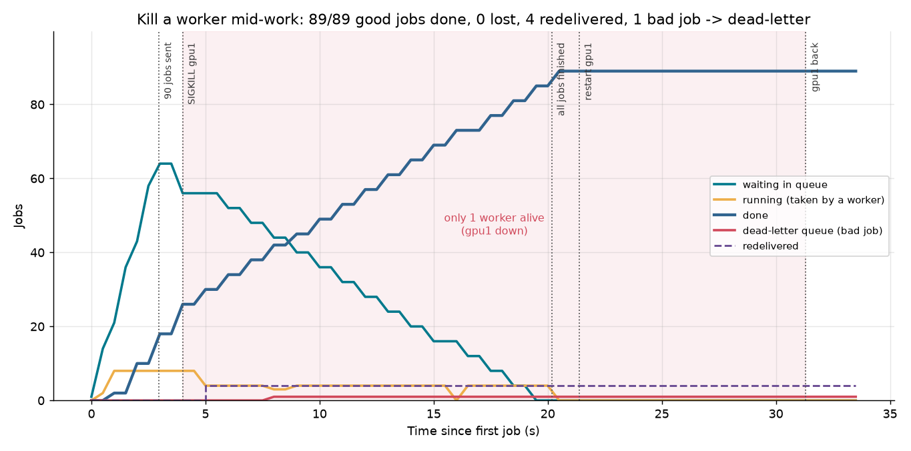

กราฟอีก 5 ภาพที่ `report.py` เขียน: [1_latency_vs_users.png](results/1_latency_vs_users.png) · [2_throughput_vs_users.png](results/2_throughput_vs_users.png) · [3_scaling_vs_gpus.png](results/3_scaling_vs_gpus.png) · [4_burst_sync_vs_hybrid.png](results/4_burst_sync_vs_hybrid.png) (เส้นระบบผสมนับซ้ำ ดูข้อสังเกตในขั้นที่ 7) · [5_express_vs_normal.png](results/5_express_vs_normal.png)

ตัวอย่างโค้ดที่ AI เขียนให้ในรอบจริง (ของคุณอาจต่างกัน): [code_reference/killtest.py](code_reference/killtest.py) · [code_reference/report.py](code_reference/report.py) · ตัวเลขรวม: [results/metrics.json](results/metrics.json)

**อ่านผลอย่างไร**

- Worker ตายแบบไม่ทันเก็บงาน แต่ **งานหาย 0** · 4 งานที่มันถืออยู่ยังไม่ถูก ack RabbitMQ จึงส่งให้ gpu0 ทำแทน
- งานที่ต้องส่งซ้ำมี **ไม่เกิน 4** เพราะ `prefetch 4` · ยิ่งตั้ง prefetch สูง งานที่ต้องทำซ้ำเมื่อ Worker ตายยิ่งมาก
- งานเสีย 1 งานไปพักที่ Dead-letter queue ไม่วนกลับมา และไม่กระทบงานอื่น
- ช่วงที่เหลือ Worker ตัวเดียว ระบบ **ช้าลงแต่ไม่หยุด** · เส้น "เสร็จ" ในกราฟชันน้อยลงหลังวินาทีที่ 4

## ขั้นที่ 10 · สร้างเว็บห้องสร้างภาพ แล้วเปิดใช้

AI เขียนเว็บ Next.js ชื่อ PixelQueue ไว้ที่ `code/web` แล้วเปิดบนเครื่องเราที่พอร์ต 3408 ให้ต่อกับ gateway บนเครื่องเช่า

```text
สร้างเว็บห้องสร้างภาพบนเครื่องนี้ (Docker Desktop) ให้ต่อกับ gateway ของ LAB 9 บน Vast.ai
1. เขียนเว็บ Next.js ไว้ที่ lab9_hybrid/code/web เปิดเป็น container ที่พอร์ต 3408 ใช้ชื่อโปรเจกต์ vapp-lab9
   เว็บเรียก gateway (lab9_hybrid/code/gateway.py) จากฝั่ง server ของเว็บ ด้วยค่าในไฟล์ .env ที่ขั้นก่อนเขียนไว้ ห้ามส่ง key ไปที่เบราว์เซอร์
2. หน้าเดียว ภาษาไทย หน้าตาเป็นแอปจริง ชื่อ PixelQueue มีส่วนต่างๆ ดังนี้
   - ช่องพิมพ์คำบรรยายภาพ ตัวเลือกงานด่วน และปุ่มสร้างภาพ ที่บอกลำดับคิวกับเวลารอ แล้วแสดงภาพเมื่อเสร็จ (ถ้าคิวเต็มให้บอกว่าควรลองใหม่เมื่อไร)
   - ปุ่มส่งงานเป็นชุด 20 งาน 60 งาน 500 งาน และงานด่วน 5 งาน พร้อมบอกว่ารับกี่งาน ปฏิเสธกี่งาน
   - ตัวเลขสด: รอในคิว กำลังสร้าง เสร็จแล้ว ถูกปฏิเสธ · กราฟความยาวคิวแบบสดพร้อมเส้นเพดานคิว
   - การ์ดของ GPU Worker แต่ละตัว (ว่าง กำลังสร้างกี่ภาพ หรือหยุดทำงาน) · ภาพที่เสร็จล่าสุด 12 ภาพ พร้อมเวลารอและป้ายงานด่วน
3. เปิดเว็บ รอจน http://localhost:3408 เปิดได้ แล้วทดสอบผ่านเว็บ 3 อย่าง: เห็น Worker 2 ตัว · ส่งงาน 1 งานจนได้ภาพ · ส่งงานเป็นชุด 500 งาน แล้วดูว่ารับกี่งาน ปฏิเสธกี่งาน
4. อธิบายโครงของเว็บสั้นๆ 3–5 บรรทัด

ห้ามแสดงค่า key · สรุปเป็นภาษาไทย เป็นตาราง: การทดสอบ · ผล · ตัวเลขที่ได้ แล้วบอกว่าเครื่องบน Vast.ai ยังเปิดอยู่
```

เปิด http://localhost:3408 ในเบราว์เซอร์ พิมพ์คำบรรยายภาพแล้วกด "สร้างภาพ" · กดปุ่มส่งงานเป็นชุดแล้วดูกราฟความยาวคิวกับการ์ด GPU Worker


*ใช้เวลา 7 นาที*


| | |
|---|---|
| 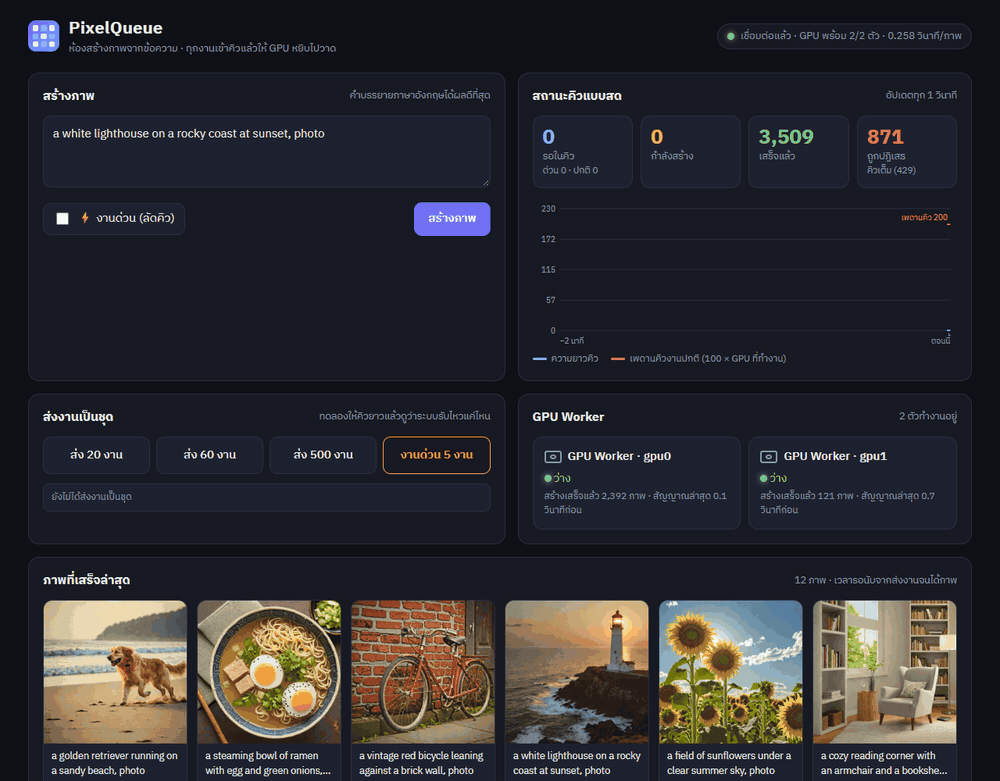 | 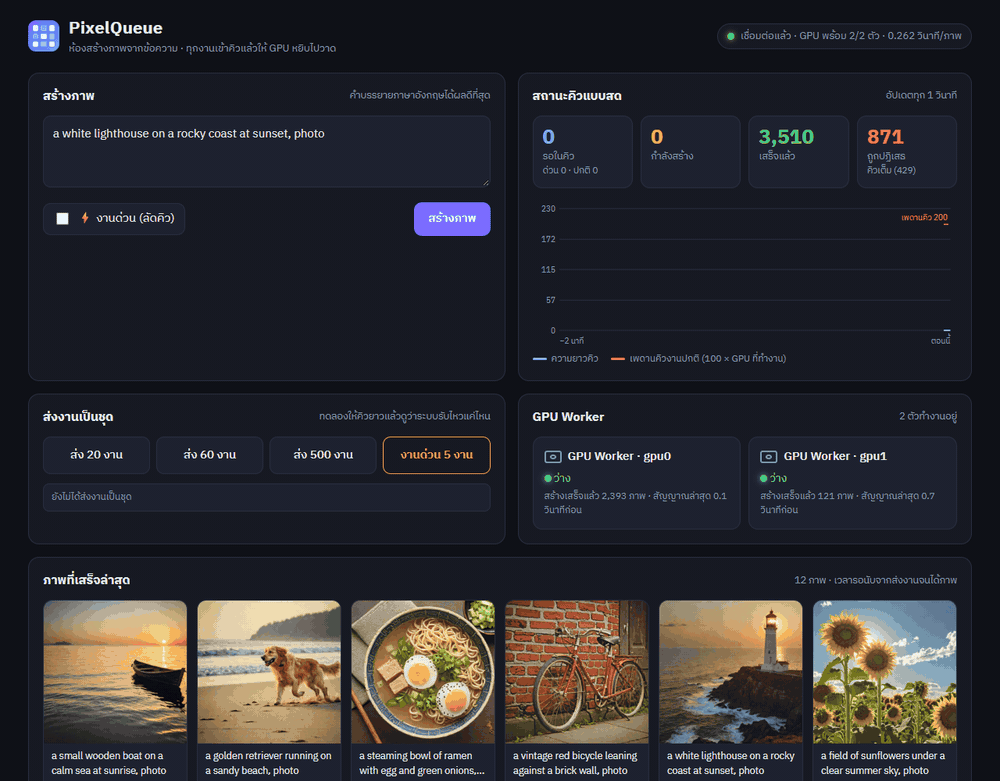 |
| สร้างภาพ 1 ภาพ | ส่งงานเป็นชุด 60 งาน |
| 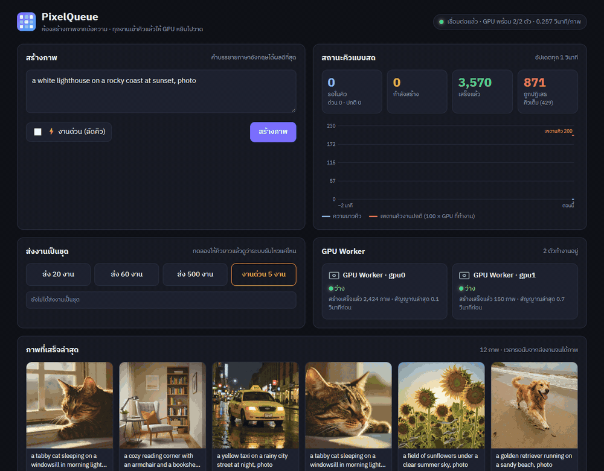 | 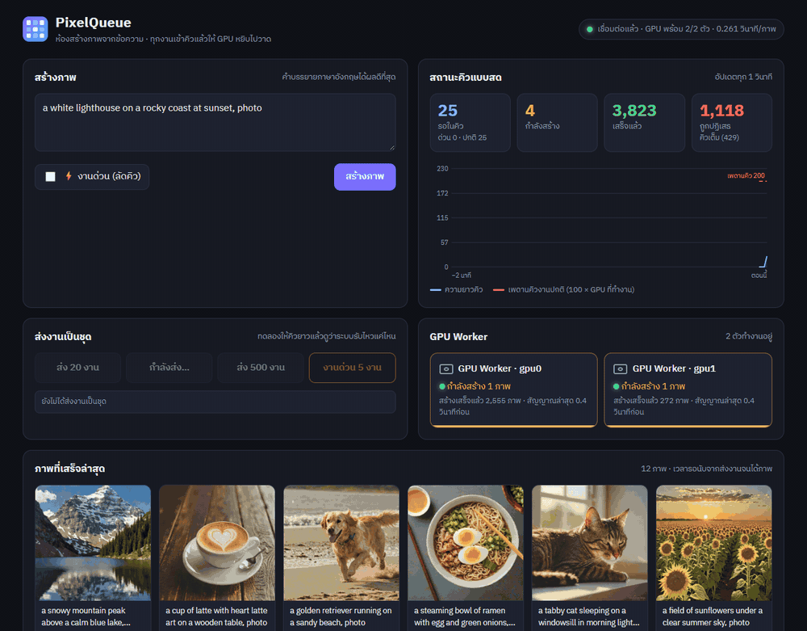 |
| 500 งาน เกินเพดาน → 429 | งานด่วนแซงคิว |
| 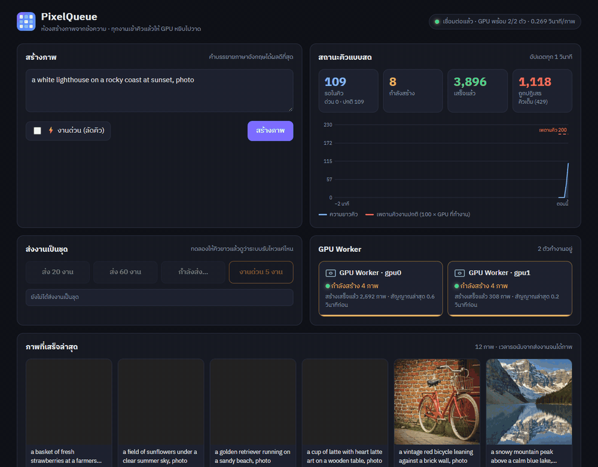 | 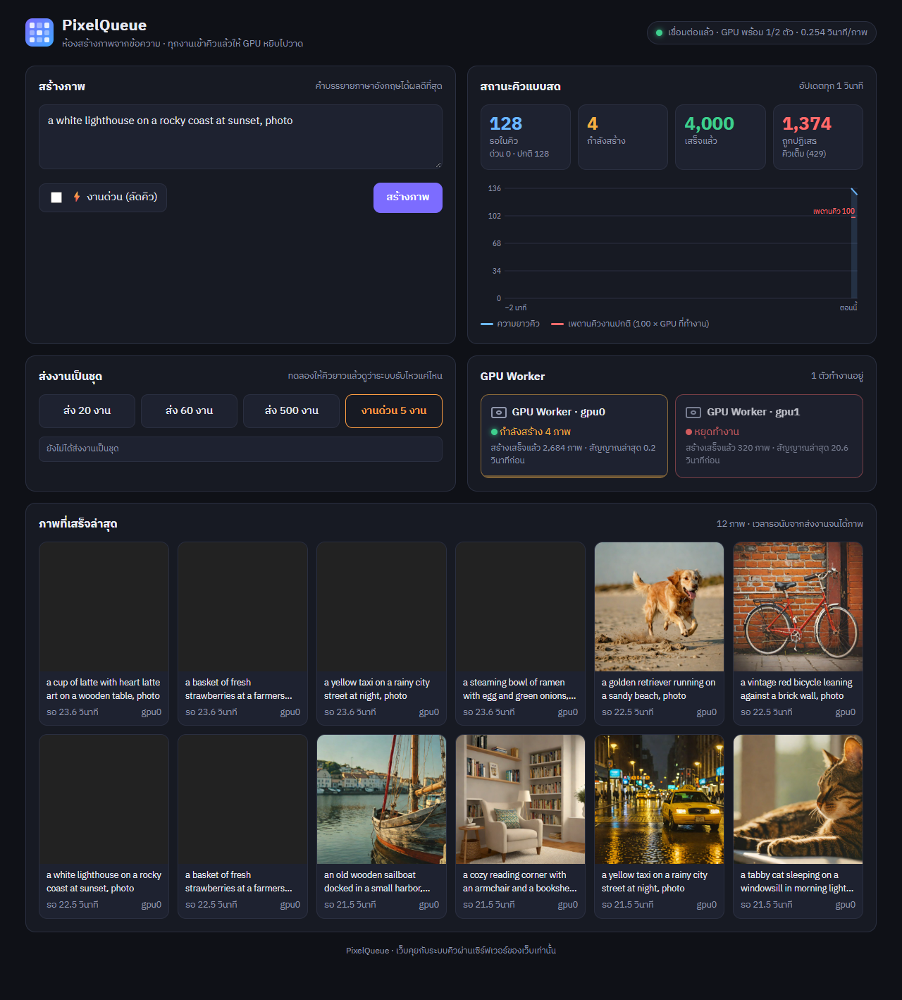 |
| ปิด Worker 1 ตัวกลางงาน | เพดานคิวลดจาก 200 เป็น 100 เอง |

ตัวอย่างโค้ดที่ AI เขียนให้ในรอบจริง (ของคุณอาจต่างกัน): [code_reference/web/](code_reference/web/app/page.js)

**อ่านผลอย่างไร**

- ทฤษฎีข้อ 6 มองเห็นได้ในหน้าเดียว: ความยาวคิว เส้นเพดาน การ์ด Worker และป้ายงานด่วน
- ส่ง 500 งานแล้วถูกรับราวครึ่งเดียว (คำตอบของ AI: รับ 250 ปฏิเสธ 250 · รอบถ่ายภาพหน้าจอ: 244 กับ 256) · เพดานคือ 200 = 100 × Worker 2 ตัว
- ปิด Worker 1 ตัว เพดานคิว **ลดเอง** เหลือ 100 · ระบบรับงานเท่าที่กำลังคนทำงานที่เหลือทำไหว
- API key อยู่ฝั่ง server ของเว็บเท่านั้น ไม่ถูกส่งถึงเบราว์เซอร์ · ช่องภาพสีดำในแกลเลอรีคือภาพที่ยังโหลดข้ามอินเทอร์เน็ตจากเครื่องเช่าไม่เสร็จ

## ขั้นที่ 11 · ลบเครื่องและสรุปค่าใช้จ่าย (ห้ามข้าม)

AI ลบเครื่องเช่า ปิด container ของเว็บ แล้วสรุปยอดจากใบแจ้งหนี้ของบัญชี

```text
ทำงานใน container `multi-account` โฟลเดอร์ /workspace/vastapp_lab ด้วยสกิล vastai

ปิดทุกอย่างของ LAB 9
1. ลบเครื่องป้าย vapp-lab9 แล้วตรวจว่าไม่มีเครื่องป้ายนี้ค้างในบัญชี (ห้ามแตะเครื่องป้ายอื่น)
2. ปิด container ของเว็บในโฟลเดอร์ lab9_hybrid/code/web ของโฟลเดอร์ปัจจุบัน

สรุปเป็นภาษาไทย ค่าใช้จ่ายจริงของเครื่อง vapp-lab9: อายุเครื่อง · ราคาต่อชั่วโมง · ยอดที่ถูกคิด (GPU · disk · รับส่งข้อมูล)
```


*ใช้เวลา 2 นาที · คำตอบของขั้นนี้ก็ออกมาเป็นภาษาอังกฤษเช่นกัน ภาพเก็บไว้ตามจริง*

| รายการ | ยอด |
|---|---|
| อายุเครื่อง | 1 ชม. 37 นาที |
| ราคาต่อชั่วโมง | $0.345 (GPU $0.320 + disk $0.025) |
| GPU | $0.511 |
| Disk | $0.041 |
| รับส่งข้อมูล (ดาวน์โหลด 7.2 GB + อัปโหลด 0.2 GB) | $0.020 |
| **รวม** | **$0.572** |

**อ่านผลอย่างไร**

- ทั้ง LAB (3 สถาปัตยกรรม + Burst + ฆ่า Worker + เว็บ) ใช้เงิน **$0.572** · ยอดมาจากใบแจ้งหนี้ของบัญชี ไม่ใช่การคูณเอง
- ตรวจทุกครั้งว่า **ไม่มีเครื่องป้าย `vapp-lab9` ค้าง** · เครื่องที่ลืมลบคิดเงินต่อไปเรื่อย ๆ
- ที่ตั้งเครื่องในคำตอบของขั้นนี้ไม่ตรงกับที่ AI รายงานในขั้นที่ 1 (AI อ่านข้อมูลคนละช่อง) · รายละเอียดประกอบที่ AI เล่ามาอาจคลาดเคลื่อนได้ ตัวเลขสำคัญอย่างยอดเงินจึงต้องอ้างจากใบแจ้งหนี้

## ปิดท้าย · เก็บงานทั้ง LAB เป็นสกิลเวอร์ชัน 0

เราเพิ่งสั่งงาน 11 ขั้นจนสำเร็จ ถ้าต้องวัดซ้ำ (เช่น เปลี่ยนรุ่น GPU หรือระดับ N) ไม่ควรต้องวาง 11 พรอมต์ใหม่ · **สกิล** คือไฟล์ที่เก็บวิธีทำงานที่สำเร็จแล้ว พร้อมโค้ดที่ใช้ได้แล้ว ให้ AI ทำซ้ำได้ในคำสั่งเดียว

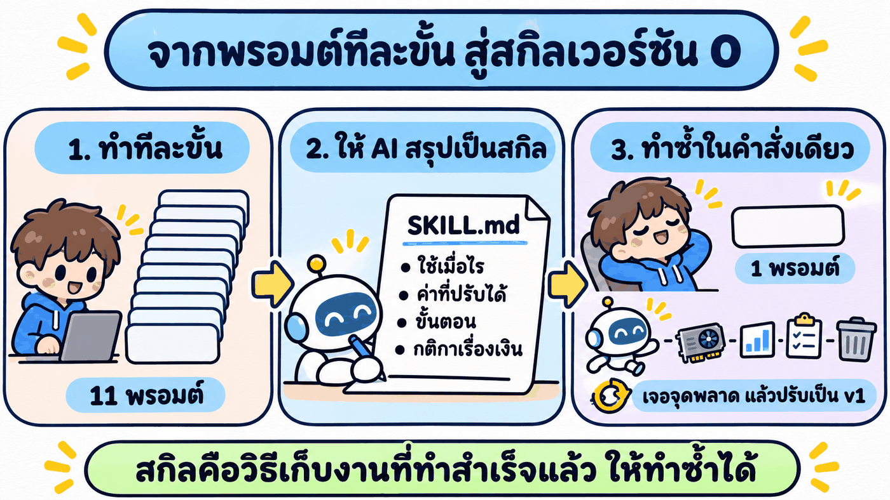

### ขั้นที่ 12 · ให้ AI สร้างสกิล v0

AI อ่านพรอมต์ โค้ด และผลของ LAB นี้ แล้วเขียน `skill_v0/SKILL.md` พร้อมคัดลอกโค้ดเข้า `skill_v0/scripts`

```text
สร้างสกิลของ Claude Code 1 ตัว ชื่อ gpu-queue-capacity จากงานของ LAB 9 ที่เพิ่งทำ เพื่อให้ทำซ้ำได้ในคำสั่งเดียว
1. ดูสิ่งที่ทำไปจากพรอมต์ทุกขั้นใน lab9_hybrid/PROMPTS.md โค้ดใน lab9_hybrid/code และผลใน lab9_hybrid/results
2. เขียนสกิลไว้ที่ lab9_hybrid/skill_v0/SKILL.md ให้มี name และ description (บอกว่าใช้เมื่อไร) · ค่าที่ผู้ใช้ปรับได้พร้อมค่าเริ่มต้น · ขั้นตอน · เกณฑ์ตรวจผ่าน · กติกาเรื่องเงิน (ลบเครื่องเสมอ)
   สกิลนี้เรียกใช้สกิล vastai ต่อ ไม่เขียนทับ
3. เก็บโค้ดที่ใช้ได้แล้วจาก lab9_hybrid/code (ไม่รวมเว็บ) เข้าไปในสกิลที่ lab9_hybrid/skill_v0/scripts รอบหน้าจะได้ไม่ต้องเขียนใหม่
4. ติดตั้งเป็นสกิลของโปรเจกต์ที่ .claude/skills/gpu-queue-capacity ของโฟลเดอร์ปัจจุบัน

สรุปเป็นภาษาไทย: สกิลนี้ทำอะไร ปรับค่าอะไรได้บ้าง และมีไฟล์อะไร
```


*ใช้เวลา 8 นาที · ไม่ต้องเช่าเครื่อง · สกิลที่ได้: [skill_v0/SKILL.md](skill_v0/SKILL.md)*

> ⚠️ หลังขั้นนี้ให้ปิดแล้วเปิด Claude Code ใหม่ 1 ครั้ง สกิลที่เพิ่งติดตั้งจึงจะถูกมองเห็น · ถ้า AI ตอบว่าไม่รู้จักสกิล ให้เปิดใหม่อีกครั้ง

### ขั้นที่ 13 · ลองใช้สกิลทำซ้ำในคำสั่งเดียว

AI ตัวใหม่ทำเองด้วยสกิล: เช่าเครื่อง ติดตั้ง วัด Baseline กับระบบผสม Worker 2 ตัว (ชุดย่อ) ทำรายงาน และลบเครื่อง

```text
ใช้สกิล gpu-queue-capacity วัดความจุของบริการสร้างภาพจากข้อความแบบย่อ บนเครื่อง RTX 3090 2 ใบ ป้ายเครื่อง vapp-lab9 ราคารวมไม่เกิน $0.60 ต่อชั่วโมง
วัดเฉพาะแบบไล่ระดับของ Baseline กับระบบผสมที่มี Worker 2 ตัว ใช้ระดับ N แค่ 16, 32, 64, 96, 128 ระดับละ 20 วินาที ไม่ต้องยิง burst ไม่ต้องเปิดเว็บ
เก็บผลไว้ที่ lab9_hybrid/results_skill_v0 แล้วลบเครื่อง
สรุปเป็นภาษาไทย เป็นตารางความจุของทั้ง 2 แบบ เวลาที่ใช้ทั้งหมด และค่าใช้จ่ายจริง
```


*ใช้เวลา 20 นาที (เครื่องเปิด 18 นาที) · เช่าเครื่องจริงและลบเครื่องจริง*

| | สั่งทีละขั้น (ขั้นที่ 1–11) | สกิล v0 (ชุดย่อ) |
|---|---|---|
| จำนวนพรอมต์ | 11 | **1** |
| สิ่งที่วัด | Baseline · ระบบผสม 1 และ 2 Worker · Burst · ฆ่า Worker · เว็บ | Baseline · ระบบผสม 2 Worker |
| ระดับ N | 1 ถึง 128 ระดับละ 30 วินาที | 16, 32, 64, 96, 128 ระดับละ 20 วินาที |
| เครื่อง (RTX 3090 2 ใบ) | $0.345/ชม. | $0.347/ชม. + disk $0.019/ชม. |
| Baseline 1 ใบ | 30 คน · 2.15 ภาพ/วินาที | 40 คน · 2.93 ภาพ/วินาที |
| ระบบผสม 2 ใบ | 104 คน · 7.4 ภาพ/วินาที | 112 คน · 7.87 ภาพ/วินาที |
| เวลา | 96 นาที | 18 นาที |
| ค่าใช้จ่ายจริง | $0.572 | $0.299 |

ผลของรอบสกิลอยู่ที่ [results_skill_v0/](results_skill_v0/report/metrics.json) · กราฟ: [1_latency_vs_users.png](results_skill_v0/report/1_latency_vs_users.png) · [2_throughput_vs_users.png](results_skill_v0/report/2_throughput_vs_users.png)

**อ่านผลอย่างไร**

- สกิล v0 **ผ่านในรอบแรก** · เวลาลดจาก 96 เหลือ 18 นาที เพราะโค้ดอยู่ในสกิลแล้ว ไม่ต้องเขียนใหม่
- ค่าใช้จ่ายไม่ลดตามเวลา: 63% ของบิล ($0.187) คือค่าดาวน์โหลด 7.2 GB เพราะเครื่องรอบนี้คิดค่ารับส่งข้อมูล $0.026/GB (รอบหลัก $0.003/GB)
- Baseline ได้ 40 คน ไม่ใช่ 30: API แบบ Synchronous ติดคอขวดที่ CPU และเครื่องรอบนี้ CPU เร็วกว่า (GPU utilization 80% เทียบ 60%) · **ตัวเลขความจุเปลี่ยนตามเครื่อง อย่าเทียบข้ามเครื่อง**
- ระบบผสม 2 ใบได้ 112 กับ 104 คน ใกล้กัน เพราะระบบผสมใช้ GPU เต็มอยู่แล้วทั้งสองรอบ · ข้อสรุปของ LAB จึงทำซ้ำได้

**v0 ยังไม่สมบูรณ์** · จุดที่ AI ต้องเดาหรือพลาดในรอบทดสอบ และควรแก้ในเวอร์ชันถัดไป

| จุดที่ v0 ยังพลาด | ควรแก้อย่างไรใน v1 |
|---|---|
| เลือกเครื่องโดยไม่ดูค่ารับส่งข้อมูล เครื่องที่ได้คิดค่าดาวน์โหลด $0.026/GB ค่าโหลดโมเดลจึงเป็น 63% ของบิล | เพิ่มเกณฑ์ราคาค่ารับส่งข้อมูลในเกณฑ์เลือกเครื่อง |
| Baseline ได้ 40 คน ต่างจากค่าอ้างอิง 30 คนในสกิล เพราะ CPU ของเครื่องต่างกัน และวัดระดับละ 20 วินาที | ให้สกิลบันทึกรุ่น CPU และเตือนว่าตัวเลข Baseline เปลี่ยนตามเครื่อง |
| เสียเวลาราว 6 นาทีเพราะคำสั่ง SSH ที่เปิดงานเบื้องหลังค้าง | เขียนวิธีเปิดงานเบื้องหลังที่ไม่ถือ SSH ไว้ให้ชัดในสกิล |
| คำสั่งชุดย่อตัดระบบผสม 1 Worker ออก จึงคำนวณ Efficiency ไม่ได้ | ให้ชุดย่อมีการวัดระบบผสม 1 Worker เสมอ |
| `stack.sh` เป็นโค้ดที่เขียนตอนสร้างสกิล ยังไม่เคยรันก่อนรอบทดสอบ (รอบนี้ใช้ได้) | ใส่ในสกิลเฉพาะของที่รันผ่านแล้ว หรือทดสอบก่อนเก็บ |
| description ยาวมาก และค่าที่ปรับได้มีเกือบ 20 ตัว | ตัดให้เหลือค่าที่ผู้ใช้เปลี่ยนจริง |

วิธีปรับคือสั่ง AI ด้วยพรอมต์อีก 1 อันให้แก้สกิลตามตารางนี้ แล้วลองใช้ซ้ำ · สกิลจึงดีขึ้นทีละเวอร์ชันจากหลักฐานของการรันจริง

---

## ไฟล์ในโฟลเดอร์นี้

| ไฟล์ / โฟลเดอร์ | คืออะไร |
|---|---|
| `PROMPTS.md` | พรอมต์ทั้ง 13 ขั้นสำหรับคัดลอก |
| `code/` | โค้ดที่ AI เขียนให้ **ของคุณ** · เริ่มจากโฟลเดอร์ว่าง (ไม่ถูกเก็บขึ้น git) |
| `code_reference/` | ตัวอย่างโค้ดที่ AI เขียนให้ในรอบจริง ไว้เทียบ: `bench_gen.py` `make_samples.py` `prompts.txt` (ขั้นที่ 1) · `sync_server.py` (ขั้นที่ 2) · `loadtest.py` (ขั้นที่ 3, 6, 7) · `gateway.py` (ขั้นที่ 4) · `worker.py` `test_worker.py` (ขั้นที่ 5) · `killtest.py` `report.py` (ขั้นที่ 9) · `web/` (ขั้นที่ 10) |
| `skill_v0/` | สกิลที่ AI สร้างในขั้นที่ 12 (`SKILL.md` + `scripts/`) |
| `results/` | ผลจากการรันจริง: `metrics.json` · กราฟ `1_` ถึง `6_` จากพรอมต์ขั้นที่ 9 · กราฟที่วาดเพิ่มจากข้อมูลดิบ (`4b_burst_backlog_corrected.png` `7_batch_size_benchmark.png` `8_batch_vs_users.png`) · ผลดิบ JSON และ log ของทุกขั้น · `dataset_samples.jpg` · `example_job.*` · คำตอบของทุกขั้นใน `answers/` · ภาพหน้าจอและ GIF ของเว็บใน `web/` |
| `results_skill_v0/` | ผลของรอบลองใช้สกิลในขั้นที่ 13 |
| `image/` | ภาพประกอบของ LAB นี้ |
