# หัวข้อที่ 1 · SiteSafe Inspect — บริการตรวจอุปกรณ์ความปลอดภัยจากภาพหน้างาน

[← กลับหน้ารวมของบท](../README.md) · เปิด Claude Code ที่โฟลเดอร์ `01_sitesafe_inspect` · พรอมต์ทั้งหมดอยู่ใน [PROMPTS.md](PROMPTS.md)

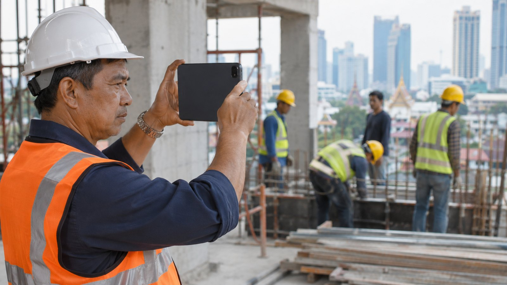
*(ภาพจำลอง · บริษัทและบุคคลในหัวข้อนี้เป็นตัวอย่างสมมติ)*

หัวข้อนี้มี 16 ขั้น · ทุกขั้นคือ 1 พรอมต์ · เริ่มจากบันทึกการสัมภาษณ์ไฟล์เดียว โค้ดทุกไฟล์ทีม AI เขียนเอง

สไลด์ประกอบการสอน: [SiteSafe_Inspect_Slides.html](SiteSafe_Inspect_Slides.html)

---

## 1 · เรื่องราวของลูกค้า

บริษัท ไทยมั่นคงก่อสร้าง รับเหมาอาคารสูง มีไซต์งาน 3 แห่งในกรุงเทพฯ

**เช้าและบ่าย: หัวหน้างานเดินถ่ายรูป**

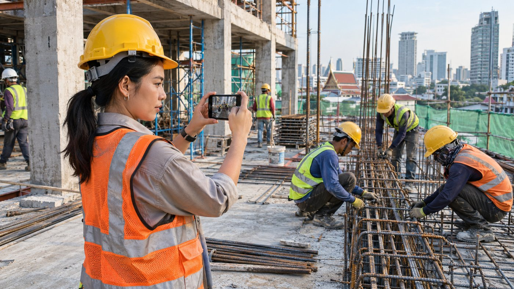

หัวหน้างานเดินถ่ายรูปวันละ 2 รอบ รอบละ 40–50 รูป แล้วส่งเข้ากลุ่ม LINE

**เย็น: ผู้จัดการความปลอดภัยเปิดดูทีละรูป**

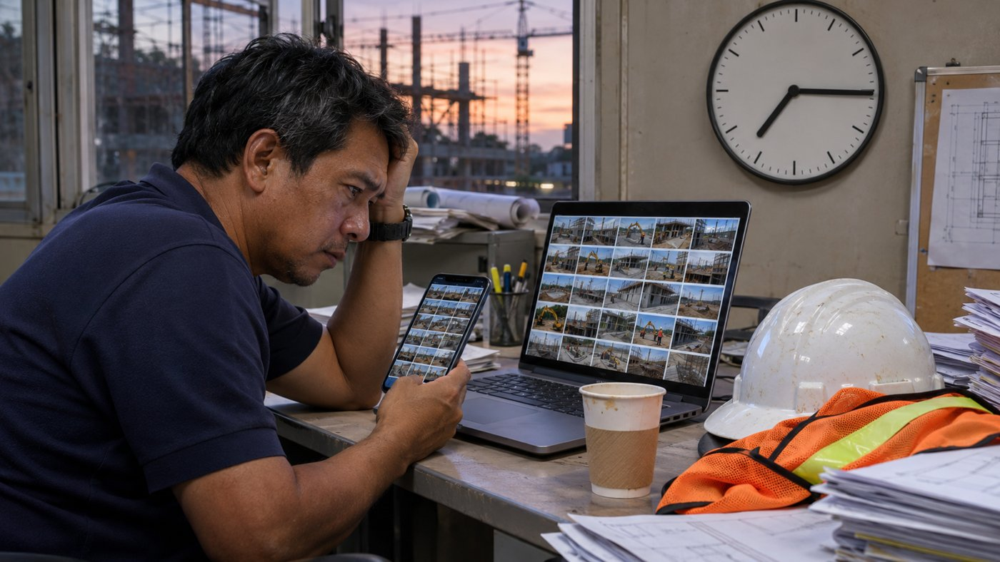

3 ไซต์รวมกันวันละราว 300 รูป คนเดียวดูไม่ทัน

**ผลที่ตามมา: คนไม่ใส่หมวกหลุดสายตา**

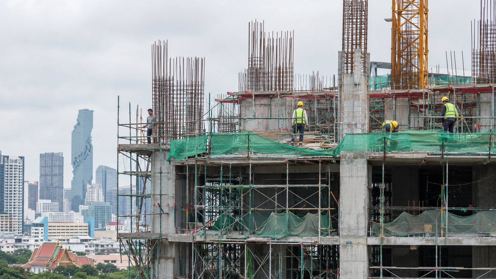

คนที่ไม่ใส่หมวกมักอยู่ไกลและตัวเล็กในรูป กว่าจะเห็นก็เลยเวลาสั่งหยุดงานไปแล้ว

**คำถามของหัวข้อนี้: ทีม AI 3 บัญชี ส่งมอบระบบตามที่ลูกค้าขอได้ครบแค่ไหน และเรารู้ได้อย่างไรว่าครบ**

---

## 2 · การสัมภาษณ์ลูกค้า

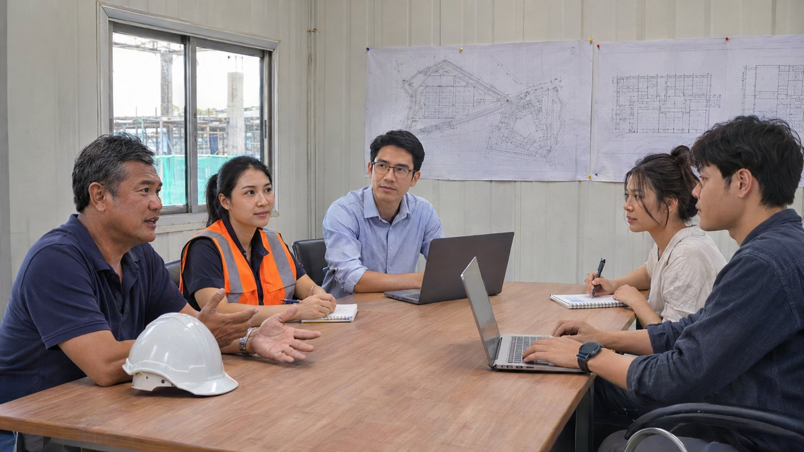

ทีมพัฒนาไปสัมภาษณ์ 3 คน แต่ละคนต้องการไม่เหมือนกัน

| | ผู้ให้สัมภาษณ์ | สิ่งที่พูด |
|---|---|---|
| 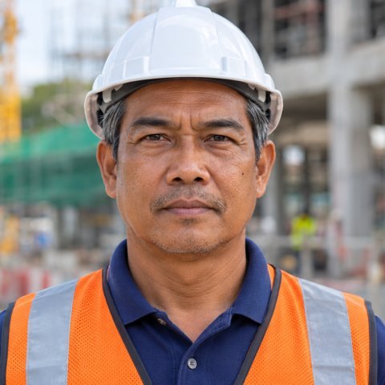 | **คุณวิชัย**<br>ผู้จัดการความปลอดภัย | "อยากให้อัปโหลดรูปแล้วระบบบอกเลยว่ารูปไหนมีคนไม่ใส่หมวก … ผมจะได้ดูเฉพาะรูปที่มีปัญหา"<br>"ไม่เกินครึ่งนาทีต่อรูปก็พอรับได้"<br>"10 รูปที่มีคนไม่ใส่หมวก ต้องจับได้อย่างน้อย 8 รูป" |
|  | **คุณนภา**<br>หัวหน้างานไซต์สาทร | "ขออัปโหลดทีละหลายรูปนะคะ เดินรอบหนึ่งได้ 40–50 รูป"<br>"กลับมาดูอีกทีสัก 5 นาทีก็ได้ ขอแค่เห็นว่างานยังอยู่ในคิว ไม่ได้หายไป"<br>"หนูขอกดแก้ผลได้ว่ารูปนี้จริง ๆ ผ่าน" |
|  | **คุณธนา**<br>ฝ่ายไอที | "รูปมีหน้าคนงาน ห้ามเปิดเป็นสาธารณะ API ต้องมี key"<br>"ขอเริ่มจากใบเดียวก่อน … ช้าหน่อยได้ แต่รูปห้ามหาย" |

*(ภาพบุคคลเป็นภาพจำลอง)*

**สังเกต:** คุณวิชัยขอผลภายในครึ่งนาที คุณนภารอได้ 5 นาที คุณธนาขอ GPU ใบเดียว ทั้ง 3 ข้อเป็นไปพร้อมกันไม่ได้ทุกกรณี · บันทึกฉบับเต็ม: [INTERVIEW.md](INTERVIEW.md)

---

## 3 · ระยะ A · จากคำพูดเป็น Requirement

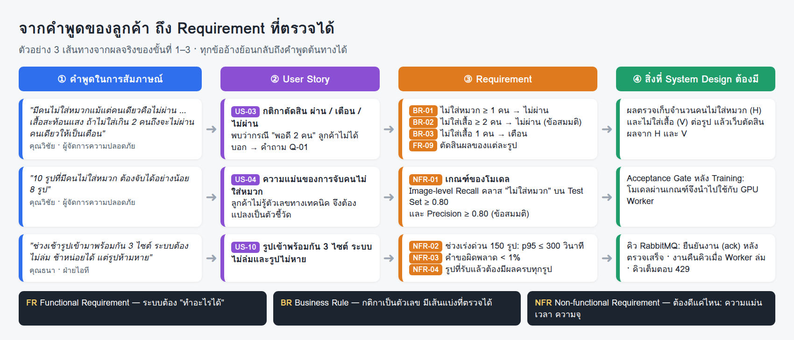

| ลำดับ | เอกสาร | ตอบคำถาม | ผลจริง |
|---|---|---|---|
| ① | [INTERVIEW.md](INTERVIEW.md) | ลูกค้าพูดว่าอะไร | 3 คน |
| ② | [USER-STORIES.md](docs/USER-STORIES.md) | ใครต้องการอะไร เพื่ออะไร | 20 ข้อ |
| ③ | [REQUIREMENTS.md](docs/REQUIREMENTS.md) | ระบบต้องทำอะไร กติกาคืออะไร ต้องดีแค่ไหน | FR 22 · BR 7 · NFR 8 |
| ④ | [DESIGN.md](docs/DESIGN.md) | ระบบมีส่วนใดบ้าง คุยกันอย่างไร | 7 ตาราง · 18 API |

### ขั้นที่ 1 · User Story จากบันทึกการสัมภาษณ์

```text
จากบันทึกการสัมภาษณ์ลูกค้าใน ./INTERVIEW.md เขียน User Story ไว้ที่ ./docs/USER-STORIES.md
1. เขียนรูปแบบ "ในฐานะ… ฉันต้องการ… เพื่อ…" ให้ครบทุกบทบาทที่ลูกค้าพูดถึง ทุกข้อมีรหัส US-01… ระดับ Must / Should / Could และเกณฑ์ยอมรับที่ตรวจได้
2. ทุกข้อต้องอ้างคำพูดในบันทึกที่เป็นที่มา ห้ามเพิ่มความต้องการที่ลูกค้าไม่ได้พูด
3. รวบรวมจุดที่ลูกค้าพูดขัดกันเอง และคำถามที่ต้องถามลูกค้าเพิ่ม เป็น 2 ตารางท้ายไฟล์
4. แยกสิ่งที่ลูกค้าบอกว่ายังไม่ทำในรุ่นแรกไว้ในหัวข้อ "นอกขอบเขต"
(ยังไม่ออกแบบระบบ ยังไม่เขียนโค้ด)
สรุปเป็นตารางภาษาไทย: จำนวน User Story แยกตามระดับ · จำนวนจุดที่ขัดกัน · จำนวนคำถาม
```

**ผลจริง** (ประมาณ 3 นาที)

| รายการ | จำนวน |
|---|---|
| User Story ระดับ Must | 16 |
| User Story ระดับ Should | 4 |
| User Story ระดับ Could | 0 |
| จุดที่ลูกค้าพูดขัดกันเอง | 4 |
| คำถามที่ต้องถามลูกค้าเพิ่ม | 14 |

ตัวอย่าง 1 ข้อ:

> **US-03 · กติกาตัดสิน ผ่าน / เตือน / ไม่ผ่าน — Must**
> **ในฐานะ** ผู้จัดการความปลอดภัย **ฉันต้องการ** ให้ระบบตัดสินแต่ละรูปตามกติกาของบริษัท **เพื่อ** ให้ผลตรงกับเกณฑ์ที่ใช้สั่งงานจริง
> **ที่มา:** คุณวิชัย — "มีคนไม่ใส่หมวกแม้แต่คนเดียวคือไม่ผ่าน ส่วนเสื้อสะท้อนแสง ถ้าไม่ใส่เกิน 2 คนในรูปเดียวถึงจะไม่ผ่าน คนเดียวให้เป็นเตือน"

**อ่านผลอย่างไร**
- AI พบ 4 จุดที่ลูกค้าพูดขัดกันเอง เช่น เวลารอผล 30 วินาทีกับ 5 นาที
- กติกาเสื้อสะท้อนแสง "เกิน 2 คนไม่ผ่าน คนเดียวเตือน" ไม่ได้บอกว่าพอดี 2 คนเป็นอะไร AI ไม่เติมเอง แต่ตั้งเป็นคำถาม Q-01
- ไม่มีข้อระดับ Could เพราะลูกค้าไม่ได้พูดถึงสิ่งที่ "มีก็ดี" สิ่งที่เลื่อนได้อยู่ในหัวข้อ "นอกขอบเขต" 2 เรื่อง: แจ้งเตือนเข้า LINE และวิดีโอจากกล้องวงจรปิด

### ขั้นที่ 2 · Requirement

```text
จาก User Story ใน ./docs/USER-STORIES.md เขียน Requirement ไว้ที่ ./docs/REQUIREMENTS.md
1. Functional Requirement (FR-01…) ทุกข้ออ้างรหัส User Story
2. Business Rule (BR-01…) ทุกข้อเป็นตัวเลขที่ตรวจได้ พร้อมค่าตัวอย่างที่ ต่ำกว่า / เท่ากับ / สูงกว่า เส้นแบ่ง
3. Non-functional Requirement (NFR-01…) ให้มีอย่างน้อย 5 เรื่อง: เกณฑ์ของโมเดล · SLO ของเวลารอผล · ความจุเมื่อรูปเข้าพร้อมกัน 3 ไซต์ · รูปห้ามหาย · ความเป็นส่วนตัวของรูป
4. เกณฑ์ของโมเดล: แปลงคำว่า "10 รูปที่มีคนไม่ใส่หมวก ต้องจับได้ 8 รูป" เป็นตัวชี้วัดที่วัดได้บน Test Set
5. จุดที่ลูกค้าขัดกันเอง ให้เลือกทางที่เสี่ยงน้อยที่สุด แล้วบันทึกเป็น "ข้อสมมติ" พร้อมเหตุผล
(ยังไม่เขียนโค้ด)
สรุปเป็นตารางภาษาไทย: จำนวน FR · BR · NFR · ข้อสมมติ และเกณฑ์ของโมเดลกับ SLO ที่ใช้
```

**ผลจริง** (ประมาณ 3 นาที): FR 22 ข้อ · BR 7 ข้อ · NFR 8 ข้อ · ข้อสมมติ 14 ข้อ

**FR · Functional Requirement — ระบบต้องทำอะไรได้** (ตัวอย่าง 3 จาก 22 ข้อ)

| รหัส | ข้อกำหนด | มาจาก |
|---|---|---|
| FR-01 | ให้หัวหน้างานเลือกและส่งรูปหลายรูปในการอัปโหลดครั้งเดียว | US-06 |
| FR-05 | ตรวจรูปต่อไปจนเสร็จหลังผู้ใช้กดส่ง แม้ผู้ใช้ปิดหน้าจอหรือไปหน้าอื่น | US-07 |
| FR-09 | ตัดสินผลของแต่ละรูปเป็น "ผ่าน" / "เตือน" / "ไม่ผ่าน" ตาม BR-01 ถึง BR-03 | US-03 |

**BR · Business Rule — กติกาเป็นตัวเลข มีเส้นแบ่งที่ตรวจได้** (H = จำนวนคนไม่ใส่หมวก · V = จำนวนคนไม่ใส่เสื้อสะท้อนแสง)

| รหัส | กติกา | ต่ำกว่าเส้นแบ่ง | เท่ากับ | สูงกว่า |
|---|---|---|---|---|
| BR-01 | H ≥ 1 → ไม่ผ่าน | H = 0 → ดูกติกาถัดไป | H = 1 → ไม่ผ่าน | H = 2 → ไม่ผ่าน |
| BR-02 | H = 0 และ V ≥ 2 → ไม่ผ่าน | V = 1 → เตือน | V = 2 → ไม่ผ่าน | V = 3 → ไม่ผ่าน |
| BR-04 | อัตราผ่านของไซต์ต่อวัน ต่ำกว่า 90% → สีแดง | 269 ÷ 300 = 89.67% → แดง | 270 ÷ 300 = 90.00% → ไม่แดง | สูงกว่า 90% → ไม่แดง |
| BR-05 | ขนาดไฟล์ต่อรูป ≤ 15 MB | 14.9 MB → รับ | 15.0 MB → รับ | 15.1 MB → ปฏิเสธ |

**NFR · Non-functional Requirement — ต้องดีแค่ไหน**

| รหัส | เรื่อง | เกณฑ์ |
|---|---|---|
| NFR-01 | เกณฑ์ของโมเดล | Image-level Recall คลาส "ไม่ใส่หมวก" บน Test Set ≥ 0.80 และ Precision ≥ 0.80 |
| NFR-02 | SLO ของเวลารอผล | ภาระปกติ (ไม่เกิน 50 รูป): p95 ≤ 30 วินาที · ช่วงเร่งด่วน (150 รูป): p95 ≤ 300 วินาที |
| NFR-04 | รูปห้ามหาย | รูปที่ระบบรับแล้วต้องจบที่ "เสร็จแล้ว" หรือ "ตรวจไม่สำเร็จ" ทุกรูป |

**อ่านผลอย่างไร**
- คำว่า "10 รูปต้องจับได้ 8 รูป" กลายเป็น Recall ≥ 0.80 ที่นับระดับรูป: รูปที่มีคนไม่ใส่หมวก 100 รูป ระบบต้องตัดสิน "ไม่ผ่าน" อย่างน้อย 80 รูป
- จุดที่ลูกค้าขัดกันเอง AI เลือกทางที่เสี่ยงน้อยที่สุดแล้วจดเป็นข้อสมมติ เช่น พอดี 2 คนไม่ใส่เสื้อ → "ไม่ผ่าน" (BR-02) ซึ่งต้องให้คุณวิชัยยืนยัน
- ตัวเลขที่ลูกค้าไม่ได้ให้ AI ตั้งเองและบอกชัดว่าเป็นข้อสมมติ เช่น Precision ≥ 0.80 และเพดานไฟล์ 15 MB

### ขั้นที่ 3 · System Design และข้อมูลทดสอบ

```text
จาก Requirement ใน ./docs/REQUIREMENTS.md ออกแบบระบบไว้ที่ ./docs/DESIGN.md และข้อมูลทดสอบไว้ที่ ./docs/TEST-DATA.md
ระบบมี 2 ฝั่ง: เว็บ Next.js + PostgreSQL รันด้วย docker compose บนเครื่องนี้ และฝั่ง AI บนเครื่อง GPU ที่เช่า 1 ใบ ซึ่งมี API gateway, RabbitMQ และ GPU Worker ที่ใช้โมเดล YOLO
1. แผนภาพ Mermaid 4 ภาพ: Architecture · ER Diagram · ลำดับการทำงานตั้งแต่อัปโหลดรูปจนเห็นผล · สถานะของงาน
2. API Contract ระหว่างเว็บกับ gateway: ส่งรูป · ถามสถานะ · คิวเต็มตอบอย่างไร · ใช้ API key อย่างไร
3. การออกแบบคิว: งานต้องไม่หายเมื่อ Worker ล่ม และคิวยาวเกินกำหนดต้องปฏิเสธงานใหม่
4. เว็บต้องมี /api/health ทางรีเซ็ตข้อมูลทดสอบ และ data-testid ทุกปุ่มและช่องกรอก
5. เว็บต้องมีโหมด BUG_MODE=1 ที่ทำให้ Business Rule ผิด 3 ข้อ (เลือกเอง) เก็บรายชื่อ 3 ข้อนั้นไว้ที่ ./docs/BUGS-SECRET.md ที่เดียว
6. ข้อมูลทดสอบ: ผู้ใช้ทุกบทบาท ไซต์งาน และกรณีขอบของทุก Business Rule พร้อมผลที่คาดหวังที่คำนวณให้ดู
(ยังไม่เขียนโค้ด)
สรุปเป็นตารางภาษาไทย: จำนวนตาราง · จำนวน API · จำนวนแถวข้อมูลทดสอบ · คำถามที่การออกแบบยังตอบไม่ได้
```

**ผลจริง** (ประมาณ 8 นาที): ตาราง 7 · API 18 · ข้อมูลทดสอบ 69 แถว · คำถามที่การออกแบบยังตอบไม่ได้ 8 ข้อ

**Architecture** (จาก [DESIGN.md](docs/DESIGN.md))

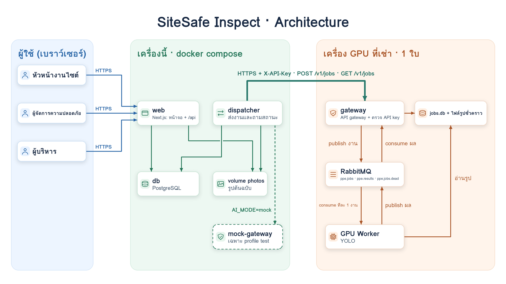

แผนภาพเดียวกันในรูปแบบ Mermaid จากเอกสารออกแบบ (กล่อง 12 กล่อง เส้น 15 เส้น เท่ากัน):

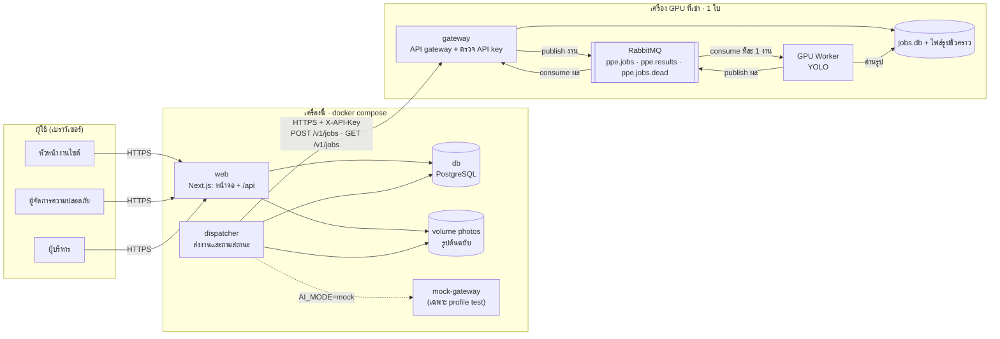

**สถานะของงาน**

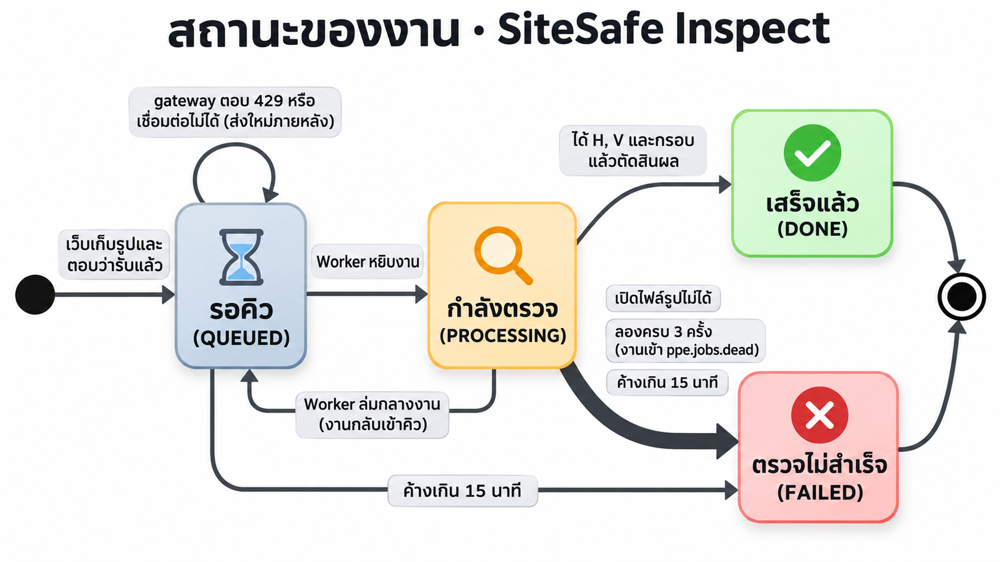

แผนภาพเดียวกันในรูปแบบ Mermaid จากเอกสารออกแบบ (4 สถานะ เส้น 11 เส้น เท่ากัน):

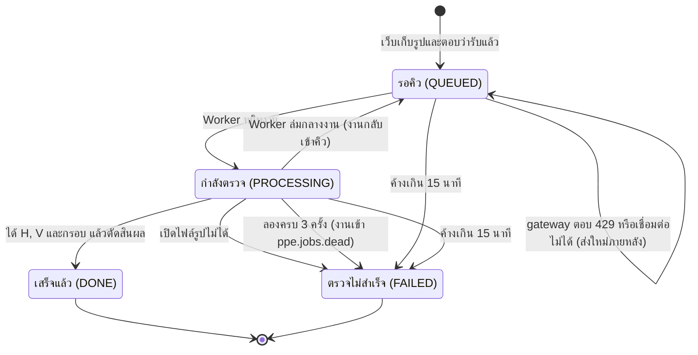

**Requirement แต่ละข้อไปอยู่ตรงไหนของการออกแบบ**

| Requirement | การออกแบบที่ตอบ |
|---|---|
| FR-05 ตรวจต่อแม้ผู้ใช้ปิดหน้าจอ | บริการ `dispatcher` แยกจากเว็บ ส่งรูปและถามสถานะเอง |
| NFR-04 รูปห้ามหาย | Worker รับทีละ 1 งานและ ack หลังส่งผลสำเร็จ งานที่ยังไม่ ack กลับเข้าคิวเอง |
| NFR-03 รูปเข้าพร้อมกัน 3 ไซต์ | งานค้างถึง 200 งาน gateway ตอบ `429` เว็บเก็บรูปไว้ที่ "รอคิว" แล้วส่งใหม่ |
| ความเป็นส่วนตัวของรูป | ทุกคำขอถึง gateway ต้องมี `X-API-Key` และค่า key ไม่ถูกส่งไปที่เบราว์เซอร์ |

**อ่านผลอย่างไร**
- คิวมี 3 คิว: คิวงาน คิวผล และคิวของงานที่ลองครบ 3 ครั้งแล้วยังไม่สำเร็จ
- AI เพิ่มโหมดจำลองฝั่ง AI (`AI_MODE=mock`) ที่คืนผลตามชื่อไฟล์ เพื่อทดสอบ Business Rule ได้ผลแน่นอนโดยไม่ต้องเช่า GPU
- คำถามที่การออกแบบยังตอบไม่ได้ เช่น "GPU 1 ใบตรวจได้กี่รูปต่อวินาที" ต้องวัดจริงในขั้นที่ 9

---

## 4 · ระยะ B · วางแผนงานให้ทีม AI

เอกสารของระยะ A บอกว่า "ต้องสร้างอะไร" ระยะนี้ตอบว่า "แบ่งงานอย่างไร ใครทำอะไร เมื่อไร"

### ขั้นที่ 4 · แตกงานเป็นบล็อก วาด DAG และ Gantt

```text
ทำงานใน container `multi-account` ด้วยสกิล dag-planner
โจทย์: สร้างระบบตาม Requirement และ System Design ในโฟลเดอร์ ./docs
1. แตกงานเป็น 8–10 บล็อก ชื่อแผน sitesafe
2. ต้องครอบคลุม: โครงโปรเจกต์ · ฐานข้อมูลและข้อมูลตั้งต้น · API gateway กับคิว RabbitMQ · GPU Worker · โค้ด Training และ Evaluation ของโมเดล · หน้าเว็บ · โลโก้ · รวมระบบและทดสอบเบื้องต้น
3. บล็อกที่ผิดแล้วเสียหายมากที่สุด 1 บล็อก ให้ใช้สกิล review (ผู้ทำกับผู้ตรวจคนละ CLI) บล็อกอื่นใช้ yolo, cyolo หรือ image
4. ให้เวลาทำงานต่อบล็อกพอสำหรับงานจริง: ขนาด S 15 นาที · M 30 นาที · L 45 นาที
5. วางแผนด้วยบัญชี yolo2, yolo3, cyolo1 เท่านั้น จำนวน agent พร้อมกันไม่เกิน 3
6. คัดลอกไฟล์บล็อก ภาพ DAG ภาพ Gantt และไฟล์แผน มาไว้ที่ ./plan
(วางแผนเท่านั้น ห้ามรันจริง ห้ามแสดงข้อมูลล็อกอินของบัญชี)
สรุปเป็นตารางภาษาไทย: บล็อก · สกิล · ขนาด · รอบล็อกใด · บัญชี · เริ่ม–จบ (นาที) แล้วบอก Critical Path และเวลารวมของแผน
```

**ผลจริง** (ประมาณ 4 นาที): 10 บล็อก · Critical Path ยาว 11.1 ล้านโทเคน · เวลารวมของแผนประมาณ 112.5 นาที

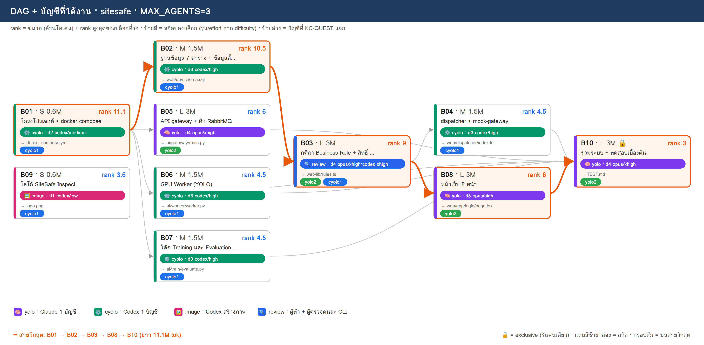

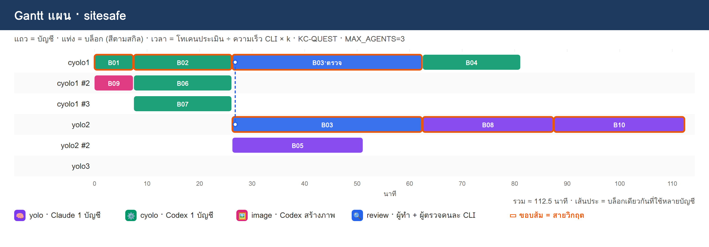

| บล็อก | งาน | สกิล | ขนาด | รอบล็อกใด | บัญชี | เริ่ม–จบ (นาที) |
|---|---|---|---|---|---|---|
| B01 | โครงโปรเจกต์ + docker compose | cyolo | S | – | cyolo1 | 0.0–7.5 |
| B09 | โลโก้ SiteSafe Inspect | image | S | – | cyolo1 | 0.0–7.5 |
| B02 | ฐานข้อมูล 7 ตาราง + ข้อมูลตั้งต้น | cyolo | M | B01 | cyolo1 | 7.5–26.2 |
| B06 | GPU Worker (YOLO) | cyolo | M | B01 | cyolo1 | 7.5–26.2 |
| B07 | โค้ด Training และ Evaluation ของโมเดล | cyolo | M | B01 | cyolo1 | 7.5–26.2 |
| B03 | กติกา Business Rule + สิทธิ์ + API ของเว็บ | review | L | B02 | yolo2 (ทำ) + cyolo1 (ตรวจ) | 26.2–62.5 |
| B05 | API gateway + คิว RabbitMQ | yolo | L | B01 | yolo2 | 26.2–51.2 |
| B08 | หน้าเว็บ 8 หน้า | yolo | L | B03 | yolo2 | 62.5–87.5 |
| B04 | dispatcher + mock-gateway | cyolo | M | B03 | cyolo1 | 62.5–81.2 |
| B10 | รวมระบบ + ทดสอบเบื้องต้น (รันคนเดียว) | yolo | L | B04–B09 | yolo2 | 87.5–112.5 |

**อ่านผลอย่างไร**
- AI เลือกให้ B03 (กติกา Business Rule + สิทธิ์ + API ของเว็บ) ใช้สกิล `review`: ถ้าบล็อกนี้ผิด ผลความปลอดภัยถูกตัดสินผิด หรือรูปของไซต์อื่นรั่ว
- Critical Path คือ B01 → B02 → B03 → B08 → B10 งานบนเส้นนี้ช้า ทั้งแผนช้าตาม
- `yolo3` อยู่ในรายชื่อแต่ไม่ได้งาน เพราะ KC-QUEST ให้คะแนน `yolo2` สูงกว่าทุกบล็อกฝั่ง Claude (โควตารอบ 5 ชั่วโมงของ `yolo3` ถูกใช้ไปแล้ว 36%) `yolo3` จึงเป็นบัญชีสำรองเมื่อ `yolo2` ล้ม
- เวลาในแผนคิดจากขนาดบล็อก ยังไม่มีตัวปรับเวลาจากการรันจริง (k = 1) ขั้นที่ 5 จะบอกว่าแผนคลาดจากของจริงเท่าไร

## 5 · ระยะ C · สร้างระบบ เทรนโมเดล และเปิดบริการ

### ขั้นที่ 5 · Agent Team สร้างระบบตามแผน

```text
ทำงานใน container `multi-account` ด้วยสกิล dag-planner
ใช้แผน sitesafe ที่มีอยู่แล้ว ห้ามวางแผนใหม่ ผมอนุมัติให้รันจริง
1. ส่งเอกสารในโฟลเดอร์ ./docs ให้ทีมเปิดดูได้ แล้วรันแผนจริงด้วยบัญชี yolo2, yolo3, cyolo1 เท่านั้น
2. รันจบแล้วออกรายงานแผนเทียบของจริง
3. คัดลอกไฟล์ที่ทีมสร้างมาไว้ที่ ./app และคัดลอกรายงาน ภาพ Gantt ของจริง กับภาพเทียบแผน มาไว้ที่ ./plan
4. บล็อกที่ล้มหรือถูกบล็อก ให้รายงานตามจริง ห้ามเขียนโค้ดแทนทีม
(ห้ามแสดงข้อมูลล็อกอินของบัญชี ไม่ต้อง commit)
สรุปเป็นตารางภาษาไทย: บล็อก · บัญชีตามแผน · บัญชีจริง · นาทีตามแผน · นาทีจริง · โทเคน · สถานะ แล้วบอกเวลารวมและโทเคนรวม
```

**ผลจริง** (39 นาที · 1,333,708 โทเคน): เสร็จ 6 จาก 10 บล็อก · 1 บล็อกไม่ผ่านการตรวจ · 3 บล็อกถูกบล็อก

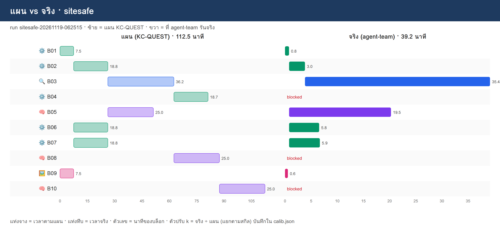

| บล็อก | บัญชีตามแผน | บัญชีจริง | นาทีตามแผน | นาทีจริง | โทเคน | สถานะ |
|---|---|---|---|---|---|---|
| B01 โครงโปรเจกต์ + docker compose | cyolo1 | cyolo1 | 7.50 | 0.77 | 36,019 | เสร็จ |
| B02 ฐานข้อมูล + ข้อมูลตั้งต้น | cyolo1 | cyolo1 | 18.75 | 3.03 | 39,832 | เสร็จ |
| B03 Business Rule + สิทธิ์ + API | yolo2 (ทำ) · cyolo1 (ตรวจ) | yolo3 และ yolo2 (ทำ) · cyolo1 (ตรวจ) | 36.25 | 35.38 | 803,710 | **ไม่ผ่านการตรวจ** |
| B04 dispatcher + mock-gateway | cyolo1 | ไม่ได้รัน | 18.75 | – | 0 | ถูกบล็อกเพราะ B03 |
| B05 API gateway + คิว RabbitMQ | yolo2 | yolo2 | 25.00 | 19.48 | 276,396 | เสร็จ |
| B06 GPU Worker (YOLO) | cyolo1 | cyolo1 | 18.75 | 5.75 | 67,811 | เสร็จ |
| B07 โค้ด Training และ Evaluation | cyolo1 | cyolo1 | 18.75 | 5.88 | 92,969 | เสร็จ |
| B08 หน้าเว็บ 8 หน้า | yolo2 | ไม่ได้รัน | 25.00 | – | 0 | ถูกบล็อกเพราะ B03 |
| B09 โลโก้ | cyolo1 | cyolo1 | 7.50 | 0.55 | 16,971 | เสร็จ |
| B10 รวมระบบ + ทดสอบเบื้องต้น | yolo2 | ไม่ได้รัน | 25.00 | – | 0 | ถูกบล็อกเพราะ B04, B08 |

**อ่านผลอย่างไร**
- B03 ใช้สกิล `review`: ผู้ทำแก้ 2 รอบ ผู้ตรวจ (Codex) ยังไม่อนุมัติ จึงจบที่ "ไม่ผ่านการตรวจ" ผู้ตรวจรายงานว่าเทสต์ผ่าน 117/117 แต่ยังขอแก้ 2 เรื่อง: เวลาที่ตั้งจากทางรีเซ็ตไม่คงที่ (อัปโหลดหลัง 23:59:59 หนึ่งวินาทีได้วันที่ของวันถัดไป) และผู้ทำไปแก้ไฟล์ฐานข้อมูลของบล็อก B02
- B03 อยู่บน Critical Path บล็อกที่รอมัน 3 บล็อกจึงไม่ได้รัน รวมถึงหน้าเว็บทั้งหมด: บล็อกเดียวที่ไม่ผ่าน หยุดงานท้ายแผนทั้งสาย
- B03 บล็อกเดียวใช้ 803,710 จาก 1,333,708 โทเคน (60%) การตรวจไขว้มีราคา
- งานจริงเร็วกว่าแผน: ตัวปรับเวลา k ของ `cyolo` คือ 0.24 ของ `yolo` คือ 0.78 แผนรอบถัดไปจะใช้ค่านี้
- สถานะ "เสร็จ" หมายถึงบัญชีทำงานจบและมีไฟล์ผลหลักของบล็อก ยังไม่ได้พิสูจน์ว่าระบบทำงานได้ การพิสูจน์อยู่ที่ระยะ D

### ขั้นที่ 6 · รันต่อเฉพาะบล็อกที่ยังไม่เสร็จ

ทำขั้นนี้เมื่อขั้นที่ 5 มีบล็อกที่ล้มหรือถูกบล็อก · ถ้าทุกบล็อกเสร็จแล้วให้ข้าม

```text
ทำงานใน container `multi-account` ด้วยสกิล agent-team และ dag-planner
แผน sitesafe รันไปแล้ว 1 รอบ มีบล็อกที่ไม่ผ่านการตรวจและบล็อกที่ถูกบล็อก ผมอนุมัติให้รันต่อ (ถ้าทุกบล็อกเสร็จแล้ว ให้ข้ามขั้นนี้)
1. รันต่อ run เดิมเฉพาะบล็อกที่ยังไม่เสร็จ ห้ามเริ่ม run ใหม่ ห้ามรันบล็อกที่เสร็จแล้วซ้ำ
2. บล็อกที่ไม่ผ่านการตรวจ: ให้ผู้ทำแก้ตามข้อที่ผู้ตรวจขอในรอบล่าสุดเท่านั้น ไม่เขียนใหม่ทั้งบล็อก และเพิ่มรอบตรวจเป็น 3
3. ใช้บัญชี yolo1, yolo2, yolo3, cyolo1
4. รันจบแล้วออกรายงานแผนเทียบของจริงใหม่ แล้วคัดลอกไฟล์ของทีมมาไว้ที่ ./app และรายงานกับภาพมาไว้ที่ ./plan
5. บล็อกที่ยังล้ม ให้รายงานตามจริง ห้ามเขียนโค้ดแทนทีม
(ห้ามแสดงข้อมูลล็อกอินของบัญชี ไม่ต้อง commit)
สรุปเป็นตารางภาษาไทย: บล็อก · สถานะรอบแรก · สถานะหลังรันต่อ · บัญชี · นาที · โทเคน แล้วบอกโทเคนรวมของทั้งสองรอบ
```

**ผลจริง** (57 นาที · 1,166,258 โทเคน): ครบ 10 จาก 10 บล็อก

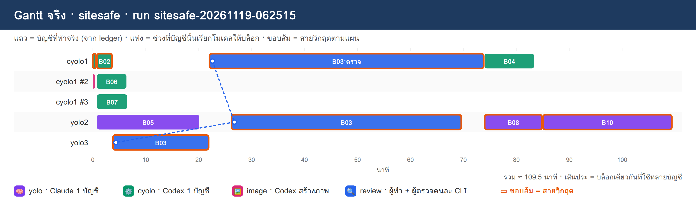

| บล็อก | สถานะรอบแรก | สถานะหลังรันต่อ | บัญชี | นาที | โทเคน |
|---|---|---|---|---|---|
| B03 กติกา + สิทธิ์ + API | ไม่ผ่านการตรวจ (2 รอบ) | เสร็จ (อนุมัติรอบที่ 3) | yolo2 (ทำ) · cyolo1 (ตรวจ) | 35.4 + 21.7 | 803,710 + 486,272 |
| B04 dispatcher + mock-gateway | ถูกบล็อก | เสร็จ | cyolo1 | 9.5 | 94,108 |
| B08 หน้าเว็บ 8 หน้า | ถูกบล็อก | เสร็จ | yolo2 | 11.0 | 224,348 |
| B10 รวมระบบ + ทดสอบเบื้องต้น | ถูกบล็อก | เสร็จ | yolo2 | 24.5 | 361,530 |
| อีก 6 บล็อก | เสร็จ | เสร็จ (ไม่รันซ้ำ) | – | – | – |

โทเคนรวมของทั้งสองรอบ: **2,499,966** (รอบแรก 1,333,708 + รันต่อ 1,166,258) · ได้ไฟล์ 104 ไฟล์ใน `app/` (ตัวอย่างจากรอบจริงอยู่ที่ `code_reference/app/`)

**อ่านผลอย่างไร**
- การรันต่อทำเฉพาะ 4 บล็อกที่ยังไม่เสร็จ อีก 6 บล็อกไม่ถูกรันซ้ำ จึงไม่เสียโทเคนซ้ำ
- B03 ผ่านในรอบตรวจที่ 3: ผู้ทำแก้โค้ดจริงแค่รอบแรก (เรื่องเวลาที่ตั้งจากทางรีเซ็ต) อีก 2 รอบผู้ตรวจติดที่บันทึกส่งงานเก่า ไม่ใช่โค้ด ใช้ไปราว 300,000 โทเคนโดยโค้ดไม่เปลี่ยน
- การรันต่อใช้รายชื่อบัญชีของ run เดิม บัญชีที่เพิ่มเข้ามาทีหลัง (`yolo1`) จึงไม่ถูกเรียก: จะเพิ่มบัญชีต้องทำตั้งแต่ตอนวางแผน
- บล็อกรวมระบบ (B10) ทดสอบด้วยตัวตรวจจำลอง ไม่ใช่ YOLO บน GPU จริง: เว็บผ่านเทสต์ 119/119 และฝั่ง AI ผ่าน 159 ข้อ แต่ยังไม่เคยรันบน GPU ยังไม่ได้วัด SLO และยังไม่ได้เปิดหน้าเว็บด้วยเบราว์เซอร์ สามเรื่องนี้พิสูจน์ในขั้นที่ 8–12

### ขั้นที่ 7 · เช่า GPU และเตรียม Dataset

```text
ทำงานใน container `multi-account` โฟลเดอร์ /workspace/vastapp_lab ด้วยสกิล vastai · ใช้ key จากไฟล์ .env ของโฟลเดอร์ปัจจุบัน
1. เช่าเครื่อง RTX 3090 1 ใบ ราคาไม่เกิน $0.30 ต่อชั่วโมง ติดป้าย e2e-sitesafe
2. ดาวน์โหลด Dataset construction-site-safety รุ่น 28 จาก Roboflow ลงเครื่องที่เช่า แล้วนับจำนวนภาพของ Training / Validation / Test Set และจำนวนกรอบของแต่ละคลาส
3. ทำภาพตัวอย่างจาก Training Set 8 รูป เรียงเป็นตาราง วาดกรอบและชื่อคลาสตาม label จริง เก็บกลับมาที่ ./results/dataset_samples.jpg
4. อธิบาย label ของรูป 1 รูปว่าแต่ละบรรทัดหมายถึงอะไร
(ห้ามแสดงค่า key ห้ามแตะเครื่องป้ายอื่น)
สรุปเป็นตารางภาษาไทย: รุ่น GPU · ราคาต่อชั่วโมง · จำนวนภาพแต่ละชุด · คลาสที่ใช้ตัดสินตาม Requirement แล้วบอกว่าเครื่องยังเปิดอยู่
```

**ผลจริง** (ประมาณ 11 นาที): RTX 3090 1 ใบ ราคา $0.2215 ต่อชั่วโมง

**รู้จัก Dataset** · [construction-site-safety](https://universe.roboflow.com/roboflow-universe-projects/construction-site-safety) รุ่น 28 จาก Roboflow Universe · ภาพหน้างานก่อสร้างพร้อมกรอบ 10 คลาส

| ชุด | จำนวนภาพ | จำนวนกรอบ |
|---|---|---|
| Training Set | 2,605 | 36,895 |
| Validation Set | 114 | 697 |
| Test Set | 82 | 760 |

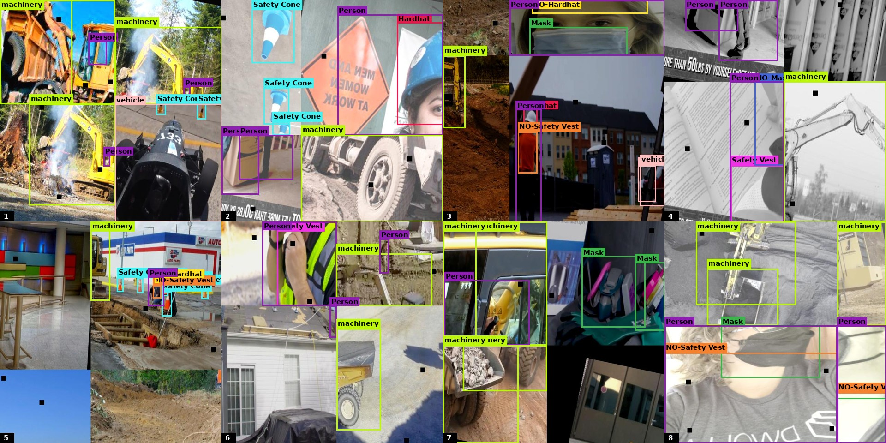

label 1 บรรทัดคือ 1 กรอบ: `2 0.44 0.24 0.08 0.11` หมายถึง คลาสที่ 2 (`NO-Hardhat`) · จุดกึ่งกลางกรอบ (x, y) · ความกว้างและความสูง ทุกค่าเป็นสัดส่วน 0–1 ของภาพ

**อ่านผลอย่างไร**
- คลาสที่ใช้ตัดสินตาม Requirement มี 2 คลาส: `NO-Hardhat` (ค่า H) และ `NO-Safety Vest` (ค่า V)
- Test Set มีเพียง 82 ภาพ แต่ Requirement ของขั้นที่ 2 กำหนดว่าต้องมีรูปที่มีคนไม่ใส่หมวกอย่างน้อย 100 รูป: เกณฑ์ที่เขียนไว้ก่อนเห็นข้อมูลจริงอาจวัดไม่ได้
- การเช่าต้องลอง 3 ครั้ง เครื่องหนึ่งค้างเกิน 5 นาทีจึงลบทิ้งแล้วเช่าเครื่องใหม่

### ขั้นที่ 8 · เทรนโมเดล และตัดสินด้วย Acceptance Gate

```text
ทำงานใน container `multi-account` โฟลเดอร์ /workspace/vastapp_lab ด้วยสกิล vastai · เครื่องที่ใช้คือเครื่องป้าย e2e-sitesafe
1. นำโค้ด Training และ Evaluation ที่ทีมเขียนไว้ในโฟลเดอร์ ./app/ai/train ไปเทรน YOLO11s ด้วย Dataset ที่เตรียมไว้ 30 Epoch ภาพขนาด 640 seed 0
2. ถ้าโค้ดของทีมรันไม่ได้ ให้แก้ให้น้อยที่สุด แล้วบอกว่าแก้อะไร
3. วัดผลบน Test Set ก่อนเทรนกับหลังเทรน แล้วตัดสินตามเกณฑ์ของโมเดลใน Requirement ว่าผ่าน Acceptance Gate หรือไม่
4. เก็บน้ำหนักโมเดลที่ดีที่สุดไว้บนเครื่อง GPU และเก็บผลวัด กราฟ กับภาพตัวอย่างผลตรวจ กลับมาที่ ./results/model
(ห้ามแสดงค่า key ห้ามแตะเครื่องป้ายอื่น งานต้องทำต่อได้แม้การเชื่อมต่อหลุด)
สรุปเป็นตารางภาษาไทย: ตัวชี้วัด · ก่อนเทรน · หลังเทรน · เกณฑ์ · ผ่านหรือไม่ · เวลาเทรน · ค่าเช่าถึงตอนนี้ แล้วบอกว่าเครื่องยังเปิดอยู่
```

**รู้จักโมเดล** · YOLO11s ของ Ultralytics · โมเดล Object Detection ขนาดเล็ก · Input: ภาพ 640 × 640 · Output: กรอบ + ชื่อคลาส + ค่าความมั่นใจของแต่ละวัตถุ · หัวข้อนี้ใช้นับจำนวนคนไม่ใส่หมวก (H) และไม่ใส่เสื้อสะท้อนแสง (V) ในรูป

**ผลจริง** (เทรน 8 นาที 55 วินาที · ค่าเช่าถึงตอนนั้นประมาณ $0.09)

| ตัวชี้วัด | ก่อนเทรน | หลังเทรน | เกณฑ์ | ผล |
|---|---|---|---|---|
| Image-level Recall คลาส "ไม่ใส่หมวก" | 0.00 (0/25) | 0.80 (20/25) | ≥ 0.80 | ถึงเกณฑ์ที่ขอบพอดี |
| Image-level Precision คลาส "ไม่ใส่หมวก" | 0.00 | 0.952 (20/21) | ≥ 0.80 | ถึงเกณฑ์ |
| จำนวนรูปใน Test Set (มีคนไม่ใส่หมวก / ไม่มี) | – | 25 / 57 | ≥ 100 / ≥ 100 | **ไม่ครบเงื่อนไข** |
| mAP50 รวม 10 คลาส | 0.011 | 0.749 | ไม่มีใน Requirement | – |
| **Acceptance Gate** | | | | **ยังตัดสินไม่ได้** |

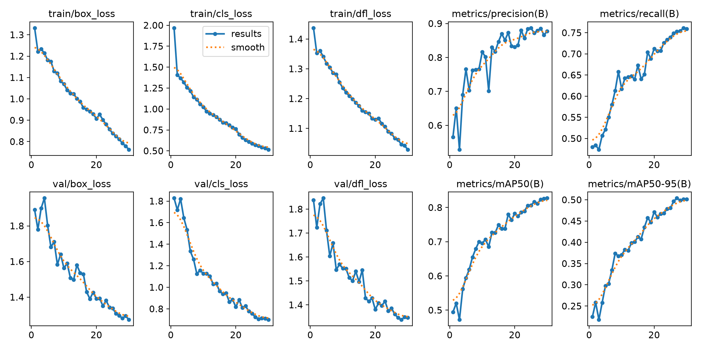

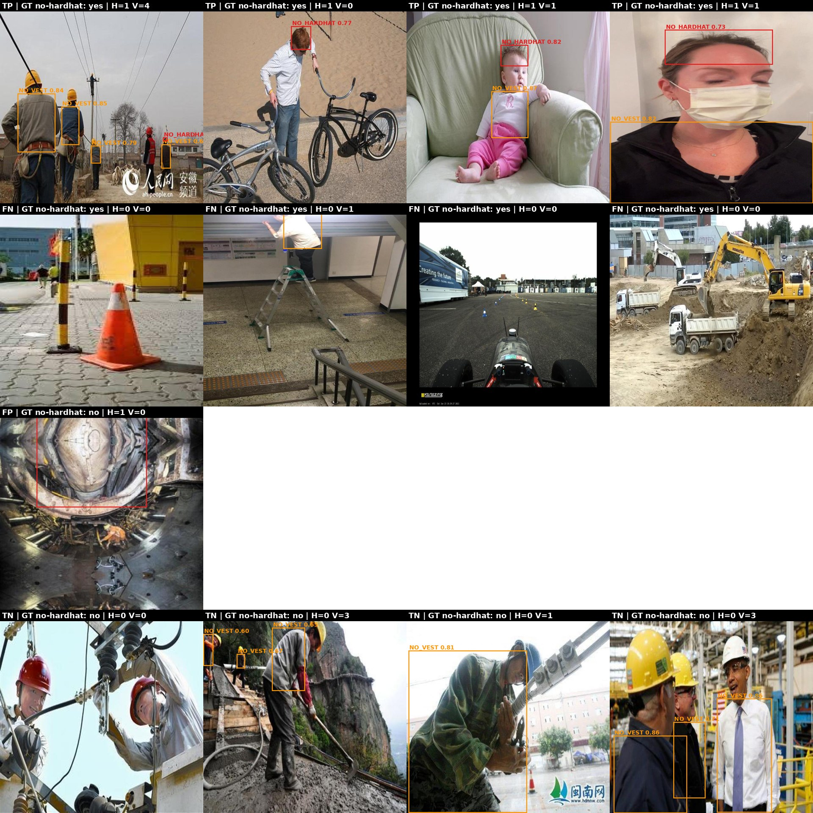

**อ่านผลอย่างไร**
- ค่า Confidence Threshold 0.32 เลือกบน Validation Set แล้วตรึงไว้ก่อนวัดบน Test Set ถ้าปรับค่าหลังเห็น Test Set ตัวเลขจะดีเกินจริง
- Recall 20/25 อยู่บนเส้นพอดี จับพลาดเพิ่มอีก 1 รูปจะเหลือ 0.76 และไม่ถึงเกณฑ์ รูป 25 รูปน้อยเกินกว่าจะยืนยันกับลูกค้า
- ผลจึงเป็น "ยังตัดสินไม่ได้" ไม่ใช่ "ผ่าน": ต้องหา Test Set ให้ครบ 100 + 100 รูปแล้ววัดซ้ำด้วย Threshold เดิม นี่คือจุดที่คนต้องตัดสินใจว่าจะเดินต่อหรือหยุด
- ทีม AI ไม่ได้เขียนสคริปต์ Training ไว้ มีแต่โค้ด Evaluation ทั้งที่บล็อกชื่อ "โค้ด Training และ Evaluation" ขึ้นสถานะเสร็จ และโค้ด Evaluation รันกับ Dataset จริงไม่ได้ 3 จุด (ที่อยู่ชุดข้อมูล · ชื่อคลาส `NO-Safety Vest` · ขนาด Test Set) ต้องแก้ 2 ไฟล์

### ขั้นที่ 9 · Deployment และทดสอบทั้งเส้นทาง

```text
ทำงานใน container `multi-account` โฟลเดอร์ /workspace/vastapp_lab ด้วยสกิล vastai · เครื่องที่ใช้คือเครื่องป้าย e2e-sitesafe
1. บนเครื่อง GPU เปิด RabbitMQ, API gateway และ GPU Worker จากโค้ดในโฟลเดอร์ ./app โดยใช้โมเดลที่เทรนแล้ว ตั้ง API key ใหม่ 1 ตัวแล้วเก็บในไฟล์ .env ของโฟลเดอร์ปัจจุบัน
2. บนเครื่องนี้เปิดเว็บและฐานข้อมูลด้วย docker compose ที่พอร์ต 3410 ให้เว็บเรียก gateway บนเครื่อง GPU
3. ทดสอบทั้งเส้นทาง: ส่งรูปจาก Test Set 5 รูปผ่านหน้าเว็บ รอจนงานเสร็จ แล้วตรวจว่าผลในฐานข้อมูลตรงกับที่ gateway ตอบ
4. ทดสอบคิว: ส่งงาน 20 งานแล้วหยุด Worker กลางงาน เปิดใหม่ แล้วนับว่างานเสร็จครบ 20 งาน
5. ส่วนใดเปิดไม่ได้ ให้แก้โค้ดให้น้อยที่สุด แล้วจดสิ่งที่แก้ไว้ในโฟลเดอร์ ./results/deploy
(ห้ามแสดงค่า key ห้ามแตะเครื่องป้ายอื่น)
สรุปเป็นตารางภาษาไทย: ส่วนของระบบ · ที่อยู่ · สถานะ · ผลทดสอบ แล้วบอกจำนวนงานที่เสร็จหลังหยุด Worker และว่าเครื่องยังเปิดอยู่
```

**ผลจริง** (ประมาณ 22 นาที)

| ส่วนของระบบ | ที่อยู่ | ผลทดสอบ |
|---|---|---|
| RabbitMQ | เครื่อง GPU (ไม่เปิดสู่ภายนอก) | คิว 3 คิว เก็บงาน 13 งานไว้ระหว่าง Worker ปิด |
| API gateway | เครื่อง GPU ผ่าน HTTPS | ไม่มี key ตอบ `401` · มี key ตอบ `200` |
| GPU Worker | เครื่อง GPU · RTX 3090 | เฉลี่ย 22 มิลลิวินาทีต่อรูป |
| เว็บ + dispatcher + PostgreSQL | เครื่องนี้ พอร์ต 3410 | `/api/health` ปกติทุกช่อง |
| ส่งรูป 5 รูปทั้งเส้นทาง | เว็บ → gateway → คิว → Worker → เว็บ | เสร็จใน 9.1 วินาที ผลในฐานข้อมูลตรงกับ gateway 5/5 |
| คิว 20 งาน + หยุด Worker กลางงาน | | เสร็จก่อนหยุด 6 งาน หลังเปิดใหม่ 14 งาน ครบ 20 งาน หาย 0 |

**อ่านผลอย่างไร**
- นี่คือครั้งแรกที่โค้ดของทีมรันบน GPU จริง แก้โค้ดของทีม 1 บรรทัด (ชื่อคลาส `NO-Safety Vest` ของ Worker) ถ้าไม่แก้ Worker หยุดตั้งแต่เริ่ม
- งานที่กำลังตรวจตอน Worker ถูกหยุดถูกส่งซ้ำ 1 ครั้งแล้วเสร็จ ไม่มีผลซ้ำ: การออกแบบ "ack หลังงานเสร็จ" ของขั้นที่ 3 ทำงานจริง
- GPU ใช้ 22 มิลลิวินาทีต่อรูป แต่ผู้ใช้รอ 2.4–8.9 วินาที คอขวดอยู่ที่ dispatcher ที่ส่งรูปทีละรูป ไม่ใช่ที่ GPU

## 6 · ระยะ D · พิสูจน์ว่าระบบทำตาม Requirement

ระยะ C จบที่ "ระบบเปิดได้" ระยะนี้ตอบว่า "ระบบทำถูกตามที่ลูกค้าขอหรือไม่" โดยผู้ทดสอบดูได้แค่ Requirement กับหน้าเว็บ ไม่เปิดโค้ด

### ขั้นที่ 10 · Test Charter และ Exploration พร้อมกัน

```text
เว็บ SiteSafe เปิดอยู่ที่ http://localhost:3410 ใช้ playwright-cli สำรวจ (ห้ามเปิดโค้ดใน ./app และห้ามเปิดไฟล์ BUGS-SECRET)
1. ดู Requirement ในโฟลเดอร์ ./docs และเดินดูเว็บ 1 รอบ แล้วเขียน Test Charter 4 ข้อไว้ที่ ./test/CHARTERS.md รูปแบบ "สำรวจ… ด้วย… เพื่อหา…" ทุก Business Rule ต้องมี Charter รับผิดชอบ
2. รีเซ็ตข้อมูลทดสอบ 1 ครั้ง แล้วสั่ง subagent 4 ตัวในข้อความเดียว (ไม่ใช้โหมดเบื้องหลัง) ตัวละ 1 Charter ตัวละ 1 session ของ playwright-cli และบัญชีทดสอบของตัวเอง เวลาไม่เกิน 10 นาทีต่อตัว
3. แต่ละตัวจดบันทึกไว้ในโฟลเดอร์ ./test/exploration: เขียนผลที่คาดหวังจาก Requirement ก่อนลอง แล้วบันทึกผลจริง ✅ ⚠️ ❌ พร้อมภาพหน้าจอ
4. รวมผลไว้ที่ ./test/EXPLORATION.md: ฟีเจอร์ที่พบ · กฎที่ยืนยันแล้ว · จุดที่เว็บไม่ตรง Requirement · ตารางความเสี่ยง P1 / P2 / P3
สรุปเป็นตารางภาษาไทย: Charter · เวลาที่ใช้ · จำนวนกฎที่ลอง · ✅ · ⚠️ · ❌
```

**ผลจริง** (ประมาณ 11 นาที): ลอง 53 กฎ · ✅ 46 · ⚠️ 6 · ❌ 1

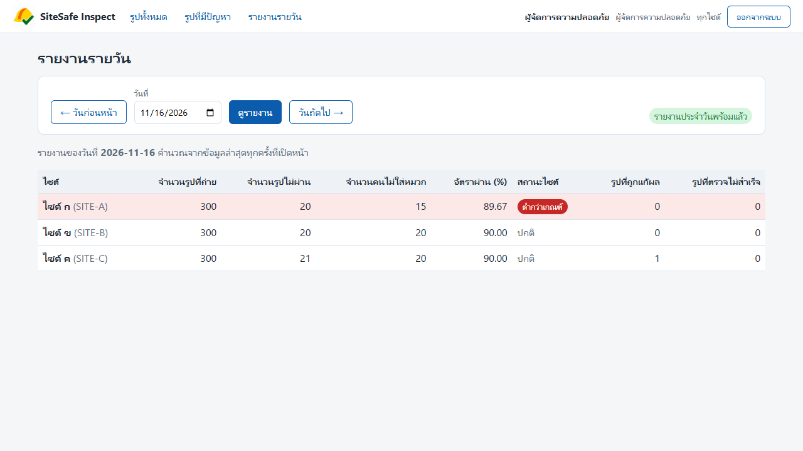

| Charter | กฎที่ลอง | ✅ | ⚠️ | ❌ |
|---|---|---|---|---|
| C1 การตัดสินผล (BR-01–BR-03) | 8 | 8 | 0 | 0 |
| C2 การอัปโหลด (BR-05–BR-06) | 14 | 11 | 3 | 0 |
| C3 รายงานและการแก้ผล (BR-04, BR-07) | 13 | 11 | 2 | 0 |
| C4 สิทธิ์ของแต่ละบทบาท | 17 | 16 | 1 | 0 |
| ตรวจซ้ำรูปที่ค้างคิว | 1 | 0 | 0 | 1 |

**อ่านผลอย่างไร**
- subagent 4 ตัวสำรวจพร้อมกันได้ เพราะแต่ละตัวมี session ของ `playwright-cli` และบัญชีทดสอบของตัวเอง
- ผู้สำรวจเขียนผลที่คาดหวังจาก Requirement ก่อนกดจริง ถ้าดูเว็บก่อน ผลที่คาดหวังจะกลายเป็น "สิ่งที่เว็บทำ"
- ❌ 1 ข้อ: รูป 3 รูป (14.9 MB, 15.0 MB และไฟล์ที่ถูกตัดครึ่ง) ค้าง "รอคิว" เกิน 7 นาที รูปปกติได้ผลใน 3–10 วินาที เรื่องนี้ถูกตั้งเป็นความเสี่ยง P1 ส่งต่อให้ขั้นที่ 11

### ขั้นที่ 11 · Test Plan และการตรวจไขว้

```text
จาก Requirement ข้อมูลทดสอบ และผล Exploration ในโฟลเดอร์ ./docs กับ ./test เขียน Test Plan ไว้ที่ ./test/TEST-PLAN.md
1. โครง 8 หัวข้อ: ภาพรวม · ขอบเขต · เทคนิค · ระดับ · Test Case · Entry/Exit Criteria · ข้อมูลทดสอบ · คุณภาพของแผน
2. Test Case 30–40 ข้อ แบ่งเป็นกลุ่ม 5.1–5.5 รหัส TC-<กลุ่ม>-<เลข> ทุกข้อมีขั้นตอน ผลที่คาดหวังที่คำนวณให้ดู ที่มา (FR/BR) และระดับ P1–P3
3. ผลที่คาดหวังต้องมาจาก Requirement ไม่ใช่จากที่เห็นบนเว็บ
4. ต้องมีกลุ่มของ AI และคิว: ผลตรวจของโมเดลกับกติกาผ่านหรือไม่ผ่าน · สถานะงานในคิว · คิวเต็ม · ไฟล์ที่ไม่รับ · สิทธิ์ของแต่ละบทบาท
5. ให้บัญชี cyolo1 ใน container `multi-account` ตรวจแผนผ่านสกิล agent-team (ผู้ตรวจต้องไม่ใช่ผู้เขียน): ตรวจได้จริงไหม ตัวเลขถูกไหม กำกวมไหม ซ้ำไหม
6. บันทึกผลตรวจไว้ที่ ./test/PLAN-REVIEW.md แล้วแก้แผนตามข้อที่รุนแรงสูง
สรุปเป็นตารางภาษาไทย: กลุ่ม · จำนวน TC · P1 · ข้อที่ผู้ตรวจพบ · ข้อที่แก้แล้ว
```

**ผลจริง** (ประมาณ 15 นาที): Test Case 39 ข้อ · ผู้ตรวจพบ 38 ข้อ (สูง 23 · กลาง 11 · ต่ำ 4) · แก้ครบ

| กลุ่ม | จำนวน TC | P1 | ข้อที่ผู้ตรวจพบ | ข้อที่แก้แล้ว |
|---|---|---|---|---|
| 5.1 รับรูป และไฟล์ที่ไม่รับ | 6 | 5 | 6 | 6 |
| 5.2 ผลตรวจของโมเดลกับกติกา | 6 | 5 | 5 | 5 |
| 5.3 สถานะงานในคิว · คิวเต็ม · รูปห้ามหาย | 10 | 8 | 10 | 10 |
| 5.4 รายงานและการแก้ผล | 8 | 5 | 6 | 6 |
| 5.5 สิทธิ์ของแต่ละบทบาท | 9 | 8 | 5 | 5 |
| ทั้งแผน (Entry/Exit Criteria · ขอบเขต) | – | – | 6 | 6 |
| **รวม** | **39** | **31** | **38** | **38** |

**อ่านผลอย่างไร**
- ผลที่คาดหวังทุกข้อคำนวณให้ดู เช่น 269 ÷ 300 = 89.67% ต้องแดง · ไฟล์ 15,728,640 + 1 ไบต์ ต้องได้ `413`
- ผู้เขียนแผนคือ Claude ผู้ตรวจคือ Codex (`cyolo1`): ผู้ตรวจพบว่าแผนรุ่นแรกไม่มี Test Case ของตัวเฝ้ารูปค้าง 15 นาที และงบรูป 79 รูปไม่พอวัดโมเดลบน Test Set
- เส้นแบ่งของ BR-01 ถึง BR-07 ครบ 21 จาก 21 จุด และไม่มี FR ข้อใดที่ไม่มี Test Case
- แผนแบ่งเป็น 2 รอบตามงบ GPU: รอบ A 37 ข้อ · รอบ B 2 ข้อ (วัดโมเดล และ Worker ล่มตอนมีงาน 100 รูป) ต้องขออนุมัติงบแยก

### ขั้นที่ 12 · Playwright Test และ Test Report

```text
เขียนและรัน Playwright Test ตาม Test Plan ในโฟลเดอร์ ./test กับเว็บที่ http://localhost:3410
1. สร้าง ./test/e2e ไฟล์ทดสอบ 1 ไฟล์ต่อกลุ่ม 5.x โดยสั่ง subagent ทุกตัวในข้อความเดียว (ไม่ใช้โหมดเบื้องหลัง) ตัวละ 1 กลุ่ม ระหว่างเขียนห้ามรันทั้งชุด
2. รันทั้งชุดบน Chromium 1 รอบ เก็บภาพหน้าจอและ trace ของข้อที่ล้ม
3. คัดแยกข้อที่ล้มเป็น: เว็บผิด · แผนผิด · เทสต์ผิด แก้เฉพาะ "เทสต์ผิด" แล้วรันซ้ำ ห้ามแก้ผลที่คาดหวังให้ตรงกับเว็บ
4. เขียน Test Report 6 ส่วนไว้ที่ ./test/TEST-REPORT.md และหน้า ./test/index.html ที่เปิดดูหลักฐานของแต่ละ Test Case ได้
5. ตัดสินตาม Exit Criteria ว่าส่งมอบได้หรือไม่
สรุปเป็นตารางภาษาไทย: กลุ่ม · ผ่าน · ล้ม · สาเหตุของข้อที่ล้ม แล้วบอกอัตราผ่านรวม อัตราผ่านของ P1 และผลตัดสิน
```

**ผลจริง** (ประมาณ 81 นาที): ผ่าน 27 · ล้ม 2 · บล็อก 10 จาก 39 ข้อ · ผลตัดสิน **ยังส่งมอบไม่ได้**

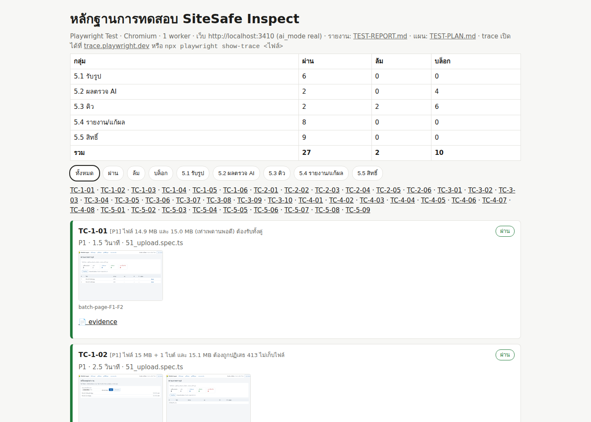

| กลุ่ม | ผ่าน | ล้ม | บล็อก | สาเหตุ |
|---|---|---|---|---|
| 5.1 รับรูป และไฟล์ที่ไม่รับ | 6 | 0 | 0 | – |
| 5.2 ผลตรวจของโมเดลกับกติกา | 2 | 0 | 4 | ต้องใช้ตัวตรวจจำลอง หรือเป็นรอบ B |
| 5.3 สถานะงานในคิว · คิวเต็ม · รูปห้ามหาย | 2 | 2 | 6 | เว็บผิด 2 ข้อ · ที่บล็อกต้องคุมคิวหรือ Worker |
| 5.4 รายงานและการแก้ผล | 8 | 0 | 0 | – |
| 5.5 สิทธิ์ของแต่ละบทบาท | 9 | 0 | 0 | – |
| **รวม** | **27** | **2** | **10** | |

ข้อบกพร่องที่พบ (เว็บผิด · P1 ทั้งคู่)

| รหัส | อาการ | หลักฐาน |
|---|---|---|
| BUG-01 | รูป 14.9 MB และ 15.0 MB ที่เว็บรับแล้วไม่ถูกตรวจ ค้าง "รอคิว" จนขึ้น "ตรวจไม่สำเร็จ · เกินเวลา 15 นาที" รูปอื่นในการอัปโหลดเดียวกันค้างตาม | TC-3-07 |
| BUG-02 | ส่ง 20 รูป p95 ของเวลารอผล = 42.4 วินาที เกินเกณฑ์ 30 วินาที | TC-3-08 |

**อ่านผลอย่างไร**
- อัตราผ่านรวม 27/39 = 69.2% · อัตราผ่านของ P1 21/31 = 67.7% · ไม่ผ่าน Exit Criteria ทั้ง 5 ข้อ ผลตัดสินจึงเป็น "ยังส่งมอบไม่ได้"
- รอบแรกล้ม 5 ข้อ คัดแยกแล้วเป็น "เทสต์ผิด" 3 ข้อ (ตัวส่งไฟล์ของเทสต์ใช้การเชื่อมต่อที่เว็บปิดไปแล้ว · เทสต์รอหน้าเว็บนิ่งไม่มีกำหนด) แก้เทสต์แล้วผ่าน ไม่มีข้อใดที่แก้ผลที่คาดหวังให้ตรงกับเว็บ
- BUG-02 ยืนยันสิ่งที่ขั้นที่ 9 เตือนไว้: GPU ใช้ 19 มิลลิวินาทีต่อรูป แต่ผลออกรูปละประมาณ 3 วินาที คอขวดอยู่ฝั่งเว็บ
- 10 ข้อที่บล็อกไม่ได้นับว่าผ่าน: เครื่องนี้รันโมเดลจริง จึงสั่งให้โมเดลตอบ "ไม่ใส่เสื้อ 2 คนพอดี" ไม่ได้ ต้องเปิดตัวตรวจจำลองอีกชุดหนึ่ง

### ขั้นที่ 13 · Bug Hunt และรายงานส่งมอบ

ชุดทดสอบที่ผ่านทุกข้อยังไม่พิสูจน์ว่าชุดทดสอบดี ขั้นนี้เปิดบั๊ก 3 ตัวที่ซ่อนไว้ตั้งแต่ขั้นที่ 3 แล้วดูว่าชุดทดสอบจับได้กี่ตัว

```text
เปิดเว็บใหม่ด้วย BUG_MODE=1 แล้วรัน Playwright Test ชุดเดิมอีก 1 รอบ (ห้ามเปิดไฟล์ BUGS-SECRET จนกว่าจะเขียนรายงานบั๊กเสร็จ)
1. เทียบกับรอบปกติ: ข้อที่ล้มเพิ่มคือข้อใด แล้วสรุปเป็นบั๊กทีละตัวไว้ที่ ./test/BUG-HUNT.md พร้อมขั้นตอนทำซ้ำ ผลที่คาดหวัง ผลจริง และหลักฐาน
2. เขียนรายงานบั๊กเสร็จแล้วจึงเปิดไฟล์ BUGS-SECRET เทียบว่าจับได้กี่ตัวจาก 3 ตัว
3. เขียนรายงานส่งมอบสำหรับลูกค้าไว้ที่ ./DELIVERY.md: ตาราง User Story → Requirement → Test Case → ผล และสิ่งที่ยังไม่ผ่านหรือยังไม่ได้ทำ
4. ปิด BUG_MODE แล้วเปิดเว็บกลับเป็นโหมดปกติ
สรุปเป็นตารางภาษาไทย: บั๊ก · Test Case ที่จับได้ · ความรุนแรง แล้วบอกจำนวน User Story ระดับ Must ที่มีหลักฐานว่าผ่าน
```

**ผลจริง** (ประมาณ 40 นาที): จับบั๊กได้ 2 จาก 3 ตัว · User Story ระดับ Must มีหลักฐานว่าผ่าน 9 จาก 16 เรื่อง

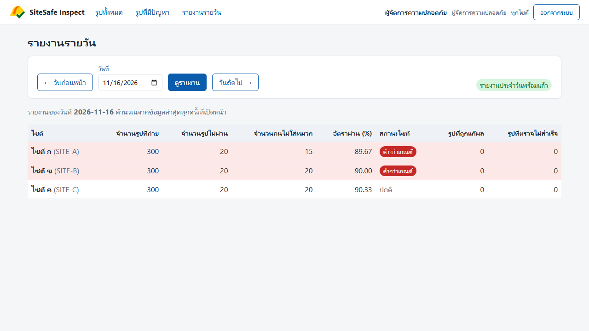

| บั๊กที่ซ่อนไว้ | Test Case ที่จับได้ | ความรุนแรง |
|---|---|---|
| BR-06 ขอเปิดอัปโหลด 51 รูปแล้วเว็บรับ (`201` แทน `422`) | TC-1-05 | สูง (P1) |
| BR-04 อัตราผ่าน 90.00% พอดีแสดงเป็นสีแดง | TC-4-01 และอีก 6 ข้อ | สูง (P1) |
| BR-02 ไม่ใส่เสื้อสะท้อนแสง 2 คนพอดี ได้ "เตือน" แทน "ไม่ผ่าน" | **จับไม่ได้** | สูง (P1) |

**อ่านผลอย่างไร**
- เทียบ 2 ภาพ: รอบปกติ (ภาพของขั้นที่ 10) ไซต์ ข 90.00% ขึ้น "ปกติ" · รอบเปิดบั๊กขึ้น "ต่ำกว่าเกณฑ์" เว็บใช้ "≤ 90" แทน "< 90" Test Case ที่ทดสอบค่าบนเส้นแบ่งพอดีจึงจับได้
- บั๊กตัวที่ 3 หลุด เพราะ Test Case ที่ควรจับ (TC-2-01) อยู่ใน 10 ข้อที่บล็อก: **Test Case ที่ยังไม่ได้รัน คือบั๊กที่ยังไม่มีใครเห็น**
- รายงานส่งมอบ `DELIVERY.md` ผูก User Story ทั้ง 20 เรื่องกับ Requirement, Test Case และผล: Must ผ่าน 9 เรื่อง · ไม่ผ่าน 3 เรื่อง · หลักฐานยังไม่ครบ 4 เรื่อง
- งานจบที่ "ยังส่งมอบไม่ได้ พร้อมรายการที่ต้องแก้" ไม่ใช่ "เสร็จแล้ว": ทีม AI สร้างระบบได้ใน 96 นาที แต่การพิสูจน์ใช้เวลามากกว่า และเป็นส่วนที่บอกความจริงกับลูกค้า

### ขั้นที่ 14 · ลบเครื่องและสรุปค่าใช้จ่าย (ห้ามข้าม)

```text
ทำงานใน container `multi-account` โฟลเดอร์ /workspace/vastapp_lab ด้วยสกิล vastai
1. คัดลอกน้ำหนักโมเดลและผลวัดที่ยังอยู่บนเครื่องป้าย e2e-sitesafe กลับมาที่ ./results/model
2. ลบเครื่องป้าย e2e-sitesafe แล้วตรวจซ้ำว่าไม่มีเครื่องป้ายนี้เหลืออยู่
3. หยุดเว็บและฐานข้อมูลบนเครื่องนี้
(ห้ามแตะเครื่องป้ายอื่น ห้ามแสดงค่า key)
สรุปค่าใช้จ่ายเป็นตารางภาษาไทย: เวลาที่เปิดเครื่อง · ค่าเช่ารวม · โทเคนรวมของทีมจากขั้นที่ 5 และ 6 แล้วยืนยันว่าเครื่องถูกลบแล้ว
```

**ผลจริง** (ประมาณ 4 นาที)

| รายการ | ค่า |
|---|---|
| เวลาที่เปิดเครื่อง | 3 ชั่วโมง 25 นาที |
| ค่าเช่ารวมที่เรียกเก็บจริง | **$0.76** (GPU $0.589 · ดิสก์ $0.164 · ดาวน์โหลด $0.007) |
| โทเคนรวมของทีม ขั้นที่ 5 + 6 | 2,499,966 |
| เครื่องป้าย `e2e-sitesafe` | ลบแล้ว · เหลือ 0 เครื่อง |

**อ่านผลอย่างไร**
- ค่าเช่า GPU ของทั้งหัวข้อคือ $0.76 ส่วนที่แพงคือโทเคนของทีม AI 2.5 ล้านโทเคน และเวลาทดสอบ
- เครื่องเปิดนาน 3 ชั่วโมง 25 นาที แต่ใช้เทรนเพียง 9 นาที เวลาที่เหลือเครื่องเปิดรอการทดสอบ: ถ้าต้องการประหยัด ให้ทดสอบ Test Case ที่ไม่ใช้โมเดลจริงก่อนเช่าเครื่อง
- เปิดหน้า [Instances](https://cloud.vast.ai/instances/) ดูด้วยตาอีกครั้งว่าว่าง

## 7 · ปิดท้าย · เก็บงานเป็นสกิลเวอร์ชัน 0

14 ขั้นที่ผ่านมาคือ 14 พรอมต์ ขั้นนี้เก็บทั้งหมดเป็นสกิลเดียว เพื่อให้งานครั้งหน้าเริ่มจากบันทึกการสัมภาษณ์ 1 ไฟล์

### ขั้นที่ 15 · สร้างสกิลเวอร์ชัน 0

```text
สร้างสกิลชื่อ agent-team-delivery จากงานทั้ง 14 ขั้นที่เพิ่งทำในโฟลเดอร์ปัจจุบัน
1. ดู PROMPTS.md เอกสารใน ./docs แผนใน ./plan และผลใน ./results กับ ./test เป็นวัตถุดิบ แล้วเขียน SKILL.md ไว้ที่ ./skill_v0
2. สกิลรับบันทึกการสัมภาษณ์ 1 ไฟล์ แล้วทำ 4 ระยะ: Requirement → Planning → Build · Train · Deploy → Verification โดยเรียกสกิล dag-planner, agent-team และ vastai
3. ค่าที่ปรับได้พร้อมค่าเริ่มต้น: บัญชีที่ใช้ · จำนวน agent พร้อมกัน · รุ่น GPU และเพดานราคา · ป้ายเครื่อง · จำนวน Epoch · พอร์ตของเว็บ · ทำถึงระยะใด · โฟลเดอร์ผล
4. ต้องมีเกณฑ์ตรวจผ่านของแต่ละระยะ จุดที่ต้องถามคนก่อนทำต่อ (ก่อนรันทีมจริง และก่อนเช่าเครื่อง) และกติกาเรื่องเงิน
5. ติดตั้งสกิลไว้ที่ .claude/skills/agent-team-delivery ของโฟลเดอร์ปัจจุบัน
(ไม่ต้อง commit)
สรุปเป็นตารางภาษาไทย: ระยะ · สิ่งที่สกิลทำ · เกณฑ์ตรวจผ่าน · จุดที่ถามคน
```

**ผลจริง** (ประมาณ 5 นาที): สกิล 8 ไฟล์ · `SKILL.md` 107 บรรทัด · บันทึกกับดัก 19 ข้อ · สคริปต์ที่ใช้ได้แล้ว 5 ไฟล์

| ระยะ | เกณฑ์ตรวจผ่าน | จุดที่ถามคน |
|---|---|---|
| A · Requirement | ทุก User Story อ้างคำพูดลูกค้า · ทุก BR มีค่าต่ำกว่า เท่ากับ สูงกว่าเส้นแบ่ง · เกณฑ์ของโมเดลบอกจำนวนรูปขั้นต่ำของ Test Set | แจ้งจุดที่ลูกค้าขัดกันและข้อสมมติที่เลือก |
| B · Planning | ทุกบล็อกได้บัญชีที่อนุญาต · มี Critical Path และเวลารวม | **ก่อนรันทีมจริง** (ค่าเริ่มต้นของสกิลหยุดที่ระยะนี้) |
| C · Build · Train · Deploy | ทุกบล็อกเสร็จ · Acceptance Gate ตัดสินตามเกณฑ์จริง · ส่งรูปทั้งเส้นทางตรงกัน 5/5 · คิว 20 งานไม่หาย | ก่อนรันต่อบล็อกที่ล้ม · **ก่อนเช่าเครื่อง** · ก่อนค่าเช่าเกิน 80% ของงบ |
| D · Verification | ทุก FR มี Test Case · ตัดสินตาม Exit Criteria · BUG_MODE กลับเป็น 0 · เครื่องเหลือ 0 เครื่อง | ก่อนรอบทดสอบที่ใช้รูปเกินงบ GPU |

**อ่านผลอย่างไร**
- สกิลเก็บ 3 อย่าง: ขั้นตอน (`SKILL.md`) · คำสั่งจริงและตัวเลขอ้างอิง (`references/phases.md`) · กับดักที่เจอจริง (`references/lessons.md`) เช่น "การรันต่อไม่รับบัญชีใหม่" และ "Test Set เล็กกว่าเกณฑ์ ให้ตอบว่ายังตัดสินไม่ได้"
- ค่าเริ่มต้นของ "ทำถึงระยะใด" คือ Planning: สกิลหยุดก่อนใช้โทเคนของทีมและก่อนใช้เงิน จนกว่าคนจะอนุมัติ
- สกิลไม่มีค่า key และไม่มีรายชื่อบั๊กที่ซ่อนไว้
- หลังสร้างสกิล ต้องเปิด Claude Code ใหม่ 1 ครั้ง สกิลจึงถูกมองเห็น

### ขั้นที่ 16 · ลองใช้สกิล

```text
ใช้สกิล agent-team-delivery กับบันทึกการสัมภาษณ์ใน ./INTERVIEW.md
ทำถึงระยะ Planning เท่านั้น · บัญชี yolo2, yolo3, cyolo1 · agent พร้อมกันไม่เกิน 3 · ชื่อแผน sitesafe-skill · โฟลเดอร์ผล ./results/skill_v0_run
(ห้ามรันทีมจริง ห้ามเช่าเครื่อง)
สรุปเป็นตารางภาษาไทย: เทียบกับรอบที่ทำทีละขั้น: จำนวน User Story · FR · BR · จำนวนบล็อก · Critical Path · เวลารวมของแผน
```

**ผลจริง** (ประมาณ 6 นาที): คำสั่งเดียวได้เอกสารระยะ A 5 ไฟล์และแผน 10 บล็อก แล้วหยุดรอคนอนุมัติ

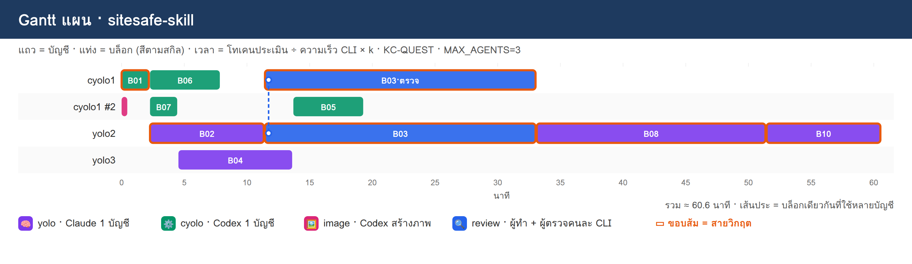

| เรื่อง | ทำทีละขั้น (ขั้นที่ 1–4) | ใช้สกิล |
|---|---|---|
| เวลาที่ใช้ | ประมาณ 18 นาที (4 พรอมต์) | ประมาณ 6 นาที (1 พรอมต์) |
| จำนวน User Story | 20 | 25 |
| FR · BR | 22 · 7 | 24 · 10 |
| จำนวนบล็อก | 10 | 10 |
| Critical Path | B01 → B02 → B03 → B08 → B10 | เหมือนกัน |
| เวลารวมของแผน | 112.5 นาที | 60.6 นาที |

**อ่านผลอย่างไร**
- แผนสั้นลงเกือบครึ่ง เพราะใช้ตัวปรับเวลา k ที่วัดจากการรันจริงของขั้นที่ 5–6 ไม่ใช่เพราะงานน้อยลง
- สกิลเก็บบทเรียนของรอบแรกไว้: แผนใหม่กำหนดให้บล็อกโมเดล "ต้องมีสคริปต์ Training จริง" ซึ่งเป็นจุดที่ทีมทำตกในขั้นที่ 8
- Requirement ไม่เหมือนรอบแรกทุกข้อ (เช่น เพดานไฟล์ 12 MB แทน 15 MB) เพราะเป็นข้อสมมติที่ AI ตั้งเมื่อลูกค้าไม่ได้ให้ตัวเลข: ข้อสมมติทุกข้อต้องให้ลูกค้ายืนยันก่อนสร้างระบบ
- สกิลหยุดที่จุดถามคนก่อนรันทีมจริง (โทเคนประมาณ 16 ล้าน) และก่อนเช่าเครื่อง ตามที่ออกแบบไว้

---

## ภาพรวมระบบ

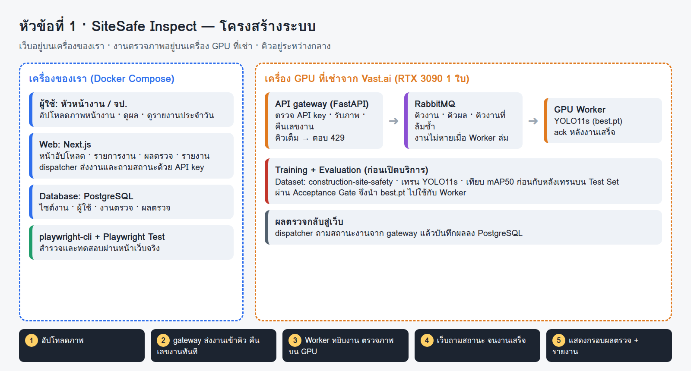

| ส่วน | ใช้อะไร | แนวคิดมาจาก |
|---|---|---|
| โมเดล | YOLO11s เทรนต่อด้วย Dataset [construction-site-safety](https://universe.roboflow.com/roboflow-universe-projects/construction-site-safety) | [LAB 1](../../02_VastAi_Application/lab1_yolo/README.md) |
| คิวงาน | API gateway + RabbitMQ + GPU Worker 1 ตัว | [LAB 8](../../02_VastAi_Application/lab8_job_queue/README.md) |
| เว็บ | Next.js + PostgreSQL ใน Docker พอร์ต 3410 | [Sabai Spa](../../../00_week01/04_sabai-spa-web-and-testplan-from-interview/README.md) |
| การทดสอบ | `playwright-cli` สำรวจ 4 session · Playwright Test | [Test Plan from Exploration](../../../00_week01/03_petshop-testplan-from-exploration/README.md) |

## 16 ขั้น

| ระยะ | ขั้น | ทำอะไร | ไฟล์ที่ได้ |
|---|---|---|---|
| A · Requirement | 1 | User Story จากบันทึกการสัมภาษณ์ | `docs/USER-STORIES.md` |
|  | 2 | Requirement: FR · BR · NFR · เกณฑ์ของโมเดล · SLO | `docs/REQUIREMENTS.md` |
|  | 3 | System Design และข้อมูลทดสอบ | `docs/DESIGN.md` · `docs/TEST-DATA.md` |
| B · Planning | 4 | แตกงานเป็นบล็อก วาด DAG และ Gantt | `plan/` |
| C · Build · Train · Deploy | 5 | Agent Team สร้างระบบตามแผน | `app/` · `plan/REPORT.md` |
|  | 6 | รันต่อเฉพาะบล็อกที่ยังไม่เสร็จ | `app/` · `plan/REPORT.md` |
|  | 7 | เช่า GPU และเตรียม Dataset | `results/dataset_samples.jpg` |
|  | 8 | เทรนโมเดล และตัดสินด้วย Acceptance Gate | `results/model/` |
|  | 9 | Deployment และทดสอบทั้งเส้นทาง | `results/deploy/` |
| D · Verification | 10 | Test Charter และ Exploration พร้อมกัน | `test/CHARTERS.md` · `test/EXPLORATION.md` |
|  | 11 | Test Plan และการตรวจไขว้ | `test/TEST-PLAN.md` · `test/PLAN-REVIEW.md` |
|  | 12 | Playwright Test และ Test Report | `test/TEST-REPORT.md` · `test/index.html` |
|  | 13 | Bug Hunt และรายงานส่งมอบ | `test/BUG-HUNT.md` · `DELIVERY.md` |
|  | 14 | ลบเครื่องและสรุปค่าใช้จ่าย (ห้ามข้าม) | — |
| ปิดท้าย | 15 | สร้างสกิลเวอร์ชัน 0 | `skill_v0/` |
|  | 16 | ลองใช้สกิล (ถึงระยะ Planning) | `results/skill_v0_run/` |

## ใครทำอะไร

| ผู้ทำ | งาน |
|---|---|
| คน | ตัดสินใจ: อนุมัติแผนก่อนรันจริง · อ่านผล Acceptance Gate · ตัดสินว่าส่งมอบได้หรือไม่ |
| Claude Code (หัวหน้าทีม) | เขียนเอกสารระยะ A · สั่งงานทีม · ถือเครื่อง GPU และเงินค่าเช่า · คุมการทดสอบ |
| Agent Team 3 บัญชี (Claude 2 + Codex 1) | เขียนโค้ดทุกบล็อกตามแผน · ตรวจไขว้ข้าม CLI |

## ไฟล์ในโฟลเดอร์นี้

| ไฟล์ | คืออะไร |
|---|---|
| `INTERVIEW.md` | บันทึกการสัมภาษณ์ลูกค้า (ข้อมูลนำเข้าของขั้นที่ 1) |
| `PROMPTS.md` | พรอมต์ทั้ง 16 ขั้น |
| `docs/` | เอกสารของระยะ A จากรอบจริง |
| `plan/` | แผนงานของทีมจากรอบจริง |
| `results/` | คำตอบจริงของทุกขั้น (`answers/`) · ผลของโมเดล · ผล Deployment · ผลลองสกิล |
| `test/` | Test Charter · Exploration · Test Plan · Test Report · หลักฐานของแต่ละ Test Case · Bug Hunt |
| `DELIVERY.md` | รายงานส่งมอบสำหรับลูกค้า |
| `skill_v0/` | สกิล `agent-team-delivery` เวอร์ชัน 0 จากขั้นที่ 15 |
| `code_reference/` | โค้ดที่ AI เขียนในรอบจริง ไว้เทียบ: `app/` (ทีม AI ขั้นที่ 5–6) · `step07/`–`step09/` · `test_e2e/` (ขั้นที่ 12) |
| `image/` | ภาพประกอบ |

เมื่อทำเอง ให้เริ่มจากโฟลเดอร์ที่มีแค่ `INTERVIEW.md` และไฟล์ `.env` · โค้ดและเอกสารทุกไฟล์เกิดจากพรอมต์
