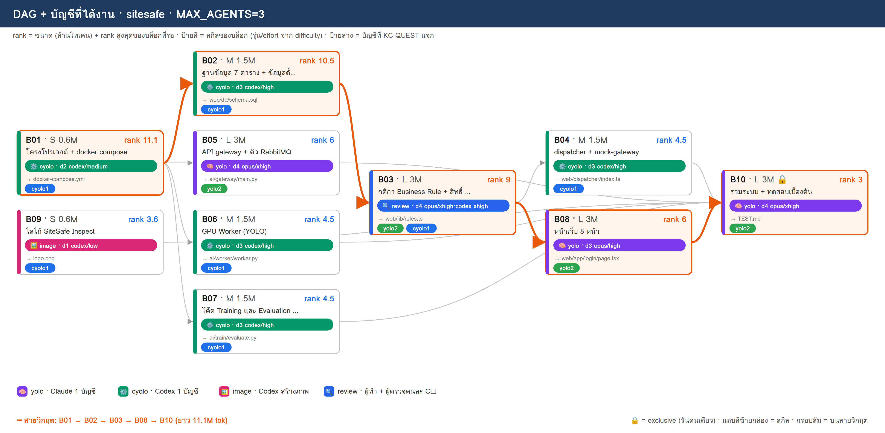
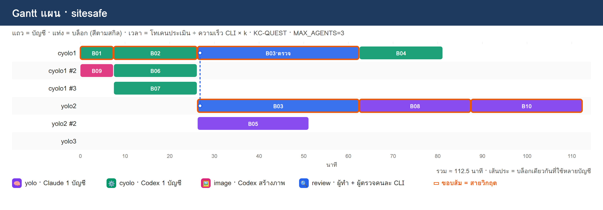

# PLAN · sitesafe

**โจทย์:** สร้างระบบ SiteSafe Inspect ตาม docs/REQUIREMENTS.md และ docs/DESIGN.md (ข้อมูลทดสอบอยู่ที่ docs/TEST-DATA.md): ฝั่งเว็บรันด้วย docker compose (web Next.js + dispatcher + PostgreSQL + volume photos + mock-gateway) และฝั่ง AI บนเครื่อง GPU 1 ใบ (API gateway + RabbitMQ + GPU Worker YOLO) หัวหน้างานอัปโหลดรูปหน้างาน ระบบนับคนไม่ใส่หมวก (H) และคนไม่ใส่เสื้อสะท้อนแสง (V) ตัดสินผล ผ่าน / เตือน / ไม่ผ่าน ตาม BR-01 ถึง BR-07 แก้ผลได้พร้อมร่องรอย มีรายงานรายวันต่อไซต์ และรูปห้ามหาย

วางแผนเมื่อ 19/11/2026 06:22 · MAX_AGENTS 3 · บัญชี cyolo1, yolo2, yolo3 · ตัวปรับเวลา k (ยังไม่มี calib.json → k=1)

> แผนนี้ยังไม่ได้รันจริง — KC-QUEST เลือกบัญชีจากโควตา แล้วจำลองเวลาตาม dependency

## 1) โควตาของแต่ละบัญชี

| บัญชี | แพลน | ใช้ไป 5 ชม. | ใช้ไปสัปดาห์ | headroom | รีเซ็ต/หมดอายุ (ชม.) | U | slot | ที่มา |
|---|---|---|---|---|---|---|---|---|
| cyolo1 | prolite | 0% | 0% | **100%** | 54.0 | 0.308 | 3 | team.py quota |
| yolo2 | default | 0% | 18% | **82%** | 102.6 | 0.19 | 3 | team.py quota |
| yolo3 | default | 36% | 11% | **64%** | 126.6 | 0.159 | 3 | team.py quota |

## 2) DAG + สกิล + บัญชี

**สายวิกฤต:** B01 → B02 → B03 → B08 → B10 · ยาว 11.1M tok

## 3) ตารางแจกงาน (เหตุผล KC-QUEST ทุกบล็อก)

| บล็อก | สกิล | ชื่อ | ขนาด · c | รอ | rank | บัญชี (บทบาท) | เริ่ม–จบ (นาที) | เหตุผล KC-QUEST |
|---|---|---|---|---|---|---|---|---|
| **B01** | ⚙️ cyolo | โครงโปรเจกต์ + docker compose | S · 0.6 | – | 11.1 | cyolo1 (ทำ) | 0.0–7.5 | ทำ: cyolo1 37.6 (U=0.308 F=0.002 S=0.984 S=0.7 L=0.0) · 0.60M ≈ 5ชม. 1.56% / สัปดาห์ 0.2% |
| B09 | 🖼️ image | โลโก้ SiteSafe Inspect | S · 0.6 | – | 3.6 | cyolo1 (ทำ) | 0.0–7.5 | ทำ: cyolo1 27.0 (U=0.308 F=0.002 S=0.969 S=0.227 L=0.333) · 0.60M ≈ 5ชม. 1.56% / สัปดาห์ 0.2% |
| **B02** | ⚙️ cyolo | ฐานข้อมูล 7 ตาราง + ข้อมูลตั้งต้น | M · 1.5 | B01 | 10.5 | cyolo1 (ทำ) | 7.5–26.2 | ทำ: cyolo1 36.3 (U=0.308 F=0.005 S=0.93 S=0.662 L=0.0) · 1.50M ≈ 5ชม. 3.9% / สัปดาห์ 0.49% |
| B06 | ⚙️ cyolo | GPU Worker (YOLO) | M · 1.5 | B01 | 4.5 | cyolo1 (ทำ) | 7.5–26.2 | ทำ: cyolo1 26.7 (U=0.308 F=0.005 S=0.891 S=0.283 L=0.333) · 1.50M ≈ 5ชม. 3.9% / สัปดาห์ 0.49% |
| B07 | ⚙️ cyolo | โค้ด Training และ Evaluation ของโมเดล | M · 1.5 | B01 | 4.5 | cyolo1 (ทำ) | 7.5–26.2 | ทำ: cyolo1 22.8 (U=0.308 F=0.005 S=0.852 S=0.283 L=0.667) · 1.50M ≈ 5ชม. 3.9% / สัปดาห์ 0.49% |
| **B03** | 🔍 review | กติกา Business Rule + สิทธิ์ + API ของเว็บ | L · 3 | B02 | 9 | yolo2 (ทำ), cyolo1 (ตรวจ) | 26.2–62.5 | ทำ: yolo2 33.8 (U=0.19 F=0.012 S=0.922 S=0.811 L=0.0) · 3.00M ≈ 5ชม. 7.8% / สัปดาห์ 0.98% · อันดับ 2 yolo3 27.2   ตรวจ: cyolo1 33.3 (U=0.308 F=0.003 S=0.828 S=0.568 L=0.0) · 0.90M ≈ 5ชม. 2.34% / สัปดาห์ 0.29% |
| B05 | 🧠 yolo | API gateway + คิว RabbitMQ | L · 3 | B01 | 6 | yolo2 (ทำ) | 26.2–51.2 | ทำ: yolo2 25.3 (U=0.19 F=0.012 S=0.844 S=0.541 L=0.333) · 3.00M ≈ 5ชม. 7.8% / สัปดาห์ 0.98% · อันดับ 2 yolo3 23.1 |
| **B08** | 🧠 yolo | หน้าเว็บ 8 หน้า | L · 3 | B03 | 6 | yolo2 (ทำ) | 62.5–87.5 | ทำ: yolo2 27.4 (U=0.19 F=0.012 S=0.766 S=0.541 L=0.0) · 3.00M ≈ 5ชม. 7.8% / สัปดาห์ 0.98% · อันดับ 2 yolo3 23.1 |
| B04 | ⚙️ cyolo | dispatcher + mock-gateway | M · 1.5 | B03 | 4.5 | cyolo1 (ทำ) | 62.5–81.2 | ทำ: cyolo1 28.5 (U=0.308 F=0.005 S=0.789 S=0.283 L=0.0) · 1.50M ≈ 5ชม. 3.9% / สัปดาห์ 0.49% |
| **B10** | 🧠 yolo | รวมระบบ + ทดสอบเบื้องต้น | L · 3 | B04, B05, B06, B07, B08, B09 | 3 | yolo2 (ทำ) | 87.5–112.5 | ทำ: yolo2 22.2 (U=0.19 F=0.012 S=0.688 S=0.27 L=0.0) · 3.00M ≈ 5ชม. 7.8% / สัปดาห์ 0.98% · อันดับ 2 yolo3 19.1 |

## 4) Gantt แผน

## 5) รอบแจกงาน

| นาทีที่ | บล็อกที่เริ่ม |
|---|---|
| 0 | B01→cyolo1, B09→cyolo1 |
| 7.5 | B02→cyolo1, B06→cyolo1, B07→cyolo1 |
| 26.2 | B03→yolo2+cyolo1, B05→yolo2 |
| 62.5 | B04→cyolo1, B08→yolo2 |
| 87.5 | B10→yolo2 |

## 6) สรุป

- บล็อก 10 · แจกได้ 10 · agent พร้อมกันสูงสุด 3/3
- เวลาประมาณ 112.5 นาที (แท่ง Gantt) · ไฟล์ผลของทีม: `/workspace/plans/sitesafe/app/`

ต่อไป: `dagplan.py export sitesafe` → `dagplan.py run sitesafe` → `dagplan.py report sitesafe`
