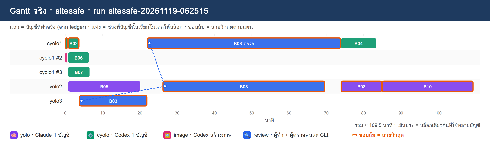
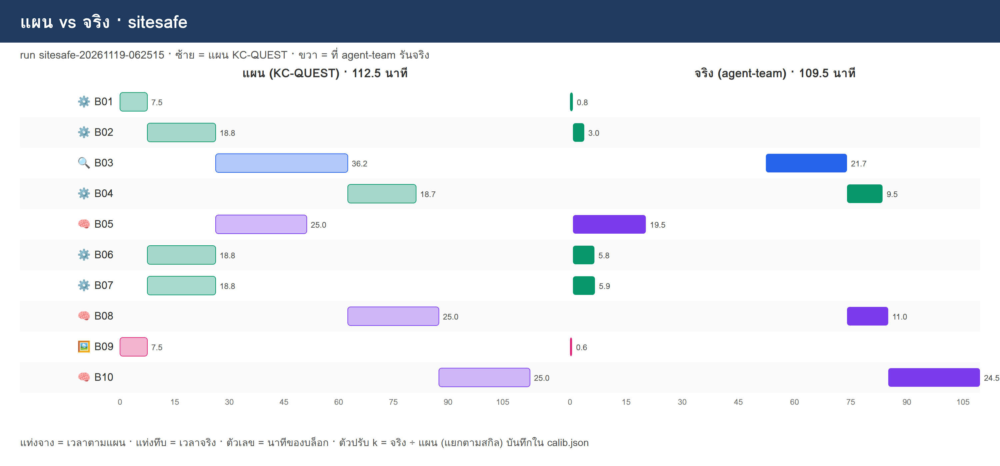

# REPORT · sitesafe

**run:** `sitesafe-20261119-062515` · `/workspace/.agent-team/sitesafe-20261119-062515` · โจทย์: สร้างระบบ SiteSafe Inspect ตาม docs/REQUIREMENTS.md และ docs/DESIGN.md (ข้อมูลทดสอบอยู่ที่ docs/TEST-DATA.md): ฝั่งเว็บรันด้วย docker compose (web Next.js + dispatcher + PostgreSQL + volume photos + mock-gateway) และฝั่ง AI บนเครื่อง GPU 1 ใบ (API gateway + RabbitMQ + GPU Worker YOLO) หัวหน้างานอัปโหลดรูปหน้างาน ระบบนับคนไม่ใส่หมวก (H) และคนไม่ใส่เสื้อสะท้อนแสง (V) ตัดสินผล ผ่าน / เตือน / ไม่ผ่าน ตาม BR-01 ถึง BR-07 แก้ผลได้พร้อมร่องรอย มีรายงานรายวันต่อไซต์ และรูปห้ามหาย

## ตารางบล็อก (แผน vs จริง)

| บล็อก | สกิล | บัญชีแผน | บัญชีจริง | นาทีแผน | นาทีจริง | tokens (ไม่รวม cache read) | ครั้ง | สถานะ | ไฟล์ผล |
|---|---|---|---|---|---|---|---|---|---|
| **B01** | ⚙️ cyolo | cyolo1(ทำ) | cyolo1(ทำ) | 7.50 | 0.77 | 36,019 | 1 | ok | ✅ docker-compose.yml |
| **B02** | ⚙️ cyolo | cyolo1(ทำ) | cyolo1(ทำ) | 18.75 | 3.03 | 39,832 | 1 | ok | ✅ web/db/schema.sql |
| **B03** | 🔍 review | yolo2(ทำ), cyolo1(ตรวจ) | yolo3(ทำ), cyolo1(ตรวจ), yolo2(ทำ) | 36.25 | 21.68 | 1,289,982 | 10 | ok | ✅ web/lib/rules.ts |
| B04 | ⚙️ cyolo | cyolo1(ทำ) | cyolo1(ทำ) | 18.75 | 9.50 | 94,108 | 1 | ok | ✅ web/dispatcher/index.ts |
| B05 | 🧠 yolo | yolo2(ทำ) | yolo2(ทำ) | 25.00 | 19.48 | 276,396 | 1 | ok | ✅ ai/gateway/main.py |
| B06 | ⚙️ cyolo | cyolo1(ทำ) | cyolo1(ทำ) | 18.75 | 5.75 | 67,811 | 1 | ok | ✅ ai/worker/worker.py |
| B07 | ⚙️ cyolo | cyolo1(ทำ) | cyolo1(ทำ) | 18.75 | 5.88 | 92,969 | 1 | ok | ✅ ai/train/evaluate.py |
| **B08** | 🧠 yolo | yolo2(ทำ) | yolo2(ทำ) | 25.00 | 11.02 | 224,348 | 1 | ok | ✅ web/app/login/page.tsx |
| B09 | 🖼️ image | cyolo1(ทำ) | cyolo1(ทำ) | 7.50 | 0.55 | 16,971 | 1 | ok | ✅ logo.png |
| **B10** | 🧠 yolo | yolo2(ทำ) | yolo2(ทำ) | 25.00 | 24.52 | 361,530 | 1 | ok | ✅ TEST.md |

- tokens รวมของบล็อก **2,499,966** = ผลรวมจาก ledger ของ run (19 การเรียก) **2,499,966** ✅ ตรงกัน
- การเรียกที่ไม่ใช่บล็อก (ตรวจความพร้อม ฯลฯ): 0 ครั้ง · 0 tokens (ไม่นับในตาราง)
- เวลารวม: แผน 112.5 นาที · จริง 109.5 นาที
- บล็อกเสร็จ 10/10

## ภาพ

## ความต่างระหว่างแผนกับของจริง

- B03: แผน yolo2(ทำ), cyolo1(ตรวจ) → จริง yolo3(ทำ), cyolo1(ตรวจ), yolo2(ทำ)
- (export ส่งเป็นฝั่ง yolo/cyolo ไม่ผูกบัญชี เพื่อให้ failover ของ agent-team ทำงาน → agent-team เลือกบัญชีในฝั่งเองตามโหลด/โควตา ดู references/run.md)

## ตัวปรับเวลา k (calib.json)

`/workspace/plans/calib.json`: {"cyolo": 0.3022, "review": 0.5981, "yolo": 0.7335, "image": 0.0733}

k = นาทีจริง ÷ นาทีแผน (ก่อนคูณ k) แยกตามสกิล · `plan` ครั้งถัดไปคูณเวลาแต่ละบล็อกด้วย k ของสกิลนั้น
