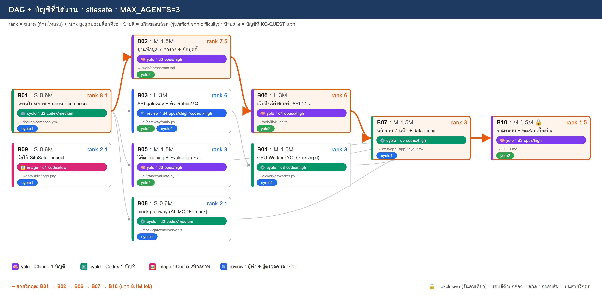
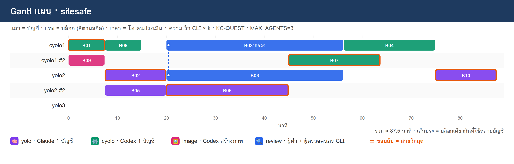

# PLAN · sitesafe

**โจทย์:** สร้างระบบ SiteSafe Inspect ตาม docs/REQUIREMENTS.md และ docs/DESIGN.md: ฝั่งเว็บ (Next.js web + dispatcher + PostgreSQL + volume photos รันด้วย docker compose) และฝั่ง AI (API gateway + RabbitMQ + GPU Worker YOLO 1 ตัว) หัวหน้างานอัปโหลดรูปหน้างาน ระบบตรวจหาคนไม่ใส่หมวก (H) และไม่ใส่เสื้อสะท้อนแสง (V) ตัดสินผล ผ่าน/เตือน/ไม่ผ่าน ตาม BR-01 ถึง BR-07 แก้ผลได้พร้อมร่องรอย และมีรายงานรายวันต่อไซต์

วางแผนเมื่อ 19/11/2026 06:18 · MAX_AGENTS 3 · บัญชี cyolo1, yolo2, yolo3 · ตัวปรับเวลา k (ยังไม่มี calib.json → k=1)

> แผนนี้ยังไม่ได้รันจริง — KC-QUEST เลือกบัญชีจากโควตา แล้วจำลองเวลาตาม dependency

## 1) โควตาของแต่ละบัญชี

| บัญชี | แพลน | ใช้ไป 5 ชม. | ใช้ไปสัปดาห์ | headroom | รีเซ็ต/หมดอายุ (ชม.) | U | slot | ที่มา |
|---|---|---|---|---|---|---|---|---|
| cyolo1 | prolite | 0% | 0% | **100%** | 54.0 | 0.307 | 3 | team.py quota |
| yolo2 | default | 0% | 18% | **82%** | 102.7 | 0.189 | 3 | team.py quota |
| yolo3 | default | 33% | 10% | **67%** | 126.7 | 0.159 | 3 | team.py quota |

## 2) DAG + สกิล + บัญชี

**สายวิกฤต:** B01 → B02 → B06 → B07 → B10 · ยาว 8.1M tok

## 3) ตารางแจกงาน (เหตุผล KC-QUEST ทุกบล็อก)

| บล็อก | สกิล | ชื่อ | ขนาด · c | รอ | rank | บัญชี (บทบาท) | เริ่ม–จบ (นาที) | เหตุผล KC-QUEST |
|---|---|---|---|---|---|---|---|---|
| **B01** | ⚙️ cyolo | โครงโปรเจกต์ + docker compose | S · 0.6 | – | 8.1 | cyolo1 (ทำ) | 0.0–7.5 | ทำ: cyolo1 37.6 (U=0.308 F=0.002 S=0.984 S=0.7 L=0.0) · 0.60M ≈ 5ชม. 1.56% / สัปดาห์ 0.2% |
| B09 | 🖼️ image | โลโก้ SiteSafe Inspect | S · 0.6 | – | 2.1 | cyolo1 (ทำ) | 0.0–7.5 | ทำ: cyolo1 26.3 (U=0.308 F=0.002 S=0.969 S=0.181 L=0.333) · 0.60M ≈ 5ชม. 1.56% / สัปดาห์ 0.2% |
| **B02** | 🧠 yolo | ฐานข้อมูล 7 ตาราง + ข้อมูลตั้งต้น | M · 1.5 | B01 | 7.5 | yolo2 (ทำ) | 7.5–20.0 | ทำ: yolo2 36.0 (U=0.189 F=0.006 S=0.961 S=0.926 L=0.0) · 1.50M ≈ 5ชม. 3.9% / สัปดาห์ 0.49% · อันดับ 2 yolo3 29.8 |
| B05 | 🧠 yolo | โค้ด Training + Evaluation ของโมเดล | M · 1.5 | B01 | 3 | yolo2 (ทำ) | 7.5–20.0 | ทำ: yolo2 23.7 (U=0.189 F=0.006 S=0.922 S=0.37 L=0.333) · 1.50M ≈ 5ชม. 3.9% / สัปดาห์ 0.49% · อันดับ 2 yolo3 21.5 |
| B08 | ⚙️ cyolo | mock-gateway (AI_MODE=mock) | S · 0.6 | B01 | 2.1 | cyolo1 (ทำ) | 7.5–15.0 | ทำ: cyolo1 29.4 (U=0.308 F=0.002 S=0.953 S=0.181 L=0.0) · 0.60M ≈ 5ชม. 1.56% / สัปดาห์ 0.2% |
| B03 | 🔍 review | API gateway + คิว RabbitMQ | L · 3 | B01 | 6 | yolo2 (ทำ), cyolo1 (ตรวจ) | 20.0–56.2 | ทำ: yolo2 31.6 (U=0.189 F=0.012 S=0.844 S=0.741 L=0.0) · 3.00M ≈ 5ชม. 7.8% / สัปดาห์ 0.98% · อันดับ 2 yolo3 26.6   ตรวจ: cyolo1 34.1 (U=0.308 F=0.003 S=0.93 S=0.519 L=0.0) · 0.90M ≈ 5ชม. 2.34% / สัปดาห์ 0.29% |
| **B06** | 🧠 yolo | เว็บฝั่งเซิร์ฟเวอร์: API 14 เส้นทาง + กติกา + dispatcher | L · 3 | B02 | 6 | yolo2 (ทำ) | 20.0–45.0 | ทำ: yolo2 27.1 (U=0.189 F=0.012 S=0.766 S=0.741 L=0.333) · 3.00M ≈ 5ชม. 7.8% / สัปดาห์ 0.98% · อันดับ 2 yolo3 26.6 |
| **B07** | ⚙️ cyolo | หน้าเว็บ 7 หน้า + data-testid | M · 1.5 | B06 | 3 | cyolo1 (ทำ) | 45.0–63.8 | ทำ: cyolo1 26.3 (U=0.308 F=0.005 S=0.891 S=0.259 L=0.333) · 1.50M ≈ 5ชม. 3.9% / สัปดาห์ 0.49% |
| B04 | ⚙️ cyolo | GPU Worker (YOLO ตรวจรูป) | M · 1.5 | B03 | 3 | cyolo1 (ทำ) | 56.2–75.0 | ทำ: cyolo1 25.8 (U=0.308 F=0.005 S=0.852 S=0.259 L=0.333) · 1.50M ≈ 5ชม. 3.9% / สัปดาห์ 0.49% |
| **B10** | 🧠 yolo | รวมระบบ + ทดสอบเบื้องต้น | M · 1.5 | B04, B05, B07, B08, B09 | 1.5 | yolo2 (ทำ) | 75.0–87.5 | ทำ: yolo2 21.4 (U=0.189 F=0.006 S=0.727 S=0.185 L=0.0) · 1.50M ≈ 5ชม. 3.9% / สัปดาห์ 0.49% · อันดับ 2 yolo3 18.7 |

## 4) Gantt แผน

## 5) รอบแจกงาน

| นาทีที่ | บล็อกที่เริ่ม |
|---|---|
| 0 | B01→cyolo1, B09→cyolo1 |
| 7.5 | B08→cyolo1, B02→yolo2, B05→yolo2 |
| 20 | B03→yolo2+cyolo1, B06→yolo2 |
| 45 | B07→cyolo1 |
| 56.2 | B04→cyolo1 |
| 75 | B10→yolo2 |

## 6) สรุป

- บล็อก 10 · แจกได้ 10 · agent พร้อมกันสูงสุด 3/3
- เวลาประมาณ 87.5 นาที (แท่ง Gantt) · ไฟล์ผลของทีม: `/workspace/plans/sitesafe/app/`

ต่อไป: `dagplan.py export sitesafe` → `dagplan.py run sitesafe` → `dagplan.py report sitesafe`
