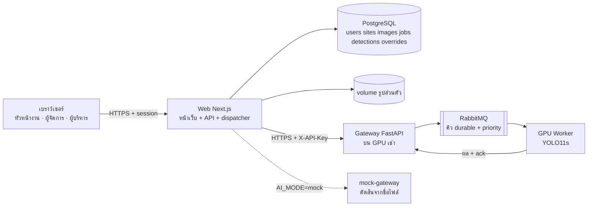
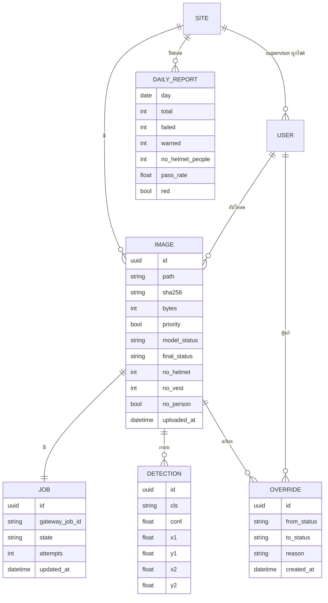
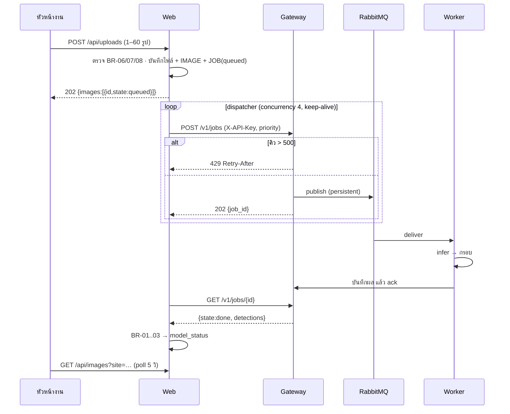
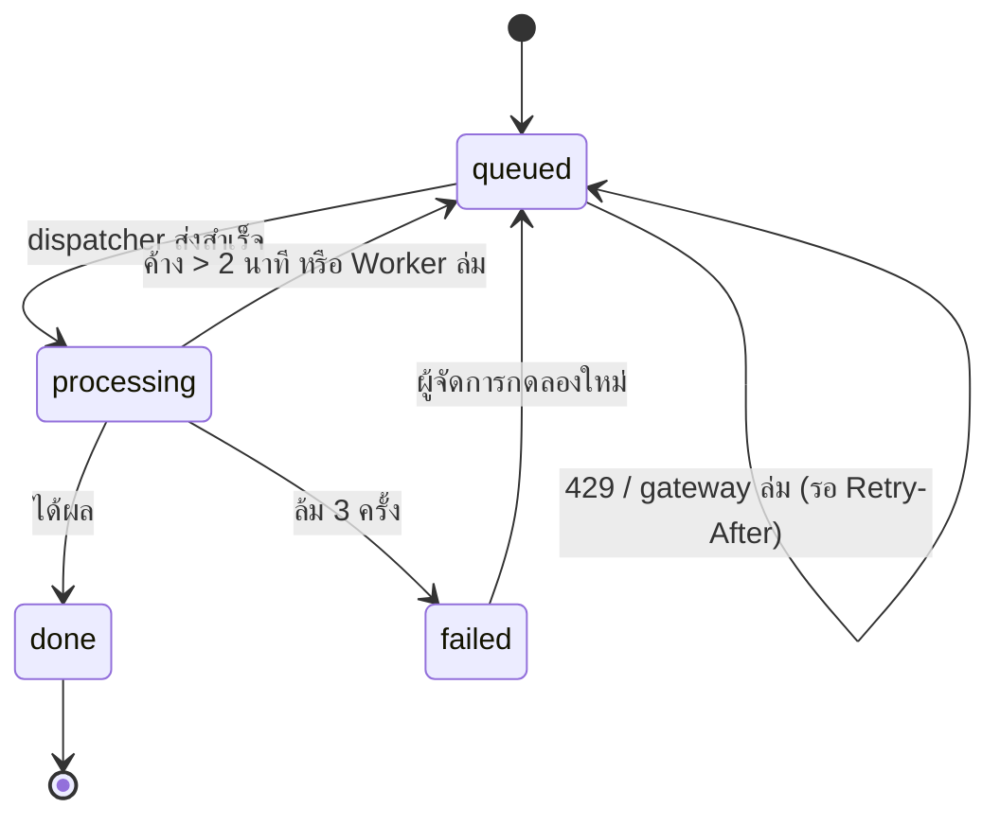

# System Design · SiteSafe Inspect (รอบสกิล)

## 1 · Architecture

เว็บ + DB + mock-gateway รันด้วย `docker compose` บนเครื่องลูกค้า · Gateway + RabbitMQ + Worker เป็น process ใน tmux บน GPU 1 ใบ (เครื่องเช่าใช้ docker ซ้อนไม่ได้)

## 2 · ER

`model_status` ไม่ถูกเขียนทับ · `final_status` = override ล่าสุด หรือ `model_status` · ตาราง OVERRIDE ไม่มี UPDATE/DELETE

## 3 · Sequence (อัปโหลดชุด → ผล)

## 4 · State (JOB)

## 5 · API Contract

### Gateway (GPU · HTTPS · ทุกคำขอต้องมี `X-API-Key`)

| Method | Path | ขอ | ตอบ |
|---|---|---|---|
| POST | `/v1/jobs` | multipart `file`, `priority` (0/9), `client_ref` | 202 `{job_id}` · 401 ไม่มี key · 413 > 12 MB · 415 ไม่ใช่ JPG/PNG · 429 `{error:"queue_full"}` + `Retry-After: 10` |
| GET | `/v1/jobs/{job_id}` | – | 200 `{state, detections:[{cls,conf,box:[x1,y1,x2,y2]}], model:"yolo11s@<sha>", threshold}` · 404 |
| GET | `/health` | – (ไม่ต้องใช้ key) | `{ok, queue_depth, worker_alive, model_loaded}` |

`client_ref` ซ้ำ = คืน job_id เดิม (กันงานซ้ำเมื่อ dispatcher ส่งใหม่)

### Web

| Method | Path | สิทธิ์ | หมายเหตุ |
|---|---|---|---|
| POST | `/api/auth/login` · `/api/auth/logout` | ทุกคน | |
| POST | `/api/uploads` | supervisor (ไซต์ตัวเอง) · safety_manager | `priority=true` = ด่วน |
| GET | `/api/images?site&status&date` | ตามไซต์ที่เห็นได้ | |
| GET | `/api/images/{id}` · `/api/images/{id}/file` | ตามไซต์ | รูปเสิร์ฟผ่านที่นี่เท่านั้น |
| POST | `/api/images/{id}/override` | supervisor ไซต์ตัวเอง · safety_manager | `{to_status, reason}` |
| GET | `/api/reports/daily?date&site` · `/api/reports/daily.csv` | manager · executive · supervisor (ไซต์ตัวเอง) | |
| GET | `/api/health` | ทุกคน | `{ok, db, gateway, queue_pending}` |
| POST | `/api/test/reset` | เฉพาะ `TEST_MODE=1` | ล้างข้อมูล + seed ใหม่ |

## 6 · คิวที่งานไม่หาย

- RabbitMQ queue `sitesafe.jobs` durable · `x-max-priority: 10` · message persistent · Worker `prefetch=4` · **ack หลังบันทึกผลแล้วเท่านั้น**
- Worker ล่ม → message unacked กลับเข้าคิวเอง · ฝั่งเว็บ JOB ค้าง processing > 2 นาที → queued (ใช้ `client_ref` เดิม จึงไม่ซ้ำ)

## 7 · โหมดและตัวแปร

| ตัวแปร | ค่า | ผล |
|---|---|---|
| `AI_MODE` | `real` / `mock` | mock = dispatcher ชี้ไป mock-gateway (compose profile `test`) |
| `TEST_MODE` | `1` | เปิด `/api/test/reset` |
| `BUG_MODE` | `0` / `1` | 1 = เปิดบั๊กที่ตั้งใจใส่ 3 ข้อ (รายชื่อใน `BUGS-SECRET.md` ไฟล์เดียว ผู้ทดสอบห้ามเปิดจนเขียนรายงานบั๊กเสร็จ) |
| `GATEWAY_URL` `GATEWAY_API_KEY` `GATEWAY_CA` | | อยู่ใน `.env` เท่านั้น |

**mock-gateway:** อ่านชื่อไฟล์ `h<จำนวนไม่ใส่หมวก>_v<จำนวนไม่ใส่เสื้อ>_<อะไรก็ได้>.jpg` เช่น `h1_v0_a.jpg` → 1 กรอบ no_helmet · `np_*.jpg` → ไม่พบบุคคล · `slow_*.jpg` → หน่วง 40 วินาที · `q429_*` → ตอบ 429 ครั้งแรก · ชื่ออื่น → h0_v0

## 8 · data-testid หลัก

`login-email` `login-password` `login-submit` · `upload-input` `upload-priority` `upload-submit` `upload-result` · `image-row-<id>` `image-status-<id>` `filter-status` · `result-canvas` `count-no_helmet` `count-no_vest` `badge-no-person` · `override-open` `override-status` `override-reason` `override-submit` `override-history` · `report-total-<site>` `report-failed-<site>` `report-nohelmet-<site>` `report-passrate-<site>` (มี class `is-red`) `report-csv`
