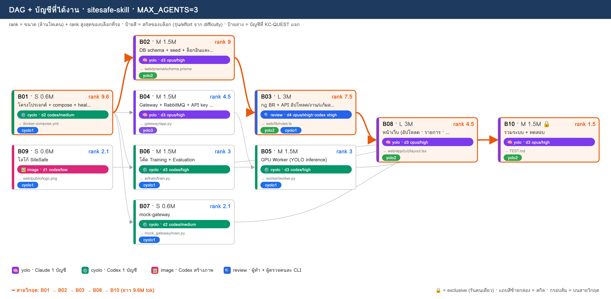
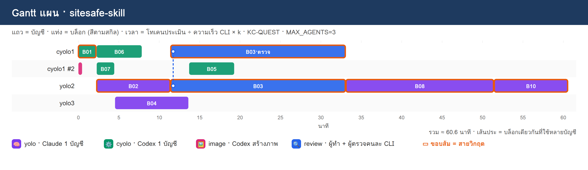

# PLAN · sitesafe-skill

**โจทย์:** SiteSafe Inspect: เว็บตรวจรูปความปลอดภัยไซต์ก่อสร้าง (อัปโหลดหลายรูป · คิวงานไม่หาย · YOLO ตรวจหมวก/เสื้อสะท้อนแสงบน GPU เช่า · กฎ BR-01..10 · แก้ผลพร้อมประวัติ · รายงานรายวันต่อไซต์) ตามเอกสารใน docs/ (USER-STORIES · REQUIREMENTS · DESIGN · TEST-DATA) ห้ามเปิด docs/BUGS-SECRET.md ยกเว้นบล็อกที่ระบุ

วางแผนเมื่อ 19/11/2026 12:01 · MAX_AGENTS 3 · บัญชี cyolo1, yolo2, yolo3 · ตัวปรับเวลา k {"cyolo": 0.3022, "yolo": 0.7335, "image": 0.0733, "*": 0.5077, "review": 0.5981}

> แผนนี้ยังไม่ได้รันจริง — KC-QUEST เลือกบัญชีจากโควตา แล้วจำลองเวลาตาม dependency

## 1) โควตาของแต่ละบัญชี

| บัญชี | แพลน | ใช้ไป 5 ชม. | ใช้ไปสัปดาห์ | headroom | รีเซ็ต/หมดอายุ (ชม.) | U | slot | ที่มา |
|---|---|---|---|---|---|---|---|---|
| cyolo1 | prolite | 0% | 0% | **100%** | 48.3 | 0.332 | 3 | team.py quota |
| yolo2 | default | 0% | 18% | **82%** | 97.0 | 0.198 | 3 | team.py quota |
| yolo3 | default | 8% | 27% | **73%** | 121.0 | 0.166 | 3 | team.py quota |

## 2) DAG + สกิล + บัญชี

**สายวิกฤต:** B01 → B02 → B03 → B08 → B10 · ยาว 9.6M tok

## 3) ตารางแจกงาน (เหตุผล KC-QUEST ทุกบล็อก)

| บล็อก | สกิล | ชื่อ | ขนาด · c | รอ | rank | บัญชี (บทบาท) | เริ่ม–จบ (นาที) | เหตุผล KC-QUEST |
|---|---|---|---|---|---|---|---|---|
| **B01** | ⚙️ cyolo | โครงโปรเจกต์ + compose + health | S · 0.6 | – | 9.6 | cyolo1 (ทำ) | 0.0–2.3 | ทำ: cyolo1 38.6 (U=0.332 F=0.002 S=0.984 S=0.7 L=0.0) · 0.60M ≈ 5ชม. 1.56% / สัปดาห์ 0.2% |
| B09 | 🖼️ image | โลโก้ SiteSafe | S · 0.6 | – | 2.1 | cyolo1 (ทำ) | 0.0–0.5 | ทำ: cyolo1 26.8 (U=0.332 F=0.002 S=0.969 S=0.153 L=0.333) · 0.60M ≈ 5ชม. 1.56% / สัปดาห์ 0.2% |
| **B02** | 🧠 yolo | DB schema + seed + ล็อกอินและสิทธิ์ | M · 1.5 | B01 | 9 | yolo2 (ทำ) | 2.3–11.4 | ทำ: yolo2 36.5 (U=0.198 F=0.006 S=0.961 S=0.938 L=0.0) · 1.50M ≈ 5ชม. 3.9% / สัปดาห์ 0.49% · อันดับ 2 yolo3 34.1 |
| B06 | ⚙️ cyolo | โค้ด Training + Evaluation | M · 1.5 | B01 | 3 | cyolo1 (ทำ) | 2.3–7.9 | ทำ: cyolo1 30.6 (U=0.332 F=0.005 S=0.93 S=0.218 L=0.0) · 1.50M ≈ 5ชม. 3.9% / สัปดาห์ 0.49% |
| B07 | ⚙️ cyolo | mock-gateway | S · 0.6 | B01 | 2.1 | cyolo1 (ทำ) | 2.3–4.5 | ทำ: cyolo1 26.0 (U=0.332 F=0.002 S=0.914 S=0.153 L=0.333) · 0.60M ≈ 5ชม. 1.56% / สัปดาห์ 0.2% |
| B04 | 🧠 yolo | Gateway + RabbitMQ + API key + 429 | M · 1.5 | B01 | 4.5 | yolo3 (ทำ) | 4.5–13.7 | ทำ: yolo3 27.0 (U=0.166 F=0.007 S=0.881 S=0.469 L=0.0) · 1.50M ≈ 5ชม. 3.9% / สัปดาห์ 0.49% · อันดับ 2 yolo2 25.6 |
| **B03** | 🔍 review | กฎ BR + API อัปโหลด/งาน/แก้ผล/รายงาน + dispatcher | L · 3 | B02 | 7.5 | yolo2 (ทำ), cyolo1 (ตรวจ) | 11.4–33.1 | ทำ: yolo2 33.1 (U=0.198 F=0.012 S=0.883 S=0.781 L=0.0) · 3.00M ≈ 5ชม. 7.8% / สัปดาห์ 0.98% · อันดับ 2 yolo3 27.3   ตรวจ: cyolo1 34.9 (U=0.332 F=0.003 S=0.891 S=0.547 L=0.0) · 0.90M ≈ 5ชม. 2.34% / สัปดาห์ 0.29% |
| B05 | ⚙️ cyolo | GPU Worker (YOLO inference) | M · 1.5 | B04 | 3 | cyolo1 (ทำ) | 13.7–19.4 | ทำ: cyolo1 26.1 (U=0.332 F=0.005 S=0.852 S=0.218 L=0.333) · 1.50M ≈ 5ชม. 3.9% / สัปดาห์ 0.49% |
| **B08** | 🧠 yolo | หน้าเว็บ (อัปโหลด · รายการ · ผล · แก้ผล · รายงาน) | L · 3 | B03 | 4.5 | yolo2 (ทำ) | 33.1–51.5 | ทำ: yolo2 27.3 (U=0.198 F=0.012 S=0.805 S=0.469 L=0.0) · 3.00M ≈ 5ชม. 7.8% / สัปดาห์ 0.98% · อันดับ 2 yolo3 26.0 |
| **B10** | 🧠 yolo | รวมระบบ + ทดสอบ | M · 1.5 | B05, B06, B07, B08, B09 | 1.5 | yolo2 (ทำ) | 51.5–60.6 | ทำ: yolo2 21.9 (U=0.198 F=0.006 S=0.766 S=0.156 L=0.0) · 1.50M ≈ 5ชม. 3.9% / สัปดาห์ 0.49% · อันดับ 2 yolo3 21.8 |

## 4) Gantt แผน

## 5) รอบแจกงาน

| นาทีที่ | บล็อกที่เริ่ม |
|---|---|
| 0 | B01→cyolo1, B09→cyolo1 |
| 2.3 | B06→cyolo1, B07→cyolo1, B02→yolo2 |
| 4.5 | B04→yolo3 |
| 11.4 | B03→yolo2+cyolo1 |
| 13.7 | B05→cyolo1 |
| 33.1 | B08→yolo2 |
| 51.5 | B10→yolo2 |

## 6) สรุป

- บล็อก 10 · แจกได้ 10 · agent พร้อมกันสูงสุด 3/3
- เวลาประมาณ 60.6 นาที (แท่ง Gantt) · ไฟล์ผลของทีม: `/workspace/plans/sitesafe-skill/app/`

ต่อไป: `dagplan.py export sitesafe-skill` → `dagplan.py run sitesafe-skill` → `dagplan.py report sitesafe-skill`
