# หัวข้อที่ 2 · ReceiptDesk — บริการอ่านใบเสร็จสำหรับสำนักงานบัญชี

[← กลับหน้ารวมของบท](../README.md) · ทำ [หัวข้อที่ 1](../01_sitesafe_inspect/README.md) ก่อน · เปิด Claude Code ที่โฟลเดอร์ `02_receipt_desk` · พรอมต์อยู่ใน [PROMPTS.md](PROMPTS.md)


*(ภาพจำลอง · บริษัทและบุคคลในหัวข้อนี้เป็นตัวอย่างสมมติ)*

สไลด์ประกอบการสอน: [ReceiptDesk_Slides.html](ReceiptDesk_Slides.html)

---

## 1 · เรื่องราวของลูกค้า

สำนักงานบัญชี ใส่ใจการบัญชี ดูแลบัญชีให้ร้านค้าและบริษัทขนาดเล็ก 60 ราย

**ลูกค้าถ่ายรูปใบเสร็จส่งมา**


ร้านค้าส่งรูปใบเสร็จมาทาง LINE และอีเมล รวมกันเดือนละราว 6,000 ใบ

**พนักงานพิมพ์ยอดทีละใบ**


พนักงาน 4 คนพิมพ์ชื่อร้าน วันที่ รายการ ราคา และยอดรวม ใบละประมาณ 2 นาที

**สิ้นเดือน: งานเข้าพร้อมกัน ทำถึงสามทุ่ม และยอดเริ่มผิด**


บางวันใบเสร็จเข้ามา 800 ใบ ยอดที่พิมพ์ผิดคือบัญชีที่ผิด

**คำถามของหัวข้อนี้: เมื่องานเข้าพร้อมกันเกินความจุของ GPU ทีม AI ออกแบบ สร้าง และพิสูจน์ระบบที่งานไม่หายและรอไม่เกิน SLO ได้อย่างไร**

---

## 2 · การสัมภาษณ์ลูกค้า


ทีมพัฒนาไปสัมภาษณ์ 4 คน

| | ผู้ให้สัมภาษณ์ | สิ่งที่พูด |
|---|---|---|
|  | **คุณอรทัย**<br>เจ้าของสำนักงาน | "อยากให้อัปโหลดรูปใบเสร็จแล้วระบบอ่านออกมาเป็นข้อมูลเลย พนักงานแค่ตรวจว่าถูกไหมแล้วกดยืนยัน"<br>"ถ้าพนักงานต้องตรวจทุกช่องทุกใบเหมือนเดิมก็ไม่ได้ประหยัดเวลา"<br>"ห้ามล่ม ห้ามหาย ถ้าเต็มจริง ๆ ให้บอกว่าตอนนี้เต็ม ให้ลองใหม่อีกกี่นาที" |
|  | **คุณพิมพ์**<br>พนักงานบัญชี | "ขออัปโหลดทีละเป็นชุดนะคะ ชุดละร้อยใบก็มี"<br>"ชุดร้อยใบ รอสักครึ่งชั่วโมงก็ได้ค่ะ ขอแค่ใบเสร็จไม่หาย" |
|  | **คุณกิตติ**<br>หัวหน้าทีมบัญชี | "100 ใบ ยอดรวมผิดได้ไม่เกิน 5 ใบ และ 5 ใบนั้นคนต้องตรวจเจอก่อนเข้าบัญชี"<br>"ถ้าระบบไม่แน่ใจต้องบอก อย่าเดา"<br>"งานแบบนี้ต้องแซงคิวได้ ไม่เกิน 5 นาทีต้องเห็นผล" |
|  | **คุณสมชาย**<br>เจ้าของร้านอาหาร (ลูกค้าของสำนักงาน) | "ผมอยากอัปโหลดเองเลยครับ … อยากเห็นสรุปรายจ่ายของร้านผมรายเดือน"<br>"ผมจะรู้ได้ไงว่าใบที่ส่งไปถึงแล้ว" |

*(ภาพบุคคลเป็นภาพจำลอง)*

**สังเกต:** คุณกิตติต้องการให้งานด่วนแซงคิว แต่คุณอรทัยไม่อยากให้งานปกติค้างข้ามวัน · คุณกิตติต้องการให้คนตรวจเจอยอดผิดทุกใบ แต่คุณอรทัยไม่อยากให้ตรวจทุกช่องทุกใบ · บันทึกฉบับเต็ม: [INTERVIEW.md](INTERVIEW.md)

---

## 3 · ระยะ A · จากคำพูดเป็น Requirement

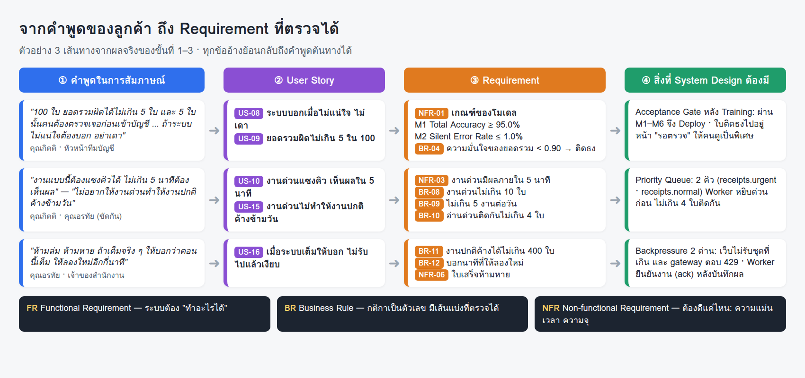

| ลำดับ | เอกสาร | ตอบคำถาม | ผลจริง |
|---|---|---|---|
| ① | [INTERVIEW.md](INTERVIEW.md) | ลูกค้าพูดว่าอะไร | 4 คน |
| ② | [USER-STORIES.md](docs/USER-STORIES.md) | ใครต้องการอะไร เพื่ออะไร | 24 ข้อ |
| ③ | [REQUIREMENTS.md](docs/REQUIREMENTS.md) | ระบบต้องทำอะไร กติกาคืออะไร ต้องดีแค่ไหน | FR 31 · BR 14 · NFR 10 |
| ④ | [DESIGN.md](docs/DESIGN.md) | ระบบมีส่วนใดบ้าง คุยกันอย่างไร | 11 ตาราง · 33 API |

### ขั้นที่ 1 · User Story จากบันทึกการสัมภาษณ์

```text
จากบันทึกการสัมภาษณ์ลูกค้าใน ./INTERVIEW.md เขียน User Story ไว้ที่ ./docs/USER-STORIES.md
1. เขียนรูปแบบ "ในฐานะ… ฉันต้องการ… เพื่อ…" ให้ครบทุกบทบาทที่ลูกค้าพูดถึง ทุกข้อมีรหัส US-01… ระดับ Must / Should / Could และเกณฑ์ยอมรับที่ตรวจได้
2. ทุกข้อต้องอ้างคำพูดในบันทึกที่เป็นที่มา ห้ามเพิ่มความต้องการที่ลูกค้าไม่ได้พูด
3. รวบรวมจุดที่ลูกค้าพูดขัดกันเอง และคำถามที่ต้องถามลูกค้าเพิ่ม เป็น 2 ตารางท้ายไฟล์
4. แยกสิ่งที่ลูกค้าบอกว่ายังไม่ทำในรุ่นแรกไว้ในหัวข้อ "นอกขอบเขต"
(ยังไม่ออกแบบระบบ ยังไม่เขียนโค้ด)
สรุปเป็นตารางภาษาไทย: จำนวน User Story แยกตามระดับ · จำนวนจุดที่ขัดกัน · จำนวนคำถาม
```

**ผลจริง** (ประมาณ 3 นาที)

| รายการ | จำนวน |
|---|---|
| User Story ระดับ Must | 16 |
| User Story ระดับ Should | 7 |
| User Story ระดับ Could | 1 |
| จุดที่ลูกค้าพูดขัดกันเอง | 6 |
| คำถามที่ต้องถามลูกค้าเพิ่ม | 14 |

**อ่านผลอย่างไร**
- User Story ครบ 4 บทบาท: พนักงานบัญชี 7 ข้อ · หัวหน้าทีม 6 ข้อ · เจ้าของสำนักงาน 8 ข้อ · ลูกค้าของสำนักงาน 3 ข้อ
- จุดขัดกัน 6 จุด มากกว่าหัวข้อที่ 1 (4 จุด) เพราะมีผู้ให้สัมภาษณ์ 4 คนที่ต้องการต่างกัน
- US-24 มาจากคำถามของคุณสมชายที่ไม่มีใครตอบในห้องประชุม ("ผมจะรู้ได้ไงว่าใบที่ส่งไปถึงแล้ว") AI เก็บเป็นความต้องการ ไม่ปล่อยผ่าน

### ขั้นที่ 2 · Requirement

```text
จาก User Story ใน ./docs/USER-STORIES.md เขียน Requirement ไว้ที่ ./docs/REQUIREMENTS.md
1. Functional Requirement (FR-01…) ทุกข้ออ้างรหัส User Story
2. Business Rule (BR-01…) ทุกข้อเป็นตัวเลขที่ตรวจได้ พร้อมค่าตัวอย่างที่ ต่ำกว่า / เท่ากับ / สูงกว่า เส้นแบ่ง
3. Non-functional Requirement (NFR-01…) ให้มีอย่างน้อย 6 เรื่อง: เกณฑ์ของโมเดล · SLO ของงานปกติและงานด่วน · ความจุช่วงสิ้นเดือน · ใบเสร็จห้ามหาย · ความเป็นส่วนตัวของข้อมูล · ความคุ้มของการเพิ่ม GPU
4. เกณฑ์ของโมเดล: แปลงคำว่า "100 ใบ ยอดรวมผิดได้ไม่เกิน 5 ใบ" และ "ถ้าไม่แน่ใจต้องบอก อย่าเดา" เป็นตัวชี้วัดที่วัดได้บน Test Set
5. กติกาของงานด่วน: ใครตั้งได้ แซงคิวอย่างไร และงานปกติต้องไม่ค้างเกินเท่าใด
6. จุดที่ลูกค้าขัดกันเอง ให้เลือกทางที่เสี่ยงน้อยที่สุด แล้วบันทึกเป็น "ข้อสมมติ" พร้อมเหตุผล
(ยังไม่เขียนโค้ด)
สรุปเป็นตารางภาษาไทย: จำนวน FR · BR · NFR · ข้อสมมติ และเกณฑ์ของโมเดลกับ SLO ที่ใช้
```

**ผลจริง** (ประมาณ 4 นาที): FR 31 ข้อ · BR 14 ข้อ · NFR 10 ข้อ · ข้อสมมติ 16 ข้อ

**BR · Business Rule** (ตัวอย่าง 5 จาก 14 ข้อ)

| รหัส | กติกา | ต่ำกว่าเส้นแบ่ง | เท่ากับ | สูงกว่า |
|---|---|---|---|---|
| BR-01 | 1 ชุดมีได้ 1–100 ไฟล์ | 99 → รับ | 100 → รับ | 101 → ปฏิเสธทั้งชุด |
| BR-04 | ความมั่นใจของยอดรวมต่ำกว่า 0.90 → ติดธง "ไม่แน่ใจยอดรวม" | 0.89 → ติดธง | 0.90 → ไม่ติดธง | 0.91 → ไม่ติดธง |
| BR-06 | ยืนยันได้เมื่อยอดรวมตั้งแต่ 0.01 บาท | 0.00 → ยืนยันไม่ได้ | 0.01 → ยืนยันได้ | 0.02 → ยืนยันได้ |
| BR-08 | งานด่วน 1 งานมีได้ไม่เกิน 10 ใบ | 9 → ตั้งด่วนได้ | 10 → ตั้งด่วนได้ | 11 → ตั้งไม่ได้ |
| BR-09 | ตั้งงานด่วนได้ไม่เกิน 5 งานต่อวัน | ตั้งไปแล้ว 4 → งานที่ 5 ตั้งได้ | — | ตั้งไปแล้ว 5 → งานที่ 6 ตั้งไม่ได้ |

**NFR-01 · เกณฑ์ของโมเดล — แปลงคำพูดเป็นตัวชี้วัดบน Test Set**

| ตัวชี้วัด | แปลงจากคำพูด | เกณฑ์ผ่าน |
|---|---|---|
| M1 Total Accuracy | "100 ใบ ยอดรวมผิดได้ไม่เกิน 5 ใบ" | ≥ 95.0% |
| M2 Silent Error Rate (ยอดผิดและไม่ติดธง) | "5 ใบนั้นคนต้องตรวจเจอ" + "อย่าเดา" | ≤ 1.0% |
| M3 Flag Recall | "ถ้าไม่แน่ใจต้องบอก" | ≥ 80.0% |
| M4 Flag Rate | "ตรวจทุกช่องทุกใบก็ไม่ได้ประหยัดเวลา" | ≤ 20.0% |

**SLO และกติกาของงานด่วน**

| เรื่อง | เกณฑ์ |
|---|---|
| SLO งานปกติ | ชุด 100 ใบมีผลครบภายใน 30 นาที · ทุกกรณีไม่เกิน 120 นาที |
| SLO งานด่วน | มีผลครบภายใน 5 นาที แม้คิวงานปกติเต็ม |
| ใครตั้งงานด่วนได้ | หัวหน้าทีมคนเดียว |
| แซงคิวอย่างไร | อ่านใบด่วนก่อน แต่ติดกันได้ไม่เกิน 4 ใบ แล้วต้องสลับใบปกติ 1 ใบ (BR-10) |
| ความคุ้มของการเพิ่ม GPU | เพิ่มเป็น 2 ใบถือว่าคุ้มเมื่อ Speedup ≥ 1.6 เท่า หรือ 1 ใบทำ SLO ไม่ได้แต่ 2 ใบทำได้ |

**อ่านผลอย่างไร**
- คำว่า "ยอดรวมต้องถูก" ไม่ได้กลายเป็นตัวชี้วัดเดียว แต่เป็น 4 ตัว: M1 วัดว่าอ่านถูกแค่ไหน ส่วน M2–M4 วัดว่าโมเดล "รู้ตัวว่าไม่แน่ใจ" ดีแค่ไหน
- จุดที่คุณกิตติกับคุณอรทัยขัดกันเรื่องการตรวจ AI เลือกทางกลาง: พนักงานตรวจช่องยอดรวมทุกใบ และตรวจทุกช่องเฉพาะใบติดธง แล้วจดเป็นข้อสมมติให้ลูกค้ายืนยัน
- ตัวเลขที่ลูกค้าไม่ได้ให้ เช่น เส้นความมั่นใจ 0.90 เพดานคิว 400 ใบ และอัตราอ่าน 4 ใบต่อนาทีต่อ Worker เป็นค่าที่ AI ตั้งและบอกชัดว่าเป็นข้อสมมติ ยังไม่ได้วัดจริง

### ขั้นที่ 3 · System Design และข้อมูลทดสอบ

```text
จาก Requirement ใน ./docs/REQUIREMENTS.md ออกแบบระบบไว้ที่ ./docs/DESIGN.md และข้อมูลทดสอบไว้ที่ ./docs/TEST-DATA.md
ระบบมี 2 ฝั่ง: เว็บ Next.js + PostgreSQL รันด้วย docker compose บนเครื่องนี้ และฝั่ง AI บนเครื่อง GPU ที่เช่า 2 ใบ ซึ่งมี API gateway, RabbitMQ, GPU Worker 2 ตัว และโมเดล Vision-Language อ่านใบเสร็จที่เปิดด้วย vLLM 2 ตัวหลัง NGINX
1. แผนภาพ Mermaid 4 ภาพ: Architecture · ER Diagram · ลำดับการทำงานตั้งแต่อัปโหลดชุดใบเสร็จจนพนักงานยืนยันผล · สถานะของงาน
2. API Contract ระหว่างเว็บกับ gateway: ส่งใบเสร็จ · ถามสถานะ · งานด่วน · คิวเต็มตอบอย่างไร · ใช้ API key อย่างไร
3. การออกแบบคิว 3 เรื่อง: Priority Queue ให้งานด่วนแซงได้โดยงานปกติไม่ค้างเกินกำหนด · Backpressure เมื่อคิวเต็ม · Dead-letter Queue สำหรับใบที่อ่านไม่ได้
4. งานต้องไม่หายเมื่อ Worker ล่ม และ Worker ที่เหลือต้องทำงานต่อได้
5. เว็บต้องมี /api/health ทางรีเซ็ตข้อมูลทดสอบ และ data-testid ทุกปุ่มและช่องกรอก
6. เว็บต้องมีโหมด BUG_MODE=1 ที่ทำให้ Business Rule ผิด 3 ข้อ (เลือกเอง) เก็บรายชื่อ 3 ข้อนั้นไว้ที่ ./docs/BUGS-SECRET.md ที่เดียว
7. ข้อมูลทดสอบ: ผู้ใช้ทุกบทบาท ลูกค้าของสำนักงาน และกรณีขอบของทุก Business Rule พร้อมผลที่คาดหวังที่คำนวณให้ดู
(ยังไม่เขียนโค้ด)
สรุปเป็นตารางภาษาไทย: จำนวนตาราง · จำนวน API · จำนวนแถวข้อมูลทดสอบ · คำถามที่การออกแบบยังตอบไม่ได้
```

**ผลจริง** (ประมาณ 9 นาที): ตาราง 11 · API 33 · ข้อมูลทดสอบ 96 แถว · คำถามที่การออกแบบยังตอบไม่ได้ 9 ข้อ

**Architecture** (จาก [DESIGN.md](docs/DESIGN.md))

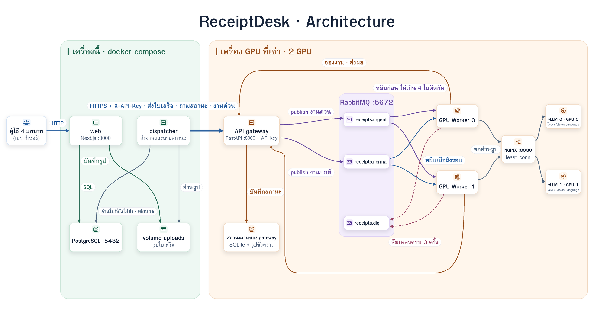

แผนภาพเดียวกันในรูปแบบ Mermaid จากเอกสารออกแบบ (กล่อง 15 กล่อง เส้น 21 เส้น เท่ากัน):

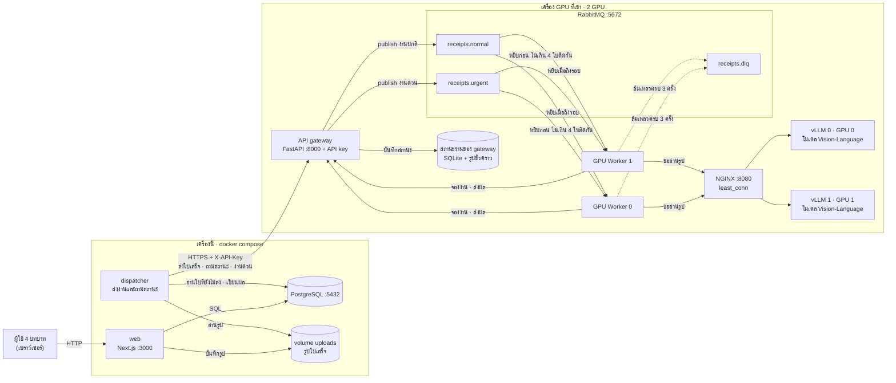

**สถานะของงาน**

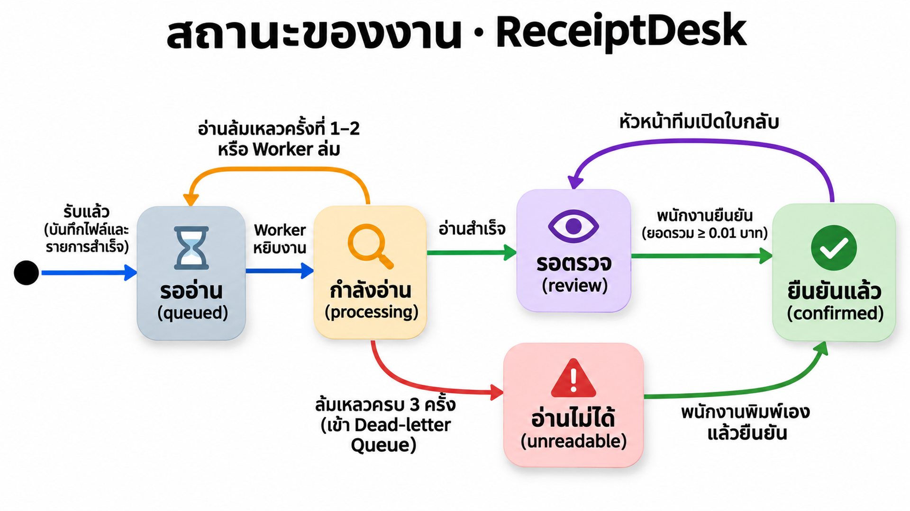

แผนภาพเดียวกันในรูปแบบ Mermaid จากเอกสารออกแบบ (5 สถานะ เส้น 8 เส้น เท่ากัน):

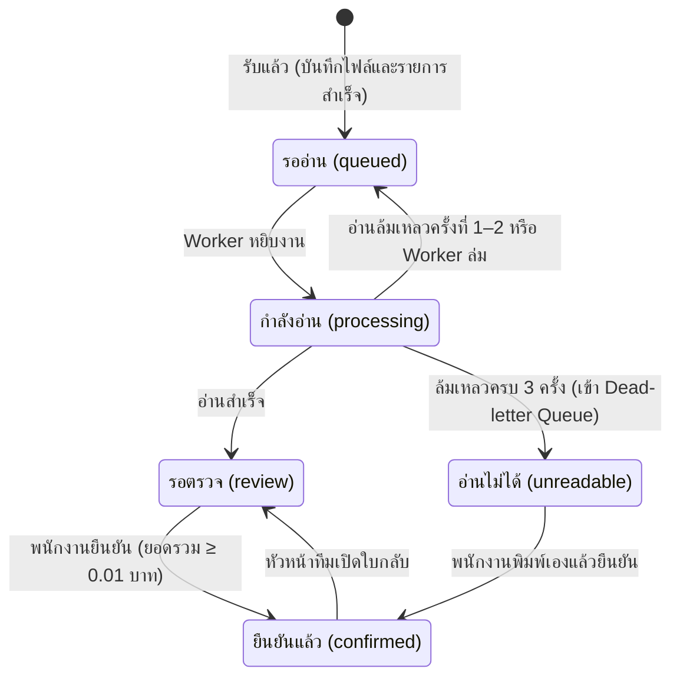

**การออกแบบคิว 3 เรื่อง**

| เรื่อง | การออกแบบ | ตอบ Requirement |
|---|---|---|
| Priority Queue | 2 คิว `receipts.urgent` และ `receipts.normal` · Worker หยิบใบด่วนก่อน แต่ไม่เกิน 4 ใบติดกัน | NFR-03 · BR-10 |
| Backpressure | 2 ด่าน: เว็บไม่รับทั้งชุดเมื่องานปกติค้างเกิน 400 ใบ พร้อมบอกนาทีที่ให้ลองใหม่ · gateway ตอบ `429` | BR-11 · BR-12 |
| Dead-letter Queue | ใบที่ล้มเหลวครบ 3 ครั้งไปที่ `receipts.dlq` แล้วไปอยู่หน้า "อ่านไม่ได้ ให้คนพิมพ์เอง" | BR-07 |
| งานไม่หายเมื่อ Worker ล่ม | Worker หยิบทีละ 1 ใบ และ ack หลังบันทึกผล · Worker ที่เหลือหยิบงานต่อเอง | NFR-06 |

**อ่านผลอย่างไร**
- AI ไม่ใช้คิวเดียวที่มีระดับความสำคัญ แต่ใช้ 2 คิว เพราะคิวเดียวบังคับกติกา "ด่วนติดกันไม่เกิน 4 ใบ" ไม่ได้ งานปกติจะถูกแซงไม่สิ้นสุด
- ฝั่งเว็บเป็นเจ้าของข้อมูลจริง ใบนับว่า "รับแล้ว" เมื่อไฟล์อยู่ในเครื่องนี้ เครื่อง GPU จึงถูกลบได้โดยใบไม่หาย
- คำถามที่การออกแบบยังตอบไม่ได้ เช่น "โมเดลอ่านได้ถึง 4 ใบต่อนาทีต่อ Worker จริงหรือไม่" ต้องวัดบนเครื่องจริง

## 4 · ระยะ B · วางแผนงานให้ทีม AI

### ขั้นที่ 4 · แตกงานเป็นบล็อก วาด DAG และ Gantt

```text
ทำงานใน container `multi-account` ด้วยสกิล dag-planner
โจทย์: สร้างระบบตาม Requirement และ System Design ในโฟลเดอร์ ./docs
1. แตกงานเป็น 12–14 บล็อก ชื่อแผน receiptdesk
2. ต้องครอบคลุม: โครงโปรเจกต์ · ฐานข้อมูลและข้อมูลตั้งต้น · กติกา Business Rule กับสิทธิ์และ API ของเว็บ · dispatcher กับตัวอ่านจำลอง · API gateway · คิว RabbitMQ (Priority Queue, Backpressure, Dead-letter Queue) · GPU Worker · โค้ด Training ด้วย LoRA บน 1 และ 2 GPU กับโค้ด Evaluation · หน้าเว็บ · โลโก้ · รวมระบบและทดสอบเบื้องต้น
3. ใช้ให้ครบ 6 สกิล: บล็อกกติกา Business Rule ใช้ review (ผู้ทำกับผู้ตรวจคนละ CLI รอบตรวจไม่เกิน 3) · บล็อกออกแบบกติกาการแซงคิวของงานด่วนใช้ debate · บล็อกหน้าจอตรวจแก้ใบเสร็จใช้ best_of · บล็อกอื่นใช้ yolo, cyolo หรือ image
4. ให้เวลาทำงานต่อบล็อกพอสำหรับงานจริง: ขนาด S 15 นาที · M 30 นาที · L 45 นาที
5. วางแผนด้วยบัญชี yolo1, yolo2, yolo3, cyolo1 เท่านั้น จำนวน agent พร้อมกันไม่เกิน 4
6. คัดลอกไฟล์บล็อก ภาพ DAG ภาพ Gantt และไฟล์แผน มาไว้ที่ ./plan
(วางแผนเท่านั้น ห้ามรันจริง ห้ามแสดงข้อมูลล็อกอินของบัญชี)
สรุปเป็นตารางภาษาไทย: บล็อก · สกิล · ขนาด · รอบล็อกใด · บัญชี · เริ่ม–จบ (นาที) แล้วบอก Critical Path และเวลารวมของแผน
```

**ผลจริง** (ประมาณ 3 นาที): 14 บล็อก · ครบ 6 สกิล · เวลารวมของแผนประมาณ 63.5 นาที

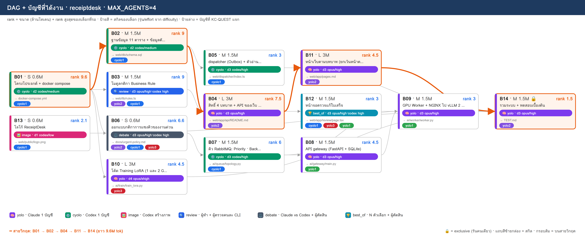

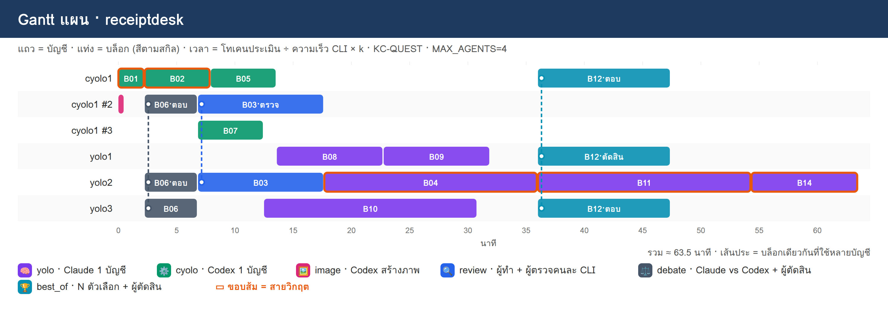

| บล็อก | สกิล | ขนาด | รอบล็อกใด | บัญชี |
|---|---|---|---|---|
| B01 โครงโปรเจกต์ + docker compose | cyolo | S | – | cyolo1 |
| B02 ฐานข้อมูล 11 ตาราง + ข้อมูลตั้งต้น | cyolo | M | B01 | cyolo1 |
| B03 โมดูลกติกา Business Rule | **review** | M | B01 | yolo2 (ทำ) · cyolo1 (ตรวจ) |
| B04 สิทธิ์ 4 บทบาท + API ของเว็บ | yolo | L | B02, B03 | yolo2 |
| B05 dispatcher + ตัวอ่านจำลอง | cyolo | M | B02 | cyolo1 |
| B06 ออกแบบกติกาการแซงคิวของงานด่วน | **debate** | S | B01 | yolo2, cyolo1 (ตอบ) · yolo3 (ตัดสิน) |
| B07 คิว RabbitMQ: Priority · Backpressure · Dead-letter | cyolo | M | B06 | cyolo1 |
| B08 API gateway | yolo | M | B07 | yolo1 |
| B09 GPU Worker + NGINX ไป vLLM 2 ตัว | yolo | M | B07, B08 | yolo1 |
| B10 โค้ด Training LoRA (1 และ 2 GPU) + Evaluation | yolo | L | B01 | yolo3 |
| B11 หน้าเว็บตามบทบาท | yolo | L | B04 | yolo2 |
| B12 หน้าจอตรวจแก้ใบเสร็จ | **best_of** | M | B04 | cyolo1, yolo3 (ตอบ) · yolo1 (ตัดสิน) |
| B13 โลโก้ ReceiptDesk | image | S | – | cyolo1 |
| B14 รวมระบบ + ทดสอบเบื้องต้น | yolo | M | B05, B09–B13 | yolo2 |

**อ่านผลอย่างไร**
- สกิลใหม่ 2 ตัวอยู่ตรงจุดที่ "ไม่มีคำตอบเดียว": กติกาการแซงคิว (B06) ให้ Claude กับ Codex เสนอคนละแบบแล้วมีผู้ตัดสิน · หน้าจอตรวจแก้ (B12) ให้ทำ 2 แบบแล้วเลือกแบบที่ดีกว่า
- B06 เป็นงานออกแบบที่ต้องเสร็จก่อนโค้ดคิว (B07): ตัดสินใจก่อน เขียนโค้ดทีหลัง
- เวลารวม 63.5 นาที สั้นกว่าแผนของหัวข้อที่ 1 (112.5 นาที) ทั้งที่บล็อกมากกว่า เพราะแผนนี้ใช้ตัวปรับเวลา k ที่วัดจากการรันจริงของหัวข้อที่ 1 และมีบัญชีเพิ่ม 1 บัญชี

### ขั้นที่ 5 · What-if ก่อนตัดสินใจรัน

```text
ทำงานใน container `multi-account` ด้วยสกิล dag-planner
ใช้ไฟล์บล็อกของแผน receiptdesk ที่มีอยู่แล้ว ห้ามแก้บล็อก
1. วางแผนเพิ่มอีก 2 แบบ: ชื่อแผน receiptdesk-2 ใช้ agent พร้อมกันไม่เกิน 2 · ชื่อแผน receiptdesk-nocodex ใช้เฉพาะบัญชี yolo1, yolo2, yolo3 (ไม่มี Codex)
2. เทียบ 3 แผน: เวลารวม · Critical Path · บัญชีที่งานหนักที่สุด · บล็อกที่วางไม่ได้หรือถูกลดคุณภาพ
3. แนะนำว่าควรรันแผนใด พร้อมเหตุผล 2–3 บรรทัด แล้วเก็บภาพ Gantt ของ 2 แผนใหม่ไว้ที่ ./plan/whatif
(วางแผนเท่านั้น ห้ามรันจริง ห้ามแสดงข้อมูลล็อกอินของบัญชี)
สรุปเป็นตารางภาษาไทย: แผน · agent พร้อมกัน · บัญชี · เวลารวม (นาที) · Critical Path · ข้อจำกัด
```

**ผลจริง** (ประมาณ 2 นาที)

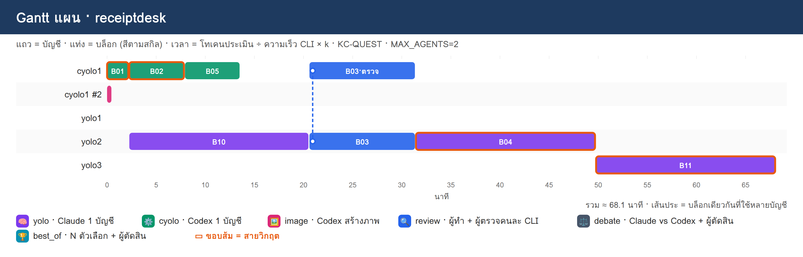

| แผน | agent พร้อมกัน | บัญชี | วางได้ | เวลารวม | ข้อจำกัด |
|---|---|---|---|---|---|
| receiptdesk | 4 | Claude 3 + Codex 1 | 14/14 | 63.5 นาที | `yolo2` งานหนักที่สุด |
| receiptdesk-2 | 2 | Claude 3 + Codex 1 | 8/14 | 68.1 นาที (ยังไม่เสร็จ) | `debate` และ `best_of` ใช้ 3 agent เกินเพดาน |
| receiptdesk-nocodex | 4 | Claude 3 | 0/14 | วางไม่ได้ | ไม่มีผู้รับงาน `cyolo`, `image` และไม่มีผู้ตรวจต่าง CLI |

**อ่านผลอย่างไร**
- What-if ใช้เวลา 2 นาทีและไม่ใช้โทเคนของทีม: รู้ข้อจำกัดของทีมก่อนเสียเงิน
- สกิล `debate` และ `best_of` ต้องการ agent พร้อมกันอย่างน้อย 3 ตัว ทีมที่ตั้งเพดานไว้ 2 จึงสร้างระบบนี้ไม่จบ
- ทีมที่ไม่มี Codex เริ่มไม่ได้ตั้งแต่บล็อกแรก: แผนนี้ผูกกับการมี CLI 2 ชนิด
- เลือกรันแผน `receiptdesk` (4 agent)

## 5 · ระยะ C · สร้างระบบ เทรนโมเดล และเปิดบริการ

### ขั้นที่ 6 · Agent Team สร้างระบบตามแผน

```text
ทำงานใน container `multi-account` ด้วยสกิล dag-planner
ใช้แผน receiptdesk ที่มีอยู่แล้ว ห้ามวางแผนใหม่ ผมอนุมัติให้รันจริง
1. ส่งเอกสารในโฟลเดอร์ ./docs ให้ทีมเปิดดูได้ แล้วรันแผนจริงด้วยบัญชี yolo1, yolo2, yolo3, cyolo1 เท่านั้น
2. รันจบแล้วออกรายงานแผนเทียบของจริง
3. คัดลอกไฟล์ที่ทีมสร้างมาไว้ที่ ./app และคัดลอกรายงาน ภาพ Gantt ของจริง กับภาพเทียบแผน มาไว้ที่ ./plan
4. บล็อกที่ล้มหรือถูกบล็อก ให้รายงานตามจริง ห้ามเขียนโค้ดแทนทีม
(ห้ามแสดงข้อมูลล็อกอินของบัญชี ไม่ต้อง commit)
สรุปเป็นตารางภาษาไทย: บล็อก · บัญชีตามแผน · บัญชีจริง · นาทีตามแผน · นาทีจริง · โทเคน · สถานะ แล้วบอกเวลารวมและโทเคนรวม
```

**ผลจริง** (ประมาณ 38 นาที · 1,758,156 โทเคน): เสร็จ 9 จาก 14 บล็อก · 1 บล็อกไม่ผ่านการตรวจ · 4 บล็อกถูกบล็อก

| บล็อก | สกิล | นาทีตามแผน | นาทีจริง | โทเคน | สถานะ |
|---|---|---|---|---|---|
| B03 โมดูลกติกา Business Rule | review | 10.8 | 20.7 | 542,741 | **ไม่ผ่านการตรวจใน 3 รอบ** |
| B06 กติกาแซงคิวของงานด่วน | debate | 4.6 | 11.5 | 320,224 | เสร็จ |
| B10 Training LoRA + Evaluation | yolo | 18.3 | 13.6 | 248,830 | เสร็จ |
| B08 · B09 gateway · GPU Worker | yolo | 9.2 · 9.2 | 9.0 · 10.4 | 373,296 | เสร็จ |
| B01 · B02 · B05 · B07 · B13 | cyolo · image | 19.8 | 17.8 | 273,065 | เสร็จ |
| B04 · B11 · B12 · B14 | yolo · best_of | 57.3 | – | 0 | ถูกบล็อกเพราะ B03 |

**อ่านผลอย่างไร**
- เหตุการณ์เดียวกับหัวข้อที่ 1: บล็อก `review` ไม่ผ่าน แล้วงานท้ายแผนหยุดทั้งสาย รวมถึงหน้าเว็บและบล็อก `best_of`
- `debate` ใช้เวลาจริง 2.5 เท่าของแผน และใช้ 320,224 โทเคนเพื่อเอกสารออกแบบ 1 ไฟล์: การตัดสินใจที่ดีมีราคา
- สถานะ "เสร็จ" ตรวจแค่ว่ามีไฟล์ผลหลักของบล็อก ไฟล์ประกอบบางไฟล์ยังไม่มี เช่น ข้อมูลตั้งต้นของฐานข้อมูล และการตั้งค่า NGINX

### ขั้นที่ 7 · รันต่อเฉพาะบล็อกที่ยังไม่เสร็จ

```text
ทำงานใน container `multi-account` ด้วยสกิล agent-team และ dag-planner
แผน receiptdesk รันไปแล้ว 1 รอบ ผมอนุมัติให้รันต่อ (ถ้าทุกบล็อกเสร็จแล้ว ให้ข้ามขั้นนี้)
1. รันต่อ run เดิมเฉพาะบล็อกที่ยังไม่เสร็จ ห้ามเริ่ม run ใหม่ ห้ามรันบล็อกที่เสร็จแล้วซ้ำ
2. บล็อกที่ไม่ผ่านการตรวจ: ให้ผู้ทำแก้ตามข้อที่ผู้ตรวจขอในรอบล่าสุดเท่านั้น ไม่เขียนใหม่ทั้งบล็อก
3. รันจบแล้วออกรายงานแผนเทียบของจริงใหม่ แล้วคัดลอกไฟล์ของทีมมาไว้ที่ ./app และรายงานกับภาพมาไว้ที่ ./plan
4. บล็อกที่ยังล้ม ให้รายงานตามจริง ห้ามเขียนโค้ดแทนทีม
(ห้ามแสดงข้อมูลล็อกอินของบัญชี ไม่ต้อง commit)
สรุปเป็นตารางภาษาไทย: บล็อก · สถานะรอบแรก · สถานะหลังรันต่อ · บัญชี · นาที · โทเคน แล้วบอกโทเคนรวมของทั้งสองรอบ
```

**ผลจริง** (ประมาณ 11 นาที · 299,928 โทเคน): B03 **ยังไม่ผ่าน** · ยังเสร็จ 9 จาก 14 บล็อก · โทเคนรวม 2,058,084

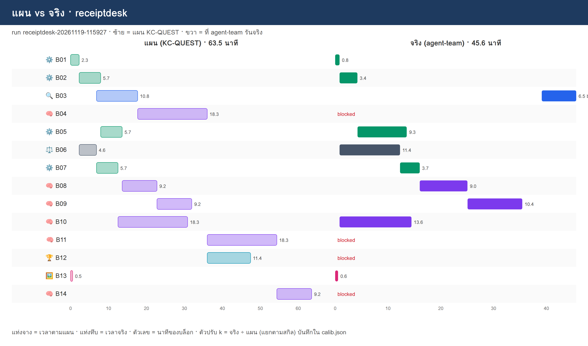

| รอบตรวจ | สิ่งที่ผู้ตรวจ (Codex) ขอเพิ่ม |
|---|---|
| 1 | PDF ที่มีคอมเมนต์คั่นระหว่าง `/Type` กับ `/Page` ยังถูกปฏิเสธ |
| 2 | คอมเมนต์ที่มีคำว่า `/Encrypt` ถูกอ่านว่าเป็นไฟล์เข้ารหัส |
| 3 | ต้องนับ `NUL (0x00)` เป็นช่องว่างตามมาตรฐาน PDF |

**อ่านผลอย่างไร**
- ผู้ทำแก้ครบทุกรอบ เทสต์เพิ่มจาก 82 เป็น 89 ข้อ และผ่านกรณีทดสอบของ Business Rule ครบ 62 ข้อ แต่ผู้ตรวจพบกรณีขอบของไฟล์ PDF ใหม่ทุกรอบ
- กรณีที่ผู้ตรวจขอไม่มีใน Requirement: ผู้ตรวจที่ไม่มีขอบเขตจะตรวจไม่จบ และ B03 ใช้ไปแล้ว 842,669 โทเคน (41% ของทั้งหมด)
- การรันต่อซ้ำอีกรอบโดยไม่เปลี่ยนอะไร น่าจะได้ผลเดิม: จุดนี้ต้องให้คนตัดสินใจ

### ขั้นที่ 8 · คนตัดสินใจเมื่อการตรวจไม่จบ

```text
ทำงานใน container `multi-account` ด้วยสกิล agent-team และ dag-planner
แผน receiptdesk รันต่อแล้ว 1 ครั้ง บล็อกกติกา Business Rule ยังไม่ผ่านการตรวจ เพราะผู้ตรวจพบกรณีขอบใหม่ที่อยู่นอก Requirement ทุกรอบ ผมตัดสินใจตามข้อ 1–2 และอนุมัติให้รันต่อ (ถ้าทุกบล็อกเสร็จแล้ว ให้ข้ามขั้นนี้)
1. กำหนดขอบเขตการตรวจของบล็อกนี้ใหม่: ผ่านเมื่อกรณีทดสอบของ Business Rule ทุกข้อในข้อมูลทดสอบของโฟลเดอร์ ./docs ผ่านครบ และไม่ขัดกับ Requirement ข้อใด
2. ข้อที่ผู้ตรวจพบนอกขอบเขตนี้ ไม่ใช้ตัดสินว่าไม่ผ่าน ให้จดไว้ที่ ./plan/FOLLOW-UPS.md พร้อมระดับความรุนแรง
3. รันต่อ run เดิมเฉพาะบล็อกที่ยังไม่เสร็จ ห้ามเริ่ม run ใหม่ ห้ามรันบล็อกที่เสร็จแล้วซ้ำ ห้ามแก้เกณฑ์ของบล็อกอื่น
4. รันจบแล้วออกรายงานแผนเทียบของจริงใหม่ แล้วคัดลอกไฟล์ของทีมมาไว้ที่ ./app และรายงานกับภาพมาไว้ที่ ./plan
5. บล็อกที่ยังล้ม ให้รายงานตามจริง ห้ามเขียนโค้ดแทนทีม
(ห้ามแสดงข้อมูลล็อกอินของบัญชี ไม่ต้อง commit)
สรุปเป็นตารางภาษาไทย: บล็อก · สถานะก่อน · สถานะหลัง · บัญชี · นาที · โทเคน แล้วบอกโทเคนรวมของทุกรอบ และจำนวนข้อที่จดเป็นงานตามหลัง
```

**ผลจริง** (ประมาณ 43 นาที · 1,211,235 โทเคน): ครบ **14 จาก 14 บล็อก** · โทเคนรวมทุกรอบ 3,269,319 · งานตามหลัง 4 ข้อ

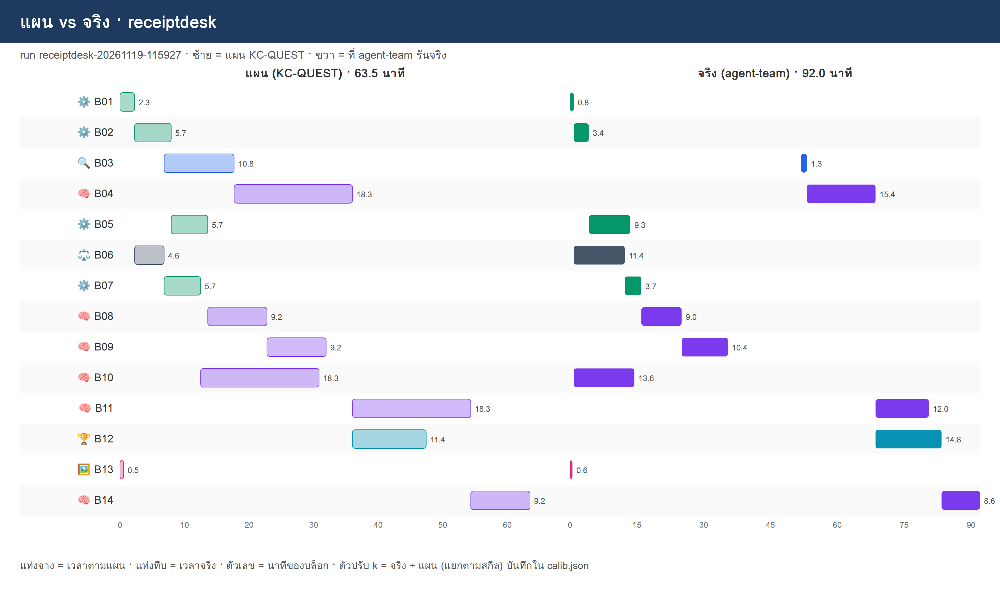

| บล็อก | สถานะก่อน | สถานะหลัง | นาที | โทเคน |
|---|---|---|---|---|
| B03 โมดูลกติกา Business Rule | ไม่ผ่านการตรวจ (6 รอบ) | เสร็จ (อนุมัติรอบที่ 1) | 1.3 | 107,481 |
| B04 สิทธิ์ + API ของเว็บ | ถูกบล็อก | เสร็จ | 15.4 | 310,623 |
| B11 หน้าเว็บตามบทบาท | ถูกบล็อก | เสร็จ | 12.0 | 254,759 |
| B12 หน้าจอตรวจแก้ (`best_of`) | ถูกบล็อก | เสร็จ | 14.8 | 406,510 |
| B14 รวมระบบ + ทดสอบเบื้องต้น | ถูกบล็อก | เสร็จ | 8.6 | 131,862 |

**อ่านผลอย่างไร**
- โค้ดของ B03 ไม่ได้แก้เพิ่มแม้แต่บรรทัดเดียว: สิ่งที่เปลี่ยนคือ "นิยามของคำว่าผ่าน" ผู้ตรวจอนุมัติในรอบแรกด้วยเทสต์ 89/89
- กรณีขอบที่ผู้ตรวจพบไม่ได้ถูกทิ้ง: จดเป็นงานตามหลัง 4 ข้อ (ระดับกลาง 1 · ต่ำ 3) ใน `plan/FOLLOW-UPS.md` ให้คนตัดสินทีหลัง
- B03 ใช้รวม 950,150 โทเคน (29% ของทั้งหมด) ส่วนใหญ่เสียไปกับ 6 รอบตรวจก่อนคนเข้ามากำหนดขอบเขต: เขียนขอบเขตการตรวจตั้งแต่ตอนวางแผนถูกกว่า
- เวลาจริง 92.0 นาที เทียบกับแผน 63.5 นาที: แผนไม่ได้นับเวลาที่บล็อกล้มแล้วต้องรันต่อ

### ขั้นที่ 9 · เช่า GPU 2 ใบ และเตรียม Dataset

```text
ทำงานใน container `multi-account` โฟลเดอร์ /workspace/vastapp_lab ด้วยสกิล vastai · ใช้ key จากไฟล์ .env ของโฟลเดอร์ปัจจุบัน
1. เช่าเครื่องที่มี RTX 3090 2 ใบในเครื่องเดียว ราคารวมไม่เกิน $0.60 ต่อชั่วโมง ติดป้าย e2e-receipt
2. ดาวน์โหลดโมเดล Qwen/Qwen3-VL-2B-Instruct และ Dataset naver-clova-ix/cord-v2 จาก Hugging Face ลงเครื่องที่เช่า แล้วนับจำนวนใบเสร็จของ Training / Validation / Test Set
3. ทำภาพตัวอย่างจาก Training Set 6 ใบ: รูปใบเสร็จคู่กับ JSON เฉลยของใบนั้น เก็บกลับมาที่ ./results/dataset_samples.jpg
4. อธิบาย label ของใบเสร็จ 1 ใบว่าแต่ละช่องหมายถึงอะไร และช่องใดคือยอดรวมที่ Requirement ใช้ตัดสิน
(ห้ามแสดงค่า key ห้ามแตะเครื่องป้ายอื่น)
สรุปเป็นตารางภาษาไทย: รุ่นและจำนวน GPU · ราคาต่อชั่วโมง · จำนวนใบเสร็จแต่ละชุด · ช่องที่ใช้ตัดสินตาม Requirement แล้วบอกว่าเครื่องยังเปิดอยู่
```

**ผลจริง** (ประมาณ 23 นาที): RTX 3090 2 ใบ ราคา $0.414 ต่อชั่วโมง

**รู้จัก Dataset** · [CORD-v2](https://huggingface.co/datasets/naver-clova-ix/cord-v2) ของ NAVER CLOVA · รูปใบเสร็จร้านค้าในอินโดนีเซียพร้อม JSON เฉลย · สัญญาอนุญาต CC BY 4.0

| ชุด | จำนวนใบเสร็จ |
|---|---|
| Training Set | 800 |
| Validation Set | 100 |
| Test Set | 100 |

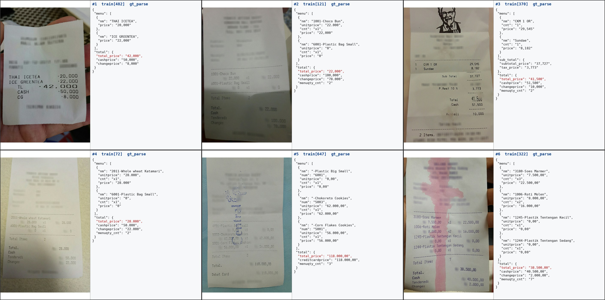

| ช่องใน label | ความหมาย |
|---|---|
| `menu[].nm` · `cnt` · `price` | ชื่อสินค้า · จำนวน · ราคาของบรรทัดนั้น |
| `sub_total.subtotal_price` · `tax_price` | ยอดก่อนภาษี · ภาษีหรือค่าบริการ |
| `total.total_price` | **ยอดรวมที่ต้องจ่าย** ช่องที่ Requirement ใช้ตัดสิน |
| `total.cashprice` · `changeprice` | เงินที่จ่าย · เงินทอน |

**รู้จักโมเดล** · Qwen3-VL-2B-Instruct ของ Alibaba · โมเดล Vision-Language ขนาด 2 พันล้านพารามิเตอร์ (4.27 GB) · Input: รูปใบเสร็จ + คำสั่งเป็นข้อความ · Output: ข้อความ JSON · หัวข้อนี้เทรนต่อด้วย LoRA ให้ตอบเป็น JSON ตามรูปแบบของ label

**อ่านผลอย่างไร**
- ตัวเลขใน label เป็นข้อความรูปแบบอินโดนีเซีย (`41,500` · `28.000` · `118.000,00`) ต้องแปลงเป็นตัวเลขก่อนเทียบยอดรวม
- label ไม่มีชื่อร้านและวันที่ (หัวใบเสร็จถูกเบลอ) แต่ Requirement ขอ 5 ช่อง: 2 ช่องนี้วัดกับ Dataset นี้ไม่ได้ ต้องบอกลูกค้า
- การเช่าต้องลอง 3 ครั้ง: เครื่องแรกเข้า SSH ไม่ได้ เครื่องที่สองค้างเกิน 5 นาที ลบทิ้งทั้งคู่ เสียค่าเช่าไปประมาณ $0.11

### ขั้นที่ 10 · เทรน 1 GPU เทียบ 2 GPU และตัดสินด้วย Acceptance Gate

```text
ทำงานใน container `multi-account` โฟลเดอร์ /workspace/vastapp_lab ด้วยสกิล vastai · เครื่องที่ใช้คือเครื่องป้าย e2e-receipt
1. นำโค้ด Training และ Evaluation ที่ทีมเขียนไว้ในโฟลเดอร์ ./app/ai/train ไปเทรน Qwen3-VL-2B ด้วย LoRA rank 16 ให้อ่านใบเสร็จออกมาเป็น JSON ใช้ Training Set 400 ใบ 1 Epoch seed 0
2. เทรน 2 รอบด้วยค่าเดิมทุกอย่าง: รอบแรก GPU 1 ใบ รอบที่สอง GPU 2 ใบ วัดเวลาต่อ Epoch แล้วคิด Speedup · Efficiency · เงินต่อ Epoch
3. ถ้าโค้ดของทีมรันไม่ได้ ให้แก้ให้น้อยที่สุด แล้วบอกว่าแก้อะไร
4. วัดผลบน Test Set 100 ใบ ก่อนเทรนกับหลังเทรน (ใช้โมเดลจากรอบ 2 GPU) ตามตัวชี้วัดของโมเดลใน Requirement แล้วตัดสินว่าผ่าน Acceptance Gate หรือไม่ และการเพิ่ม GPU คุ้มตามเกณฑ์ใน Requirement หรือไม่
5. เก็บ LoRA ที่ดีที่สุดไว้บนเครื่อง GPU และเก็บผลวัด กราฟ กับตัวอย่างคำตอบของโมเดล กลับมาที่ ./results/model
(ห้ามแสดงค่า key ห้ามแตะเครื่องป้ายอื่น งานต้องทำต่อได้แม้การเชื่อมต่อหลุด)
สรุปเป็นตาราง 2 ตารางภาษาไทย: (ก) จำนวน GPU · เวลาต่อ Epoch · Speedup · Efficiency · เงินต่อ Epoch (ข) ตัวชี้วัด · ก่อนเทรน · หลังเทรน · เกณฑ์ · ผ่านหรือไม่ แล้วบอกค่าเช่าถึงตอนนี้และว่าเครื่องยังเปิดอยู่
```

**ผลจริง** (ประมาณ 30 นาที · ค่าเช่าถึงตอนนั้นประมาณ $0.36): เพิ่ม GPU **คุ้ม** · Acceptance Gate **ไม่ผ่าน**

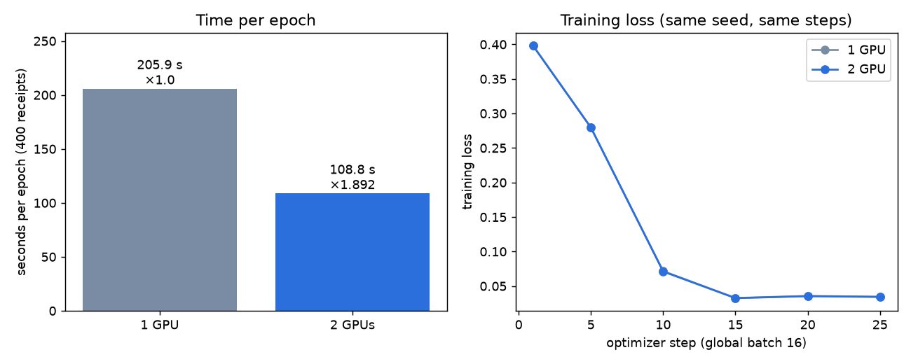

| จำนวน GPU | เวลาต่อ Epoch | Speedup | Efficiency | เงินต่อ Epoch |
|---|---|---|---|---|
| 1 × RTX 3090 | 205.9 วินาที | 1.00 เท่า | 100% | $0.0118 |
| 2 × RTX 3090 | 108.8 วินาที | **1.89 เท่า** | **94.6%** | $0.0125 |

$$\text{Speedup} = \frac{205.9}{108.8} = 1.89 \qquad \text{Efficiency} = \frac{1.89}{2} = 94.6\%$$

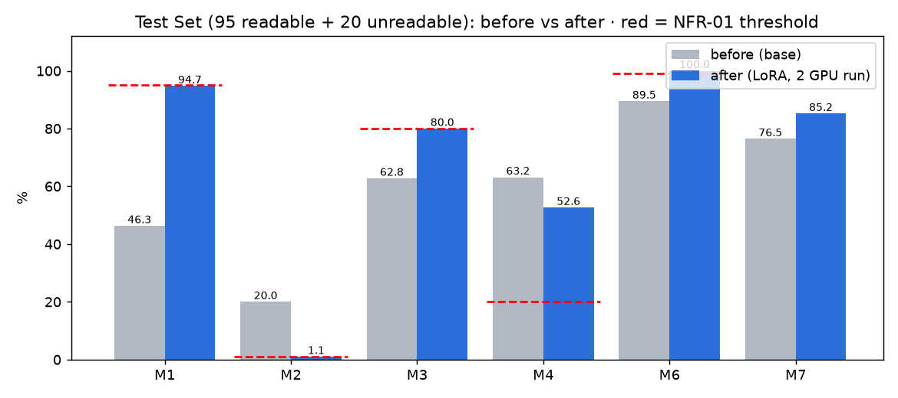

| ตัวชี้วัด | ก่อนเทรน | หลังเทรน | เกณฑ์ | ผล |
|---|---|---|---|---|
| M1 Total Accuracy | 46.32% (44/95) | 94.74% (90/95) | ≥ 95.0% | ไม่ผ่าน (ขาด 1 ใบ) |
| M2 Silent Error Rate | 20.0% | 1.05% (1/95) | ≤ 1.0% | ไม่ผ่าน |
| M3 Flag Recall | 62.75% | 80.0% (4/5) | ≥ 80.0% | ผ่าน |
| M4 Flag Rate | 63.16% | 52.63% (50/95) | ≤ 20.0% | ไม่ผ่าน |
| M5 ใบที่อ่านไม่ได้แต่โมเดลตอบยอด | 4 จาก 20 | 20 จาก 20 | 0 ใบ | ไม่ผ่าน |
| M6 JSON Validity | 89.47% | 100.0% | ≥ 99.0% | ผ่าน |
| **Acceptance Gate** | | | ต้องผ่าน M1–M6 | **ไม่ผ่าน (2 จาก 6)** |

**อ่านผลอย่างไร**
- โค้ด Training ของทีมรันผ่านทั้ง 2 รอบโดยไม่ต้องแก้ ต่างจากหัวข้อที่ 1 ที่ทีมไม่ได้เขียนสคริปต์ Training ไว้
- loss ของ 2 รอบทับกัน: เพิ่ม GPU แล้วได้โมเดลเท่าเดิม ในเวลาเกือบครึ่ง และเงินต่อ Epoch เกือบเท่าเดิม จึงคุ้มตามเกณฑ์ Speedup ≥ 1.6 เท่า
- การเทรนช่วยมาก (M1 จาก 46% เป็น 95%) แต่โมเดลยังไม่ผ่าน Gate ด้วยเหตุ 3 เรื่อง:
  - **M5:** Training Set ไม่มีตัวอย่างใบที่อ่านไม่ได้ โมเดลจึงตอบยอด 0.00 ด้วยความมั่นใจเต็มทุกใบ ไม่เคยเรียนรู้ที่จะบอกว่า "อ่านไม่ได้"
  - **M4:** ครึ่งหนึ่งของใบถูกติดธง เพราะกติกา BR-05 (ผลรวมรายการต้องเท่ากับยอดรวม) ไม่ได้คิดถึงใบที่มีภาษีหรือค่าบริการ: ปัญหาอยู่ที่ Business Rule ไม่ใช่ที่โมเดล
  - **M1, M2:** ขาดไปอย่างละ 1 ใบ จาก Test Set 95 ใบ ซึ่งน้อยกว่าที่ Requirement กำหนด (200 ใบ)
- Acceptance Gate ทำหน้าที่ของมัน: หยุดโมเดลที่ "ดูดีขึ้นมาก" แต่ยังไม่ถึงที่ลูกค้าขอ หัวข้อนี้เดินต่อเพื่อทดสอบระบบส่วนที่เหลือ และบันทึกผลนี้ไว้ในรายงานส่งมอบ

### ขั้นที่ 11 · Deployment และทดสอบทั้งเส้นทาง

```text
ทำงานใน container `multi-account` โฟลเดอร์ /workspace/vastapp_lab ด้วยสกิล vastai · เครื่องที่ใช้คือเครื่องป้าย e2e-receipt
1. บนเครื่อง GPU เปิด vLLM 2 ตัว (GPU ละ 1 ตัว ใช้โมเดลที่เทรนแล้ว) หลัง NGINX แบบ least_conn แล้วเปิด RabbitMQ, API gateway และ GPU Worker 2 ตัวจากโค้ดในโฟลเดอร์ ./app ตั้ง API key ใหม่ 1 ตัวแล้วเก็บในไฟล์ .env ของโฟลเดอร์ปัจจุบัน
2. บนเครื่องนี้เปิดเว็บและฐานข้อมูลด้วย docker compose ที่พอร์ต 3420 ให้เว็บเรียก gateway บนเครื่อง GPU
3. ทดสอบทั้งเส้นทาง: ส่งใบเสร็จจาก Test Set 5 ใบผ่านหน้าเว็บ รอจนถึงสถานะรอตรวจ แล้วตรวจว่ายอดรวมในฐานข้อมูลตรงกับที่ gateway ตอบ
4. ส่วนใดเปิดไม่ได้ ให้แก้โค้ดให้น้อยที่สุด แล้วจดสิ่งที่แก้ไว้ในโฟลเดอร์ ./results/deploy
(ห้ามแสดงค่า key ห้ามแตะเครื่องป้ายอื่น)
สรุปเป็นตารางภาษาไทย: ส่วนของระบบ · ที่อยู่ · สถานะ · ผลทดสอบ แล้วบอกเวลาอ่านเฉลี่ยต่อใบ และว่าเครื่องยังเปิดอยู่
```

**ผลจริง** (ประมาณ 54 นาที · ค่าเช่าถึงตอนนั้นประมาณ $0.74): ทุกส่วนทำงาน · ใบเสร็จ 5 ใบถึงสถานะรอตรวจใน 7.2 วินาที

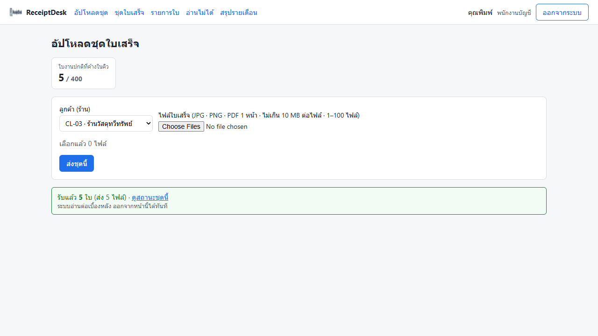

| ส่วนของระบบ | อยู่ที่ | ผลทดสอบ |
|---|---|---|
| vLLM 2 ตัว (GPU ละ 1 ตัว · โมเดลหลังเทรน) | เครื่อง GPU | อ่านตัวละ 5 คำขอ |
| NGINX `least_conn` | เครื่อง GPU | แบ่งงาน 5/5 · เรียกจากภายนอกได้ `403` |
| RabbitMQ + GPU Worker 2 ตัว | เครื่อง GPU | Worker อ่านตัวละ 5 ใบ |
| API gateway | เครื่อง GPU (พอร์ตสาธารณะ) | ไม่มี key ได้ `401` |
| เว็บ + dispatcher + PostgreSQL | เครื่องของเรา พอร์ต 3420 | ยอดรวมในฐานข้อมูลตรงกับ gateway 5/5 ใบ |

**อ่านผลอย่างไร**
- โค้ดของทีมใช้ได้บน GPU จริงเกือบทั้งหมด: แก้ 1 บรรทัด (พอร์ตเว็บเขียนตายตัว) ส่วน gateway · Worker · คิว · NGINX ไม่ต้องแก้
- โมเดลอ่านเฉลี่ย 0.88 วินาทีต่อใบ แต่ผู้ใช้รอ 7.2 วินาที: เวลาส่วนใหญ่คือรอบ poll 5 วินาทีของ dispatcher ไม่ใช่ GPU
- อ่านถูก 4 จาก 5 ใบ ใบที่ผิด (174,000 แทน 174,600) มีความมั่นใจ 0.64 จึงถูกติดธง "ไม่แน่ใจยอดรวม" ให้คนตรวจ: กติกาธงทำงานตามที่ออกแบบ
- สิ่งที่พบตอนขึ้นระบบจริงและจดไว้ใน `results/deploy/FIXES.md`:
  - ฐานข้อมูลใหม่ไม่มีบัญชีผู้ใช้ เพราะบัญชีถูกสร้างจากฟังก์ชันรีเซ็ตข้อมูลทดสอบเท่านั้น
  - gateway ยังเป็น HTTP ธรรมดา API key จึงวิ่งผ่านอินเทอร์เน็ตโดยไม่เข้ารหัส (ยังค้าง)

### ขั้นที่ 12 · Capacity Test ตาม SLO และ Failure Test

```text
ทำงานใน container `multi-account` โฟลเดอร์ /workspace/vastapp_lab ด้วยสกิล vastai · เครื่องที่ใช้คือเครื่องป้าย e2e-receipt
เขียนโค้ดยิงโหลดไว้ที่ ./loadtest แล้ววัดระบบที่เปิดอยู่ โดยยิงที่ gateway ด้วยใบเสร็จจาก Test Set
1. ความจุ: ส่งงานปกติ 100 ใบ วัดเวลาจนมีผลครบ เมื่อเปิด GPU Worker 1 ตัว แล้ววัดซ้ำเมื่อเปิด 2 ตัว เทียบกับ SLO ของงานปกติใน Requirement
2. งานด่วน: ระหว่างที่งานปกติ 100 ใบค้างอยู่ ส่งงานด่วน 10 ใบ วัดเวลาจนงานด่วนมีผลครบ เทียบกับ SLO ของงานด่วน และตรวจลำดับว่างานปกติยังได้อ่านสลับตามกติกา
3. คิวเต็ม: ส่งงานจนเกินเพดานคิวใน Requirement แล้วตรวจว่า gateway ปฏิเสธด้วยคำตอบที่ออกแบบไว้ และงานที่รับไว้ไม่หาย
4. Worker ล่ม: ส่ง 40 ใบ หยุด Worker 1 ตัวกลางงาน นับว่างานเสร็จครบ 40 ใบโดย Worker ที่เหลือ แล้วเปิด Worker กลับ
5. ใบที่อ่านไม่ได้: ส่งไฟล์เสีย 2 ไฟล์ ตรวจว่าเข้า Dead-letter Queue หลังลองครบ 3 ครั้ง และไม่ขวางงานอื่น
6. เก็บผลเป็นไฟล์ตัวเลขและกราฟ 2 รูปไว้ที่ ./results/capacity
(ห้ามแสดงค่า key ห้ามแตะเครื่องป้ายอื่น)
สรุปเป็นตารางภาษาไทย: การทดสอบ · ค่าที่วัดได้ · เกณฑ์ · ผ่านหรือไม่ แล้วบอก Speedup ของ Worker 2 ตัวเทียบ 1 ตัว และว่าเครื่องยังเปิดอยู่
```

**ผลจริง** (ประมาณ 25 นาที · ค่าเช่าถึงตอนนั้นประมาณ $0.91): ผ่านทุกการทดสอบ

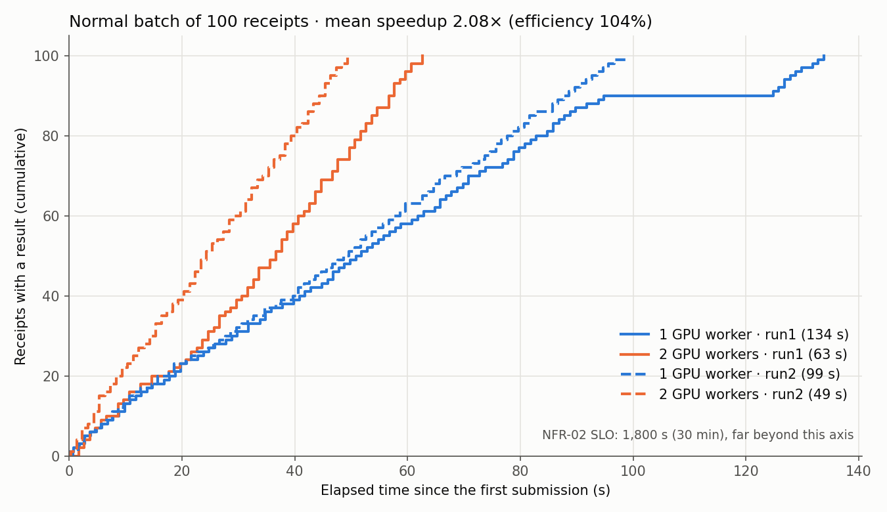

| การทดสอบ | ค่าที่วัดได้ | เกณฑ์ใน Requirement | ผล |
|---|---|---|---|
| ความจุ · Worker 1 ตัว · 100 ใบ | 133.8 และ 98.7 วินาที | ครบภายใน 30 นาที | ผ่าน |
| ความจุ · Worker 2 ตัว · 100 ใบ | 62.7 และ 49.4 วินาที | ครบภายใน 30 นาที | ผ่าน |
| Speedup ของ Worker 2 ตัว | **2.08 เท่า** (เฉลี่ย 2 รอบ) | ≥ 1.6 เท่า | ผ่าน |
| งานด่วน 10 ใบ ขณะงานปกติค้าง 66 ใบ | **5.7 วินาที** | ≤ 300 วินาที | ผ่าน |
| ลำดับการอ่าน | `UUUUNUUUUNUU` | ด่วนติดกันไม่เกิน 4 ใบ | ผ่าน |
| คิวเต็ม (ส่ง 500 ใบ) | รับ 409 · ปฏิเสธ 91 ด้วย `429` `Retry-After: 60` | เพดาน 400 ใบ · ใบที่รับแล้วไม่หาย | ผ่าน |
| Worker ล่ม (`kill -9` กลางงาน 40 ใบ) | ครบ 40/40 · หาย 0 · ซ้ำ 0 · ตรวจพบใน 14.7 วินาที | ครบทุกใบ · ตรวจพบภายใน 15 วินาที | ผ่าน |
| ไฟล์เสีย 2 ไฟล์ปนใบดี 20 ใบ | เข้า Dead-letter Queue หลังลอง 3 ครั้ง · ใบดีครบใน 8.9 วินาที | ลอง 3 ครั้ง · ไม่ขวางงานอื่น | ผ่าน |

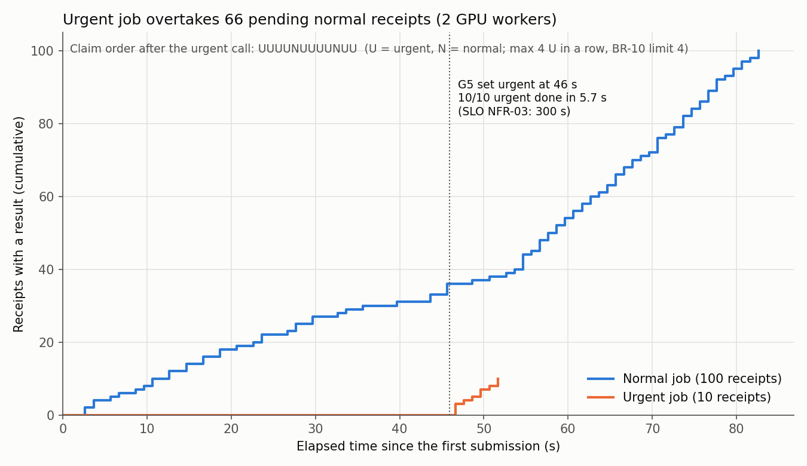

$$\text{Speedup} = \frac{116.2}{56.0} = 2.08 \qquad \text{Efficiency} = \frac{2.08}{2} = 104\%$$

**อ่านผลอย่างไร**
- Speedup ได้ 2 เท่าเต็ม เพราะ Worker แต่ละตัวอ่านทีละใบ และ vLLM 2 ตัวอยู่คนละ GPU จึงไม่แย่งทรัพยากรกัน ค่าที่เกิน 100% มาจากรอบ 1 ของ Worker 1 ตัวที่นิ่งไป 30 วินาที (เส้นราบในกราฟ) รอบ 2 ได้ 2.00 เท่าพอดี
- ระบบเร็วกว่า SLO มาก (100 ใบใน 1 นาที เทียบกับ 30 นาที): คอขวดของงานนี้ไม่ใช่ GPU แต่เป็นคนที่ต้องตรวจใบที่ติดธง (M4 ของขั้นที่ 10)
- Priority Queue · Backpressure · Dead-letter Queue · การคืนงานเมื่อ Worker ล่ม ทำงานตรงกับ Design ทุกข้อ ไม่มีใบหาย
- ข้อจำกัดของการวัด:
  - ใช้ชุด 100 ใบ ไม่ใช่ 200 ใบตามที่ Requirement เขียน
  - ยิงโหลดจากบนเครื่อง GPU เอง จึงไม่รวมเวลาอัปโหลดผ่านอินเทอร์เน็ต
  - รูป 4 ใบใน Test Set ใหญ่เกิน 10 MB ถูกปฏิเสธด้วย `413` ตามที่ออกแบบ จึงบีบรูปใหม่ก่อนวัด
- การรับ 100 ไฟล์ปกติใช้ 0.7 วินาที แต่มี 2 รอบที่ใช้ 22 วินาที ยังผ่านเกณฑ์ 60 วินาที แต่ควรตามดู

---

## 6 · ระยะ D · พิสูจน์ว่าระบบทำตาม Requirement

ระยะ C จบที่ "ระบบเปิดได้และรับโหลดได้" ระยะนี้ตอบว่า "ระบบทำถูกตามที่ลูกค้าขอหรือไม่" โดยผู้ทดสอบดูได้แค่ Requirement กับหน้าเว็บ ไม่เปิดโค้ด

### ขั้นที่ 13 · Test Charter และ Exploration พร้อมกัน

```text
เว็บ ReceiptDesk เปิดอยู่ที่ http://localhost:3420 ใช้ playwright-cli สำรวจ (ห้ามเปิดโค้ดใน ./app และห้ามเปิดไฟล์ BUGS-SECRET)
1. ดู Requirement ในโฟลเดอร์ ./docs และเดินดูเว็บ 1 รอบ แล้วเขียน Test Charter 6 ข้อไว้ที่ ./test/CHARTERS.md รูปแบบ "สำรวจ… ด้วย… เพื่อหา…" ทุก Business Rule ต้องมี Charter รับผิดชอบ
2. รีเซ็ตข้อมูลทดสอบ 1 ครั้ง แล้วสั่ง subagent 6 ตัวในข้อความเดียว (ไม่ใช้โหมดเบื้องหลัง) ตัวละ 1 Charter ตัวละ 1 session ของ playwright-cli และบัญชีทดสอบของตัวเอง เวลาไม่เกิน 10 นาทีต่อตัว ใบเสร็จจริงที่ส่งเข้า GPU ไม่เกิน 10 ใบต่อตัว
3. แต่ละตัวจดบันทึกไว้ในโฟลเดอร์ ./test/exploration: เขียนผลที่คาดหวังจาก Requirement ก่อนลอง แล้วบันทึกผลจริง ✅ ⚠️ ❌ พร้อมภาพหน้าจอ
4. รวมผลไว้ที่ ./test/EXPLORATION.md: ฟีเจอร์ที่พบ · กฎที่ยืนยันแล้ว · จุดที่เว็บไม่ตรง Requirement · ตารางความเสี่ยง P1 / P2 / P3
สรุปเป็นตารางภาษาไทย: Charter · เวลาที่ใช้ · จำนวนกฎที่ลอง · ✅ · ⚠️ · ❌
```

**ผลจริง** (ประมาณ 11 นาที): ลอง 72 รายการ · ✅ 64 · ⚠️ 8 · ❌ 0 · พบความเสี่ยงระดับ P1 2 ข้อ

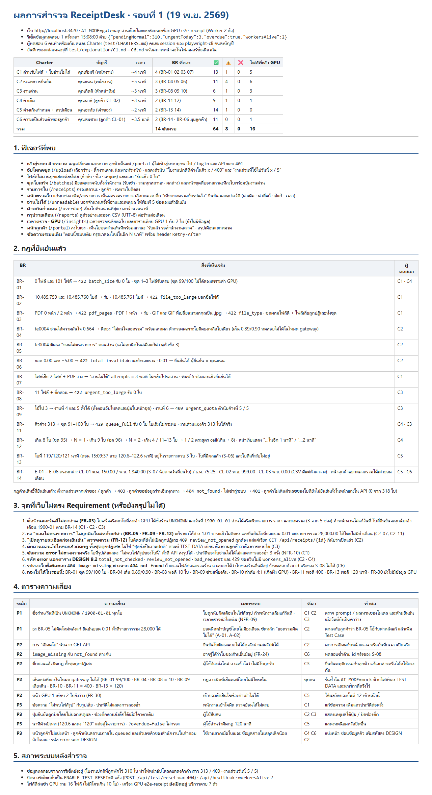

| Charter | Business Rule ที่รับผิดชอบ | ✅ | ⚠️ | ❌ |
|---|---|---|---|---|
| C1 ด่านรับไฟล์และใบที่อ่านไม่ได้ | BR-01, 02, 03, 07 | 13 | 1 | 0 |
| C2 ธงและการยืนยัน | BR-04, 05, 06 | 11 | 4 | 0 |
| C3 งานด่วน | BR-08, 09, 10 | 6 | 1 | 0 |
| C4 คิวเต็ม | BR-11, 12 | 9 | 1 | 0 |
| C5 งานค้างเกินกำหนดและสรุปรายเดือน | BR-13, 14 | 14 | 1 | 0 |
| C6 ความเป็นส่วนตัวของลูกค้า | BR-14, BR-06 | 11 | 0 | 0 |

**อ่านผลอย่างไร**
- ผู้ทดสอบ 6 ตัวทำงานพร้อมกัน เวลาจริงจึงเท่ากับตัวที่ช้าที่สุด (ประมาณ 5 นาที) ไม่ใช่ผลรวม 20 นาที
- ก่อนสำรวจ ระบบถูกรีเซ็ตให้มีงานค้าง 310 ใบและใช้โควตางานด่วนไปแล้ว 3 งาน: ลองกฎคิวเต็มและโควตาได้โดยไม่ต้องส่งใบเสร็จเข้า GPU เป็นร้อยใบ (ทั้งขั้นส่งเข้า GPU 16 ใบ)
- ไม่มี ❌ ไม่ได้แปลว่าไม่มีปัญหา: ⚠️ 2 ข้อเป็นความเสี่ยงระดับ P1 ที่ต้องยืนยันด้วย Test Case ในขั้นถัดไป
  - โมเดลตอบชื่อร้านเป็น `UNKNOWN` และวันที่เป็น `1900-01-01` ทุกใบ (Dataset ไม่มี 2 ช่องนี้ ตามที่เห็นในขั้นที่ 9)
  - ธง "ยอดไม่ตรงรายการ" ไม่ถูกคิดใหม่หลังพนักงานแก้ค่า จึงยืนยันยอด 0.01 บาททั้งที่รายการรวม 28,000 บาทได้
- กฎที่เป็นเส้นแบ่งพอดี (เช่น ความมั่นใจ 0.89 / 0.90) ลองกับโมเดลจริงไม่ได้ เพราะกำหนดคำตอบของโมเดลไม่ได้: ต้องใช้ตัวอ่านจำลองในขั้นที่ 15

### ขั้นที่ 14 · Test Plan และการตรวจไขว้

```text
จาก Requirement ข้อมูลทดสอบ และผล Exploration ในโฟลเดอร์ ./docs กับ ./test เขียน Test Plan ไว้ที่ ./test/TEST-PLAN.md
1. โครง 8 หัวข้อ: ภาพรวม · ขอบเขต · เทคนิค · ระดับ · Test Case · Entry/Exit Criteria · ข้อมูลทดสอบ · คุณภาพของแผน
2. Test Case 45–60 ข้อ แบ่งเป็นกลุ่ม 5.1–5.8 รหัส TC-<กลุ่ม>-<เลข> ทุกข้อมีขั้นตอน ผลที่คาดหวังที่คำนวณให้ดู ที่มา (FR/BR) และระดับ P1–P3
3. ผลที่คาดหวังต้องมาจาก Requirement ไม่ใช่จากที่เห็นบนเว็บ
4. ต้องมีกลุ่ม: การรับชุดใบเสร็จ · ผลอ่านและธงไม่แน่ใจ · การตรวจแก้และยืนยัน · งานด่วน · สถานะงานในคิวและใบที่อ่านไม่ได้ · รายงานรายเดือน · สิทธิ์ของแต่ละบทบาท · ลูกค้าภายนอก
5. Test Case ที่ต้องกำหนดผลอ่านให้แน่นอน (เช่น ความมั่นใจ 0.89 / 0.90 / 0.91) ให้ระบุว่าต้องรันกับตัวอ่านจำลอง และแยกจากข้อที่รันกับโมเดลจริง
6. ให้บัญชี cyolo1 ใน container `multi-account` ตรวจแผนผ่านสกิล agent-team (ผู้ตรวจต้องไม่ใช่ผู้เขียน): ตรวจได้จริงไหม ตัวเลขถูกไหม กำกวมไหม ซ้ำไหม
7. บันทึกผลตรวจไว้ที่ ./test/PLAN-REVIEW.md แล้วแก้แผนตามข้อที่รุนแรงสูง
สรุปเป็นตารางภาษาไทย: กลุ่ม · จำนวน TC · P1 · ข้อที่ผู้ตรวจพบ · ข้อที่แก้แล้ว
```

**ผลจริง** (ประมาณ 28 นาที): Test Case 59 ข้อ · ผู้ตรวจพบ 49 ข้อ · ข้อรุนแรงสูงแก้ครบ 30 จาก 30

| กลุ่ม | จำนวน TC | P1 | ข้อที่ผู้ตรวจพบ | ข้อที่แก้แล้ว |
|---|---|---|---|---|
| ทั้งแผน (หัวข้อ 1–4, 6–8) | — | — | 11 | 10 |
| 5.1 การรับชุดใบเสร็จ | 9 | 4 | 0 | — |
| 5.2 ผลอ่านและธงไม่แน่ใจ | 8 | 5 | 7 | 7 |
| 5.3 การตรวจแก้และยืนยัน | 8 | 5 | 4 | 4 |
| 5.4 งานด่วน | 8 | 4 | 7 | 7 |
| 5.5 สถานะงานในคิวและใบที่อ่านไม่ได้ | 10 | 7 | 7 | 7 |
| 5.6 รายงานรายเดือน | 7 | 2 | 4 | 4 |
| 5.7 สิทธิ์ของแต่ละบทบาท | 4 | 3 | 5 | 5 |
| 5.8 ลูกค้าภายนอก | 5 | 4 | 4 | 4 |
| **รวม** | **59** | **34** | **49** | **48** |

Test Case แบ่งตามสิ่งที่ใช้รัน:

| ประเภท | จำนวน | รันกับอะไร | ตัวอย่าง |
|---|---|---|---|
| M | 21 | ตัวอ่านจำลอง (พอร์ต 3421) | ความมั่นใจ 0.89 / 0.90 / 0.91 · ผลต่าง 0.99 / 1.00 / 1.01 บาท |
| A | 32 | ไม่ขึ้นกับผลอ่าน จึงรันกับตัวอ่านจำลองเพื่อไม่ใช้ GPU | ชุด 99 / 100 / 101 ไฟล์ · สิทธิ์ของแต่ละบทบาท |
| R | 6 | โมเดลจริง (พอร์ต 3420) | อ่านครบ 5 ช่องจากใบเสร็จจริง 12 ใบ |

**อ่านผลอย่างไร**
- ผลที่คาดหวังเขียนจาก Requirement เสมอ: จุดที่ Exploration เห็นว่าเว็บทำต่างออกไป แผนไม่ได้แก้เฉลยให้ตรงกับเว็บ
- ผลที่คาดหวังแสดงวิธีคิด เช่น |98.99 − 100.00| = 1.01 > 1.00 จึงต้องติดธง ผู้ตรวจจึงคำนวณซ้ำได้ และตัวเลขตรงกันทุกข้อ
- ข้อที่ผู้ตรวจพบส่วนใหญ่คือ "ตรวจได้จริงหรือไม่" (24 ข้อ) และ "กำกวม" (15 ข้อ) ไม่ใช่ตัวเลขผิด: ผู้เขียนแผนมองไม่เห็นจุดนี้เอง
- เรื่องที่ Requirement ยังไม่ชัดถูกแยกเป็นคำถามถึงลูกค้า 6 ข้อ ไม่ได้เดาเฉลยเอง
- แผนบอกสิ่งที่ตัวเองไม่ครอบคลุมไว้ชัด เช่น NFR-04 ยังไม่มี Test Case

### ขั้นที่ 15 · Playwright Test แยก shard และ Test Report

```text
เขียนและรัน Playwright Test ตาม Test Plan ในโฟลเดอร์ ./test กับเว็บ ReceiptDesk
1. สร้าง ./test/e2e ไฟล์ทดสอบ 1 ไฟล์ต่อกลุ่ม 5.x โดยสั่ง subagent ทุกตัวในข้อความเดียว (ไม่ใช้โหมดเบื้องหลัง) ตัวละ 1 กลุ่ม ระหว่างเขียนห้ามรันทั้งชุด
2. Test Case ที่ต้องใช้ตัวอ่านจำลอง: เปิดเว็บชุดที่สองด้วยตัวอ่านจำลองที่พอร์ต 3421 แล้วรันข้อเหล่านั้นกับชุดนี้ ข้อที่เหลือรันกับเว็บที่ http://localhost:3420 ซึ่งใช้โมเดลจริง
3. รันทั้งชุดบน Chromium แบ่งเป็น 4 shard เก็บภาพหน้าจอและ trace ของข้อที่ล้ม
4. คัดแยกข้อที่ล้มเป็น: เว็บผิด · แผนผิด · เทสต์ผิด แก้เฉพาะ "เทสต์ผิด" แล้วรันซ้ำ ห้ามแก้ผลที่คาดหวังให้ตรงกับเว็บ
5. เขียน Test Report 6 ส่วนไว้ที่ ./test/TEST-REPORT.md และหน้า ./test/index.html ที่เปิดดูหลักฐานของแต่ละ Test Case ได้
6. ตัดสินตาม Exit Criteria ว่าส่งมอบได้หรือไม่
สรุปเป็นตารางภาษาไทย: กลุ่ม · ผ่าน · ล้ม · บล็อก · สาเหตุของข้อที่ล้ม แล้วบอกอัตราผ่านรวม อัตราผ่านของ P1 และผลตัดสิน
```

**ผลจริง** (ประมาณ 110 นาที): ผ่าน 46 · ล้ม 11 · บล็อก 2 · ผลตัดสิน **ยังส่งมอบไม่ได้**

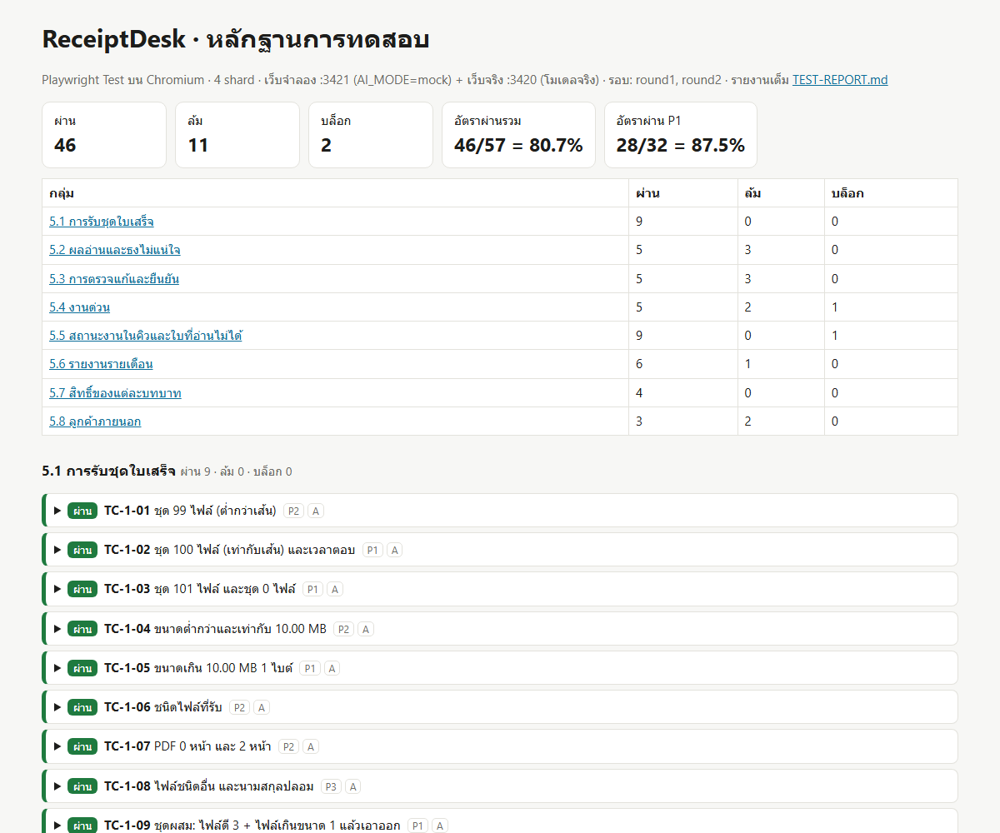

| กลุ่ม | ผ่าน | ล้ม | บล็อก | สาเหตุของข้อที่ล้ม |
|---|---|---|---|---|
| 5.1 การรับชุดใบเสร็จ | 9 | 0 | 0 | — |
| 5.2 ผลอ่านและธงไม่แน่ใจ | 5 | 3 | 0 | เว็บผิด 3 |
| 5.3 การตรวจแก้และยืนยัน | 5 | 3 | 0 | เว็บผิด 2 · แผนผิด 1 |
| 5.4 งานด่วน | 5 | 2 | 1 | เว็บผิด 2 |
| 5.5 สถานะงานในคิวและใบที่อ่านไม่ได้ | 9 | 0 | 1 | — |
| 5.6 รายงานรายเดือน | 6 | 1 | 0 | เว็บผิด 1 |
| 5.7 สิทธิ์ของแต่ละบทบาท | 4 | 0 | 0 | — |
| 5.8 ลูกค้าภายนอก | 3 | 2 | 0 | เว็บผิด 1 · แผนผิด 1 |
| **รวม** | **46** | **11** | **2** | เว็บผิด 9 · แผนผิด 2 |

$$\text{อัตราผ่านรวม} = \frac{46}{57} = 80.7\% \qquad \text{อัตราผ่านของ P1} = \frac{28}{32} = 87.5\%$$

**อ่านผลอย่างไร**
- ข้อบกพร่องที่หนักที่สุดเป็นเรื่องเงิน: ธง "ยอดไม่ตรงรายการ" ไม่ถูกคิดใหม่หลังแก้ค่า (TC-3-07) พนักงานจึงยืนยันยอดผิดได้โดยไม่มีอะไรเตือน Exploration เห็นไว้ก่อนแล้ว Test Case ยืนยันว่าเกิดซ้ำได้
- โมเดลจริงอ่านยอดรวมถูก 11 จาก 12 ใบ และใบที่ผิดถูกติดธงทุกใบ แต่ชื่อร้านกับวันที่อ่านไม่ได้เลย (TC-2-07)
- ข้อที่ล้มถูกคัดแยก 3 แบบก่อนแก้: "เทสต์ผิด" 3 ข้อแก้แล้วรันซ้ำจนผ่าน "แผนผิด" 2 ข้อจดไว้ให้แก้แผน "เว็บผิด" 9 ข้อไม่แตะ ผลที่คาดหวังไม่ถูกแก้ให้ตรงกับเว็บแม้แต่ข้อเดียว
- ตัวอ่านจำลองทำให้ 53 จาก 59 ข้อรันได้โดยไม่ใช้ GPU และไม่มีข้อใดถูกบล็อกเพราะกำหนดคำตอบของโมเดลไม่ได้ (หัวข้อที่ 1 ถูกบล็อก 10 ข้อด้วยเหตุนี้)
- การรันพร้อมกันมีราคา: shard 2 ชุดเคยรันซ้อนกัน ใบเสร็จจริงจึงถูกส่งซ้ำ 22 ใบ รวมทั้งขั้นส่งเข้า GPU 88 ใบ มากกว่าที่แผนตั้งไว้ 40 ใบ

### ขั้นที่ 16 · Bug Hunt และรายงานส่งมอบ

```text
เปิดเว็บทั้ง 2 ชุดใหม่ด้วย BUG_MODE=1 แล้วรัน Playwright Test ชุดเดิมอีก 1 รอบ (ห้ามเปิดไฟล์ BUGS-SECRET จนกว่าจะเขียนรายงานบั๊กเสร็จ)
1. เทียบกับรอบปกติ: ข้อที่ล้มเพิ่มคือข้อใด แล้วสรุปเป็นบั๊กทีละตัวไว้ที่ ./test/BUG-HUNT.md พร้อมขั้นตอนทำซ้ำ ผลที่คาดหวัง ผลจริง และหลักฐาน
2. เขียนรายงานบั๊กเสร็จแล้วจึงเปิดไฟล์ BUGS-SECRET เทียบว่าจับได้กี่ตัวจาก 3 ตัว
3. เขียนรายงานส่งมอบสำหรับลูกค้าไว้ที่ ./DELIVERY.md: ตาราง User Story → Requirement → Test Case → ผล · ผล Acceptance Gate ของโมเดล · ผล Capacity Test เทียบ SLO · สิ่งที่ยังไม่ผ่านหรือยังไม่ได้ทำ
4. ปิด BUG_MODE แล้วเปิดเว็บกลับเป็นโหมดปกติ
สรุปเป็นตารางภาษาไทย: บั๊ก · Test Case ที่จับได้ · ความรุนแรง แล้วบอกจำนวน User Story ระดับ Must ที่มีหลักฐานว่าผ่าน
```

**ผลจริง** (ประมาณ 20 นาที): จับได้ **3 จาก 3 บั๊ก** · User Story ระดับ Must ที่มีหลักฐานว่าผ่าน 6 จาก 16 เรื่อง

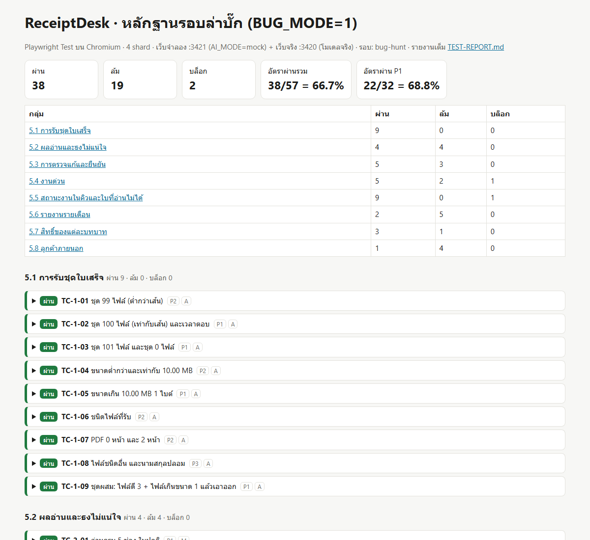

| บั๊กที่ซ่อนไว้ | Test Case ที่จับได้ | ความรุนแรง |
|---|---|---|
| ธง "ยอดไม่ตรงรายการ" ไม่ติดเมื่อผลต่าง 1.01–1.49 บาท (BR-05) | TC-2-05, 2-06 | วิกฤต |
| สรุปรายเดือนไม่นับใบที่ลงวันที่ 1 ของเดือน (BR-14) | TC-6-01, 6-02, 6-04, 6-05, 7-04, 8-02, 8-04 | วิกฤต |
| ใช้โควตางานด่วนครบ 5 งานแล้วยังตั้งงานที่ 6 ได้ (BR-09) | TC-4-04 | สูง |

| รอบ | ผ่าน | ล้ม | บล็อก |
|---|---|---|---|
| ปกติ | 46 | 11 | 2 |
| `BUG_MODE=1` | 38 | 19 | 2 |

**อ่านผลอย่างไร**
- บั๊กทั้ง 3 ตัวอยู่ที่เส้นแบ่งของ Business Rule (1.00 บาท · วันที่ 1 · งานที่ 5) Test Case ที่ลองค่า "ต่ำกว่า · เท่ากับ · เกิน" จึงจับได้ครบ
- หัวข้อที่ 1 พลาด 1 ตัวเพราะ Test Case ที่ควรจับถูกบล็อก หัวข้อนี้มีตัวอ่านจำลองจึงไม่พลาด
- บั๊ก 1 ตัวทำให้ล้มได้หลายข้อ: บั๊กสรุปรายเดือนทำให้ล้ม 7 ข้อใน 3 กลุ่ม เพราะยอดเดียวกันแสดงใน CSV หน้าตัวอย่าง และหน้าลูกค้า
- ข้อมูลทดสอบไม่มีใบที่ผลต่าง 1.50–4.99 บาท จึงบอกได้แค่ว่าเส้นตัดเลื่อนไปอยู่ในช่วงนี้ ชี้ค่า 2.00 บาทพอดีไม่ได้
- รายงานส่งมอบ (`DELIVERY.md`) บอกลูกค้าตรง ๆ ว่า **ยังไม่พร้อมใช้งานจริง**: Acceptance Gate ของโมเดลไม่ผ่าน · ข้อบกพร่อง 9 ข้อยังเปิดอยู่ · Capacity Test ผ่านทุกข้อ

### ขั้นที่ 17 · ลบเครื่องและสรุปค่าใช้จ่าย (ห้ามข้าม)

```text
ทำงานใน container `multi-account` โฟลเดอร์ /workspace/vastapp_lab ด้วยสกิล vastai
1. คัดลอก LoRA และผลวัดที่ยังอยู่บนเครื่องป้าย e2e-receipt กลับมาที่ ./results/model
2. ลบเครื่องป้าย e2e-receipt แล้วตรวจซ้ำว่าไม่มีเครื่องป้ายนี้เหลืออยู่
3. หยุดเว็บและฐานข้อมูลบนเครื่องนี้ทั้ง 2 ชุด
(ห้ามแตะเครื่องป้ายอื่น ห้ามแสดงค่า key)
สรุปค่าใช้จ่ายเป็นตารางภาษาไทย: เวลาที่เปิดเครื่อง · ค่าเช่ารวม · โทเคนรวมของทีมจากขั้นที่ 6 ถึง 8 แล้วยืนยันว่าเครื่องถูกลบแล้ว
```

**ผลจริง** (ประมาณ 3 นาที)

| รายการ | ค่า |
|---|---|
| เวลาที่เปิดเครื่อง | 4 ชั่วโมง 48 นาที |
| ค่าเช่าเครื่อง 2 GPU | $1.99 (4.807 ชั่วโมง × $0.4142) |
| ค่าเช่าของการเช่าที่ไม่สำเร็จ 2 ครั้งในขั้นที่ 9 | $0.10 |
| **ค่าเช่ารวม** | **ประมาณ $2.10** |
| โทเคนรวมของทีม ขั้นที่ 6 ถึง 8 | 3,269,319 |
| เครื่องป้าย `e2e-receipt` | ลบแล้ว · เหลือ 0 เครื่อง |

**อ่านผลอย่างไร**
- เครื่องเปิด 4 ชั่วโมง 48 นาที แต่ใช้เทรนจริงประมาณ 5 นาที และ Capacity Test 25 นาที เวลาที่เหลือเครื่องเปิดรอ Verification
- Test Case 53 จาก 59 ข้อรันกับตัวอ่านจำลอง ไม่ต้องใช้ GPU: ถ้ารันกลุ่มนี้ก่อนเช่าเครื่อง แล้วเช่าเฉพาะตอนเทรน วัดความจุ และรันข้อที่ใช้โมเดลจริง ค่าเช่าจะลดลงมากกว่าครึ่ง
- LoRA ของรอบ 2 GPU (67 MB) ถูกคัดลอกกลับมาก่อนลบเครื่อง: ลบเครื่องแล้วทุกอย่างบนเครื่องหายหมด
- เปิดหน้า [Instances](https://cloud.vast.ai/instances/) ดูด้วยตาอีกครั้งว่าว่าง

## 7 · ปิดท้าย · ปรับสกิลเป็นเวอร์ชัน 1

หัวข้อที่ 1 จบด้วยสกิล `agent-team-delivery` เวอร์ชัน 0 หัวข้อนี้เจอสิ่งที่เวอร์ชัน 0 ยังไม่รู้จัก 5 เรื่อง ขั้นนี้เก็บทั้งหมดเข้าเวอร์ชัน 1

### ขั้นที่ 18 · สร้างสกิลเวอร์ชัน 1 จากงานของหัวข้อนี้

```text
สร้างสกิลชื่อ agent-team-delivery เวอร์ชัน 1 จากงานทั้ง 17 ขั้นที่เพิ่งทำในโฟลเดอร์ปัจจุบัน
1. ดู PROMPTS.md เอกสารใน ./docs แผนใน ./plan และผลใน ./results กับ ./test เป็นวัตถุดิบ แล้วเขียน SKILL.md ไว้ที่ ./skill_v1
2. สกิลรับบันทึกการสัมภาษณ์ 1 ไฟล์ แล้วทำ 4 ระยะ: Requirement → Planning → Build · Train · Deploy → Verification โดยเรียกสกิล dag-planner, agent-team และ vastai
3. สิ่งที่เวอร์ชัน 1 ต้องมีเพิ่มจากงานรอบนี้: What-if ก่อนรันทีม · การรันต่อเมื่อมีบล็อกไม่เสร็จ · เทรนเทียบจำนวน GPU · Capacity Test ตาม SLO · การแยก Test Case ที่ต้องใช้ตัวอ่านจำลองออกจากข้อที่ใช้โมเดลจริง
4. ค่าที่ปรับได้พร้อมค่าเริ่มต้น: บัญชีที่ใช้ · จำนวน agent พร้อมกัน · รุ่นและจำนวน GPU กับเพดานราคา · ป้ายเครื่อง · จำนวน Epoch · พอร์ตของเว็บ · ทำถึงระยะใด · โฟลเดอร์ผล
5. ต้องมีเกณฑ์ตรวจผ่านของแต่ละระยะ จุดที่ต้องถามคนก่อนทำต่อ (ก่อนรันทีมจริง และก่อนเช่าเครื่อง) และกติกาเรื่องเงิน
6. ติดตั้งสกิลไว้ที่ .claude/skills/agent-team-delivery ของโฟลเดอร์ปัจจุบัน
(ไม่ต้อง commit)
สรุปเป็นตารางภาษาไทย: ระยะ · สิ่งที่สกิลทำ · เกณฑ์ตรวจผ่าน · จุดที่ถามคน
```

**ผลจริง** (ประมาณ 6 นาที): สกิล 22 ไฟล์ · `SKILL.md` 136 บรรทัด · บันทึกกับดัก 26 ข้อ · สคริปต์ที่ใช้ได้แล้ว 19 ไฟล์

| สิ่งที่เพิ่มในเวอร์ชัน 1 | มาจากขั้นใด | สกิลทำอะไร |
|---|---|---|
| What-if ก่อนรันทีม | 5 | วางแผนเพิ่ม 2 แบบจาก `blocks.json` เดิม แล้วเทียบเวลา · Critical Path · บล็อกที่วางไม่ได้ |
| รันต่อเมื่อมีบล็อกไม่เสร็จ | 7, 8 | รันเฉพาะบล็อกที่ไม่เสร็จ ถ้าผู้ตรวจพบกรณีขอบใหม่ทุกรอบ ให้คนตัดสินขอบเขตการตรวจ |
| เทรนเทียบจำนวน GPU | 10 | เทรน 1 GPU และ N GPU ด้วยค่าเดิม คิด Speedup · Efficiency · เงินต่อ Epoch |
| Capacity Test ตาม SLO | 12 | ความจุ · งานด่วน · คิวเต็ม · Worker ล่ม · Dead-letter Queue |
| แยก Test Case ตามสิ่งที่ใช้รัน | 14, 15 | ทุก Test Case ติดป้าย M (ตัวอ่านจำลอง) · A (ไม่ขึ้นกับผลอ่าน) · R (โมเดลจริง) |

| ระยะ | เกณฑ์ตรวจผ่าน | จุดที่ถามคน |
|---|---|---|
| A · Requirement | ทุก User Story อ้างคำพูดลูกค้า · ทุก BR มีค่าขอบ 3 จุด · เกณฑ์ของโมเดลและ SLO เป็นตัวเลขที่วัดได้ | รายงานจุดที่ลูกค้าขัดกันและตัวเลขที่ทีมตั้งเอง |
| B · Planning | แผนที่แนะนำวางได้ครบทุกบล็อก · มีตารางเทียบ What-if 3 แผน | **ก่อนรันทีมจริง** |
| C · Build · Train · Deploy | ทุกบล็อกเสร็จ · มีตาราง Speedup · Gate ตัดสินตามเกณฑ์จริง · ทุกการทดสอบความจุมีค่าเทียบเกณฑ์ · ใบหาย 0 | ก่อนรันต่อ · ก่อนเปลี่ยนขอบเขตการตรวจ · **ก่อนเช่าเครื่อง** · ก่อนใช้เงินเกิน 80% ของงบ |
| D · Verification | ทุก FR มี Test Case · ทุก Test Case รันกับเว็บชุดที่ถูกต้อง · ตัดสินตาม Exit Criteria · เครื่องเหลือ 0 เครื่อง | ก่อนส่งภาพจริงเกินงบ |

**อ่านผลอย่างไร**
- เวอร์ชัน 1 ไม่ได้เขียนใหม่: โครง 4 ระยะเหมือนเวอร์ชัน 0 ส่วนที่เพิ่มคือสิ่งที่งานรอบนี้สอน สกิลจึงโตตามงานจริง
- จุดถามคนเพิ่มจาก 2 เป็น 5 จุด จุดใหม่ที่สำคัญคือ "ก่อนเปลี่ยนขอบเขตการตรวจ" จากขั้นที่ 8: AI ไม่ควรตัดสินเองว่าการตรวจแค่ไหนจึงพอ
- กติกาเรื่องเงินมีเพดาน 2 ชั้น: ราคาต่อชั่วโมง ($0.60) และค่าเช่ารวมทั้งงาน ($3.00)
- สคริปต์ในสกิลใช้ตัวแปรแทนป้ายเครื่อง พอร์ต และที่อยู่ของรอบนี้ และไม่มีค่า key หรือรายชื่อบั๊กที่ซ่อนไว้
- หลังสร้างสกิล ต้องเปิด Claude Code ใหม่ 1 ครั้ง สกิลจึงถูกมองเห็น

### ขั้นที่ 19 · ลองใช้สกิล

```text
ใช้สกิล agent-team-delivery กับบันทึกการสัมภาษณ์ใน ./INTERVIEW.md
ทำถึงระยะ Planning เท่านั้น · บัญชี yolo1, yolo2, yolo3, cyolo1 · agent พร้อมกันไม่เกิน 4 · ชื่อแผน receiptdesk-skill · โฟลเดอร์ผล ./results/skill_v1_run
(ห้ามรันทีมจริง ห้ามเช่าเครื่อง)
สรุปเป็นตารางภาษาไทย: เทียบกับรอบที่ทำทีละขั้น: จำนวน User Story · FR · BR · จำนวนบล็อก · Critical Path · เวลารวมของแผน
```

**ผลจริง** (ประมาณ 8 นาที): คำสั่งเดียวได้เอกสารระยะ A 5 ไฟล์ แผน 14 บล็อก และตาราง What-if แล้วหยุดรอคนอนุมัติ

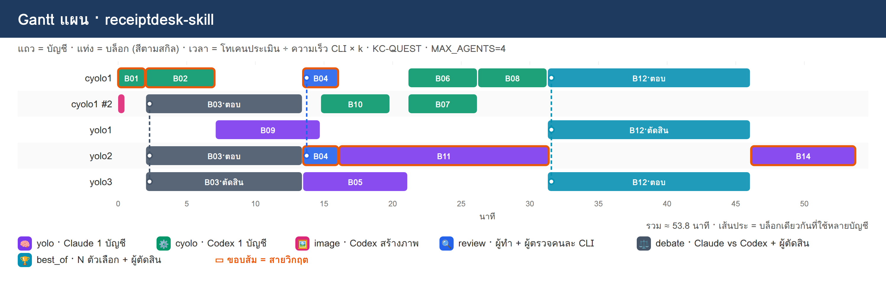

| เรื่อง | ทำทีละขั้น (ขั้นที่ 1–5) | ใช้สกิล |
|---|---|---|
| จำนวน User Story | 24 | 27 |
| FR · BR | 31 · 14 | 32 · 14 |
| จำนวนบล็อก | 14 | 14 |
| Critical Path | B01 → B02 → B04 → B11 → B14 | เหมือนกัน |
| เวลารวมของแผน | 63.5 นาที | 53.8 นาที |
| What-if: agent 2 ตัว · ไม่มี Codex | วางได้ 8/14 · 0/14 | วางได้ 7/14 · 0/14 |

**อ่านผลอย่างไร**
- สกิลทำ What-if เองโดยไม่ต้องสั่ง และได้ข้อสรุปเดียวกับขั้นที่ 5: งานนี้ต้องมี agent 4 ตัวและต้องมี Codex
- แผนใหม่ผูกเกณฑ์ตรวจของบล็อกกติกา Business Rule กับข้อมูลทดสอบตั้งแต่ต้น และจำกัดรอบตรวจที่ 3 รอบ: บทเรียนของขั้นที่ 8 ถูกใช้ก่อนเกิดปัญหา
- สกิลชี้คอขวดของแผนเอง: บัญชี cyolo1 รับ 10 บทบาท และบล็อก `best_of` ต้องรอ agent ว่าง 3 ตัว แผนจึงจบที่ 53.8 นาทีทั้งที่ Critical Path จบที่ 31.5 นาที
- ตัวเลขที่ลูกค้าไม่ได้ให้ (เช่น เพดานคิว 400 ใบ) สกิลรายงานเป็นข้อสมมติให้ลูกค้ายืนยัน ไม่ถือเป็น Requirement
- สกิลหยุดก่อนรันทีมจริงและก่อนเช่าเครื่อง ตามที่ออกแบบไว้

---

## ภาพรวมระบบ

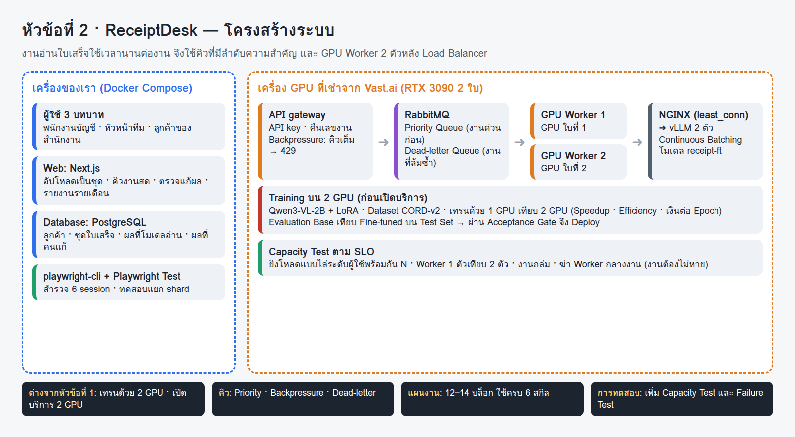

| ส่วน | ใช้อะไร | แนวคิดมาจาก |
|---|---|---|
| โมเดล | Qwen3-VL-2B + LoRA เทรนด้วย Dataset [CORD-v2](https://huggingface.co/datasets/naver-clova-ix/cord-v2) | [LAB 2](../../02_VastAi_Application/lab2_vlm/README.md) |
| Training | GPU 1 ใบ เทียบ 2 ใบ: Speedup · Efficiency · เงินต่อ Epoch | [LAB 4](../../02_VastAi_Application/lab4_multigpu/README.md) |
| Inference | vLLM 2 ตัว (Continuous Batching) หลัง NGINX `least_conn` | [LAB 7](../../02_VastAi_Application/lab7_llm_chat/README.md) |
| คิวงาน | RabbitMQ: Priority Queue · Backpressure · Dead-letter Queue · GPU Worker 2 ตัว | [LAB 8](../../02_VastAi_Application/lab8_job_queue/README.md) · [LAB 9](../../02_VastAi_Application/lab9_hybrid/README.md) |
| เว็บ | Next.js + PostgreSQL ใน Docker | [Sabai Spa](../../../00_week01/04_sabai-spa-web-and-testplan-from-interview/README.md) |

## สิ่งที่ยากขึ้นจากหัวข้อที่ 1

| เรื่อง | หัวข้อที่ 1 | หัวข้อที่ 2 |
|---|---|---|
| Requirement | ลูกค้า 3 คน · FR 22 · BR 7 · NFR 8 | ลูกค้า 4 คน รวมผู้ใช้ภายนอก · FR 31 · BR 14 · NFR 10 |
| เกณฑ์ของโมเดล | Recall และ Precision ของคลาสเดียว | 6 ตัวชี้วัด รวมการวัดว่าโมเดลรู้ตัวว่าไม่แน่ใจ |
| Training | GPU 1 ใบ | GPU 2 ใบ และวัดว่าคุ้มเงินหรือไม่ |
| ระบบคิว | คิวงาน 1 คิว Worker 1 ตัว | Priority · Backpressure · Dead-letter · Worker 2 ตัว |
| แผนงานของทีม | 10 บล็อก · สกิล yolo, cyolo, image, review | 14 บล็อก · เพิ่ม `debate` และ `best_of` |
| การทดสอบ | Functional Test + Bug Hunt | เพิ่ม Capacity Test ตาม SLO และ Failure Test |

## ไฟล์ในโฟลเดอร์นี้

| ไฟล์ | คืออะไร |
|---|---|
| `INTERVIEW.md` | บันทึกการสัมภาษณ์ลูกค้า (ข้อมูลนำเข้าของขั้นที่ 1) |
| `PROMPTS.md` | พรอมต์ทั้ง 19 ขั้น |
| `docs/` | เอกสารของระยะ A จากรอบจริง |
| `plan/` | แผนงานของทีม · What-if · รายงานการรันจากรอบจริง |
| `results/` | คำตอบจริงของทุกขั้น (`answers/`) · ผลของโมเดล · ผล Deployment · ผล Capacity Test · ผลลองสกิล |
| `test/` | Test Charter · Exploration · Test Plan · Test Report · หลักฐานของแต่ละ Test Case · Bug Hunt |
| `DELIVERY.md` | รายงานส่งมอบสำหรับลูกค้า |
| `skill_v1/` | สกิล `agent-team-delivery` เวอร์ชัน 1 จากขั้นที่ 18 |
| `code_reference/` | โค้ดที่ AI เขียนในรอบจริง ไว้เทียบ: `app/` (ทีม AI ขั้นที่ 6–8) · `step09/`–`step12/` · `step15/` · `test_e2e/` (ขั้นที่ 15) |
| `image/` | ภาพประกอบ |

เมื่อทำเอง ให้เริ่มจากโฟลเดอร์ที่มีแค่ `INTERVIEW.md` และไฟล์ `.env` · โค้ดและเอกสารทุกไฟล์เกิดจากพรอมต์
