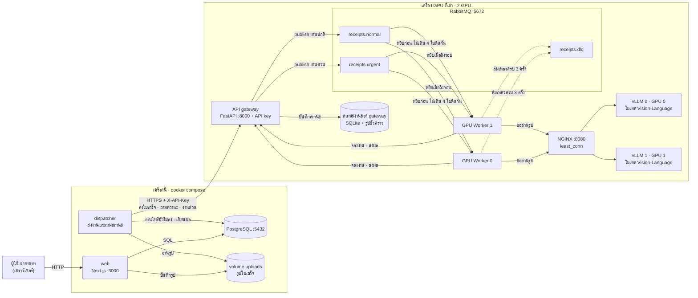
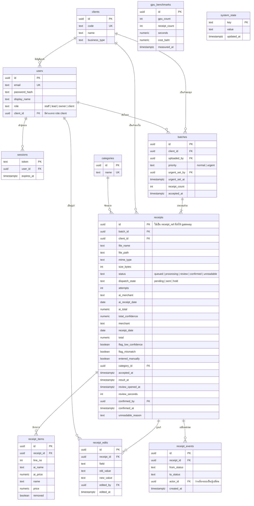
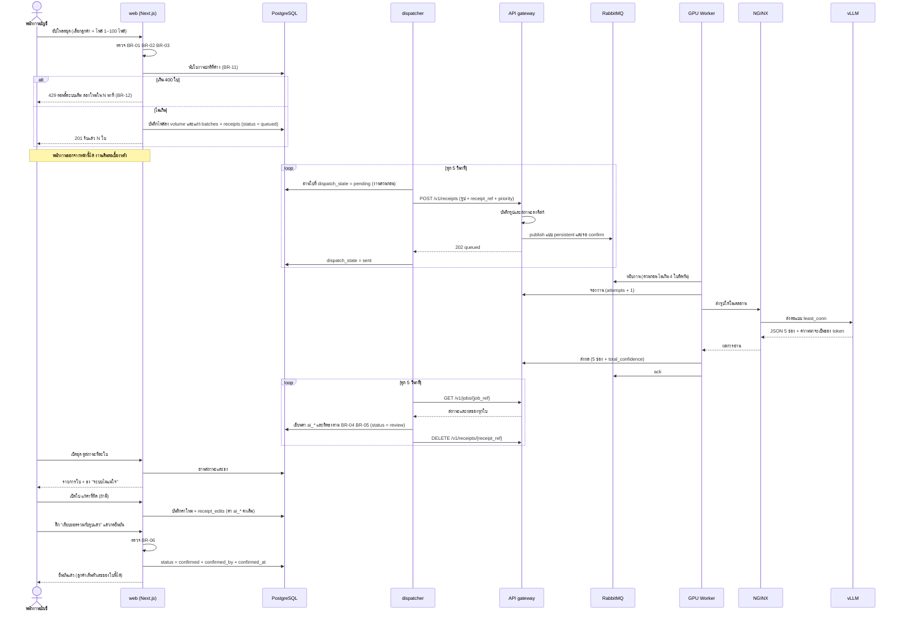
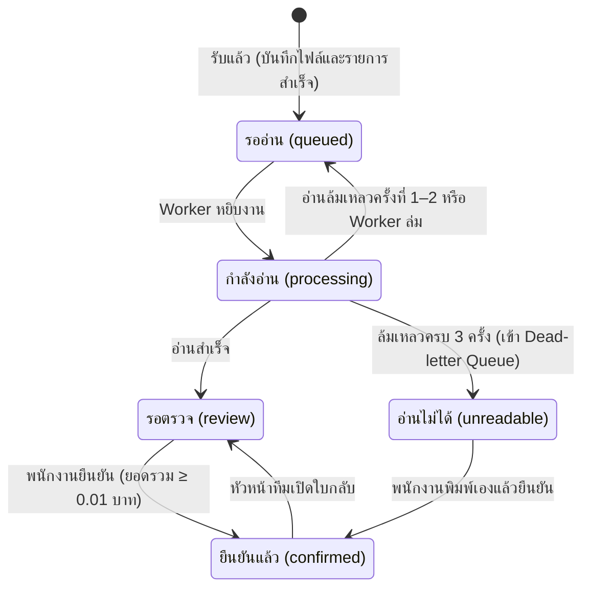

# Design · ReceiptDesk

ที่มา: `docs/REQUIREMENTS.md` (FR-01 – FR-31 · BR-01 – BR-14 · NFR-01 – NFR-10 · ข้อสมมติ A-01 – A-16)
เอกสารนี้เป็นการออกแบบเท่านั้น ยังไม่มีโค้ด ตัวเลขความเร็วทุกตัวเป็นค่าที่ Requirement ตั้งไว้ ยังไม่ได้วัดจริง
ข้อมูลทดสอบอยู่ที่ `docs/TEST-DATA.md`

## 1. ภาพรวม

ระบบมี 2 ฝั่ง

| ฝั่ง | อยู่ที่ไหน | ส่วนประกอบ | หน้าที่ |
|---|---|---|---|
| เว็บ | เครื่องนี้ รันด้วย docker compose | `web` (Next.js) · `dispatcher` (image เดียวกับ web) · `db` (PostgreSQL) · volume `uploads` | รับใบเสร็จ เก็บข้อมูลจริงทั้งหมด บังคับ Business Rule ให้คนตรวจและยืนยัน |
| AI | เครื่อง GPU ที่เช่า 2 ใบ | API gateway · RabbitMQ · GPU Worker 2 ตัว · NGINX · vLLM 2 ตัว (GPU ละ 1 ตัว) | อ่านรูปใบเสร็จเป็นข้อมูล 5 ช่อง พร้อมค่าความมั่นใจของยอดรวม |

หลักที่ใช้ตัดสินใจ

1. **ฝั่งเว็บเป็นเจ้าของความจริง** ใบถูกนับว่า "รับแล้ว" เมื่อไฟล์และแถวข้อมูลอยู่ใน volume และ PostgreSQL แล้ว ไม่ขึ้นกับเครื่อง GPU (NFR-06) เครื่อง GPU ถูกลบทิ้งได้ทุกเมื่อโดยใบไม่หาย
2. **dispatcher ส่งงานแบบ Outbox** อ่านใบที่ยังไม่ส่งจากฐานข้อมูล ส่งไป gateway แล้วถามสถานะเป็นรอบ (ทุก 5 วินาที) เครื่อง GPU ไม่ต้องเรียกกลับมาที่เครื่องนี้
3. **gateway ไม่รู้จักชื่อร้านหรือชื่อลูกค้า** เห็นเฉพาะรูปกับรหัสอ้างอิงแบบสุ่ม (NFR-07)
4. **Business Rule ทุกข้อที่เกี่ยวกับการตัดสินใจของคน (BR-01 – BR-06, BR-08, BR-09, BR-11 – BR-14) คิดที่ฝั่งเว็บ** รวมไว้ในโมดูลกฎโมดูลเดียว ส่วน BR-07 และ BR-10 คิดที่ฝั่ง AI

### 1.1 Architecture



### 1.2 บริการและพอร์ต

| บริการ | เครื่อง | พอร์ต | เปิดออกนอกเครื่อง | ข้อมูลที่เก็บถาวร |
|---|---|---|---|---|
| `web` | นี้ | 3000 | ใช่ (ผู้ใช้) | — |
| `dispatcher` | นี้ | — | ไม่ | — |
| `db` | นี้ | 5432 | ไม่ | volume `pgdata` |
| volume `uploads` | นี้ | — | ไม่ | รูปใบเสร็จต้นฉบับ |
| API gateway | GPU | 8000 | ใช่ (เฉพาะจาก dispatcher ต้องมี API key) | SQLite `gateway.db` + โฟลเดอร์รูปชั่วคราว |
| RabbitMQ | GPU | 5672 | ไม่ | คิวแบบ durable บนดิสก์ |
| GPU Worker 0, 1 | GPU | — | ไม่ | — |
| NGINX | GPU | 8080 | ไม่ | — |
| vLLM 0, 1 | GPU | 8001, 8002 | ไม่ | น้ำหนักโมเดล |

---

## 2. ฐานข้อมูล (PostgreSQL · 11 ตาราง)



หมายเหตุของตาราง

- จำนวนเงินทุกช่องเป็น `numeric(12,2)` การเทียบตาม BR-05 และ BR-06 คิดเป็นสตางค์ (จำนวนเต็ม) ไม่ใช้เลขทศนิยมแบบ float
- คอลัมน์ `ai_*` เขียนครั้งเดียวตอนรับผลจาก AI และไม่ถูกแก้อีก (FR-14, NFR-10) ค่าที่คนแก้อยู่ในคอลัมน์ที่ไม่มี `ai_` และทุกการแก้มี 1 แถวใน `receipt_edits`
- ยอดตรวจนับ (FR-08): `count(receipts)` = ผลรวม `count` แยกตาม `status` เพราะ `status` มีได้ 5 ค่าและไม่มีค่าว่าง
- BR-09 นับจาก `batches.urgent_set_at` ของวันปฏิทิน (เขต Asia/Bangkok) · BR-11 นับจาก `receipts` ที่ `status` เป็น `queued` หรือ `processing` และชุดเป็น `normal` · BR-13 คิดจาก `accepted_at` เทียบเวลาปัจจุบัน
- `system_state` เก็บค่าที่ dispatcher อ่านจาก gateway ล่าสุด เช่น `workers_alive` ใช้คิด BR-12
- ฝั่ง gateway มีตารางของตัวเอง 1 ตารางใน SQLite (`gw_receipts`: receipt_ref · job_ref · priority · status · attempts · lease_until · result · error) ไม่อยู่ใน ER นี้เพราะเป็นข้อมูลชั่วคราว

---

## 3. ลำดับการทำงาน: อัปโหลดชุดใบเสร็จจนพนักงานยืนยันผล



---

## 4. สถานะของงาน

สถานะนี้เป็นของใบเสร็จ 1 ใบในฝั่งเว็บ (คอลัมน์ `receipts.status`) สถานะของชุดคิดจากจำนวนใบในแต่ละสถานะ



- การเป็นงานด่วนไม่ใช่สถานะ เป็นค่า `priority` ของชุด เปลี่ยนได้ขณะใบยังเป็น `queued`
- `unreadable` ไม่มีเส้นกลับไป `queued` (FR-16)
- ทุกเส้นบันทึก 1 แถวใน `receipt_events`
- การเขียนผลใช้เงื่อนไข "เปลี่ยนเฉพาะเมื่อสถานะปัจจุบันเป็น queued หรือ processing" ผลที่มาซ้ำจึงไม่ทับใบที่ไปถึง review แล้ว

---

## 5. API Contract ระหว่างเว็บกับ gateway

ผู้เรียกคือ `dispatcher` เท่านั้น · ฐาน URL อยู่ในตัวแปร `GATEWAY_URL` · ข้อมูลเป็น JSON ยกเว้นการส่งรูป · จำนวนเงินเป็นข้อความทศนิยม 2 ตำแหน่ง เช่น `"100.00"`

### 5.1 การใช้ API key

| เรื่อง | กติกา |
|---|---|
| ส่งอย่างไร | header `X-API-Key: <key>` ทุกคำขอ ยกเว้น `GET /healthz` |
| ไม่มี key | `401 {"error":"missing_api_key"}` |
| key ผิด | `403 {"error":"invalid_api_key"}` |
| เก็บที่ไหน | ไฟล์ `.env` ของแต่ละฝั่ง (`GATEWAY_API_KEY`) ไม่อยู่ใน git ไม่อยู่ในโค้ดฝั่งเบราว์เซอร์ และไม่ถูกพิมพ์ลง log |
| เปลี่ยน key | gateway รับได้หลาย key คั่นด้วยจุลภาค (`GATEWAY_API_KEYS`) ใส่ key ใหม่ → เปลี่ยนที่ dispatcher → เอา key เก่าออก |
| key ของโมเดล | Worker เรียก NGINX ด้วย key อีกตัว (`VLLM_API_KEY`) ที่ไม่ออกนอกเครื่อง GPU |
| ระหว่างทาง | HTTPS (ใบรับรองที่สร้างเอง dispatcher ตรวจกับไฟล์ `GATEWAY_CA_CERT`) |

### 5.2 รายการ API ของ gateway (7 เส้น)

| # | Method + Path | ใช้ทำอะไร | ตอบสำเร็จ |
|---|---|---|---|
| G1 | `GET /healthz` | ตรวจว่า gateway · RabbitMQ · Worker · vLLM พร้อม (ไม่ต้องมี key ไม่มีข้อมูลใบเสร็จ) | `200` |
| G2 | `POST /v1/receipts` | ส่งใบเสร็จ 1 ใบเข้าคิว | `202` |
| G3 | `GET /v1/receipts/{receipt_ref}` | ถามสถานะและผลของ 1 ใบ | `200` |
| G4 | `GET /v1/jobs/{job_ref}` | ถามสถานะและผลของทุกใบในชุด | `200` |
| G5 | `POST /v1/jobs/{job_ref}/urgent` | เปลี่ยนชุดเป็นงานด่วน | `200` |
| G6 | `GET /v1/queue` | ดูความยาวคิว จำนวน Worker และอัตราอ่าน | `200` |
| G7 | `DELETE /v1/receipts/{receipt_ref}` | ลบรูปและผลของใบออกจากเครื่อง GPU | `204` |

### 5.3 ส่งใบเสร็จ · `POST /v1/receipts`

คำขอ `multipart/form-data`

| ช่อง | ค่า |
|---|---|
| `file` | รูป JPG · PNG หรือ PDF 1 หน้า ไม่เกิน 10 MB |
| `receipt_ref` | UUID ของใบ (มาจาก `receipts.id`) ใช้เป็นกุญแจกันส่งซ้ำ |
| `job_ref` | UUID ของชุด (มาจาก `batches.id`) |
| `priority` | `normal` หรือ `urgent` |

```json
// 202 Accepted
{ "receipt_ref": "5f0c…", "job_ref": "a91e…", "status": "queued", "priority": "normal" }
```

| รหัส | เมื่อใด | เนื้อหา |
|---|---|---|
| `202` | บันทึกรูปลงดิสก์ บันทึกสถานะ และ RabbitMQ ยืนยันการรับข้อความแล้ว (ครบ 3 อย่างจึงตอบ) | ตามตัวอย่าง |
| `200` | `receipt_ref` นี้เคยส่งแล้ว (ส่งซ้ำได้ ไม่เกิดงานซ้ำ) | สถานะปัจจุบันของใบ |
| `400` | ช่องไม่ครบ หรือ `priority` ไม่ถูก | `{"error":"bad_request","detail":"…"}` |
| `413` | ไฟล์เกิน 10 MB | `{"error":"file_too_large","limit_bytes":10485760}` |
| `415` | ชนิดไฟล์ไม่รับ หรือ PDF ไม่ใช่ 1 หน้า | `{"error":"unsupported_file"}` |
| `429` | คิวเต็ม (ดู 5.6) | ดู 5.6 |
| `503` | RabbitMQ ใช้ไม่ได้ จึงไม่รับ | `{"error":"broker_unavailable"}` + `Retry-After: 10` |

### 5.4 ถามสถานะ · `GET /v1/jobs/{job_ref}` และ `GET /v1/receipts/{receipt_ref}`

```json
// 200 OK · GET /v1/jobs/{job_ref}
{
  "job_ref": "a91e…",
  "priority": "normal",
  "counts": { "queued": 61, "processing": 2, "done": 36, "dead": 1 },
  "receipts": [
    {
      "receipt_ref": "5f0c…",
      "status": "done",
      "attempts": 1,
      "queued_at": "2026-11-19T02:00:05Z",
      "finished_at": "2026-11-19T02:03:41Z",
      "result": {
        "merchant": "ร้านตัวอย่าง",
        "date": "2026-11-18",
        "items": [ { "name": "ข้าวสาร 5 กก.", "price": "45.00" } ],
        "total": "100.00",
        "total_confidence": 0.93,
        "model": "receipt-vlm"
      }
    },
    { "receipt_ref": "77b2…", "status": "dead", "attempts": 3, "error": "unreadable_image" }
  ]
}
```

- สถานะฝั่ง gateway มี 4 ค่า: `queued` · `processing` · `done` · `dead` dispatcher แปลงเป็นสถานะฝั่งเว็บ: `done` → `review` · `dead` → `unreadable`
- gateway ส่ง `total_confidence` เป็นค่าดิบ การติดธงตาม BR-04 และ BR-05 คิดที่ฝั่งเว็บ
- `404 {"error":"unknown_job"}` หรือ `{"error":"unknown_receipt"}` → dispatcher ถือว่าเครื่อง GPU ถูกสร้างใหม่ ตั้ง `dispatch_state = pending` แล้วส่งใบนั้นใหม่

### 5.5 งานด่วน · `POST /v1/jobs/{job_ref}/urgent`

ไม่มีเนื้อหาคำขอ gateway ย้ายใบของชุดที่ยังเป็น `queued` ไปคิว `receipts.urgent` ใบที่กำลังอ่านอยู่ไม่ถูกขัดจังหวะ

```json
// 200 OK
{ "job_ref": "a91e…", "priority": "urgent", "moved": 7, "already_processing": 1, "already_finished": 2 }
```

| รหัส | เมื่อใด |
|---|---|
| `200` | ย้ายแล้ว หรือชุดนี้เป็นงานด่วนอยู่แล้ว (เรียกซ้ำได้) |
| `404` | ไม่รู้จัก `job_ref` |
| `422` | ชุดมีเกิน 10 ใบ `{"error":"urgent_too_large","limit":10}` (ด่านซ้ำของ BR-08) |
| `429` | คิวงานด่วนค้างเกิน 50 ใบ `{"error":"queue_full","queue":"urgent",…}` |

ชุดที่หัวหน้าทีมตั้งเป็นด่วนตั้งแต่ตอนอัปโหลด ใช้ `priority=urgent` ใน G2 ได้เลย
สิทธิ์ (หัวหน้าทีมเท่านั้น) และโควตา 5 งานต่อวัน (BR-09) ตรวจที่ฝั่งเว็บก่อนเรียก gateway

### 5.6 คิวเต็มตอบอย่างไร

```http
HTTP/1.1 429 Too Many Requests
Retry-After: 600
Content-Type: application/json

{ "error": "queue_full", "queue": "normal", "pending": 400, "limit": 400,
  "workers_alive": 2, "retry_after_minutes": 10, "retry_after_seconds": 600 }
```

- ใบที่ได้ `429` **ไม่ถูกรับ** gateway ไม่เก็บรูปและไม่สร้างสถานะ
- `retry_after_minutes` คิดด้วยสูตรเดียวกับ BR-12
- dispatcher ไม่ส่งใบนั้นซ้ำจนพ้นเวลา `Retry-After` ใบยังเป็น `queued` ในฝั่งเว็บ ผู้ใช้ไม่เห็นความผิดปกติ

### 5.7 ดูคิว · `GET /v1/queue`

```json
{ "normal": { "pending": 128, "limit": 400 }, "urgent": { "pending": 0, "limit": 50 },
  "dead_letter": { "count": 3 }, "workers_alive": 2, "vllm_up": 2, "rate_per_minute": 7.6 }
```

### 5.8 API ภายในเครื่อง GPU (Worker → gateway · 3 เส้น ไม่เปิดออกนอกเครื่อง)

| # | Method + Path | ใช้ทำอะไร |
|---|---|---|
| I1 | `POST /internal/receipts/{receipt_ref}/claim` | จองงานก่อนอ่าน ตอบ `go` (attempts + 1 และเริ่มสัญญาเช่า 90 วินาที) · `skip` (ใบจบแล้ว ให้ ack ทิ้ง) · `wait` (Worker อื่นถืออยู่) · `dead` (attempts ครบ 3 แล้ว) |
| I2 | `POST /internal/receipts/{receipt_ref}/result` | ส่งผลสำเร็จหรือล้มเหลว gateway บันทึกครั้งแรกครั้งเดียว |
| I3 | `POST /internal/workers/{worker_id}/heartbeat` | Worker แจ้งว่ายังทำงาน ทุก 5 วินาที เงียบเกิน 15 วินาทีถือว่าล่ม |

---

## 6. การออกแบบคิว

| คิว | ชนิด | ใครเขียน | ใครอ่าน |
|---|---|---|---|
| `receipts.urgent` | durable · ข้อความ persistent | gateway | Worker ทุกตัว |
| `receipts.normal` | durable · ข้อความ persistent | gateway | Worker ทุกตัว |
| `receipts.dlq` | durable · รับจาก Dead-letter Exchange `receipts.dlx` | RabbitMQ (เมื่อ Worker reject) | ไม่มีผู้อ่านอัตโนมัติ |

ข้อความในคิวมีเฉพาะ `receipt_ref` · `job_ref` · `priority` รูปอยู่บนดิสก์ของ gateway

### 6.1 Priority Queue: งานด่วนแซงได้ งานปกติไม่ค้างเกินกำหนด

ใช้ 2 คิวแยกตามลำดับความสำคัญ แล้วให้ Worker เป็นผู้เลือกหยิบ ไม่ใช้ `x-max-priority` ของคิวเดียว เพราะคิวเดียวที่เรียงตาม priority จะส่งงานด่วนก่อนเสมอ บังคับอัตรา 4:1 ของ BR-10 ไม่ได้

กติกาการหยิบของ Worker แต่ละตัว (หยิบทีละ 1 ใบ)

1. ถ้าคิวด่วนมีงาน และ Worker นี้หยิบใบด่วนติดกันมายังไม่ถึง 4 ใบ → หยิบใบด่วน นับ +1
2. ถ้าหยิบใบด่วนติดกันครบ 4 ใบแล้ว และคิวปกติมีงาน → หยิบใบปกติ ตั้งตัวนับเป็น 0
3. ถ้าคิวด่วนว่าง → หยิบใบปกติ ตั้งตัวนับเป็น 0
4. ถ้าคิวปกติว่างแต่คิวด่วนมีงาน → หยิบใบด่วนต่อได้ (ไม่มีใบปกติรอ จึงไม่ผิด BR-10)

งานด่วนไม่ขัดจังหวะใบที่กำลังอ่านอยู่

ตรวจตัวเลขกับ Requirement (อัตราอ่าน 4 ใบ/นาทีต่อ Worker ยังเป็นค่าที่ตั้งไว้ ไม่ใช่ค่าที่วัด)

| กรณี | คำนวณ | เกณฑ์ |
|---|---|---|
| งานด่วน 10 ใบ · Worker 2 ตัว · คิวปกติเต็ม | ใบด่วนได้ 4 ใน 5 ของ 8 ใบ/นาที = 6.4 ใบ/นาที → 10 ÷ 6.4 = 1.6 นาที + รอใบที่อ่านค้างอยู่ไม่เกิน 0.25 นาที = 1.9 นาที | ≤ 5 นาที (NFR-03) |
| งานด่วน 10 ใบ · เหลือ Worker 1 ตัว | 4 ใน 5 ของ 4 = 3.2 ใบ/นาที → 3.1 นาที + 0.25 = 3.4 นาที | ≤ 5 นาที |
| งานปกติเต็มเพดาน 400 ใบ + ใบด่วนทั้งวัน 50 ใบ · Worker 2 ตัว | 450 ÷ 8 = 56.3 นาที | ≤ 120 นาที (BR-13) |
| กรณีเดียวกัน · เหลือ Worker 1 ตัว | 450 ÷ 4 = 112.5 นาที | ≤ 120 นาที |
| ชุดปกติ 100 ใบ · คิวค้าง 100 ใบ · Worker 2 ตัว | 200 ÷ 8 = 25 นาที | ≤ 30 นาที (NFR-02) |

ขอบเขตของงานด่วนมาจาก 3 ด่าน: ชุดละไม่เกิน 10 ใบ (BR-08) · วันละไม่เกิน 5 งาน (BR-09) · สลับ 4:1 (BR-10) สองด่านแรกบังคับที่เว็บ ด่านที่สามบังคับที่ Worker

เว็บแสดงใบงานปกติที่รอเกิน 120 นาทีในหน้า "ค้างเกินกำหนด" ของหัวหน้าทีม (FR-21) โดยคิดจาก `accepted_at` ไม่ต้องถามเครื่อง GPU

### 6.2 Backpressure เมื่อคิวเต็ม

มี 2 ด่าน

| ด่าน | อยู่ที่ไหน | เพดาน | ผลเมื่อเกิน | ใครเห็น |
|---|---|---|---|---|
| 1 | เว็บ ตอนรับชุด | ใบงานปกติที่ `queued` + `processing` ในฐานข้อมูล + ชุดใหม่ ≤ 400 (BR-11) | ไม่รับทั้งชุด ตอบ `429` พร้อม N นาที (BR-12) ไม่มีแถวใดถูกสร้าง | ผู้อัปโหลด: "ตอนนี้ระบบเต็ม กรุณาลองใหม่ในอีก N นาที" |
| 2 | gateway ตอนรับใบ | คิวปกติ 400 ใบ · คิวด่วน 50 ใบ | ตอบ `429` + `Retry-After` (5.6) | dispatcher เท่านั้น ใบยังเป็น "รออ่าน" ในเว็บ |

- ด่าน 1 นับในธุรกรรมเดียวกับการสร้างชุด (ล็อกระดับตาราง) ชุด 2 ชุดที่เข้าพร้อมกันจึงไม่ทะลุเพดาน
- N = ปัดขึ้น((ค้าง + ใหม่ − 400) ÷ (4 × จำนวน Worker ที่ทำงานอยู่)) อย่างน้อย 1 · จำนวน Worker อ่านจาก `system_state.workers_alive` ถ้าค่าเป็น 0 หรือเก่ากว่า 30 วินาที ใช้ 1 ตัว (4 ใบ/นาที) เพื่อไม่ให้หารด้วยศูนย์และไม่บอกเวลาสั้นเกินจริง
- งานด่วนไม่นับในด่าน 1 (BR-11) แต่ถูกจำกัดด้วยโควตาจึงมีได้ไม่เกิน 50 ใบต่อวัน
- ด่าน 2 มีไว้กันกรณี dispatcher ส่งซ้ำหลังเครื่อง GPU ถูกสร้างใหม่ ในการทำงานปกติไม่ควรถึง

### 6.3 Dead-letter Queue สำหรับใบที่อ่านไม่ได้

| เหตุที่นับเป็นล้มเหลว 1 ครั้ง | ตัวอย่าง |
|---|---|
| โมเดลตอบว่าอ่านไม่ได้ | รูปเบลอ ถ่ายไม่ครบใบ ไม่ใช่ใบเสร็จ |
| ผลไม่เป็น JSON ครบ 5 ช่อง | ขาดช่องยอดรวม |
| เกินเวลา 60 วินาทีต่อครั้ง | vLLM ค้าง |
| Worker ล่มระหว่างอ่าน | นับเพราะ attempts เพิ่มตอนจองงาน (กันใบที่ทำให้ Worker ล่มซ้ำไม่รู้จบ) |

ขั้นตอน

1. ล้มเหลวครั้งที่ 1–2 → Worker แจ้ง gateway (สถานะกลับเป็น `queued`) แล้วคืนข้อความเข้าคิวเดิม
2. ล้มเหลวครั้งที่ 3 → Worker แจ้ง gateway (สถานะ `dead` พร้อมเหตุผล) แล้ว reject แบบไม่คืนคิว RabbitMQ ส่งข้อความไป `receipts.dlq` ผ่าน `receipts.dlx`
3. ไม่มีผู้อ่าน `receipts.dlq` อัตโนมัติ ใบจึงไม่วนกลับ (BR-07, FR-16)
4. dispatcher เห็นสถานะ `dead` → ตั้ง `receipts.status = unreadable` + `unreadable_reason` ใบไปอยู่หน้า "อ่านไม่ได้ ให้คนพิมพ์เอง"
5. รูปของใบใน DLQ ถูกลบจากเครื่อง GPU ตามกติกา 60 นาที (หัวข้อ 8) รูปต้นฉบับยังอยู่ที่ฝั่งเว็บให้คนพิมพ์เอง

---

## 7. งานไม่หายเมื่อ Worker ล่ม และ Worker ที่เหลือทำงานต่อ

| กลไก | รายละเอียด |
|---|---|
| ack ด้วยมือ | Worker ack ข้อความหลัง gateway ตอบว่าบันทึกผลแล้วเท่านั้น |
| หยิบทีละ 1 ใบ | Worker ถือข้อความที่ยังไม่ ack ได้ครั้งละ 1 ข้อความ ใบที่เหลืออยู่ในคิวให้ Worker อื่นหยิบ |
| คืนคิวอัตโนมัติ | Worker ล่ม → การเชื่อมต่อขาด → RabbitMQ คืนข้อความที่ยังไม่ ack เข้าคิวเดิม |
| สัญญาเช่า 90 วินาที | Worker ที่หยิบใบที่ถูกคืนคิวจะจองได้เมื่อสัญญาเช่าเดิมหมด (เกินเวลาอ่านสูงสุด 60 วินาที) จึงไม่มี 2 ตัวอ่านใบเดียวกันพร้อมกัน |
| ผลครั้งแรกครั้งเดียว | gateway รับผลของ `receipt_ref` หนึ่งได้ครั้งเดียว ผลที่มาช้าของ Worker ที่ค้างถูกทิ้ง → ผลซ้ำ = 0 |
| Worker อิสระต่อกัน | Worker แต่ละตัวเป็น process แยก ไม่มีสถานะร่วมกันนอกจากคิวและ gateway ตัวหนึ่งล่ม อีกตัวหยิบงานต่อทันที อัตราอ่านเหลือ 4 ใบ/นาที |
| vLLM ล่ม 1 ตัว | NGINX ส่งคำขอไป vLLM อีกตัว (ลองตัวถัดไปเมื่อ error หรือ timeout) |
| RabbitMQ เริ่มใหม่ | คิว durable + ข้อความ persistent + publisher confirm ก่อนตอบ `202` |
| gateway เริ่มใหม่ | สถานะอยู่ใน SQLite บนดิสก์ dispatcher ส่งซ้ำได้เพราะ `receipt_ref` กันงานซ้ำ |
| เครื่อง GPU หายทั้งเครื่อง | ใบทุกใบยังอยู่ที่เว็บ (ไฟล์ + แถว) dispatcher ได้ `404` จึงส่งใหม่ไปเครื่องใหม่ |
| ฝั่ง AI ใช้ไม่ได้ | เว็บยังรับชุดและให้คนตรวจใบเดิมได้ ใบใหม่ค้างที่ "รออ่าน" |

การทดสอบที่ต้องผ่าน (NFR-06): ส่ง 100 ใบ → ดับ Worker 1 ตัวกลางงาน → ครบ 100 ใบมีผล · ใบหาย 0 · ผลซ้ำ 0 · `GET /v1/queue` แสดง `workers_alive` = 1 ภายใน 15 วินาที

---

## 8. ความเป็นส่วนตัว

- `receipt_ref` และ `job_ref` เป็น UUID สุ่ม gateway ไม่ได้รับชื่อร้าน ชื่อลูกค้า หรือชื่อไฟล์เดิม
- gateway ลบรูปและผลเมื่อ dispatcher เรียก G7 และลบเองเมื่อครบ 60 นาทีหลังใบจบ (รวมใบใน DLQ)
- log ของ gateway และ Worker มีเฉพาะรหัสอ้างอิง สถานะ และเวลา
- เว็บ: ทุกหน้าและทุก API ต้องมี session ยกเว้น `/login` และ `/api/health` · รูปใบเสร็จเปิดผ่าน API ที่ตรวจสิทธิ์ ไม่มีลิงก์ตรงไปที่ไฟล์
- บัญชีลูกค้า: ทุกคำสั่งอ่านข้อมูลกรองด้วย `client_id` ของ session ที่ฝั่ง server ขอใบของร้านอื่นได้ `404` · ใบที่ยังไม่ `confirmed` ส่งให้ลูกค้าเฉพาะชื่อไฟล์ เวลาที่รับ และสถานะ ช่องตัวเลขไม่ถูกส่งออกจาก server

---

## 9. ฝั่งเว็บ

### 9.1 หน้าและสิทธิ์

| หน้า | Path | พนักงาน | หัวหน้าทีม | เจ้าของ | ลูกค้า |
|---|---|---|---|---|---|
| เข้าสู่ระบบ | `/login` | ✓ | ✓ | ✓ | ✓ |
| อัปโหลดชุด | `/upload` | ✓ | ✓ (ตั้งด่วนได้) | — | — |
| รายการชุด + ยอดตรวจนับ | `/batches` | ✓ | ✓ | ✓ | — |
| ชุด 1 ชุด (สถานะทีละใบ) | `/batches/[id]` | ✓ | ✓ (ปุ่มงานด่วน) | ✓ | — |
| รายการใบ (กรองสถานะ · ธง) | `/receipts` | ✓ | ✓ | ✓ | — |
| ตรวจและยืนยันใบ | `/receipts/[id]` | ✓ | ✓ (ดูค่าเดิม · เปิดใบกลับ) | ดูอย่างเดียว | — |
| อ่านไม่ได้ ให้คนพิมพ์เอง | `/unreadable` | ✓ | ✓ | ✓ | — |
| ค้างเกินกำหนด | `/overdue` | — | ✓ | ✓ | — |
| ไฟล์สรุปรายเดือน | `/reports` | ✓ | ✓ | ✓ | — |
| เวลาตรวจ · GPU 1 เทียบ 2 ใบ | `/insights` | — | ✓ (เวลาตรวจ) | ✓ | — |
| หน้าลูกค้า: ส่งใบ · ใบของร้าน · สรุปแยกหมวด | `/portal` | — | — | — | ✓ |

### 9.2 API ของเว็บ (23 เส้น)

| # | Method + Path | ใช้ทำอะไร | ใครเรียกได้ |
|---|---|---|---|
| W1 | `GET /api/health` | สุขภาพของเว็บ | ทุกคน ไม่ต้องเข้าสู่ระบบ |
| W2 | `POST /api/test/reset` | รีเซ็ตข้อมูลทดสอบ | ผู้ทดสอบ (มี token) |
| W3 | `POST /api/auth/login` | เข้าสู่ระบบ | ทุกคน |
| W4 | `POST /api/auth/logout` | ออกจากระบบ | ผู้เข้าสู่ระบบ |
| W5 | `GET /api/me` | บัญชีและบทบาทของตัวเอง | ผู้เข้าสู่ระบบ |
| W6 | `GET /api/clients` | รายชื่อลูกค้าของสำนักงาน | พนักงาน · หัวหน้า · เจ้าของ |
| W7 | `POST /api/batches` | อัปโหลดชุด (BR-01 – BR-03, BR-11, BR-12 · `urgent=true` ได้เฉพาะหัวหน้า) | พนักงาน · หัวหน้า · ลูกค้า (ร้านตัวเอง) |
| W8 | `GET /api/batches` | รายการชุด | พนักงาน · หัวหน้า · เจ้าของ |
| W9 | `GET /api/batches/{id}` | สถานะทุกใบและจำนวนต่อสถานะ | พนักงาน · หัวหน้า · เจ้าของ |
| W10 | `POST /api/batches/{id}/urgent` | ตั้งงานด่วน (BR-08, BR-09) | หัวหน้าเท่านั้น คนอื่นได้ `403` |
| W11 | `GET /api/receipts` | รายการใบ กรอง `status` · `flagged` · `client_id` · `overdue` | ทุกบทบาท (ลูกค้าได้เฉพาะร้านตัวเองและไม่มีตัวเลขก่อนยืนยัน) |
| W12 | `GET /api/receipts/{id}` | รายละเอียดใบ | เหมือน W11 |
| W13 | `GET /api/receipts/{id}/image` | รูปใบเสร็จ | เหมือน W11 |
| W14 | `PATCH /api/receipts/{id}` | แก้ค่า หรือพิมพ์เองสำหรับใบอ่านไม่ได้ | พนักงาน · หัวหน้า |
| W15 | `POST /api/receipts/{id}/confirm` | ยืนยัน (BR-06 · ต้องส่ง `totalChecked=true` และ `categoryId`) | พนักงาน · หัวหน้า |
| W16 | `POST /api/receipts/{id}/reopen` | เปิดใบที่ยืนยันแล้วกลับเป็นรอตรวจ | หัวหน้าเท่านั้น |
| W17 | `GET /api/receipts/{id}/history` | ค่าเดิมที่ระบบอ่านและประวัติการแก้ | พนักงาน · หัวหน้า · เจ้าของ |
| W18 | `GET /api/reports/monthly?clientId=&month=YYYY-MM` | ไฟล์สรุปรายเดือน CSV (BR-14) | พนักงาน · หัวหน้า · เจ้าของ |
| W19 | `GET /api/reports/categories?month=YYYY-MM` | ยอดแยกหมวดของร้าน | ลูกค้า (ร้านตัวเอง) · สำนักงานระบุ `clientId` |
| W20 | `GET /api/reports/reconcile` | ยอดตรวจนับ: รับแล้ว · รวมทุกสถานะ · ผลต่าง | พนักงาน · หัวหน้า · เจ้าของ |
| W21 | `GET /api/reports/review-time` | เวลาตรวจเฉลี่ยต่อใบ | หัวหน้า · เจ้าของ |
| W22 | `GET /api/reports/gpu` | เทียบ GPU 1 กับ 2 ใบ | เจ้าของ |
| W23 | `GET /api/queue` | ใบงานปกติที่ค้าง · เพดาน · งานด่วนที่ใช้ไปวันนี้ · จำนวน Worker | พนักงาน · หัวหน้า · เจ้าของ |

รูปแบบคำตอบเมื่อผิดกฎ: `{"error":"<รหัส>","rule":"BR-xx","message":"<ข้อความภาษาไทย>"}`

| สถานการณ์ | รหัส HTTP | `error` |
|---|---|---|
| ชุดว่าง หรือเกิน 100 ไฟล์ | `422` | `batch_size` |
| ไฟล์เกิน 10 MB | `422` | `file_too_large` (บอกชื่อไฟล์) |
| ชนิดไฟล์ไม่รับ / PDF ไม่ใช่ 1 หน้า | `422` | `file_type` / `pdf_pages` (บอกชื่อไฟล์) |
| ระบบเต็ม | `429` | `queue_full` + `retryAfterMinutes` |
| ยอดรวมต่ำกว่า 0.01 | `422` | `total_invalid` |
| งานด่วนเกิน 10 ใบ | `422` | `urgent_too_large` |
| งานด่วนครบ 5 งานของวัน | `409` | `urgent_quota` |
| ไม่มีสิทธิ์ | `403` | `forbidden` |
| ยังไม่เข้าสู่ระบบ | `401` | `unauthenticated` |
| ข้อมูลของร้านอื่น | `404` | `not_found` |

### 9.3 `/api/health`

ไม่ต้องเข้าสู่ระบบ ไม่มีข้อมูลใบเสร็จ ตอบ `200` เมื่อเว็บต่อฐานข้อมูลได้ ตอบ `503` เมื่อต่อไม่ได้ สถานะของฝั่ง AI รายงานแยก ไม่ทำให้เว็บเป็น `503` (เว็บต้องใช้ได้แม้ฝั่ง AI ล่ม)

```json
{ "status": "ok", "db": "ok", "ai": { "mode": "gateway", "reachable": true, "workersAlive": 2 }, "version": "1.0.0" }
```

### 9.4 ทางรีเซ็ตข้อมูลทดสอบ

`POST /api/test/reset` ลบข้อมูลทุกตารางแล้วใส่ข้อมูลตั้งต้นจาก `docs/TEST-DATA.md`

| เรื่อง | กติกา |
|---|---|
| เปิดใช้ | เฉพาะเมื่อ `ENABLE_TEST_RESET=1` ถ้าไม่ตั้ง เส้นนี้ตอบ `404` |
| ป้องกัน | header `X-Test-Token` ต้องตรงกับ `TEST_RESET_TOKEN` ใน `.env` |
| เนื้อหา (ไม่ใส่ก็ได้) | `{"pendingNormal":0,"urgentToday":0,"urgentYesterday":0,"workersAlive":2,"overdue":false}` |
| `pendingNormal` | สร้างใบงานปกติสถานะ `queued` ตามจำนวน โดย `dispatch_state = hold` (ไม่ถูกส่งไปอ่าน) ใช้ทดสอบ BR-11 และ BR-12 |
| `urgentToday` / `urgentYesterday` | สร้างชุดที่ถูกตั้งด่วนวันนี้ / เมื่อวาน 23:59 ตามจำนวน ใช้ทดสอบ BR-09 |
| `workersAlive` | ตั้งค่า `system_state.workers_alive` ใช้ทดสอบ BR-12 |
| `overdue` | สร้างใบที่รับมาแล้ว 119 · 120 · 121 นาที ใช้ทดสอบ BR-13 |
| ตอบ | `200 {"ok":true,"counts":{"users":6,"clients":3,"receipts":8}}` |

โหมดอ่านจำลอง: เมื่อ `AI_MODE=mock` dispatcher ไม่เรียก gateway แต่ให้ผลตาม**ชื่อไฟล์**ที่กำหนดใน `docs/TEST-DATA.md` (ค่าความมั่นใจ ยอดรวม รายการ จำนวนครั้งที่ล้มเหลว) ใช้ทดสอบเว็บโดยไม่ต้องเช่าเครื่อง GPU ค่าเริ่มต้นคือ `AI_MODE=gateway`

### 9.5 `data-testid`

ทุกปุ่ม ทุกช่องกรอก ทุกตัวเลือก และทุกข้อความผลลัพธ์ที่การทดสอบต้องอ่าน มี `data-testid` รูปแบบ `<หน้า>-<สิ่งนั้น>[-<รหัส>]` ตัวพิมพ์เล็ก คั่นด้วยขีด ห้ามเปลี่ยนชื่อโดยไม่แก้เอกสารนี้

| หน้า | `data-testid` |
|---|---|
| ทุกหน้า | `nav-upload` · `nav-batches` · `nav-receipts` · `nav-unreadable` · `nav-overdue` · `nav-reports` · `nav-insights` · `nav-portal` · `nav-user-name` · `nav-user-role` · `logout-button` |
| `/login` | `login-email-input` · `login-password-input` · `login-submit-button` · `login-error` |
| `/upload` | `upload-client-select` · `upload-file-input` · `upload-urgent-checkbox` · `upload-submit-button` · `upload-accepted-count` · `upload-error` · `upload-file-error-{ลำดับ}` · `upload-full-message` · `upload-retry-minutes` · `upload-queue-pending` |
| `/batches` | `batches-table` · `batch-row-{id}` · `batch-open-link-{id}` · `reconcile-accepted` · `reconcile-sum` · `reconcile-diff` |
| `/batches/[id]` | `batch-priority` · `batch-count-accepted` · `batch-count-queued` · `batch-count-processing` · `batch-count-review` · `batch-count-confirmed` · `batch-count-unreadable` · `batch-urgent-button` · `batch-urgent-error` · `receipt-row-{id}` · `receipt-status-{id}` · `receipt-flag-{id}` · `receipt-open-link-{id}` |
| `/receipts` | `filter-status-select` · `filter-flagged-checkbox` · `filter-client-select` · `filter-apply-button` · `receipts-table` · `receipts-count` · `receipt-row-{id}` · `receipt-status-{id}` · `receipt-flag-{id}` |
| `/receipts/[id]` | `receipt-image` · `receipt-status` · `flag-low-confidence` · `flag-mismatch` · `field-merchant-input` · `field-date-input` · `field-total-input` · `item-name-input-{บรรทัด}` · `item-price-input-{บรรทัด}` · `item-remove-button-{บรรทัด}` · `item-add-button` · `items-sum` · `category-select` · `total-checked-checkbox` · `save-button` · `confirm-button` · `confirm-error` · `confirmed-by` · `reopen-button` · `history-button` · `original-merchant` · `original-date` · `original-total` · `history-row-{ลำดับ}` |
| `/unreadable` | `unreadable-table` · `unreadable-count` · `unreadable-row-{id}` · `unreadable-reason-{id}` · `unreadable-open-link-{id}` |
| `/overdue` | `overdue-table` · `overdue-count` · `overdue-row-{id}` · `overdue-minutes-{id}` |
| `/reports` | `report-client-select` · `report-month-input` · `report-preview-button` · `report-total` · `report-receipt-count` · `report-export-button` |
| `/insights` | `review-time-average` · `review-time-table` · `gpu-table` · `gpu-speedup` · `gpu-efficiency` · `gpu-cost-per-100` · `gpu-verdict` |
| `/portal` | `portal-file-input` · `portal-upload-button` · `portal-accepted-count` · `portal-upload-error` · `portal-receipt-row-{id}` · `portal-receipt-status-{id}` · `portal-receipt-total-{id}` (มีเฉพาะใบที่ยืนยันแล้ว) · `portal-month-input` · `portal-summary-total` · `portal-category-total-{id}` |

### 9.6 โหมด `BUG_MODE=1`

- ใช้ฝึกการทดสอบ: เมื่อ `web` และ `dispatcher` เริ่มด้วย `BUG_MODE=1` Business Rule 3 ข้อจะคิดผิดโดยตั้งใจ ค่าเริ่มต้นคือ `BUG_MODE=0` (ทุกกฎถูก)
- รายชื่อ 3 ข้อและลักษณะที่ผิดอยู่ที่ `docs/BUGS-SECRET.md` **ที่เดียว** เอกสารอื่น ข้อความ commit ชื่อตัวแปร ข้อความบนหน้าเว็บ `/api/health` และ log ต้องไม่บอกว่าเป็นข้อใด
- กฎทุกข้ออยู่ในโมดูลกฎโมดูลเดียว จุดที่ผิดทั้ง 3 จุดอยู่ในโมดูลนี้และอ่านค่า `BUG_MODE` ตอนเริ่มโปรแกรม ไม่มีทางสลับจากหน้าเว็บ
- ข้อผิดเป็นแบบที่ข้อมูลทดสอบกรณีขอบใน `docs/TEST-DATA.md` จับได้ และไม่ทำให้ข้อมูลหายหรือข้ามร้าน
- ผู้ที่เขียนชุดทดสอบต้องไม่เปิด `docs/BUGS-SECRET.md`

### 9.7 ตัวแปรสภาพแวดล้อม (ไฟล์ `.env` ไม่อยู่ใน git)

| ตัวแปร | ใช้ที่ | ความหมาย |
|---|---|---|
| `DATABASE_URL` | web · dispatcher | ที่อยู่ PostgreSQL |
| `SESSION_SECRET` | web | ลงนาม cookie |
| `AI_MODE` | dispatcher | `gateway` หรือ `mock` |
| `GATEWAY_URL` · `GATEWAY_API_KEY` · `GATEWAY_CA_CERT` | dispatcher | ที่อยู่ กุญแจ และใบรับรองของ gateway |
| `ENABLE_TEST_RESET` · `TEST_RESET_TOKEN` | web | เปิดทางรีเซ็ตข้อมูลทดสอบ |
| `BUG_MODE` | web · dispatcher | `0` หรือ `1` |
| `TZ` | ทุกบริการ | `Asia/Bangkok` |

---

## 10. คำถามที่การออกแบบยังตอบไม่ได้

| # | คำถาม | กระทบ | ต้องทำอะไรจึงรู้ |
|---|---|---|---|
| D-01 | โมเดลบน GPU ที่เช่าอ่านได้ถึง 4 ใบ/นาทีต่อ Worker จริงหรือไม่ และ Worker 1 ตัวควรส่งคำขอพร้อมกันกี่ใบ | ทุกตัวเลขในหัวข้อ 6.1 · NFR-02 – NFR-05 | วัดบนเครื่องจริงด้วยใบเสร็จจริง |
| D-02 | ค่าความมั่นใจของยอดรวมคิดจากอะไร (ความน่าจะเป็นของ token ยอดรวมจาก vLLM) และเส้น 0.90 ให้ M2 – M4 ผ่านหรือไม่ | BR-04 · NFR-01 | วัดบน Test Set แล้วปรับเส้น |
| D-03 | โมเดลตั้งต้นผ่าน M1 – M6 หรือต้อง Fine-tune ก่อน | NFR-01 | Evaluation บน Test Set |
| D-04 | เครื่อง GPU ที่เช่าเปิด HTTPS ด้วยใบรับรองที่สร้างเองได้หรือต้องใช้อุโมงค์ SSH และรูปบนดิสก์เครื่องเช่าต้องเข้ารหัสหรือไม่ | NFR-07 · A-06 | ลองบนผู้ให้เช่าจริง + คำตอบ Q-08 ของลูกค้า |
| D-05 | BR-10 นับ "4 ใบติดกัน" แยกตาม Worker (ที่ออกแบบไว้) หรือต้องนับรวมทั้งระบบ | BR-10 | ยืนยันกับผู้เขียน Requirement การนับรวมต้องมีตัวนับกลางเพิ่ม |
| D-06 | งานด่วน 2 งานพร้อมกันขณะเหลือ Worker 1 ตัว (20 ใบ ÷ 3.2 = 6.3 นาที) เกิน 5 นาที จะปฏิเสธงานที่ 2 หรือยอมให้ช้า | NFR-03 | ลูกค้าตัดสิน (Q-04) |
| D-07 | อัปโหลดชุด 100 ไฟล์ × 10 MB (สูงสุด 1 GB) ในคำขอเดียว ตอบ "รับแล้ว" ภายใน 60 วินาทีได้หรือไม่บนเครือข่ายของสำนักงาน | NFR-02 · FR-04 | วัดจริง ถ้าไม่ได้ต้องส่งทีละไฟล์แล้วปิดชุด |
| D-08 | การแปลง PDF เป็นรูปและการย่อรูปก่อนส่งโมเดล ใช้ความละเอียดเท่าใดจึงไม่ทำให้ยอดรวมอ่านผิด | NFR-01 | ทดลองบน Test Set |
| D-09 | ไฟล์ CSV ต้องมีคอลัมน์อะไร และต้องเปิดใน Excel ภาษาไทยได้ตรง ๆ หรือไม่ | FR-28 · A-13 | คำตอบ Q-10 ของลูกค้า |
