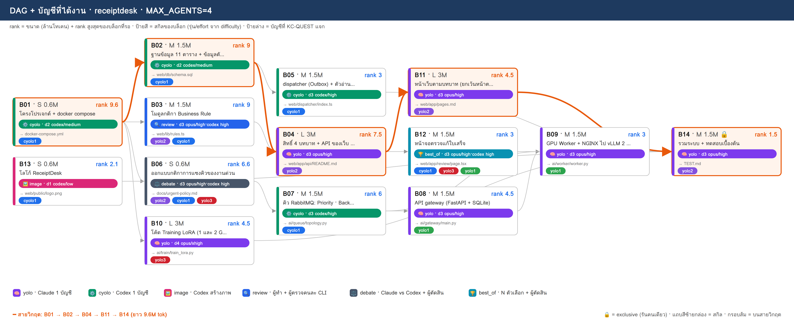
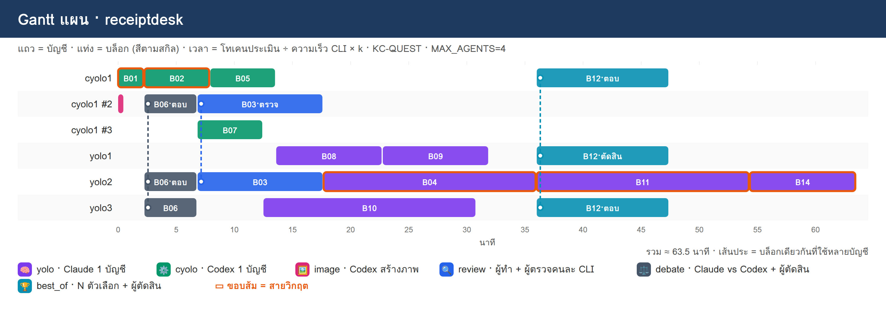

# PLAN · receiptdesk

**โจทย์:** สร้างระบบ ReceiptDesk ตาม docs/REQUIREMENTS.md และ docs/DESIGN.md (ข้อมูลทดสอบ docs/TEST-DATA.md · ต้นฉบับอยู่ที่ /workspace/e2e_lab/receiptdesk/docs): ฝั่งเว็บรันด้วย docker compose (web Next.js + dispatcher + PostgreSQL + volume uploads) และฝั่ง AI บนเครื่อง GPU 2 ใบ (API gateway FastAPI + RabbitMQ คิว urgent/normal/dlq + GPU Worker 2 ตัว + NGINX + vLLM 2 ตัว) อ่านใบเสร็จเป็น 5 ช่อง ติดธงตาม BR-04/BR-05 ให้พนักงานตรวจแก้และยืนยัน งานด่วนแซงคิวแบบ 4:1 คิวเต็มแจ้งนาทีลองใหม่ ใบที่อ่านไม่ได้ไป Dead-letter Queue และมีโค้ด Training LoRA + Evaluation ของโมเดล Vision-Language

วางแผนเมื่อ 19/11/2026 11:55 · MAX_AGENTS 4 · บัญชี cyolo1, yolo1, yolo2, yolo3 · ตัวปรับเวลา k {"cyolo": 0.3022, "yolo": 0.7335, "image": 0.0733, "*": 0.5077, "review": 0.5981}

> แผนนี้ยังไม่ได้รันจริง — KC-QUEST เลือกบัญชีจากโควตา แล้วจำลองเวลาตาม dependency

## 1) โควตาของแต่ละบัญชี

| บัญชี | แพลน | ใช้ไป 5 ชม. | ใช้ไปสัปดาห์ | headroom | รีเซ็ต/หมดอายุ (ชม.) | U | slot | ที่มา |
|---|---|---|---|---|---|---|---|---|
| cyolo1 | prolite | 0% | 0% | **100%** | 48.4 | 0.331 | 3 | team.py quota |
| yolo1 | default | 0% | 2% | **98%** | 162.1 | 0.129 | 3 | team.py quota |
| yolo2 | default | 0% | 18% | **82%** | 97.1 | 0.198 | 3 | team.py quota |
| yolo3 | default | 6% | 27% | **73%** | 121.1 | 0.165 | 3 | team.py quota |

## 2) DAG + สกิล + บัญชี

**สายวิกฤต:** B01 → B02 → B04 → B11 → B14 · ยาว 9.6M tok

## 3) ตารางแจกงาน (เหตุผล KC-QUEST ทุกบล็อก)

| บล็อก | สกิล | ชื่อ | ขนาด · c | รอ | rank | บัญชี (บทบาท) | เริ่ม–จบ (นาที) | เหตุผล KC-QUEST |
|---|---|---|---|---|---|---|---|---|
| **B01** | ⚙️ cyolo | โครงโปรเจกต์ + docker compose | S · 0.6 | – | 9.6 | cyolo1 (ทำ) | 0.0–2.3 | ทำ: cyolo1 38.5 (U=0.331 F=0.002 S=0.984 S=0.7 L=0.0) · 0.60M ≈ 5ชม. 1.56% / สัปดาห์ 0.2% |
| B13 | 🖼️ image | โลโก้ ReceiptDesk | S · 0.6 | – | 2.1 | cyolo1 (ทำ) | 0.0–0.5 | ทำ: cyolo1 26.8 (U=0.331 F=0.002 S=0.969 S=0.153 L=0.333) · 0.60M ≈ 5ชม. 1.56% / สัปดาห์ 0.2% |
| **B02** | ⚙️ cyolo | ฐานข้อมูล 11 ตาราง + ข้อมูลตั้งต้น | M · 1.5 | B01 | 9 | cyolo1 (ทำ) | 2.3–7.9 | ทำ: cyolo1 37.1 (U=0.331 F=0.005 S=0.93 S=0.657 L=0.0) · 1.50M ≈ 5ชม. 3.9% / สัปดาห์ 0.49% |
| B06 | ⚖️ debate | ออกแบบกติกาการแซงคิวของงานด่วน | S · 0.6 | B01 | 6.6 | yolo2 (ตอบ), cyolo1 (ตอบ), yolo3 (ตัดสิน) | 2.3–6.8 | ตอบ: yolo2 33.0 (U=0.198 F=0.002 S=0.984 S=0.688 L=0.0) · 0.60M ≈ 5ชม. 1.56% / สัปดาห์ 0.2% · อันดับ 2 yolo3 30.8   ตอบ: cyolo1 30.9 (U=0.331 F=0.002 S=0.914 S=0.482 L=0.333) · 0.60M ≈ 5ชม. 1.56% / สัปดาห์ 0.2%   ตัดสิน: yolo3 31.0 (U=0.165 F=0.001 S=0.935 S=0.688 L=0.0) · 0.18M ≈ 5ชม. 0.47% / สัปดาห์ 0.06% · อันดับ 2 yolo1 30.4 |
| B03 | 🔍 review | โมดูลกติกา Business Rule | M · 1.5 | B01 | 9 | yolo2 (ทำ), cyolo1 (ตรวจ) | 6.8–17.7 | ทำ: yolo2 36.3 (U=0.198 F=0.006 S=0.945 S=0.938 L=0.0) · 1.50M ≈ 5ชม. 3.9% / สัปดาห์ 0.49% · อันดับ 2 yolo3 34.2   ตรวจ: cyolo1 29.4 (U=0.331 F=0.001 S=0.863 S=0.657 L=0.667) · 0.45M ≈ 5ชม. 1.17% / สัปดาห์ 0.15% |
| B07 | ⚙️ cyolo | คิว RabbitMQ: Priority · Backpressure · DLQ | M · 1.5 | B06 | 6 | cyolo1 (ทำ) | 6.8–12.5 | ทำ: cyolo1 29.7 (U=0.331 F=0.005 S=0.875 S=0.438 L=0.333) · 1.50M ≈ 5ชม. 3.9% / สัปดาห์ 0.49% |
| B05 | ⚙️ cyolo | dispatcher (Outbox) + ตัวอ่านจำลอง | M · 1.5 | B02 | 3 | cyolo1 (ทำ) | 7.9–13.6 | ทำ: cyolo1 22.3 (U=0.331 F=0.005 S=0.824 S=0.218 L=0.667) · 1.50M ≈ 5ชม. 3.9% / สัปดาห์ 0.49% |
| B10 | 🧠 yolo | โค้ด Training LoRA (1 และ 2 GPU) + Evaluation | L · 3 | B01 | 4.5 | yolo3 (ทำ) | 12.5–30.8 | ทำ: yolo3 26.8 (U=0.165 F=0.013 S=0.857 S=0.469 L=0.0) · 3.00M ≈ 5ชม. 7.8% / สัปดาห์ 0.98% · อันดับ 2 yolo1 26.2 |
| B08 | 🧠 yolo | API gateway (FastAPI + SQLite) | M · 1.5 | B07 | 4.5 | yolo1 (ทำ) | 13.6–22.8 | ทำ: yolo1 26.7 (U=0.129 F=0.005 S=0.961 S=0.469 L=0.0) · 1.50M ≈ 5ชม. 3.9% / สัปดาห์ 0.49% · อันดับ 2 yolo2 25.3 |
| **B04** | 🧠 yolo | สิทธิ์ 4 บทบาท + API ของเว็บ 23 เส้น | L · 3 | B02, B03 | 7.5 | yolo2 (ทำ) | 17.7–36.0 | ทำ: yolo2 32.9 (U=0.198 F=0.012 S=0.867 S=0.781 L=0.0) · 3.00M ≈ 5ชม. 7.8% / สัปดาห์ 0.98% · อันดับ 2 yolo1 27.0 |
| B09 | 🧠 yolo | GPU Worker + NGINX ไป vLLM 2 ตัว | M · 1.5 | B07, B08 | 3 | yolo1 (ทำ) | 22.8–31.9 | ทำ: yolo1 23.8 (U=0.129 F=0.005 S=0.922 S=0.312 L=0.0) · 1.50M ≈ 5ชม. 3.9% / สัปดาห์ 0.49% · อันดับ 2 yolo2 21.8 |
| **B11** | 🧠 yolo | หน้าเว็บตามบทบาท (ยกเว้นหน้าตรวจแก้) | L · 3 | B04 | 4.5 | yolo2 (ทำ) | 36.0–54.4 | ทำ: yolo2 27.0 (U=0.198 F=0.012 S=0.789 S=0.469 L=0.0) · 3.00M ≈ 5ชม. 7.8% / สัปดาห์ 0.98% · อันดับ 2 yolo3 25.6 |
| B12 | 🏆 best_of | หน้าจอตรวจแก้ใบเสร็จ | M · 1.5 | B04 | 3 | cyolo1 (ตอบ), yolo3 (ตอบ), yolo1 (ตัดสิน) | 36.0–47.4 | ตอบ: cyolo1 28.4 (U=0.331 F=0.005 S=0.785 S=0.218 L=0.0) · 1.50M ≈ 5ชม. 3.9% / สัปดาห์ 0.49% · อันดับ 2 yolo3 23.7   ตอบ: yolo3 23.7 (U=0.165 F=0.007 S=0.818 S=0.312 L=0.0) · 1.50M ≈ 5ชม. 3.9% / สัปดาห์ 0.49% · อันดับ 2 yolo1 23.2   ตัดสิน: yolo1 23.5 (U=0.129 F=0.002 S=0.91 S=0.312 L=0.0) · 0.45M ≈ 5ชม. 1.17% / สัปดาห์ 0.15% · อันดับ 2 yolo2 21.0 |
| **B14** | 🧠 yolo | รวมระบบ + ทดสอบเบื้องต้น | M · 1.5 | B05, B09, B10, B11, B12, B13 | 1.5 | yolo2 (ทำ) | 54.4–63.5 | ทำ: yolo2 21.6 (U=0.198 F=0.006 S=0.75 S=0.156 L=0.0) · 1.50M ≈ 5ชม. 3.9% / สัปดาห์ 0.49% · อันดับ 2 yolo3 20.8 |

## 4) Gantt แผน

## 5) รอบแจกงาน

| นาทีที่ | บล็อกที่เริ่ม |
|---|---|
| 0 | B01→cyolo1, B13→cyolo1 |
| 2.3 | B02→cyolo1, B06→yolo2+cyolo1+yolo3 |
| 6.8 | B07→cyolo1, B03→yolo2+cyolo1 |
| 7.9 | B05→cyolo1 |
| 12.5 | B10→yolo3 |
| 13.6 | B08→yolo1 |
| 17.7 | B04→yolo2 |
| 22.8 | B09→yolo1 |
| 36 | B11→yolo2, B12→cyolo1+yolo3+yolo1 |
| 54.4 | B14→yolo2 |

## 6) สรุป

- บล็อก 14 · แจกได้ 14 · agent พร้อมกันสูงสุด 4/4
- เวลาประมาณ 63.5 นาที (แท่ง Gantt) · ไฟล์ผลของทีม: `/workspace/plans/receiptdesk/app/`

ต่อไป: `dagplan.py export receiptdesk` → `dagplan.py run receiptdesk` → `dagplan.py report receiptdesk`
