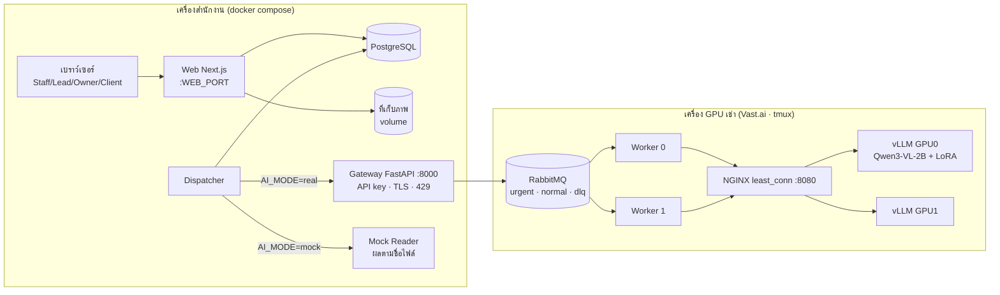
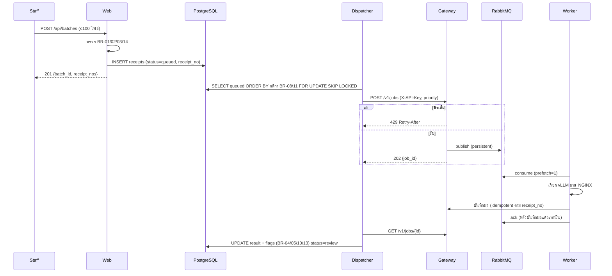
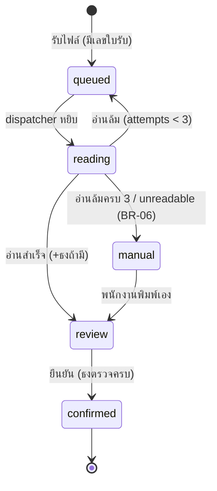
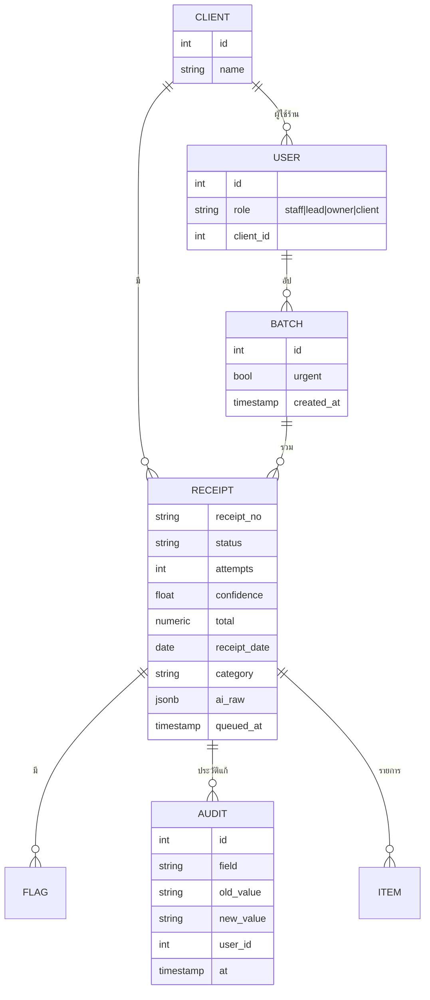

# System Design · ReceiptDesk

## 1. สถาปัตยกรรม

## 2. ลำดับการทำงาน (อัปโหลด → รอตรวจ)

## 3. สถานะใบเสร็จ

## 4. ข้อมูล (ER)

## 5. API Contract (เว็บ)

| Method · Path | สิทธิ์ | ผลสำเร็จ | ผิดพลาด |
|---|---|---|---|
| `POST /api/batches` multipart `files[]`, `client_id` | staff, lead, client (ร้านตัวเอง) | 201 `{batch_id, receipts:[{receipt_no,status}]}` | 415 ชนิด · 413 ขนาด · 422 หน้า/จำนวน · 429 คิวเต็มหรือโควตา + `Retry-After` |
| `GET /api/batches/:id` | เจ้าของชุด, lead, owner | 200 `{receipts:[{receipt_no,status,flags}]}` | 404 ร้านอื่น |
| `POST /api/batches/:id/urgent` | **lead เท่านั้น** | 200 `{urgent:true}` | 403 · 409 เกินโควตา BR-07 |
| `GET /api/receipts/:no` | staff, lead (ทุกร้าน) · client (ร้านตัวเอง ยอดเฉพาะ confirmed) | 200 | 404 |
| `PATCH /api/receipts/:no` `{field, value}` | staff, lead | 200 + audit | 409 ถ้า confirmed |
| `POST /api/receipts/:no/confirm` `{checked_flags:[]}` | staff, lead | 200 | 422 ธงยังไม่ตรวจครบ |
| `GET /api/receipts/:no/audit` | lead, owner | 200 | 403 |
| `GET /api/manual` | staff, lead | 200 กองพิมพ์เอง | — |
| `GET /api/clients/:id/summary?month=YYYY-MM` | client (ตัวเอง), staff, lead, owner | 200 ยอดต่อหมวด (confirmed เท่านั้น · BR-12) | 404 |
| `GET /api/clients/:id/summary.csv?month=` | เหมือนบน | CSV UTF-8 BOM | 404 |
| `GET /api/health` | ไม่ต้องล็อกอิน | 200 `{db,queue,gateway,workers}` | 503 |
| `POST /api/test/reset` | เปิดเมื่อ `TEST_RESET=1` เท่านั้น | 200 · รับ `{queued_normal, urgent_used_today, client_uploads_today, stuck_reading}` | 404 เมื่อปิด |

## 6. API Contract (gateway บน GPU)

| Method · Path | หัว | ผล |
|---|---|---|
| `POST /v1/jobs` `{receipt_no, image_b64, priority:"urgent"|"normal"}` | `X-API-Key` | 202 `{job_id}` · 401 key ผิด · 429 `Retry-After` (เพดาน BR-09 นับเฉพาะ normal) |
| `GET /v1/jobs/{job_id}` | `X-API-Key` | 200 `{state: queued|done|dead, result?, attempts}` |
| `GET /v1/health` | — | 200 `{queue_depth:{urgent,normal,dlq}, workers}` |
| `POST /v1/admin/limits` `{max_queue}` | `X-Admin-Key` | ใช้ปรับเพดานตอนทดสอบ |

ผลอ่าน (JSON): `{"store":str,"date":"YYYY-MM-DD","items":[{"name":str,"price":number}],"total":number,"confidence":0–1,"unreadable":bool}`

## 7. คิว

- **Priority Queue**: 2 คิว `urgent` / `normal` · dispatcher เลือกตาม BR-08 (สลับ `UUUUN`) และ BR-11 (normal รอ ≥ 60 นาทีหยิบก่อน) → งานปกติไม่ค้าง
- **Backpressure**: เว็บนับใบ `queued` ใน DB + gateway นับ depth · normal เกิน 400 → 429 + `Retry-After` (BR-09) · urgent ข้ามเพดานแต่ติดโควตา BR-07
- **Dead-letter Queue**: `attempts` เพิ่มทุกครั้งที่อ่านล้ม (timeout 60 วินาที/JSON เสีย/`unreadable`) · ครบ 3 → `dlq` และสถานะ `manual` (BR-06)
- **ack หลังบันทึกผล**: Worker `prefetch=1` · บันทึกผลด้วย upsert ตาม `receipt_no` แล้วจึง ack → Worker ล่ม ข้อความกลับคิว · ผลซ้ำถูกตัดด้วย upsert
- dispatcher ใช้ `SELECT … FOR UPDATE SKIP LOCKED` · ใบ `reading` นานเกิน 5 นาทีคืนเป็น `queued`

## 8. สภาพแวดล้อม

| ตัวแปร | ค่า | ความหมาย |
|---|---|---|
| `AI_MODE` | `real` / `mock` | `mock` = Mock Reader ให้ผลตามชื่อไฟล์ (ดู TEST-DATA §1) ไม่ใช้ GPU |
| `BUG_MODE` | `0` / `1` | `1` = ทำ BR ผิด 3 ข้อเพื่อฝึกหาบั๊ก (รายชื่ออยู่ในไฟล์ลับไฟล์เดียว) |
| `TEST_RESET` | `0` / `1` | เปิดทางรีเซ็ตข้อมูลทดสอบ |
| `WEB_PORT` · `MOCK_PORT` | 3420 · 3421 | เว็บโมเดลจริง / เว็บ mock (compose project และ DB แยก) |
| `GW_URL` · `GW_API_KEY` | ใน `.env` | ห้าม log |

## 9. `data-testid` หลัก

`upload-input` `upload-submit` `batch-row-<receipt_no>` `status-<receipt_no>` `flag-<code>` `field-total` `field-store` `field-date` `item-row-<i>` `check-flag-<code>` `confirm-btn` `urgent-btn` `quota-left` `manual-list` `audit-tab` `summary-category-<name>` `summary-total` `export-csv` `queue-full-msg` `retry-after`

## 10. GPU

- เทรน LoRA Qwen/Qwen3-VL-2B-Instruct บน 1 GPU (`python`) และ 2 GPU (`torchrun --nproc_per_node 2`) global batch เท่ากัน · วัดด้วย `train_runtime`
- Deploy: vLLM ต่อ GPU ละ 1 ตัว หลัง NGINX `least_conn` · Worker N ตัวต่อ GPU N ใบ
