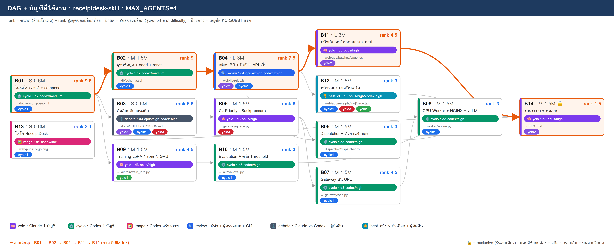
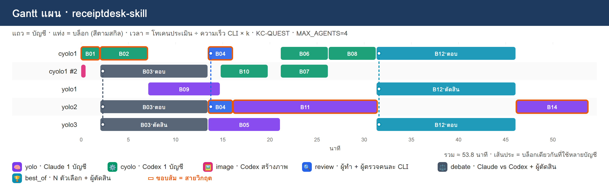

# PLAN · receiptdesk-skill

**โจทย์:** ReceiptDesk: เว็บรับใบเสร็จเป็นชุดให้สำนักงานบัญชี อ่านด้วย VLM (Qwen3-VL-2B + LoRA) บน GPU เช่า ผ่าน gateway + RabbitMQ (Priority/Backpressure/DLQ) ให้พนักงานตรวจแก้ยืนยัน ลูกค้าร้านดูสรุปรายเดือน ตาม docs/USER-STORIES.md docs/REQUIREMENTS.md docs/DESIGN.md docs/TEST-DATA.md

วางแผนเมื่อ 19/11/2026 18:11 · MAX_AGENTS 4 · บัญชี cyolo1, yolo1, yolo2, yolo3 · ตัวปรับเวลา k {"cyolo": 0.2708, "yolo": 0.6138, "image": 0.0733, "*": 0.4904, "review": 0.0726, "debate": 1.2722, "best_of": 0.6585}

> แผนนี้ยังไม่ได้รันจริง — KC-QUEST เลือกบัญชีจากโควตา แล้วจำลองเวลาตาม dependency

## 1) โควตาของแต่ละบัญชี

| บัญชี | แพลน | ใช้ไป 5 ชม. | ใช้ไปสัปดาห์ | headroom | รีเซ็ต/หมดอายุ (ชม.) | U | slot | ที่มา |
|---|---|---|---|---|---|---|---|---|
| cyolo1 | prolite | 0% | 0% | **100%** | 42.2 | 0.363 | 3 | team.py quota |
| yolo1 | default | 0% | 5% | **95%** | 155.8 | 0.133 | 3 | team.py quota |
| yolo2 | default | 0% | 18% | **82%** | 90.8 | 0.209 | 3 | team.py quota |
| yolo3 | default | 3% | 31% | **69%** | 114.8 | 0.173 | 3 | team.py quota |

## 2) DAG + สกิล + บัญชี

**สายวิกฤต:** B01 → B02 → B04 → B11 → B14 · ยาว 9.6M tok

## 3) ตารางแจกงาน (เหตุผล KC-QUEST ทุกบล็อก)

| บล็อก | สกิล | ชื่อ | ขนาด · c | รอ | rank | บัญชี (บทบาท) | เริ่ม–จบ (นาที) | เหตุผล KC-QUEST |
|---|---|---|---|---|---|---|---|---|
| **B01** | ⚙️ cyolo | โครงโปรเจกต์ + compose | S · 0.6 | – | 9.6 | cyolo1 (ทำ) | 0.0–2.0 | ทำ: cyolo1 39.8 (U=0.363 F=0.002 S=0.984 S=0.7 L=0.0) · 0.60M ≈ 5ชม. 1.56% / สัปดาห์ 0.2% |
| B13 | 🖼️ image | โลโก้ ReceiptDesk | S · 0.6 | – | 2.1 | cyolo1 (ทำ) | 0.0–0.5 | ทำ: cyolo1 28.1 (U=0.363 F=0.002 S=0.969 S=0.153 L=0.333) · 0.60M ≈ 5ชม. 1.56% / สัปดาห์ 0.2% |
| **B02** | ⚙️ cyolo | ฐานข้อมูล + seed + reset | M · 1.5 | B01 | 9 | cyolo1 (ทำ) | 2.0–7.1 | ทำ: cyolo1 38.4 (U=0.363 F=0.005 S=0.93 S=0.657 L=0.0) · 1.50M ≈ 5ชม. 3.9% / สัปดาห์ 0.49% |
| B03 | ⚖️ debate | ตัดสินกติกาแซงคิว | S · 0.6 | B01 | 6.6 | yolo2 (ตอบ), cyolo1 (ตอบ), yolo3 (ตัดสิน) | 2.0–13.5 | ตอบ: yolo2 33.5 (U=0.209 F=0.002 S=0.984 S=0.688 L=0.0) · 0.60M ≈ 5ชม. 1.56% / สัปดาห์ 0.2% · อันดับ 2 yolo3 31.6   ตอบ: cyolo1 32.2 (U=0.363 F=0.002 S=0.914 S=0.482 L=0.333) · 0.60M ≈ 5ชม. 1.56% / สัปดาห์ 0.2%   ตัดสิน: yolo3 31.7 (U=0.173 F=0.001 S=0.965 S=0.688 L=0.0) · 0.18M ≈ 5ชม. 0.47% / สัปดาห์ 0.06% · อันดับ 2 yolo1 30.6 |
| B09 | 🧠 yolo | Training LoRA 1 และ N GPU | M · 1.5 | B01 | 4.5 | yolo1 (ทำ) | 7.1–14.8 | ทำ: yolo1 26.9 (U=0.133 F=0.005 S=0.961 S=0.469 L=0.0) · 1.50M ≈ 5ชม. 3.9% / สัปดาห์ 0.49% · อันดับ 2 yolo2 26.4 |
| **B04** | 🔍 review | กติกา BR + สิทธิ์ + API เว็บ | L · 3 | B02 | 7.5 | yolo2 (ทำ), cyolo1 (ตรวจ) | 13.5–16.1 | ทำ: yolo2 33.9 (U=0.209 F=0.012 S=0.906 S=0.781 L=0.0) · 3.00M ≈ 5ชม. 7.8% / สัปดาห์ 0.98% · อันดับ 2 yolo3 32.2   ตรวจ: cyolo1 36.1 (U=0.363 F=0.003 S=0.891 S=0.547 L=0.0) · 0.90M ≈ 5ชม. 2.34% / สัปดาห์ 0.29% |
| B05 | 🧠 yolo | คิว Priority · Backpressure · DLQ | M · 1.5 | B03 | 6 | yolo3 (ทำ) | 13.5–21.2 | ทำ: yolo3 30.3 (U=0.173 F=0.007 S=0.926 S=0.625 L=0.0) · 1.50M ≈ 5ชม. 3.9% / สัปดาห์ 0.49% · อันดับ 2 yolo2 27.5 |
| B10 | ⚙️ cyolo | Evaluation + ตรึง Threshold | M · 1.5 | B09 | 3 | cyolo1 (ทำ) | 14.8–19.9 | ทำ: cyolo1 27.3 (U=0.363 F=0.005 S=0.852 S=0.218 L=0.333) · 1.50M ≈ 5ชม. 3.9% / สัปดาห์ 0.49% |
| **B11** | 🧠 yolo | หน้าเว็บ อัปโหลด สถานะ สรุป | L · 3 | B04 | 4.5 | yolo2 (ทำ) | 16.1–31.5 | ทำ: yolo2 28.1 (U=0.209 F=0.012 S=0.828 S=0.469 L=0.0) · 3.00M ≈ 5ชม. 7.8% / สัปดาห์ 0.98% · อันดับ 2 yolo1 25.8 |
| B07 | ⚙️ cyolo | Gateway บน GPU | M · 1.5 | B05 | 4.5 | cyolo1 (ทำ) | 21.2–26.2 | ทำ: cyolo1 31.7 (U=0.363 F=0.005 S=0.813 S=0.328 L=0.0) · 1.50M ≈ 5ชม. 3.9% / สัปดาห์ 0.49% |
| B06 | ⚙️ cyolo | Dispatcher + ตัวอ่านจำลอง | M · 1.5 | B02, B05 | 3 | cyolo1 (ทำ) | 21.2–26.2 | ทำ: cyolo1 26.2 (U=0.363 F=0.005 S=0.774 S=0.218 L=0.333) · 1.50M ≈ 5ชม. 3.9% / สัปดาห์ 0.49% |
| B08 | ⚙️ cyolo | GPU Worker + NGINX + vLLM | M · 1.5 | B07 | 3 | cyolo1 (ทำ) | 26.2–31.3 | ทำ: cyolo1 28.9 (U=0.363 F=0.005 S=0.735 S=0.218 L=0.0) · 1.50M ≈ 5ชม. 3.9% / สัปดาห์ 0.49% |
| B12 | 🏆 best_of | หน้าจอตรวจแก้ใบเสร็จ | M · 1.5 | B04 | 3 | cyolo1 (ตอบ), yolo3 (ตอบ), yolo1 (ตัดสิน) | 31.3–46.1 | ตอบ: cyolo1 28.3 (U=0.363 F=0.005 S=0.696 S=0.218 L=0.0) · 1.50M ≈ 5ชม. 3.9% / สัปดาห์ 0.49% · อันดับ 2 yolo3 25.0   ตอบ: yolo3 25.0 (U=0.173 F=0.007 S=0.887 S=0.312 L=0.0) · 1.50M ≈ 5ชม. 3.9% / สัปดาห์ 0.49% · อันดับ 2 yolo1 23.9   ตัดสิน: yolo1 24.3 (U=0.133 F=0.002 S=0.949 S=0.312 L=0.0) · 0.45M ≈ 5ชม. 1.17% / สัปดาห์ 0.15% · อันดับ 2 yolo2 22.0 |
| **B14** | 🧠 yolo | รวมระบบ + ทดสอบ | M · 1.5 | B06, B08, B10, B11, B12, B13 | 1.5 | yolo2 (ทำ) | 46.1–53.8 | ทำ: yolo2 22.7 (U=0.209 F=0.006 S=0.789 S=0.156 L=0.0) · 1.50M ≈ 5ชม. 3.9% / สัปดาห์ 0.49% · อันดับ 2 yolo3 22.1 |

## 4) Gantt แผน

## 5) รอบแจกงาน

| นาทีที่ | บล็อกที่เริ่ม |
|---|---|
| 0 | B01→cyolo1, B13→cyolo1 |
| 2 | B02→cyolo1, B03→yolo2+cyolo1+yolo3 |
| 7.1 | B09→yolo1 |
| 13.5 | B04→yolo2+cyolo1, B05→yolo3 |
| 14.8 | B10→cyolo1 |
| 16.1 | B11→yolo2 |
| 21.2 | B07→cyolo1, B06→cyolo1 |
| 26.2 | B08→cyolo1 |
| 31.3 | B12→cyolo1+yolo3+yolo1 |
| 46.1 | B14→yolo2 |

## 6) สรุป

- บล็อก 14 · แจกได้ 14 · agent พร้อมกันสูงสุด 4/4
- เวลาประมาณ 53.8 นาที (แท่ง Gantt) · ไฟล์ผลของทีม: `/workspace/plans/receiptdesk-skill/app/`

ต่อไป: `dagplan.py export receiptdesk-skill` → `dagplan.py run receiptdesk-skill` → `dagplan.py report receiptdesk-skill`
