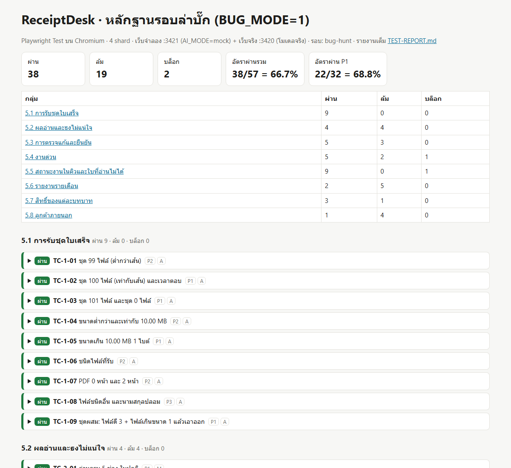

# Bug Hunt · ReceiptDesk · รอบ BUG_MODE=1 (19 พ.ย. 2569)

หลักฐาน: [`test/evidence/bug-hunt/index.html`](evidence/bug-hunt/index.html) (ภาพหน้าจอ · JSON · CSV · trace ของทุกข้อ) · ภาพรวม [`report.png`](evidence/bug-hunt/report.png) · ผลดิบ `test/runs/bug-hunt/shard-*.json` · รายงาน Playwright `test/runs/bug-hunt/blob`
รายงานนี้เขียนจากผลเทสต์อย่างเดียว ก่อนเปิด `docs/BUGS-SECRET.md`

## 1. วิธีรัน

| เรื่อง | รายละเอียด |
|---|---|
| ชุดเทสต์ | Playwright Test ชุดเดิมของรอบปกติ (`test/e2e/tests/51…58`) ไม่ได้แก้เทสต์หรือผลที่คาดหวังเลย |
| เว็บ | `:3421` `receiptdesk-mock` (ตัวอ่านจำลอง) และ `:3420` `receiptdesk-e2e` (โมเดลจริง) ทั้ง 2 ชุดเปิดใหม่ด้วย `BUG_MODE=1` (สร้าง container web + dispatcher ใหม่ ตรวจใน container แล้วว่าเป็น 1 ทั้ง 4 ตัว) · `:3420` เปิด test reset ชั่วคราวด้วย token เดิมที่ไม่ได้พิมพ์ |
| การรัน | 4 shard รันพร้อมกัน ครั้งเดียว (ไม่มีชุดรันซ้อน) `RUN=bug-hunt` · ใช้ล็อกต่อสแตกเหมือนเดิม |
| ใบจริงไป GPU | **40 ไฟล์** (TC-2-07 12 · 2-08 2 · 4-08 23 · 5-09 3) ≤ 120 |

## 2. เทียบกับรอบปกติ

| | รอบปกติ (ผลสุดท้าย) | รอบ BUG_MODE=1 |
|---|---|---|
| ผ่าน / ล้ม / บล็อก | 46 / 11 / 2 | **38 / 19 / 2** |
| P1 ผ่าน | 28 / 32 | 22 / 32 |

**ข้อที่ล้มเพิ่ม (ผ่านในรอบปกติ ล้มในรอบนี้) 9 ข้อ:** TC-2-06 · TC-4-04 · TC-6-01 · TC-6-02 · TC-6-04 · TC-6-05 · TC-7-04 · TC-8-02 · TC-8-04
**ข้อที่ล้มทั้งสองรอบแต่อาการเปลี่ยน 1 ข้อ:** TC-2-05 (รอบปกติติดธงครบแต่เหตุผลไม่ครบ · รอบนี้ไม่ติดธงเลย)
**ล้มเหมือนเดิมทุกอย่าง 9 ข้อ:** TC-2-07, 2-08, 3-06, 3-07, 3-08, 4-01, 6-07, 8-01, 8-05 (ข้อความ error ตรงกับรอบปกติทุกบรรทัด = ข้อบกพร่อง D1–D9 เดิม ไม่ใช่บั๊กใหม่)
**ผ่านในรอบนี้แต่ล้มในรอบปกติ:** TC-4-08 (D5 เกิดไม่คงที่ 1 ใน 8 รูปคิว รอบนี้ไม่เกิด ไม่ถือว่าหาย)

ข้อที่ล้มเพิ่มทั้ง 10 ข้อ (9 + 2-05) จัดกลุ่มตามสาเหตุได้ **3 บั๊ก**

| บั๊ก | เรื่อง | TC ที่จับได้ | ความรุนแรง |
|---|---|---|---|
| BH-1 | ธง "ยอดไม่ตรงรายการ" ไม่ติดเมื่อผลต่างเกิน 1.00 บาทเล็กน้อย | TC-2-05, TC-2-06 | วิกฤต (P1 เงิน: ยอดผิดผ่านไปโดยไม่มีธง) |
| BH-2 | สรุปรายเดือนไม่นับใบที่ลงวันที่ 1 ของเดือน | TC-6-01, 6-02, 6-04, 6-05, 7-04, 8-02, 8-04 | วิกฤต (P1 เงิน: ยอดรายงาน/CSV/หน้าลูกค้าผิด) |
| BH-3 | โควตางานด่วนครบ 5 งานแล้วยังตั้งงานที่ 6 ได้ | TC-4-04 | สูง (P1 ตามแผน: เกินโควตา งานปกติเสี่ยงค้าง) |

## 3. รายละเอียดบั๊ก

### BH-1 · ธง BR-05 "ยอดไม่ตรงรายการ" ไม่ติดที่ผลต่าง 1.01 และ 1.49 บาท — วิกฤต

- **ที่มา:** FR-09 · BR-05 (ผลต่าง > 1.00 บาท → ติดธง) · US-08, US-09
- **ขั้นตอนทำซ้ำ** (`:3421` ตัวอ่านจำลอง)
  1. รีเซ็ตตั้งต้น · เข้าสู่ระบบ U-01 (`pim@receiptdesk.test`)
  2. อัปโหลด `test/data/diff-101.jpg`, `diff-over-101.jpg`, `diff-149.jpg` เข้า CL-01 รอจนเป็น "รอตรวจ"
  3. เปิดหน้าตรวจของแต่ละใบ และ `GET /api/receipts/<id>`
  4. (TC-2-06) อัปโหลด `ok-100`, `conf-089`, `conf-090`, `diff-101`, `both-flags` แล้วกรองเฉพาะใบติดธง
- **ผลที่คาดหวัง:** ทั้ง 3 ใบติดธง "ยอดไม่ตรงรายการ" (ผลต่าง 1.01 / 1.01 / 1.49 > 1.00) · ตัวกรองของ TC-2-06 ได้ 3 ใบ (conf-089 · diff-101 · both-flags)
- **ผลจริง:** ทั้ง 3 ใบ `flags.mismatch=false`, `flagged=false`, `reasons=[]` ทั้งที่หน้าเว็บแสดง ยอดรวม 100.00 · ผลรวมรายการ 98.99 / 101.01 / 98.51 · ตัวกรองได้ 2 ใบ (diff-101 หาย) · ใบ `both-flags` ที่ผลต่าง 5.00 ยังติดธง และ TC-2-04 (0.99 · 1.00 ไม่ติดธง) ยังผ่าน → เส้นตัดของ BR-05 เลื่อนจาก 1.00 ไปอยู่ระหว่าง 1.49 ถึง 5.00
- **ผลกระทบ:** ใบที่ยอดรวมไม่ตรงรายการ 1–1.49 บาทไม่ถูกบังคับให้เปิดดูก่อนยืนยัน (FR-12) ยอดผิดผ่านเข้าบัญชีได้โดยไม่มีธง
- **หลักฐาน:** `evidence/bug-hunt/TC-2-05/01_W12_receipts_after_reading.json` (flags ทั้งหมด false) · `04/06/08_review_page_*.json` (itemsSum กับ total) · `03/05/07_review_page_*.png` · `evidence/bug-hunt/TC-2-06/06_flagged_filter_rows_of_this_batch.json` · `07_W11_flagged_true_ids_of_this_batch_.json` (count 2)

### BH-2 · สรุปรายเดือนไม่นับใบที่ลงวันที่ 1 ของเดือน — วิกฤต

- **ที่มา:** FR-28 · FR-29 · FR-25 · BR-14 (นับเข้าเดือนตั้งแต่วันที่ 1 ถึงวันสุดท้าย) · TD-BR14-b, e · E-02, E-03, E-05 · US-21, US-18, US-23
- **ขั้นตอนทำซ้ำ** (`:3421`)
  1. รีเซ็ตตั้งต้น (ใบตั้งต้น S-01 … S-08)
  2. U-04 (`orathai@receiptdesk.test`) เปิด `/reports` เลือก CL-01 เดือน 2026-11 → ดูตัวอย่างและออก CSV
  3. ทำซ้ำกับเดือน 2026-12 · และเข้าสู่ระบบ U-05 (ลูกค้า CL-01) ดูสรุป พ.ย. ที่หน้าลูกค้า
- **ผลที่คาดหวัง:** พ.ย. = S-02 + S-03 + S-04 + S-07 = 200.50 + 99.50 + 1,000.00 + 40.00 = **1,340.00 บาท · 4 ใบ** · CAT-01 = 1,200.50 · ธ.ค. = S-05 = **75.25 บาท · 1 ใบ**
- **ผลจริง:** พ.ย. = **1,139.50 บาท · 3 ใบ** (ขาด S-02 วันที่ 2026-11-01 พอดี 200.50) · CAT-01 = 1,000.00 · ธ.ค. = **0.00 บาท · 0 ใบ** (ขาด S-05 วันที่ 2026-12-01) · ใบวันสุดท้ายของเดือน (S-04 2026-11-30) และ ต.ค. (S-01 2026-10-31) ยังถูก → ผิดเฉพาะขอบล่างของเดือน (นับแบบ "มากกว่า" วันที่ 1 แทน "ตั้งแต่")
  - ผลเดียวกันใน CSV (W18), หน้าตัวอย่าง, W19 ยอดแยกหมวด, หน้าลูกค้า และไฟล์สรุปของ U-01 / U-03 (TC-7-04) · หลังยืนยันใบใหม่ (TC-6-04, 8-04) ยอดก็ขาด 200.50 เท่าเดิม
- **ผลกระทบ:** ยอดรายจ่ายรายเดือนที่ส่งลูกค้าและที่ออกเป็นไฟล์ผิด ทุกใบที่ลงวันที่ 1 หายจากรายงานทุกเดือน (ข้อมูลยังอยู่ในระบบ ไม่หาย แต่ไม่ถูกนับ)
- **หลักฐาน:** `evidence/bug-hunt/TC-6-01/01_CL-01_2026-11.csv` (มี 3 แถว ไม่มี S-02) · `02_CL-01_2026-11_report.json` · `00_CL-01_2026-11_preview.png` · `TC-6-02/04_CL-01_2026-12.csv` (มีแต่หัวตาราง) · `TC-6-05` · `TC-8-02/00_U-05_portal_เดือน_2026-11.png` · `TC-8-04` · `TC-7-04`

### BH-3 · โควตางานด่วนครบ 5 งานแล้ว งานที่ 6 ยังตั้งได้ — สูง

- **ที่มา:** FR-18 · BR-09 (ไม่เกิน 5 งานต่อวัน งานที่ 6 → `409 urgent_quota`) · US-10, US-15
- **ขั้นตอนทำซ้ำ** (`:3421`)
  1. รีเซ็ตด้วย `{"urgentToday":5}` · พักการอ่าน (`code_step15/mock.sh stop-reader`)
  2. U-03 (`kitti@receiptdesk.test`) (ก) อัปโหลด 5 ไฟล์ติ๊ก "ด่วน" (W7) · (ข) อัปโหลดแบบปกติแล้วกดปุ่มด่วนในหน้าชุด (W10)
  3. รีเซ็ตตั้งต้น · ตั้งด่วน 3 งานด้วย W10 และ 2 งานด้วย W7 แล้วลองงานที่ 6
- **ผลที่คาดหวัง:** งานที่ 6 ทุกช่องทางได้ `409 urgent_quota` · ตัวนับ `usedToday` คงเป็น 5 / 5
- **ผลจริง:** งานที่ 6 ได้ `201` priority `urgent` (W7) · ตัวนับขึ้นเป็น **6** · ทั้งขั้น ① และ ② · TC-4-03 (ใช้ไป 4 → งานที่ 5 ได้) ยังผ่าน → ผิดที่เส้น 5 พอดี (off-by-one)
- **ผลกระทบ:** ตั้งด่วนเกินโควตาได้ งานด่วนกินเวลาอ่านเกิน 50 ใบต่อวัน (NFR-04) งานปกติเสี่ยงค้าง
- **หลักฐาน:** `evidence/bug-hunt/TC-4-04/01_①_ก_W7_urgent_true.json` (201 urgent) · `05_②_ลำดับการตั้งด่วน.json` (usedToday 1 … 6) · `00_①_ก_อัปโหลดติ๊กด่วน_งานที่_6.png` · `04_②_งานที่_6_กดปุ่มด่วน.png`

## 4. ข้อสังเกต

- ข้อที่ล้มเหมือนรอบปกติไม่ได้นับเป็นบั๊กของรอบนี้ (ข้อความ error ตรงกันทุกข้อ)
- สภาพตอนจบรอบนี้: คืนรายงานรอบปกติ (`test/index.html`, `test/runs/summary.json`, `test/triage.json`, `test/evidence/test-report.png`) กลับเป็นไฟล์เดิมแล้ว (ตรวจด้วย md5 ตรงกันทุกไฟล์)

## 5. เทียบกับ BUGS-SECRET (เปิดหลังเขียนหัวข้อ 1–4 เสร็จ)

**จับได้ 3 จาก 3 ตัว** และระบุกฎได้ตรงทุกตัว

| BUGS-SECRET | บั๊กที่รายงาน | ตรงไหม | หมายเหตุ |
|---|---|---|---|
| #1 BR-05 ปัดผลต่างลงเป็นบาทเต็ม ติดธงเมื่อ ≥ 2.00 | BH-1 (TC-2-05, 2-06) | ✅ | รายงานบอกว่าเส้นตัดอยู่ระหว่าง 1.49–5.00 ข้อมูลทดสอบไม่มีผลต่าง 1.50–4.99 จึงชี้ค่า 2.00 ไม่ได้ · ถ้าจะแยกได้ต้องเพิ่มใบผลต่าง 1.99 / 2.00 |
| #2 BR-09 ใช้ "มากกว่า 5" ตั้งงานที่ 6 ได้ | BH-3 (TC-4-04) | ✅ | ตรงทั้งอาการ (ตัวนับ 6) และสาเหตุ off-by-one · ไม่ได้ลองงานที่ 7 |
| #3 BR-14 ช่วงเดือนเริ่มหลังวันที่ 1 | BH-2 (TC-6-01, 6-02, 6-04, 6-05, 7-04, 8-02, 8-04) | ✅ | ตัวเลข 1,139.50 / 3 ใบ · 0.00 / 0 ใบ · CAT-01 1,000.00 ตรงกับไฟล์ทุกค่า |

ไม่มีบั๊กที่รายงานเกิน (false positive) เพราะข้อที่ล้มเหมือนรอบปกติถูกแยกออกตั้งแต่หัวข้อ 2
