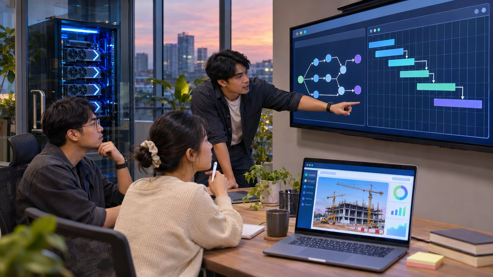
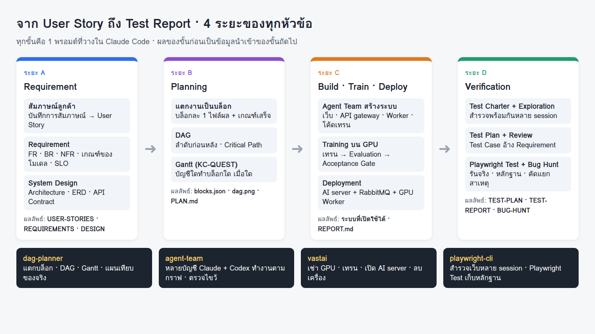

# Agent Team ส่งมอบระบบ AI ครบวงจร · จาก User Story ถึง Test Report

บทนี้รวมความรู้ 4 เรื่องที่เรียนมาเป็นงานเดียว: รับความต้องการจากลูกค้า → วางแผนงานให้ทีม AI → สร้าง เทรน และเปิดบริการบน GPU → ทดสอบแล้วออกรายงาน

ทุกขั้นเป็นพรอมต์ Copy & Paste ใน **Claude Code** · พรอมต์บอกเป้าหมายเป็นข้อ ๆ โค้ดทุกไฟล์ทีม AI เขียนเอง

## ความรู้ที่นำมารวม

| ระยะ | ทำอะไร | เครื่องมือ | เรียนมาจากบท |
|---|---|---|---|
| A · Requirement | สัมภาษณ์ → User Story → Requirement → System Design | Claude Code | [Sabai Spa](../../00_week01/04_sabai-spa-web-and-testplan-from-interview/README.md) |
| B · Planning | แตกงานเป็นบล็อก → DAG → Gantt | สกิล `dag-planner` | [DAG Planner](../../01_week02/05_DAG_Planner/README.md) |
| C · Build · Train · Deploy | ทีมหลายบัญชีสร้างระบบ · เทรนโมเดล · เปิด AI server + RabbitMQ | สกิล `agent-team` · `vastai` | [VastAi Application](../02_VastAi_Application/README.md) |
| D · Verification | Test Charter → Exploration → Test Plan → Playwright Test → Bug Hunt | `playwright-cli` · Playwright Test | [Test Plan from Exploration](../../00_week01/03_petshop-testplan-from-exploration/README.md) |

## 2 หัวข้อ จากง่ายไปยาก

| | [หัวข้อที่ 1 · SiteSafe Inspect](01_sitesafe_inspect/README.md) | [หัวข้อที่ 2 · ReceiptDesk](02_receipt_desk/README.md) |
|---|---|---|
| ลูกค้า | บริษัทรับเหมาก่อสร้าง | สำนักงานบัญชี |
| บริการ | อัปโหลดภาพหน้างาน → ตรวจอุปกรณ์ความปลอดภัย → รายงานประจำวัน | อัปโหลดใบเสร็จเป็นชุด → อ่านเป็นข้อมูล → คนตรวจแก้ → รายงานรายเดือน |
| โมเดล | YOLO11s (Object Detection) | Qwen3-VL-2B + LoRA (Vision-Language Model) |
| Training | GPU 1 ใบ | GPU 2 ใบ เทียบกับ 1 ใบ |
| Inference | GPU Worker 1 ตัว | vLLM 2 ตัวหลัง Load Balancer + GPU Worker 2 ตัว |
| RabbitMQ | Work Queue 1 คิว | Priority Queue · Backpressure · Dead-letter Queue |
| แผนงานของทีม | 10 บล็อก · 4 สกิล | 14 บล็อก · ครบ 6 สกิล |
| สไลด์ประกอบการสอน | [SiteSafe_Inspect_Slides.html](01_sitesafe_inspect/SiteSafe_Inspect_Slides.html) | [ReceiptDesk_Slides.html](02_receipt_desk/ReceiptDesk_Slides.html) |
| การทดสอบ | Functional Test + Bug Hunt | เพิ่ม Capacity Test ตาม SLO และ Failure Test |

ทั้ง 2 หัวข้อใช้เว็บ **Next.js + PostgreSQL** ใน Docker บนเครื่องของเรา และเครื่อง GPU ที่เช่าจาก Vast.ai

## ต้องมีก่อน

- container `multi-account` รันอยู่ มีสกิล `dag-planner` · `agent-team` · `yolo` · `cyolo` · `vastai` และมีบัญชีพร้อมอย่างน้อย Claude 2 บัญชี + Codex 1 บัญชี
- ทำ [VastAi Application LAB 0](../02_VastAi_Application/README.md#lab-0--เตรียม-key-3-ตัว) แล้ว (ไฟล์ `.env` มี key 3 ตัว) แล้วคัดลอกไฟล์ `.env` มาไว้ในโฟลเดอร์ของหัวข้อที่จะทำ
- Docker Desktop และ Claude Code บนเครื่องนี้

> ⚠️ **เสียเงินจริง** — ทุกหัวข้อจบด้วยพรอมต์ **ลบเครื่อง** ห้ามข้าม แล้วดูหน้า [Instances](https://cloud.vast.ai/instances/) ว่าว่าง

## ไฟล์ในโฟลเดอร์นี้

| โฟลเดอร์ | คืออะไร |
|---|---|
| `01_sitesafe_inspect/` | หัวข้อที่ 1 · บริการตรวจอุปกรณ์ความปลอดภัยจากภาพหน้างาน |
| `02_receipt_desk/` | หัวข้อที่ 2 · บริการอ่านใบเสร็จสำหรับสำนักงานบัญชี |
| `image/` | ภาพประกอบของหน้ารวม |
