# LAB 1 · เทรน YOLO ตรวจหมวกนิรภัย แล้วต่อเข้าเว็บ

[← กลับหน้ารวมของบท](../README.md) · เปิด Claude Code ที่โฟลเดอร์ของบท `03_VastAi_Application` ("โฟลเดอร์ปัจจุบัน" ในพรอมต์หมายถึงโฟลเดอร์นั้น) · ทำ [LAB 0](../README.md#lab-0--เตรียม-key-3-ตัว) ก่อน

## ทำไปเพื่ออะไร

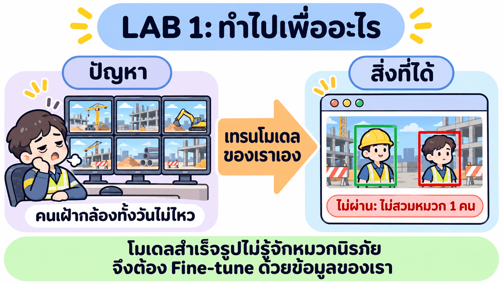

โมเดลสำเร็จรูปรู้จัก "คน" แต่ไม่รู้จัก "หมวกนิรภัย" หรือ "ไม่สวมหมวก" · คำถามของ LAB นี้คือ **เช่า GPU มาเทรนต่อด้วยข้อมูลของเราไม่กี่นาที แล้วโมเดลดีขึ้นแค่ไหน**

LAB นี้มี **7 ขั้น ขั้นละ 1 พรอมต์** · แต่ละพรอมต์บอกเป้าหมายเป็นข้อ ๆ ส่วนคำสั่งจริง AI คิดเองด้วยสกิล `vastai` · ปิดท้ายด้วยอีก 2 ขั้นที่เก็บงานทั้งหมดเป็น **สกิลเวอร์ชัน 0**


## ทฤษฎีที่ต้องรู้

### 1 · Object Detection คืออะไร

รูป 1 รูป ได้หลายกรอบ แต่ละกรอบบอก **คลาส + Confidence + ตำแหน่ง** · งานความปลอดภัยต้องรู้ว่า "คนไหน" ไม่สวมหมวกและมีกี่คน จึงใช้ Detection ไม่ใช่การจำแนกทั้งรูป

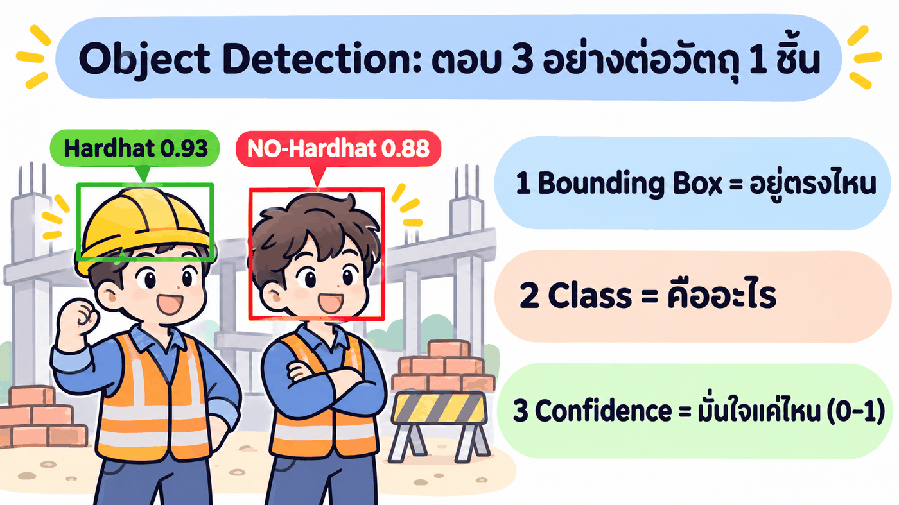

### 2 · รู้จักโมเดลที่ใช้: YOLO11s

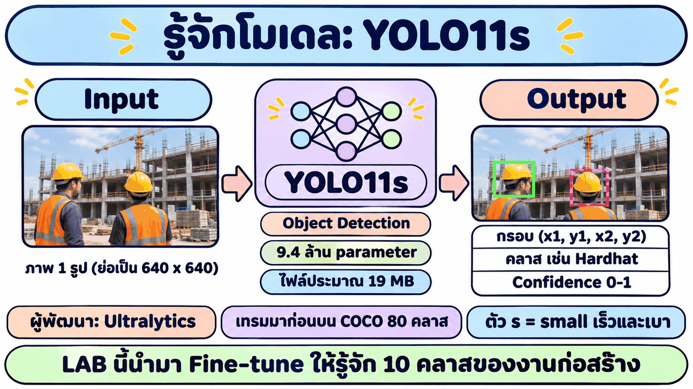

| หัวข้อ | YOLO11s |
|---|---|
| ประเภท | Object Detection |
| Input | ภาพ 1 รูป (ย่อเป็น 640 × 640) |
| Output | รายการกรอบ แต่ละกรอบมีพิกัด คลาส และ Confidence |
| ขนาด | 9.4 ล้าน parameter · ไฟล์ประมาณ 19 MB |
| ที่มา | [Ultralytics](https://docs.ultralytics.com/models/yolo11/) · เทรนมาก่อนบน COCO 80 คลาส · ตัว `s` คือรุ่น small |

### 3 · Fine-tuning คืออะไร และทำไมต้องใช้

เทรนจากศูนย์ต้องใช้ภาพจำนวนมากและเวลานาน · โมเดลที่เทรนมาแล้ว (Pre-trained) รู้จักขอบ รูปร่าง และ "คน" อยู่แล้ว เราจึง **เทรนต่อ** ด้วยภาพของเราเพียง 2,605 ภาพ

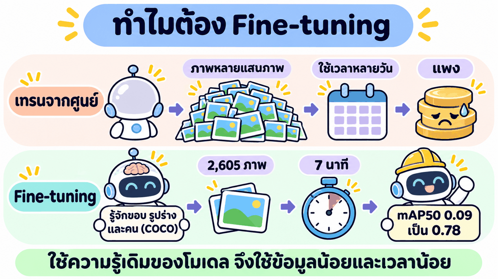

ส่วนที่สกัดลักษณะของภาพถูกใช้ต่อ ส่วนที่ทำนายคลาสถูกเปลี่ยนจาก 80 คลาสของ COCO เป็น 10 คลาสของเรา


### 4 · Training / Validation / Test Set

ถ้าวัดผลด้วยภาพที่โมเดลเคยเห็น คะแนนจะสูงเกินจริง · จึงแบ่งข้อมูลเป็น 3 ชุด และ **ตัดสินผลด้วยชุดที่โมเดลไม่เคยเห็น**

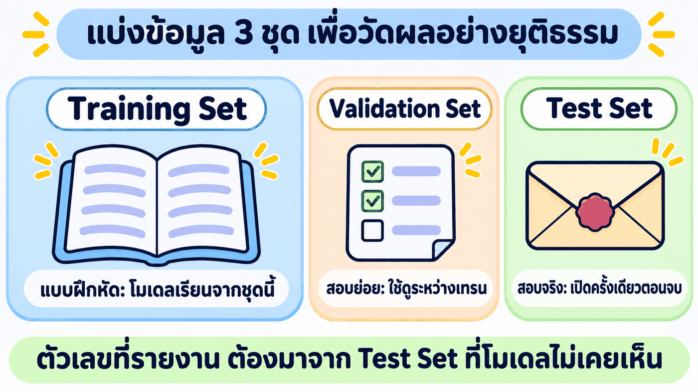

| ชุด | จำนวนภาพ | ใช้ทำอะไร |
|---|---|---|
| Training Set | 2,605 | ปรับโมเดล |
| Validation Set | 114 | ดูระหว่างเทรน และเลือกโมเดลที่ดีที่สุด (`best.pt`) |
| Test Set | 82 | ตัดสินครั้งเดียวตอนจบ ใช้เทียบก่อนกับหลังเทรน |

### 5 · IoU และ mAP: วัดว่าโมเดลดีแค่ไหน

กรอบที่ทำนายต้องทับกรอบเฉลยมากพอจึงนับว่าถูก · mAP คือคะแนนรวมของทุกคลาส (0–1 ยิ่งสูงยิ่งดี)

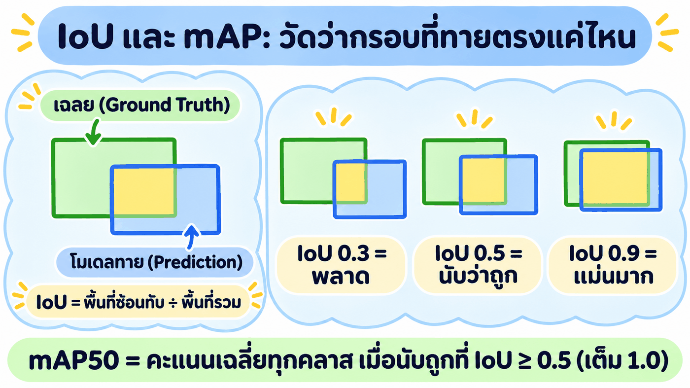

| ตัวชี้วัด | ความหมาย |
|---|---|
| mAP50 | นับว่าถูกเมื่อ IoU ≥ 0.5 |
| mAP50-95 | เฉลี่ยเกณฑ์ IoU 0.5 ถึง 0.95 · เข้มกว่า ตัวเลขจึงต่ำกว่า |
| AP50 รายคลาส | คะแนนของคลาสเดียว ใช้ดูว่าคลาสไหนยังอ่อน |

### 6 · Confidence Threshold

โมเดลให้ค่าความมั่นใจกับทุกกรอบ เว็บของเราเชื่อเฉพาะกรอบที่ได้ 0.35 ขึ้นไป · ค่านี้คือการแลกกันระหว่าง "เตือนผิด" กับ "หลุด"

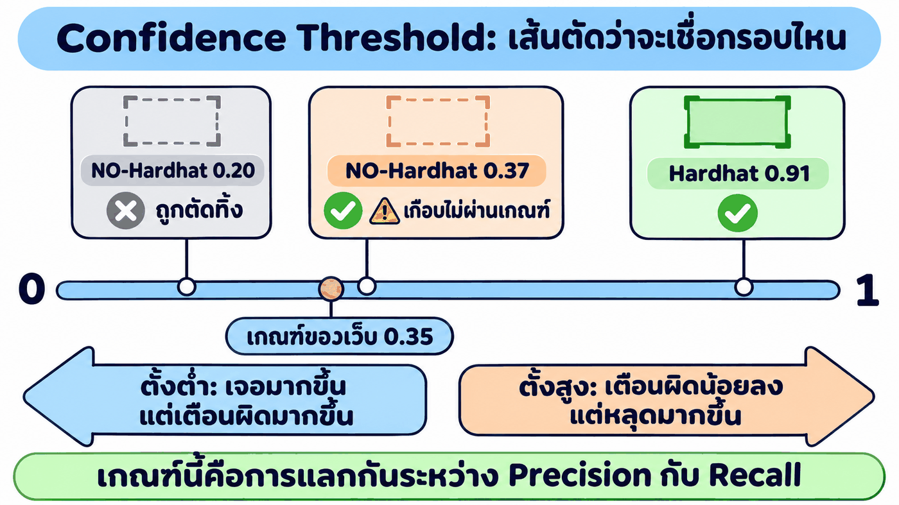

### 7 · ระบบที่จะได้

เว็บอยู่บนเครื่องเรา ส่วนโมเดลอยู่บนเครื่องเช่า · API key อยู่ฝั่ง server ของเว็บ ไม่ถูกส่งถึงเบราว์เซอร์

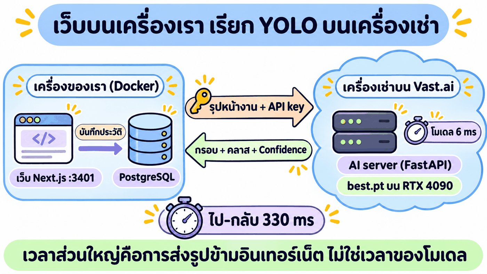

## การทดลอง

| หัวข้อ | รายละเอียด |
|---|---|
| Dataset | [Construction Site Safety](https://universe.roboflow.com/roboflow-universe-projects/construction-site-safety) รุ่น 28 จาก Roboflow Universe (CC BY 4.0) |
| คลาส (10) | Hardhat · NO-Hardhat · Safety Vest · NO-Safety Vest · Mask · NO-Mask · Person · Safety Cone · machinery · vehicle |
| เทียบ A กับ B | **ก่อนเทรน** = `yolo11s` ที่เทรนบน COCO · **หลังเทรน** = โมเดลเดิมเทรนต่อ 50 Epoch |
| วัดผล | Test Set 82 ภาพ ด้วยสคริปต์เดียวกันทั้งสองโมเดล |
| เครื่อง | RTX 4090 1 ใบ · เพดาน $0.70/ชม. |
| เวลาและค่าเช่าจริง | 7 ขั้นรวม 29 นาที · **$0.21** |

ทำตามลำดับขั้นที่ 1 → 7 ให้ครบในรอบเดียว · คัดลอกพรอมต์ไปวางในช่องพิมพ์ของ Claude Code ทีละขั้น

## ขั้นที่ 1 · เช่าเครื่อง GPU

```text
ทำงานใน container `multi-account` โฟลเดอร์ /workspace/vastapp_lab ด้วยสกิล vastai

เช่าเครื่อง GPU สำหรับเทรนโมเดล
1. เช่า RTX 4090 1 ใบ ราคารวมไม่เกิน $0.70 ต่อชั่วโมง ตั้งป้ายเครื่องว่า vapp-lab1
2. เลือกเครื่อง verified ที่เน็ตเร็วทั้งขาเข้าและขาออก (500 Mbps ขึ้นไป) มี CPU 12 cores ขึ้นไป แล้วเอาเครื่องที่ถูกที่สุด
3. ใช้ image PyTorch 2.8 ที่มี CUDA 12.8 disk 40 GB และเปิดพอร์ต 8080 ไว้ให้ AI server
4. รอจนเครื่องพร้อมและเข้าไปเห็น GPU จริง ถ้าเกิน 10 นาทียังไม่พร้อม ให้ลบแล้วเช่าเครื่องอื่น
กุญแจ SSH อยู่ที่ /workspace/vastai_lab/Devtool_SSH/devtoolSSH

สรุปเป็นตารางภาษาไทย: GPU · ราคาต่อชั่วโมง · ที่ตั้ง · CPU cores · เวลาที่รอจนเครื่องพร้อม แล้วบอกว่าเครื่องยังเปิดอยู่
```


*ใช้เวลา 9 นาที · ที่อยู่เครื่องในภาพเป็นค่าตัวอย่าง*

**อ่านผลอย่างไร**

- เครื่องแรกที่ถูกที่สุดขึ้นสถานะ running แต่เข้าไม่ได้ AI จึงลบแล้วเช่าเครื่องถัดไปเอง · เครื่องเช่าเสียได้ เราจึงสั่งไว้ในข้อ 4
- เครื่องที่เปิดไม่ขึ้นก็ถูกคิดเงินตามเวลาที่เปิด (รอบนี้ $0.05)
- **ตั้งแต่ขั้นนี้เงินเริ่มเดิน** ชั่วโมงละ $0.41 จนกว่าจะลบเครื่องในขั้นที่ 7

## ขั้นที่ 2 · เตรียม Dataset

```text
ทำงานใน container `multi-account` โฟลเดอร์ /workspace/vastapp_lab ด้วยสกิล vastai
เครื่องที่ใช้คือเครื่องป้าย vapp-lab1 · กุญแจ SSH อยู่ที่ /workspace/vastai_lab/Devtool_SSH/devtoolSSH

เตรียม Dataset ภาพหน้างานก่อสร้างบนเครื่องที่เช่า
1. ติดตั้ง ultralytics และ roboflow ให้ใช้งานได้
2. ดาวน์โหลด Dataset construction-site-safety รุ่น 28 ของ roboflow-universe-projects จาก Roboflow ในรูปแบบ YOLO
3. ใช้ ROBOFLOW_API_KEY จากไฟล์ .env ของโฟลเดอร์ปัจจุบัน ห้ามแสดงค่า key และห้ามทิ้ง key ไว้บนเครื่องที่เช่า

สรุปเป็นตารางภาษาไทย: จำนวนภาพของ Training Set · Validation Set · Test Set และรายชื่อคลาส แล้วบอกว่าเครื่องยังเปิดอยู่
```


*ใช้เวลา 3 นาที*

ต้องได้ **2,605 / 114 / 82 ภาพ และ 10 คลาส** · Dataset ถูกโหลดลงเครื่องเช่าโดยตรง ไม่ผ่านเครื่องเรา

## ขั้นที่ 3 · Training 50 Epoch

```text
ทำงานใน container `multi-account` โฟลเดอร์ /workspace/vastapp_lab ด้วยสกิล vastai
เครื่องที่ใช้คือเครื่องป้าย vapp-lab1 · กุญแจ SSH อยู่ที่ /workspace/vastai_lab/Devtool_SSH/devtoolSSH

เทรนโมเดลตรวจอุปกรณ์ความปลอดภัยบนเครื่องที่เช่า
1. ใช้สคริปต์ lab1_yolo/train.py ของโฟลเดอร์ปัจจุบัน เทรน 50 Epoch โดยเริ่มจากโมเดล yolo11s ที่เทรนบน COCO มาแล้ว
2. ให้เทรนต่อได้แม้การเชื่อมต่อหลุด และรายงานทุก 2 นาทีว่าถึง Epoch ไหน mAP50 บน Validation Set เท่าไร

สรุปตอนจบเป็นภาษาไทย: เวลาที่ใช้เทรน · mAP50 บน Validation Set ที่ Epoch 10, 25, 50 แล้วบอกว่าเครื่องยังเปิดอยู่
```

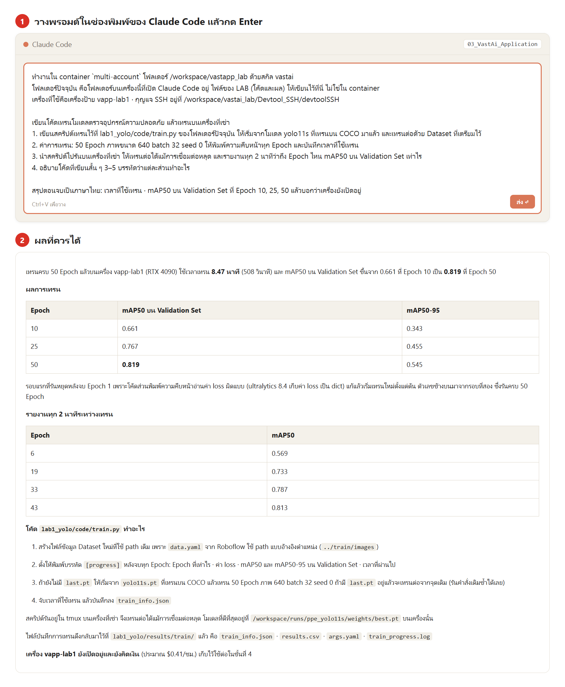
*ใช้เวลา 10 นาที · เทรนจริง 7 นาที*

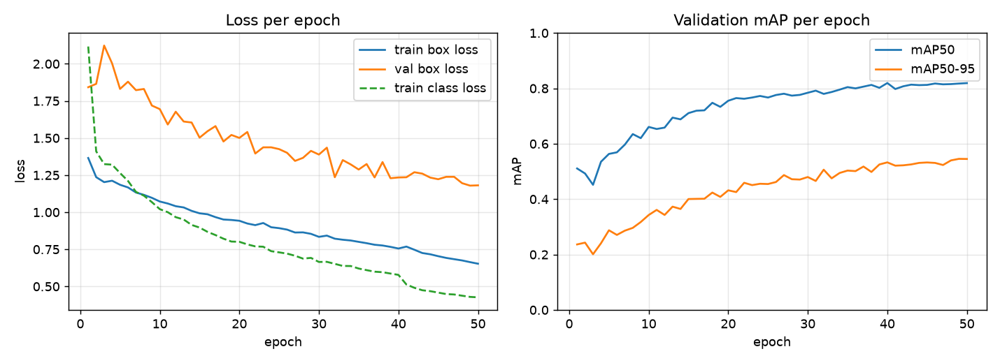

**อ่านผลอย่างไร**

- **1 Epoch** = โมเดลเห็นภาพ Training Set ครบ 1 รอบ · รอบนี้ใช้ราว 8 วินาทีต่อ Epoch
- mAP50 ขึ้นเร็วช่วงแรกแล้วแบน: 10 Epoch แรกได้ 0.661 ส่วน 15 Epoch สุดท้ายเพิ่มเพียง 0.014 = เทรนนานกว่านี้ได้เพิ่มไม่มาก
- loss ของ Training และ Validation ลดลงพร้อมกัน = ยังไม่ Overfitting

## ขั้นที่ 4 · Evaluation ก่อน vs หลังเทรน

```text
ทำงานใน container `multi-account` โฟลเดอร์ /workspace/vastapp_lab ด้วยสกิล vastai
เครื่องที่ใช้คือเครื่องป้าย vapp-lab1 · กุญแจ SSH อยู่ที่ /workspace/vastai_lab/Devtool_SSH/devtoolSSH

วัดผลบน Test Set เทียบโมเดลก่อนเทรนกับหลังเทรน
1. ใช้สคริปต์ lab1_yolo/eval.py ของโฟลเดอร์ปัจจุบัน วัดโมเดลก่อนเทรน (COCO เดิม) กับโมเดลหลังเทรน บน Test Set ที่ไม่ได้ใช้เทรน
2. เก็บผลทั้งหมด (ตัวเลข กราฟ ภาพก่อน/หลัง และไฟล์โมเดล) กลับมาไว้ในโฟลเดอร์ lab1_yolo/results ของโฟลเดอร์ปัจจุบัน ให้ไฟล์ metrics.json อยู่ในโฟลเดอร์นี้

สรุปเป็นตารางภาษาไทย ก่อน vs หลัง: mAP50 · mAP50-95 · AP50 ของ Hardhat, NO-Hardhat, Safety Vest, NO-Safety Vest, Person · เวลาต่อรูป แล้วบอกว่าเครื่องยังเปิดอยู่
```

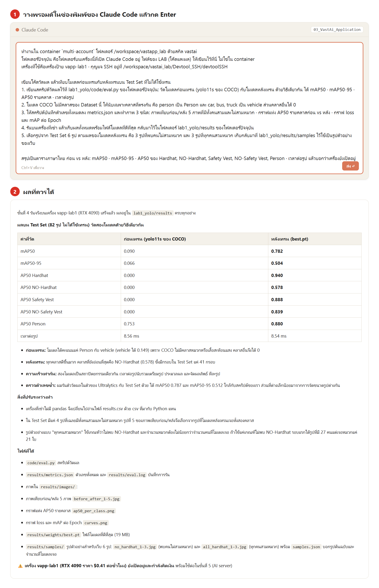
*ใช้เวลา 2 นาที*

| ตัวชี้วัด (Test Set 82 ภาพ) | ก่อนเทรน (COCO) | หลังเทรน |
|---|---|---|
| mAP50 | 0.090 | **0.782** |
| mAP50-95 | 0.066 | **0.504** |
| เวลาโมเดลต่อรูป | 8.3 ms | 8.2 ms |


ตัวอย่างจริง 1 ภาพ · ซ้ายก่อนเทรน เห็นแค่ `person` 5 คน · ขวาหลังเทรน เห็น Hardhat 5 และ NO-Hardhat 1


**อ่านผลอย่างไร**

- ก่อนเทรน โมเดลได้คะแนนเฉพาะคลาสที่ COCO มี (Person 0.75) คลาสอื่นได้ 0 เพราะ **โมเดลไม่มีคลาสนั้น** ไม่ใช่เพราะมองไม่เห็น
- Validation ได้ 0.819 แต่ Test ได้ 0.782 · ต่ำกว่าเล็กน้อยเป็นเรื่องปกติ เพราะ `best.pt` ถูกเลือกจาก Validation Set
- **ค่าเฉลี่ยสูงไม่ได้แปลว่าดีทุกคลาส**: NO-Hardhat ได้ 0.58 ทั้งที่เป็นคลาสสำคัญที่สุดของงานนี้ · ก่อนใช้งานจริงต้องเก็บภาพคลาสนี้เพิ่ม
- ความเร็วเท่าเดิม เพราะเป็นโมเดลขนาดเดิม

## ขั้นที่ 5 · เปิด AI server

```text
ทำงานใน container `multi-account` โฟลเดอร์ /workspace/vastapp_lab ด้วยสกิล vastai
เครื่องที่ใช้คือเครื่องป้าย vapp-lab1 · กุญแจ SSH อยู่ที่ /workspace/vastai_lab/Devtool_SSH/devtoolSSH

เปิด AI server บนเครื่องที่เช่า ให้เว็บส่งรูปมาถามโมเดลที่เทรนได้
1. ใช้สคริปต์ lab1_yolo/serve.py ของโฟลเดอร์ปัจจุบัน เปิด AI server ที่พอร์ต 8080 ให้ทำงานต่อได้แม้การเชื่อมต่อหลุด (สคริปต์สร้าง API key ให้เอง)
2. ทดสอบจากนอกเครื่อง 3 ข้อ: server ตอบว่าพร้อม · ส่งรูปจาก Test Set 1 รูปพร้อม key แล้วได้กรอบกลับมา · ส่งแบบไม่มี key ต้องถูกปฏิเสธ
3. เขียนไฟล์ lab1_yolo/web/.env ของโฟลเดอร์ปัจจุบัน ให้มี YOLO_BASE_URL YOLO_API_KEY และ YOLO_MODEL=ppe-yolo11s เพื่อให้เว็บต่อ server นี้ได้

ห้ามแสดงค่า key · สรุปเป็นภาษาไทย: ผลทดสอบ 3 ข้อ และเวลาที่โมเดลใช้ต่อรูป แล้วบอกว่าเครื่องยังเปิดอยู่
```

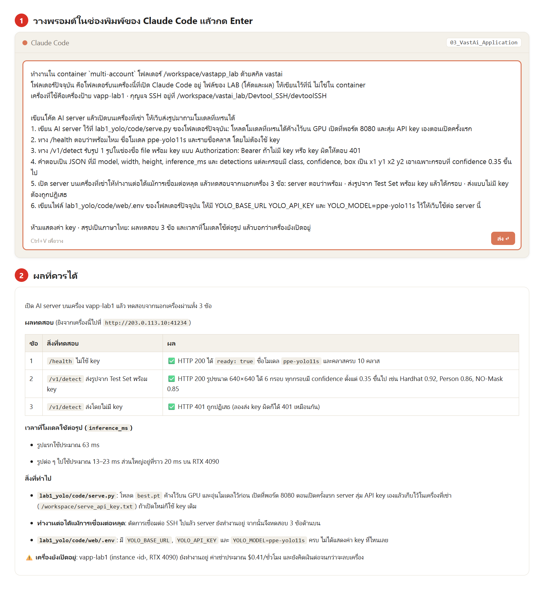
*ใช้เวลา 2 นาที*

**อ่านผลอย่างไร**

- server นี้เปิดสู่อินเทอร์เน็ต จึงต้องมี **API key** · ข้อทดสอบที่ 3 ยืนยันว่าคนไม่มี key ใช้ไม่ได้
- ไฟล์ `lab1_yolo/web/.env` คือสิ่งที่เชื่อมเว็บบนเครื่องเรากับโมเดลบนเครื่องเช่า · ไฟล์นี้ไม่ถูกเก็บขึ้น git

## ขั้นที่ 6 · เปิดเว็บและทดสอบ

```text
เปิดเว็บตรวจความปลอดภัยหน้างานบนเครื่องนี้ (Docker Desktop) แล้วต่อกับ AI server บน Vast.ai
1. เปิดเว็บในโฟลเดอร์ lab1_yolo/web ด้วย docker compose แล้วรอจน http://localhost:3401 เปิดได้ (เว็บอ่านที่อยู่และ key ของ AI server จากไฟล์ .env ที่ขั้นก่อนเขียนไว้)
2. ทดสอบโดยส่งรูป sample-1.jpg sample-2.jpg sample-5.jpg ในโฟลเดอร์ lab1_yolo/web/public/samples ให้เว็บตรวจทีละรูป

สรุปเป็นตารางภาษาไทย: รูป · ผล (ผ่าน/ไม่ผ่าน) · จำนวนคนไม่สวมหมวก · เวลาที่โมเดลใช้ (ms) · เวลาส่งรูปไป-กลับ (ms) ห้ามแสดงค่า key แล้วบอกว่าเครื่องบน Vast.ai ยังเปิดอยู่
```

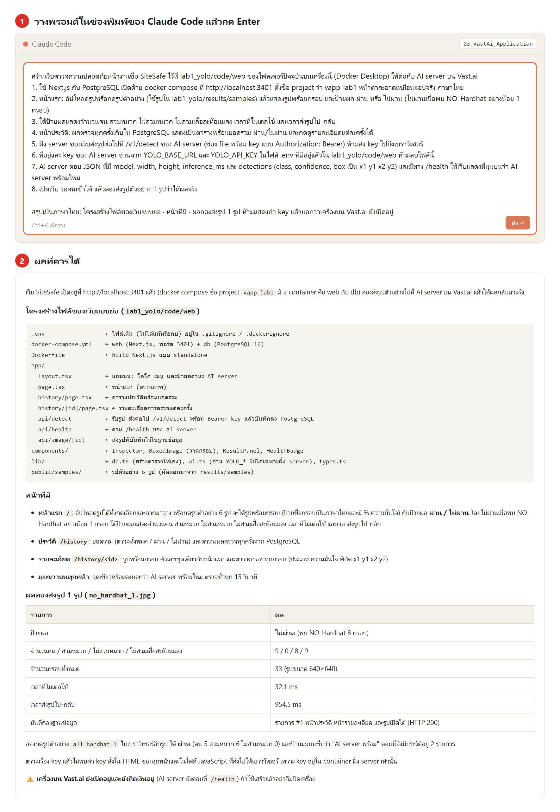
*ใช้เวลา 1 นาที*

จากนั้นเปิด **http://localhost:3401** → กดรูปตัวอย่าง หรืออัปโหลดรูปเอง

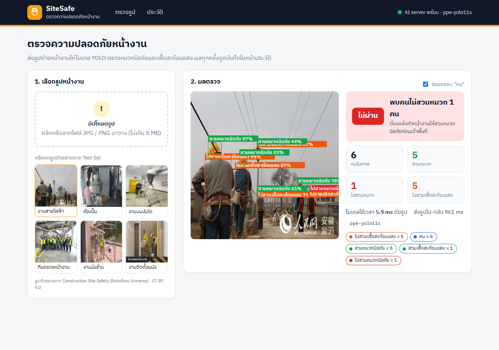

| อัปโหลดรูปเอง → ผ่าน | กดรูปตัวอย่าง → ไม่ผ่าน แล้วเปิดกรอบ "คน" |
|---|---|
| 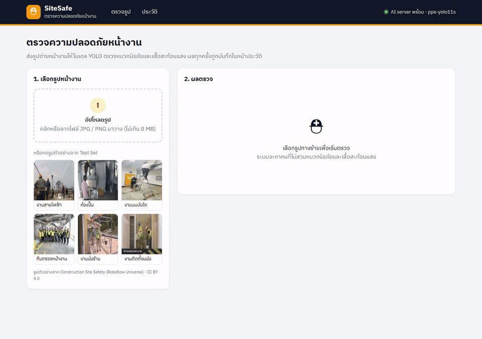 |  |

| กดรูปตัวอย่าง → ผ่าน | หน้าประวัติ → รายละเอียด 1 รายการ |
|---|---|
| 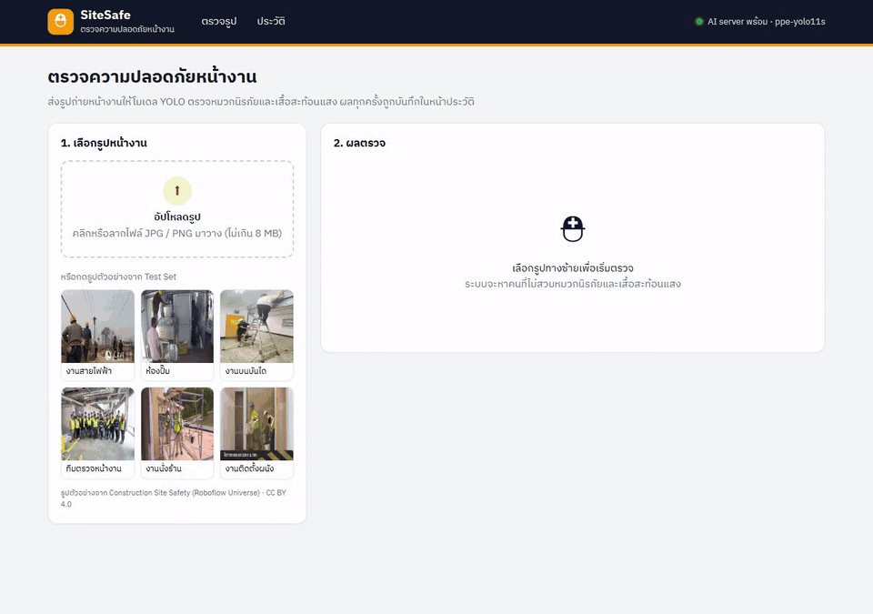 | 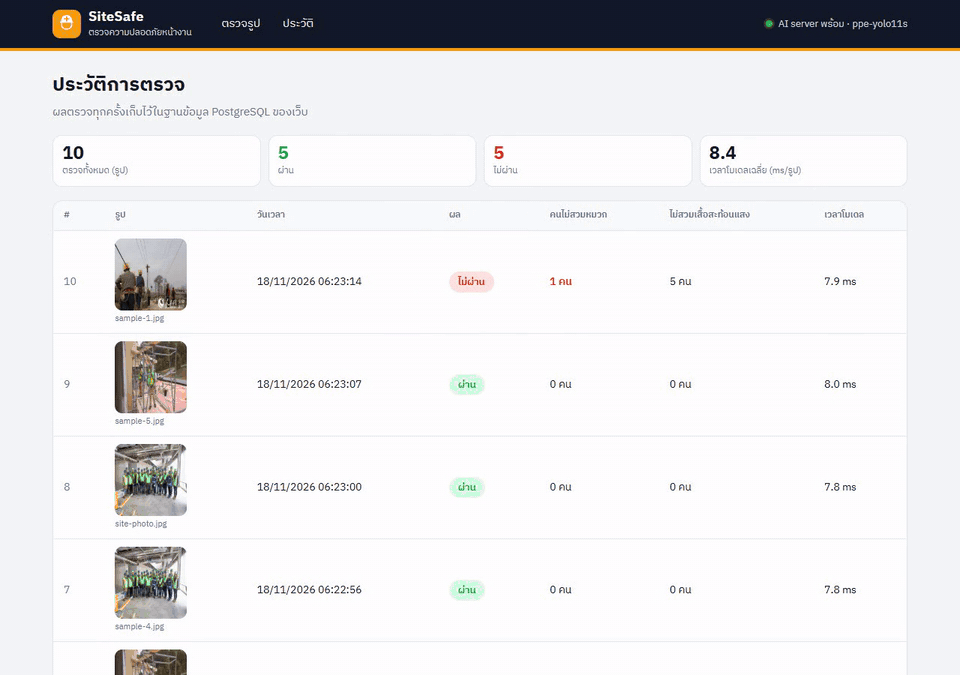 |

ผลทุกครั้งถูกเก็บใน PostgreSQL ดูได้ที่หน้า **ประวัติ**

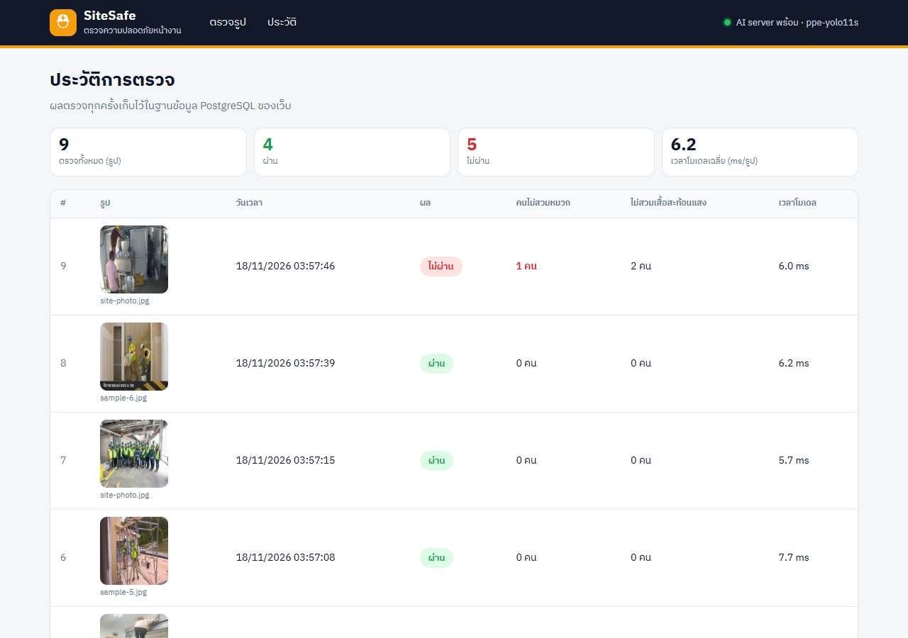

**อ่านผลอย่างไร**

- **โมเดลใช้ 8 ms แต่ผู้ใช้รอ 240–900 ms** เวลาเกือบทั้งหมดคือการส่งรูปข้ามอินเทอร์เน็ตไปเครื่องเช่า · รูปแรกช้าที่สุดเพราะเปิดการเชื่อมต่อใหม่
- รูปแรกถูกตัดสิน "ไม่ผ่าน" จากกรอบ NO-Hardhat ที่ Confidence เพียง 0.37 เกือบไม่ผ่านเกณฑ์ 0.35 ของเว็บ (ดูทฤษฎีข้อ 6)

## ขั้นที่ 7 · ลบเครื่องและสรุปค่าใช้จ่าย (ห้ามข้าม)

```text
ทำงานใน container `multi-account` โฟลเดอร์ /workspace/vastapp_lab ด้วยสกิล vastai

ปิดทุกอย่างของ LAB 1
1. ลบเครื่องป้าย vapp-lab1 แล้วตรวจว่าไม่มีเครื่องป้ายนี้ค้างในบัญชี (ห้ามแตะเครื่องป้ายอื่น)
2. ปิดเว็บในโฟลเดอร์ lab1_yolo/web ของโฟลเดอร์ปัจจุบัน โดยเก็บประวัติการตรวจไว้

สรุปเป็นภาษาไทย ค่าใช้จ่ายจริงของเครื่อง vapp-lab1: อายุเครื่อง · ราคาต่อชั่วโมง · ยอดที่ถูกคิด (GPU · disk · รับส่งข้อมูล)
```

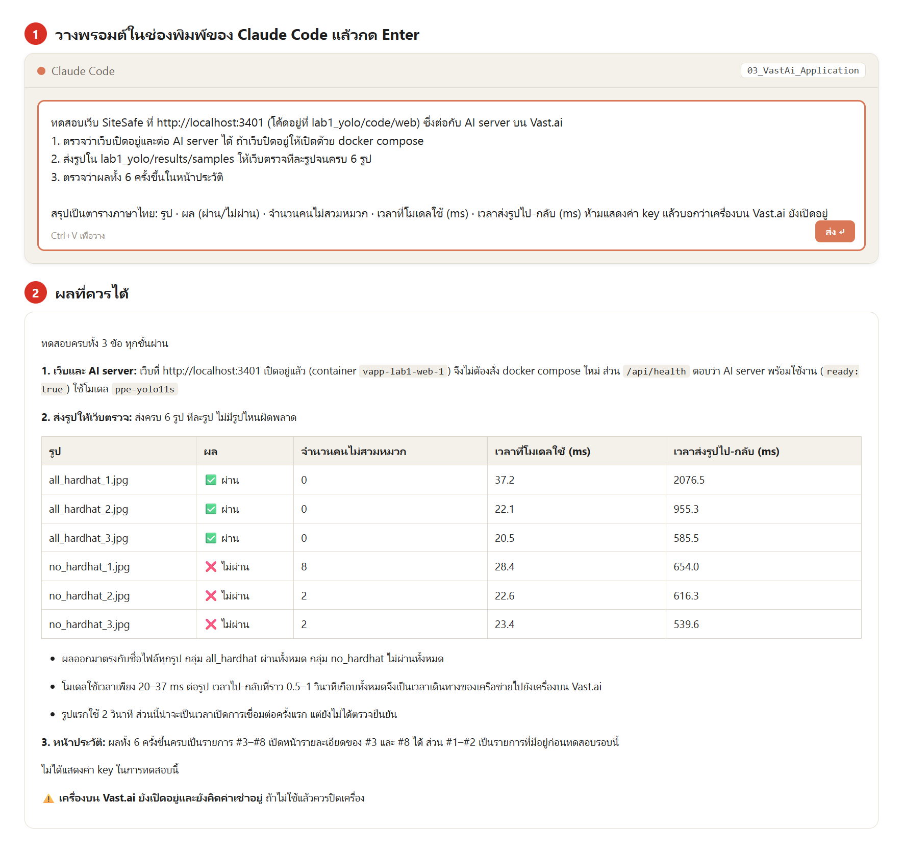
*ใช้เวลา 2 นาที · ยอดสุดท้ายในใบแจ้งหนี้ของ Vast.ai คือ $0.164 และเมื่อรวมเครื่องแรกที่เปิดไม่ขึ้นเป็น **$0.21***

**อ่านผลอย่างไร**

- ต้องเห็นว่า **ไม่มีเครื่องป้ายนี้เหลือ** แล้วเปิดหน้า [Instances](https://cloud.vast.ai/instances/) ดูอีกครั้ง
- เทรนจริง 7 นาที แต่เครื่องเปิดอยู่ 21 นาที · **เงินเดินตลอดเวลาที่เครื่องเปิด** ไม่ใช่เฉพาะตอนเทรน
- โมเดลที่เทรนได้ถูกเก็บกลับมาที่ `lab1_yolo/results/weights/best.pt` ตั้งแต่ขั้นที่ 4 · ลบเครื่องแล้วทุกอย่างบนเครื่องหายหมด

---

## ปิดท้าย · เก็บงานทั้ง LAB เป็นสกิลเวอร์ชัน 0

เราเพิ่งสั่งงาน 7 ขั้นจนสำเร็จ ถ้าต้องทำซ้ำ (เช่น เปลี่ยนจำนวน Epoch) ไม่ควรต้องวาง 7 พรอมต์ใหม่ · **สกิล** คือไฟล์ที่เก็บวิธีทำงานที่สำเร็จแล้วไว้ให้ AI ทำซ้ำได้ในคำสั่งเดียว

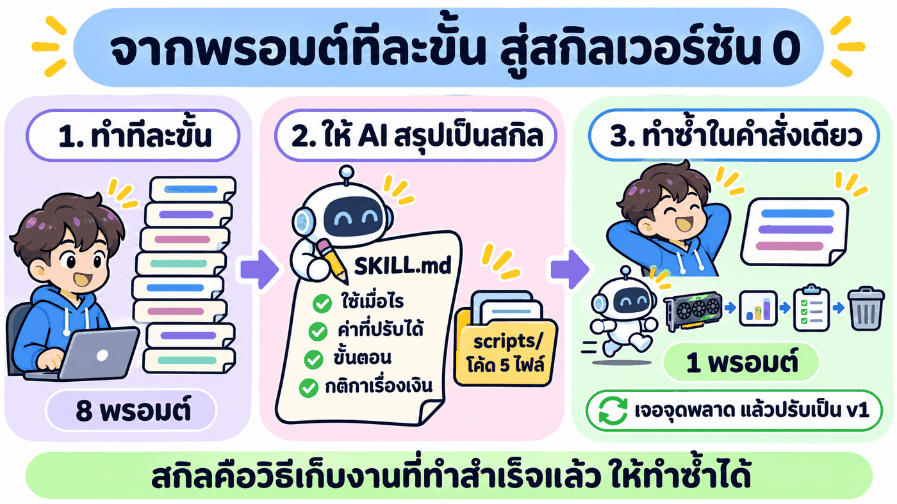

### ขั้นที่ 8 · ให้ AI สร้างสกิล v0

```text
สร้างสกิลเวอร์ชัน 0 จากงานของ LAB 1 ที่เพิ่งทำเสร็จ เพื่อให้ครั้งหน้าสั่งทำซ้ำได้ในคำสั่งเดียว
1. ดูงานทั้งหมดจากพรอมต์ทุกขั้นใน lab1_yolo/PROMPTS.md สคริปต์ในโฟลเดอร์ lab1_yolo และผลใน lab1_yolo/results
2. เขียนเป็นสกิลชื่อ yolo-ppe-train เก็บที่ lab1_yolo/skill_v0/SKILL.md ให้มี name กับ description (บอกว่าใช้เมื่อไร) · ค่าที่ปรับได้พร้อมค่าเริ่มต้น · ขั้นตอน · เกณฑ์ตรวจผ่าน · กติกาเรื่องเงิน (ลบเครื่องเสมอ)
3. ให้สกิลนี้เรียกใช้สกิล vastai ต่อ ไม่เขียนวิธีใช้ Vast.ai ซ้ำ
4. ติดตั้งเป็นสกิลของโปรเจกต์ที่ .claude/skills/yolo-ppe-train ของโฟลเดอร์ปัจจุบัน

สรุปเป็นภาษาไทย: สกิลทำอะไรได้ · ค่าที่ปรับได้ · ไฟล์ที่สร้าง
```

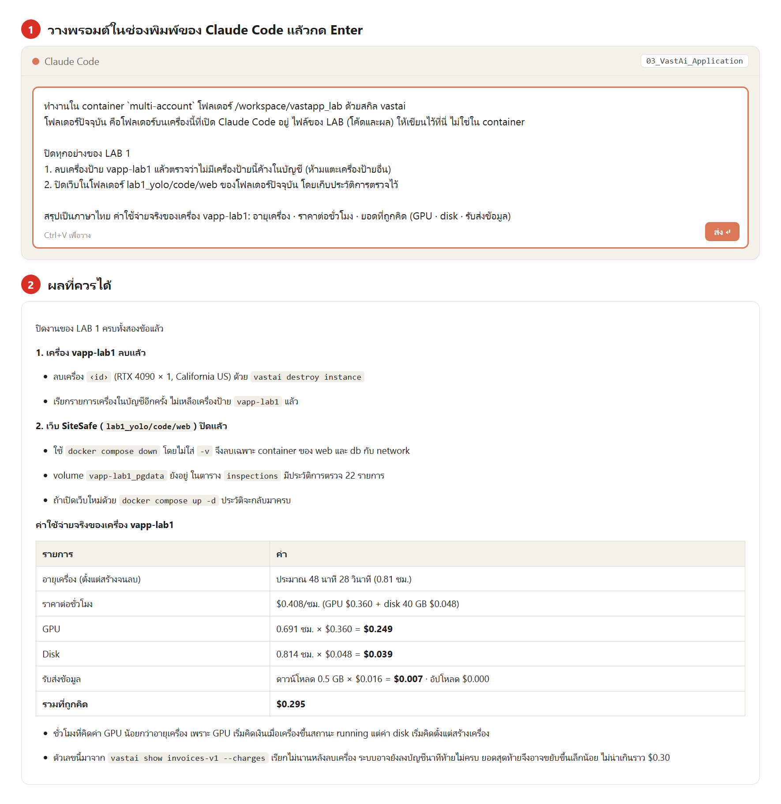
*ใช้เวลา 2 นาที · ไม่ต้องเช่าเครื่อง · สกิลที่ได้: [skill_v0/SKILL.md](skill_v0/SKILL.md)*

### ขั้นที่ 9 · ลองใช้สกิลทำซ้ำในคำสั่งเดียว

เปิด Claude Code ใหม่ 1 ครั้งเพื่อให้เห็นสกิล แล้ววางพรอมต์นี้

```text
ใช้สกิล yolo-ppe-train เทรนโมเดลตรวจหมวกนิรภัย 10 Epoch บนเครื่องป้าย vapp-lab1-skill ไม่ต้องเปิดเว็บ เสร็จแล้วลบเครื่อง
เก็บผลไว้ที่ lab1_yolo/results/skill_v0_run ห้ามเขียนทับผลเดิมใน lab1_yolo/results
สรุปเป็นภาษาไทย: mAP50 ก่อน vs หลังบน Test Set · เวลาแต่ละขั้น · ค่าใช้จ่ายจริง
```

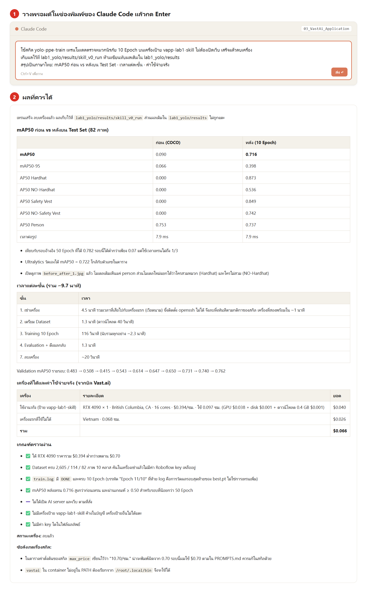
*ใช้เวลา 12 นาที · เช่าเครื่องจริงและลบเครื่องจริง*

| | สั่งทีละขั้น (ขั้นที่ 1–4 และ 7) | สกิล v0 |
|---|---|---|
| จำนวนพรอมต์ | 5 | **1** |
| จำนวน Epoch | 50 | 10 |
| เวลาเทรน | 418 วินาที | 116 วินาที |
| mAP50 บน Test Set | 0.782 | 0.716 |
| ค่าเช่า | $0.21 (รวม server และเว็บ) | $0.07 |

**อ่านผลอย่างไร**

- สกิล v0 **ผ่านในรอบแรก**: AI ตัวใหม่ได้คำสั่ง 3 บรรทัด แล้วเช่า เตรียม Dataset เทรน วัดผล ลบเครื่อง และสรุปบิลเองทั้งหมด
- สกิลจำบทเรียนจากรอบจริงไว้ เช่น "running แต่เข้าไม่ได้ ให้ลบทันที" รอบนี้เจอเครื่องเสียเครื่องเดิมอีกและลบได้เร็วกว่าขั้นที่ 1
- เทรน 10 Epoch ได้ 0.716 คือ 92% ของผล 50 Epoch ด้วยเวลาเทรนไม่ถึง 1 ใน 3

**v0 ยังไม่สมบูรณ์** · จุดที่ AI ต้องเดาเองในรอบทดสอบ และควรแก้ในเวอร์ชันถัดไป

| จุดที่พลาด | ควรแก้อย่างไรใน v1 |
|---|---|
| เพดานราคา `$0.70` ถูกอ่านเป็น "10.70" ตอนโหลดสกิล เพราะ `$0` ในไฟล์สกิลถูกแทนค่า | เขียนเป็น "0.70 USD" ไม่ใช้ `$` ตามด้วยตัวเลข |
| สกิลไม่ได้บอกว่าคำสั่ง `vastai` ใน container อยู่ที่ไหน AI ต้องหาเอง | ระบุที่อยู่ของคำสั่งไว้ในสกิล |
| ป้ายเครื่องเริ่มต้นซ้ำกับ LAB หลัก อาจชนกับเครื่องที่เปิดค้าง | ตั้งป้ายเริ่มต้นแยก |
| เกณฑ์ "ถูกที่สุด" พาไปเจอเครื่องเสียเครื่องเดิมซ้ำทุกรอบ | เพิ่มรายการเครื่องที่ให้ข้าม |

วิธีปรับคือสั่ง AI ด้วยพรอมต์อีก 1 อันให้แก้สกิลตามตารางนี้ แล้วลองใช้ซ้ำ · สกิลจึงดีขึ้นทีละเวอร์ชันจากหลักฐานของการรันจริง

---

## ไฟล์ในโฟลเดอร์นี้

| ไฟล์ / โฟลเดอร์ | คืออะไร |
|---|---|
| `PROMPTS.md` | พรอมต์ทั้ง 9 ขั้นสำหรับคัดลอก |
| `train.py` · `eval.py` · `serve.py` | สคริปต์เทรน วัดผล และเปิด AI server · มีไว้ให้ผลเทียบกันได้ทุกรอบ |
| `web/` | เว็บตรวจความปลอดภัยหน้างาน (Next.js + PostgreSQL + `docker-compose.yml`) พอร์ต 3401 |
| `skill_v0/` | สกิลที่ AI สร้างในขั้นที่ 8 |
| `results/` | ผลจากการรันจริง: ตัวเลข กราฟ ภาพก่อน/หลัง โมเดล `best.pt` คำตอบของทุกขั้น ภาพหน้าจอและ GIF ของเว็บ |
| `image/` | ภาพประกอบของ LAB นี้ |
